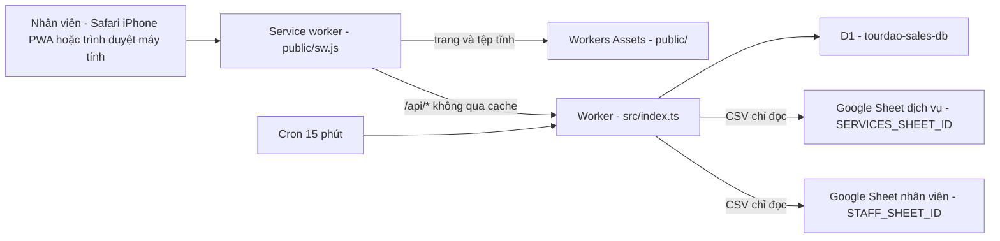
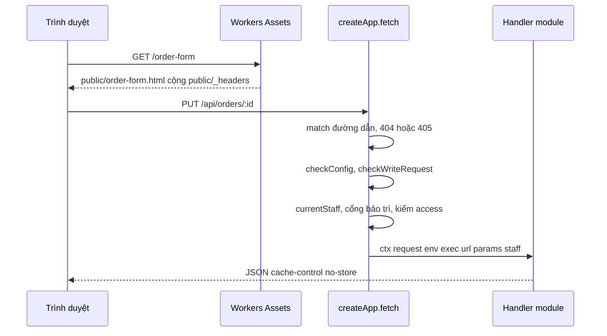
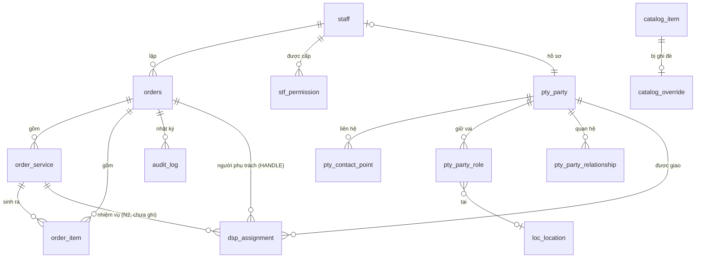
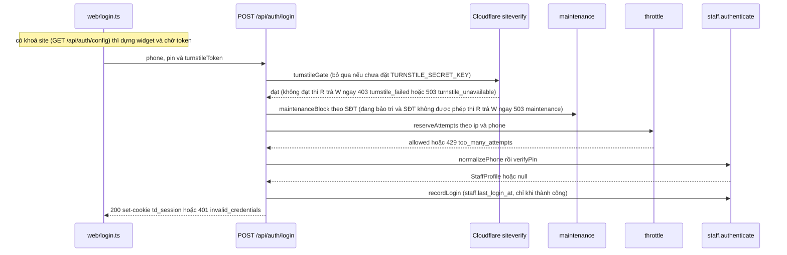

# Thiết kế hệ thống — tourdao-sales

> Mô tả **hiện trạng mã tại HEAD của nhánh này**, cho kỹ sư (hoặc một phiên Claude mới) chưa biết dự án và cần sửa nhanh, đúng.
> Luật kiến trúc: `docs/ARCHITECTURE.md` + `docs/adr/`. Đặc tả nghiệp vụ: `docs/SPEC-tourdao-sales.md`. Bảng/cột/view: `docs/DATA-DICTIONARY.md` (sinh từ `docs/data-dictionary.json`). Triển khai/hoàn tác: `docs/HANDOFF-N1.md`. PWA: `docs/PWA-IPHONE.md`.
> Tài liệu này KHÔNG chép lại các tệp đó; khi mâu thuẫn thì **mã thắng** — xem §16.

## Mục lục

1. [Mục đích, người dùng, phạm vi, ràng buộc nền tảng](#1-mục-đích-người-dùng-phạm-vi-ràng-buộc-nền-tảng)
2. [Bối cảnh và topology chạy thật](#2-bối-cảnh-và-topology-chạy-thật)
3. [Vòng đời một request](#3-vòng-đời-một-request)
4. [Xác thực và phiên](#4-xác-thực-và-phiên)
5. [Mô hình dữ liệu](#5-mô-hình-dữ-liệu)
6. [Luồng nghiệp vụ chính](#6-luồng-nghiệp-vụ-chính)
7. [Danh mục API](#7-danh-mục-api)
8. [Phân quyền](#8-phân-quyền)
9. [Giao diện](#9-giao-diện)
10. [Build, kiểm thử, triển khai](#10-build-kiểm-thử-triển-khai)
11. [Bảo mật](#11-bảo-mật)
12. [Giới hạn và hiệu năng](#12-giới-hạn-và-hiệu-năng)
13. [Quan sát và vận hành](#13-quan-sát-và-vận-hành)
14. [Lộ trình và điểm gắn tính năng tiếp theo](#14-lộ-trình-và-điểm-gắn-tính-năng-tiếp-theo)
15. [Thuật ngữ](#15-thuật-ngữ)
16. [Sai lệch tài liệu ↔ mã](#16-sai-lệch-tài-liệu--mã)

---

## 1. Mục đích, người dùng, phạm vi, ràng buộc nền tảng

**Mục đích.** Sổ đơn hàng nội bộ của Công ty TNHH Tour Đảo: nhân viên lập đơn dịch vụ tour, ghi thông tin chuyến (ngày giờ khởi hành, đón, check-in), xác nhận hoặc huỷ đơn; quản trị viên quản lý tài khoản + quyền, danh mục dịch vụ (đồng bộ từ Google Sheet), hồ sơ khách/đại lý và địa điểm.

**Người dùng** = nhân viên có tài khoản trong D1 (không có đăng ký công khai). Bốn quyền app (`src/shared/permissions.ts`): `SALES` (Bán hàng), `ACCOUNTING` (Kế toán), `ADMIN` (Quản trị), `FIELD` (Thực hiện). Một tài khoản mang **nhiều** quyền (ADR-0005).

**Trong phạm vi hiện tại:** đăng nhập (kèm Cloudflare Turnstile khi được bật, khối thông tin công ty và số phiên bản ở màn đăng nhập), sổ đơn (nháp → xác nhận/huỷ), sửa thông tin chuyến sau xác nhận, **người phụ trách đơn** (đặt/đổi/nhận; người phụ trách sửa được đơn như người lập — §6(j), §9), danh mục dịch vụ + ghi đè giá, tài khoản/quyền, hồ sơ (party) và địa điểm, nhật ký.
**Ảnh xác nhận đơn (PNG) gửi khách:** ĐÃ có (v1.0), dựng ở trình duyệt (§9). **Chưa có trong mã:** xuất PDF/in A4 bản xác nhận, thu tiền/hoá đơn, phân công NHIỆM VỤ (đón khách, lái cano — N2; riêng "người phụ trách" đã có), màn hình cho tài khoản chỉ-`FIELD` (xem §14).

**Ràng buộc nền tảng.**

| Ràng buộc | Chi tiết |
|---|---|
| Runtime và CSDL | Cloudflare Workers, một Worker duy nhất tên `tourdao-sales` (`wrangler.jsonc`), `compatibility_date` `2026-09-01`; Cloudflare D1 `tourdao-sales-db`, binding `DB`, `migrations_dir: migrations` |
| Tệp tĩnh | Workers Assets: thư mục `./public`, binding `ASSETS`, `run_worker_first: ["/api/*"]` |
| Ngôn ngữ và giao diện | TypeScript `strict` + `noUncheckedIndexedAccess` (`tsconfig.json`), không framework, không thư viện router; HTML tĩnh `public/*.html` + TypeScript thuần `web/*.ts` gom bằng **esbuild** vào `public/js/` (gitignored) |
| Phụ thuộc | Chỉ `devDependencies`: `esbuild`, `typescript`, `wrangler`. Không có dependency runtime. |

---

## 2. Bối cảnh và topology chạy thật

*Một tên miền `booking.tourdao.vn` (`routes` + `custom_domain: true`); vì khai `routes` mà không khai `workers_dev`, địa chỉ `workers.dev` đã bị TẮT có chủ ý. `run_worker_first: ["/api/*"]` khiến mọi `/api/*` vào Worker trước, còn lại do Workers Assets phục vụ.*

**Cron.** `triggers.crons: ["*/15 * * * *"]` → `scheduled()` trong `src/index.ts` gọi `ctx.waitUntil(runScheduledSync(env))` (module `catalog`) để kéo danh mục dịch vụ.

**Google Sheet — chỉ ĐỌC, công khai.** `src/shared/sheets.ts#fetchSheetCsv` gọi `https://docs.google.com/spreadsheets/d/<id>/export?format=csv`, `AbortSignal.timeout(8000)`. App **không bao giờ** ghi ngược vào Sheet.

**Biến và bí mật.**

| Tên | Loại | Đặt ở đâu | Dùng ở đâu |
|---|---|---|---|
| `STAFF_SHEET_ID` | biến công khai (`vars`) | `wrangler.jsonc` | `accounts`: `GET /api/staff/sheet`, `POST /api/staff/sheet/apply` |
| `SERVICES_SHEET_ID` | biến công khai (`vars`) | `wrangler.jsonc` | `catalog`: `syncCatalog` |
| `SESSION_SECRET` | **bí mật** | `wrangler secret put SESSION_SECRET` (production), `.dev.vars` (local — xem `.dev.vars.example`) | ký/kiểm cookie phiên (`src/modules/auth/session.ts`) |
| `TURNSTILE_SITE_KEY` | biến công khai, **tuỳ chọn** | `vars` của `wrangler.jsonc` khi có khoá thật (chưa thêm), `.dev.vars` (local) | `auth`: `GET /api/auth/config` trả cho trang đăng nhập dựng widget Turnstile |
| `TURNSTILE_SECRET_KEY` | **bí mật, tuỳ chọn** | `wrangler secret put TURNSTILE_SECRET_KEY` (production, chỉ khi chủ dự án ra lệnh), `.dev.vars` (local) | `auth`: `verifyTurnstile` (`POST /api/auth/login`). Vắng ⇒ Turnstile TẮT (xem mục 4) |
| `DB` / `ASSETS` | binding D1 / binding Workers Assets | `wrangler.jsonc` | `env.DB` ở mọi module; `ASSETS` do nền tảng dùng |

`SESSION_SECRET` ngắn hơn `MIN_SECRET_LENGTH` = 32 ký tự → **mọi** route trả 500 `server_misconfigured` (`checkAuthConfig`). Hai biến Turnstile KHÔNG đi qua `checkAuthConfig` (vắng là trạng thái hợp lệ "tắt"). Kiểu của `Env` ở `worker-configuration.d.ts` (sinh bởi `npm run types` khi `.dev.vars` có đủ bí mật; hai biến Turnstile đang khai tay dạng tuỳ chọn — xem `docs/CHANGE-GUIDE.md` công thức l).

---

## 3. Vòng đời một request

*Tệp tĩnh không chạm Worker; `/api/*` đi qua `createApp` rồi mới tới handler của module.*

**`src/shared/router.ts`** — router tối giản, không import module nào (gốc lắp ráp `src/index.ts` tiêm `currentStaff`, `checkConfig` và `injected`):

- `route(method, path, access, handler)`; `Access = "public" | "staff" | "office" | "admin"`.
- Khớp đường dẫn bằng `split("/").filter(Boolean)`, tham số `:tên` giải mã bằng `decodeURIComponent`. Không khớp đường dẫn nào → **404** `not_found`; khớp đường dẫn nhưng sai phương thức → **405** `method_not_allowed` kèm header `allow`.
- `injected` (BẮT BUỘC, ADR-0007 điều 4(b)): hai hàm nối chéo module do gốc lắp ráp cung cấp từ module `dispatch` — router đưa vào `ctx` thành `ctx.isAssigned(orderId)` (người đang đăng nhập có phải người phụ trách đang mở của đơn không; một truy vấn D1 mỗi lần gọi, chỉ route nào cần thì gọi) và `ctx.defaultHandlerStatement(orderId, at)` (câu lệnh chưa chạy đặt người lập làm người phụ trách mặc định của đơn mới; `null` nếu tài khoản chưa có hồ sơ). `orders` dùng chúng mà KHÔNG import `dispatch`. Hàm thứ ba `maintenanceBlock(env, staff)` (từ module `maintenance`) là cổng chế độ bảo trì — bullet về `access` ngay dưới.
- `checkConfig` lỗi → **500** `server_misconfigured` (ghi log, không bao giờ in giá trị bí mật).
- `checkWriteRequest` với `POST/PUT/PATCH/DELETE`: so `Origin` với `url.origin` (thiếu `Origin` thì xét `Sec-Fetch-Site === "same-origin"`) → sai thì **403** `cross_origin`; thân không phải `application/json` → **415** `unsupported_media_type`.
- `access !== "public"` mà không có phiên → **401** `unauthenticated`; rồi **cổng bảo trì** (`injected.maintenanceBlock`): tài khoản bị chặn lúc này → **503** `maintenance` (mục 4), handler không chạy; RỒI mới kiểm quyền: `admin` mà thiếu quyền `ADMIN` → **403** `forbidden`; `office` mà `isOffice(staff)` sai → **403** `forbidden`. Cổng đứng TRƯỚC kiểm quyền để người bị chặn thấy "đang bảo trì" chứ không phải "không đủ quyền". Cổng KHÔNG chạy cho route `public` (`/api/auth/config`, `/api/auth/login`, `/api/auth/logout`, `/api/company`); `GET /api/auth/me` là route `staff` nên có qua cổng. Chi phí: MỘT truy vấn D1 (`getMaintenanceState`) mỗi request cần đăng nhập, cố ý KHÔNG đệm (hiệu lực ngay khi bật). `maintenanceBlock` là trường BẮT BUỘC của `injected` — thiếu là lỗi `tsc`, không phải chế độ bảo trì lặng lẽ mất tác dụng.
- Bọc toàn cục: ngoại lệ → **500** `internal` kèm `requestId` (`cf-ray` hoặc `crypto.randomUUID()`), log JSON một dòng `{level, event: "unhandled", requestId, method, path, error}`.

**`src/shared/http.ts`** — `json()` (luôn `content-type: application/json; charset=utf-8` + `cache-control: no-store`), `error(status, code, message)`, `readJson()`, `intParam(v, fallback, min, max)`, `escapeLike()`, `getCookie()`, `UUID_RE`.

**`public/_headers`** (chỉ áp cho tệp tĩnh): CSP `default-src 'self'; script-src 'self' https://challenges.cloudflare.com; style-src 'self' 'unsafe-inline'; img-src 'self' data: blob:; font-src 'self' data:; connect-src 'self' https://challenges.cloudflare.com; frame-src https://challenges.cloudflare.com; object-src 'none'; base-uri 'none'; form-action 'self'; frame-ancestors 'none'` (Cloudflare mở duy nhất cho widget Turnstile ở màn đăng nhập — đúng ba directive này, không nới `style-src`/`img-src`; `frame-src` chỉ có Cloudflare nên khung cùng nguồn cũng bị chặn — app không dùng iframe nào; đã đo bằng Chrome thật, `docs/evidence/2026-09-21-v1-0/`), `X-Content-Type-Options: nosniff`, `Referrer-Policy: same-origin`, `X-Frame-Options: DENY`, `Permissions-Policy: camera=(), microphone=(), geolocation=()`; riêng `/sw.js` là `Cache-Control: no-store` (KHÔNG `no-cache` — lý do ở `docs/PWA-IPHONE.md`).

---

## 4. Xác thực và phiên

**Đăng nhập = số điện thoại + PIN 6 số.** `normalizePhone` (`src/shared/phone.ts`) chuẩn hoá về `0xxxxxxxxx`; `isValidPin` (`src/modules/staff/phone.ts`: đúng 6 chữ số) và `isWeakPin` (`src/modules/staff/rules.ts`) chặn PIN toàn số giống nhau hoặc chạy liên tiếp (kể cả cuộn vòng).

**Băm PIN** — `src/modules/staff/password.ts`: PBKDF2-SHA256, `PBKDF2_ITERATIONS = 100_000` (trần của Workers), muối 16 byte ngẫu nhiên, khoá 256 bit; chuỗi lưu `pbkdf2$sha256$<iter>$<salt>$<hash>` (base64url). So sánh bằng `timingSafeEqual`. `verifyDummy()` chạy một phép băm giả khi SĐT không tồn tại để thời gian phản hồi không lộ tài khoản nào có thật.

**Cookie phiên** — `src/modules/auth/session.ts`: tên `td_session`; token `"<staffId>.<issuedAt ms>.<HMAC-SHA256 base64url>"` ký bằng `SESSION_SECRET`; `SESSION_TTL_SECONDS = 60*60*24*7` (7 ngày). Thuộc tính: `Path=/; Max-Age=604800; HttpOnly; SameSite=Lax` và `Secure` khi request là `https:`. Chữ ký đúng nhưng `issuedAt > now + 60_000` → từ chối (đồng hồ lạ).

**Thu hồi phiên.** `currentStaff` → `getActiveStaff(db, id, issuedAt)`: tài khoản phải `active = 1`, và nếu `staff.credentials_changed_at` (mili-giây) **lớn hơn** thời điểm phát hành phiên thì phiên bị từ chối. Đổi PIN / đặt lại PIN cập nhật cột này ⇒ mọi thiết bị cũ bị đăng xuất; route đổi PIN cấp ngay cookie mới cho thiết bị hiện tại (`newSessionCookie`).

**Cloudflare Turnstile (chỉ ở đăng nhập)** — `src/modules/auth/turnstile.ts` (thuần, có test). `POST /api/auth/login` nhận thêm `turnstileToken`; sau khi đầu vào hợp lệ (400 nếu thiếu SĐT/PIN) và **TRƯỚC** `verifyPinThrottled`, máy chủ gọi `https://challenges.cloudflare.com/turnstile/v0/siteverify` (POST form `secret`, `response`, `remoteip` — chỉ khi `cf-connecting-ip` đúng là IP), hạn chót `TURNSTILE_TIMEOUT_MS` = 5 giây, token dài tối đa 2048 ký tự (`MAX_TOKEN_LENGTH` — ngưỡng ĐÃ ĐỐI CHIẾU 2026-09-21 với tài liệu Cloudflare (tối đa 2048 ký tự); xem log sau khi bật khoá thật). Kẻ tấn công không có token nhận **403 `turnstile_failed`** ("Chưa xác minh được bạn là người thật. Hãy thử lại.") mà **không tiêu hao lượt thử** của SĐT nạn nhân (cũng không của IP). **Đóng khi lỗi**: siteverify không trả lời/HTTP lỗi/hết giờ/thân lạ/secret sai (`invalid-input-secret`, trả HTTP 400) → **503 `turnstile_unavailable`** ("Chưa kết nối được dịch vụ xác minh. Hãy thử lại sau ít phút."), ghi log `turnstile_unavailable` kèm mã ngắn `detail`. `GET /api/auth/config` (public) → `{ turnstileSiteKey }`: khoá site khi có CẢ secret lẫn khoá site, ngược lại `null`.
**Chưa đặt `TURNSTILE_SECRET_KEY` ⇒ TẮT**: bỏ qua kiểm (không khoá chết local/e2e/lần deploy đầu), `config` trả `null`, và mỗi lần đăng nhập máy chủ `console.warn` `turnstile_disabled` để mất secret không thành tắt lặng lẽ — sau deploy phải kiểm `GET /api/auth/config` khác `null`. Có secret mà thiếu khoá site ⇒ vẫn kiểm, trang không có widget nên không ai đăng nhập được (log `turnstile_misconfigured`). **Widget ở trang đăng nhập** (`web/login.ts`): chỉ khi `GET /api/auth/config` trả khoá site, trang tải `api.js` của Cloudflare (`?render=explicit`, script động — không nhúng trong HTML) rồi `turnstile.render` (`theme: "light"`, `language: "vi-vn"`, cỡ `flexible` hoặc `compact` khi lòng thẻ < 300 px). **`theme: "light"` là lệch có chủ ý so với đặc tả nháp v1.0 (ghi "chủ đề theo hệ thống", tức `auto`)**: app chỉ có giao diện sáng, `auto` cho widget tối trên thẻ trắng khi điện thoại bật chế độ tối; đổi lại khi app có chế độ tối. Trạng thái của trang:
- Trong lúc chờ nạp script (tối đa 15 giây) khung giữ chỗ hiện "Đang tải xác minh…" (`
`, không phải `
` để không lẫn với widget) và nút Đăng nhập khoá; nút khoá tới khi có token; `turnstile.reset()` sau MỌI lần đăng nhập thất bại (token dùng một lần; cổng Turnstile chạy trước PIN nên token đã bị đốt dù PIN sai).
- Lỗi 403/503 của máy chủ hiện nguyên văn ở `#error`; script không tải/`render` lỗi thì thông báo + nút "Thử lại"; `error-callback` của widget cũng hiện thông báo + "Thử lại" và ghi `console.warn("Turnstile báo lỗi, mã:", <mã>)` (callback trả `true` = "đã xử lý" thì Cloudflare KHÔNG ghi mã lỗi ra console, nên lần deploy khoá thật đầu tiên sai tên miền sẽ chỉ còn thông báo chung nếu trang không tự ghi).
- **Hỏi lại cấu hình (tự phục hồi):** `GET /api/auth/config` lỗi lúc mở trang thì nút Đăng nhập mở NGAY (đăng nhập như không có widget; cấu hình chỉ chậm thì nút mở sau 3 giây) và trang hỏi lại NỀN sau 1,5 giây rồi 4 giây (không giữ nút); khi máy chủ đã bật Turnstile mà trang chưa có khoá site, mỗi lần đăng nhập bị 403 `turnstile_failed` / 503 `turnstile_unavailable` lại hỏi lại (ngay, sau 2 giây, sau 4 giây). Mỗi lúc chỉ MỘT vòng, có hạn số lần (không lặp vô hạn, không bão yêu cầu); lấy được khoá thì dựng widget và khoá nút tới khi có token. Đây cũng là lưới an toàn cho người đã mở trang đăng nhập GIỮA lúc deploy mã và lúc `wrangler secret put` (lúc mở, `config` trả `null` nên trang chưa có widget; secret đặt xong thì lần đăng nhập đầu bị 403 rồi trang tự dựng widget, không cần tải lại). Kịch bản Chrome `v1-dang-nhap.mjs` (bước l, o) kiểm cơ chế này. Bỏ cơ chế này thì `siteKey` kẹt `null` và MỌI lần đăng nhập 403 mãi — mà PWA trên iPhone không có nút tải lại. Cấu hình về muộn hơn 3 giây thì widget vẫn được dựng lúc đó.

Đặt secret ở production PHẢI kèm khoá site (`vars`). Đổi PIN không đòi Turnstile.

**Ghi nhận đăng nhập thành công.** Chỉ `POST /api/auth/login` gọi `recordLogin` (module `staff`) → `staff.last_login_at` = giờ hiện tại (ISO UTC; migration `0015`; NULL = chưa từng đăng nhập kể từ khi có cột). KHÔNG ghi trong `verifyPinThrottled` (dùng chung với đổi PIN — ghi ở đó thì mỗi lần đổi PIN thành "một lần đăng nhập"), không ghi khi phiên được cấp lại sau đổi PIN. Lỗi ghi được log `record_login_failed` và KHÔNG làm hỏng đăng nhập (chỉ là thống kê). Chỉ lưu thời điểm — không SĐT/PIN nào vào nhật ký. Hiện ở cột "Đăng nhập gần nhất" của `/staff` (`GET /api/staff` → `lastLoginAt`).

**Chế độ bảo trì — chỉ chủ dự án dùng được khi bật.** Module `maintenance` (`src/modules/maintenance/`), luật thuần + thông điệp ở `src/shared/maintenance.ts` (dùng chung với giao diện), bảng `mnt_setting` (singleton `default`, migration `0016`, gieo TẮT, `allowed_phones` = `0989929373`). BẬT thì máy chủ chặn MỌI tài khoản có SĐT không nằm trong `allowed_phones` (SĐT chuẩn hoá bằng `normalizePhone`; danh sách rỗng khi bật = chặn tất cả), KỂ CẢ phiên đang mở, bằng **503** với thân `{ error: { code: "maintenance", message, endsAt } }` (`endsAt` = giờ dự kiến hoàn tất, ISO UTC hoặc `null`; giao diện dựng đồng hồ đếm ngược từ đó, không gọi thêm). Ba nơi ép, đều dùng hàm của module: (1) router — mọi route cần đăng nhập, sau `currentStaff` và trước kiểm quyền (mục 3); (2) `POST /api/auth/login` — sau Turnstile, TRƯỚC `verifyPinThrottled`: cùng một 503 cho MỌI SĐT (kể cả không tồn tại), không tiêu hao lượt thử PIN; (3) `GET /api/auth/config` trả `maintenance: { on, endsAt }` (công khai; KHÔNG lộ ai được phép) cho banner ở trang đăng nhập; `GET /api/auth/me` trả thêm `maintenance` (chỉ người được phép mới tới được nó khi đang bảo trì) cho dải "Đang ở chế độ bảo trì". Bật/tắt bằng `PUT /api/maintenance` (§7): chỉ ADMIN VÀ nằm trong `allowed_phones`; giờ dự kiến phải ở tương lai, tối đa 7 ngày (`MAX_MAINTENANCE_MS`); ghi nhật ký `maintenance_changed` (không ghi SĐT). Thông điệp đúng chữ chủ dự án đã chốt: "Hệ thống đang tạm đóng để bảo trì. Thời gian dự kiến hoàn tất là (đếm ngược), liên hệ quản trị viên khi cần hỗ trợ thêm (0989929373)."; hết giờ dự kiến hoặc chưa có giờ thì dùng biến thể không có đếm ngược (`maintenanceMessageParts`), vẫn chặn cho tới khi chủ tắt. `503 maintenance` KHÁC `503 turnstile_unavailable` (dịch vụ xác minh của Cloudflare lỗi). Cron đồng bộ danh mục không đi qua router nên không bị chặn. **Đường thoát khẩn** khi chủ bị khoá: một câu `UPDATE mnt_setting` qua `wrangler d1 execute --remote` — `docs/HANDOFF-N1.md`. Giới hạn đã chấp nhận: người được phép nhập sai PIN nhận 401/429 chứ không phải 503, nên về lý thuyết phân biệt được số của chủ với số khác — thông điệp đã hiện chính số đó.

**Chống dò PIN** — `src/modules/auth/throttle.ts`, bảng `login_attempt`, cửa sổ trượt `LOGIN_WINDOW_MS = 15 * 60 * 1000`:

| Khoá | Hằng | Giá trị |
|---|---|---|
| `phone:<SĐT chuẩn hoá>` | `PHONE_LIMIT` | 5 lần / 15 phút |
| `ip:<cf-connecting-ip>` | `IP_LIMIT` | 30 lần / 15 phút |

Cơ chế **đặt chỗ trước khi kiểm**: đếm → nếu đã đủ thì chặn ngay và KHÔNG ghi thêm (kẻ tấn công không kéo dài khoá của nạn nhân) → chèn dòng → đếm lại; nếu vượt thì xoá dòng vừa chèn và chặn. Vượt → **429** `too_many_attempts` kèm `retry-after` giây. Thành công → `clearAttempts` xoá mọi lần thử của SĐT đó. `verifyPinThrottled` dùng chung cho **đăng nhập và đổi PIN** (đổi PIN không thành đường vòng dò PIN hiện tại). Admin mở khoá bằng `POST /api/staff/:id/unlock` (`unlockPhone`); danh sách đang khoá do `lockedPhones` trả về.

**`safeNext`** (`src/shared/safe-next.ts`): `/login?next=…` chỉ nhận đường dẫn nội bộ; chặn `//evil.com`, `/\evil.com`, ký tự điều khiển. Dùng ở `web/login.ts` và `goLogin()` của `web/api.ts`.

---

## 5. Mô hình dữ liệu

Module chủ sở hữu bảng của mình; bảng mới mang tiền tố module (`pty_`, `loc_`, `stf_`), bảng cũ giữ nguyên tên và được đánh dấu `legacy` trong `docs/data-dictionary.json` (**nguồn sự thật**, `src/architecture.test.ts` đối chiếu với schema thật).

| Bảng / view | Module | Mục đích |
|---|---|---|
| `staff` | staff | tài khoản đăng nhập (SĐT, `pin_hash`, `active`, `credentials_changed_at`, `last_login_at`, `party_id`); `role` và `full_name` là **cột chết** |
| `stf_permission_type` | staff | tra cứu 4 quyền app: `SALES`, `ACCOUNTING`, `ADMIN`, `FIELD` |
| `stf_permission` | staff | quyền của một tài khoản, có hiệu lực `valid_from_at` / `valid_to_at` |
| `v_stf_staff_label` | staff | view công bố: `id, label, active, party_id` (`label` = tên hồ sơ, dự phòng `(chưa có hồ sơ)`) |
| `pty_party` | parties | hồ sơ: `party_kind` `PERSON` hoặc `ORGANIZATION`, `display_name`, `active` |
| `pty_person` / `pty_organization` | parties | phần cá nhân (`family_name`, `middle_name`, `given_name`) / phần tổ chức (`legal_name`, `tax_code`, `address`, `invoice_email`) |
| `pty_contact_kind` / `pty_role_type` / `pty_relationship_type` | parties | tra cứu: loại liên hệ (`PHONE`, `EMAIL`); vai trò hồ sơ (`STAFF`, `GUIDE`, `DRIVER`, `AGENT`, `CUSTOMER`…); loại quan hệ |
| `pty_contact_point` | parties | điểm liên hệ của hồ sơ, có `is_primary` và hiệu lực theo ngày |
| `pty_party_role` | parties | hồ sơ giữ vai trò nào, ở nơi nào, trong khoảng nào |
| `pty_party_relationship` | parties | quan hệ hồ sơ ↔ hồ sơ, có hiệu lực |
| `v_pty_party_label` | parties | view công bố: `id, display_name, party_kind, active, sort_key` |
| `loc_location_type` | locations | tra cứu loại địa điểm (`OFFICE`, `TICKET_COUNTER`, `PIER`, `PORT`) |
| `loc_location` | locations | địa điểm (`code`, `name`, `sort_order`, `active`); 0010 nạp sẵn 8 dòng |
| `v_loc_location_label` | locations | view công bố: `id, code, name, location_type_code, active` |
| `dsp_task_kind` | dispatch | tra cứu loại việc: `HANDLE` (phụ trách), `PICKUP`, `DROPOFF`, `BOAT`; **bản v1.0 chỉ dùng `HANDLE`** (migration 0014; module `dispatch` ghi/đọc — `src/modules/dispatch/`) |
| `dsp_assignment_status` | dispatch | tra cứu trạng thái việc: chỉ `PENDING`, `DONE` (huỷ = đóng dòng, không có `CANCELLED`) |
| `dsp_assignment` | dispatch | một dòng = một người được giao một việc, thuộc ĐÚNG MỘT hạt: cả đơn (`order_id`) hoặc một dịch vụ (`order_service_id`); hiệu lực `valid_from_at`/`valid_to_at` (UTC, NULL = đang mở). Người phụ trách = dòng `HANDLE` hạt đơn đang mở (ADR-0006/0009). Mã ghi hạt dịch vụ chưa có (chờ N2) |
| `v_dsp_order_handler` | dispatch | view công bố: `order_id, party_id, staff_id, label, since` — người phụ trách ĐANG MỞ của đơn (`staff_id` NULL nếu hồ sơ không có tài khoản) |
| `orders` | orders | đơn: `order_code`, `staff_id`, `status`, thông tin khách, các số tiền, `updated_at`, `confirmed_at` |
| `order_service` | orders | một dịch vụ trong đơn: số khách 4 loại + thông tin chuyến (ngày giờ, đón, check-in, ghi chú) |
| `order_item` | orders | dòng tiền: `description`, `quantity`, `unit_price`, `line_total`, `catalog_code`, `catalog_price`, `pax_code`, `service_id` |
| `v_ord_order_label` | orders | view công bố: `id, order_code` |
| `catalog_item` | catalog | dịch vụ lấy từ Sheet: `code`, `name`, `unit`, 4 mức giá, ghi chú, `in_sheet` |
| `catalog_override` / `catalog_sync` | catalog | ghi đè của admin (`hidden`, `prices_json`, `base_json` = giá Sheet lúc ghi đè) / trạng thái lần kéo gần nhất (đúng một dòng `default`) |
| `audit_log` | audit | nhật ký chỉ-thêm: `action`, `staff_id` (NULL = hệ thống), `order_id`, `target_type`, `target_id`, `detail` |
| `login_attempt` | auth | lần thử PIN theo `key` (`phone:`/`ip:`) và `at` (mili-giây) |
| `company_profile` | company | hồ sơ công ty (singleton `default`); module `company` đọc qua `GET /api/company` (chỉ đọc, không lộ `zalo_number`/`logo_url`/`updated_by`) |
| `mnt_setting` | maintenance | chế độ bảo trì (singleton `default`): `enabled` 0/1, `ends_at` (giờ dự kiến hoàn tất, ISO UTC), `allowed_phones` (SĐT chuẩn hoá được dùng app khi đang bật, cách nhau dấu phẩy) + cột kiểm toán ADR-0003 (`updated_by` = người bật/tắt lần cuối). Không CHECK chéo cột: tắt khẩn là MỘT câu `UPDATE … SET enabled = 0` |

### Quan hệ cốt lõi

*Ba nhánh chính: đơn → dịch vụ → dòng tiền; tài khoản → hồ sơ → vai trò/liên hệ/quan hệ; vai trò → địa điểm. `order_item.catalog_code` cố ý KHÔNG có khoá ngoại tới `catalog_item` (nhập tay luôn phải chạy được).*

### Bất biến do SQL giữ (lưới cuối, luật chính vẫn ở code)

| Cơ chế | Nơi | Giữ điều gì |
|---|---|---|
| `orders_money_insert` / `_update`, `order_item_money_insert` / `_update` | 0007 | `total = subtotal − discount`, `remaining = total − deposit`, không âm, có cọc phải có `deposit_method`; `line_total = quantity * unit_price` |
| `order_item_service_scope_insert` / `_update` | 0008 | `service_id` phải thuộc đúng đơn đó |
| `order_service_frozen_insert` / `_delete` / `_update` | 0008 | đơn không còn `draft` thì không thêm/xoá dịch vụ, không đổi dịch vụ hay số khách (trường vận hành vẫn sửa được) |
| `order_service_confirmed_keeps_date` | 0008 | đơn đã xác nhận không được xoá `depart_date` |
| `orders_confirm_requires_trip` | 0008 | lúc chuyển sang `confirmed`: có ≥ 1 dịch vụ, mọi dịch vụ có ngày khởi hành và ≥ 1 khách |
| `pty_party_role_no_overlap_ins` / `_upd`, `pty_relationship_no_overlap_ins` / `_upd`; `pty_contact_primary_uq` | 0011 | vai trò và quan hệ không chồng lấn khoảng hiệu lực; chỉ mục duy nhất **một phần**: mỗi hồ sơ tối đa một liên hệ chính cho mỗi loại (dòng còn mở) |
| `pty_party_role_open_uq`, `pty_relationship_open_uq`, `stf_permission_open_uq` | 0011/0012 | mỗi bộ khoá tối đa **một dòng đang mở** (`valid_to… IS NULL`) |
| `staff_party_uq` | 0012 | một hồ sơ tối đa một tài khoản (`WHERE party_id IS NOT NULL`) |
| `dsp_assignment_handler_open_uq`, `dsp_assignment_grain_ck`, `dsp_assignment_handle_grain_ck` | 0014 | mỗi đơn tối đa **một `HANDLE` đang mở** (chỉ mục duy nhất một phần); đúng MỘT trong `order_id`/`order_service_id`; `HANDLE` chỉ ở hạt đơn (không thì `order_id` NULL lọt chỉ mục). Cố ý KHÔNG có trigger chống chồng lấn khoảng đã đóng — **LỆCH ADR-0003 điều 7 có chủ ý**: đổi người đóng dòng cũ và mở dòng mới cùng một thời điểm, mà vị từ chồng lấn mẫu của ADR coi hai đầu mút trùng là chồng lấn nên sẽ chặn chính đường đổi người. **Lưới thay thế: kiểm `R-DSP-3` của `audit-invariants`** (khoảng NỬA MỞ `[từ, đến)` của các dòng `HANDLE` cùng đơn không chồng nhau; mức đỏ; có test chạy đúng câu SQL ở `src/audit-invariants.test.ts`). Muốn chặn ngay ở CSDL thì cần trigger dùng vị từ nửa mở — việc của một migration mới + ADR |
| `CHECK` | 0003/0011… | tập ĐÓNG: `orders.status`, `deposit_method`, `party_kind`, khuôn dạng ngày `YYYY-MM-DD` / giờ `HH:MM` |

### Migration

| # | Tệp | Nội dung |
|---|---|---|
| 0001 | `0001_staff.sql` | bảng `staff` |
| 0002 | `0002_company_profile.sql` | bảng `company_profile` (singleton `default`) |
| 0003 | `0003_orders.sql` | bảng `orders`, `order_item` và chỉ mục |
| 0004 | `0004_audit_log.sql` | bảng `audit_log` (ban đầu bắt buộc gắn đơn) |
| 0005 | `0005_admin_and_login_throttle.sql` | dựng lại `audit_log` cho hành động không thuộc đơn; `staff.credentials_changed_at`; bảng `login_attempt` |
| 0006 | `0006_catalog.sql` | `audit_log.staff_id` cho phép NULL (hệ thống); `catalog_item`, `catalog_override`, `catalog_sync` |
| 0007 | `0007_audit_open_actions_catalog_code_money_guards.sql` | bỏ `CHECK` liệt kê của `audit_log` (danh sách chuyển về code); `order_item.catalog_code`; 4 trigger bất biến tiền |
| 0008 | `0008_order_service.sql` | bảng `order_service`; `order_item.service_id/catalog_price/pax_code`; di trú đơn cũ; 6 trigger đóng băng và điều kiện xác nhận |
| 0009 | `0009_orders_label_view.sql` | view công bố `v_ord_order_label` |
| 0010 | `0010_locations.sql` | `loc_location_type`, `loc_location` (8 dòng nạp sẵn), `v_loc_location_label` |
| 0011 | `0011_parties.sql` | toàn bộ `pty_*` + trigger không chồng lấn + `v_pty_party_label` |
| 0012 | `0012_staff_permissions_party.sql` | `stf_permission_type`, `stf_permission`, `staff.party_id`, `v_stf_staff_label`, backfill hồ sơ/vai trò `STAFF`/quyền cho tài khoản có sẵn |
| 0013 | `0013_company_email.sql` | bản v1.0, ĐÃ lên production 2026-09-21: chỉ dữ liệu — điền `company_profile.email` (không đổi cấu trúc) |
| 0014 | `0014_dispatch.sql` | bản v1.0, ĐÃ lên production 2026-09-21: chỉ THÊM — `dsp_task_kind`, `dsp_assignment_status`, `dsp_assignment` (đủ cột cả hạt dịch vụ), `v_dsp_order_handler`; **backfill** mỗi đơn hiện có một dòng `HANDLE` đang mở = người lập đơn (qua `staff.party_id`; tài khoản chưa có hồ sơ thì đơn đó tạm chưa có người phụ trách) |
| 0015 | `0015_staff_last_login.sql` | ĐÃ lên production 2026-09-21: chỉ THÊM cột `staff.last_login_at` (TEXT NULL) |
| 0016 | `0016_maintenance.sql` | ĐÃ lên production 2026-09-21: chỉ THÊM bảng singleton `mnt_setting` (gieo TẮT, `allowed_phones` = `0989929373`) |

Migration siết B5 (`staff_party_required`: bắt buộc `staff.party_id`) **chưa có trong `migrations/`** — cố ý, theo expand–contract (`docs/HANDOFF-N1.md`); số thứ tự của nó là số kế tiếp sau `0016` (dự kiến `0017`; không còn là `0013` hay `0015`).

---

## 6. Luồng nghiệp vụ chính

### (a) Đăng nhập

*Turnstile rồi cổng bảo trì đứng TRƯỚC bộ chống dò: không có token, hoặc SĐT bị chặn vì bảo trì, thì không chạm bộ đếm. `web/login.ts` gửi `turnstileToken` của widget (khi máy chủ báo có khoá), reset widget sau mỗi lần thất bại và hỏi lại cấu hình sau 403/503 khi chưa có khoá site (mục 4). SĐT không tồn tại vẫn chạy `verifyDummy` để không lộ tài khoản; thành công thì `clearAttempts` xoá bộ đếm của SĐT.*

### (b) Lập đơn nháp

`web/order-form.ts` (thẻ dịch vụ + bộ đếm + đơn giá) → `POST /api/orders` → `validationContext(db, null)` nạp danh mục hiệu lực → `validateOrder` (`orders/rules.ts`) → với mỗi dịch vụ `validateService` (`orders/service-rules.ts`) → `buildLines` (`shared/order-lines.ts`) sinh dòng tiền → `createOrder` (`orders/repository.ts`) ghi **một `db.batch`**: `INSERT orders` (mã đơn `TD-YYYYMMDD-NNNN` sinh ngay trong câu `INSERT` bằng `MAX(...)+1`, thử lại tối đa 3 lần nếu đụng `UNIQUE`) + `INSERT order_service`… + `INSERT order_item`… + `auditStatement(action: "created", detail: summarizeDeviations(...))`. Mọi số tiền do **server** tính, không nhận từ client.

### (c) Sửa đơn nháp

`PUT /api/orders/:id` kiểm `can(staff, "order.modify", {ownerId})`, `status === "draft"`, và **khoá lạc quan** `expectedUpdatedAt`. `updateDraftOrder` chạy một `db.batch`: `UPDATE orders … WHERE status = 'draft' AND updated_at = ?` → dòng nhật ký `updated` có `id` riêng chỉ chèn khi `changes() > 0` → `DELETE order_item` → `DELETE order_service` → chèn lại, mọi câu sau mang `wonGuard` = `EXISTS (SELECT 1 FROM audit_log WHERE id = ?)`. Thua → route đọc lại và trả **409 `stale`** (hoặc `not_editable` nếu đơn đã đổi trạng thái).
Xung đột giá: nếu `catalogPriceSeen` của form khác giá danh mục hiện tại, `validateService` trả **409 `catalog_changed`** kèm `changes[]` (`serviceIndex`, `catalogCode`, `pax`, `seen`, `current`); `classifyOrderError` (`shared/order-errors.ts`) biến nó thành banner "Giá danh mục vừa đổi". Nháp cũ giữ **bản chụp** (`snapshotService`): dịch vụ đã lưu, cùng mã và cùng số khách thì không tra lại danh mục nên dịch vụ đã ẩn/đổi giá vẫn sửa được.

### (d) Xác nhận và huỷ đơn

`POST /api/orders/:id/status` với `status: "confirmed" | "cancelled"`; `canTransition` cho `draft → confirmed|cancelled` và `confirmed → cancelled`, không có đường quay lại.
`confirmOrder` đặt điều kiện **trong chính câu `UPDATE`**: còn `draft`, có ≥ 1 dịch vụ, không dịch vụ nào thiếu ngày khởi hành, ngoài khoảng `[hôm nay, hôm nay + MAX_DAYS_AHEAD]` hoặc có tổng khách < 1. Thua → route đọc lại: đã đổi trạng thái thì **409 `invalid_transition`**, thiếu chuyến thì **409 `incomplete_trip`** kèm `missing[]` do `confirmGaps` dựng (`no_date`, `past_date`, `too_far`, `no_guests`). Trigger `orders_confirm_requires_trip` là lưới thứ hai.
`cancelOrder` dùng điều kiện `status = <from>`; thua → **409 `invalid_transition`**. Cả hai ghi nhật ký với `changes() > 0`.

### (e) Sửa thông tin chuyến sau xác nhận

`PUT /api/orders/:id/trip` (quyền `order.trip.edit`) chấp nhận cả đơn `draft` và `confirmed`, từ chối đơn `cancelled`. `validateTripUpdate` bắt gửi **mọi** dịch vụ của đơn (thân thay toàn bộ); với đơn đã xác nhận, `departDate` không được xoá và nếu **đổi** thì ngày mới phải nằm trong cửa sổ cho phép. `describeTripUpdates` dựng dòng nhật ký `trip_updated` — ngày/giờ ghi "trước → sau", còn điểm đón / nơi check-in / ghi chú **chỉ ghi "đổi"** (không đưa dữ liệu cá nhân vào nhật ký). `updateTrip` dùng cùng cặp khoá lạc quan + `wonGuard`. Giao diện: `web/trip-sheet.ts`.

### (f) Đồng bộ danh mục dịch vụ

Hai lối vào cùng một hàm `syncCatalog(env, actorId, {force})` (`catalog/service.ts`): Cron 15 phút (`actorId = null` → nhật ký ghi là hệ thống) và `POST /api/catalog/sync` của admin. Ngoài ra `GET /api/catalog` gọi `bootstrapIfNeverSynced` — chỉ request giành được quyền (`claimFirstSync`) mới kéo Sheet lần đầu.
Các bước: `markAttempt` → `fetchSheetCsv` → `parseCatalogSheet` (cột bắt buộc `Mã tour`, `Tên tour`, `Đơn vị`, `Giá người lớn`; **cố ý không đọc** `Khoá giá`, `Đường dẫn`, `Ghi chú nội bộ`) → `planSync` (`added` / `changed` / `missing` / `unchanged`) → **chốt chặn `syncGuard`**: Sheet không còn dịch vụ hợp lệ nào, hoặc sẽ ẩn quá nửa số dịch vụ khi đang có ≥ 4 → **409 `sync_guard`**, chưa áp thay đổi nào (admin có thể gửi `force: true`). Lỗi mạng → 502 `sheet_unreachable`; mất quyền chia sẻ / sai định dạng → 424. Dịch vụ biến mất khỏi Sheet chỉ bị **đặt `in_sheet = 0`**, không xoá.
**Ghi đè của admin không bị lần đồng bộ sau đè mất**: nằm ở bảng riêng `catalog_override`; `applyOverride` phủ lên giá Sheet và so `base_json` để báo `conflicts` khi Sheet đổi giá; `acknowledge` ("Giữ ghi đè") chụp lại mốc mới; `DELETE /api/catalog/:code/override` quay về theo Sheet.

### (g) Nạp nhân viên từ Sheet

`GET /api/staff/sheet` đọc Sheet nhân viên, đối chiếu với D1 và trả `candidates[]` với `status` `new` / `same` / `name_differs`, `problems[]`, `notInSheet[]` (chỉ **xem trước**, không ghi gì).
`POST /api/staff/sheet/apply` nhận `phones[]`, **tải lại Sheet** và chỉ tin dữ liệu Sheet (không tin tên/SĐT do client gửi), bỏ SĐT đã có tài khoản, rồi ghi **một `db.batch`**: với mỗi người `createAccountStatements` (hồ sơ `pty_party` → `pty_person` → vai trò `pty_party_role` `STAFF` → `staff` → `stf_permission` `SALES`) + nhật ký `staff_created`, cuối cùng một dòng `staff_synced`. Tài khoản mới **chỉ có quyền `SALES`**; PIN sinh ngẫu nhiên và trả về một lần trong phản hồi (không bao giờ vào nhật ký). Dự phòng dòng lệnh: `scripts/import-staff.mjs`.

### (h) Cấp/đổi quyền và đổi PIN

- `PUT /api/staff/:id/permissions`: `cleanPermissions` (mảng không rỗng, mã hợp lệ, theo thứ tự chuẩn) → `checkAccountChange` chặn tự đổi quyền của chính mình và chặn mất quản trị viên cuối → `setPermissionStatements` đóng dòng cũ (`valid_to_at`) và mở dòng mới; khi bỏ `ADMIN`, câu chốt đứng đầu batch và mọi câu sau mang `changes() > 0` → thua trả **409 `account_rule`**.
- `PATCH /api/staff/:id` (tên, SĐT, ngưng/kích hoạt): `patchStaffStatements` giữ thứ tự chốt → nhật ký → đổi tên ở hồ sơ (`renameAccountStatements`); SĐT trùng → **409 `phone_taken`**; chưa có hồ sơ → **409 `no_party`**; đổi SĐT của tài khoản đang nằm trong danh sách được phép của chế độ bảo trì → **409 `account_rule`** (`phoneChangeProblem`; chế độ nhận diện chủ theo SĐT nên đổi là tự khoá — cạnh `accounts → maintenance`). `POST /api/staff/:id/reset-pin` sinh PIN mới, ghi `pin_reset` **không chứa PIN**, mở khoá đăng nhập, trả PIN một lần.
- `POST /api/account/change-pin`: kiểm PIN hiện tại qua `verifyPinThrottled` (PIN sai → 403 `invalid_credentials`), `validateNewPin` chặn PIN yếu và trùng PIN cũ, ghi `pin_changed`, rồi cấp cookie phiên mới.

### (i) Hồ sơ và địa điểm

`web/parties.ts` → `/api/parties*`: `GET /api/parties/meta` (loại vai trò + loại quan hệ), `GET /api/parties/lookup?phone=` cảnh báo trùng SĐT trước khi tạo, `GET/POST /api/parties`, `GET/PUT /api/parties/:id` (khoá lạc quan → 409 `stale`). Liên hệ: thêm và **đóng** (`/contacts`, `/contacts/:cid/end`) — nhân sự văn phòng làm được. Vai trò và quan hệ (`/roles`, `/relationships` và hai đường `…/end`) chỉ **admin**; đụng ràng buộc chồng lấn → 409 `role_overlap` / `relationship_overlap`.
`web/locations.ts` → `/api/locations`: mọi tài khoản đăng nhập **đọc** được (nhãn không nhạy cảm, người làm hiện trường cũng cần), chỉ admin thêm/sửa; mã trùng → 409 `code_taken`. Không có đường xoá cứng — ngưng dùng bằng `active = 0`.

### (j) Người phụ trách đơn (module `dispatch`, ADR-0006/0009)

**Người phụ trách** = dòng `HANDLE` hạt đơn đang mở của `dsp_assignment`: người nhận trách nhiệm chăm sóc khách (gọi xác nhận, đón), một người mỗi đơn (chỉ mục duy nhất `dsp_assignment_handler_open_uq`), và **sửa được đơn như người lập** (`order.modify`, `order.history.view`, `order.trip.edit`, `dispatch.assign` là `ownOrAssigned`; `order.money.edit` KHÔNG mở).
- **Đơn mới:** `POST /api/orders` gộp một câu INSERT `HANDLE` (người lập) vào CÙNG `db.batch()` tạo đơn — câu do `dispatch` cung cấp qua `ctx.defaultHandlerStatement`, `createOrder` nhận dưới dạng HÀM `(orderId, at)` (id đơn đổi mỗi lần thử lại khi trùng mã). Không ghi thêm dòng nhật ký. Tài khoản chưa có `party_id` thì không có dòng (đơn không có người phụ trách là trạng thái hợp lệ).
- **Ai được đặt/đổi** (`mayChangeHandler`, và `handlerChangeVerdict` cho route): `dispatch.assign` (người lập — kể cả đã giao lại —, người phụ trách hiện tại, quản trị) hoặc `dispatch.claim` (SALES/ADMIN nhận CHO CHÍNH MÌNH khi đơn chưa có người). Kế toán/FIELD không. Người có quyền nhận mà đơn ĐÃ có người phụ trách → 409 `stale`, không phải 403 (ghi chú dưới bảng API, §7).
- **Người được giao** (`checkAssignee`): đang hoạt động, có hồ sơ, và `can(người đó, "order.modify", { assigned: true })` (SALES hoặc ADMIN hôm nay). Không hợp lệ → 400 `invalid_assignee` kèm lý do.
- **Đổi người = một `db.batch()`** (`handlerChangeStatements`): [đóng dòng cũ — câu chốt, chỉ áp dụng nếu người phụ trách đang mở VẪN là người route đã đọc; mở dòng mới `WHERE changes() > 0`; nhật ký `order_handler_changed` "từ A sang B" `WHERE changes() > 0`]; hoặc khi chưa có người: [mở dòng mới `WHERE NOT EXISTS (dòng đang mở)`; nhật ký]. `changes` của câu đầu = 0 → **409 `stale`** và KHÔNG dòng nào thay đổi, không nhật ký. Đổi sang chính người đang phụ trách → 409 `no_change`. Chỉ mục duy nhất là lưới cuối (lỗi của nó cũng ra 409 `stale`, không 500).
- **Đọc:** `GET /api/dispatch/handlers?orderIds=…` (một lời gọi mỗi trang danh sách), `GET /api/dispatch/assignees`; `orders` hỏi "đang được giao" bằng `ctx.isAssigned(orderId)`.
- **Giao diện** (dòng "Phụ trách" ở thẻ đơn, khối "Người phụ trách" và bảng chọn ở trang đơn): mục "Người phụ trách ở giao diện" của §9.

---

## 7. Danh mục API

Tất cả 47 route khai bằng `route(...)` trong `src/modules/*/index.ts`.

| Phương thức | Đường dẫn | Mức truy cập | Module | Mục đích |
|---|---|---|---|---|
| GET | `/api/auth/config` | public | auth | `{ turnstileSiteKey, maintenance: { on, endsAt } }` — khoá site để trang đăng nhập dựng widget (`null` = Turnstile tắt) và trạng thái chế độ bảo trì cho banner + đếm ngược (không lộ ai được phép) |
| POST | `/api/auth/login` | public | auth | đăng nhập SĐT + PIN (+ `turnstileToken` khi Turnstile bật), đặt cookie phiên và ghi `staff.last_login_at`; 403 `turnstile_failed` / 503 `turnstile_unavailable`; 503 `maintenance` (đang bảo trì và SĐT không được phép — sau Turnstile, TRƯỚC PIN) |
| GET | `/api/auth/me` | staff | auth | `{ staff, maintenance: { on, endsAt } }` — hồ sơ nhân viên của phiên hiện tại; khi đang bảo trì chỉ người được phép tới được đây (người khác nhận 503 `maintenance` từ router) |
| POST | `/api/auth/logout` | public | auth | xoá cookie phiên |
| POST | `/api/account/change-pin` | staff | accounts | tự đổi PIN (thu hồi phiên cũ, cấp phiên mới) |
| GET | `/api/staff` | admin | accounts | danh sách tài khoản kèm cờ `locked` (đang bị khoá đăng nhập) và `lastLoginAt` (lần đăng nhập thành công gần nhất, ISO UTC; `null` = chưa từng) |
| POST | `/api/staff` | admin | accounts | tạo tài khoản thủ công (kèm hồ sơ, trả PIN một lần) |
| GET | `/api/staff/sheet` | admin | accounts | xem trước danh sách nhân viên từ Google Sheet |
| POST | `/api/staff/sheet/apply` | admin | accounts | tạo tài khoản cho các SĐT đã chọn (quyền `SALES`) |
| PATCH | `/api/staff/:id` | admin | accounts | sửa tên, SĐT đăng nhập, ngưng/kích hoạt |
| PUT | `/api/staff/:id/permissions` | admin | accounts | đặt tập quyền app của tài khoản |
| POST | `/api/staff/:id/reset-pin` | admin | accounts | đặt lại PIN và mở khoá đăng nhập |
| POST | `/api/staff/:id/unlock` | admin | accounts | mở khoá đăng nhập (xoá bộ đếm theo SĐT) |
| GET | `/api/orders` | office | orders | danh sách đơn, lọc `q` / `status`, phân trang `limit`/`offset` |
| POST | `/api/orders` | office | orders | lập đơn nháp |
| GET | `/api/orders/:id` | office | orders | chi tiết đơn + lịch sử + cờ `canModify` |
| PUT | `/api/orders/:id` | office | orders | sửa đơn nháp (khoá lạc quan `expectedUpdatedAt`) |
| PUT | `/api/orders/:id/trip` | office | orders | sửa thông tin chuyến (kể cả đơn đã xác nhận) |
| POST | `/api/orders/:id/status` | office | orders | xác nhận hoặc huỷ đơn |
| GET | `/api/dispatch/handlers` | office | dispatch | `?orderIds=a,b,c` (tối đa 100; thiếu/rỗng = rỗng; giá trị lạ 400) → `{ handlers: { [orderId]: { partyId, staffId, name } \| null } }` — người phụ trách đang mở của từng đơn (chỉ tên, không SĐT) |
| GET | `/api/dispatch/assignees` | office | dispatch | `{ assignees: [{ staffId, partyId, name }] }` — nhân sự đang hoạt động, có hồ sơ, có quyền Bán hàng/Quản trị (có thể được giao phụ trách) |
| PUT | `/api/orders/:id/handler` | office | dispatch | `{ staffId }` đặt/đổi người phụ trách (hoặc tự nhận khi đơn chưa có người); trả `{ handler }`. 403 `forbidden`, 400 `invalid_assignee` (không phải SALES/ADMIN đang hoạt động có hồ sơ) / `invalid_input`, 404, 409 `no_change` / `stale` (mọi kết quả "thua đua" là MỘT mã — xem ghi chú dưới bảng) |
| GET | `/api/catalog` | office | catalog | danh mục dịch vụ đang bán (giá hiệu lực) + trạng thái đồng bộ |
| GET | `/api/catalog/admin` | admin | catalog | danh mục đầy đủ: giá Sheet, ghi đè, ẩn, xung đột |
| POST | `/api/catalog/sync` | admin | catalog | "Đồng bộ ngay" (nhận `force` để vượt chốt chặn) |
| PATCH | `/api/catalog/:code` | admin | catalog | ghi đè giá và/hoặc ẩn/hiện một dịch vụ |
| POST | `/api/catalog/:code/ack` | admin | catalog | "Giữ ghi đè" sau khi Sheet đổi giá |
| DELETE | `/api/catalog/:code/override` | admin | catalog | bỏ toàn bộ ghi đè, quay về theo Sheet |
| GET | `/api/audit` | admin | audit | nhật ký toàn hệ thống, lọc `action` / `q`, phân trang |
| GET | `/api/locations` | staff | locations | danh sách địa điểm + loại địa điểm |
| POST | `/api/locations` | admin | locations | thêm địa điểm |
| PUT | `/api/locations/:id` | admin | locations | sửa địa điểm (khoá lạc quan) |
| GET | `/api/company` | public | company | hồ sơ công ty công khai `{ company }`: tên, MST, địa chỉ, hotline, email (không Zalo/logo/người sửa) |
| GET | `/api/maintenance` | admin | maintenance | `{ on, endsAt, canToggle }` — `canToggle` = chính người gọi có được bật/tắt không (nằm trong danh sách được phép); KHÔNG trả danh sách |
| PUT | `/api/maintenance` | admin | maintenance | `{ on, endsAt? }` bật/tắt chế độ bảo trì; trả `{ on, endsAt, canToggle: true }`. 403 `forbidden` (không nằm trong danh sách được phép), 400 `invalid_input` (thiếu/sai `on`; bật mà thiếu/sai giờ dự kiến, giờ không ở tương lai, hoặc quá 7 ngày). Ghi nhật ký `maintenance_changed` (không SĐT) cùng một `db.batch()` với câu cập nhật |
| GET | `/api/parties/meta` | office | parties | loại vai trò và loại quan hệ |
| GET | `/api/parties/lookup` | office | parties | tra hồ sơ theo SĐT (cảnh báo trùng) |
| GET | `/api/parties` | office | parties | danh sách hồ sơ, tìm/lọc, phân trang |
| POST | `/api/parties` | office | parties | tạo hồ sơ cá nhân hoặc tổ chức |
| GET | `/api/parties/:id` | office | parties | chi tiết hồ sơ (liên hệ, vai trò, quan hệ) |
| PUT | `/api/parties/:id` | office | parties | sửa hồ sơ (khoá lạc quan) |
| POST | `/api/parties/:id/contacts` | office | parties | thêm điểm liên hệ |
| POST | `/api/parties/:id/contacts/:cid/end` | office | parties | đóng một điểm liên hệ |
| POST | `/api/parties/:id/roles` | admin | parties | gán vai trò hồ sơ (kèm nơi, khoảng hiệu lực) |
| POST | `/api/parties/:id/roles/:rid/end` | admin | parties | kết thúc một vai trò |
| POST | `/api/parties/:id/relationships` | admin | parties | thêm quan hệ giữa hai hồ sơ |
| POST | `/api/parties/:id/relationships/:rid/end` | admin | parties | kết thúc một quan hệ |

**Ghi chú về 503 `maintenance` (mã lỗi mới):** chỉ trả khi chế độ bảo trì BẬT và SĐT của tài khoản (hoặc SĐT gõ ở đăng nhập) không nằm trong danh sách được phép; thân `{ error: { code: "maintenance", message, endsAt } }` (`endsAt` là trường thêm so với các lỗi khác — `web/api.ts` đã chuyển thân `error` vào `ApiError.details`). Router trả nó cho MỌI route không công khai, kể cả `GET /api/auth/me` và các route `admin`/`office` (cổng chạy trước kiểm quyền); route công khai không bao giờ trả nó, trừ `POST /api/auth/login` (chủ ý, sau Turnstile).

**Ghi chú về `PUT /api/orders/:id/handler` (đã chủ ý — đừng "sửa" mà không đọc):**
- **Nhận phụ trách thua đua = luôn 409 `stale`.** Người có quyền nhận (SALES/ADMIN) tự đặt CHÍNH MÌNH khi đơn ĐÃ có người phụ trách nhận 409 `stale` (giao diện tải lại), không phải 403: nếu thua đúng lúc ghi thì câu chốt của batch không áp dụng (409), nếu đến sau thì route thấy đơn đã có người — cả hai là cùng một chuyện nên cùng một mã. 403 chỉ còn cho vượt quyền thật (giao hộ người khác khi không phải người lập/người phụ trách/quản trị; kế toán, FIELD). Luật ở `handlerChangeVerdict` (`src/modules/dispatch/rules.ts`, `allow`/`stale`/`forbidden`).
- **Cho phép cả đơn đã xác nhận và đơn ĐÃ HUỶ.** Không xét trạng thái đơn: khách của đơn huỷ vẫn cần người theo dõi. Với đơn huỷ, việc này chỉ mở thêm cho người phụ trách quyền xem nhật ký (`order.history.view`); sửa nội dung đơn vẫn bị các luật trạng thái của `orders` chặn như với mọi người (PUT đơn chỉ nháp, `PUT /trip` từ chối đơn huỷ, đơn huỷ là trạng thái cuối).
- **Khoá lạc quan của đổi người theo GIÁ TRỊ `party_id`** (câu đóng `… AND party_id = <người route đã đọc>`), không theo phiên bản dòng ⇒ KHÔNG chặn ABA: nếu giữa lúc đọc và lúc ghi người phụ trách đi A → B → A thì câu chốt vẫn thắng. Đây là "lost update" lành tính có chủ ý — trạng thái thật lúc ghi vẫn là "A phụ trách" như người thao tác đã thấy, lịch sử và nhật ký giữ mọi lần đổi, bất biến "một `HANDLE` đang mở" còn nguyên. Ghi tại `src/modules/dispatch/repository.ts`.

---

## 8. Phân quyền

Hai tầng, cả hai **mặc định từ chối**:

1. **Router** (`access` của từng route) — lớp thô: `public` / `staff` (mọi tài khoản đăng nhập) / `office` (`isOffice(staff)` = `can(staff, "order.view")`, tức mọi quyền trừ chỉ-`FIELD`) / `admin` (`hasPermission(staff, "ADMIN")`).
2. **`can(who, op, ctx)`** (`src/shared/permissions.ts`) — bản đồ ADR-0007, MỘT nguồn dùng chung server ↔ `web/`. Thao tác lạ hoặc ô không khai → `false`.

**Phạm vi (`Scope`)**: `none` không được · `own` chỉ đơn của mình (`orders.staff_id`) · `assigned` chỉ việc đang được giao (nguồn hiện có: người phụ trách đang mở của `dispatch`, qua `ctx.isAssigned`; nhiệm vụ đón/lái cano là N2) · `ownOrAssigned` một trong hai · `any` tất cả. Quyền của một người là **hợp** các ô của mọi quyền họ có.

| Thao tác | SALES | ACCOUNTING | ADMIN | FIELD | Thi hành ở đâu |
|---|---|---|---|---|---|
| `order.view` | any | any | any | none | gián tiếp qua `isOffice` (router `office`) |
| `money.view` | any | any | any | none | `web/` (hiển thị tiền, bảng giá) |
| `order.history.view` | ownOrAssigned | any | any | none | `GET /api/orders/:id` (rỗng nếu không được) |
| `contact.view` | any | any | any | assigned | **chưa có route** dùng |
| `order.create` | any | none | any | none | `POST /api/orders`; `web/shell.ts`, `web/orders.ts`, `web/order-form.ts` |
| `order.modify` | ownOrAssigned | none | any | none | `PUT /api/orders/:id`, `POST /api/orders/:id/status`, cờ `canModify` |
| `order.trip.edit` | ownOrAssigned | none | any | none | `PUT /api/orders/:id/trip` |
| `task.progress` | none | none | any | assigned | **chưa có route** (N2) |
| `order.money.edit` | own | any | any | none | **chưa có route** (N3) |
| `dispatch.assign` | ownOrAssigned | none | any | none | `PUT /api/orders/:id/handler` (module `dispatch`, `mayChangeHandler`); hiện nút đổi: `handlerControls` (`src/shared/handler-view.ts`) |
| `dispatch.claim` | any | none | any | none | `PUT /api/orders/:id/handler` với `staffId` = chính mình khi đơn CHƯA có người phụ trách — điều kiện "chưa có người" do dịch vụ của `dispatch` kiểm (câu chốt trong batch), không phải ô này; hiện nút nhận: `handlerControls` (`handler === null && can(…)`) |
| `payment.receive` | own | any | any | none | **chưa có route** (N3) |
| `payment.refund` | none | any | any | none | **chưa có route** (N3) |
| `invoice.request` | own | any | any | none | **chưa có route** (N3) |
| `invoice.issue` | none | any | any | none | **chưa có route** (N3) |
| `party.view` | any | any | any | none | router `office` trên `/api/parties*` |
| `party.write` | any | any | any | none | router `office` trên `/api/parties*` |
| `admin.manage` | none | none | any | none | router `access: "admin"` |

Các ô "chưa có route" có mặt để **khoá bản đồ bằng test** (`src/shared/permissions.test.ts`) trước khi N2/N3 tới.
Nơi `can()` thực sự được gọi trong mã: `src/modules/orders/index.ts` (6 lời gọi: `order.create`, `order.history.view`, `order.modify` ở `canModify`/`PUT`/`status`, `order.trip.edit`; các route đó truyền `assigned` từ `ctx.isAssigned(id)`, `GET /api/orders/:id` tính MỘT lần cho cả nhật ký và `canModify` để cờ và máy chủ luôn khớp nhau), `src/modules/dispatch/rules.ts` (`dispatch.assign`, `dispatch.claim`, và `order.modify` với `assigned: true` để xét ai được giao phụ trách), `web/shell.ts`, `web/orders.ts`, `web/order-form.ts`, và `src/shared/handler-view.ts` (`handlerControls`: nút đổi/nhận người phụ trách của `web/order.ts`; Sửa/Xác nhận/Huỷ ở trang đơn KHÔNG gọi `can()` mà theo cờ `canModify` của máy chủ). Giao diện chỉ **ẩn/hiện**; máy chủ luôn kiểm lại.
Vai trò hồ sơ (HDV, tài xế…) **không bao giờ** là điều kiện cho phép — `src/architecture.test.ts` bắt mọi tệp ngoài `src/modules/parties/` nhắc tới `pty_party_role`.

---

## 9. Giao diện

| Trang | HTML | Bundle | API gọi | Ai vào được |
|---|---|---|---|---|
| Đơn hàng (danh sách) | `public/index.html` | `web/orders.ts` | `/api/auth/me`, `/api/orders`, `/api/dispatch/handlers` (MỘT lời gọi mỗi lần tải một trang; lỗi thì ẩn dòng "Phụ trách", danh sách vẫn hiện) | office |
| Đăng nhập | `public/login.html` | `web/login.ts` | `/api/auth/login`, `/api/auth/me`, `/api/auth/config` (widget Turnstile; lỗi thì hỏi lại — mục 4; và banner + đếm ngược khi đang bảo trì), `/api/company` (chân trang; lỗi thì ẩn) | công khai |
| Lập/sửa đơn | `public/order-form.html` | `web/order-form.ts` | `/api/catalog`, `/api/orders` | có `order.create` |
| Chi tiết đơn | `public/order.html` | `web/order.ts` | `/api/orders/:id`, `/api/orders/:id/status`, `/api/orders/:id/trip`; khối "Người phụ trách": `/api/dispatch/handlers?orderIds=<id>` (song song với đơn; lỗi riêng), bảng chọn (`web/handler-sheet.ts`): `/api/dispatch/assignees`, `PUT /api/orders/:id/handler` (đổi) và cùng route đó với `staffId` của chính mình (nhận); hộp thoại ảnh xác nhận: `/api/company`, `/api/dispatch/handlers` (tên người phụ trách; lỗi thì dùng tên người lập) | office |
| Tôi | `public/account.html` | `web/account.ts` | `/api/auth/me`, `/api/account/change-pin`, `/api/maintenance` (mục "Chế độ bảo trì", chỉ ADMIN) | mọi tài khoản |
| Hồ sơ | `public/parties.html` | `web/parties.ts` | `/api/parties*`, `/api/locations` | office (vai trò/quan hệ: admin) |
| Địa điểm | `public/locations.html` | `web/locations.ts` | `/api/locations` | admin |
| Dịch vụ | `public/catalog.html` | `web/catalog.ts` | `/api/catalog/admin`, `/api/catalog/sync`, `/api/catalog/:code*` | admin |
| Nhân viên | `public/staff.html` | `web/staff.ts` | `/api/staff*` (cột "Đăng nhập gần nhất": `lastLoginAt`, "Chưa đăng nhập" khi `null`) | admin |
| Nhật ký | `public/audit.html` | `web/audit.ts` | `/api/audit` | admin |

**Lớp logic thuần dùng chung server ↔ `web/`** (`src/shared/`, không import `src/modules/` — `src/architecture.test.ts` kiểm):

| Tệp | Vai trò |
|---|---|
| `contracts.ts` | hợp đồng API: **chỉ kiểu**, `web/api.ts` re-export |
| `permissions.ts` | bản đồ quyền → thao tác, `can`, `isOffice`, `hasPermission` |
| `order-lines.ts` | `buildLines`, `parseUnit`, `PAX_*`, `priceDeviation`, `MAX_AMOUNT_VND`, `MAX_GUESTS_PER_SERVICE`, `CATALOG_CODE_RE` |
| `trip-rules.ts` | `MAX_SERVICES`, `MAX_LINES_PER_ORDER`, `MAX_DAYS_AHEAD`, `confirmWindow`, `MISSING_LABEL` |
| `trip-form.ts` | giá trị ô thông tin chuyến, cảnh báo ngày/giờ, thân `PUT /trip` |
| `service-form.ts` | bản nháp một thẻ dịch vụ, dòng tiền xem trước, lỗi chặn Lưu |
| `order-errors.ts` | `classifyOrderError`: phản hồi lỗi → một banner (giọng, tiêu đề, dòng, hành động) |
| `order-view.ts` | DTO → mô hình hiển thị trang đơn, bộ nút theo trạng thái và quyền |
| `handler-view.ts` | người phụ trách ở giao diện: `handlerControls` ("ai thấy nút nào" — nút đổi = `can(…, "dispatch.assign", { ownerId, assigned })` với `assigned` = người phụ trách là chính mình; nút nhận = đơn CHƯA có người và `can(…, "dispatch.claim")`; chưa biết người phụ trách → không nút nào), `handlerFailure` (409 `stale`/`no_change` và 403 → tải lại + banner cảnh báo tiếng Việt; 400 giữ chữ máy chủ; mất mạng câu riêng; không lộ mã lỗi), `handlerSaved`, `NO_HANDLER_TEXT` ("Chưa có người phụ trách"), `handlerText` ("Phụ trách: <tên>"); thuần, có test |
| `order-confirmation.ts` | đơn + hồ sơ công ty + tên người phụ trách → mô hình nội dung ảnh xác nhận (khối/dòng đã định dạng chữ, đã làm sạch ký tự điều khiển/bidi); KHÔNG biết canvas |
| `text-wrap.ts` | ngắt dòng theo bề rộng đo được (hàm đo tiêm vào): dấu cách thường, NBSP không ngắt, ngắt cứng theo cụm ký tự |
| `audit-actions.ts` | nguồn duy nhất của `audit_log.action` và `target_type` + nhãn tiếng Việt (nhóm `system` "Hệ thống" cho `maintenance_changed`) |
| `maintenance.ts` | luật chế độ bảo trì: `isBlocked`, `isAllowedPhone`, `parseAllowedPhones`, `checkMaintenanceInput`, `formatCountdown`, `maintenanceMessageParts` / `maintenanceMessage` (thông điệp đúng chữ chủ dự án chốt), `MAINTENANCE_CODE`, `MAINTENANCE_CONTACT_PHONE`, `MAX_MAINTENANCE_MS`; thuần, có test — MÁY CHỦ ép, giao diện chỉ hiển thị thông điệp/đếm ngược từ cùng nguồn |
| `vn-date.ts` | `vnToday`, `addDays`, `isISODate`, `isHHMM`, `vnDateTimeText` ("HH:MM DD/MM/YYYY" giờ VN, dùng cho câu chữ ghi vào nhật ký) theo giờ Việt Nam (UTC+7) |
| `app-info.ts` | `APP_NAME`, `APP_VERSION`, `APP_RELEASE_DATE`, `formatReleaseLine()` ("Phiên bản 1.0 · ngày 21 tháng 9 năm 2026") — số phiên bản hiện ở màn đăng nhập (`web/login.ts`), hằng trong mã, không ở D1; thông tin pháp lý công ty ở bảng `company_profile` |
| `phone.ts` / `safe-next.ts` | chuẩn hoá SĐT Việt Nam / chặn open redirect cho `?next=` |
| `sw-policy.ts` | `PAGES`, `PRECACHE`, `routeFor`, `isCacheable`, `CACHE_NAME` |
| `router.ts`, `http.ts`, `csv.ts`, `encoding.ts`, `sheets.ts`, `sql-registry.ts` | hạ tầng chỉ dùng ở server |

**Thành phần DOM** (`web/`): `dom.ts` (`h()` — chỉ `textContent`/`createTextNode`, **không bao giờ `innerHTML`**), `icons.ts` (SVG bằng `createElementNS`), `shell.ts` (thanh đầu trang + thanh tab + điều hướng theo quyền), `banner.ts`, `counter.ts` (− / ô số / +), `money-input.ts`, `service-card.ts`, `catalog-picker.ts`, `order-services.ts`, `trip-fields.ts`, `trip-sheet.ts`, `handler-sheet.ts` (bảng chọn người phụ trách), `confirmation-image.ts` (bộ vẽ PNG), `confirmation-dialog.ts` (hộp thoại xác nhận gửi khách), `maintenance-screen.ts` (lớp phủ + thông điệp bảo trì có đếm ngược), `format.ts`, `pwa.ts`.

**Người phụ trách ở giao diện — v1.0** (module `dispatch`, §6(j); luật thuần ở `src/shared/handler-view.ts`; bằng chứng `docs/evidence/2026-09-21-v1-0/`, kịch bản `v1-nguoi-phu-trach.mjs`). Người phụ trách có BA trạng thái, không hai: **có tên** · **`null` = đơn chưa có người phụ trách** (trạng thái hợp lệ: đơn của tài khoản chưa có hồ sơ lúc áp `0014`, đơn do mã cũ tạo giữa lúc áp migration và lúc deploy, hoặc dòng `HANDLE` đã bị đóng) · **chưa biết** (lời gọi lỗi, thiếu khoá hoặc phản hồi sai dạng). Gộp "chưa biết" vào `null` là lỗi: một lần mạng chập chờn sẽ làm mọi đơn hiện chip "Chưa có người phụ trách" và mời nhận đơn đã có người.
- **Danh sách** (`web/orders.ts`): trang danh sách vốn là MỘT thẻ (`.order-row`) cho mỗi đơn ở MỌI khổ màn hình — không có "bảng máy tính" riêng (đặc tả nháp ghi khác; mã thắng, §16) — nên dòng "Phụ trách: <tên>" (hoặc chip "Chưa có người phụ trách") nằm trong thẻ ở cả điện thoại lẫn máy tính. MỘT lời gọi `GET /api/dispatch/handlers?orderIds=…` cho mỗi lần tải một trang (≤ 30 mã; "Tải thêm" gọi thêm cho các thẻ mới) và KHÔNG chờ nó: danh sách hiện ngay, mỗi thẻ có sẵn chỗ một dòng (không nhảy bố cục). Chưa biết → dòng bị ẩn, KHÔNG chip, không banner lỗi. Thẻ đã bị thay (gõ tìm kiếm mới trong lúc chờ) thì bỏ qua kết quả.
- **Trang đơn** (`web/order.ts`): khối "Người phụ trách" (tên hoặc chip) nằm trong `#order`, tải SONG SONG với đơn nhưng lỗi riêng (`loadHandler` không bao giờ ném: đơn luôn hiện). Nút theo `handlerControls`: "Đổi người phụ trách" (nhãn "Chọn người phụ trách" khi đơn chưa có người) và "Nhận phụ trách" (nhận cho chính mình khi đơn chưa có người; người lập và quản trị ở đơn chưa có người thấy cả hai). Chưa biết → "Chưa tải được người phụ trách." + "Thử lại" (tải lại đơn) và KHÔNG nút đổi/nhận (mời nhận khi không biết đơn đã có người chưa là khẳng định điều chưa biết). Hai nút này nằm NGOÀI `#actions`; Sửa/Xác nhận/Huỷ vẫn theo `canModify` của máy chủ (đã tính người phụ trách, ADR-0009) — client KHÔNG tự tính lại quyền sửa đơn. Sau đổi/nhận thành công: tải lại đơn, banner thông tin ("Đã đổi người phụ trách sang <tên>." / "Bạn đã nhận phụ trách đơn này."), trả focus. Câu giải thích cho người không được sửa: "Chỉ <người lập> (người lập đơn), người phụ trách đơn hoặc quản trị viên mới được sửa, xác nhận hoặc huỷ đơn này." (`web/order.ts`; `web/order-form.ts` có câu tương ứng).
- **Bảng chọn** (`web/handler-sheet.ts`, cùng khuôn `trip-sheet.ts`, dùng chung CSS `.sheet*`): `role=dialog`, `aria-modal`, nền `inert`, Esc/✕/chạm nền, trả focus; danh sách là các ô radio GỐC (bàn phím và trình đọc màn hình miễn phí) lấy từ `GET /api/dispatch/assignees` lúc mở; người đang phụ trách bị khoá + chip "Đang phụ trách"; "Lưu người phụ trách" chỉ mở khi đã chọn. KHOÁ khi đang lưu: nút ("Đang lưu…"), danh sách và ✕ khoá, Esc/chạm nền KHÔNG đóng, bấm đúp chỉ gửi một PUT. Lỗi máy chủ đi qua `handlerFailure`: 409 `stale`/`no_change` và 403 = màn hình đã cũ → bảng đóng, đơn tải lại, banner tiếng Việt (bảng này không có dữ liệu gõ tay để mất nên không giữ mở như `trip-sheet`); 400 `invalid_assignee` (người vừa nghỉ) → bảng GIỮ MỞ, hiện chữ của máy chủ, làm mới danh sách và bỏ lựa chọn cũ; lỗi tải danh sách → thông báo + "Thử lại". Focus luôn ở trong bảng (nút đang giữ focus mà bị khoá/gỡ làm focus rơi ra `body` — bẫy ở `docs/CHANGE-GUIDE.md` §4). `stale` thật không đến được từ bảng: `PUT` đọc lại người phụ trách hiện tại NGAY trong yêu cầu nên đổi sau lưng giao diện ra 200 (người khác), 409 `no_change` hoặc 403; chỉ "nhận đơn vừa có người" ra 409 `stale` xác định được từ giao diện. Không có test tự động cho `handler-sheet.ts` — bằng chứng là `v1-nguoi-phu-trach.mjs`.
- **Ảnh xác nhận** in người phụ trách hiện tại ở dòng "Nhân viên phụ trách" (dự phòng: tên người lập); sau khi đổi người, mở lại ảnh ra đúng tên mới (`loadHandlerName` không nhớ đệm).

**Ảnh xác nhận đơn (PNG) — v1.0.** Dựng HOÀN TOÀN ở trình duyệt (Worker không có canvas/font; PDF/in A4 để sau; ảnh không lưu lên máy chủ, dựng lại mỗi lần mở). Luồng: `web/order-form.ts` lưu đơn MỚI xong `location.replace("/order?id=…&moi=1")` → `web/order.ts` bỏ `moi` khỏi URL bằng `history.replaceState` NGAY (trước mọi `await`) rồi sau lần tải đơn đầu mở hộp thoại một lần (đơn SỬA không kèm `moi`; tải lại trang không bật lại). Nút "Xác nhận gửi khách" (`#send`, ngoài `#actions`) luôn có ở trang đơn cho mọi trạng thái và mọi người xem được đơn (ảnh chỉ in lại dữ liệu họ đã thấy). Hộp thoại `web/confirmation-dialog.ts` cùng khuôn `trip-sheet.ts` (role=dialog, aria-modal, nền `inert`, Esc/✕/chạm nền, trả focus): lấy `GET /api/company` (nhớ sau lần thành công) và tên người phụ trách qua `loadHandlerName` (`GET /api/dispatch/handlers?orderIds=<id>`, tối đa 3 giây, MỌI lỗi/404/chậm → `null` → mô hình dùng tên người lập; không chặn ảnh) → `buildConfirmation` (`src/shared/order-confirmation.ts`) → `renderConfirmationPng` (`web/confirmation-image.ts`): đọc màu/phông từ token qua `getComputedStyle` (không hex cứng; thiếu token = lỗi), chờ `document.fonts.load` cho mọi họ × độ đậm KÈM chữ của mô hình (mỗi họ phông tách hai tập con theo `unicode-range`; thiếu chữ mẫu thì tập tiếng Việt chưa nạp và ₫/dấu bị vẽ bằng phông dự phòng) rồi mới ĐO, bố cục 720 px CSS × `max(2, min(3, devicePixelRatio))` (ảnh ≥ 1440 px; đơn cao hơn ~5.800 px CSS thì hạ độ phân giải theo bước 0,25, tối thiểu 1, để diện tích canvas ≤ 2²⁴ điểm ảnh — giới hạn của iOS Safari, vượt thì trả canvas trống), `toBlob("image/png")`. Tiền chỉ ở ô nguyên khối căn phải (cột bảng đo theo chuỗi dài nhất của mọi dịch vụ; hết chỗ cho mô tả thì bảng chuyển hai hàng), không qua bộ ngắt dòng. Nút "Tải ảnh PNG" = `<a download="xac-nhan-<mã đơn>.png">` trỏ `blob:` URL (thu hồi khi đóng/thử lại/đóng giữa lúc đang dựng); "Chia sẻ" chỉ khi `navigator.canShare({ files })`. Lỗi (công ty, phông, canvas, `toBlob` null, quá 30 giây) → thông báo tiếng Việt + "Thử lại", không kẹt. Không ghi nhật ký `exported_png` (không có route; xem §14). Thay đổi mẫu: `docs/CHANGE-GUIDE.md` công thức p; bằng chứng: `docs/evidence/2026-09-21-v1-0/`.

**Chế độ bảo trì ở giao diện** (máy chủ ép — mục 4; giao diện chỉ hiển thị, chữ và cách đếm lấy từ `src/shared/maintenance.ts`). (1) **Lớp phủ toàn trang:** `web/api.ts` bắt `error.code === "maintenance"` TRƯỚC khi ném `ApiError` và gọi `showMaintenanceScreen(endsAt)` (`web/maintenance-screen.ts`): một lớp `role="alertdialog"` phủ lên trang, thông điệp đúng chữ đã chốt với đồng hồ đếm ngược SỐNG (một phần tử riêng, `aria-live="off"` để trình đọc màn hình không đọc từng giây; hết giờ tự đổi sang câu "…sắp hoàn tất…"), nút "Thử lại" (tải lại), nút "Đăng xuất" (`POST /api/auth/logout` — route công khai nên không bị chặn), tự hỏi lại `GET /api/auth/config` mỗi 20 giây để đổi câu chữ + nút "Tải lại trang" khi chủ đã tắt (lời gọi API đang treo không tự chạy tiếp nên vẫn phải tải lại, phần chưa lưu mất), và trả Promise không bao giờ xong như `goLogin()` để mã gọi API dừng. KHÔNG xoá DOM bên dưới (chỉ `inert`) nên chữ người dùng đang gõ vẫn còn trong trang; nhiều lời gọi cùng gặp 503 chỉ tạo MỘT lớp. Không áp dụng ở `/login`. (2) **Banner ở `/login`** (`web/login.ts`, khối `#maintenance-banner` trong `public/login.html`): hiện khi `GET /api/auth/config` báo `maintenance.on` hoặc khi `POST /api/auth/login` trả 503 `maintenance`; KHÔNG che form (chủ vẫn phải đăng nhập được) và không đi vào nhánh hỏi lại cấu hình của Turnstile. (3) **Dải "Đang ở chế độ bảo trì — chỉ bạn dùng được"** (`setMaintenanceStrip` ở `web/shell.ts`, từ `me.maintenance.on` của `GET /api/auth/me`): chỉ người được phép tới được app lúc bảo trì nên chỉ họ thấy; liên kết tới `/account`. (4) **Nút bật/tắt** ở `/account` (`web/account.ts`, mục `#maintenance` trong `public/account.html`): chỉ hiện khi `GET /api/maintenance` trả `canToggle`; nút nhanh 30/60/120 phút hoặc chọn giờ (`<input type="datetime-local">` hiểu là GIỜ VIỆT NAM — `vnLocalToIso` ở `src/shared/vn-date.ts`), gọi `PUT /api/maintenance`, rồi cập nhật dải ngay.

**PWA.** `public/manifest.webmanifest` (`name` "Tour Đảo Booking", `short_name` "Tour Đảo", `display: standalone`, `theme_color` `#0c4a6e`), `public/icons/*` (RGB, không alpha), service worker `web/sw/sw.ts` → `public/sw.js` với `__BUILD_ID__` 14 chữ số. Chính sách ở `src/shared/sw-policy.ts`: **danh sách cho phép đóng theo mặc định** (`PAGES` 10 đường dẫn + `STATIC_FILE` đúng mẫu) và **lớp chắn theo content-type** (`isCacheable`) ⇒ `/api/*` không bao giờ vào cache, kể cả `//api/…`.

**CSS.** `public/app.css` khai toàn bộ token ở `:root` (màu `--c-*`, bo góc, bóng, font, `--tap-min: 44px`, `--bar-h`, `--tabbar-h`, các cỡ chữ `--fs-*`…). **Từ dấu mốc `/* ---------- app iPhone (PWA)` đến cuối tệp chỉ được dùng token**: `tests/e2e/pwa.mjs` cắt phần đó, bỏ chú thích và điều kiện `@media`, rồi bắt lỗi nếu còn màu hex, `rgb()/hsl()`, số `px` (trừ đúng `1px`) hay `rem/em`. Bộ quét này **không** bắt tên màu (`red`), `%`, `vw/vh/ch`, `color-mix()` — vẫn phải tự kiểm. `theme_color` của manifest phải bằng token `--c-primary`, cũng do `pwa.mjs` đối chiếu. Font tự lưu trữ: 6 tệp `public/fonts/*.woff2` (Nunito, Be Vietnam Pro), mỗi tệp phải có thật, đúng `content-type: font/woff2` và nằm trong `PRECACHE`.

---

## 10. Build, kiểm thử, triển khai

**Script (`package.json`).**

| Lệnh | Làm gì |
|---|---|
| `npm run dev` | `wrangler dev` (tự chạy `build:web` nhờ `build.command` + `watch_dir: web`) |
| `npm run build:web` | esbuild 10 trang `web/*.ts` → `public/js/` (`--bundle --format=esm --target=es2022 --minify`), rồi `web/sw/sw.ts` → `public/sw.js` (`--format=iife`, `--define:__BUILD_ID__` = dấu thời gian 14 chữ số) |
| `npm run typecheck` | `tsc --noEmit` cho server, `-p web`, `-p web/sw` |
| `npm test` | `node --test "src/**/*.test.ts"` |
| `npm run test:e2e` | `node tests/e2e/run.mjs` |
| `npm run types` / `npm run dict` | sinh `worker-configuration.d.ts` / sinh lại `docs/DATA-DICTIONARY.md` từ `docs/data-dictionary.json` |
| `npm run db:migrate:local` / `:remote` | `wrangler d1 migrations apply tourdao-sales-db --local` / `--remote` |

**Thêm một trang mới phải khai ở 4 nơi** (không có nơi nào tự suy ra):
`public/<tên>.html` → mục `esbuild` của `build:web` trong `package.json` → `PAGES` (và nếu cần, `PRECACHE`) trong `src/shared/sw-policy.ts` → điều hướng trong `web/shell.ts`. Hai bài kiểm bắt lỗi nếu quên: `src/shared/sw-policy.test.ts` đối chiếu `PAGES` với các tệp HTML trong `public/`, và `tests/e2e/pwa.mjs` yêu cầu mọi đường dẫn trong `PAGES ∪ PRECACHE` trả 200 với content-type qua được `isCacheable`, đồng thời kiểm thẻ meta iOS và tên/màu trên MỌI trang của `PAGES` (10 trang: e2e in "nhất quán trên 10 trang").

**Các lớp kiểm.**

- **Unit** `src/**/*.test.ts` (`node --test`, chạy thẳng TypeScript nên tệp thuần import nhau bằng đuôi `.ts`). Nổi bật: `src/architecture.test.ts` — dựng schema thật từ `migrations/*.sql` bằng `node:sqlite`, kiểm ranh giới import theo `ALLOWED_EDGES`, đồ thị không vòng, `shared/` và `web/` không import module, sổ dữ liệu ↔ schema, tiền tố bảng, khoá ngoại xuyên module, view công bố đúng cột và không `INSTEAD OF`, cột kiểm toán của bảng mới, và **ranh giới SQL bằng `EXPLAIN`** cho module "nghiêm" (`company`, `dispatch`, `locations`, `maintenance`, `parties`, `staff` — SQL phải đi qua `defineSql` của `src/shared/sql-registry.ts`, và `.prepare(` không được nhận chuỗi/template thô).
- **E2E** `tests/e2e/*.mjs` qua `tests/e2e/run.mjs`: dựng D1 local **tạm** trong `mktemp` (không đụng `.wrangler/state`), áp migration, seed tài khoản, chạy `wrangler dev` trên cổng tự do với `SESSION_SECRET` ngẫu nhiên và Turnstile BẬT bằng khoá thử của Cloudflare (`--var TURNSTILE_SITE_KEY/TURNSTILE_SECRET_KEY`; mọi đăng nhập trong kịch bản gửi token thử), rồi chạy 14 kịch bản `platform, pwa, orders, trip, admin, turnstile, catalog, dispatch, admin-race, locations, parties, permissions, company, maintenance` (`maintenance` tự đặt `allowed_phones` bằng SQL rồi khôi phục và luôn tắt chế độ ở cuối, vì chế độ bật chặn mọi tài khoản test còn lại). **Cần mạng**: `admin.mjs` và `catalog.mjs` đọc Google Sheet thật; mọi đăng nhập gọi siteverify của Cloudflare, và `turnstile.mjs` kiểm thêm hợp đồng với siteverify thật. Chạy đủ bộ thì bước cuối là `scripts/audit-invariants.mjs --strict`.
- **Bất biến dữ liệu**: `scripts/audit-invariants.mjs --db local|remote [--strict]` — **chỉ đọc** (`SELECT`/`PRAGMA`), mỗi kiểm `R-N1-*` / `R-DSP-*` (người phụ trách đơn) là một câu SQL đếm dòng vi phạm (danh sách ở `scripts/audit-checks.mjs`, tệp thuần; `src/audit-invariants.test.ts` chạy đúng các câu đó trên schema đầy đủ bằng `node:sqlite`), thoát mã 1 nếu có vi phạm. Ba mức: `fail` (đỏ), `warn-unless-strict` (cảnh báo, đỏ khi `--strict` — mức của e2e), `warn` (cảnh báo vĩnh viễn). `R-DSP-1` (một `HANDLE` đang mở mỗi đơn) và `R-DSP-3` (các dòng `HANDLE` cùng đơn không chồng nhau theo khoảng nửa mở; lưới thay thế cho trigger ADR-0003 điều 7 mà `0014` cố ý không có — xem §5) là `fail`; `R-DSP-2a` (người phụ trách không còn tài khoản hoặc quyền Bán hàng/Quản trị) là `warn-unless-strict`; `R-DSP-2b` (người phụ trách có tài khoản đã ngưng) là `warn`. **Thoát mã 2 = không chạy được** (D1 chưa áp đủ migration — vd chưa có `dsp_*` của `0014` —, mất mạng, sai `--db`), không có nghĩa dữ liệu sạch.
- **Kịch bản Chrome thật** (đều KHÔNG nằm trong CI; số dòng ✓ ở lần chạy cuối, ghi trong README bằng chứng): `docs/evidence/2026-09-20-a2/kich-ban/` (`a2-smoke-form.mjs` 21 ✓, `a2-smoke-order.mjs` 10 ✓, `a2-smoke-sheet.mjs` 13 ✓, `a2-cdp.mjs`, `a2-evidence.mjs`, `chrome-wrap.sh`) — bắt buộc chạy lại khi sửa `web/order-form.ts`, `web/order.ts`, `web/trip-sheet.ts` (ba tệp này không có kiểm tự động trong repo). Màn đăng nhập v1.0: `docs/evidence/2026-09-21-v1-0/kich-ban/v1-dang-nhap.mjs` (15 dòng ✓, bước a–o: khối công ty, widget Turnstile trên hai máy chủ bật/tắt, CSP, service worker, axe, ảnh, tự phục hồi khi cấu hình lỗi, chữ chờ nạp script, `theme: "light"`, ghi mã lỗi widget; CẦN MẠNG, ≈ 9 phút vì có bước chờ thật) — chạy lại khi sửa `web/login.ts`, `public/login.html` hoặc CSP ở `public/_headers`. Người phụ trách: `v1-nguoi-phu-trach.mjs` (12 dòng ✓: A lập đơn bằng giao diện → dòng "Phụ trách" ở danh sách (390 và 1040) → đổi người → ảnh PNG in đúng tên → ai thấy nút nào cho từng vai → đơn chưa có người và nhận → bảng chọn (a11y, `inert`, khoá khi đang lưu, focus) → đổi song song (409 `no_change`/`stale`, 403, 400) → lời gọi `handlers` lỗi (chưa biết ≠ chưa có) → axe 18 trạng thái → ảnh; không cần mạng ngoài; tự tạo thêm tài khoản dùng một lần) — chạy lại khi sửa `web/orders.ts`, `web/order.ts` (khối người phụ trách), `web/handler-sheet.ts`, `src/shared/handler-view.ts` hoặc khối "người phụ trách" ở cuối `public/app.css`. Ảnh xác nhận đơn: `docs/evidence/2026-09-21-v1-0/kich-ban/v1-xac-nhan-png.mjs` (11 dòng ✓: tạo đơn bằng giao diện → hộp thoại tự mở, PNG đo điểm ảnh, tải/thu hồi `blob:`, chia sẻ, tải lại không bật lại, trạng thái/quyền, tên người phụ trách, đơn cỡ tối đa, vẽ lỗi, axe, ảnh mẫu; không cần mạng ngoài) — chạy lại khi sửa `web/confirmation-image.ts`, `web/confirmation-dialog.ts`, `src/shared/order-confirmation.ts`, `src/shared/text-wrap.ts`, hoặc phần `moi=1`/nút "Xác nhận gửi khách" ở `web/order.ts`/`web/order-form.ts`.

**Môi trường.** Local: `cp .dev.vars.example .dev.vars` (điền `SESSION_SECRET` ≥ 32 ký tự) → `npm run db:migrate:local` → `scripts/create-staff.mjs` in SQL tạo tài khoản → `npm run dev`. Thử trên iPhone thật với D1 tạm: `node scripts/dev-iphone.mjs` (thêm `--tunnel` để có HTTPS tạm, mới có service worker). Production: Cloudflare **không nối GitHub** — `git push` không deploy; quy trình áp migration rồi `wrangler deploy` ngay trong cùng lượt, cổng chỉ-đọc trước khi áp, điểm khôi phục Time Travel, cửa sổ đóng băng thao tác tài khoản và cách hoàn tác: **xem `docs/HANDOFF-N1.md`** (không chép lại ở đây).

---

## 11. Bảo mật

| Mối đe doạ | Biện pháp | Nơi trong mã |
|---|---|---|
| CSRF / ghi từ trang khác | Cookie `SameSite=Lax` + kiểm `Origin` (dự phòng `Sec-Fetch-Site`) cho mọi phương thức ghi → 403 `cross_origin`; thân bắt buộc `application/json` → chặn form `enctype="text/plain"` giả JSON | `src/shared/router.ts#checkWriteRequest`, `session.ts#sessionCookie` |
| Dò PIN (1 triệu tổ hợp) | Giới hạn 5 lần/SĐT và 30 lần/IP trong 15 phút, đặt chỗ trước khi kiểm; PBKDF2 100k vòng; dùng chung bộ đếm cho đổi PIN | `src/modules/auth/throttle.ts`, `verifyPinThrottled`, `staff/password.ts` |
| Bot dò PIN / khoá SĐT của người khác | Cloudflare Turnstile kiểm ở `POST /api/auth/login` TRƯỚC bộ chống dò: không có token thì 403 mà không tiêu hao lượt thử của SĐT; đóng khi Cloudflare lỗi (503). Chỉ có tác dụng khi `TURNSTILE_SECRET_KEY` được đặt (mục 4) | `src/modules/auth/turnstile.ts`, `auth/index.ts` |
| Chiếm phiên / phiên cũ sống dai | Token ký HMAC-SHA256, so bằng `timingSafeEqual`, TTL 7 ngày, cookie `HttpOnly` + `Secure` trên https; đổi/đặt lại PIN đẩy `credentials_changed_at` ⇒ mọi phiên cũ bị từ chối | `auth/session.ts`, `staff/index.ts#getActiveStaff` |
| Nhân viên vẫn dùng app khi chủ dự án đang thử/sửa trên production | Chế độ bảo trì ép Ở MÁY CHỦ: cổng trong router (mọi route cần đăng nhập, kể cả phiên đang mở, chạy trước kiểm quyền) và ở `POST /api/auth/login` (sau Turnstile, trước PIN, cùng 503 cho mọi SĐT); giao diện chỉ hiển thị thông điệp. Chỉ ADMIN nằm trong `mnt_setting.allowed_phones` bật/tắt được; nhật ký `maintenance_changed` không ghi SĐT | `src/modules/maintenance/`, `src/shared/router.ts`, `src/modules/auth/index.ts` |
| Vượt quyền | Mặc định từ chối hai tầng: `access` của route (401/403) và `can()` theo phạm vi `own`/`any`; ô không khai = không được; giao diện chỉ ẩn/hiện, máy chủ luôn kiểm lại | `src/shared/router.ts`, `src/shared/permissions.ts` |
| XSS | `web/dom.ts` chỉ dựng DOM qua `textContent`/`createTextNode`, repo không dùng `innerHTML`; CSP `script-src 'self'` (không inline, không CDN; ngoại lệ duy nhất `https://challenges.cloudflare.com` cho widget Turnstile), `object-src 'none'`, `base-uri 'none'`, `frame-ancestors 'none'` | `web/dom.ts`, `web/icons.ts`, `public/_headers` |
| Script bên thứ ba trên trang nhập PIN | **Rủi ro chấp nhận có chủ ý:** `api.js` của Cloudflare chạy với đặc quyền của trang `/login` (đọc được ô SĐT/PIN); Cloudflare không hỗ trợ SRI cho script này (ghi nhận ở rà soát Task 3 v1.0, chưa đối chiếu lại bằng mạng) nên không ghim băm được. Giảm thiểu: script CHỈ tải khi Turnstile bật (lúc tắt trang không chạm Cloudflare) và chỉ ở `/login`; CSP mở đúng một nguồn ở ba directive (`script-src`, `frame-src`, `connect-src`); `Referrer-Policy: same-origin`; service worker không cache script này. Tin nhà cung cấp là điều kiện của việc dùng Turnstile | `web/login.ts`, `public/_headers`, `src/shared/sw-policy.ts` |
| Lộ PII trong nhật ký | Nhật ký chuyến **chỉ ghi "đổi"** cho điểm đón / nơi check-in / ghi chú; `pin_reset` và `staff_created` không chứa PIN; log lỗi chỉ có `requestId`, method, path; `checkAuthConfig` không in giá trị bí mật | `orders/service-rules.ts#describeTripChange`, `accounts/index.ts`, `router.ts` |
| Tin tiền từ trình duyệt | Mọi `line_total`, `subtotal`, `total`, `remaining_amount` do server tính từ danh mục + số khách; `catalogPriceSeen` của form chỉ dùng để phát hiện lệch giá → 409 `catalog_changed`; trigger tiền ở 0007 là lưới cuối | `orders/rules.ts`, `orders/service-rules.ts`, `migrations/0007…` |
| Sheet độc hại hoặc hỏng | Chỉ đọc, timeout 8 giây, kiểm `content-type` và phát hiện trang HTML trả về với mã 200 (mất quyền chia sẻ); `syncGuard` chặn lần đồng bộ sẽ ẩn hàng loạt; dịch vụ biến mất chỉ bị ẩn; dữ liệu Sheet được tải lại và **không** tin thân request khi áp dụng | `src/shared/sheets.ts`, `catalog/rules.ts#syncGuard`, `accounts/index.ts` |
| Open redirect; SQL injection | `safeNext` chỉ nhận đường dẫn nội bộ; mọi câu SQL tham số hoá, tên bảng trong `insertRow` là union literal, module nghiêm phải `defineSql` và bị `EXPLAIN` soi | `src/shared/safe-next.ts`, `orders/repository.ts`, `src/shared/sql-registry.ts` |

---

## 12. Giới hạn và hiệu năng

**Hằng nghiệp vụ (giá trị thật trong mã).**

| Hằng | Giá trị | Nơi |
|---|---|---|
| `MAX_SERVICES` | 20 dịch vụ / đơn | `src/shared/trip-rules.ts` |
| `MAX_LINES_PER_ORDER` | 50 dòng tiền / đơn (cũng là trần dòng nhập tay của một dịch vụ) | `src/shared/trip-rules.ts` |
| `MAX_DAYS_AHEAD` | 365 ngày (cửa sổ xác nhận) | `src/shared/trip-rules.ts` |
| `MAX_GUESTS_PER_SERVICE` | 50 khách / dịch vụ | `src/shared/order-lines.ts` |
| `MAX_AMOUNT_VND` / `MAX_QUANTITY` | 100 000 000 000 ₫ / 100 000 (số lượng một dòng nhập tay) | `shared/order-lines.ts`, `orders/service-rules.ts` |
| `PBKDF2_ITERATIONS` | 100 000 | `src/modules/staff/password.ts` |
| `SESSION_TTL_SECONDS` / `MIN_SECRET_LENGTH` | 604 800 s (7 ngày) / 32 ký tự | `auth/session.ts`, `auth/index.ts` |
| `LOGIN_WINDOW_MS` / `PHONE_LIMIT` / `IP_LIMIT` | 900 000 ms / 5 / 30 | `src/modules/auth/throttle.ts` |
| `REQUEST_TIMEOUT_MS` / timeout đọc Sheet | 45 000 ms / 8 000 ms | `web/api.ts`, `src/shared/sheets.ts` |

**Số câu D1 — đếm từ mã, hai đơn vị khác nhau, đừng lẫn.**

*Một `db.batch()` lớn nhất:* `createOrder` = 1 `INSERT orders` + tối đa 20 `INSERT order_service` + tối đa 50 `INSERT order_item` + 1 nhật ký = **72**. `updateDraftOrder` = 1 `UPDATE` + 1 nhật ký + 2 `DELETE` + (20 + 50) `INSERT` = **74**. `updateTrip` = 1 + 1 + tối đa 20 = **22**. `POST /api/staff/sheet/apply` = **6N + 1** câu cho N tài khoản (`docs/HANDOFF-N1.md`).

*Một lần gọi Worker (tổng mọi câu, kể cả ngoài batch)* — đây mới là đơn vị của giới hạn D1 theo gói: `POST /api/orders` = 1 (`getActiveStaff`) + 1 (`loadAll` danh mục) + 72 + 3 (`findOrder`) + 1 (`loadAll` lần hai trong `loadOrderView`) = **≈ 78**; `PUT /api/orders/:id` = 1 + 1 (`getMeta`) + 1 + 2 (`getStoredServices`) + 74 + 3 + 1 = **≈ 83**.

**Gói Workers: TRẢ PHÍ (chủ dự án xác nhận 2026-09-21).** Mối lo ở A1/N1 (`docs/HANDOFF-M4.md`, `docs/HANDOFF-N1.md`) là giới hạn số truy vấn D1 mỗi lần gọi Worker của gói Free; ở gói trả phí đơn cỡ tối đa (≈ 78 khi tạo, ≈ 83 khi sửa) nằm xa giới hạn, nên KHÔNG cần hạ `MAX_SERVICES`/`MAX_LINES_PER_ORDER`. Vẫn phải đối chiếu trang giới hạn D1 hiện hành của Cloudflare trước khi TĂNG các hằng đó, và (riêng) kích thước/số tham số của một câu và một batch trước lần nạp nhân viên đầu tiên qua Sheet (`docs/HANDOFF-N1.md` "Cổng bổ sung" §2). Tài liệu này **không chép lại con số nào của Cloudflare** để tránh tin nhầm khi gói hoặc chính sách đổi.

**Phân trang và hiệu năng khác.** `GET /api/orders`: `limit` mặc định 30, kẹp `[1, 100]`; `offset` kẹp `[0, 100000]`; `q` cắt còn 100 ký tự. `GET /api/audit`: `limit` mặc định 50, kẹp `[1, 100]`. `GET /api/parties` cũng dùng `intParam`. Tìm kiếm dùng `LIKE` với `escapeLike` (`ESCAPE '\'`). `getActiveStaff` xác thực lại mỗi request bằng **một** truy vấn (kèm tên và quyền); chi tiết đơn đọc bằng `db.batch` ba câu. Khung app mở từ cache service worker (stale-while-revalidate) nên lần mở thứ hai gần như tức thì; dữ liệu vẫn luôn đi mạng.

---

## 13. Quan sát và vận hành

- **Observability**: `wrangler.jsonc` bật `"observability": { "enabled": true }` ⇒ log của Worker xem trong Cloudflare dashboard (Workers → `tourdao-sales` → Logs) hoặc `npx wrangler tail`. Lỗi chưa bắt được ghi một dòng JSON `{level:"error", event:"unhandled", requestId, method, path, error}`; `requestId` cũng nằm trong thân 500 trả về người dùng, nên nhân viên đọc mã đó là tra được. Turnstile ghi thêm các dòng JSON (không bao giờ có secret/token/IP; dựng bởi `turnstileLog` ở `turnstile.ts`, có test): `turnstile_disabled` (cảnh báo, MỖI lần đăng nhập khi chưa đặt `TURNSTILE_SECRET_KEY`), `turnstile_misconfigured` (có secret thiếu khoá site), `turnstile_unavailable` (503, kèm `detail`: `network`, `timeout`, `http_<mã>`, `bad_response`, `invalid-input-secret`…) và `turnstile_failed` (403, MỘT dòng warn mỗi lần bị từ chối, kèm `detail` là mã lý do đã lọc: `missing_token`, `timeout-or-duplicate`, `invalid-input-response`, `rejected`…) — 403 hàng loạt là bot đang dò, máy khách còn `login.js` cũ, hoặc widget/khoá site/ngưỡng `MAX_TOKEN_LENGTH` sai. Sau deploy hãy kiểm `GET /api/auth/config` và tìm các sự kiện này.
- **`audit_log`** — nhật ký chỉ-thêm. **Ghi**: `action` (danh sách ở `src/shared/audit-actions.ts`, không còn `CHECK` trong SQL từ 0007), ai (`staff_id`, NULL = hệ thống/Cron), khi nào, đối tượng (`target_type` + `target_id`), đơn liên quan, và `detail` ngắn gọn — lệch giá danh mục (mã + loại khách + số tiền), thay đổi tên/SĐT, đổi quyền, tóm tắt lần đồng bộ. **KHÔNG ghi**: PIN, giá trị chuỗi tự do của khách (điểm đón, nơi check-in, ghi chú — chỉ ghi "đổi"), nội dung phiên, giá trị bí mật. Dòng nhật ký được gộp vào cùng `db.batch` với thay đổi dữ liệu và thường mang `changes() > 0` ⇒ không có dấu vết cho thao tác đã bị chặn.
- **Xem nhật ký**: `GET /api/audit` (admin) hoặc trang `/audit`; lịch sử một đơn nằm trong `GET /api/orders/:id` (chỉ khi `can(staff, "order.history.view")`). Trạng thái đồng bộ danh mục nằm ở bảng `catalog_sync` (`last_attempt_at`, `last_success_at`, `last_error_code`, `last_error`, `item_count`, `problems_json`), hiện ở `/catalog`. Bất biến dữ liệu: `node scripts/audit-invariants.mjs --db remote` (chỉ đọc, an toàn trên production).
- **D1 Time Travel**: `npx wrangler d1 time-travel info tourdao-sales-db` để ghi điểm khôi phục **trước** mỗi lần áp migration; khôi phục bằng `npx wrangler d1 time-travel restore tourdao-sales-db --bookmark=<điểm>`. Migration không có `down`; hoàn tác chỉ Worker **chỉ** an toàn khi chưa có thao tác tài khoản/quyền/hồ sơ nào dưới mã mới — đánh đổi và cửa sổ đóng băng mô tả đầy đủ ở `docs/HANDOFF-N1.md`.
- **Chế độ bảo trì — tắt khẩn cấp khi chủ bị khoá:** `CI=1 npx wrangler d1 execute tourdao-sales-db --remote --command "UPDATE mnt_setting SET enabled = 0 WHERE id = 'default'"` (tác dụng tức thì, không cần deploy; xem trạng thái chỉ-đọc: `SELECT enabled, ends_at FROM mnt_setting`). Chỉ dùng khi chủ không vào được app; ghi lại vào `docs/HANDOFF-N1.md` sau khi dùng. Mỗi lần bật/tắt qua giao diện có một dòng `maintenance_changed` ở `/audit` (nhóm "Hệ thống"). Lỗi ghi `last_login_at` chỉ hiện ở log Worker dưới dạng `record_login_failed`.
- **Tắt khẩn cấp service worker** (khung hỏng bị cache trên máy nhân viên): thay `web/sw/sw.ts` bằng đoạn `unregister()` + xoá cache rồi deploy; được phép vì `/sw.js` luôn `no-store`. Quy trình ở `docs/PWA-IPHONE.md`.

---

## 14. Lộ trình và điểm gắn tính năng tiếp theo

> Các mục N2 (phần nhiệm vụ đón/lái cano), N3 và N4 dưới đây là **KẾ HOẠCH — chưa có trong mã**: các ô `MATRIX` của `contact.view`, `task.progress`, `order.money.edit`, `payment.*`, `invoice.*` và hai tên hành động nhật ký `exported_png`/`exported_pdf` đã có sẵn để khoá bản đồ, nhưng **không route/mã nào dùng**.
> **Bản v1.0 (ba việc: màn đăng nhập, người phụ trách, ảnh xác nhận PNG) ĐÃ LÊN PRODUCTION 2026-09-21 (merge vào `main` @ `9594696` + deploy, Worker `21cbaca5-8229-43b8-bab8-928036c9e871`; Turnstile CÒN TẮT)** (runbook và trạng thái ở `docs/HANDOFF-N1.md` mục "Lần phát hành v1.0"). `docs/adr/ADR-0009-nguoi-phu-trach-duoc-sua-don.md` (accepted 2026-09-21) đã quyết đổi ba ô của `SALES` — `order.modify`, `order.history.view`, `dispatch.assign` — từ `own` sang `ownOrAssigned` và thêm thao tác `dispatch.claim`; **`MATRIX` ĐÃ đổi** (task 4; §8 là hiện trạng), module `dispatch` (task 6) ĐÃ tiêm `ctx.isAssigned` cho các route của `orders` nên người phụ trách sửa được đơn, và giao diện người phụ trách ĐÃ có (task 8; §9). Đặc tả (NHÁP, chưa duyệt): `docs/superpowers/specs/2026-09-21-v1-0-dang-nhap-xac-nhan-phu-trach-design.md`; nhật ký thi công: `docs/superpowers/plans/2026-09-21-v1-0-thi-cong-nhat-ky.md`.

- **N2 — phân công / người phụ trách** (ADR-0006): module mới `dispatch`, bảng `dsp_assignment` (+ `dsp_task_kind`, `dsp_assignment_status`, `dsp_call_log`, `dsp_service_progress`). Tiền tố `dsp_` đã được khai sẵn trong `TABLE_PREFIX`/`VIEW_PREFIX` của `src/architecture.test.ts`. **Đã có (migration 0014, bản v1.0):** `dsp_task_kind`, `dsp_assignment_status`, `dsp_assignment`, `v_dsp_order_handler` và backfill người phụ trách cho đơn hiện có; **mã module `dispatch` ĐÃ có (task 6: người phụ trách + `dispatch.claim`) và giao diện người phụ trách ĐÃ có (task 8, §9); chưa có:** `dsp_call_log`, `dsp_service_progress`, nhiệm vụ đón/lái cano (hạt dịch vụ). Tiền đề bắt buộc: `updateDraftOrder` phải đổi từ "xoá hết rồi chèn lại" sang so khớp theo `id` để `order_service.id` bền. `OperationContext.assigned` đã có nguồn dữ liệu thật cho người phụ trách (`ctx.isAssigned`); ô `assigned` của `FIELD` (việc đón, N2) vẫn chưa có nguồn.
- **N3 — sổ thu tiền, hoá đơn, sửa sau xác nhận** (ADR-0004): tiền tố `bil_` đã khai sẵn; các thao tác `payment.receive`, `payment.refund`, `invoice.request`, `invoice.issue`, `order.money.edit` đã có trong `MATRIX`, chưa có route.
- **N4 — giá net HDV/Guide**: cột `Ghi chú nội bộ` của Sheet dịch vụ hiện **cố ý không đọc** (`src/modules/catalog/sheet.ts`).

**Ba việc của bản v1.0 — ĐÃ LÊN PRODUCTION 2026-09-21 (Turnstile còn tắt); đã chạm những chỗ nào và còn gì:**

| Việc | Đã chạm / còn lại |
|---|---|
| Cloudflare Turnstile ở màn hình đăng nhập | **ĐÃ XONG (task 2 + 3; phần sửa phía web ở task 8):** máy chủ `src/modules/auth/turnstile.ts` + `POST /api/auth/login` (kiểm token trước `verifyPinThrottled`) + `GET /api/auth/config`; giao diện `web/login.ts` (widget `theme: "light"`, `reset()` sau lần thất bại, nút Thử lại, hỏi lại cấu hình khi lỗi, chữ chờ nạp script, ghi mã lỗi widget — mục 4) và CSP ở `public/_headers`; test `sw-policy` (script/khung Cloudflare không vào cache). **Còn lại lúc deploy (thứ tự ĐÚNG — deploy mã TRƯỚC khi đặt secret):** tạo widget Turnstile cho `booking.tourdao.vn` (chủ dự án), ghi khoá site vào `vars` của `wrangler.jsonc`; áp `0013`+`0014` rồi `wrangler deploy` (Turnstile còn TẮT vì chưa có secret); để nhân viên mở app một lần — service worker phục vụ `login.js` từ cache nên iPhone đã cài PWA có thể còn chạy bản CŨ (không gửi token) và sẽ bị 403 nếu bật kiểm quá sớm; rồi `wrangler secret put TURNSTILE_SECRET_KEY` (không cần deploy lại) và kiểm `GET /api/auth/config` khác `null`, header CSP của `/login`, đăng nhập thử bằng trình duyệt thật. Chi tiết từng bước: `docs/HANDOFF-N1.md` mục "Lần phát hành v1.0". Đối chiếu ngưỡng `MAX_TOKEN_LENGTH` trước khi đặt khoá thật. Bằng chứng Chrome (khoá thử, không phải khoá thật): `docs/evidence/2026-09-21-v1-0/`. |
| Bản xác nhận đơn dạng PNG tải xuống | **ĐÃ XONG (task 9 + 10):** mô hình `src/shared/order-confirmation.ts`, bố cục/vẽ `web/confirmation-image.ts`, hộp thoại `web/confirmation-dialog.ts`, nối vào `web/order-form.ts` (`&moi=1`) và `web/order.ts` (nút "Xác nhận gửi khách"); CSP `img-src blob:` đủ dùng (KHÔNG có `connect-src blob:`, nên không `fetch("blob:…")`). Còn thiếu: PDF/in A4, và ghi nhật ký `exported_png` (tên hành động đã có trong `AUDIT_ACTIONS`, **không nơi nào dùng** vì ảnh dựng ở trình duyệt, không có route; nếu cần ghi thì thêm route ghi nhật ký gọi từ hộp thoại khi tải/chia sẻ — khả năng một module `exports` mới theo `docs/ARCHITECTURE.md` mục "Thêm một module mới"). |
| Người phụ trách ở danh sách đơn, trang đơn, bảng chọn | **ĐÃ XONG (task 6 + 8):** module `dispatch` và API (`GET /api/dispatch/handlers`, `GET /api/dispatch/assignees`, `PUT /api/orders/:id/handler`), giao diện `web/orders.ts`, `web/order.ts`, `web/handler-sheet.ts`, luật thuần `src/shared/handler-view.ts` (§9). **Khác dự kiến ban đầu:** danh sách KHÔNG có cột mới trong `listOrders`/`OrderSummaryDto` — `web/orders.ts` gọi RIÊNG `GET /api/dispatch/handlers` cho các mã đang hiện (một lời gọi mỗi trang), vì `orders` không được đọc `dsp_*` và một lời gọi lỗi không được làm hỏng danh sách. Nếu sau này cần sắp xếp/lọc danh sách theo người phụ trách thì mới phải đọc qua view công bố `v_dsp_order_handler` (đã ghép nhãn) hoặc `v_pty_party_label`/`v_stf_staff_label`, không JOIN thẳng bảng của module khác (`src/architecture.test.ts` sẽ đỏ). Bằng chứng Chrome: `docs/evidence/2026-09-21-v1-0/` (`v1-nguoi-phu-trach.mjs`). Chưa kiểm: iPhone thật, danh sách 30 đơn với "Tải thêm", đơn có người phụ trách đã nghỉ (README bằng chứng, mục "Chưa kiểm"). |

---

## 15. Thuật ngữ

| Tiếng Việt | Định danh mã | Ghi chú |
|---|---|---|
| đơn (booking) | bảng `orders`, DTO `OrderDto` | `ORDER` là từ khoá SQL nên bảng số nhiều; mã đơn `orders.order_code` dạng `TD-YYYYMMDD-NNNN` theo giờ VN |
| trạng thái đơn | `orders.status` | `draft` nháp · `confirmed` đã xác nhận · `cancelled` đã huỷ |
| dịch vụ trong đơn | bảng `order_service` | số khách 4 loại + thông tin chuyến |
| dòng tiền | bảng `order_item` | `quantity × unit_price = line_total` |
| thông tin chuyến | `TripInfoDto`, `validateTrip` | ngày/giờ khởi hành, đón, check-in, ghi chú |
| loại khách | `PaxCode` | `adult`, `child`, `senior`, `infant` |
| bản chụp | `snapshotService` | dựng lại dịch vụ danh mục từ dữ liệu đã lưu của đơn |
| danh mục dịch vụ, ghi đè | `catalog_item`, `catalog_override`, `applyOverride` | "giá hiệu lực" = giá Sheet đã áp ghi đè; ghi đè không bị đồng bộ sau đè mất |
| hồ sơ | bảng `pty_party` ("party") | cá nhân `PERSON` hoặc tổ chức `ORGANIZATION` |
| vai trò hồ sơ | `pty_party_role`, `pty_role_type` | HDV, tài xế, `STAFF`… — **không** dùng để cho/chặn thao tác |
| quyền app | `stf_permission`, `PermissionCode` | `SALES`, `ACCOUNTING`, `ADMIN`, `FIELD` |
| thao tác | `OperationCode`, `MATRIX`, `can()` | ô của bản đồ ADR-0007 |
| nhân sự văn phòng; nhật ký | `isOffice` / `access: "office"`; `audit_log`, `AUDIT_ACTIONS` | mọi quyền trừ chỉ-`FIELD`; nhật ký chỉ-thêm |
| chế độ bảo trì | module `maintenance`, bảng `mnt_setting`, mã lỗi 503 `maintenance` | bật thì chặn mọi tài khoản trừ SĐT trong `allowed_phones` (hiện chỉ chủ dự án), kể cả phiên đang mở; khác "Development Mode" của Cloudflare (chỉ tắt cache) |
| khoá lạc quan; view công bố | `expectedUpdatedAt` / `updated_at`; `v_<tiền tố>_<tên>` | lệch → 409 `stale`; view là cách duy nhất đọc nhãn của module khác |

---

## 16. Sai lệch tài liệu ↔ mã

| Tệp tài liệu | Câu sai | Sự thật trong mã |
|---|---|---|
| `docs/SPEC-tourdao-sales.md` §1 ("Là gì", bước 3–4) | "Xem trước bản xác nhận theo mẫu chuẩn công ty" và "Xuất PNG … và/hoặc PDF" như năng lực của ứng dụng | PNG ĐÃ có từ v1.0 (dựng ở trình duyệt: `web/confirmation-image.ts`, hộp thoại `web/confirmation-dialog.ts`, mô hình `src/shared/order-confirmation.ts`; §9) — chỉ thiếu PDF/in A4. Hai **tên** hành động nhật ký `exported_png` / `exported_pdf` trong `src/shared/audit-actions.ts` vẫn không nơi nào ghi (ảnh không đi qua máy chủ). Thông tin công ty: module `company` (`GET /api/company`, chỉ đọc), dùng ở chân trang màn đăng nhập và đầu ảnh xác nhận. |
| `docs/SPEC-tourdao-sales.md` §2.1 (bảng `staff`) | mô tả `full_name` là "tên hiển thị trên đơn" trong dòng trường | Cùng bảng đã chú thích đúng ở dòng `role` rằng `full_name` là **cột chết**; mã đọc tên từ `v_stf_staff_label` (hồ sơ `pty_party`) và `src/architecture.test.ts` (R-N1-14) bắt mọi chỗ đọc `staff.full_name`. Mâu thuẫn nội bộ trong chính bảng đó. |
| `docs/adr/ADR-0003` điều 7 (khoảng hiệu lực) | chống chồng lấn khoảng đã đóng "bắt buộc bằng trigger" với vị từ đóng | LỆCH CÓ CHỦ Ý ở `dsp_assignment` (migration 0014): KHÔNG có trigger vì đổi người đóng dòng cũ và mở dòng mới cùng một thời điểm — vị từ đóng của ADR coi hai đầu mút trùng là chồng lấn nên chặn chính đường đổi người. Lưới thay thế: kiểm `R-DSP-3` (khoảng nửa mở) của `audit-invariants`; xem §5. ADR không sửa (quy tắc `CLAUDE.md` §6); muốn trigger nửa mở thì cần migration mới + ADR mới. |
| `docs/superpowers/specs/2026-09-21-v1-0-dang-nhap-xac-nhan-phu-trach-design.md` (đặc tả NHÁP, chưa được chủ dự án duyệt; hai chỗ lệch dưới đây được ghi ở đây chứ không sửa vào đặc tả) | (1) Việc 1: widget "chủ đề theo hệ thống"; (2) Việc 3: dòng "Phụ trách" "cả ở bảng máy tính và thẻ điện thoại" | (1) `theme: "light"` — LỆCH CÓ CHỦ Ý: app chỉ có giao diện sáng, `auto` cho widget tối trên thẻ trắng khi điện thoại bật chế độ tối (§4). (2) Danh sách đơn chỉ có MỘT dạng thẻ (`.order-row`) ở mọi khổ màn hình, không có bảng máy tính riêng; dòng "Phụ trách" nằm trong thẻ đó và có ở cả hai loại thiết bị (§9). Hai chỗ này đã đo bằng Chrome (`docs/evidence/2026-09-21-v1-0/`). |
| `docs/adr/ADR-0009` điều 3 (và phần "ai được làm gì" của đặc tả nháp v1.0 — đặc tả nháp đã được sửa tên, ADR thì không) | `dispatch` xuất hàm `isHandler(db, staffId, orderId)`; gốc lắp ráp tiêm kết quả vào `ctx.assigned` | TÊN thật: hàm công khai của `dispatch` là `isOrderHandler` (`src/modules/dispatch/index.ts`; `isHandler` là tên NỘI BỘ của `repository.ts`); gốc lắp ráp tiêm nó thành `ctx.isAssigned(orderId)` (`AppOptions.injected`, `src/shared/router.ts`) — một HÀM (mỗi lần gọi một truy vấn D1; route nào cần thì gọi); `assigned` chỉ là KHOÁ của `OperationContext` (`src/shared/permissions.ts`) mà route điền từ kết quả `ctx.isAssigned(id)`. Ý nghĩa của quyết định không đổi. ADR không sửa (quy tắc `CLAUDE.md` §6). |
| `docs/SPEC-tourdao-sales.md` §2.3 mục 5 (chốt 2026-09-19) | "chỉ **người lập đơn** hoặc `admin` được sửa, xác nhận, huỷ một đơn" | Từ ADR-0009 (accepted 2026-09-21) thêm **người phụ trách đang mở của đơn** (`dispatch`): người đó sửa nháp đủ, xác nhận, huỷ, sửa thông tin chuyến, xem nhật ký; người lập giữ quyền sau khi giao lại. Số khách/dịch vụ/tiền sau xác nhận vẫn khoá (N3). SPEC là bản ghi quyết định lịch sử — không sửa; ADR-0009 thay thế phần này. |
