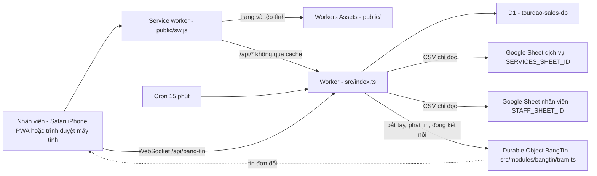
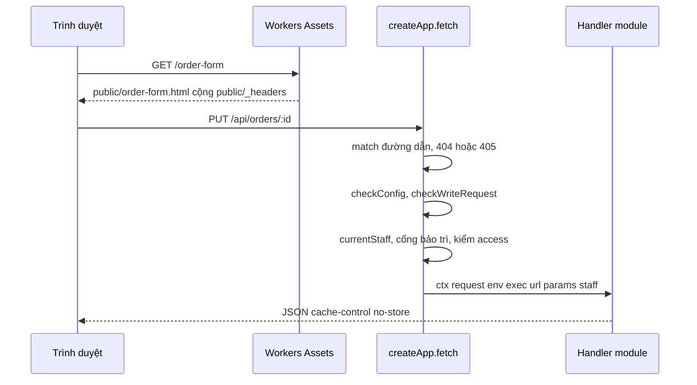
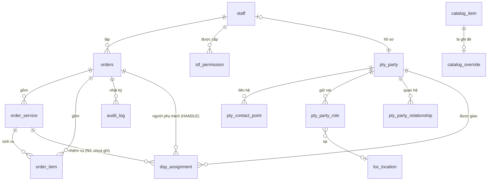
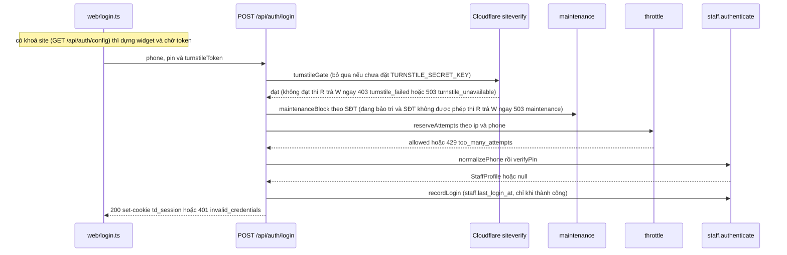

# Thiết kế hệ thống — tourdao-sales

> Mô tả **hiện trạng mã tại HEAD của nhánh này**, cho kỹ sư (hoặc một phiên Claude mới) chưa biết dự án và cần sửa nhanh, đúng.
> Luật kiến trúc: `docs/ARCHITECTURE.md` + `docs/adr/`. Đặc tả nghiệp vụ: `docs/SPEC-tourdao-sales.md`. Bảng/cột/view: `docs/DATA-DICTIONARY.md` (sinh từ `docs/data-dictionary.json`). Triển khai/hoàn tác: `docs/HANDOFF-N1.md`. PWA: `docs/PWA-IPHONE.md`.
> Tài liệu này KHÔNG chép lại các tệp đó; khi mâu thuẫn thì **mã thắng** — xem §16.

## Mục lục

1. [Mục đích, người dùng, phạm vi, ràng buộc nền tảng](#1-mục-đích-người-dùng-phạm-vi-ràng-buộc-nền-tảng)
2. [Bối cảnh và topology chạy thật](#2-bối-cảnh-và-topology-chạy-thật)
3. [Vòng đời một request](#3-vòng-đời-một-request)
4. [Xác thực và phiên](#4-xác-thực-và-phiên)
5. [Mô hình dữ liệu](#5-mô-hình-dữ-liệu)
6. [Luồng nghiệp vụ chính](#6-luồng-nghiệp-vụ-chính)
7. [Danh mục API](#7-danh-mục-api)
8. [Phân quyền](#8-phân-quyền)
9. [Giao diện](#9-giao-diện)
10. [Build, kiểm thử, triển khai](#10-build-kiểm-thử-triển-khai)
11. [Bảo mật](#11-bảo-mật)
12. [Giới hạn và hiệu năng](#12-giới-hạn-và-hiệu-năng)
13. [Quan sát và vận hành](#13-quan-sát-và-vận-hành)
14. [Lộ trình và điểm gắn tính năng tiếp theo](#14-lộ-trình-và-điểm-gắn-tính-năng-tiếp-theo)
15. [Thuật ngữ](#15-thuật-ngữ)
16. [Sai lệch tài liệu ↔ mã](#16-sai-lệch-tài-liệu--mã)

---

## 1. Mục đích, người dùng, phạm vi, ràng buộc nền tảng

**Mục đích.** Sổ đơn hàng nội bộ của Công ty TNHH Tour Đảo: nhân viên lập đơn dịch vụ tour, ghi thông tin chuyến (ngày giờ khởi hành, đón, check-in), xác nhận hoặc huỷ đơn; quản trị viên quản lý tài khoản + quyền, danh mục dịch vụ (đồng bộ từ Google Sheet), hồ sơ khách/đại lý và địa điểm.

**Người dùng** = nhân viên có tài khoản trong D1 (không có đăng ký công khai). Sáu quyền app (`src/shared/permissions.ts`): `SALES` (Bán hàng), `ACCOUNTING` (Kế toán), `ADMIN` (Quản trị), `FIELD` (Hướng dẫn viên), `PARTNER` (Đối tác — ADR-0014), `SUPER_ADMIN` (Super Admin, vai trên Quản trị — ADR-0014). Một tài khoản mang **nhiều** quyền (ADR-0005).

**Trong phạm vi hiện tại:** đăng nhập (kèm Cloudflare Turnstile khi được bật, khối thông tin công ty và số phiên bản ở màn đăng nhập), sổ đơn (nháp → xác nhận/huỷ), sửa thông tin chuyến sau xác nhận, **người phụ trách đơn** (đặt/đổi/nhận; người phụ trách sửa được đơn như người lập — §6(j), §9), danh mục dịch vụ + ghi đè giá, tài khoản/quyền, hồ sơ (party) và địa điểm, nhật ký, và **Bảng tin** (báo tức thì cho mọi màn hình đang mở khi một đơn đổi — WebSocket + một Durable Object, ADR-0022; §2, §3, §9, §11; **có trong mã của nhánh `bang-tin`, CHƯA phát hành**).
**Ảnh xác nhận đơn (PNG) gửi khách:** ĐÃ có (v1.0), dựng ở trình duyệt (§9). **Chưa có trong mã:** xuất PDF/in A4 bản xác nhận, thu tiền/hoá đơn, phân công NHIỆM VỤ (đón khách, lái cano — N2; riêng "người phụ trách" đã có), màn hình cho tài khoản chỉ-`FIELD` (xem §14).

**Ràng buộc nền tảng.**

| Ràng buộc | Chi tiết |
|---|---|
| Runtime và CSDL | Cloudflare Workers, một Worker duy nhất tên `tourdao-sales` (`wrangler.jsonc`), `compatibility_date` `2026-09-01`; Cloudflare D1 `tourdao-sales-db`, binding `DB`, `migrations_dir: migrations`; Durable Object `BangTin` (binding `BANG_TIN`, MỘT thực thể tên `cong-ty`, migration DO tag `v1` `new_sqlite_classes` ở `wrangler.jsonc` — chỉ cho Bảng tin, §2) |
| Tệp tĩnh | Workers Assets: thư mục `./public`, binding `ASSETS`, `run_worker_first: ["/api/*"]` |
| Ngôn ngữ và giao diện | TypeScript `strict` + `noUncheckedIndexedAccess` (`tsconfig.json`), không framework, không thư viện router; HTML tĩnh `public/*.html` + TypeScript thuần `web/*.ts` gom bằng **esbuild** vào `public/js/` (gitignored) |
| Phụ thuộc | Chỉ `devDependencies`: `esbuild`, `typescript`, `wrangler`. Không có dependency runtime. |

---

## 2. Bối cảnh và topology chạy thật



*Một tên miền `booking.tourdao.vn` (`routes` + `custom_domain: true`); vì khai `routes` mà không khai `workers_dev`, địa chỉ `workers.dev` đã bị TẮT có chủ ý. `run_worker_first: ["/api/*"]` khiến mọi `/api/*` vào Worker trước, còn lại do Workers Assets phục vụ.*

**Cron.** `triggers.crons: ["*/15 * * * *"]` → `scheduled()` trong `src/index.ts` gọi `ctx.waitUntil(runScheduledSync(env))` (module `catalog`) để kéo danh mục dịch vụ.

**Bảng tin — Durable Object `BangTin` (ADR-0022; có trong mã của nhánh `bang-tin`, CHƯA phát hành).** Thông báo tức thì "đơn vừa đổi" tới mọi màn hình đang mở, không cần bấm tải lại. Thành phần:

- **Trạm** `src/modules/bangtin/tram.ts` — lớp `BangTin extends DurableObject`, MỘT thực thể tên `cong-ty` cho cả công ty (`env.BANG_TIN.getByName("cong-ty")`); lưu trữ theo lớp SQLite (`new_sqlite_classes`) nhưng KHÔNG lưu gì ngoài một báo thức: không bảng, không lưu tin — tin đi rồi là thôi. Dùng WebSocket Hibernation API: `ctx.acceptWebSocket(server, nhãn)` (nhãn = tag), `serializeAttachment({ staffId, hetHan })` gắn vào kết nối; `setWebSocketAutoResponse("ping" → "pong")` trả lời mà không đánh thức trạm (BT-3); `webSocketMessage/Close/Error` không làm gì (mọi tin trình duyệt gửi lên bị bỏ). Bốn lối vào: `fetch` (chỉ nhận yêu cầu bắt tay do route dựng MỚI), RPC `phat(sự kiện, nhãn)` và RPC `dongCua(…)` (chỉ gốc lắp ráp gọi), và `alarm`.
- **Route bắt tay** `GET /api/bang-tin` (`src/modules/bangtin/index.ts`, module lá hạng `KHONG_DB` — không bảng, không SQL, không `env.DB`; `architecture.test.ts` ép) và luật thuần `bangtin/rules.ts` (`kiemOrigin`, `docHanGiay`, `keHoachTram` — MỌI quyết định đóng/gửi/báo thức nằm ở đây để `node --test` kiểm được; `tram.ts` chỉ là vỏ gọi API Cloudflare).
- **Gốc lắp ráp** `src/index.ts` — nơi DUY NHẤT nạp lớp `tram.ts` (`export { BangTin } from "./modules/bangtin/tram"`; `architecture.test.ts` cấm nơi khác) và nối hai hàm tiêm `baoThayDoi`/`dongBangTin` (§3). `orders`, `dispatch`, `accounts`, `maintenance` KHÔNG import `bangtin`, chỉ gọi `ctx.baoThayDoi`/`ctx.dongBangTin`.
- **Hàm thuần dùng chung server ↔ trình duyệt** `src/shared/bang-tin.ts` (§9): nhãn kết nối/sự kiện suy từ `can()`, kiểu sự kiện đúng 5 khoá, câu thông báo nổi, thời gian chờ nối lại.
- **Phía trình duyệt** `web/bangtin.ts` + `web/bangtin-logic.ts` + `web/toast.ts` + `web/lam-moi-logic.ts` (§9).

Không có D1 migration; có MỘT migration Durable Object (tag `v1`) do `wrangler deploy` tự áp — cửa một chiều mềm (`docs/HANDOFF-N1.md`, mục runbook Bảng tin). Mỗi lần deploy ngắt mọi kết nối (Cloudflare khởi động lại Durable Object); trình duyệt tự nối lại trong 1–30 giây.

**Google Sheet — chỉ ĐỌC, công khai.** `src/shared/sheets.ts#fetchSheetCsv` gọi `https://docs.google.com/spreadsheets/d/<id>/export?format=csv`, `AbortSignal.timeout(8000)`. App **không bao giờ** ghi ngược vào Sheet.

**Biến và bí mật.**

| Tên | Loại | Đặt ở đâu | Dùng ở đâu |
|---|---|---|---|
| `STAFF_SHEET_ID` | biến công khai (`vars`) | `wrangler.jsonc` | `accounts`: `GET /api/staff/sheet`, `POST /api/staff/sheet/apply` |
| `SERVICES_SHEET_ID` | biến công khai (`vars`) | `wrangler.jsonc` | `catalog`: `syncCatalog` |
| `SESSION_SECRET` | **bí mật** | `wrangler secret put SESSION_SECRET` (production), `.dev.vars` (local — xem `.dev.vars.example`) | ký/kiểm cookie phiên (`src/modules/auth/session.ts`) |
| `TURNSTILE_SITE_KEY` | biến công khai, **tuỳ chọn** | `vars` của `wrangler.jsonc` khi có khoá thật (chưa thêm), `.dev.vars` (local) | `auth`: `GET /api/auth/config` trả cho trang đăng nhập dựng widget Turnstile |
| `TURNSTILE_SECRET_KEY` | **bí mật, tuỳ chọn** | `wrangler secret put TURNSTILE_SECRET_KEY` (production, chỉ khi chủ dự án ra lệnh), `.dev.vars` (local) | `auth`: `verifyTurnstile` (`POST /api/auth/login`). Vắng ⇒ Turnstile TẮT (xem mục 4) |
| `DB` / `ASSETS` | binding D1 / binding Workers Assets | `wrangler.jsonc` | `env.DB` ở mọi module; `ASSETS` do nền tảng dùng |
| `BANG_TIN` | binding Durable Object (lớp `BangTin`) | `wrangler.jsonc` (`durable_objects.bindings` + `migrations` tag `v1`); kiểu khai TAY ở `worker-configuration.d.ts` | `src/modules/bangtin/index.ts` (`getByName("cong-ty")`); lớp ở `src/modules/bangtin/tram.ts`, export từ `src/index.ts` |
| `BANG_TIN_HAN_GIAY` | biến, **tuỳ chọn, KHÔNG đặt ở production** | chỉ `--var` khi chạy e2e (`tests/e2e/run.mjs` đặt `20`) hoặc `.dev.vars`; khai TAY dạng tuỳ chọn ở `worker-configuration.d.ts` | `bangtin/rules.ts#docHanGiay`: hạn sống một kết nối Bảng tin, giây; vắng hoặc không phải số nguyên dương → 900; kẹp trong [5, 3600] |

`SESSION_SECRET` ngắn hơn `MIN_SECRET_LENGTH` = 32 ký tự → **mọi** route trả 500 `server_misconfigured` (`checkAuthConfig`). Hai biến Turnstile KHÔNG đi qua `checkAuthConfig` (vắng là trạng thái hợp lệ "tắt"). Kiểu của `Env` ở `worker-configuration.d.ts` (sinh bởi `npm run types` khi `.dev.vars` có đủ bí mật; hai biến Turnstile đang khai tay dạng tuỳ chọn — xem `docs/CHANGE-GUIDE.md` công thức l; `BANG_TIN` và `BANG_TIN_HAN_GIAY` cũng khai tay — `npm run types` chỉ sinh lại `BANG_TIN_HAN_GIAY` nếu `.dev.vars` có tên đó, xem bẫy ở `docs/CHANGE-GUIDE.md` §4).

---

## 3. Vòng đời một request



*Tệp tĩnh không chạm Worker; `/api/*` đi qua `createApp` rồi mới tới handler của module.*

**`src/shared/router.ts`** — router tối giản, không import module nào (gốc lắp ráp `src/index.ts` tiêm `currentStaff`, `checkConfig` và `injected`):

- `route(method, path, access, handler)`; `Access = "public" | "staff" | "office" | "orders" | "admin"`.
- Khớp đường dẫn bằng `split("/").filter(Boolean)`, tham số `:tên` giải mã bằng `decodeURIComponent`. Không khớp đường dẫn nào → **404** `not_found`; khớp đường dẫn nhưng sai phương thức → **405** `method_not_allowed` kèm header `allow`.
- `injected` (BẮT BUỘC, ADR-0007 điều 4(b)): hai hàm nối chéo module do gốc lắp ráp cung cấp từ module `dispatch` — router đưa vào `ctx` thành `ctx.isAssigned(orderId)` (người đang đăng nhập có phải người phụ trách đang mở của đơn không; một truy vấn D1 mỗi lần gọi, chỉ route nào cần thì gọi) và `ctx.defaultHandlerStatement(orderId, at)` (câu lệnh chưa chạy đặt người lập làm người phụ trách mặc định của đơn mới; `null` nếu người lập không đủ điều kiện làm người phụ trách theo `checkAssignee` — chưa có hồ sơ, hoặc tài khoản chỉ Đối tác, ADR-0014 điều 9/10). `orders` dùng chúng mà KHÔNG import `dispatch`. Hàm thứ ba `maintenanceBlock(env, staff)` (từ module `maintenance`) là cổng chế độ bảo trì — bullet về `access` ngay dưới. **Bảng tin (ADR-0022)** thêm hai hàm BẮT BUỘC nữa: `baoThayDoi(env, người thao tác, { orderId, thayDoi, handlerTruoc? })` và `dongBangTin(env, { staffId } | "tat-ca")`; router đưa vào `ctx` thành `ctx.baoThayDoi(e)` và `ctx.dongBangTin(muc)` kiểu `void` — route KHÔNG `await` được: router bọc `exec.waitUntil(Promise.resolve().then(…).catch(…))` nên lỗi phát tin/đóng kết nối không làm hỏng hay chậm thao tác ghi, chỉ ghi một dòng log `bang_tin_loi` (`{ viec: "bao" | "dong", name }`, không SĐT/tên/nội dung lỗi — §13). `ctx.baoThayDoi` là no-op ở route công khai (không có người thao tác). Phía `src/index.ts`, `baoThayDoi` thoát ngay khi vắng binding `BANG_TIN` (khung thử `tests/audit`, `router.test.ts` không có trạm), rồi đọc song song `findOrderRef` (orders) + `handlerOf` (dispatch), dựng sự kiện đúng 5 khoá (`tao` mà không ai phụ trách → `tao_cho_nhan`), tính nhãn người nhận bằng `nhanSuKien` và gọi `phatDon`.
- `checkConfig` lỗi → **500** `server_misconfigured` (ghi log, không bao giờ in giá trị bí mật).
- `checkWriteRequest` với `POST/PUT/PATCH/DELETE`: so `Origin` với `url.origin` (thiếu `Origin` thì xét `Sec-Fetch-Site === "same-origin"`) → sai thì **403** `cross_origin`; thân không phải `application/json` → **415** `unsupported_media_type`.
- `access !== "public"` mà không có phiên → **401** `unauthenticated`; rồi **cổng bảo trì** (`injected.maintenanceBlock`): tài khoản bị chặn lúc này → **503** `maintenance` (mục 4), handler không chạy; RỒI mới kiểm quyền: `admin` mà `passesAdminGate(staff)` sai → **403** `forbidden`; `office` mà `isOffice(staff)` sai → **403** `forbidden`; `orders` mà `canAccessOrders(staff)` sai → **403** `forbidden` (ba hàm đọc ba danh sách `ADMIN_GATE`/`OFFICE_GATE`/`ORDERS_GATE`, mục 8). Cổng đứng TRƯỚC kiểm quyền để người bị chặn thấy "đang bảo trì" chứ không phải "không đủ quyền". Cổng KHÔNG chạy cho route `public` (`/api/auth/config`, `/api/auth/login`, `/api/auth/logout`, `/api/company`); `GET /api/auth/me` là route `staff` nên có qua cổng. Chi phí: MỘT truy vấn D1 (`getMaintenanceState`) mỗi request cần đăng nhập, cố ý KHÔNG đệm (hiệu lực ngay khi bật). `maintenanceBlock` là trường BẮT BUỘC của `injected` — thiếu là lỗi `tsc`, không phải chế độ bảo trì lặng lẽ mất tác dụng.
- **Router KHÔNG bọc/dựng lại phản hồi của route** (`fetch` trả thẳng `await dispatch(...)`, `dispatch` trả thẳng kết quả handler; `src/index.ts` `fetch: app.fetch`). Điều này BẮT BUỘC cho `/api/bang-tin`: phản hồi 101 của trạm mang thuộc tính `webSocket` — `new Response(body, res)`/thêm header chung lên nó làm rơi `webSocket` và bắt tay hỏng lặng lẽ. Đừng thêm bước bọc chung ở router mà không miễn `/api/bang-tin` (e2e `bangtin.mjs` ca 1 mở kết nối thật nên sẽ hỏng khi đó — nhưng chưa từng thử cố ý làm hỏng để thấy đỏ).
- **Một request bắt tay Bảng tin** (`GET /api/bang-tin`, `Upgrade: websocket`; không nằm trong `checkWriteRequest` vì là GET): khớp đường dẫn (404/405) → `checkConfig` (500) → **401** chưa đăng nhập → **503** chế độ bảo trì (cổng của router) → handler `bangtin`: thiếu `Upgrade: websocket` → **426** (kèm `upgrade: websocket`) → `kiemOrigin` (CÓ `Origin` VÀ bằng `url.origin`; vắng/lạ → **403** `cross_origin`; KHÔNG có nhánh `Sec-Fetch-Site` dự phòng như `checkWriteRequest`) → vắng binding `BANG_TIN` → **503** `unavailable` → tính nhãn `nhanKetNoi(staff)` bằng `can()` → dựng yêu cầu MỚI `https://bang-tin/ket-noi` chỉ với ba header do máy chủ đặt (`upgrade`, `x-bang-tin-nhan`, `x-bang-tin-nguoi`) — header `x-bang-tin-*` hay cookie của trình duyệt KHÔNG được chép sang (BT-2) → `getByName("cong-ty").fetch(...)` → trạm `acceptWebSocket` + đặt hạn/báo thức → **101**. Route dùng `access: "staff"` (mọi tài khoản đang đăng nhập, kể cả Đối tác và Hướng dẫn viên); Ai nhận được tin nào do nhãn quyết định, không do route.
- Bọc toàn cục: ngoại lệ → **500** `internal` kèm `requestId` (`cf-ray` hoặc `crypto.randomUUID()`), log JSON một dòng `{level, event: "unhandled", requestId, method, path, error}`.

**`src/shared/http.ts`** — `json()` (luôn `content-type: application/json; charset=utf-8` + `cache-control: no-store`), `error(status, code, message)`, `readJson()`, `intParam(v, fallback, min, max)`, `escapeLike()`, `getCookie()`, `UUID_RE`.

**`public/_headers`** (chỉ áp cho tệp tĩnh): CSP `default-src 'self'; script-src 'self' https://challenges.cloudflare.com; style-src 'self' 'unsafe-inline'; img-src 'self' data: blob:; font-src 'self' data:; connect-src 'self' wss://booking.tourdao.vn https://challenges.cloudflare.com; frame-src https://challenges.cloudflare.com; object-src 'none'; base-uri 'none'; form-action 'self'; frame-ancestors 'none'` (Cloudflare mở duy nhất cho widget Turnstile ở màn đăng nhập — đúng ba directive này, không nới `style-src`/`img-src`; `frame-src` chỉ có Cloudflare nên khung cùng nguồn cũng bị chặn — app không dùng iframe nào; đã đo bằng Chrome thật, `docs/evidence/2026-09-21-v1-0/`; `connect-src` còn liệt kê rõ `wss://booking.tourdao.vn` cho WebSocket Bảng tin vì Safari cũ không coi `wss:` cùng máy là `'self'` — local/LAN dựa vào `'self'`, **chưa kiểm** trên Safari iPhone thật qua LAN), `X-Content-Type-Options: nosniff`, `Referrer-Policy: same-origin`, `X-Frame-Options: DENY`, `Permissions-Policy: camera=(), microphone=(), geolocation=()`; riêng `/sw.js` là `Cache-Control: no-store` (KHÔNG `no-cache` — lý do ở `docs/PWA-IPHONE.md`).

---

## 4. Xác thực và phiên

**Đăng nhập = số điện thoại + PIN 6 số.** `normalizePhone` (`src/shared/phone.ts`) chuẩn hoá về `0xxxxxxxxx`; `isValidPin` (`src/modules/staff/phone.ts`: đúng 6 chữ số) và `isWeakPin` (`src/modules/staff/rules.ts`) chặn PIN toàn số giống nhau hoặc chạy liên tiếp (kể cả cuộn vòng).

**Băm PIN** — `src/modules/staff/password.ts`: PBKDF2-SHA256, `PBKDF2_ITERATIONS = 100_000` (trần của Workers), muối 16 byte ngẫu nhiên, khoá 256 bit; chuỗi lưu `pbkdf2$sha256$<iter>$<salt>$<hash>` (base64url). So sánh bằng `timingSafeEqual`. `verifyDummy()` chạy một phép băm giả khi SĐT không tồn tại để thời gian phản hồi không lộ tài khoản nào có thật.

**Cookie phiên** — `src/modules/auth/session.ts`: tên `td_session`; token `"<staffId>.<issuedAt ms>.<HMAC-SHA256 base64url>"` ký bằng `SESSION_SECRET`; `SESSION_TTL_SECONDS = 60*60*24*7` (7 ngày). Thuộc tính: `Path=/; Max-Age=604800; HttpOnly; SameSite=Lax` và `Secure` khi request là `https:`. Chữ ký đúng nhưng `issuedAt > now + 60_000` → từ chối (đồng hồ lạ).

**Thu hồi phiên.** `currentStaff` → `getActiveStaff(db, id, issuedAt)`: tài khoản phải `active = 1`, và nếu `staff.credentials_changed_at` (mili-giây) **lớn hơn** thời điểm phát hành phiên thì phiên bị từ chối. Đổi PIN / đặt lại PIN cập nhật cột này ⇒ mọi thiết bị cũ bị đăng xuất; route đổi PIN cấp ngay cookie mới cho thiết bị hiện tại (`newSessionCookie`).

**Cloudflare Turnstile (chỉ ở đăng nhập)** — `src/modules/auth/turnstile.ts` (thuần, có test). `POST /api/auth/login` nhận thêm `turnstileToken`; sau khi đầu vào hợp lệ (400 nếu thiếu SĐT/PIN) và **TRƯỚC** `verifyPinThrottled`, máy chủ gọi `https://challenges.cloudflare.com/turnstile/v0/siteverify` (POST form `secret`, `response`, `remoteip` — chỉ khi `cf-connecting-ip` đúng là IP), hạn chót `TURNSTILE_TIMEOUT_MS` = 5 giây, token dài tối đa 2048 ký tự (`MAX_TOKEN_LENGTH` — ngưỡng ĐÃ ĐỐI CHIẾU 2026-09-21 với tài liệu Cloudflare (tối đa 2048 ký tự); xem log sau khi bật khoá thật). Kẻ tấn công không có token nhận **403 `turnstile_failed`** ("Chưa xác minh được bạn là người thật. Hãy thử lại.") mà **không tiêu hao lượt thử** của SĐT nạn nhân (cũng không của IP). **Đóng khi lỗi**: siteverify không trả lời/HTTP lỗi/hết giờ/thân lạ/secret sai (`invalid-input-secret`, trả HTTP 400) → **503 `turnstile_unavailable`** ("Chưa kết nối được dịch vụ xác minh. Hãy thử lại sau ít phút."), ghi log `turnstile_unavailable` kèm mã ngắn `detail`. `GET /api/auth/config` (public) → `{ turnstileSiteKey }`: khoá site khi có CẢ secret lẫn khoá site, ngược lại `null`.
**Chưa đặt `TURNSTILE_SECRET_KEY` ⇒ TẮT**: bỏ qua kiểm (không khoá chết local/e2e/lần deploy đầu), `config` trả `null`, và mỗi lần đăng nhập máy chủ `console.warn` `turnstile_disabled` để mất secret không thành tắt lặng lẽ — sau deploy phải kiểm `GET /api/auth/config` khác `null`. Có secret mà thiếu khoá site ⇒ vẫn kiểm, trang không có widget nên không ai đăng nhập được (log `turnstile_misconfigured`). **Widget ở trang đăng nhập** (`web/login.ts`): chỉ khi `GET /api/auth/config` trả khoá site, trang tải `api.js` của Cloudflare (`?render=explicit`, script động — không nhúng trong HTML) rồi `turnstile.render` (`theme: "light"`, `language: "vi-vn"`, cỡ `flexible` hoặc `compact` khi lòng thẻ < 300 px). **`theme: "light"` là lệch có chủ ý so với đặc tả nháp v1.0 (ghi "chủ đề theo hệ thống", tức `auto`)**: app chỉ có giao diện sáng, `auto` cho widget tối trên thẻ trắng khi điện thoại bật chế độ tối; đổi lại khi app có chế độ tối. Trạng thái của trang:
- Trong lúc chờ nạp script (tối đa 15 giây) khung giữ chỗ hiện "Đang tải xác minh…" (`<p role="status">`, không phải `<div>` để không lẫn với widget) và nút Đăng nhập khoá; nút khoá tới khi có token; `turnstile.reset()` sau MỌI lần đăng nhập thất bại (token dùng một lần; cổng Turnstile chạy trước PIN nên token đã bị đốt dù PIN sai).
- Lỗi 403/503 của máy chủ hiện nguyên văn ở `#error`; script không tải/`render` lỗi thì thông báo + nút "Thử lại"; `error-callback` của widget cũng hiện thông báo + "Thử lại" và ghi `console.warn("Turnstile báo lỗi, mã:", <mã>)` (callback trả `true` = "đã xử lý" thì Cloudflare KHÔNG ghi mã lỗi ra console, nên lần deploy khoá thật đầu tiên sai tên miền sẽ chỉ còn thông báo chung nếu trang không tự ghi).
- **Hỏi lại cấu hình (tự phục hồi):** `GET /api/auth/config` lỗi lúc mở trang thì nút Đăng nhập mở NGAY (đăng nhập như không có widget; cấu hình chỉ chậm thì nút mở sau 3 giây) và trang hỏi lại NỀN sau 1,5 giây rồi 4 giây (không giữ nút); khi máy chủ đã bật Turnstile mà trang chưa có khoá site, mỗi lần đăng nhập bị 403 `turnstile_failed` / 503 `turnstile_unavailable` lại hỏi lại (ngay, sau 2 giây, sau 4 giây). Mỗi lúc chỉ MỘT vòng, có hạn số lần (không lặp vô hạn, không bão yêu cầu); lấy được khoá thì dựng widget và khoá nút tới khi có token. Đây cũng là lưới an toàn cho người đã mở trang đăng nhập GIỮA lúc deploy mã và lúc `wrangler secret put` (lúc mở, `config` trả `null` nên trang chưa có widget; secret đặt xong thì lần đăng nhập đầu bị 403 rồi trang tự dựng widget, không cần tải lại). Kịch bản Chrome `v1-dang-nhap.mjs` (bước l, o) kiểm cơ chế này. Bỏ cơ chế này thì `siteKey` kẹt `null` và MỌI lần đăng nhập 403 mãi — mà PWA trên iPhone không có nút tải lại. Cấu hình về muộn hơn 3 giây thì widget vẫn được dựng lúc đó.

Đặt secret ở production PHẢI kèm khoá site (`vars`). Đổi PIN không đòi Turnstile.

**Ghi nhận đăng nhập thành công.** `POST /api/auth/login` (PIN) VÀ `POST /api/auth/passkey/login` (Face ID — xem mục dưới) đều gọi `recordLogin` (module `staff`) → `staff.last_login_at` = giờ hiện tại (ISO UTC; migration `0015`; NULL = chưa từng đăng nhập kể từ khi có cột). KHÔNG ghi trong `verifyPinThrottled` (dùng chung với đổi PIN — ghi ở đó thì mỗi lần đổi PIN thành "một lần đăng nhập"), không ghi khi phiên được cấp lại sau đổi PIN. Lỗi ghi được log `record_login_failed` và KHÔNG làm hỏng đăng nhập (chỉ là thống kê). Chỉ lưu thời điểm — không SĐT/PIN nào vào nhật ký. Hiện ở cột "Đăng nhập gần nhất" của `/staff` (`GET /api/staff` → `lastLoginAt`).

**Đăng nhập bằng Face ID (passkey, ADR-0016 — accepted 2026-09-23).** Song song với SĐT + PIN, không thay thế: PIN luôn còn là đường dự phòng. Chuẩn WebAuthn, kiểm phía máy chủ **tự viết bằng Web Crypto** (`src/modules/auth/webauthn.ts`, không thư viện chạy lúc runtime) — CBOR tự giải mã (`src/modules/auth/cbor.ts`), khoá công khai ES256 (`algorithm -7`) hoặc RS256 (`-257`, đòi ≥ 2048 bit).
- **Bật/tắt tính năng theo cấu hình, không theo cột dữ liệu:** `passkeyRelyingParty(env)` (`src/modules/auth/webauthn.ts`) đọc hai biến `PASSKEY_RP_ID`/`PASSKEY_ORIGIN`; thiếu MỘT trong hai, hoặc `origin` không khớp `rpId`, hoặc giao thức không phải `https:` (trừ `localhost`/`127.0.0.1` được `http:`) ⇒ **TẮT** (`passkeyRp` trả `null`, mọi route passkey — cả 10, kể cả xem danh sách, gỡ và quản trị viên gỡ hộ, đặc tả §2.3 — trả 503 `passkey_unavailable` trước mọi truy vấn D1, test `src/passkey-off.test.ts`; khi tắt, đặt lại PIN (`POST /api/staff/:id/reset-pin`) VẪN gỡ hết Face ID, ngưng tài khoản cũng VẪN gỡ (không phụ thuộc công tắc — xem "8b" dưới); `console.warn` MỘT lần mỗi isolate — `passkey_disabled` khi thiếu cả hai biến, `passkey_misconfigured` khi có một trong hai mà cấu hình sai, giống cơ chế `turnstile_disabled` của mục Turnstile). `GET /api/auth/config` trả thêm `passkey: boolean` cho trang đăng nhập/trang Tôi biết có hiện nút hay không.
- **Bảng `aut_passkey`** (migration `0023`, module `auth`): `staff_id`, `credential_id` (UNIQUE — chặn đăng ký lại cùng một khoá), `public_key` (SPKI DER, base64url), `algorithm`, `user_handle` (16 byte ngẫu nhiên gửi làm `user.id` — KHÔNG chứa SĐT/thông tin cá nhân, ADR-0016 điều 8), `sign_count`, `label` (tên máy đoán từ `User-Agent`, vd "iPhone", "Máy Mac" — `src/modules/auth/device-label.ts`), `last_used_at`, hiệu lực `valid_from_at`/`valid_to_at` (gỡ = đóng cột này, KHÔNG xoá cứng).
- **Thách thức KHÔNG lưu D1** — cookie riêng `td_webauthn` (`src/modules/auth/challenge.ts`), ký HMAC **DẪN XUẤT** từ `SESSION_SECRET` bằng nhãn mục đích riêng (`KEY_LABEL`), TTL 300 giây (`CHALLENGE_TTL_SECONDS`), `Path=/api; HttpOnly; SameSite=Strict`. Token có **7 phần** (`w1.<mục đích>.<staffId|->.<ms phát hành>.<challenge>.<phụ|->.<chữ ký>`) — khác hẳn cấu trúc 3 phần của `td_session`, nên token thách thức không bao giờ qua được `verifySessionToken` và ngược lại (khoá dẫn xuất riêng là lớp thứ hai). Ba mục đích (`ChallengePurpose`): `login` (đăng nhập), `register` (bật Face ID, `extra` mang `user_handle`), `pin` (đặt PIN bằng Face ID, điều 2b).
- **Dùng một lần:** một thách thức chỉ xác nhận được đúng MỘT lần — `checkPasskeyAssertion` (`src/modules/auth/passkey.ts`) gọi `markPasskeyUsed` (ghi `last_used_at`) SAU khi kiểm chữ ký/bộ đếm/cổng bổ sung nhưng TRƯỚC khi trả kết quả; dùng lại token cũ ⇒ 400 `passkey_expired`.
- **Luồng đăng nhập** (`POST /api/auth/passkey/options` rồi `POST /api/auth/passkey/login`, cả hai `public`): xin thách thức (hạn mức riêng theo IP, `CHALLENGE_IP_LIMIT` = 120/15 phút — KHÔNG dùng chung bộ chống dò PIN vì không có PIN để dò) → trình duyệt gọi `navigator.credentials.get` → máy chủ tìm khoá theo `credential_id`, kiểm chữ ký (`verifyAssertion`) và bộ đếm (`counterRegressed`: từ chối nếu bộ đếm mới ≤ bộ đếm cũ VÀ cả hai > 0 — nghi khoá bị nhân bản) → cổng bảo trì theo SĐT chủ khoá (TRƯỚC khi tiêu thụ thách thức, đúng thứ tự đặc tả §2.6: kiểm → cổng bảo trì → dùng một lần) → `recordLogin` → cấp `td_session` + xoá `td_webauthn`. Không Turnstile (không phải chỗ để dò PIN) và không bộ chống dò PIN (chỉ hạn mức thách thức).
- **Bật Face ID cho một máy** (tự phục vụ, `staff`): `POST /api/account/passkeys/options` đòi nhập lại PIN hiện tại (cùng `verifyPinThrottled`/bộ chống dò của đăng nhập — điều 2a) rồi mới cấp thách thức `register`; `POST /api/account/passkeys` kiểm `verifyRegistration` và ghi `aut_passkey` + nhật ký `passkey_added`. **Hai lần chạm riêng trên iPhone** (`web/passkey.ts` `enableFlow`): chạm 1 gửi PIN (có `await fetch`), chạm 2 (nút "Tiếp tục với Face ID") gọi `navigator.credentials.create` NGAY, không `await` nào trước đó — Safari/iOS có thể chặn WebAuthn nếu không còn trong "cử chỉ người dùng" trực tiếp (đặc tả §2.7).
- **Gỡ Face ID:** `DELETE /api/account/passkeys/:id` (một khoá) hoặc `POST /api/account/passkeys/remove-all` (tự phục vụ, tất cả — dùng khi mất máy) đều đóng `valid_to_at`, đẩy `staff.credentials_changed_at` (đăng xuất MỌI máy khác) và cấp `td_session` mới cho máy đang thao tác cùng MỘT mốc `now`; admin gỡ hộ qua `POST /api/staff/:id/passkeys/remove-all` (theo luật "cấp dưới" — mục 8) không cần đặt lại PIN. `POST /api/staff/:id/reset-pin` (đặt lại PIN) cũng gỡ HẾT Face ID của tài khoản đó (điều 6) — đặt lại PIN là tình huống "có thể đã lộ", Face ID cũ không còn đáng tin.
- **Đặt PIN mới bằng Face ID** (điều 2b, không cần PIN cũ): `POST /api/account/pin-by-passkey/options` (thách thức mục đích `pin`, ràng buộc ĐÚNG `staff.id` của phiên) rồi `POST /api/account/pin-by-passkey` — bắt buộc một lần ký Face ID MỚI, phiên đang mở không đủ. Đặt xong thì gỡ khoá "sai PIN quá nhiều" của SĐT (`unlockPhone`, như admin `reset-pin` — chủ quyết 2026-09-23).
- **Mã lỗi riêng** (`PASSKEY_ERRORS`, `src/modules/auth/passkey.ts`): `passkey_unavailable` (503, tắt), `passkey_expired` (400, thách thức hết hạn/đã dùng), `passkey_unknown` (401, khoá đã gỡ/không thuộc tài khoản nào), `passkey_invalid` (401 "Không xác nhận được Face ID…" khi đăng nhập/đặt PIN bằng Face ID: chữ ký/bộ đếm sai; 400 "Không bật được Face ID. Hãy thử lại." khi bật Face ID: dữ liệu đăng ký không hợp lệ), `passkey_exists` (409, máy đã bật), `passkey_none` (409, chưa bật Face ID nào), `passkey_not_yours` (403, đặt PIN bằng Face ID — `POST /api/account/pin-by-passkey` — mà ký bằng khoá của người khác). Gỡ khoá không phải của mình qua `DELETE /api/account/passkeys/:id` KHÔNG dùng mã này: trả 404 `not_found` như khoá không tồn tại.
- **Nhật ký** (`passkey_added`, `passkey_removed`, `pin_set_by_passkey`) KHÔNG chứa id khoá/`credential_id` — chỉ ai, khi nào, đối tượng.
- **Ngưng tài khoản gỡ mọi Face ID trong CÙNG lô ghi ("8b", ADR-0016 điều 6; chủ chọn A-4 phương án 1):** `PATCH /api/staff/:id` với `active: false` nối ba câu vào CUỐI batch của `patchStaffStatements` (sau mọi mắt xích cũ, vì câu gỡ có thể đổi 0 dòng mà chuỗi cũ dựa vào `changes() > 0`): gỡ CÓ ĐIỀU KIỆN `passkey_revoke_all_if_suspended` (chỉ khi tài khoản đang ngưng — đọc qua view `v_stf_staff_label`; câu chốt "còn quản trị viên khác" thua thì không gỡ gì) → `touchCredentialsStatement(…, true)` NGAY SAU (đẩy `credentials_changed_at`, thu hồi phiên cũ) → nhật ký `passkey_removed` "gỡ khi ngưng tài khoản" (`changes() > 0`). Kích hoạt lại tài khoản KHÔNG làm Face ID cũ sống lại. Bất biến `R-AUT-1` (§10, `scripts/audit-checks.mjs`) là lưới dữ liệu cho điều này: sau triển khai phải xanh; đỏ là lỗi thật.

**Chế độ bảo trì — chỉ chủ dự án dùng được khi bật.** Module `maintenance` (`src/modules/maintenance/`), luật thuần + thông điệp ở `src/shared/maintenance.ts` (dùng chung với giao diện), bảng `mnt_setting` (singleton `default`, migration `0016`, gieo TẮT, `allowed_phones` = `0989929373`). BẬT thì máy chủ chặn MỌI tài khoản có SĐT không nằm trong `allowed_phones` (SĐT chuẩn hoá bằng `normalizePhone`; danh sách rỗng khi bật = chặn tất cả), KỂ CẢ phiên đang mở, bằng **503** với thân `{ error: { code: "maintenance", message, endsAt } }` (`endsAt` = giờ dự kiến hoàn tất, ISO UTC hoặc `null`; giao diện dựng đồng hồ đếm ngược từ đó, không gọi thêm). Ba nơi ép, đều dùng hàm của module: (1) router — mọi route cần đăng nhập, sau `currentStaff` và trước kiểm quyền (mục 3); (2) `POST /api/auth/login` — sau Turnstile, TRƯỚC `verifyPinThrottled`: cùng một 503 cho MỌI SĐT (kể cả không tồn tại), không tiêu hao lượt thử PIN; (3) `GET /api/auth/config` trả `maintenance: { on, endsAt }` (công khai; KHÔNG lộ ai được phép) cho banner ở trang đăng nhập; `GET /api/auth/me` trả thêm `maintenance` (chỉ người được phép mới tới được nó khi đang bảo trì) cho dải "Đang ở chế độ bảo trì". Bật/tắt bằng `PUT /api/maintenance` (§7): chỉ ADMIN VÀ nằm trong `allowed_phones`; giờ dự kiến phải ở tương lai, tối đa 7 ngày (`MAX_MAINTENANCE_MS`); ghi nhật ký `maintenance_changed` (không ghi SĐT). Thông điệp đúng chữ chủ dự án đã chốt: "Hệ thống đang tạm đóng để bảo trì. Thời gian dự kiến hoàn tất là (đếm ngược), liên hệ quản trị viên khi cần hỗ trợ thêm (0989929373)."; hết giờ dự kiến hoặc chưa có giờ thì dùng biến thể không có đếm ngược (`maintenanceMessageParts`), vẫn chặn cho tới khi chủ tắt. `503 maintenance` KHÁC `503 turnstile_unavailable` (dịch vụ xác minh của Cloudflare lỗi). Cron đồng bộ danh mục không đi qua router nên không bị chặn. **Đường thoát khẩn** khi chủ bị khoá: một câu `UPDATE mnt_setting` qua `wrangler d1 execute --remote` — `docs/HANDOFF-N1.md`. Giới hạn đã chấp nhận: người được phép nhập sai PIN nhận 401/429 chứ không phải 503, nên về lý thuyết phân biệt được số của chủ với số khác — thông điệp đã hiện chính số đó.

**Phiên và Bảng tin (ADR-0022, KN-2).** Kết nối Bảng tin sống lâu hơn một request nên KHÔNG tự thấy phiên bị thu hồi. Vì vậy mọi route đổi thông tin đăng nhập/quyền của một tài khoản gọi `ctx.dongBangTin({ staffId })` sau khi ghi thành công, và `PUT /api/maintenance` (bật) gọi `dongBangTin("tat-ca")` — trạm đóng các kết nối đó với mã 4003 (danh sách route đầy đủ ở §11). Trình duyệt nối lại và nhận 401/503 như một request thường.
**Chống dò PIN** — `src/modules/auth/throttle.ts`, bảng `login_attempt`, cửa sổ trượt `LOGIN_WINDOW_MS = 15 * 60 * 1000`:

| Khoá | Hằng | Giá trị |
|---|---|---|
| `phone:<SĐT chuẩn hoá>` | `PHONE_LIMIT` | 5 lần / 15 phút |
| `ip:<cf-connecting-ip>` | `IP_LIMIT` | 30 lần / 15 phút |

Cơ chế **đặt chỗ trước khi kiểm**: đếm → nếu đã đủ thì chặn ngay và KHÔNG ghi thêm (kẻ tấn công không kéo dài khoá của nạn nhân) → chèn dòng → đếm lại; nếu vượt thì xoá dòng vừa chèn và chặn. Vượt → **429** `too_many_attempts` kèm `retry-after` giây. Thành công → `clearAttempts` xoá mọi lần thử của SĐT đó. `verifyPinThrottled` dùng chung cho **đăng nhập và đổi PIN** (đổi PIN không thành đường vòng dò PIN hiện tại). Admin mở khoá bằng `POST /api/staff/:id/unlock` (`unlockPhone`); danh sách đang khoá do `lockedPhones` trả về.

**`safeNext`** (`src/shared/safe-next.ts`): `/login?next=…` chỉ nhận đường dẫn nội bộ; chặn `//evil.com`, `/\evil.com`, ký tự điều khiển. Dùng ở `web/login.ts` và `goLogin()` của `web/api.ts`.

---

## 5. Mô hình dữ liệu

Module chủ sở hữu bảng của mình; bảng mới mang tiền tố module (`pty_`, `loc_`, `stf_`), bảng cũ giữ nguyên tên và được đánh dấu `legacy` trong `docs/data-dictionary.json` (**nguồn sự thật**, `src/architecture.test.ts` đối chiếu với schema thật).

| Bảng / view | Module | Mục đích |
|---|---|---|
| `staff` | staff | tài khoản đăng nhập (SĐT, `pin_hash`, `active`, `credentials_changed_at`, `last_login_at`, `party_id`); `role` và `full_name` là **cột chết** |
| `stf_permission_type` | staff | tra cứu 6 quyền app: `SALES`, `ACCOUNTING`, `ADMIN`, `FIELD`, `PARTNER`, `SUPER_ADMIN` (hai mã sau: ADR-0014) |
| `stf_permission` | staff | quyền của một tài khoản, có hiệu lực `valid_from_at` / `valid_to_at` |
| `v_stf_staff_label` | staff | view công bố: `id, label, active, party_id` (`label` = tên hồ sơ, dự phòng `(chưa có hồ sơ)`) |
| `pty_party` | parties | hồ sơ: `party_kind` `PERSON` hoặc `ORGANIZATION`, `display_name`, `active` |
| `pty_person` / `pty_organization` | parties | phần cá nhân (`family_name`, `middle_name`, `given_name`) / phần tổ chức (`legal_name`, `tax_code`, `address`, `invoice_email`) |
| `pty_contact_kind` / `pty_role_type` / `pty_relationship_type` | parties | tra cứu: loại liên hệ (`PHONE`, `EMAIL`); vai trò hồ sơ (`STAFF`, `GUIDE`, `DRIVER`, `AGENT`, `CUSTOMER`…, nay có thêm 11 vai mô hình người–vai–quyền — ADR-0018); loại quan hệ. `pty_role_type.role_group` (0024, `CHECK IN ('INTERNAL','EXTERNAL','OTHER')`, tập đóng theo ADR-0003 điều 3) phân biệt vai gắn với TÀI KHOẢN (`INTERNAL`/`EXTERNAL`, quản lý ở trang Nhân viên) với vai khác (`OTHER`, vẫn quản lý ở trang Hồ sơ như trước) |
| `pty_contact_point` | parties | điểm liên hệ của hồ sơ, có `is_primary` và hiệu lực theo ngày |
| `pty_party_role` | parties | hồ sơ giữ vai trò nào, ở nơi nào, trong khoảng nào |
| `pty_party_relationship` | parties | quan hệ hồ sơ ↔ hồ sơ, có hiệu lực |
| `v_pty_party_label` | parties | view công bố: `id, display_name, party_kind, active, sort_key` |
| `v_pty_open_role_group` (0024) | parties | view nội bộ dùng bởi trigger LC-3: mỗi hồ sơ đang giữ vai nhóm nào (`INTERNAL`/`EXTERNAL`) đang mở, để chặn giữ cả hai cùng lúc |
| `stf_permission_adjustment` (0024) | staff | dòng CHỈNH TAY cộng/bớt một mã quyền ngoài bộ mặc định của vai (`direction` `CHECK IN ('ADD','REMOVE')`, tập đóng); mỗi (tài khoản, mã quyền) tối đa MỘT dòng đang mở; nơi DUY NHẤT tính là `roleChangeStatements` (module `staff`) |
| `loc_location_type` | locations | tra cứu loại địa điểm (`OFFICE`, `TICKET_COUNTER`, `PIER`, `PORT`) |
| `loc_location` | locations | địa điểm (`code`, `name`, `sort_order`, `active`); 0010 nạp sẵn 8 dòng |
| `v_loc_location_label` | locations | view công bố: `id, code, name, location_type_code, active` |
| `dsp_task_kind` | dispatch | tra cứu loại việc: `HANDLE` (phụ trách), `PICKUP`, `DROPOFF`, `BOAT`; **bản v1.0 chỉ dùng `HANDLE`** (migration 0014; module `dispatch` ghi/đọc — `src/modules/dispatch/`) |
| `dsp_assignment_status` | dispatch | tra cứu trạng thái việc: chỉ `PENDING`, `DONE` (huỷ = đóng dòng, không có `CANCELLED`) |
| `dsp_assignment` | dispatch | một dòng = một người được giao một việc, thuộc ĐÚNG MỘT hạt: cả đơn (`order_id`) hoặc một dịch vụ (`order_service_id`); hiệu lực `valid_from_at`/`valid_to_at` (UTC, NULL = đang mở). Người phụ trách = dòng `HANDLE` hạt đơn đang mở (ADR-0006/0009). Mã ghi hạt dịch vụ chưa có (chờ N2) |
| `v_dsp_order_handler` | dispatch | view công bố: `order_id, party_id, staff_id, label, since` — người phụ trách ĐANG MỞ của đơn (`staff_id` NULL nếu hồ sơ không có tài khoản) |
| `orders` | orders | đơn: `order_code`, `staff_id`, `status`, thông tin khách (bản chụp `customer_*`), `booker_party_id` (0018, N2 lát 1 — NULL được, FK `pty_party` NO ACTION, chỉ mục `orders_booker_party_idx`; tên đọc qua `v_pty_party_label`, không đọc trực tiếp `pty_party`), các số tiền, `updated_at`, `confirmed_at` |
| `order_service` | orders | một dịch vụ trong đơn: số khách 4 loại + thông tin chuyến (ngày giờ, đón, check-in, ghi chú) |
| `order_item` | orders | dòng tiền: `description`, `quantity`, `unit_price`, `line_total`, `catalog_code`, `catalog_price`, `pax_code`, `service_id` |
| `v_ord_order_label` | orders | view công bố: `id, order_code` |
| `catalog_item` | catalog | dịch vụ lấy từ Sheet: `code`, `name`, `unit`, 4 mức giá, ghi chú, `in_sheet` |
| `catalog_override` / `catalog_sync` | catalog | ghi đè của admin (`hidden`, `prices_json`, `base_json` = giá Sheet lúc ghi đè) / trạng thái lần kéo gần nhất (đúng một dòng `default`) |
| `audit_log` | audit | nhật ký chỉ-thêm: `action`, `staff_id` (NULL = hệ thống), `order_id`, `target_type`, `target_id`, `detail` |
| `login_attempt` | auth | lần thử PIN theo `key` (`phone:`/`ip:`) và `at` (mili-giây) |
| `company_profile` | company | hồ sơ công ty (singleton `default`); module `company` đọc qua `GET /api/company` (chỉ đọc, không lộ `zalo_number`/`logo_url`/`updated_by`) |
| `mnt_setting` | maintenance | chế độ bảo trì (singleton `default`): `enabled` 0/1, `ends_at` (giờ dự kiến hoàn tất, ISO UTC), `allowed_phones` (SĐT chuẩn hoá được dùng app khi đang bật, cách nhau dấu phẩy) + cột kiểm toán ADR-0003 (`updated_by` = người bật/tắt lần cuối). Không CHECK chéo cột: tắt khẩn là MỘT câu `UPDATE … SET enabled = 0` |
| `fbk_kind` / `fbk_status` | feedback | tra cứu: loại yêu cầu (`BUG`, `IDEA`, `QUESTION`) / trạng thái xử lý (`NEW`, `ACK`, `IN_PROGRESS`, `DONE`, `DECLINED`) |
| `fbk_ticket` | feedback | một yêu cầu Góp ý/Báo lỗi: `seq` (mã người đọc `YC-000n`), `kind_code`, `status_code`, `title`, `context` (JSON trình duyệt gửi, không đáng tin, đã lọc khoá ở `rules.ts`), `submitter_id`/`assignee_id` (WHO, không khoá ngoại), `client_request_id` (UUID chống gửi trùng), các mốc đã xem/hoạt động/phản hồi công khai/đã báo email |
| `fbk_message` | feedback | một tin trong cuộc trao đổi của một `fbk_ticket`: `author_id` (WHO, không khoá ngoại), `body`, `internal` (1 = ghi chú nội bộ, chỉ admin thấy) |

### Quan hệ cốt lõi



*Ba nhánh chính: đơn → dịch vụ → dòng tiền; tài khoản → hồ sơ → vai trò/liên hệ/quan hệ; vai trò → địa điểm. `order_item.catalog_code` cố ý KHÔNG có khoá ngoại tới `catalog_item` (nhập tay luôn phải chạy được).*

### Bất biến do SQL giữ (lưới cuối, luật chính vẫn ở code)

| Cơ chế | Nơi | Giữ điều gì |
|---|---|---|
| `orders_money_insert` / `_update`, `order_item_money_insert` / `_update` | 0007 | `total = subtotal − discount`, `remaining = total − deposit`, không âm, có cọc phải có `deposit_method`; `line_total = quantity * unit_price` |
| `order_item_service_scope_insert` / `_update` | 0008 | `service_id` phải thuộc đúng đơn đó |
| `order_service_frozen_insert` / `_delete` / `_update` | 0008 | đơn không còn `draft` thì không thêm/xoá dịch vụ, không đổi dịch vụ hay số khách (trường vận hành vẫn sửa được) |
| `order_service_confirmed_keeps_date` | 0008 | đơn đã xác nhận không được xoá `depart_date` |
| `orders_confirm_requires_trip` | 0008 | lúc chuyển sang `confirmed`: có ≥ 1 dịch vụ, mọi dịch vụ có ngày khởi hành và ≥ 1 khách |
| `pty_party_role_no_overlap_ins` / `_upd`, `pty_relationship_no_overlap_ins` / `_upd`; `pty_contact_primary_uq` | 0011 | vai trò và quan hệ không chồng lấn khoảng hiệu lực; chỉ mục duy nhất **một phần**: mỗi hồ sơ tối đa một liên hệ chính cho mỗi loại (dòng còn mở) |
| `pty_party_role_open_uq`, `pty_relationship_open_uq`, `stf_permission_open_uq` | 0011/0012 | mỗi bộ khoá tối đa **một dòng đang mở** (`valid_to… IS NULL`) |
| `staff_party_uq` | 0012 | một hồ sơ tối đa một tài khoản (`WHERE party_id IS NOT NULL`) |
| `dsp_assignment_handler_open_uq`, `dsp_assignment_grain_ck`, `dsp_assignment_handle_grain_ck` | 0014 | mỗi đơn tối đa **một `HANDLE` đang mở** (chỉ mục duy nhất một phần); đúng MỘT trong `order_id`/`order_service_id`; `HANDLE` chỉ ở hạt đơn (không thì `order_id` NULL lọt chỉ mục). Cố ý KHÔNG có trigger chống chồng lấn khoảng đã đóng — **LỆCH ADR-0003 điều 7 có chủ ý**: đổi người đóng dòng cũ và mở dòng mới cùng một thời điểm, mà vị từ chồng lấn mẫu của ADR coi hai đầu mút trùng là chồng lấn nên sẽ chặn chính đường đổi người. **Lưới thay thế: kiểm `R-DSP-3` của `audit-invariants`** (khoảng NỬA MỞ `[từ, đến)` của các dòng `HANDLE` cùng đơn không chồng nhau; mức đỏ; có test chạy đúng câu SQL ở `src/audit-invariants.test.ts`). Muốn chặn ngay ở CSDL thì cần trigger dùng vị từ nửa mở — việc của một migration mới + ADR |
| `CHECK` | 0003/0011… | tập ĐÓNG: `orders.status`, `deposit_method`, `party_kind`, khuôn dạng ngày `YYYY-MM-DD` / giờ `HH:MM` |
| `lc1_stf_permission_external_partner_only` (LC-1) | 0024 | tài khoản đang giữ vai nhóm EXTERNAL chỉ được thêm quyền Đối tác (`PARTNER`) — chặn `INSERT` vào `stf_permission`, kể cả câu `INSERT OR IGNORE` |
| `pty_party_role_group_conflict_ins` / `_upd` (LC-3) | 0024 | một hồ sơ không được giữ cùng lúc vai nhóm INTERNAL và EXTERNAL đang mở — chặn cả mở mới (`INSERT`) lẫn mở lại vai đã đóng (`UPDATE`) |

### Migration

| # | Tệp | Nội dung |
|---|---|---|
| 0001 | `0001_staff.sql` | bảng `staff` |
| 0002 | `0002_company_profile.sql` | bảng `company_profile` (singleton `default`) |
| 0003 | `0003_orders.sql` | bảng `orders`, `order_item` và chỉ mục |
| 0004 | `0004_audit_log.sql` | bảng `audit_log` (ban đầu bắt buộc gắn đơn) |
| 0005 | `0005_admin_and_login_throttle.sql` | dựng lại `audit_log` cho hành động không thuộc đơn; `staff.credentials_changed_at`; bảng `login_attempt` |
| 0006 | `0006_catalog.sql` | `audit_log.staff_id` cho phép NULL (hệ thống); `catalog_item`, `catalog_override`, `catalog_sync` |
| 0007 | `0007_audit_open_actions_catalog_code_money_guards.sql` | bỏ `CHECK` liệt kê của `audit_log` (danh sách chuyển về code); `order_item.catalog_code`; 4 trigger bất biến tiền |
| 0008 | `0008_order_service.sql` | bảng `order_service`; `order_item.service_id/catalog_price/pax_code`; di trú đơn cũ; 6 trigger đóng băng và điều kiện xác nhận |
| 0009 | `0009_orders_label_view.sql` | view công bố `v_ord_order_label` |
| 0010 | `0010_locations.sql` | `loc_location_type`, `loc_location` (8 dòng nạp sẵn), `v_loc_location_label` |
| 0011 | `0011_parties.sql` | toàn bộ `pty_*` + trigger không chồng lấn + `v_pty_party_label` |
| 0012 | `0012_staff_permissions_party.sql` | `stf_permission_type`, `stf_permission`, `staff.party_id`, `v_stf_staff_label`, backfill hồ sơ/vai trò `STAFF`/quyền cho tài khoản có sẵn |
| 0013 | `0013_company_email.sql` | bản v1.0, ĐÃ lên production 2026-09-21: chỉ dữ liệu — điền `company_profile.email` (không đổi cấu trúc) |
| 0014 | `0014_dispatch.sql` | bản v1.0, ĐÃ lên production 2026-09-21: chỉ THÊM — `dsp_task_kind`, `dsp_assignment_status`, `dsp_assignment` (đủ cột cả hạt dịch vụ), `v_dsp_order_handler`; **backfill** mỗi đơn hiện có một dòng `HANDLE` đang mở = người lập đơn (qua `staff.party_id`; tài khoản chưa có hồ sơ thì đơn đó tạm chưa có người phụ trách) |
| 0015 | `0015_staff_last_login.sql` | ĐÃ lên production 2026-09-21: chỉ THÊM cột `staff.last_login_at` (TEXT NULL) |
| 0016 | `0016_maintenance.sql` | ĐÃ lên production 2026-09-21: chỉ THÊM bảng singleton `mnt_setting` (gieo TẮT, `allowed_phones` = `0989929373`) |
| 0016 | `0016_feedback.sql` | Góp ý / Báo lỗi: chỉ THÊM `fbk_kind`, `fbk_status` (bảng tra cứu), `fbk_ticket`, `fbk_message` |
| 0017 | `0017_order_status_audit_guards.sql` | ĐÃ lên production 2026-09-21: chỉ THÊM trigger `orders_status_transition` (CSDL chặn đơn chuyển trạng thái sai chiều) và `audit_log_no_update`/`audit_log_no_delete` (nhật ký chỉ-thêm), đối chiếu Oracle TCA |
| 0018 | `0018_orders_booker_party.sql` | có trong repo, **CHƯA lên production**: chỉ THÊM cột `orders.booker_party_id` (TEXT, NULL được, FK `pty_party(id)` NO ACTION) + chỉ mục `orders_booker_party_idx` — người đặt trên đơn (N2 lát 1, ADR-0011) |
| 0024 | `0024_vai_quyen_mac_dinh.sql` | có trong nhánh `gd1-mo-hinh-vai`, **CHƯA lên production**: chỉ THÊM — cột `pty_role_type.role_group` (`CHECK`), 11 dòng vai mô hình người–vai–quyền (ADR-0018) vào `pty_role_type`, bảng `stf_permission_adjustment` (`CHECK direction`), view `v_pty_open_role_group`, trigger `lc1_stf_permission_external_partner_only` (LC-1), `pty_party_role_group_conflict_ins`/`_upd` (LC-3). Số `0019` chưa dùng (giữa 0018 và 0020, xem `docs/CHANGE-GUIDE.md` bẫy số migration) |

**Hai tệp cùng tiền tố `0016`** (`0016_maintenance.sql` và `0016_feedback.sql`) — chấp nhận được: wrangler theo dõi migration theo **tên đầy đủ**, không theo số, và thứ tự áp là thứ tự tên (`0016_feedback` trước `0016_maintenance`). Hai tệp hoàn toàn độc lập (bảng `fbk_*` ↔ `mnt_setting`) nên thứ tự nào cũng dựng được schema. KHÔNG đổi tên `0016_feedback.sql` (đã áp production đúng tên đó).

Migration siết B5 (`staff_party_required`: bắt buộc `staff.party_id`) **chưa có trong `migrations/`** — cố ý, theo expand–contract (`docs/HANDOFF-N1.md`); số thứ tự của nó là số kế tiếp sau `0018` (dự kiến `0019`; `0018` đã dùng cho người đặt trên đơn — N2 lát 1; không còn là `0013` hay `0015`).

---

## 6. Luồng nghiệp vụ chính

### (a) Đăng nhập



*Turnstile rồi cổng bảo trì đứng TRƯỚC bộ chống dò: không có token, hoặc SĐT bị chặn vì bảo trì, thì không chạm bộ đếm. `web/login.ts` gửi `turnstileToken` của widget (khi máy chủ báo có khoá), reset widget sau mỗi lần thất bại và hỏi lại cấu hình sau 403/503 khi chưa có khoá site (mục 4). SĐT không tồn tại vẫn chạy `verifyDummy` để không lộ tài khoản; thành công thì `clearAttempts` xoá bộ đếm của SĐT.*

**Đăng nhập bằng Face ID (passkey, song song với luồng trên — mục 4):**

```mermaid
sequenceDiagram
  participant W as web/passkey.ts
  participant O as POST /api/auth/passkey/options
  participant L as POST /api/auth/passkey/login
  participant A as Authenticator (Face ID/Touch ID)
  participant M as maintenance
  participant S as staff.getActiveStaff
  W->>O: (không thân)
  O-->>W: 503 passkey_unavailable nếu TẮT; hạn mức theo IP (429) nếu quá
  O-->>W: 200 challenge + cookie td_webauthn (mục đích "login")
  W->>A: navigator.credentials.get NGAY trong lần chạm
  A-->>W: assertion đã ký
  W->>L: credential + cookie td_webauthn
  L->>L: tìm khoá theo credential_id, kiểm chữ ký + bộ đếm (không tăng lùi)
  L->>S: getActiveStaff(chủ khoá)
  S-->>L: StaffProfile hoặc null (401 passkey_unknown)
  L->>M: maintenanceBlock theo SĐT (TRƯỚC khi dùng thách thức)
  M-->>L: đạt (không đạt thì 503 maintenance)
  L->>L: đánh dấu thách thức đã dùng (400 passkey_expired nếu dùng lại)
  L->>S: recordLogin (staff.last_login_at)
  L-->>W: 200 set-cookie td_session, xoá td_webauthn
```

*Không Turnstile, không bộ chống dò PIN (không có PIN để dò) — chỉ hạn mức xin thách thức theo IP. Thứ tự "kiểm chữ ký/bộ đếm → cổng bảo trì → dùng một lần" đúng đặc tả §2.6: cổng bảo trì chạy TRƯỚC khi tiêu thụ thách thức để một SĐT bị chặn không "đốt" thách thức của chính khoá đó. `getActiveStaff` lọc `active = 0` nên tài khoản đã ngưng luôn bị từ chối ở đây, kể cả khi Face ID còn hiệu lực vì lọt lưới (vd. ngưng bằng SQL) — đường API ngưng tài khoản đã gỡ Face ID trong cùng lô (8b, xem mục 4).*

### (b) Lập đơn nháp

`web/order-form.ts` (thẻ dịch vụ + bộ đếm + đơn giá) → `POST /api/orders` → `validationContext(db, null)` nạp danh mục hiệu lực → `validateOrder` (`orders/rules.ts`) → với mỗi dịch vụ `validateService` (`orders/service-rules.ts`) → `buildLines` (`shared/order-lines.ts`) sinh dòng tiền → `createOrder` (`orders/repository.ts`) ghi **một `db.batch`**: `INSERT orders` (mã đơn `TD-YYYYMMDD-NNNN` sinh ngay trong câu `INSERT` bằng `MAX(...)+1`, thử lại tối đa 3 lần nếu đụng `UNIQUE`) + `INSERT order_service`… + `INSERT order_item`… + `auditStatement(action: "created", detail: summarizeDeviations(...))`. Mọi số tiền do **server** tính, không nhận từ client.
**Ba kiểm riêng sau `validateOrder`, theo thứ tự R1 → R2 → R3 (DK-T3-01, chủ dự án trả lời 2026-09-26; luật thuần `orders/price-guards.ts`, route gọi qua `priceGuard` ở `POST`/`PUT /api/orders`):**
- **R1 — dịch vụ nhập tay đã ngừng (mọi tài khoản):** máy chủ **không nhận dịch vụ nhập tay MỚI** → **400 `invalid_input`** "Dịch vụ N: dịch vụ nhập tay đã ngừng — …". Dịch vụ nhập tay CŨ đã lưu của chính đơn (đơn nháp lập trước bản vá) bị **đóng băng**: chỉ nhận lại khi có `id` trỏ đúng dịch vụ nhập tay đã lưu (không mượn được id của dịch vụ danh mục) VÀ tên + các dòng tiền (mô tả, chi tiết, số lượng, đơn giá — so sau khi bỏ khoảng trắng; chi tiết `null` ≡ `""`) giống hệt bản đã lưu (`manualFreezeViolation`); thông tin chuyến, ngày cả đơn (ADR-0021) và số khách vẫn sửa được; bỏ dịch vụ nhập tay khỏi đơn nháp thì được. Dữ liệu cũ không bị xoá. `validateService` (phân tích dữ liệu) không đổi. Giao diện: nút "+ Dịch vụ nhập tay" vẫn ẩn; thẻ nhập tay đã lưu ở form sửa đơn **chỉ xem** tên và dòng tiền (`isFrozenManual`, `web/service-card.ts`), còn bộ đếm số khách, khối chuyến và nút "Xoá".
- **R2 — giá bán lẻ cho tài khoản CÓ quyền Đối tác** (có `PARTNER`, kể cả khi kèm quyền khác — `holdsPartner`; chủ dự án chốt 2026-09-26 "Có quyền Đối tác là áp", vì đường quản trị cũ gán được `PARTNER` kèm quyền nội bộ mà LC-1 không chạy): mọi dòng tiền phải có giá danh mục và **đơn giá = giá danh mục** (`retailPricesOnly`) → sai **403 `forbidden`** "Tài khoản đối tác dùng đúng giá bán lẻ theo danh mục; muốn giá khác, nhờ văn phòng." Áp ở lập, sửa **và xác nhận** (mục d). Nhân viên nội bộ (SALES/ADMIN/…) lập/sửa/xác nhận với đơn giá thoả thuận như cũ. Lưu ý: tài khoản Đối tác nhận 403 ở `GET /api/catalog` nên hôm nay KHÔNG lập được đơn trên giao diện (chỉ qua API trực tiếp) — mở danh mục cho Đối tác là quyết định quyền, chưa làm.
- **R3 — tài khoản có quyền Đối tác chưa được giảm giá** (chủ dự án chốt 2026-09-26: giá luôn là giá bán lẻ; đối tác được giảm cho khách nhưng luôn trả công ty một mức giá cố định, **mức giảm tối đa = mức chiết khấu Tour Đảo dành cho đối tác**; app CHƯA có bảng mức chiết khấu nên chủ chọn **"Tạm không cho giảm"**): giảm giá cấp đơn phải ≤ trần `PARTNER_DISCOUNT_CAP` = **0** (`discountWithinCap(discount, trần)`) → sai **403 `forbidden`** "Tài khoản đối tác chưa được giảm giá: mức giảm tối đa bằng mức chiết khấu Tour Đảo dành cho đối tác, mà mức này chưa được thiết lập. Muốn giảm cho khách, nhờ văn phòng." Áp ở lập, sửa **và xác nhận** (xác nhận đọc giảm giá ĐÃ LƯU — mục d); đơn nháp cũ của Đối tác có giảm giá phải sửa giảm giá về 0 rồi mới xác nhận được. Nhân viên nội bộ giảm giá như cũ. Khi có bảng chiết khấu (việc sau, chưa làm): route tính trần từ bảng đó thay hằng 0 và đổi câu lỗi.

### (c) Sửa đơn nháp

`PUT /api/orders/:id` kiểm `can(staff, "order.modify", {ownerId})`, `status === "draft"`, `validateOrder` rồi ba kiểm R1/R2/R3 của mục (b), và **khoá lạc quan** `expectedUpdatedAt`. `updateDraftOrder` chạy một `db.batch`: `UPDATE orders … WHERE status = 'draft' AND updated_at = ?` → dòng nhật ký `updated` có `id` riêng chỉ chèn khi `changes() > 0` → `DELETE order_item` → `DELETE order_service` → chèn lại, mọi câu sau mang `wonGuard` = `EXISTS (SELECT 1 FROM audit_log WHERE id = ?)`. Thua → route đọc lại và trả **409 `stale`** (hoặc `not_editable` nếu đơn đã đổi trạng thái).
Xung đột giá: nếu `catalogPriceSeen` của form khác giá danh mục hiện tại, `validateService` trả **409 `catalog_changed`** kèm `changes[]` (`serviceIndex`, `catalogCode`, `pax`, `seen`, `current`); `classifyOrderError` (`shared/order-errors.ts`) biến nó thành banner "Giá danh mục vừa đổi". Nháp cũ giữ **bản chụp** (`snapshotService`): dịch vụ đã lưu, cùng mã và cùng số khách thì không tra lại danh mục nên dịch vụ đã ẩn/đổi giá vẫn sửa được.

### (d) Xác nhận và huỷ đơn

`POST /api/orders/:id/status` với `status: "confirmed" | "cancelled"`; `canTransition` cho `draft → confirmed|cancelled` và `confirmed → cancelled`, không có đường quay lại.
`confirmOrder` đặt điều kiện **trong chính câu `UPDATE`**: còn `draft`, có ≥ 1 dịch vụ, không dịch vụ nào thiếu ngày khởi hành, ngoài khoảng `[hôm nay, hôm nay + MAX_DAYS_AHEAD]` hoặc có tổng khách < 1. Thua → route đọc lại: đã đổi trạng thái thì **409 `invalid_transition`**, thiếu chuyến thì **409 `incomplete_trip`** kèm `missing[]` do `confirmGaps` dựng (`no_date`, `past_date`, `too_far`, `no_guests`). Trigger `orders_confirm_requires_trip` là lưới thứ hai.
`cancelOrder` dùng điều kiện `status = <from>`; thua → **409 `invalid_transition`**. Cả hai ghi nhật ký với `changes() > 0`.
**Xác nhận bởi tài khoản có quyền Đối tác (DK-T3-01 R2 + R3, mục b):** trước `confirmOrder`, route đọc đơn (`findOrder`) và từ chối **403 `forbidden`** nếu có dòng không đúng giá danh mục (R2 — kể cả đơn nháp CŨ lập trước bản vá, và dòng nhập tay — không có giá danh mục), hoặc giảm giá ĐÃ LƯU vượt trần (R3 — hôm nay trần 0). Giới hạn đã biết: `confirmOrder` không khoá theo `updated_at`, nên nếu NHÂN VIÊN NỘI BỘ sửa giá/giảm giá đúng lúc Đối tác bấm xác nhận thì có một khe đua rất hẹp (Đối tác tự mình không ghi được giá lệch hay giảm giá — R2/R3 chặn ở PUT).

### (e) Sửa thông tin chuyến sau xác nhận

`PUT /api/orders/:id/trip` (quyền `order.trip.edit`) chấp nhận cả đơn `draft` và `confirmed`, từ chối đơn `cancelled`. `validateTripUpdate` nhận gửi **một phần** dịch vụ (mỗi dịch vụ gửi lên thì thay toàn bộ trường chuyến của nó; dịch vụ vắng giữ nguyên — giao diện `web/trip-sheet.ts` luôn gửi đủ); với đơn đã xác nhận, `departDate` không được xoá và nếu **đổi** thì ngày mới phải nằm trong cửa sổ cho phép. **Một ngày cho cả đơn** (ADR-0021, đặc tả `docs/superpowers/specs/2026-09-25-mot-ngay-ca-don.md`): `validateOrder` (lập/sửa nháp) từ chối các dịch vụ khác `departDate` ("chưa có ngày" cũng là một giá trị); `validateTripUpdate` chỉ khi yêu cầu **đổi** ngày của ít nhất một dịch vụ thì trạng thái sau khi sửa phải cùng một ngày — không đổi ngày thì đơn cũ đang lệch vẫn sửa được. Hàm thuần dùng chung: `sameDepartDate`, `tripUpdateKeepsOneDate` (`src/shared/trip-rules.ts`). Dữ liệu vẫn lưu theo từng `order_service.depart_date`; chưa có bất biến dữ liệu cho luật này (đơn cũ có thể lệch). `describeTripUpdates` dựng dòng nhật ký `trip_updated` — ngày/giờ ghi "trước → sau", còn điểm đón / nơi check-in / ghi chú **chỉ ghi "đổi"** (không đưa dữ liệu cá nhân vào nhật ký). `updateTrip` dùng cùng cặp khoá lạc quan + `wonGuard`. Giao diện: `web/trip-sheet.ts`.

### (f) Đồng bộ danh mục dịch vụ

Hai lối vào cùng một hàm `syncCatalog(env, actorId, {force})` (`catalog/service.ts`): Cron 15 phút (`actorId = null` → nhật ký ghi là hệ thống) và `POST /api/catalog/sync` của admin. Ngoài ra `GET /api/catalog` và `GET /api/catalog/for-order` (cùng hàm nội bộ `catalogForOrderForm`, gọi SAU khi route đã kiểm quyền — ADR-0033) gọi `bootstrapIfNeverSynced` — chỉ request giành được quyền (`claimFirstSync`) mới kéo Sheet lần đầu.
Các bước: `markAttempt` → `fetchSheetCsv` → `parseCatalogSheet` (cột bắt buộc `Mã tour`, `Tên tour`, `Đơn vị`, `Giá người lớn`; **cố ý không đọc** `Khoá giá`, `Đường dẫn`, `Ghi chú nội bộ`) → `planSync` (`added` / `changed` / `missing` / `unchanged`) → **chốt chặn `syncGuard`**: Sheet không còn dịch vụ hợp lệ nào, hoặc sẽ ẩn quá nửa số dịch vụ khi đang có ≥ 4 → **409 `sync_guard`**, chưa áp thay đổi nào (admin có thể gửi `force: true`). Lỗi mạng → 502 `sheet_unreachable`; mất quyền chia sẻ / sai định dạng → 424. Dịch vụ biến mất khỏi Sheet chỉ bị **đặt `in_sheet = 0`**, không xoá.
**Ghi đè của admin không bị lần đồng bộ sau đè mất**: nằm ở bảng riêng `catalog_override`; `applyOverride` phủ lên giá Sheet và so `base_json` để báo `conflicts` khi Sheet đổi giá; `acknowledge` ("Giữ ghi đè") chụp lại mốc mới; `DELETE /api/catalog/:code/override` quay về theo Sheet.

### (g) Nạp nhân viên từ Sheet

`GET /api/staff/sheet` đọc Sheet nhân viên, đối chiếu với D1 và trả `candidates[]` với `status` `new` / `same` / `name_differs`, `problems[]`, `notInSheet[]` (chỉ **xem trước**, không ghi gì).
`POST /api/staff/sheet/apply` nhận `phones[]`, **tải lại Sheet** và chỉ tin dữ liệu Sheet (không tin tên/SĐT do client gửi), bỏ SĐT đã có tài khoản, rồi ghi **một `db.batch`**: với mỗi người `createAccountStatements` (hồ sơ `pty_party` → `pty_person` → vai trò `pty_party_role` `STAFF` → `staff` → `stf_permission` `SALES`) + nhật ký `staff_created`, cuối cùng một dòng `staff_synced`. Tài khoản mới **chỉ có quyền `SALES`**; PIN sinh ngẫu nhiên và trả về một lần trong phản hồi (không bao giờ vào nhật ký). Dự phòng dòng lệnh: `scripts/import-staff.mjs`.

### (h) Cấp/đổi quyền và đổi PIN

- `PUT /api/staff/:id/permissions`: `cleanPermissions` (mảng không rỗng, mã hợp lệ, theo thứ tự chuẩn) → `checkAccountChange` chặn tự đổi quyền của chính mình và chặn mất quản trị viên cuối → `setPermissionStatements` đóng dòng cũ (`valid_to_at`) và mở dòng mới; khi bỏ `ADMIN`, câu chốt đứng đầu batch và mọi câu sau mang `changes() > 0` → thua trả **409 `account_rule`**.
- `PATCH /api/staff/:id` (tên, SĐT, ngưng/kích hoạt): `patchStaffStatements` giữ thứ tự chốt → nhật ký → đổi tên ở hồ sơ (`renameAccountStatements`), khi ngưng thì thêm ở CUỐI: gỡ Face ID có điều kiện → đẩy `credentials_changed_at` → nhật ký `passkey_removed` (mục 4, 8b); SĐT trùng → **409 `phone_taken`**; chưa có hồ sơ → **409 `no_party`**; đổi SĐT của tài khoản đang nằm trong danh sách được phép của chế độ bảo trì → **409 `account_rule`** (`phoneChangeProblem`; chế độ nhận diện chủ theo SĐT nên đổi là tự khoá — cạnh `accounts → maintenance`). `POST /api/staff/:id/reset-pin` sinh PIN mới, ghi `pin_reset` **không chứa PIN**, mở khoá đăng nhập, trả PIN một lần; **không áp cho chính người gọi** → **403 `forbidden`** trước mọi ghi (DK-T3-02: route này không hỏi PIN cũ; tự đổi PIN của mình chỉ ở trang Tôi — `POST /api/account/change-pin` có PIN hiện tại, hoặc `pin-by-passkey` với một lần ký Face ID mới).
- `POST /api/account/change-pin`: kiểm PIN hiện tại qua `verifyPinThrottled` (PIN sai → 403 `invalid_credentials`), `validateNewPin` chặn PIN yếu và trùng PIN cũ, ghi `pin_changed`, rồi cấp cookie phiên mới.
- **Tạm khoá** = ngưng tài khoản (`active = false`) ở màn Nhân viên (`PATCH /api/staff/:id`, trên) — hồ sơ `pty_party` giữ nguyên đang hoạt động, chỉ đăng nhập bị chặn (và Face ID bị gỡ, mục 8b). **Nghỉ việc** = ngưng tài khoản (`PATCH /api/staff/:id` với `active: false`, màn Nhân viên) **và** kết thúc vai trò Nhân sự (`STAFF`) ở màn Hồ sơ, bằng `POST /api/parties/:id/roles/:rid/end` (chỉ **admin** — ADR-0013 điều 5). `PUT /api/parties/:id` với `active` khác giá trị hiện tại **không** phải đường làm việc này: với hồ sơ gắn tài khoản, route đó luôn 409 `account_rule` (đổi "đang dùng" của hồ sơ có tài khoản chỉ làm được ở màn Nhân viên, mục (i) dưới) — kể cả admin. Máy chủ giữ bất biến một chiều: tài khoản đang hoạt động thì hồ sơ của nó phải đang hoạt động (`R-ADR13-1`, §10) — chiều ngược lại (tài khoản ngưng, hồ sơ còn hoạt động = "tạm khoá") là hợp lệ.

### (i) Hồ sơ và địa điểm

`web/parties.ts` → `/api/parties*`: `GET /api/parties/meta` (loại vai trò + loại quan hệ), `GET /api/parties/lookup?phone=` cảnh báo trùng SĐT trước khi tạo, `GET/POST /api/parties`, `GET/PUT /api/parties/:id` (khoá lạc quan → 409 `stale`). Liên hệ: thêm và **đóng** (`/contacts`, `/contacts/:cid/end`) — nhân sự văn phòng làm được với hồ sơ **không** gắn tài khoản; hồ sơ gắn tài khoản chỉ quản trị viên cấp trên (ADR-0013: ô `party.staff.write` + kết luận cấp bậc qua `ctx.partyAccount`), và ba route ghi này không đổi "đang dùng" ở đây — gửi `active` khác giá trị hiện tại cho hồ sơ gắn tài khoản luôn là 409 `account_rule` (đổi "đang dùng" của tài khoản làm ở màn Nhân viên). Vai trò và quan hệ (`/roles`, `/relationships` và hai đường `…/end`) chỉ **admin**; đụng ràng buộc chồng lấn → 409 `role_overlap` / `relationship_overlap`.
`web/locations.ts` → `/api/locations`: mọi tài khoản đăng nhập **đọc** được (nhãn không nhạy cảm, người làm hiện trường cũng cần), chỉ admin thêm/sửa; mã trùng → 409 `code_taken`. Không có đường xoá cứng — ngưng dùng bằng `active = 0`.

### (j) Người phụ trách đơn (module `dispatch`, ADR-0006/0009)

**Người phụ trách** = dòng `HANDLE` hạt đơn đang mở của `dsp_assignment`: người nhận trách nhiệm chăm sóc khách (gọi xác nhận, đón), một người mỗi đơn (chỉ mục duy nhất `dsp_assignment_handler_open_uq`), và **sửa được đơn như người lập** (`order.modify`, `order.history.view`, `order.trip.edit`, `dispatch.assign` là `ownOrAssigned`; `order.money.edit` KHÔNG mở qua cơ chế này). Riêng `FIELD` đang phụ trách có một cơ chế RIÊNG, hẹp hơn (`order.money.edit` phạm vi `assigned`, ADR-0014 điều 6): sửa số khách qua route `POST /api/orders/:id/handler-money-edit`, không qua `ownOrAssigned`; huỷ đơn đã xác nhận qua `POST /api/orders/:id/handler-cancel` (`order.cancel` phạm vi `assigned`, ADR-0014 điều 11, lý do đóng hai lựa chọn) — **trừ khi tour đã qua ngày đi** (DK-T4-02, chủ dự án chốt 2026-09-26): ngày đi = ngày khởi hành LỚN NHẤT trong các dịch vụ, đã qua ⇔ < hôm nay giờ VN (luật thuần `tripDeparted`, `src/shared/trip-rules.ts`; `dispatch` đọc ngày qua `findOrderDepartDates` của `orders`) → **409 `departed`**; ngay trong ngày đi vẫn huỷ được; từ hôm sau chỉ văn phòng huỷ (`POST /api/orders/:id/status`). Sửa số khách không bị mốc ngày này chặn. Trang Tôi ("Việc của tôi") ẩn nút "Huỷ đơn này" theo cùng luật.
- **Đơn mới:** `POST /api/orders` gộp một câu INSERT `HANDLE` (người lập) vào CÙNG `db.batch()` tạo đơn — câu do `dispatch` cung cấp qua `ctx.defaultHandlerStatement`, `createOrder` nhận dưới dạng HÀM `(orderId, at)` (id đơn đổi mỗi lần thử lại khi trùng mã). Không ghi thêm dòng nhật ký. **Chỉ khi người lập đủ điều kiện làm người phụ trách** theo đúng luật `checkAssignee` (hàm thuần `defaultHandlerPartyId`, gọi lại luật đó, không chép tay; người lập luôn đang hoạt động vì phiên chỉ có với tài khoản đang hoạt động) — hôm nay SALES/ADMIN/SUPER_ADMIN có hồ sơ. Không đủ điều kiện thì không có dòng (đơn không có người phụ trách là trạng thái hợp lệ, người đủ điều kiện nhận sau bằng `dispatch.claim`/`dispatch.assign`): tài khoản chưa có `party_id`, và **tài khoản chỉ Đối tác** (`PARTNER` — ADR-0014 điều 9 "chọn hướng dẫn viên hoặc để trống", điều 10 "không tự thành người phụ trách"; bước "chọn hướng dẫn viên lúc lập đơn" chưa làm).
- **Ai được đặt/đổi** (`mayChangeHandler`, và `handlerChangeVerdict` cho route): `dispatch.assign` (người lập — kể cả đã giao lại —, người phụ trách hiện tại, quản trị) hoặc `dispatch.claim` (SALES/ADMIN nhận CHO CHÍNH MÌNH khi đơn chưa có người). Kế toán/FIELD không. Người có quyền nhận mà đơn ĐÃ có người phụ trách → 409 `stale`, không phải 403 (ghi chú dưới bảng API, §7).
- **Người được giao** (`checkAssignee`): đang hoạt động, có hồ sơ, và `can(người đó, "order.modify", { assigned: true })` (cấp đầy đủ — SALES/ADMIN/SUPER_ADMIN) HOẶC ô `order.money.edit` của một quyền người đó giữ đúng bằng `assigned` (cấp hẹp — FIELD, ADR-0014 điều 6). `PARTNER` chưa đủ điều kiện (cấp thứ ba, điều 10, chưa làm). Không hợp lệ → 400 `invalid_assignee` kèm lý do.
- **Đổi người = một `db.batch()`** (`handlerChangeStatements`): [đóng dòng cũ — câu chốt, chỉ áp dụng nếu người phụ trách đang mở VẪN là người route đã đọc; mở dòng mới `WHERE changes() > 0`; nhật ký `order_handler_changed` "từ A sang B" `WHERE changes() > 0`]; hoặc khi chưa có người: [mở dòng mới `WHERE NOT EXISTS (dòng đang mở)`; nhật ký]. `changes` của câu đầu = 0 → **409 `stale`** và KHÔNG dòng nào thay đổi, không nhật ký. Đổi sang chính người đang phụ trách → 409 `no_change`. Chỉ mục duy nhất là lưới cuối (lỗi của nó cũng ra 409 `stale`, không 500).
- **Đọc:** `GET /api/dispatch/handlers?orderIds=…` (một lời gọi mỗi trang danh sách), `GET /api/dispatch/assignees`; `orders` hỏi "đang được giao" bằng `ctx.isAssigned(orderId)`.
- **Giao diện** (dòng "Phụ trách" ở thẻ đơn, khối "Người phụ trách" và bảng chọn ở trang đơn): mục "Người phụ trách ở giao diện" của §9.

---

## 7. Danh mục API

Tất cả 73 route khai bằng `route(...)` trong `src/modules/*/index.ts` (đếm lại: `grep -ho 'route("' src/modules/*/index.ts | wc -l`; con số này ĐỔI theo thời gian, đừng tin số ghi ở đây hơn lệnh grep).

| Phương thức | Đường dẫn | Mức truy cập | Module | Mục đích |
|---|---|---|---|---|
| GET | `/api/auth/config` | public | auth | `{ turnstileSiteKey, maintenance: { on, endsAt }, passkey, version }` — khoá site để trang đăng nhập dựng widget (`null` = Turnstile tắt), trạng thái chế độ bảo trì cho banner + đếm ngược (không lộ ai được phép), `passkey: boolean` (đăng nhập Face ID có bật hay không — ADR-0016), và `version` (số phiên bản đang chạy, từ nhật ký thay đổi — `src/shared/changelog.ts`) |
| POST | `/api/auth/login` | public | auth | đăng nhập SĐT + PIN (+ `turnstileToken` khi Turnstile bật), đặt cookie phiên và ghi `staff.last_login_at`; 403 `turnstile_failed` / 503 `turnstile_unavailable`; 503 `maintenance` (đang bảo trì và SĐT không được phép — sau Turnstile, TRƯỚC PIN) |
| GET | `/api/auth/me` | staff | auth | `{ staff, maintenance: { on, endsAt } }` — hồ sơ nhân viên của phiên hiện tại; khi đang bảo trì chỉ người được phép tới được đây (người khác nhận 503 `maintenance` từ router) |
| POST | `/api/auth/logout` | public | auth | xoá cookie phiên |
| POST | `/api/auth/passkey/options` | public | auth | xin thách thức đăng nhập Face ID (ADR-0016; hạn mức riêng theo IP, không Turnstile/chống dò PIN); 503 `passkey_unavailable` nếu tắt |
| POST | `/api/auth/passkey/login` | public | auth | đăng nhập bằng Face ID (assertion đã ký); cùng cổng bảo trì + ghi `last_login_at` như PIN; 401 `passkey_unknown`/`passkey_invalid`, 400 `passkey_expired` |
| POST | `/api/account/change-pin` | staff | accounts | tự đổi PIN (thu hồi phiên cũ, cấp phiên mới) |
| POST | `/api/account/passkeys/options` | staff | accounts | bật Face ID bước 1: nhập lại PIN (bộ chống dò của đăng nhập) → thách thức đăng ký |
| POST | `/api/account/passkeys` | staff | accounts | bật Face ID bước 2: gửi khoá vừa tạo (một lần chạm riêng ở giao diện); 409 `passkey_exists` |
| GET | `/api/account/passkeys` | staff | accounts | danh sách Face ID còn hiệu lực của chính mình (nhãn máy, ngày bật, lần dùng gần nhất — không lộ id khoá) |
| POST | `/api/account/passkeys/remove-all` | staff | accounts | tự gỡ hết Face ID của mình (mất máy); đăng xuất mọi thiết bị khác, cấp phiên mới cho thiết bị hiện tại |
| DELETE | `/api/account/passkeys/:id` | staff | accounts | tự gỡ một Face ID; 404 `not_found` nếu không có HOẶC không phải khoá của mình (không phân biệt hai trường hợp) |
| POST | `/api/account/pin-by-passkey/options` | staff | accounts | xin thách thức đặt PIN mới bằng Face ID (không cần PIN cũ, điều 2b); 409 `passkey_none` nếu chưa bật |
| POST | `/api/account/pin-by-passkey` | staff | accounts | đặt PIN mới sau khi ký lại bằng Face ID (bắt buộc một lần ký MỚI, phiên đang mở không đủ) |
| GET | `/api/staff` | admin | accounts | danh sách tài khoản kèm cờ `locked` (đang bị khoá đăng nhập) và `lastLoginAt` (lần đăng nhập thành công gần nhất, ISO UTC; `null` = chưa từng) |
| POST | `/api/staff` | admin | accounts | tạo tài khoản thủ công (kèm hồ sơ, trả PIN một lần) |
| GET | `/api/staff/sheet` | admin | accounts | xem trước danh sách nhân viên từ Google Sheet |
| POST | `/api/staff/sheet/apply` | admin | accounts | tạo tài khoản cho các SĐT đã chọn (quyền `SALES`) |
| PATCH | `/api/staff/:id` | admin | accounts | sửa tên, SĐT đăng nhập, ngưng/kích hoạt |
| PUT | `/api/staff/:id/permissions` | admin | accounts | đặt tập quyền app của tài khoản CHƯA gán vai mô hình người–vai–quyền (ADR-0018); tài khoản ĐÃ gán vai (role-managed) → **409 `role_managed`**, sửa qua `PUT /api/staff/:id/roles` |
| GET | `/api/staff/:id/roles` | admin | accounts | trạng thái vai + chỉnh tay của một tài khoản: vai đang giữ (nhóm INTERNAL/EXTERNAL), quyền hiệu lực (mặc định của vai ± chỉnh tay), dòng chỉnh tay đang mở kèm `reason` — dữ liệu để trang Nhân viên xem trước trước khi lưu |
| PUT | `/api/staff/:id/roles` | admin | accounts | đổi vai và/hoặc chỉnh tay quyền của tài khoản trong MỘT lần lưu; LC-4 (`roleAssignmentProblem`/`highPermissionProblem`) chặn người không phải Toàn quyền cấp/gỡ quyền Quản trị/Toàn quyền qua đường này — kể cả qua dòng chỉnh tay chưa có hiệu lực hôm nay ("ngủ"); vi phạm LC-1/LC-3 (trigger CSDL) → 409 `rule_violation`; tự sửa vai của chính mình → 403 |
| POST | `/api/staff/:id/reset-pin` | admin | accounts | đặt lại PIN và mở khoá đăng nhập; cũng gỡ HẾT Face ID của tài khoản đó (ADR-0016 điều 6); tài khoản của chính người gọi → 403 (DK-T3-02) |
| POST | `/api/staff/:id/passkeys/remove-all` | admin | accounts | quản trị viên gỡ hết Face ID của một tài khoản (mất máy, nghi lộ khoá) mà không cần đặt lại PIN; luật "cấp dưới" như các route quản lý tài khoản khác (mục 8) |
| POST | `/api/staff/:id/unlock` | admin | accounts | mở khoá đăng nhập (xoá bộ đếm theo SĐT) |
| GET | `/api/orders` | orders | orders | danh sách đơn, lọc `q` / `status`, phân trang `limit`/`offset` |
| GET | `/api/orders/dashboard` | orders | orders | ba ô số liệu Trang chủ (toàn công ty, chuyến đón hôm nay, doanh thu của người xem); hỏi `order.view` + `money.view` + `contact.view` (thiếu một ô → 403); chuyển từ `office` sang `orders` ở ADR-0019 phần B |
| POST | `/api/orders` | orders | orders | lập đơn nháp; nhận thêm `bookerPartyId` (gắn hồ sơ có sẵn) **hoặc** `newBooker: { fullName, phone }` (tạo hồ sơ cá nhân mới + vai `CUSTOMER` cùng `db.batch()`, ADR-0011 điều 1) — không gửi cả hai, vắng cả hai = không gắn. Dịch vụ nhập tay mới → 400 `invalid_input`; tài khoản chỉ Đối tác với đơn giá ≠ giá danh mục hoặc giảm giá > 0 → 403 `forbidden` (DK-T3-01 R2/R3, §6 b) |
| GET | `/api/orders/:id` | orders | orders | chi tiết đơn + lịch sử + cờ `canModify`; `OrderDto` có `bookerPartyId`, `bookerName` (tên đọc qua `v_pty_party_label`, `null` = chưa gắn) |
| PUT | `/api/orders/:id` | orders | orders | sửa đơn nháp (khoá lạc quan `expectedUpdatedAt`); nhận `bookerPartyId`/`newBooker` như `POST` (đổi hoặc bỏ gắn hồ sơ khách của đơn nháp) — RIÊNG đường này: thân yêu cầu KHÔNG có cả hai khoá `bookerPartyId`/`newBooker` (client PWA cũ chưa biết trường người đặt) thì **giữ nguyên** người đặt đang lưu, không gọi lại `resolveBooker`; `bookerPartyId: null` tường minh vẫn bỏ gắn. `POST /api/orders` và `PUT /api/orders/:id/booker` không có ngoại lệ này — vắng cả hai khoá ở hai đường đó vẫn là "không gắn"/"không đổi" như đọc trực tiếp từ `parseBooker`. Dịch vụ nhập tay: chỉ nhận lại NGUYÊN dịch vụ nhập tay đã lưu (tên + dòng tiền), khác → 400 `invalid_input`; tài khoản chỉ Đối tác với đơn giá ≠ giá danh mục hoặc giảm giá > 0 → 403 `forbidden` (DK-T3-01 R2/R3, §6 b) |
| PUT | `/api/orders/:id/trip` | orders | orders | sửa thông tin chuyến (kể cả đơn đã xác nhận) |
| PUT | `/api/orders/:id/booker` | orders | orders | đổi khách (hồ sơ người đặt + tên/SĐT chụp trên đơn) của đơn **nháp hoặc đã xác nhận** — cùng quyền `order.trip.edit` với sửa chuyến (ADR-0011 điều 2); nhận `bookerPartyId`/`newBooker` (không gửi cả hai); 400 `invalid_input`, 403 `forbidden`, 404 `not_found`, 409 `stale` (khoá lạc quan) / `not_editable` (đơn đã huỷ); nhật ký `booker_changed` "từ A sang B" bằng tên, không SĐT |
| POST | `/api/orders/:id/status` | orders | orders | xác nhận hoặc huỷ đơn; tài khoản có quyền Đối tác xác nhận đơn có dòng ≠ giá danh mục hoặc giảm giá đã lưu > 0 → 403 `forbidden` (DK-T3-01 R2/R3, §6 d) |
| GET | `/api/dispatch/handlers` | orders | dispatch | `?orderIds=a,b,c` (tối đa 100; thiếu/rỗng = rỗng; giá trị lạ 400) → `{ handlers: { [orderId]: { partyId, staffId, name } \| null } }` — người phụ trách đang mở của từng đơn (chỉ tên, không SĐT) |
| GET | `/api/dispatch/assignees` | office | dispatch | `{ assignees: [{ staffId, partyId, name }] }` — nhân sự đang hoạt động, có hồ sơ, có quyền Bán hàng/Quản trị (có thể được giao phụ trách); hỏi `dispatch.assign` (ngữ cảnh chính mình) |
| PUT | `/api/orders/:id/handler` | orders | dispatch | `{ staffId }` đặt/đổi người phụ trách (hoặc tự nhận khi đơn chưa có người); trả `{ handler }`. 403 `forbidden`, 400 `invalid_assignee` (không phải SALES/ADMIN đang hoạt động có hồ sơ) / `invalid_input`, 404, 409 `no_change` / `stale` (mọi kết quả "thua đua" là MỘT mã — xem ghi chú dưới bảng) |
| POST | `/api/orders/:id/handler-cancel` | staff | dispatch | `{ reason }` (`not_reachable` \| `customer_requested`) — hướng dẫn viên (`FIELD`) đang phụ trách huỷ đơn ĐÃ XÁC NHẬN (ADR-0014 điều 11); trả `{ ok: true }`, nhật ký `order_cancelled_by_field`, không đổi cột tiền. Thứ tự: 404 → 403 `forbidden` (không phải người phụ trách cấp hẹp) → 409 `not_editable` (không phải đơn đã xác nhận) → **409 `departed`** (tour đã qua ngày đi — ngày khởi hành lớn nhất < hôm nay giờ VN; DK-T4-02) → 400 `invalid_input` (lý do) → ghi (thua khoá lạc quan → 409 `stale`/`not_editable`) |
| GET | `/api/catalog` | office | catalog | danh mục dịch vụ đang bán (giá hiệu lực) + trạng thái đồng bộ (kể cả chữ lỗi đồng bộ) — CHỈ ĐỌC, cho văn phòng; Đối tác, Thực tập, Hướng dẫn viên 403 ở cổng (ADR-0033 đưa về `office` — bản 1.15–1.18 là `orders`) |
| GET | `/api/catalog/for-order` | orders | catalog | danh mục cho form lập đơn — người có `order.create` (Bán hàng, Quản trị, Toàn quyền, Đối tác, Thực tập; Kế toán và tài khoản chỉ-Hướng dẫn viên không có; ADR-0033): cùng `CatalogPublicResponse` như `GET /api/catalog`; chữ lỗi đồng bộ (`sync.error`) chỉ cho văn phòng, người khác nhận `null`. 403 `forbidden` ở thân khi không có `order.create` (Kế toán; Hướng dẫn viên kể cả sau Phần C) |
| GET | `/api/catalog/admin` | admin | catalog | danh mục đầy đủ: giá Sheet, ghi đè, ẩn, xung đột |
| POST | `/api/catalog/sync` | admin | catalog | "Đồng bộ ngay" (nhận `force` để vượt chốt chặn) |
| PATCH | `/api/catalog/:code` | admin | catalog | ghi đè giá và/hoặc ẩn/hiện một dịch vụ |
| POST | `/api/catalog/:code/ack` | admin | catalog | "Giữ ghi đè" sau khi Sheet đổi giá |
| DELETE | `/api/catalog/:code/override` | admin | catalog | bỏ toàn bộ ghi đè, quay về theo Sheet |
| GET | `/api/audit` | admin | audit | nhật ký toàn hệ thống, lọc `action` / `q`, phân trang |
| GET | `/api/locations` | staff | locations | danh sách địa điểm + loại địa điểm |
| POST | `/api/locations` | admin | locations | thêm địa điểm |
| PUT | `/api/locations/:id` | admin | locations | sửa địa điểm (khoá lạc quan) |
| GET | `/api/company` | public | company | hồ sơ công ty công khai `{ company }`: tên, MST, địa chỉ, hotline, email (không Zalo/logo/người sửa) |
| GET | `/api/maintenance` | admin | maintenance | `{ on, endsAt, canToggle }` — `canToggle` = chính người gọi có được bật/tắt không (nằm trong danh sách được phép); KHÔNG trả danh sách |
| PUT | `/api/maintenance` | admin | maintenance | `{ on, endsAt? }` bật/tắt chế độ bảo trì; trả `{ on, endsAt, canToggle: true }`. 403 `forbidden` (không nằm trong danh sách được phép), 400 `invalid_input` (thiếu/sai `on`; bật mà thiếu/sai giờ dự kiến, giờ không ở tương lai, hoặc quá 7 ngày). Ghi nhật ký `maintenance_changed` (không SĐT) cùng một `db.batch()` với câu cập nhật |
| GET | `/api/parties/meta` | office | parties | loại vai trò (TẤT CẢ, kể cả 11 vai mô hình người–vai–quyền — ADR-0018 — kèm `group` INTERNAL/EXTERNAL/OTHER và `active`) và loại quan hệ |
| GET | `/api/parties/lookup` | office | parties | tra hồ sơ theo SĐT (cảnh báo trùng) |
| GET | `/api/parties` | office | parties | danh sách hồ sơ, tìm/lọc, phân trang |
| POST | `/api/parties` | office | parties | tạo hồ sơ cá nhân hoặc tổ chức |
| GET | `/api/parties/:id` | office | parties | chi tiết hồ sơ (liên hệ, vai trò, quan hệ) |
| PUT | `/api/parties/:id` | office | parties | sửa hồ sơ (khoá lạc quan). 403 nếu hồ sơ có tài khoản và người gọi không phải quản trị cấp trên (chính mình hoặc cấp dưới); 409 `account_rule` khi đổi `active` của hồ sơ có tài khoản (kể cả admin) |
| POST | `/api/parties/:id/contacts` | office | parties | thêm điểm liên hệ. 403 nếu hồ sơ có tài khoản và người gọi không phải quản trị cấp trên |
| POST | `/api/parties/:id/contacts/:cid/end` | office | parties | đóng một điểm liên hệ. 403 nếu hồ sơ có tài khoản và người gọi không phải quản trị cấp trên |
| POST | `/api/parties/:id/roles` | admin | parties | gán vai trò hồ sơ (kèm nơi, khoảng hiệu lực); vai nhóm INTERNAL/EXTERNAL (mô hình người–vai–quyền, ADR-0018) → **409 `role_via_account`** — vai này chỉ gán được ở trang Nhân viên (`GET/PUT /api/staff/:id/roles`), không qua route Hồ sơ |
| POST | `/api/parties/:id/roles/:rid/end` | admin | parties | kết thúc một vai trò; vai nhóm INTERNAL/EXTERNAL → **409 `role_via_account`** cùng lý do trên |
| POST | `/api/parties/:id/relationships` | admin | parties | thêm quan hệ giữa hai hồ sơ |
| POST | `/api/parties/:id/relationships/:rid/end` | admin | parties | kết thúc một quan hệ |
| POST | `/api/feedback` | staff | feedback | gửi yêu cầu Góp ý / Báo lỗi (`clientRequestId` chống gửi trùng; trần 5 yêu cầu/giờ giữ bằng MỘT câu `INSERT … SELECT … WHERE (đếm) < trần`); báo email admin chạy trong `waitUntil`, lỗi không làm hỏng yêu cầu |
| GET | `/api/feedback/mine` | staff | feedback | danh sách yêu cầu của chính mình |
| GET | `/api/feedback/badge` | staff | feedback | số mục chưa đọc cho chấm đỏ (người thường: phản hồi mới; admin: thêm yêu cầu chờ) |
| GET | `/api/feedback` | admin | feedback | hàng đợi tiếp nhận: lọc theo trạng thái/loại, thống kê, cờ `mailPending` |
| GET | `/api/feedback/:id` | staff | feedback | một yêu cầu + cuộc trao đổi (`feedback.view`: người gửi thấy của mình, admin thấy mọi yêu cầu; tin nội bộ ẩn với người gửi) |
| POST | `/api/feedback/:id/messages` | staff | feedback | thêm tin vào cuộc trao đổi (trần 30 tin/giờ); người gửi trả lời khi yêu cầu đã đóng thì mở lại về `ACK` |
| PATCH | `/api/feedback/:id` | admin | feedback | đổi trạng thái / người xử lý (`feedback.triage`); khoá lạc quan theo trạng thái hiện tại → sai bước trả 409 `bad_transition` |
| GET | `/api/bang-tin` | staff | bangtin | mở kết nối WebSocket Bảng tin (BT-1) — chỉ nhận yêu cầu `Upgrade: websocket`; **426** thiếu `Upgrade`, **403** `cross_origin` (Origin vắng/lạ), **503** `unavailable` (vắng binding trạm), **101** kèm khung tin `{ loai: "don", orderId, maDon, thayDoi, luc }` (đúng 5 khoá — §11). 401 (chưa đăng nhập) và 503 `maintenance` do router. Phản hồi 101 của trạm đi nguyên tới trình duyệt, router không bọc lại (§3) |

**Ô quyền máy chủ hỏi trong thân route (ADR-0019 phần B — cổng chỉ là lớp thô, `can()` mới là lớp quyết định):** mọi route sau cổng `office`/`orders`/`admin` (đọc lẫn ghi) phải gọi `can(staff, "<ô>")` và dùng kết quả để từ chối (`src/route-write-guard.test.ts`, hàng rào 2). Đối chiếu nhanh: `/api/orders*` hỏi `order.view`/`order.create`/`order.modify`/`order.trip.edit`/`money.view`/`contact.view`/`order.history.view` tuỳ route; `GET /api/orders/dashboard` hỏi `order.view` + `money.view` + `contact.view`; `GET /api/dispatch/handlers` hỏi `order.view`; `GET /api/dispatch/assignees` hỏi `dispatch.assign` (ngữ cảnh chính mình); `PUT /api/orders/:id/handler` hỏi `dispatch.assign`/`dispatch.claim` (`mayChangeHandler`/`handlerChangeVerdict` ở `src/modules/dispatch/rules.ts`); `GET /api/catalog` (cổng `office`, ADR-0033) hỏi `money.view` (ngữ cảnh chính mình); `GET /api/catalog/for-order` (cổng `orders`, ADR-0033) hỏi `order.create` TRƯỚC mọi truy vấn rồi `money.view` (ngữ cảnh chính mình); các route Hồ sơ `office` hỏi `party.view`/`party.write` (hồ sơ gắn tài khoản: `party.staff.write` + luật cấp bậc); vai/quan hệ của hồ sơ (`/api/parties/:id/roles*`, `…/relationships*`) hỏi `admin.manage` + luật cấp bậc khi hồ sơ gắn tài khoản; route `admin` khác hỏi `admin.manage` (`/api/staff*`, danh mục, địa điểm, nhật ký, `GET /api/maintenance`), `admin.manage.superadmin` (chỉ để biết người gọi có phải Toàn quyền cho luật LC-4 ở `POST /api/staff`, `PUT /api/staff/:id/permissions`, `PUT /api/staff/:id/roles` — không phải cổng chặn), `feedback.triage` (hàng đợi Góp ý), `settings.ops` (`PUT /api/maintenance`; `GET` chỉ trả cờ `canToggle` = `settings.ops` && SĐT trong danh sách được phép). Route `admin` phải có dòng `if (!can(…, "admin.manage" | "admin.manage.superadmin" | "feedback.triage" | "settings.ops")) return …` viết thẳng trong thân (hàng rào cùng tệp — không đưa ô qua biến/hàm bọc).

**Ghi chú về 503 `maintenance` (mã lỗi mới):** chỉ trả khi chế độ bảo trì BẬT và SĐT của tài khoản (hoặc SĐT gõ ở đăng nhập) không nằm trong danh sách được phép; thân `{ error: { code: "maintenance", message, endsAt } }` (`endsAt` là trường thêm so với các lỗi khác — `web/api.ts` đã chuyển thân `error` vào `ApiError.details`). Router trả nó cho MỌI route không công khai, kể cả `GET /api/auth/me` và các route `admin`/`office`/`orders` (cổng chạy trước kiểm quyền); route công khai không bao giờ trả nó, trừ `POST /api/auth/login` (chủ ý, sau Turnstile).

**Ghi chú về Bảng tin (ADR-0022) — route nào phát tin / đóng kết nối:**
- **Phát tin đơn** (`ctx.baoThayDoi`, ngay trước `return` thành công, sau `db.batch`; KHÔNG ở các nhánh lỗi 400/403/404/409 và nhánh "không đổi gì" của `trip`/`booker`): `POST /api/orders` (`tao`, hoặc `tao_cho_nhan` khi không ai phụ trách), `PUT /api/orders/:id` (`sua`), `PUT …/trip` (`chuyen`), `PUT …/booker` (`sua`), `POST …/status` (`xac_nhan`/`huy`), `PUT …/handler` (`nhan` khi tự nhận đơn chưa có người, còn lại `giao`), `POST …/handler-cancel` (`huy`), `POST …/handler-money-edit` (`tien`). `src/bang-tin-guard.test.ts` canh QUÊN gọi ở đúng tám route này (`docs/SO-HANG-RAO.md`). **Lệch nhỏ đã biết (R16):** `handler-money-edit` phát `tien` cả khi số khách y nguyên (`editMoneyAsHandler` trả `{ ok: true }` không ghi gì mà route vẫn gọi) — thêm một lần làm mới thừa, không thông báo nổi vì `tien` không hiện toast; sửa thật đụng hợp đồng tiền orders↔dispatch nên chờ chủ.
- **Đóng kết nối** (`ctx.dongBangTin`): mười vị trí — `POST /api/account/change-pin`, `POST /api/account/passkeys/remove-all`, `DELETE /api/account/passkeys/:id`, `POST /api/account/pin-by-passkey`, `PATCH /api/staff/:id` (chỉ khi `active: false` hoặc đổi SĐT), `PUT /api/staff/:id/permissions`, `PUT /api/staff/:id/roles`, `POST /api/staff/:id/reset-pin`, `POST /api/staff/:id/passkeys/remove-all` (chín route `accounts`, đóng theo `{ staffId }`), và `PUT /api/maintenance` khi bật (`"tat-ca"`). Mới hai vị trí có e2e (`bangtin.mjs` ca 9, 10).
**Ghi chú về `PUT /api/orders/:id/handler` (đã chủ ý — đừng "sửa" mà không đọc):**
- **Nhận phụ trách thua đua = luôn 409 `stale`.** Người có quyền nhận (SALES/ADMIN) tự đặt CHÍNH MÌNH khi đơn ĐÃ có người phụ trách nhận 409 `stale` (giao diện tải lại), không phải 403: nếu thua đúng lúc ghi thì câu chốt của batch không áp dụng (409), nếu đến sau thì route thấy đơn đã có người — cả hai là cùng một chuyện nên cùng một mã. 403 chỉ còn cho vượt quyền thật (giao hộ người khác khi không phải người lập/người phụ trách/quản trị; kế toán, FIELD). Luật ở `handlerChangeVerdict` (`src/modules/dispatch/rules.ts`, `allow`/`stale`/`forbidden`).
- **Cho phép cả đơn đã xác nhận và đơn ĐÃ HUỶ.** Không xét trạng thái đơn: khách của đơn huỷ vẫn cần người theo dõi. Với đơn huỷ, việc này chỉ mở thêm cho người phụ trách quyền xem nhật ký (`order.history.view`); sửa nội dung đơn vẫn bị các luật trạng thái của `orders` chặn như với mọi người (PUT đơn chỉ nháp, `PUT /trip` từ chối đơn huỷ, đơn huỷ là trạng thái cuối).
- **Khoá lạc quan của đổi người theo GIÁ TRỊ `party_id`** (câu đóng `… AND party_id = <người route đã đọc>`), không theo phiên bản dòng ⇒ KHÔNG chặn ABA: nếu giữa lúc đọc và lúc ghi người phụ trách đi A → B → A thì câu chốt vẫn thắng. Đây là "lost update" lành tính có chủ ý — trạng thái thật lúc ghi vẫn là "A phụ trách" như người thao tác đã thấy, lịch sử và nhật ký giữ mọi lần đổi, bất biến "một `HANDLE` đang mở" còn nguyên. Ghi tại `src/modules/dispatch/repository.ts`.

---

## 8. Phân quyền

Hai tầng, cả hai **mặc định từ chối**:

1. **Router** (`access` của từng route) — lớp thô: `public` / `staff` (mọi tài khoản đăng nhập) / `office` (`isOffice(staff)` = giữ một mã trong `OFFICE_GATE` = Bán hàng, Kế toán, Quản trị, Toàn quyền) / `orders` (`canAccessOrders(staff)` = giữ một mã trong `ORDERS_GATE` = văn phòng, Đối tác, Thực tập, dùng cho `/api/orders*`) / `admin` (`passesAdminGate(staff)` = giữ một mã trong `ADMIN_GATE` = Quản trị, Toàn quyền — ADR-0014 điều 2). Ba danh sách khai tường minh ở `src/shared/permissions.ts` và được khoá bằng `src/shared/cong-quyen.test.ts` (ADR-0019, không suy từ ô `order.view`); "xem được mọi đơn" (hiện Trang chủ/Đơn hàng ở giao diện) là câu hỏi riêng `seesAllOrders(staff)`.
2. **`can(who, op, ctx)`** (`src/shared/permissions.ts`) — bản đồ ADR-0007 + ADR-0014, MỘT nguồn dùng chung server ↔ `web/`. Thao tác lạ hoặc ô không khai → `false`.

**Phạm vi (`Scope`)**: `none` không được · `own` chỉ đơn của mình (`orders.staff_id`) · `assigned` chỉ việc đang được giao (nguồn hiện có: người phụ trách đang mở của `dispatch`, qua `ctx.isAssigned`; nhiệm vụ đón/lái cano là N2) · `ownOrAssigned` một trong hai · `any` tất cả. Quyền của một người là **hợp** các ô của mọi quyền họ có. `SUPER_ADMIN` = `any` ở **mọi** thao tác dưới đây, không ngoại lệ (ADR-0014 điều 2) — không lặp lại ở cột riêng.

| Thao tác | SALES | ACCOUNTING | ADMIN | FIELD | PARTNER | Thi hành ở đâu |
|---|---|---|---|---|---|---|
| `order.view` | any | any | any | none | own | router `orders`, lọc `ownerId` ở `listOrders`/`GET /api/orders/:id` (D-01, ADR-0014 điều 3); `GET /api/orders/dashboard`, `GET /api/dispatch/handlers` hỏi không ngữ cảnh (`own` → 403); giao diện hỏi qua `seesAllOrders(who)` = `can(who, "order.view")` (Trang chủ, mục Đơn hàng) |
| `money.view` | any | any | any | none | own | `GET /api/catalog` và `GET /api/catalog/for-order` (bảng giá, ngữ cảnh chính mình — chỉ bắt ô `none`), `GET /api/orders/dashboard`, `GET /api/orders/:id` và danh sách đơn (403 khi thiếu); `web/` (hiển thị tiền) |
| `order.history.view` | ownOrAssigned | any | any | none | own | `GET /api/orders/:id` (rỗng nếu không được) |
| `contact.view` | any | any | any | assigned | ownOrAssigned | `GET /api/orders/dashboard`, `GET /api/orders/:id`, danh sách đơn, `GET /api/dispatch/mine` (ngữ cảnh `assigned`) — 403 khi thiếu (PARTNER: own + assigned sau khi được duyệt "xin nhận" — Phase C, chưa thi công) |
| `order.create` | any | none | any | none | any | `POST /api/orders`; `GET /api/catalog/for-order` (chốt chặn trước mọi truy vấn — ADR-0033; bài khoá "`order.create` ≠ none ⇒ `money.view` ≠ none" ở `src/shared/permissions.test.ts`); `web/shell.ts`, `web/orders.ts`, `web/order-form.ts` |
| `order.modify` | ownOrAssigned | none | any | none | own | `PUT /api/orders/:id`, `POST /api/orders/:id/status`, cờ `canModify` |
| `order.trip.edit` | ownOrAssigned | none | any | none | none | `PUT /api/orders/:id/trip` |
| `task.progress` | none | none | any | assigned | assigned | **chưa có route** (N2; PARTNER chỉ có tác dụng sau khi được duyệt "xin nhận" — Phase C) |
| `order.money.edit` | own | any | any | assigned | none | `POST /api/orders/:id/handler-money-edit` (module `dispatch` — ADR-0014 điều 6, FIELD đang phụ trách sửa số khách; ghi qua bảng `order_money_adjustment`, không sửa đè `order_service`/`order_item`/cột tiền) |
| `order.cancel` | none | none | none | assigned | none | `POST /api/orders/:id/handler-cancel` (module `dispatch` — ADR-0014 điều 11, huỷ đơn đang phụ trách, lý do đóng hai lựa chọn; tour đã qua ngày đi → 409 `departed`, DK-T4-02) |
| `dispatch.assign` | ownOrAssigned | none | any | none | none | `PUT /api/orders/:id/handler` (module `dispatch`, `mayChangeHandler`), `GET /api/dispatch/assignees` (ngữ cảnh chính mình); hiện nút đổi: `handlerControls` (`src/shared/handler-view.ts`) |
| `dispatch.claim` | any | none | any | none | none | `PUT /api/orders/:id/handler` với `staffId` = chính mình khi đơn CHƯA có người phụ trách (route còn sàng sớm: người không có cả `dispatch.claim` lẫn `dispatch.assign` nhận 403 ngay đầu thân, trước mọi đọc CSDL/thân yêu cầu) — điều kiện "chưa có người" do dịch vụ của `dispatch` kiểm (câu chốt trong batch), không phải ô này; hiện nút nhận: `handlerControls` (`handler === null && can(…)`) |
| `dispatch.guides.view` | none | none | none | none | any | **chưa có route** (Phase C, ADR-0014 điều 9 — danh sách hẹp hướng dẫn viên nội bộ) |
| `payment.receive` | own | any | any | none | none | **chưa có route** (N3) |
| `payment.refund` | none | any | any | none | none | **chưa có route** (N3) |
| `invoice.request` | own | any | any | none | none | **chưa có route** (N3) |
| `invoice.issue` | none | any | any | none | none | **chưa có route** (N3) |
| `party.view` | any | any | any | none | none | `can()` trong 4 route GET (`meta`, `lookup`, `GET /api/parties`, `GET /api/parties/:id`, module `parties`) |
| `party.write` | any | any | any | none | none | `can()` trong 4 route GHI (`POST /api/parties` tạo mới, `PUT /api/parties/:id`, `POST …/contacts`, `POST …/contacts/:cid/end`, module `parties`) — chỉ áp dụng khi hồ sơ **không** gắn tài khoản; hồ sơ gắn tài khoản dùng `party.staff.write` thay thế |
| `party.staff.write` | none | none | any | none | none | `can()` trong 3 route ghi trên (`PUT /api/parties/:id`, `POST …/contacts`, `POST …/contacts/:cid/end`), CHỈ khi `ctx.partyAccount(id)` báo hồ sơ gắn tài khoản (`acc.linked`); còn cần `acc.manageable` — ADMIN chỉ quản được chính mình hoặc cấp dưới (ADR-0014 điều 8), SUPER_ADMIN quản mọi tài khoản (ADR-0013) |
| `admin.manage` | none | none | any | none | none | router `access: "admin"` VÀ `can(staff, "admin.manage")` viết thẳng trong thân mọi route `admin` (`/api/staff*`, danh mục, địa điểm, nhật ký, `GET /api/maintenance`, vai/quan hệ hồ sơ) — hàng rào `src/route-write-guard.test.ts`; với ADMIN còn giới hạn "cấp dưới" ở tầng `canManageAccount` (ADR-0014 điều 8, NGOÀI bản đồ quyền — xem `src/modules/staff/rules.ts`) — `POST /api/staff/:id/passkeys/remove-all` (gỡ Face ID hộ, ADR-0016) dùng CHÍNH luật "cấp dưới" này (`mayManage`, như `reset-pin`/`unlock`), không phải ô riêng |
| `admin.manage.superadmin` | none | none | none | none | none | `PUT /api/staff/:id/permissions` (đổi thành/khỏi `SUPER_ADMIN`), `PUT /api/staff/:id/roles` (gán/gỡ vai cấp cao, LC-4), `POST /api/staff` (tạo mới với `SUPER_ADMIN`) — chỉ `SUPER_ADMIN` gọi được, ADR-0014 điều 2/8 |
| `settings.ops` | none | none | none | none | none | cài đặt vận hành (ADR-0019): **chỉ `SUPER_ADMIN` = any** (cột SUPER_ADMIN không có trong bảng này). `PUT /api/maintenance` chặn bằng ô này rồi mới kiểm SĐT trong danh sách được phép; `GET /api/maintenance` chặn bằng `admin.manage`, cờ `canToggle` = `settings.ops` && SĐT trong danh sách |
| `feedback.submit` | any | any | any | any | any | `POST /api/feedback`, `POST /api/feedback/:id/messages` (mọi tài khoản đăng nhập đều gửi được) |
| `feedback.view` | own | own | any | own | own | `GET /api/feedback/mine`, `GET /api/feedback/:id` — "của mình" ở đây là NGƯỜI GỬI yêu cầu (không phải người lập đơn) |
| `feedback.triage` | none | none | any | none | none | `POST /api/feedback/:id/messages` (nơi DUY NHẤT ô này **từ chối**: 403 khi người không triage ghi chú nội bộ), `GET /api/feedback/:id` và `GET /api/feedback/badge` (chỉ dùng cờ để đổi nội dung trả về); còn `GET /api/feedback` (hàng đợi) và `PATCH /api/feedback/:id` đều gọi `can(staff, "feedback.triage")` viết thẳng trong thân và từ chối 403 (ADR-0019 phần B; trước đó chỉ có router) |

Ba ô `feedback.*` là mở rộng của module Góp ý (spec 2026-09-21), KHÔNG thuộc bảng ADR-0007 gốc. Ba thao tác `order.cancel`, `dispatch.guides.view`, `admin.manage.superadmin` là ADR-0014 (điều 2/8/9/11); ô `dispatch.request` (ADR-0014 điều 10) đã bỏ khỏi bản đồ ở ADR-0019 vì không còn route dự kiến.
Các ô "chưa có route" có mặt để **khoá bản đồ bằng test** (`src/shared/permissions.test.ts`) trước khi N2/N3/Phase B/C tới.
**Luật giá và giảm giá cho tài khoản có quyền Đối tác (DK-T3-01 R2 + R3, 2026-09-26) nằm NGOÀI `MATRIX`:** ô `order.create`/`order.modify` của `PARTNER` không đổi; route `POST`/`PUT /api/orders` và xác nhận (`POST /api/orders/:id/status`) thêm kiểm `isPartnerOnly(staff) && !retailPricesOnly(dòng tiền)` (R2) và `isPartnerOnly(staff) && !discountWithinCap(giảm giá, PARTNER_DISCOUNT_CAP)` (R3, trần hôm nay 0 — "tạm không cho giảm") → 403 `forbidden` (`src/modules/orders/price-guards.ts`, §6 b/d). Chỉ xét mã quyền (mọi quyền là `PARTNER`), không xét vai hồ sơ; tài khoản `PARTNER` kèm quyền khác và tài khoản Thực tập (`INTERN`) KHÔNG thuộc luật này.
Nơi `can()` thực sự được gọi trong mã (từ ADR-0019 phần B mọi module có route sau cổng `office`/`orders`/`admin` đều gọi — `orders`, `dispatch`, `catalog`, `parties`, `accounts`, `locations`, `audit`, `maintenance`, `feedback`; danh sách dưới chỉ kể chi tiết `orders`/`dispatch`): `src/modules/orders/index.ts` (các lời gọi: `order.create`, `order.history.view`, `order.modify` ở `canModify`/`PUT`/`status`, `order.trip.edit`; các route đó truyền `assigned` từ `ctx.isAssigned(id)`, `GET /api/orders/:id` tính MỘT lần cho cả nhật ký và `canModify` để cờ và máy chủ luôn khớp nhau), `src/modules/dispatch/rules.ts` (`dispatch.assign`, `dispatch.claim`, và `order.modify` với `assigned: true` để xét ai được giao phụ trách), `web/shell.ts`, `web/orders.ts`, `web/order-form.ts`, và `src/shared/handler-view.ts` (`handlerControls`: nút đổi/nhận người phụ trách của `web/order.ts`; Sửa/Xác nhận/Huỷ ở trang đơn KHÔNG gọi `can()` mà theo cờ `canModify` của máy chủ), `src/modules/feedback/index.ts` (`feedback.submit`, `feedback.view` với `ownerId` = người gửi, `feedback.triage`) và `web/feedback.ts` + `web/shell.ts`/`web/account.ts` (chấm đỏ, tab hàng đợi). Giao diện chỉ **ẩn/hiện**; máy chủ luôn kiểm lại.
Vai trò hồ sơ (HDV, tài xế…) **không bao giờ** là điều kiện cho phép — `src/architecture.test.ts` bắt mọi tệp ngoài `src/modules/parties/` nhắc tới `pty_party_role`.
Phạm vi (`Scope`) hiện chỉ theo sở hữu/phân công; **thêm phạm vi theo nơi (chi nhánh, đại lý tự xem đơn) chỉ khi đạt ngưỡng của `docs/adr/ADR-0010-nguong-mo-rong-sau-doi-chieu-oracle.md` điều 1** (accepted 2026-09-21); tác nhân tự động ghi dữ liệu thay người dùng theo điều 3 của ADR đó. Hai ngoại lệ đã quyết cho N2 lát 1 (đã thi công trên nhánh, migration `0018` **chưa lên production**): lập/sửa đơn được tạo hồ sơ khách + vai `CUSTOMER` (`POST`/`PUT /api/orders`), và đổi người đặt của đơn đã xác nhận theo `order.trip.edit` (`PUT /api/orders/:id/booker`) — `docs/adr/ADR-0011-khach-tren-don-ngoai-le-quyen.md`.

### Vai → quyền (ADR-0018, mô hình người–vai–quyền, GĐ1 — nhánh `gd1-mo-hinh-vai`, migration `0024` CHƯA lên production)

Sáu cột quyền cũ ở trên (`SALES`/`ACCOUNTING`/`ADMIN`/`FIELD`/`PARTNER`/`SUPER_ADMIN`) **không đổi một ô nào** ở giai đoạn này. Bên cạnh đó, tài khoản có thể được gán MỘT hoặc nhiều trong **11 vai** khai ở `src/shared/roles.ts` (đối chiếu `pty_role_type` bằng `src/roles-schema.test.ts`): Giám đốc, Điều hành chung, Hướng dẫn viên nội bộ, Nhân viên kinh doanh, Kế toán (dùng lại mã `ACCOUNTANT` cũ), Thực tập sinh (`INTERN`, mã vai TRÙNG mã quyền, tạm hẹp giai đoạn 1 — xem cột `INTERN` của `MATRIX` ở `src/shared/permissions.ts`: lập đơn được (`order.create` = `any`), chỉ xem/sửa đơn, tiền, lịch sử, liên hệ của CHÍNH MÌNH (`own`), gửi Góp ý được nhưng chỉ xem yêu cầu của mình; mọi thao tác quản trị/thu chi/người phụ trách khác = `none`) — nhóm INTERNAL; Công ty lữ hành, Hướng dẫn viên độc lập, Lễ tân khách sạn, Tài xế taxi, Cộng tác viên — nhóm EXTERNAL. Vai nhóm INTERNAL/EXTERNAL chỉ gán/đổi/kết thúc được ở **trang Nhân viên** (`GET`/`PUT /api/staff/:id/roles`); route vai của Hồ sơ (`POST /api/parties/:id/roles`, `.../end`) từ chối các vai này bằng 409 `role_via_account` (§7). Vai nhóm OTHER (khách, HDV/tài xế/đại lý kiểu cũ…) vẫn quản lý ở trang Hồ sơ như trước, không đổi.

**Quyền hiệu lực của một tài khoản đã gán vai** = quyền MẶC ĐỊNH của (các) vai đang giữ, **cộng** mã trong dòng chỉnh tay `direction = 'ADD'` đang mở, **trừ** mã trong dòng chỉnh tay `direction = 'REMOVE'` đang mở (bảng `stf_permission_adjustment`), rồi **lọc bởi LC-1** (tài khoản giữ vai EXTERNAL chỉ còn lại mã `PARTNER`, nếu có). `stf_permission` (bảng cũ) là bản **hiện thực hoá** của phép tính này tại thời điểm lưu — nơi DUY NHẤT tính lại là `roleChangeStatements` (module `staff`); không nơi nào khác được tự suy ra quyền từ vai.

**LC-4 (không ai tự cấp/gỡ Quản trị+Toàn quyền trừ Toàn quyền)** áp dụng ở MỌI đường cấp quyền, kể cả đường vai và đường chỉnh tay "ngủ" (chưa đổi quyền ròng hôm nay nhưng sẽ tự kích hoạt khi vai đổi sau): `roleAssignmentProblem`/`highPermissionProblem` (`src/shared/roles.ts`) so `currentAdjustments` (dòng chỉnh tay THẬT đang có của tài khoản) với dòng mới, cả hai chiều cấp/gỡ. Bốn đường gọi: `PUT /api/staff/:id/roles` (route mới), `PUT /api/staff/:id/permissions` (route cũ), `POST /api/staff` (tạo mới, route cũ), `POST /api/staff/sheet/apply` (nạp từ Sheet — không cấp cao, luôn `{adds:[],removes:[]}`).

**Route quyền cũ khoá với tài khoản đã gán vai (role-managed):** `PUT /api/staff/:id/permissions` trả 409 `role_managed` cho tài khoản đã có vai mô hình mới — sửa quyền của tài khoản đó phải qua `PUT /api/staff/:id/roles`. Tài khoản CHƯA gán vai không đổi gì (không có câu nào tự tính lại quyền của họ khi phát hành 0024).

**Tạo tài khoản theo vai trên hồ sơ có sẵn** (`POST /api/staff` kèm `roles` + `partyId`, `createAccountWithRolesStatements`): hồ sơ phải là cá nhân, đang hoạt động, chưa có tài khoản, không lẫn nhóm (LC-3), và **vai được chọn phải gồm mọi vai tài khoản hồ sơ đang giữ** (không gắn nơi, `valid_to_date IS NULL`) — thiếu thì 409 `account_rule` "Hồ sơ này đang giữ vai …: chọn cả vai này (hoặc đổi vai sau khi tạo)." (Ruling R26, để quyền không lệch vai). Vai đã có không chèn lại. Trang Nhân viên chọn sẵn các vai đó khi bấm "Dùng hồ sơ có sẵn" (đọc `GET /api/parties/:id`).

**Giao diện** (`web/staff.ts`, `web/role-picker.ts`): chọn vai theo nhóm, xem trước quyền hiệu lực TRƯỚC khi lưu, chặn LC-3 ngay ở giao diện (chọn vai nội bộ tắt lựa chọn nhóm bên ngoài và ngược lại) — máy chủ luôn kiểm lại. Trang Hồ sơ hiện dòng "Đổi ở trang Nhân viên" thay nút "Kết thúc" cho vai do trang Nhân viên quản lý (ADR-0018, R18), và ô thêm vai trò của Hồ sơ không còn liệt kê 11 vai Nội bộ/Bên ngoài này.

---

## 9. Giao diện

| Trang | HTML | Bundle | API gọi | Ai vào được |
|---|---|---|---|---|
| Trang chủ | `public/index.html` | `web/home.ts` | `/api/auth/me`, `GET /api/orders/dashboard` (ba ô số liệu toàn công ty, "Chuyến đón hôm nay", "Doanh thu của tôi" — riêng người xem); ADMIN thêm `/api/catalog/admin` + `/api/feedback` cho khối "Cần xem lại" (Đợt D Task 3, chỉ gọi khi `canSeeReviewAlerts()` xác nhận) | `orders` (cổng) + ba ô `order.view`/`money.view`/`contact.view` không ngữ cảnh trong thân (ADR-0019); tài khoản dùng được Đơn hàng nhưng không xem được mọi đơn (`!seesAllOrders && canAccessOrders`, thực tế: Đối tác, Thực tập) được `location.replace("/orders")` ngay sau `/api/auth/me`, KHÔNG gọi dashboard (`homeRedirect()` ở `src/shared/start-page.ts`, sửa sau phát hành 2026-09-24); chỉ-FIELD vẫn thấy banner lỗi 403 |
| Đơn hàng (danh sách) | `public/orders.html` | `web/orders.ts` | `/api/auth/me`, `/api/orders`, `/api/dispatch/handlers` (MỘT lời gọi mỗi lần tải một trang; lỗi thì ẩn dòng "Phụ trách", danh sách vẫn hiện) | cổng `orders` (`ORDERS_GATE`: văn phòng, Đối tác, Thực tập; cả `/api/orders` lẫn `/api/dispatch/handlers` là `access: "orders"`); `/api/dispatch/handlers` hỏi `order.view` KHÔNG ngữ cảnh nên Đối tác/Thực tập (`own`) nhận 403 ở đó và không thấy dòng "Phụ trách" |
| Đăng nhập | `public/login.html` | `web/login.ts` | `/api/auth/login`, `/api/auth/me`, `/api/auth/config` (widget Turnstile; lỗi thì hỏi lại — mục 4; và banner + đếm ngược khi đang bảo trì) (chân trang và số hỗ trợ là chữ tĩnh theo bản thiết kế 2026-09-24 — KHÔNG gọi `/api/company`) | công khai |
| Lập/sửa đơn | `public/order-form.html` | `web/order-form.ts` | `/api/catalog/for-order` (ADR-0033), `/api/orders` | có `order.create` |
| Chi tiết đơn | `public/order.html` | `web/order.ts` | `/api/orders/:id`, `/api/orders/:id/status`, `/api/orders/:id/trip`; khối "Người phụ trách": `/api/dispatch/handlers?orderIds=<id>` (song song với đơn; lỗi riêng), bảng chọn (`web/handler-sheet.ts`): `/api/dispatch/assignees`, `PUT /api/orders/:id/handler` (đổi) và cùng route đó với `staffId` của chính mình (nhận); hộp thoại ảnh xác nhận: `/api/company`, `/api/dispatch/handlers` (tên người phụ trách; lỗi thì dùng tên người lập) | cổng `orders` (`/api/orders/:id*`, `/api/dispatch/handlers`); `/api/dispatch/assignees` là `office` (hỏi `dispatch.assign`) |
| Tôi | `public/account.html` | `web/account.ts` | `/api/auth/me`, `/api/account/change-pin`, `/api/maintenance` (mục "Chế độ bảo trì", chỉ ADMIN) | mọi tài khoản |
| Hồ sơ | `public/parties.html` | `web/parties.ts` | `/api/parties*`, `/api/locations` | office (vai trò/quan hệ: admin) |
| Địa điểm | `public/locations.html` | `web/locations.ts` | `/api/locations` | admin |
| Dịch vụ | `public/catalog.html` | `web/catalog.ts` | `/api/catalog/admin`, `/api/catalog/sync`, `/api/catalog/:code*` | admin |
| Nhân viên | `public/staff.html` | `web/staff.ts` | `/api/staff*` (cột "Đăng nhập gần nhất": `lastLoginAt`, "Chưa đăng nhập" khi `null`) | admin |
| Nhật ký | `public/audit.html` | `web/audit.ts` | `/api/audit` | admin |
| Góp ý / Báo lỗi | `public/feedback.html` | `web/feedback.ts` | `/api/feedback*` (gửi yêu cầu, "yêu cầu của tôi", cuộc trao đổi; tab hàng đợi + thống kê chỉ admin) | mọi tài khoản |
| Trợ giúp | `public/help.html` | `web/help.ts` | phiên bản, nhật ký thay đổi (`src/shared/changelog.ts`), lối tắt Góp ý; chấm đỏ theo `localStorage` `td_help_seen` | mọi tài khoản |

**Lớp logic thuần dùng chung server ↔ `web/`** (`src/shared/`, không import `src/modules/` — `src/architecture.test.ts` kiểm):

| Tệp | Vai trò |
|---|---|
| `contracts.ts` | hợp đồng API: **chỉ kiểu**, `web/api.ts` re-export |
| `permissions.ts` | bản đồ quyền → thao tác, `can`, ba danh sách cổng (`ADMIN_GATE`/`OFFICE_GATE`/`ORDERS_GATE`), `isOffice`, `canAccessOrders`, `seesAllOrders`, `hasPermission` |
| `order-lines.ts` | `buildLines`, `parseUnit`, `PAX_*`, `priceDeviation`, `MAX_AMOUNT_VND`, `MAX_GUESTS_PER_SERVICE`, `CATALOG_CODE_RE` |
| `trip-rules.ts` | `MAX_SERVICES`, `MAX_LINES_PER_ORDER`, `MAX_DAYS_AHEAD`, `confirmWindow`, `MISSING_LABEL` |
| `trip-form.ts` | giá trị ô thông tin chuyến, cảnh báo ngày/giờ, thân `PUT /trip` |
| `service-form.ts` | bản nháp một thẻ dịch vụ, dòng tiền xem trước, lỗi chặn Lưu |
| `order-errors.ts` | `classifyOrderError`: phản hồi lỗi → một banner (giọng, tiêu đề, dòng, hành động) |
| `order-view.ts` | DTO → mô hình hiển thị trang đơn, bộ nút theo trạng thái và quyền |
| `handler-view.ts` | người phụ trách ở giao diện: `handlerControls` ("ai thấy nút nào" — nút đổi = `can(…, "dispatch.assign", { ownerId, assigned })` với `assigned` = người phụ trách là chính mình; nút nhận = đơn CHƯA có người và `can(…, "dispatch.claim")`; chưa biết người phụ trách → không nút nào), `handlerFailure` (409 `stale`/`no_change` và 403 → tải lại + banner cảnh báo tiếng Việt; 400 giữ chữ máy chủ; mất mạng câu riêng; không lộ mã lỗi), `handlerSaved`, `NO_HANDLER_TEXT` ("Chưa có người phụ trách"), `handlerText` ("Phụ trách: <tên>"); thuần, có test |
| `order-confirmation.ts` | đơn + hồ sơ công ty + tên người phụ trách → mô hình nội dung ảnh xác nhận (khối/dòng đã định dạng chữ, đã làm sạch ký tự điều khiển/bidi); KHÔNG biết canvas |
| `bang-tin.ts` | Bảng tin (ADR-0022): `THAY_DOI` (9 loại thay đổi), `SuKienDon` (đúng 5 khoá `loai/orderId/maDon/thayDoi/luc`), `nhanKetNoi` (nhãn kết nối suy từ `can()`), `nhanSuKien` (nhãn người nhận một sự kiện), `thayDoiCuaHandler`, `choNoiLai` (chờ nối lại), `thongBaoNoi` (có hiện thông báo nổi không, câu gì), `laSuKienHopLe`; import `./permissions.ts`, không I/O |
| `text-wrap.ts` | ngắt dòng theo bề rộng đo được (hàm đo tiêm vào): dấu cách thường, NBSP không ngắt, ngắt cứng theo cụm ký tự |
| `audit-actions.ts` | nguồn duy nhất của `audit_log.action` và `target_type` + nhãn tiếng Việt (nhóm `system` "Hệ thống" cho `maintenance_changed`) |
| `maintenance.ts` | luật chế độ bảo trì: `isBlocked`, `isAllowedPhone`, `parseAllowedPhones`, `checkMaintenanceInput`, `formatCountdown`, `maintenanceMessageParts` / `maintenanceMessage` (thông điệp đúng chữ chủ dự án chốt), `MAINTENANCE_CODE`, `MAINTENANCE_CONTACT_PHONE`, `MAX_MAINTENANCE_MS`; thuần, có test — MÁY CHỦ ép, giao diện chỉ hiển thị thông điệp/đếm ngược từ cùng nguồn |
| `feedback-catalog.ts` | danh mục Góp ý dùng chung: loại (`FeedbackKind`), trạng thái (`FeedbackStatus`) + nhãn tiếng Việt, bảng chuyển trạng thái hợp lệ; thuần, có test — migration `0016_feedback` gieo đúng các mã này (`src/shared/feedback-catalog.test.ts` đối chiếu) |
| `vn-date.ts` | `vnToday`, `addDays`, `isISODate`, `isHHMM`, `vnDateTimeText` ("HH:MM DD/MM/YYYY" giờ VN, dùng cho câu chữ ghi vào nhật ký) theo giờ Việt Nam (UTC+7) |
| `app-info.ts` | `APP_NAME`, `APP_VERSION`, `APP_RELEASE_DATE`, `formatReleaseLine()` ("Phiên bản 1.0 · ngày 21 tháng 9 năm 2026") — số phiên bản hiện ở màn đăng nhập (`web/login.ts`), hằng trong mã, không ở D1; thông tin pháp lý công ty ở bảng `company_profile` |
| `phone.ts` / `safe-next.ts` | chuẩn hoá SĐT Việt Nam / chặn open redirect cho `?next=` |
| `sw-policy.ts` | `PAGES`, `PRECACHE`, `routeFor`, `isCacheable`, `CACHE_NAME` |
| `router.ts`, `http.ts`, `csv.ts`, `encoding.ts`, `sheets.ts`, `sql-registry.ts` | hạ tầng chỉ dùng ở server |

**Thành phần DOM** (`web/`): `dom.ts` (`h()` — chỉ `textContent`/`createTextNode`, **không bao giờ `innerHTML`**), `icons.ts` (SVG bằng `createElementNS`), `shell.ts` (thanh đầu trang + thanh tab + điều hướng theo quyền), `banner.ts`, `counter.ts` (− / ô số / +), `money-input.ts`, `service-card.ts`, `catalog-picker.ts`, `order-services.ts`, `trip-fields.ts`, `trip-sheet.ts`, `handler-sheet.ts` (bảng chọn người phụ trách), `confirmation-image.ts` (bộ vẽ PNG), `confirmation-dialog.ts` (hộp thoại xác nhận gửi khách), `maintenance-screen.ts` (lớp phủ + thông điệp bảo trì có đếm ngược), `format.ts`, `pwa.ts`.

**Người phụ trách ở giao diện — v1.0** (module `dispatch`, §6(j); luật thuần ở `src/shared/handler-view.ts`; bằng chứng `docs/evidence/2026-09-21-v1-0/`, kịch bản `v1-nguoi-phu-trach.mjs`). Người phụ trách có BA trạng thái, không hai: **có tên** · **`null` = đơn chưa có người phụ trách** (trạng thái hợp lệ: đơn của tài khoản chưa có hồ sơ lúc áp `0014`, đơn do mã cũ tạo giữa lúc áp migration và lúc deploy, hoặc dòng `HANDLE` đã bị đóng) · **chưa biết** (lời gọi lỗi, thiếu khoá hoặc phản hồi sai dạng). Gộp "chưa biết" vào `null` là lỗi: một lần mạng chập chờn sẽ làm mọi đơn hiện chip "Chưa có người phụ trách" và mời nhận đơn đã có người.
- **Danh sách** (`web/orders.ts`): trang danh sách vốn là MỘT thẻ (`.order-row`) cho mỗi đơn ở MỌI khổ màn hình — không có "bảng máy tính" riêng (đặc tả nháp ghi khác; mã thắng, §16) — nên dòng "Phụ trách: <tên>" (hoặc chip "Chưa có người phụ trách") nằm trong thẻ ở cả điện thoại lẫn máy tính. MỘT lời gọi `GET /api/dispatch/handlers?orderIds=…` cho mỗi lần tải một trang (≤ 30 mã; "Tải thêm" gọi thêm cho các thẻ mới) và KHÔNG chờ nó: danh sách hiện ngay, mỗi thẻ có sẵn chỗ một dòng (không nhảy bố cục). Chưa biết → dòng bị ẩn, KHÔNG chip, không banner lỗi. Thẻ đã bị thay (gõ tìm kiếm mới trong lúc chờ) thì bỏ qua kết quả.
- **Trang đơn** (`web/order.ts`): khối "Người phụ trách" (tên hoặc chip) nằm trong `#order`, tải SONG SONG với đơn nhưng lỗi riêng (`loadHandler` không bao giờ ném: đơn luôn hiện). Nút theo `handlerControls`: "Đổi người phụ trách" (nhãn "Chọn người phụ trách" khi đơn chưa có người) và "Nhận phụ trách" (nhận cho chính mình khi đơn chưa có người; người lập và quản trị ở đơn chưa có người thấy cả hai). Chưa biết → "Chưa tải được người phụ trách." + "Thử lại" (tải lại đơn) và KHÔNG nút đổi/nhận (mời nhận khi không biết đơn đã có người chưa là khẳng định điều chưa biết). Hai nút này nằm NGOÀI `#actions`; Sửa/Xác nhận/Huỷ vẫn theo `canModify` của máy chủ (đã tính người phụ trách, ADR-0009) — client KHÔNG tự tính lại quyền sửa đơn. Sau đổi/nhận thành công: tải lại đơn, banner thông tin ("Đã đổi người phụ trách sang <tên>." / "Bạn đã nhận phụ trách đơn này."), trả focus. Câu giải thích cho người không được sửa: "Chỉ <người lập> (người lập đơn), người phụ trách đơn hoặc quản trị viên mới được sửa, xác nhận hoặc huỷ đơn này." (`web/order.ts`; `web/order-form.ts` có câu tương ứng).
- **Bảng chọn** (`web/handler-sheet.ts`, cùng khuôn `trip-sheet.ts`, dùng chung CSS `.sheet*`): `role=dialog`, `aria-modal`, nền `inert`, Esc/✕/chạm nền, trả focus; danh sách là các ô radio GỐC (bàn phím và trình đọc màn hình miễn phí) lấy từ `GET /api/dispatch/assignees` lúc mở; người đang phụ trách bị khoá + chip "Đang phụ trách"; "Lưu người phụ trách" chỉ mở khi đã chọn. KHOÁ khi đang lưu: nút ("Đang lưu…"), danh sách và ✕ khoá, Esc/chạm nền KHÔNG đóng, bấm đúp chỉ gửi một PUT. Lỗi máy chủ đi qua `handlerFailure`: 409 `stale`/`no_change` và 403 = màn hình đã cũ → bảng đóng, đơn tải lại, banner tiếng Việt (bảng này không có dữ liệu gõ tay để mất nên không giữ mở như `trip-sheet`); 400 `invalid_assignee` (người vừa nghỉ) → bảng GIỮ MỞ, hiện chữ của máy chủ, làm mới danh sách và bỏ lựa chọn cũ; lỗi tải danh sách → thông báo + "Thử lại". Focus luôn ở trong bảng (nút đang giữ focus mà bị khoá/gỡ làm focus rơi ra `body` — bẫy ở `docs/CHANGE-GUIDE.md` §4). `stale` thật không đến được từ bảng: `PUT` đọc lại người phụ trách hiện tại NGAY trong yêu cầu nên đổi sau lưng giao diện ra 200 (người khác), 409 `no_change` hoặc 403; chỉ "nhận đơn vừa có người" ra 409 `stale` xác định được từ giao diện. Không có test tự động cho `handler-sheet.ts` — bằng chứng là `v1-nguoi-phu-trach.mjs`.
- **Ảnh xác nhận** in người phụ trách hiện tại ở dòng "Nhân viên phụ trách" (dự phòng: tên người lập); sau khi đổi người, mở lại ảnh ra đúng tên mới (`loadHandlerName` không nhớ đệm).

**Bảng tin ở giao diện (ADR-0022; có trong mã nhánh `bang-tin`, CHƯA phát hành).** Sau khi đăng nhập, mỗi trang gọi `initShell()` (`web/shell.ts`) mở ĐÚNG MỘT kết nối WebSocket `/api/bang-tin` (`batDauBangTin(staff)` ở `web/bangtin.ts`, gọi cuối `initShell()`; trang Đăng nhập không gọi `initShell()` nên không mở). Phân tầng: `web/bangtin.ts` (glue mỏng nối `WebSocket`/`window`/`document` thật) → `web/bangtin-logic.ts` (logic THUẦN: `taoBoDieuKhien`, `taoBoGop`, `taoSoTuLam`, `taoBoThongBao`, `ganThongBao` — không đụng DOM nên `node --test` chạy được, test ở `src/bang-tin-web.test.ts`) → `web/toast.ts` (vẽ thông báo nổi) và `web/lam-moi-logic.ts` (bộ gộp lần tải `taoBoLamMoi` + `suKienVeDon`/`soDongCanTai`/`coODaSua`/`nenHoanLamMoi`, test ở `src/lam-moi-web.test.ts`). Hai tệp `*-logic.ts` import `src/shared` KÈM đuôi `.ts` (vì Node chạy thẳng tệp) — lệch chữ của `web/CLAUDE.md` (không đuôi), chờ chủ duyệt (§16).

- **Hai sự kiện trên `window`:** `don-thay-doi` (`detail: SuKienDon[]` — tin đến liên tiếp được gộp trong 1 giây thành MỘT đợt) và `can-tai-lai` (mỗi lần mở kết nối thành công sau một lần hỏng/đóng chủ động — kể cả lần mở đầu tiên đến sau một lần thử đầu đã hỏng; KHÔNG phát ở lần mở đầu tiên khi chưa hỏng lần nào). `visibilitychange` → hiện lại, `online`, `pageshow` (khôi phục từ bộ nhớ đệm chuyển trang) đều đóng socket cũ và nối lại NGAY, nên `can-tai-lai` bắn ở MỌI lần đổi tab hiện lại — mọi trang phải làm mới rẻ và gộp. `pagehide` đóng sạch, không nối lại.
- **Nối lại và sống còn:** đóng/lỗi → chờ tăng gấp đôi từ 1 giây tới trần 30 giây, cộng ngẫu nhiên (`choNoiLai`, tối đa ~36 giây ở trần); gửi `ping` mỗi 50 giây, không thấy `pong` trong 10 giây thì coi kết nối chết và nối lại. Máy chủ đóng mỗi kết nối sau 900 giây (mã 4001) nên trình duyệt định kỳ nối lại và tải lại (§11).
- **Thông báo nổi** (`web/toast.ts`, `thongBaoNoi` quyết): chỉ 5 loại hiện — `tao_cho_nhan` (chỉ người có `dispatch.claim`), `nhan`, `giao`, `xac_nhan`, `huy`; `tao`, `sua`, `chuyen`, `tien` chỉ làm mới màn hình. KHÔNG bao giờ hiện cho tài khoản không phải văn phòng và không phải Hướng dẫn viên (Đối tác, Thực tập — Đối tác chỉ được làm mới màn hình; "chấm đếm" cho Đối tác theo ADR-0014 điều 12 CHƯA có). Vùng `div.toast-vung[aria-live="polite"]` được tạo sẵn lúc khởi động; mỗi thông báo là một liên kết `a.toast` (dựng bằng `h()`), tự ẩn sau ~6 giây, tối đa 3 cái, bấm vào mở `/order?id=<đơn>` (văn phòng) hoặc `/account` (Hướng dẫn viên — hôm nay không mở được `/order`). **Không hiện cho việc CHÍNH tab này vừa làm** (`vuaLamBoiTabNay`, sổ trong bộ nhớ trang, 5 giây): dấu được ghi từ lúc GỬI yêu cầu với id lấy từ đường dẫn `/api/orders/<id>…`, và ghi lại khi thành công (id của `POST /api/orders` lấy từ phản hồi); quyết định hiện được hoãn 500 ms rồi mới kiểm dấu, vì máy chủ phát tin song song với việc dựng phản hồi HTTP (có thể tới trước hoặc sau phản hồi) nên khung tin có thể tới trước dấu. Đánh đổi đã chấp nhận: dấu theo đơn (không theo người làm) nên có thể chặn nhầm thông báo về đơn ĐÓ do NGƯỜI KHÁC làm trong cùng 5 giây.
- **Từng trang làm mới thế nào** (đều đi qua `taoBoLamMoi`: tối đa hai lần tải TUẦN TỰ mỗi cụm tin, không bao giờ song song): `/orders` tải lại danh sách giữ bộ lọc/ô tìm và đủ số dòng đang xem (trần 100), không chen vào lượt "Tải thêm" đang chạy; `/order?id=X` chỉ phản ứng với tin về đơn X và không phản ứng với tin về việc tab này vừa ghi ≤ 5 giây (khỏi xoá dải "Đã lưu…"), tải lại đơn + khối người phụ trách — nhưng khi đang mở bảng sửa hoặc hộp xác nhận (`.sheet[role="dialog"]`) thì chỉ hiện dải "Đơn vừa được cập nhật — Tải lại" (không dựng lại dưới tay người dùng), và bỏ phản hồi tải cũ hơn lần đã áp (`loadSeq`); `/` (Trang chủ) tải lại số liệu + danh sách hôm nay; `/account` tải lại "Việc của tôi", nhưng hoãn khi người dùng đang gõ/đã sửa ô/mở hộp huỷ và hiện dải "Có cập nhật — Tải lại"; `/order-form` KHÔNG BAO GIỜ tự tải lại (sẽ xoá thứ đang nhập) — chỉ khi đang SỬA đơn có tin về đúng đơn đó mới hiện dải cảnh báo, khoá lạc quan `stale` ở máy chủ vẫn là lưới thật khi bấm Lưu.
- **Điều đã biết / chưa kiểm:** (1) khi có bảng/hộp mở, dải "Tải lại" và cả thông báo nổi nằm DƯỚI lớp phủ (`.toast-vung` z-index 40 < `.sheet-root` 50) nên có thể không thấy tới khi đóng bảng; dải nằm trong nền `inert` nên trình đọc màn hình có thể không đọc (**chưa kiểm**) — chờ chủ quyết cách sửa (`docs/superpowers/plans/2026-09-25-bang-tin-de-xuat-luat.md`). (2) **Chưa kiểm** trên iPhone Safari thật (khoá màn hình ≥ 1 phút, mất mạng thật, CSP `wss:` qua LAN) — việc của chủ (Task 13). Bằng chứng Chrome hai tài khoản: `docs/evidence/2026-09-25-bang-tin/` (kịch bản `bang-tin-smoke.mjs`, §10).
**Ảnh xác nhận đơn (PNG) — v1.0.** Dựng HOÀN TOÀN ở trình duyệt (Worker không có canvas/font; PDF/in A4 để sau; ảnh không lưu lên máy chủ, dựng lại mỗi lần mở). Luồng: `web/order-form.ts` lưu đơn MỚI xong `location.replace("/order?id=…&moi=1")` → `web/order.ts` bỏ `moi` khỏi URL bằng `history.replaceState` NGAY (trước mọi `await`) rồi sau lần tải đơn đầu mở hộp thoại một lần (đơn SỬA không kèm `moi`; tải lại trang không bật lại). Nút "Xem biên nhận" (trước 1.11: "Xác nhận gửi khách"; `#send`, ngoài `#actions`) luôn có ở trang đơn cho mọi trạng thái và mọi người xem được đơn (ảnh chỉ in lại dữ liệu họ đã thấy). Hộp thoại `web/confirmation-dialog.ts` cùng khuôn `trip-sheet.ts` (role=dialog, aria-modal, nền `inert`, Esc/✕/chạm nền, trả focus): lấy `GET /api/company` (nhớ sau lần thành công) và tên người phụ trách qua `loadHandlerName` (`GET /api/dispatch/handlers?orderIds=<id>`, tối đa 3 giây, MỌI lỗi/404/chậm → `null` → mô hình dùng tên người lập; không chặn ảnh) → `buildConfirmation` (`src/shared/order-confirmation.ts`) → `renderConfirmationPng` (`web/confirmation-image.ts`): đọc màu/phông từ token qua `getComputedStyle` (không hex cứng; thiếu token = lỗi), chờ `document.fonts.load` cho mọi họ × độ đậm KÈM chữ của mô hình (mỗi họ phông tách hai tập con theo `unicode-range`; thiếu chữ mẫu thì tập tiếng Việt chưa nạp và ₫/dấu bị vẽ bằng phông dự phòng) rồi mới ĐO, bố cục 720 px CSS × `max(2, min(3, devicePixelRatio))` (ảnh ≥ 1440 px; đơn cao hơn ~5.800 px CSS thì hạ độ phân giải theo bước 0,25, tối thiểu 1, để diện tích canvas ≤ 2²⁴ điểm ảnh — giới hạn của iOS Safari, vượt thì trả canvas trống), `toBlob("image/png")`. Tiền chỉ ở ô nguyên khối căn phải (cột bảng đo theo chuỗi dài nhất của mọi dịch vụ; hết chỗ cho mô tả thì bảng chuyển hai hàng), không qua bộ ngắt dòng. Nút "Tải ảnh PNG" = `<a download="xac-nhan-<mã đơn>.png">` trỏ `blob:` URL (thu hồi khi đóng/thử lại/đóng giữa lúc đang dựng); "Chia sẻ" chỉ khi `navigator.canShare({ files })`. Lỗi (công ty, phông, canvas, `toBlob` null, quá 30 giây) → thông báo tiếng Việt + "Thử lại", không kẹt. Không ghi nhật ký `exported_png` (không có route; xem §14). Thay đổi mẫu: `docs/CHANGE-GUIDE.md` công thức p; bằng chứng: `docs/evidence/2026-09-21-v1-0/`.

**Màn Đăng nhập — bản thiết kế "Đăng nhập.dc.html" (Claude Design, dự án `11c6f555…`, 2026-09-24; chủ dự án yêu cầu tuân thủ 100%).** Một cột giữa (`.login-col`, tối đa `--w-login` 400px) trên nền trắng: logo 72px, tiêu đề thương hiệu "Tour Đảo Booking" (navy, 26px / 32px từ 900px; tên APP ở tiêu đề tab vẫn là "Island Booking System"), banner bảo trì và khung lỗi (`#error`, nằm NGOÀI form, trên các ô), ô "Số điện thoại" và ô "Mã PIN 6 số" (nhãn ở trên; bộ đếm `#pin-count` "n/6"; nút Hiện/Ẩn nằm trong ô; ô cao `--h-field` 56px / 52px từ 900px, chữ 17px, viền navy + vành 3px khi gõ), khung widget Turnstile (KHÔNG có trong bản thiết kế — lớp bảo mật đang chạy thật, giữ, đặt giữa ô PIN và hàng nút), hàng nút: "Đăng nhập" (navy; vòng quay + "Đang đăng nhập…" khi gửi) và nút vuông sinh trắc học CHỈ biểu tượng (`#passkey-login`, `aria-label` "Đăng nhập bằng Face ID / vân tay"), rồi "Hỗ trợ kỹ thuật" + nút số `tel:0989929373`, dòng "Phiên bản V<x> · ngày d/m/yyyy" (từ nhật ký thay đổi), và chân trang có vạch trên: "Công ty TNHH Tour Đảo · MST 4201969169" / địa chỉ — chữ TĨNH đúng bản thiết kế (trang không còn gọi `GET /api/company`; nguồn `company_profile` vẫn dùng cho ảnh xác nhận đơn). Hành vi theo bản thiết kế: ô SĐT chỉ nhận chữ số/dấu cách (tối đa 13), ô PIN chỉ chữ số (tối đa 6); nút "Đăng nhập" KHOÁ tới khi SĐT ≥ 10 chữ số và PIN đủ 6 số (cộng các điều kiện cũ: đã biết cấu hình, có token Turnstile khi bật, không đang gửi); sửa ô thì ẩn lỗi cũ; sai SĐT/PIN (401) thì xoá PIN. Máy chủ vẫn kiểm lại mọi thứ. **Không kéo được:** `body.login-page` cao đúng `100dvh`, `overflow: hidden`, `overscroll-behavior: none`; chỉ `main.login` tự cuộn khi màn thấp hơn nội dung (vd Safari có thanh công cụ + widget Turnstile). Lời mời bật Face ID ẩn form. Kịch bản: `dang-nhap-v2.mjs` (số đo đúng bản thiết kế ở 390×844 và 1280×800, vừa một màn hình kể cả có Turnstile, nút khoá tới khi đủ, lọc ký tự, bộ đếm), `v1-dang-nhap.mjs` (điền sẵn bộ SĐT/PIN hợp lệ để đo cơ chế Turnstile), `dot-c-smoke.mjs`, `passkey-smoke.mjs`, `v1-bao-tri.mjs`.

**Chế độ bảo trì ở giao diện** (máy chủ ép — mục 4; giao diện chỉ hiển thị, chữ và cách đếm lấy từ `src/shared/maintenance.ts`). (1) **Lớp phủ toàn trang:** `web/api.ts` bắt `error.code === "maintenance"` TRƯỚC khi ném `ApiError` và gọi `showMaintenanceScreen(endsAt)` (`web/maintenance-screen.ts`): một lớp `role="alertdialog"` phủ lên trang, thông điệp đúng chữ đã chốt với đồng hồ đếm ngược SỐNG (một phần tử riêng, `aria-live="off"` để trình đọc màn hình không đọc từng giây; hết giờ tự đổi sang câu "…sắp hoàn tất…"), nút "Thử lại" (tải lại), nút "Đăng xuất" (`POST /api/auth/logout` — route công khai nên không bị chặn), tự hỏi lại `GET /api/auth/config` mỗi 20 giây để đổi câu chữ + nút "Tải lại trang" khi chủ đã tắt (lời gọi API đang treo không tự chạy tiếp nên vẫn phải tải lại, phần chưa lưu mất), và trả Promise không bao giờ xong như `goLogin()` để mã gọi API dừng. KHÔNG xoá DOM bên dưới (chỉ `inert`) nên chữ người dùng đang gõ vẫn còn trong trang; nhiều lời gọi cùng gặp 503 chỉ tạo MỘT lớp. Không áp dụng ở `/login`. (2) **Banner ở `/login`** (`web/login.ts`, khối `#maintenance-banner` trong `public/login.html`): hiện khi `GET /api/auth/config` báo `maintenance.on` hoặc khi `POST /api/auth/login` trả 503 `maintenance`; KHÔNG che form (chủ vẫn phải đăng nhập được) và không đi vào nhánh hỏi lại cấu hình của Turnstile. (3) **Dải "Đang ở chế độ bảo trì — chỉ bạn dùng được"** (`setMaintenanceStrip` ở `web/shell.ts`, từ `me.maintenance.on` của `GET /api/auth/me`): chỉ người được phép tới được app lúc bảo trì nên chỉ họ thấy; liên kết tới `/account`. (4) **Nút bật/tắt** ở `/account` (`web/account.ts`, mục `#maintenance` trong `public/account.html`): chỉ hiện khi `GET /api/maintenance` trả `canToggle`; nút nhanh 30/60/120 phút hoặc chọn giờ (`<input type="datetime-local">` hiểu là GIỜ VIỆT NAM — `vnLocalToIso` ở `src/shared/vn-date.ts`), gọi `PUT /api/maintenance`, rồi cập nhật dải ngay.

**PWA.** `public/manifest.webmanifest` (`name` "Island Booking System", `short_name` "Island Booking" — đổi từ "Tour Đảo Booking"/"Tour Đảo" 2026-09-24, `display: standalone`, `theme_color` `#0c4a6e`), `public/icons/*` (RGB, không alpha), service worker `web/sw/sw.ts` → `public/sw.js` với `__BUILD_ID__` 14 chữ số. Chính sách ở `src/shared/sw-policy.ts`: **danh sách cho phép đóng theo mặc định** (`PAGES` 13 đường dẫn + `STATIC_FILE` đúng mẫu) và **lớp chắn theo content-type** (`isCacheable`) ⇒ `/api/*` không bao giờ vào cache, kể cả `//api/…`.

**CSS.** `public/app.css` khai toàn bộ token ở `:root` (màu `--c-*`, bo góc, bóng, font, `--tap-min: 44px`, `--bar-h`, `--tabbar-h`, các cỡ chữ `--fs-*`…). **Từ dấu mốc `/* ---------- app iPhone (PWA)` đến cuối tệp chỉ được dùng token**: `tests/e2e/pwa.mjs` cắt phần đó, bỏ chú thích và điều kiện `@media`, rồi bắt lỗi nếu còn màu hex, `rgb()/hsl()`, số `px` (trừ đúng `1px`) hay `rem/em`. Bộ quét này **không** bắt tên màu (`red`), `%`, `vw/vh/ch`, `color-mix()` — vẫn phải tự kiểm. `theme_color` của manifest phải bằng token `--c-primary`, cũng do `pwa.mjs` đối chiếu. Font tự lưu trữ: 6 tệp `public/fonts/*.woff2` (Nunito, Be Vietnam Pro), mỗi tệp phải có thật, đúng `content-type: font/woff2` và nằm trong `PRECACHE`.

---

## 10. Build, kiểm thử, triển khai

**Script (`package.json`).**

| Lệnh | Làm gì |
|---|---|
| `npm run dev` | `wrangler dev` (tự chạy `build:web` nhờ `build.command` + `watch_dir: web`) |
| `npm run build:web` | sinh MỘT `BUILD_ID` (dấu thời gian 14 chữ số) rồi esbuild 13 trang `web/*.ts` → `public/js/` (`--bundle --format=esm --target=es2022 --minify --define:__BUILD_ID__`), rồi `web/sw/sw.ts` → `public/sw.js` (`--format=iife`, cùng `__BUILD_ID__` đó — bundle trang và service worker luôn cùng một mã bản dựng) |
| `npm run typecheck` | `tsc --noEmit` cho server, `-p web`, `-p web/sw` |
| `npm test` | `node --test "src/**/*.test.ts"` |
| `npm run test:e2e` | `node tests/e2e/run.mjs` |
| `npm run types` / `npm run dict` | sinh `worker-configuration.d.ts` / sinh lại `docs/DATA-DICTIONARY.md` từ `docs/data-dictionary.json` |
| `npm run db:migrate:local` / `:remote` | `wrangler d1 migrations apply tourdao-sales-db --local` / `--remote` |

**Thêm một trang mới phải khai ở 4 nơi** (không có nơi nào tự suy ra):
`public/<tên>.html` → mục `esbuild` của `build:web` trong `package.json` → `PAGES` và `PRECACHE` (trang + `/js/<tên>.js`, bắt buộc từ 2026-09-27) trong `src/shared/sw-policy.ts` → điều hướng trong `web/shell.ts`. Hai bài kiểm bắt lỗi nếu quên: `src/shared/sw-policy.test.ts` đối chiếu `PAGES` với các tệp HTML trong `public/`, và `tests/e2e/pwa.mjs` yêu cầu mọi đường dẫn trong `PAGES ∪ PRECACHE` trả 200 với content-type qua được `isCacheable`, đồng thời kiểm thẻ meta iOS và tên/màu trên MỌI trang của `PAGES` (14 trang, thêm `/orders` từ Đợt D Task 5 và `/help` từ trang Trợ giúp: e2e in "nhất quán trên 14 trang").

**Các lớp kiểm.**

- **Unit** `src/**/*.test.ts` (`node --test`, chạy thẳng TypeScript nên tệp thuần import nhau bằng đuôi `.ts`). Nổi bật: `src/architecture.test.ts` — dựng schema thật từ `migrations/*.sql` bằng `node:sqlite`, kiểm ranh giới import theo `ALLOWED_EDGES`, đồ thị không vòng, `shared/` và `web/` không import module, sổ dữ liệu ↔ schema, tiền tố bảng, khoá ngoại xuyên module, view công bố đúng cột và không `INSTEAD OF`, cột kiểm toán của bảng mới, và **ranh giới SQL bằng `EXPLAIN`** cho module "nghiêm" (`company`, `dispatch`, `feedback`, `locations`, `maintenance`, `parties`, `staff` — SQL phải đi qua `defineSql` của `src/shared/sql-registry.ts`, và `.prepare(` không được nhận chuỗi/template thô).
- **E2E** `tests/e2e/*.mjs` qua `tests/e2e/run.mjs`: dựng D1 local **tạm** trong `mktemp` (không đụng `.wrangler/state`), áp migration, seed tài khoản, chạy `wrangler dev` trên cổng tự do với `SESSION_SECRET` ngẫu nhiên và Turnstile BẬT bằng khoá thử của Cloudflare (`--var TURNSTILE_SITE_KEY/TURNSTILE_SECRET_KEY`; mọi đăng nhập trong kịch bản gửi token thử), rồi chạy 15 kịch bản `platform, pwa, orders, trip, admin, turnstile, catalog, dispatch, admin-race, locations, parties, permissions, feedback, company, maintenance` (`feedback` xếp TRƯỚC `maintenance`: cổng bảo trì chặn mọi route cần đăng nhập) (`maintenance` tự đặt `allowed_phones` bằng SQL rồi khôi phục và luôn tắt chế độ ở cuối, vì chế độ bật chặn mọi tài khoản test còn lại). **Cần mạng**: `admin.mjs` và `catalog.mjs` đọc Google Sheet thật; mọi đăng nhập gọi siteverify của Cloudflare, và `turnstile.mjs` kiểm thêm hợp đồng với siteverify thật. Chạy đủ bộ thì bước cuối là `scripts/audit-invariants.mjs --strict`. Danh sách kịch bản đủ nằm ở `ALL` của `tests/e2e/run.mjs` (số 15 ở trên đã cũ). **Bảng tin:** kịch bản `bangtin` (đứng SAU `company`, TRƯỚC `maintenance` vì tự bật/tắt bảo trì; `passkey` phải chạy sau `permissions`) — `run.mjs` thêm `--var BANG_TIN_HAN_GIAY:20` để ca hạn sống 4001 chỉ mất ~20 giây; `tests/e2e/lib.mjs` mở WebSocket bằng `node:http` + bộ đọc/viết khung viết tay (`moBangTin`/`batTay`) vì `fetch` của Node CẤM header `Upgrade` và vì sự kiện `close` của `WebSocket` gốc nổi lên trễ ~10 giây trên `wrangler dev` cục bộ (harness coi "đã đóng" = ĐỌC ĐƯỢC khung close). `tests/audit/harness.mjs` cần plugin esbuild `cloudflare-workers-gia` để gói `src/index.ts` (kéo `tram.ts` import `cloudflare:workers`).
- **Bất biến dữ liệu**: `scripts/audit-invariants.mjs --db local|remote [--strict]` — **chỉ đọc** (`SELECT`/`PRAGMA`), mỗi kiểm `R-N1-*` / `R-DSP-*` (người phụ trách đơn) / `R-AUT-1` (tài khoản đã ngưng không còn Face ID hiệu lực, `fail`; đỏ trên D1 thật là lỗi thật — ngưng tài khoản qua API luôn gỡ Face ID trong cùng lô, 8b) / `R-ADR13-1` (tài khoản đang hoạt động ⇒ hồ sơ của nó đang hoạt động, `fail`; chiều ngược lại — tài khoản ngưng, hồ sơ còn hoạt động, tức "tạm khoá" — là hợp lệ; ADR-0013 điều 5, mục 6h ở trên) là một câu SQL đếm dòng vi phạm (danh sách ở `scripts/audit-checks.mjs`, tệp thuần; `src/audit-invariants.test.ts` chạy đúng các câu đó trên schema đầy đủ bằng `node:sqlite`), thoát mã 1 nếu có vi phạm. Ba mức: `fail` (đỏ), `warn-unless-strict` (cảnh báo, đỏ khi `--strict` — mức của e2e), `warn` (cảnh báo vĩnh viễn). `R-DSP-1` (một `HANDLE` đang mở mỗi đơn) và `R-DSP-3` (các dòng `HANDLE` cùng đơn không chồng nhau theo khoảng nửa mở; lưới thay thế cho trigger ADR-0003 điều 7 mà `0014` cố ý không có — xem §5) là `fail`; `R-DSP-2a` (người phụ trách không còn tài khoản hoặc quyền Bán hàng/Quản trị) là `warn-unless-strict`; `R-DSP-2b` (người phụ trách có tài khoản đã ngưng) là `warn`. **Thoát mã 2 = không chạy được** (D1 chưa áp đủ migration — vd chưa có `dsp_*` của `0014` —, mất mạng, sai `--db`), không có nghĩa dữ liệu sạch.
- **Kịch bản Chrome thật** (đều KHÔNG nằm trong CI; số dòng ✓ ở lần chạy cuối, ghi trong README bằng chứng): `docs/evidence/2026-09-20-a2/kich-ban/` (`a2-smoke-form.mjs` 21 ✓, `a2-smoke-order.mjs` 10 ✓, `a2-smoke-sheet.mjs` 13 ✓, `a2-cdp.mjs`, `a2-evidence.mjs`, `chrome-wrap.sh`) — bắt buộc chạy lại khi sửa `web/order-form.ts`, `web/order.ts`, `web/trip-sheet.ts` (ba tệp này không có kiểm tự động trong repo). Màn đăng nhập v1.0: `docs/evidence/2026-09-21-v1-0/kich-ban/v1-dang-nhap.mjs` (15 dòng ✓, bước a–o: khối công ty, widget Turnstile trên hai máy chủ bật/tắt, CSP, service worker, axe, ảnh, tự phục hồi khi cấu hình lỗi, chữ chờ nạp script, `theme: "light"`, ghi mã lỗi widget; CẦN MẠNG, ≈ 9 phút vì có bước chờ thật) — chạy lại khi sửa `web/login.ts`, `public/login.html` hoặc CSP ở `public/_headers`. Người phụ trách: `v1-nguoi-phu-trach.mjs` (12 dòng ✓: A lập đơn bằng giao diện → dòng "Phụ trách" ở danh sách (390 và 1040) → đổi người → ảnh PNG in đúng tên → ai thấy nút nào cho từng vai → đơn chưa có người và nhận → bảng chọn (a11y, `inert`, khoá khi đang lưu, focus) → đổi song song (409 `no_change`/`stale`, 403, 400) → lời gọi `handlers` lỗi (chưa biết ≠ chưa có) → axe 18 trạng thái → ảnh; không cần mạng ngoài; tự tạo thêm tài khoản dùng một lần) — chạy lại khi sửa `web/orders.ts`, `web/order.ts` (khối người phụ trách), `web/handler-sheet.ts`, `src/shared/handler-view.ts` hoặc khối "người phụ trách" ở cuối `public/app.css`. Ảnh xác nhận đơn: `docs/evidence/2026-09-21-v1-0/kich-ban/v1-xac-nhan-png.mjs` (11 dòng ✓: tạo đơn bằng giao diện → hộp thoại tự mở, PNG đo điểm ảnh, tải/thu hồi `blob:`, chia sẻ, tải lại không bật lại, trạng thái/quyền, tên người phụ trách, đơn cỡ tối đa, vẽ lỗi, axe, ảnh mẫu; không cần mạng ngoài) — chạy lại khi sửa `web/confirmation-image.ts`, `web/confirmation-dialog.ts`, `src/shared/order-confirmation.ts`, `src/shared/text-wrap.ts`, hoặc phần `moi=1`/nút "Xác nhận gửi khách" ở `web/order.ts`/`web/order-form.ts`. Bảng tin: `docs/evidence/2026-09-25-bang-tin/kich-ban/bang-tin-smoke.mjs` (36 dòng ✓ = 18 mỗi khổ 390/1040; HAI tài khoản mở CÙNG LÚC bằng hai ngữ cảnh trình duyệt tách kho cookie; cần Chrome + axe ngoài repo, lệnh trong README cùng thư mục) — chạy lại khi sửa `web/bangtin*.ts`, `web/toast.ts`, `web/lam-moi-logic.ts`, phần Bảng tin của `web/api.ts`/`web/shell.ts`/`web/orders.ts`/`web/order.ts`/`web/home.ts`/`web/account.ts`/`web/order-form.ts`, hoặc khối `.toast*` ở `public/app.css`.

**Môi trường.** Local: `cp .dev.vars.example .dev.vars` (điền `SESSION_SECRET` ≥ 32 ký tự) → `npm run db:migrate:local` → `scripts/create-staff.mjs` in SQL tạo tài khoản → `npm run dev`. Thử trên iPhone thật với D1 tạm: `node scripts/dev-iphone.mjs` (thêm `--tunnel` để có HTTPS tạm, mới có service worker). Production: Cloudflare **không nối GitHub** — `git push` không deploy; quy trình áp migration rồi `wrangler deploy` ngay trong cùng lượt, cổng chỉ-đọc trước khi áp, điểm khôi phục Time Travel, cửa sổ đóng băng thao tác tài khoản và cách hoàn tác: **xem `docs/HANDOFF-N1.md`** (không chép lại ở đây).

---

## 11. Bảo mật

| Mối đe doạ | Biện pháp | Nơi trong mã |
|---|---|---|
| CSRF / ghi từ trang khác | Cookie `SameSite=Lax` + kiểm `Origin` (dự phòng `Sec-Fetch-Site`) cho mọi phương thức ghi → 403 `cross_origin`; thân bắt buộc `application/json` → chặn form `enctype="text/plain"` giả JSON | `src/shared/router.ts#checkWriteRequest`, `session.ts#sessionCookie` |
| Dò PIN (1 triệu tổ hợp) | Giới hạn 5 lần/SĐT và 30 lần/IP trong 15 phút, đặt chỗ trước khi kiểm; PBKDF2 100k vòng; dùng chung bộ đếm cho đổi PIN | `src/modules/auth/throttle.ts`, `verifyPinThrottled`, `staff/password.ts` |
| Bot dò PIN / khoá SĐT của người khác | Cloudflare Turnstile kiểm ở `POST /api/auth/login` TRƯỚC bộ chống dò: không có token thì 403 mà không tiêu hao lượt thử của SĐT; đóng khi Cloudflare lỗi (503). Chỉ có tác dụng khi `TURNSTILE_SECRET_KEY` được đặt (mục 4) | `src/modules/auth/turnstile.ts`, `auth/index.ts` |
| Chiếm phiên / phiên cũ sống dai | Token ký HMAC-SHA256, so bằng `timingSafeEqual`, TTL 7 ngày, cookie `HttpOnly` + `Secure` trên https; đổi/đặt lại PIN đẩy `credentials_changed_at` ⇒ mọi phiên cũ bị từ chối; phiên đang mở KHÔNG tự đặt lại được PIN của chính mình (reset-pin trên chính mình → 403, DK-T3-02) — tự đổi PIN cần PIN hiện tại (`change-pin`) hoặc một lần ký Face ID mới (`pin-by-passkey`, ADR-0016 điều 2b); chỉ có phiên thì không đủ | `auth/session.ts`, `staff/index.ts#getActiveStaff` |
| Nhân viên vẫn dùng app khi chủ dự án đang thử/sửa trên production | Chế độ bảo trì ép Ở MÁY CHỦ: cổng trong router (mọi route cần đăng nhập, kể cả phiên đang mở, chạy trước kiểm quyền) và ở `POST /api/auth/login` (sau Turnstile, trước PIN, cùng 503 cho mọi SĐT); giao diện chỉ hiển thị thông điệp. Chỉ ADMIN nằm trong `mnt_setting.allowed_phones` bật/tắt được; nhật ký `maintenance_changed` không ghi SĐT | `src/modules/maintenance/`, `src/shared/router.ts`, `src/modules/auth/index.ts` |
| Vượt quyền | Mặc định từ chối hai tầng: `access` của route (401/403) và `can()` theo phạm vi `own`/`any`; ô không khai = không được; giao diện chỉ ẩn/hiện, máy chủ luôn kiểm lại | `src/shared/router.ts`, `src/shared/permissions.ts` |
| XSS | `web/dom.ts` chỉ dựng DOM qua `textContent`/`createTextNode`, repo không dùng `innerHTML`; CSP `script-src 'self'` (không inline, không CDN; ngoại lệ duy nhất `https://challenges.cloudflare.com` cho widget Turnstile), `object-src 'none'`, `base-uri 'none'`, `frame-ancestors 'none'` | `web/dom.ts`, `web/icons.ts`, `public/_headers` |
| Script bên thứ ba trên trang nhập PIN | **Rủi ro chấp nhận có chủ ý:** `api.js` của Cloudflare chạy với đặc quyền của trang `/login` (đọc được ô SĐT/PIN); Cloudflare không hỗ trợ SRI cho script này (ghi nhận ở rà soát Task 3 v1.0, chưa đối chiếu lại bằng mạng) nên không ghim băm được. Giảm thiểu: script CHỈ tải khi Turnstile bật (lúc tắt trang không chạm Cloudflare) và chỉ ở `/login`; CSP mở đúng một nguồn ở ba directive (`script-src`, `frame-src`, `connect-src`); `Referrer-Policy: same-origin`; service worker không cache script này. Tin nhà cung cấp là điều kiện của việc dùng Turnstile | `web/login.ts`, `public/_headers`, `src/shared/sw-policy.ts` |
| Lộ PII trong nhật ký | Nhật ký chuyến **chỉ ghi "đổi"** cho điểm đón / nơi check-in / ghi chú; `pin_reset` và `staff_created` không chứa PIN; log lỗi chỉ có `requestId`, method, path; `checkAuthConfig` không in giá trị bí mật | `orders/service-rules.ts#describeTripChange`, `accounts/index.ts`, `router.ts` |
| Tin tiền từ trình duyệt | Mọi `line_total`, `subtotal`, `total`, `remaining_amount` do server tính từ danh mục + số khách; `catalogPriceSeen` của form chỉ dùng để phát hiện lệch giá → 409 `catalog_changed`; trigger tiền ở 0007 là lưới cuối | `orders/rules.ts`, `orders/service-rules.ts`, `migrations/0007…` |
| Sheet độc hại hoặc hỏng | Chỉ đọc, timeout 8 giây, kiểm `content-type` và phát hiện trang HTML trả về với mã 200 (mất quyền chia sẻ); `syncGuard` chặn lần đồng bộ sẽ ẩn hàng loạt; dịch vụ biến mất chỉ bị ẩn; dữ liệu Sheet được tải lại và **không** tin thân request khi áp dụng | `src/shared/sheets.ts`, `catalog/rules.ts#syncGuard`, `accounts/index.ts` |
| Open redirect; SQL injection | `safeNext` chỉ nhận đường dẫn nội bộ; mọi câu SQL tham số hoá, tên bảng trong `insertRow` là union literal, module nghiêm phải `defineSql` và bị `EXPLAIN` soi | `src/shared/safe-next.ts`, `orders/repository.ts`, `src/shared/sql-registry.ts` |
| Chiếm tài khoản qua Face ID trên máy dùng chung | **Rủi ro chấp nhận, dựa vào kỷ luật người dùng:** bật Face ID đăng ký khoá của CHÍNH thiết bị đang cầm — không có gì ở máy chủ phân biệt "máy riêng" với "máy dùng chung"; giao diện cảnh báo tường minh ("Chỉ bật trên điện thoại riêng của bạn.") ngay trước bước ký. Giảm nhẹ: mỗi khoá đứng tên một máy (`label`), tự xem/tự gỡ được ở trang Tôi, admin gỡ hộ không cần PIN khi nghi ngờ (ADR-0016 điều 6) | `web/passkey.ts#enableFlow` (cảnh báo), `GET/DELETE /api/account/passkeys`, `POST /api/staff/:id/passkeys/remove-all` |
| Gửi lại lần xác nhận (replay) | Thách thức WebAuthn dùng ĐÚNG MỘT lần: `markPasskeyUsed` ghi `last_used_at` ngay sau khi kiểm chữ ký/bộ đếm/cổng bổ sung nhưng TRƯỚC khi trả kết quả; gửi lại cùng một `credential`/thách thức cũ → 400 `passkey_expired`. Bộ đếm chữ ký (`sign_count`) cũng bị kiểm không được lùi (`counterRegressed`) — lưới thứ hai cho khoá bị nhân bản | `src/modules/auth/passkey.ts#checkPasskeyAssertion`, `repository.ts#markPasskeyUsed` |
| Cookie thách thức giả làm phiên | `td_webauthn` (thách thức) và `td_session` (phiên) dùng HAI khoá ký HMAC **dẫn xuất riêng** từ `SESSION_SECRET` (nhãn mục đích khác nhau) và hai cấu trúc token khác số phần (thách thức 7 phần, phiên 3 phần) — token thách thức không bao giờ qua được `verifySessionToken` và ngược lại, kể cả nếu một phía bị lộ | `src/modules/auth/challenge.ts`, `src/modules/auth/session.ts` |
| Trang khác mở WebSocket tới Bảng tin (CSWSH) | Bắt tay `GET /api/bang-tin` là GET nên KHÔNG qua `checkWriteRequest`; route tự kiểm `Origin` bằng `kiemOrigin` — chỉ nhận khi CÓ header `Origin` VÀ bằng đúng `url.origin`; vắng hoặc lạ → 403 `cross_origin`, không mở kết nối, không có nhánh `Sec-Fetch-Site` dự phòng. Kiểm này chạy SAU cổng đăng nhập/bảo trì của router và sau kiểm `Upgrade`, TRƯỚC khi chạm trạm | `src/modules/bangtin/rules.ts#kiemOrigin`, `bangtin/index.ts`; `bat-tay.test.ts`, e2e `bangtin.mjs` ca 1 |
| Người nhận tin không đúng quyền / tin lộ dữ liệu | Nhãn kết nối tính Ở MÁY CHỦ bằng `can()` (`nhanKetNoi`: `nguoi:<id>` luôn có; `tat-ca` khi `order.view` là `any`; `cho-nhan` khi `dispatch.claim`), yêu cầu gửi trạm dựng MỚI với ba header — nhãn/cookie do trình duyệt gửi bị bỏ (BT-2); trạm KHÔNG có đường vào ngoài binding. Nhãn người nhận một sự kiện: `tat-ca` + người lập + người phụ trách trước/sau (nếu có tài khoản) + `cho-nhan` khi đơn không còn ai phụ trách. Sự kiện chỉ ĐÚNG 5 khoá (`loai`, `orderId`, `maDon`, `thayDoi`, `luc`): KHÔNG tiền, SĐT, tên khách/người, id người làm; trình duyệt bỏ mọi tin sai hình dạng (`laSuKienHopLe`). Đối tác chỉ nhận tin đơn do mình lập (hoặc mình phụ trách); Hướng dẫn viên theo ô `order.view` hiện hành (hôm nay `none` → chỉ đơn mình phụ trách). Bài NT-3 đỏ có chủ đích khi quyết định (5)/GĐ2 đổi `MATRIX` | `src/shared/bang-tin.ts`, `bangtin/tram.ts`, `src/index.ts`; e2e `bangtin.mjs` ca 3–6 |
| Kết nối Bảng tin sống dai sau khi quyền bị thu hồi | (1) **Hạn sống** 900 giây (KN-1; `BANG_TIN_HAN_GIAY` chỉ để e2e rút ngắn, production không đặt): báo thức của trạm + kiểm ở mỗi lần phát đóng kết nối quá hạn với mã **4001** (`het-han`); trình duyệt nối lại (qua cổng đăng nhập/bảo trì) và tải lại trang. (2) **Đóng theo biến cố** (KN-2): mã **4003** (`cap-nhat-tai-khoan`) cho mọi kết nối của tài khoản khi ngưng/đổi SĐT/đổi quyền/đổi vai/đổi hay đặt lại PIN/gỡ Face ID (chín route `accounts`, §7), và cho MỌI kết nối khi bật chế độ bảo trì; tắt bảo trì không đóng gì. Người bị chặn nối lại nhận 401/503 như thường; trình duyệt thử lại theo lùi tới 30 giây. Chỉ 2/10 vị trí gọi có e2e (`docs/SO-HANG-RAO.md`) | `bangtin/tram.ts`, `bangtin/rules.ts#keHoachTram`, `accounts/index.ts`, `maintenance/index.ts` |
| Lỗi phát tin làm hỏng thao tác ghi | `baoThayDoi`/`dongBangTin` bắn-và-quên (`exec.waitUntil` + `.catch`); lỗi chỉ ghi log `bang_tin_loi` không kèm dữ liệu cá nhân; module `bangtin` hạng `KHONG_DB` nên không thể ghi/đọc D1 | `src/shared/router.ts`, `architecture.test.ts` |

---

## 12. Giới hạn và hiệu năng

**Hằng nghiệp vụ (giá trị thật trong mã).**

| Hằng | Giá trị | Nơi |
|---|---|---|
| `MAX_SERVICES` | 20 dịch vụ / đơn | `src/shared/trip-rules.ts` |
| `MAX_LINES_PER_ORDER` | 50 dòng tiền / đơn (cũng là trần dòng nhập tay của một dịch vụ) | `src/shared/trip-rules.ts` |
| `MAX_DAYS_AHEAD` | 365 ngày (cửa sổ xác nhận) | `src/shared/trip-rules.ts` |
| `MAX_GUESTS_PER_SERVICE` | 50 khách / dịch vụ | `src/shared/order-lines.ts` |
| `MAX_AMOUNT_VND` / `MAX_QUANTITY` | 100 000 000 000 ₫ / 100 000 (số lượng một dòng nhập tay) | `shared/order-lines.ts`, `orders/service-rules.ts` |
| `PBKDF2_ITERATIONS` | 100 000 | `src/modules/staff/password.ts` |
| `SESSION_TTL_SECONDS` / `MIN_SECRET_LENGTH` | 604 800 s (7 ngày) / 32 ký tự | `auth/session.ts`, `auth/index.ts` |
| `LOGIN_WINDOW_MS` / `PHONE_LIMIT` / `IP_LIMIT` | 900 000 ms / 5 / 30 | `src/modules/auth/throttle.ts` |
| `REQUEST_TIMEOUT_MS` / timeout đọc Sheet | 45 000 ms / 8 000 ms | `web/api.ts`, `src/shared/sheets.ts` |
| Hạn sống một kết nối Bảng tin (`docHanGiay`) | 900 s mặc định; kẹp [5, 3600] | `src/modules/bangtin/rules.ts` |
| Gộp tin / hoãn thông báo nổi / dấu "tab này vừa làm" | 1000 ms / 500 ms / 5000 ms | `web/bangtin-logic.ts` (`GOP_MS`, `TRE_THONG_BAO_MS`, `HAN_TU_LAM_MS`) |
| Ping / chờ pong / nối lại | mỗi 50 s / 10 s / 1 s tăng gấp đôi tới trần 30 s (+ tối đa 20% ở trần) | `web/bangtin-logic.ts` (`PING_MS`, `PONG_HAN_MS`), `src/shared/bang-tin.ts#choNoiLai` |
| Thông báo nổi | tự ẩn ~6 s; tối đa 3 cùng lúc | `web/toast.ts`, `web/bangtin-logic.ts` (`TOI_DA_THONG_BAO`) |

**Số câu D1 — đếm từ mã, hai đơn vị khác nhau, đừng lẫn.**

*Một `db.batch()` lớn nhất:* `createOrder` = 1 `INSERT orders` + tối đa 20 `INSERT order_service` + tối đa 50 `INSERT order_item` + 1 nhật ký = **72**. `updateDraftOrder` = 1 `UPDATE` + 1 nhật ký + 2 `DELETE` + (20 + 50) `INSERT` = **74**. `updateTrip` = 1 + 1 + tối đa 20 = **22**. `POST /api/staff/sheet/apply` = **6N + 1** câu cho N tài khoản (`docs/HANDOFF-N1.md`).

*Một lần gọi Worker (tổng mọi câu, kể cả ngoài batch)* — đây mới là đơn vị của giới hạn D1 theo gói: `POST /api/orders` = 1 (`getActiveStaff`) + 1 (`loadAll` danh mục) + 72 + 3 (`findOrder`) + 1 (`loadAll` lần hai trong `loadOrderView`) = **≈ 78**; `PUT /api/orders/:id` = 1 + 1 (`getMeta`) + 1 + 2 (`getStoredServices`) + 74 + 3 + 1 = **≈ 83**.

**Gói Workers: TRẢ PHÍ (chủ dự án xác nhận 2026-09-21).** Mối lo ở A1/N1 (`docs/HANDOFF-M4.md`, `docs/HANDOFF-N1.md`) là giới hạn số truy vấn D1 mỗi lần gọi Worker của gói Free; ở gói trả phí đơn cỡ tối đa (≈ 78 khi tạo, ≈ 83 khi sửa) nằm xa giới hạn, nên KHÔNG cần hạ `MAX_SERVICES`/`MAX_LINES_PER_ORDER`. Vẫn phải đối chiếu trang giới hạn D1 hiện hành của Cloudflare trước khi TĂNG các hằng đó, và (riêng) kích thước/số tham số của một câu và một batch trước lần nạp nhân viên đầu tiên qua Sheet (`docs/HANDOFF-N1.md` "Cổng bổ sung" §2). Tài liệu này **không chép lại con số nào của Cloudflare** để tránh tin nhầm khi gói hoặc chính sách đổi.

**Phân trang và hiệu năng khác.** `GET /api/orders`: `limit` mặc định 30, kẹp `[1, 100]`; `offset` kẹp `[0, 100000]`; `q` cắt còn 100 ký tự. `GET /api/audit`: `limit` mặc định 50, kẹp `[1, 100]`. `GET /api/parties` cũng dùng `intParam`. Tìm kiếm dùng `LIKE` với `escapeLike` (`ESCAPE '\'`). `getActiveStaff` xác thực lại mỗi request bằng **một** truy vấn (kèm tên và quyền); chi tiết đơn đọc bằng `db.batch` ba câu. `GET /api/orders` (danh sách): 2 câu tuần tự — trang chính + một câu gộp dữ liệu dịch vụ (`json_each(?1)`) cho các đơn trong trang đó. Khung app mở từ cache service worker (stale-while-revalidate) nên lần mở thứ hai gần như tức thì; dữ liệu vẫn luôn đi mạng.

---

## 13. Quan sát và vận hành

- **Observability**: `wrangler.jsonc` bật `"observability": { "enabled": true }` ⇒ log của Worker xem trong Cloudflare dashboard (Workers → `tourdao-sales` → Logs) hoặc `npx wrangler tail`. Lỗi chưa bắt được ghi một dòng JSON `{level:"error", event:"unhandled", requestId, method, path, error}`; `requestId` cũng nằm trong thân 500 trả về người dùng, nên nhân viên đọc mã đó là tra được. Turnstile ghi thêm các dòng JSON (không bao giờ có secret/token/IP; dựng bởi `turnstileLog` ở `turnstile.ts`, có test): `turnstile_disabled` (cảnh báo, MỖI lần đăng nhập khi chưa đặt `TURNSTILE_SECRET_KEY`), `turnstile_misconfigured` (có secret thiếu khoá site), `turnstile_unavailable` (503, kèm `detail`: `network`, `timeout`, `http_<mã>`, `bad_response`, `invalid-input-secret`…) và `turnstile_failed` (403, MỘT dòng warn mỗi lần bị từ chối, kèm `detail` là mã lý do đã lọc: `missing_token`, `timeout-or-duplicate`, `invalid-input-response`, `rejected`…) — 403 hàng loạt là bot đang dò, máy khách còn `login.js` cũ, hoặc widget/khoá site/ngưỡng `MAX_TOKEN_LENGTH` sai. Sau deploy hãy kiểm `GET /api/auth/config` và tìm các sự kiện này.
- **Bảng tin:** lỗi phát tin/đóng kết nối ghi MỘT dòng JSON `{ level: "error", event: "bang_tin_loi", viec: "bao" | "dong", name }` (`src/shared/router.ts#ghiLoiBangTin`) — chỉ mã lỗi, không SĐT/tên/nội dung; KHÔNG ghi `audit_log` cho mỗi lần kết nối hay mỗi tin. Cloudflare khởi động lại Durable Object mỗi lần deploy nên mọi kết nối bị ngắt và tự nối lại trong 1–30 giây — không phải sự cố. Runbook + hoàn tác (không `wrangler rollback` qua migration DO): `docs/HANDOFF-N1.md` mục Bảng tin.
- **`audit_log`** — nhật ký chỉ-thêm. **Ghi**: `action` (danh sách ở `src/shared/audit-actions.ts`, không còn `CHECK` trong SQL từ 0007), ai (`staff_id`, NULL = hệ thống/Cron), khi nào, đối tượng (`target_type` + `target_id`), đơn liên quan, và `detail` ngắn gọn — lệch giá danh mục (mã + loại khách + số tiền), thay đổi tên/SĐT, đổi quyền, tóm tắt lần đồng bộ. **KHÔNG ghi**: PIN, giá trị chuỗi tự do của khách (điểm đón, nơi check-in, ghi chú — chỉ ghi "đổi"), nội dung phiên, giá trị bí mật. Dòng nhật ký được gộp vào cùng `db.batch` với thay đổi dữ liệu và thường mang `changes() > 0` ⇒ không có dấu vết cho thao tác đã bị chặn.
- **Xem nhật ký**: `GET /api/audit` (admin) hoặc trang `/audit`; lịch sử một đơn nằm trong `GET /api/orders/:id` (chỉ khi `can(staff, "order.history.view")`). Trạng thái đồng bộ danh mục nằm ở bảng `catalog_sync` (`last_attempt_at`, `last_success_at`, `last_error_code`, `last_error`, `item_count`, `problems_json`), hiện ở `/catalog`. Bất biến dữ liệu: `node scripts/audit-invariants.mjs --db remote` (chỉ đọc, an toàn trên production).
- **D1 Time Travel**: `npx wrangler d1 time-travel info tourdao-sales-db` để ghi điểm khôi phục **trước** mỗi lần áp migration; khôi phục bằng `npx wrangler d1 time-travel restore tourdao-sales-db --bookmark=<điểm>`. Migration không có `down`; hoàn tác chỉ Worker **chỉ** an toàn khi chưa có thao tác tài khoản/quyền/hồ sơ nào dưới mã mới — đánh đổi và cửa sổ đóng băng mô tả đầy đủ ở `docs/HANDOFF-N1.md`.
- **Chế độ bảo trì — tắt khẩn cấp khi chủ bị khoá:** `CI=1 npx wrangler d1 execute tourdao-sales-db --remote --command "UPDATE mnt_setting SET enabled = 0 WHERE id = 'default'"` (tác dụng tức thì, không cần deploy; xem trạng thái chỉ-đọc: `SELECT enabled, ends_at FROM mnt_setting`). Chỉ dùng khi chủ không vào được app; ghi lại vào `docs/HANDOFF-N1.md` sau khi dùng. Mỗi lần bật/tắt qua giao diện có một dòng `maintenance_changed` ở `/audit` (nhóm "Hệ thống"). Lỗi ghi `last_login_at` chỉ hiện ở log Worker dưới dạng `record_login_failed`.
- **Tắt khẩn cấp service worker** (khung hỏng bị cache trên máy nhân viên): thay `web/sw/sw.ts` bằng đoạn `unregister()` + xoá cache rồi deploy; được phép vì `/sw.js` luôn `no-store`. Quy trình ở `docs/PWA-IPHONE.md`.

---

## 14. Lộ trình và điểm gắn tính năng tiếp theo

> Các mục N2 (phần nhiệm vụ đón/lái cano), N3 và N4 dưới đây là **KẾ HOẠCH — chưa có trong mã**: các ô `MATRIX` của `contact.view`, `task.progress`, `payment.*`, `invoice.*` và hai tên hành động nhật ký `exported_png`/`exported_pdf` đã có sẵn để khoá bản đồ, nhưng **không route/mã nào dùng**. (`order.money.edit` từng nằm trong nhóm này nhưng ĐÃ có route — xem "Đã lên production" dưới; phần "sửa sau xác nhận" của N3 nay chỉ còn phạm vi cho `SALES`/`ACCOUNTING`/`ADMIN`, chưa làm.)
> **Đăng nhập nhanh (Face ID/passkey — ADR-0016, accepted 2026-09-23):** lát 0 (thử `navigator.credentials` thật trên iPhone, ngoài mã app) kết luận **ĐI** 2026-09-23 (`docs/evidence/2026-09-23-passkey/ket-luan-lat-0.md`) — thiết kế "hai lần chạm riêng" ở đặc tả §2.7 được giữ nguyên vì cả hai kiểu gọi (lấy sẵn/chạm rồi xin) đều chạy được trong cửa sổ app cài lẫn tab trình duyệt. Lát 1 (PIN chính, Face ID phụ) **đã thi công xong trên nhánh** (Task 0–12, mục 4/6(a)/7/8/11 ở trên là hiện trạng mã); đây là toàn bộ phạm vi đã thi công của mục này. **Lát 2 (đăng nhập bằng Google) CHƯA làm — mô phỏng chuyển hướng qua tên miền khác ở lát 0 CHƯA có kết quả** (trang `bounce/back` chưa từng được gọi trong lần thử; chưa rõ cửa sổ app cài có giữ cookie và quay về đúng cửa sổ sau khi rời tên miền hay không): phải thử lại bước đó trước khi lập kế hoạch lát 2. Zalo (lát 3, nếu có) để sau. Runbook phát hành lát 1 (gồm "8b": ngưng tài khoản gỡ Face ID trong cùng lô ghi — chủ chọn A-4 phương án 1, đã làm trên nhánh, cần kiểm độc lập trước khi gộp): `docs/HANDOFF-N1.md`.
> **Bản v1.0 (ba việc: màn đăng nhập, người phụ trách, ảnh xác nhận PNG) ĐÃ LÊN PRODUCTION 2026-09-21 (merge vào `main` @ `9594696` + deploy, Worker `21cbaca5-8229-43b8-bab8-928036c9e871`)** — trạng thái Turnstile đổi theo thời gian (bật/tắt bằng `wrangler secret`), xem hiện trạng thật ở `docs/HANDOFF-N1.md` mục "TRẠNG THÁI TRIỂN KHAI — bản v1.0" (đừng tin số này ở đây, tài liệu mô tả không cập nhật theo). Runbook: `docs/HANDOFF-N1.md` mục "Lần phát hành v1.0". `docs/adr/ADR-0009-nguoi-phu-trach-duoc-sua-don.md` (accepted 2026-09-21) đã quyết đổi ba ô của `SALES` — `order.modify`, `order.history.view`, `dispatch.assign` — từ `own` sang `ownOrAssigned` và thêm thao tác `dispatch.claim`; **`MATRIX` ĐÃ đổi** (task 4; §8 là hiện trạng), module `dispatch` (task 6) ĐÃ tiêm `ctx.isAssigned` cho các route của `orders` nên người phụ trách sửa được đơn, và giao diện người phụ trách ĐÃ có (task 8; §9). Đặc tả (NHÁP, chưa duyệt): `docs/superpowers/specs/2026-09-21-v1-0-dang-nhap-xac-nhan-phu-trach-design.md`; nhật ký thi công: `docs/superpowers/plans/2026-09-21-v1-0-thi-cong-nhat-ky.md`.

- **N2 — phân công / người phụ trách** (ADR-0006): module mới `dispatch`, bảng `dsp_assignment` (+ `dsp_task_kind`, `dsp_assignment_status`, `dsp_call_log`, `dsp_service_progress`). Tiền tố `dsp_` đã được khai sẵn trong `TABLE_PREFIX`/`VIEW_PREFIX` của `src/architecture.test.ts`. **Đã có (migration 0014, bản v1.0):** `dsp_task_kind`, `dsp_assignment_status`, `dsp_assignment`, `v_dsp_order_handler` và backfill người phụ trách cho đơn hiện có; **mã module `dispatch` ĐÃ có (task 6: người phụ trách + `dispatch.claim`) và giao diện người phụ trách ĐÃ có (task 8, §9); chưa có:** `dsp_call_log`, `dsp_service_progress`, nhiệm vụ đón/lái cano (hạt dịch vụ). Tiền đề bắt buộc: `updateDraftOrder` phải đổi từ "xoá hết rồi chèn lại" sang so khớp theo `id` để `order_service.id` bền. `OperationContext.assigned` đã có nguồn dữ liệu thật cho người phụ trách (`ctx.isAssigned`); ô `assigned` của `FIELD` (việc đón, N2) vẫn chưa có nguồn.
- **N3 — sổ thu tiền, hoá đơn, sửa sau xác nhận (`SALES`/`ACCOUNTING`/`ADMIN`)** (ADR-0004): tiền tố `bil_` đã khai sẵn; các thao tác `payment.receive`, `payment.refund`, `invoice.request`, `invoice.issue` đã có trong `MATRIX`, chưa có route. Riêng `order.money.edit` cho `FIELD` (cấp hẹp — ADR-0014 điều 6, Phase B) đã có route (`POST /api/orders/:id/handler-money-edit`, bảng `order_money_adjustment`); `SALES`/`ACCOUNTING`/`ADMIN` (`order.money.edit` phạm vi `own`/`any`) vẫn chưa có route, vẫn thuộc N3.
- **N4 — giá net HDV/Guide**: cột `Ghi chú nội bộ` của Sheet dịch vụ hiện **cố ý không đọc** (`src/modules/catalog/sheet.ts`).

**Ba việc của bản v1.0 — ĐÃ LÊN PRODUCTION 2026-09-21 (trạng thái Turnstile: xem `docs/HANDOFF-N1.md`); đã chạm những chỗ nào và còn gì:**

| Việc | Đã chạm / còn lại |
|---|---|
| Cloudflare Turnstile ở màn hình đăng nhập | **ĐÃ XONG (task 2 + 3; phần sửa phía web ở task 8):** máy chủ `src/modules/auth/turnstile.ts` + `POST /api/auth/login` (kiểm token trước `verifyPinThrottled`) + `GET /api/auth/config`; giao diện `web/login.ts` (widget `theme: "light"`, `reset()` sau lần thất bại, nút Thử lại, hỏi lại cấu hình khi lỗi, chữ chờ nạp script, ghi mã lỗi widget — mục 4) và CSP ở `public/_headers`; test `sw-policy` (script/khung Cloudflare không vào cache). **Còn lại lúc deploy (thứ tự ĐÚNG — deploy mã TRƯỚC khi đặt secret):** tạo widget Turnstile cho `booking.tourdao.vn` (chủ dự án), ghi khoá site vào `vars` của `wrangler.jsonc`; áp `0013`+`0014` rồi `wrangler deploy` (Turnstile còn TẮT vì chưa có secret); để nhân viên mở app một lần — service worker phục vụ `login.js` từ cache nên iPhone đã cài PWA có thể còn chạy bản CŨ (không gửi token) và sẽ bị 403 nếu bật kiểm quá sớm; rồi `wrangler secret put TURNSTILE_SECRET_KEY` (không cần deploy lại) và kiểm `GET /api/auth/config` khác `null`, header CSP của `/login`, đăng nhập thử bằng trình duyệt thật. Chi tiết từng bước: `docs/HANDOFF-N1.md` mục "Lần phát hành v1.0". Đối chiếu ngưỡng `MAX_TOKEN_LENGTH` trước khi đặt khoá thật. Bằng chứng Chrome (khoá thử, không phải khoá thật): `docs/evidence/2026-09-21-v1-0/`. |
| Bản xác nhận đơn dạng PNG tải xuống | **ĐÃ XONG (task 9 + 10):** mô hình `src/shared/order-confirmation.ts`, bố cục/vẽ `web/confirmation-image.ts`, hộp thoại `web/confirmation-dialog.ts`, nối vào `web/order-form.ts` (`&moi=1`) và `web/order.ts` (nút "Xác nhận gửi khách"); CSP `img-src blob:` đủ dùng (KHÔNG có `connect-src blob:`, nên không `fetch("blob:…")`). Còn thiếu: PDF/in A4, và ghi nhật ký `exported_png` (tên hành động đã có trong `AUDIT_ACTIONS`, **không nơi nào dùng** vì ảnh dựng ở trình duyệt, không có route; nếu cần ghi thì thêm route ghi nhật ký gọi từ hộp thoại khi tải/chia sẻ — khả năng một module `exports` mới theo `docs/ARCHITECTURE.md` mục "Thêm một module mới"). |
| Người phụ trách ở danh sách đơn, trang đơn, bảng chọn | **ĐÃ XONG (task 6 + 8):** module `dispatch` và API (`GET /api/dispatch/handlers`, `GET /api/dispatch/assignees`, `PUT /api/orders/:id/handler`), giao diện `web/orders.ts`, `web/order.ts`, `web/handler-sheet.ts`, luật thuần `src/shared/handler-view.ts` (§9). **Khác dự kiến ban đầu:** danh sách KHÔNG có cột mới RIÊNG CHO NGƯỜI PHỤ TRÁCH trong `listOrders`/`OrderSummaryDto` (khác với các trường hiển thị thẻ đơn thêm ở Bước 1 thiết kế lại giao diện — xem `docs/superpowers/specs/2026-09-22-thiet-ke-lai-giao-dien-design.md` §7) — `web/orders.ts` gọi RIÊNG `GET /api/dispatch/handlers` cho các mã đang hiện (một lời gọi mỗi trang), vì `orders` không được đọc `dsp_*` và một lời gọi lỗi không được làm hỏng danh sách. Nếu sau này cần sắp xếp/lọc danh sách theo người phụ trách thì mới phải đọc qua view công bố `v_dsp_order_handler` (đã ghép nhãn) hoặc `v_pty_party_label`/`v_stf_staff_label`, không JOIN thẳng bảng của module khác (`src/architecture.test.ts` sẽ đỏ). Bằng chứng Chrome: `docs/evidence/2026-09-21-v1-0/` (`v1-nguoi-phu-trach.mjs`). Chưa kiểm: iPhone thật, danh sách 30 đơn với "Tải thêm", đơn có người phụ trách đã nghỉ (README bằng chứng, mục "Chưa kiểm"). |

---

## 15. Thuật ngữ

| Tiếng Việt | Định danh mã | Ghi chú |
|---|---|---|
| đơn (booking) | bảng `orders`, DTO `OrderDto` | `ORDER` là từ khoá SQL nên bảng số nhiều; mã đơn `orders.order_code` dạng `TD-YYYYMMDD-NNNN` theo giờ VN |
| trạng thái đơn | `orders.status` | `draft` nháp · `confirmed` đã xác nhận · `cancelled` đã huỷ |
| dịch vụ trong đơn | bảng `order_service` | số khách 4 loại + thông tin chuyến |
| dòng tiền | bảng `order_item` | `quantity × unit_price = line_total` |
| thông tin chuyến | `TripInfoDto`, `validateTrip` | ngày/giờ khởi hành, đón, check-in, ghi chú |
| loại khách | `PaxCode` | `adult`, `child`, `senior`, `infant` |
| bản chụp | `snapshotService` | dựng lại dịch vụ danh mục từ dữ liệu đã lưu của đơn |
| danh mục dịch vụ, ghi đè | `catalog_item`, `catalog_override`, `applyOverride` | "giá hiệu lực" = giá Sheet đã áp ghi đè; ghi đè không bị đồng bộ sau đè mất |
| hồ sơ (màn **Danh bạ**, `/parties`) | bảng `pty_party` ("party") | cá nhân `PERSON` hoặc tổ chức `ORGANIZATION`; mỗi mục trong Danh bạ vẫn gọi là "hồ sơ" (từ bản 1.10, trước đó màn tên "Hồ sơ") |
| vai trò hồ sơ (trên màn: mục **"Công việc tại đâu"**; quan hệ `pty_party_relationship` hiện ở mục **"Người liên hệ"**) | `pty_party_role`, `pty_role_type` | HDV, tài xế, `STAFF`… — **không** dùng để cho/chặn thao tác |
| tài khoản (màn **Quản lý tài khoản**, `/staff`; tab điện thoại "Tài khoản") | bảng `staff`, module `staff`/`accounts` | đăng nhập (SĐT, PIN, Face ID), vai và quyền, khoá/nghỉ việc; mỗi tài khoản trỏ đúng một hồ sơ. Trang cá nhân `/account` là "Tôi" (mục thanh bên: "Của tôi"). Từ bản 1.10; trước đó màn tên "Nhân viên" |
| quyền app | `stf_permission`, `PermissionCode` | `SALES`, `ACCOUNTING`, `ADMIN`, `FIELD`, `PARTNER`, `SUPER_ADMIN` (hai mã sau: ADR-0014) |
| thao tác | `OperationCode`, `MATRIX`, `can()` | ô của bản đồ ADR-0007 + ADR-0014 |
| nhân sự văn phòng; đơn (văn phòng hoặc Đối tác); nhật ký | `isOffice` / `access: "office"`; `canAccessOrders` / `access: "orders"` (ADR-0014, ADR-0019); `audit_log`, `AUDIT_ACTIONS` | `OFFICE_GATE`; `ORDERS_GATE`; nhật ký chỉ-thêm |
| chế độ bảo trì | module `maintenance`, bảng `mnt_setting`, mã lỗi 503 `maintenance` | bật thì chặn mọi tài khoản trừ SĐT trong `allowed_phones` (hiện chỉ chủ dự án), kể cả phiên đang mở; khác "Development Mode" của Cloudflare (chỉ tắt cache) |
| khoá lạc quan; view công bố | `expectedUpdatedAt` / `updated_at`; `v_<tiền tố>_<tên>` | lệch → 409 `stale`; view là cách duy nhất đọc nhãn của module khác |

---

## 16. Sai lệch tài liệu ↔ mã

| Tệp tài liệu | Câu sai | Sự thật trong mã |
|---|---|---|
| `docs/SPEC-tourdao-sales.md` §1/§2 (tên app, chốt 2026-09-19) | Tên ứng dụng là "Tour Đảo Booking" | Chủ dự án đổi tên APP 2026-09-24 thành **"Island Booking System"** (tên ngắn "Island Booking"; manifest, tiêu đề tab 14 trang, thanh bên, hộp thoại Face ID); riêng tiêu đề trang Đăng nhập là tên thương hiệu "Tour Đảo Booking" theo bản thiết kế cùng ngày. Chờ chủ dự án ghi dòng quyết định mới vào đặc tả (AI không sửa đặc tả đã duyệt). |
| `docs/SPEC-tourdao-sales.md` §1 ("Là gì", bước 3–4) | "Xem trước bản xác nhận theo mẫu chuẩn công ty" và "Xuất PNG … và/hoặc PDF" như năng lực của ứng dụng | PNG ĐÃ có từ v1.0 (dựng ở trình duyệt: `web/confirmation-image.ts`, hộp thoại `web/confirmation-dialog.ts`, mô hình `src/shared/order-confirmation.ts`; §9) — chỉ thiếu PDF/in A4. Hai **tên** hành động nhật ký `exported_png` / `exported_pdf` trong `src/shared/audit-actions.ts` vẫn không nơi nào ghi (ảnh không đi qua máy chủ). Thông tin công ty: module `company` (`GET /api/company`, chỉ đọc), dùng ở chân trang màn đăng nhập và đầu ảnh xác nhận. |
| `docs/SPEC-tourdao-sales.md` §2.1 (bảng `staff`) | mô tả `full_name` là "tên hiển thị trên đơn" trong dòng trường | Cùng bảng đã chú thích đúng ở dòng `role` rằng `full_name` là **cột chết**; mã đọc tên từ `v_stf_staff_label` (hồ sơ `pty_party`) và `src/architecture.test.ts` (R-N1-14) bắt mọi chỗ đọc `staff.full_name`. Mâu thuẫn nội bộ trong chính bảng đó. |
| `docs/adr/ADR-0003` điều 7 (khoảng hiệu lực) | chống chồng lấn khoảng đã đóng "bắt buộc bằng trigger" với vị từ đóng | LỆCH CÓ CHỦ Ý ở `dsp_assignment` (migration 0014): KHÔNG có trigger vì đổi người đóng dòng cũ và mở dòng mới cùng một thời điểm — vị từ đóng của ADR coi hai đầu mút trùng là chồng lấn nên chặn chính đường đổi người. Lưới thay thế: kiểm `R-DSP-3` (khoảng nửa mở) của `audit-invariants`; xem §5. ADR không sửa (quy tắc `CLAUDE.md` §8); muốn trigger nửa mở thì cần migration mới + ADR mới. |
| `docs/superpowers/specs/2026-09-21-v1-0-dang-nhap-xac-nhan-phu-trach-design.md` (đặc tả NHÁP, chưa được chủ dự án duyệt; hai chỗ lệch dưới đây được ghi ở đây chứ không sửa vào đặc tả) | (1) Việc 1: widget "chủ đề theo hệ thống"; (2) Việc 3: dòng "Phụ trách" "cả ở bảng máy tính và thẻ điện thoại" | (1) `theme: "light"` — LỆCH CÓ CHỦ Ý: app chỉ có giao diện sáng, `auto` cho widget tối trên thẻ trắng khi điện thoại bật chế độ tối (§4). (2) Danh sách đơn chỉ có MỘT dạng thẻ (`.order-row`) ở mọi khổ màn hình, không có bảng máy tính riêng; dòng "Phụ trách" nằm trong thẻ đó và có ở cả hai loại thiết bị (§9). Hai chỗ này đã đo bằng Chrome (`docs/evidence/2026-09-21-v1-0/`). |
| `docs/adr/ADR-0009` điều 3 (và phần "ai được làm gì" của đặc tả nháp v1.0 — đặc tả nháp đã được sửa tên, ADR thì không) | `dispatch` xuất hàm `isHandler(db, staffId, orderId)`; gốc lắp ráp tiêm kết quả vào `ctx.assigned` | TÊN thật: hàm công khai của `dispatch` là `isOrderHandler` (`src/modules/dispatch/index.ts`; `isHandler` là tên NỘI BỘ của `repository.ts`); gốc lắp ráp tiêm nó thành `ctx.isAssigned(orderId)` (`AppOptions.injected`, `src/shared/router.ts`) — một HÀM (mỗi lần gọi một truy vấn D1; route nào cần thì gọi); `assigned` chỉ là KHOÁ của `OperationContext` (`src/shared/permissions.ts`) mà route điền từ kết quả `ctx.isAssigned(id)`. Ý nghĩa của quyết định không đổi. ADR không sửa (quy tắc `CLAUDE.md` §8). |
| `docs/SPEC-tourdao-sales.md` §2.3 mục 5 (chốt 2026-09-19) | "chỉ **người lập đơn** hoặc `admin` được sửa, xác nhận, huỷ một đơn" | Từ ADR-0009 (accepted 2026-09-21) thêm **người phụ trách đang mở của đơn** (`dispatch`): người đó sửa nháp đủ, xác nhận, huỷ, sửa thông tin chuyến, xem nhật ký; người lập giữ quyền sau khi giao lại. Số khách/dịch vụ/tiền sau xác nhận vẫn khoá (N3). SPEC là bản ghi quyết định lịch sử — không sửa; ADR-0009 thay thế phần này. |
| `docs/adr/ADR-0015-khung-dieu-huong-doc.md` điều 1 ("Máy tính (≥900px): thanh bên dọc thay thanh ngang") | Thanh điều hướng dọc chỉ hiện từ **≥900px** | LỆCH CÓ CHỦ Ý: mã hiện thanh bên dọc từ **641px** — luật thật là khối `@media (min-width: 641px)` chứa `body.has-sidebar { display: grid; … }` trong `public/app.css` (tìm bằng `grep -n "body.has-sidebar { display: grid" public/app.css`; **đừng trích theo số dòng** — bản đầu của mục này trích `:334`/`:348` và đã trỏ nhầm sang hai luật không liên quan). Đã đo lại độc lập nhiều vòng và xác nhận đúng. Nguồn quyết định: **quyết định 9 của chủ dự án**, `docs/superpowers/specs/2026-09-23-trang-chu-moi-quyet-dinh.md` dòng 76 (2026-09-23, sau khi ADR-0015 đã accepted). **Lý do:** vòng thi công phát hiện khoảng hở 641–899px không nằm trong ADR-0015 — dải đó không có thanh bên (chỉ ≥900px) lẫn thanh tab (chỉ ≤640px), nên mất hẳn đường vào các trang Nhân viên/Địa điểm/Nhật ký/Hồ sơ và mất luôn nút Đăng xuất; iPad dựng đứng (768px) rơi đúng vào dải hở này. Bản thanh ngang cũ vẫn hoạt động ở dải đó nên giữ nguyên ≥900px là HỒI QUY chức năng do Đợt D gây ra. ADR-0015 không sửa (`CLAUDE.md` §8, N9 cấm sửa ADR đã duyệt để khớp mã); mục trình chủ ra ADR mới/dòng lịch sử mới cho ngưỡng 641px: `docs/superpowers/specs/2026-09-23-dot-d-can-chu-duyet.md`. |
| `docs/adr/ADR-0007` điều 3 ("Máy chủ kiểm quyền theo bảng này … bảng nằm ở một nơi duy nhất trong mã và có test phủ từng ô") | Ngụ ý mọi ô của `MATRIX` đều được máy chủ hỏi và có test hành vi | **Hiện trạng sau ADR-0019 phần B:** cổng `office`/`orders`/`admin` khai bằng ba danh sách (`ADMIN_GATE`/`OFFICE_GATE`/`ORDERS_GATE`, không còn suy từ `order.view`); mọi route sau các cổng đó (đọc lẫn ghi) đều gọi `can()` trong thân (hàng rào `src/route-write-guard.test.ts`; route `admin` phải viết thẳng ô quản trị); ô `dispatch.request` đã bỏ, ô `settings.ops` mới. Phần còn hoãn (có người chịu trách nhiệm + hạn) nằm ở `docs/quyen-hoan.json`: sáu ô chưa có route (`task.progress`, `dispatch.guides.view`, `payment.receive`, `payment.refund`, `invoice.request`, `invoice.issue`) và bảy cửa ghi tự phục vụ của chính mình (`/api/account/*`). **Lịch sử** — kiểm lại 2026-09-24: **13/25 ô không được máy chủ hỏi ở đâu** (`party.view`, `party.write`, `admin.manage`, `admin.manage.superadmin`, `money.view`, `contact.view`, `task.progress`, `dispatch.guides.view`, `dispatch.request`, `payment.*`, `invoice.*`); 12 route Hồ sơ, 4 route danh mục, 2 route địa điểm không có lời kiểm quyền nào ngoài cổng thô `access` của router (§8 mục 1); các route `/api/staff/:id*` (`mayManage`, cấp bậc ADR-0014 điều 8) và `PUT /api/maintenance` (`isAllowedPhone`) có kiểm thật nhưng **không qua ô `admin.manage`** của `MATRIX`; và cổng `office` là `can(order.view)` chứ không phải danh sách quyền tường minh. `src/shared/permissions.test.ts` chỉ khoá GIÁ TRỊ ô. Hệ quả đã chứng minh: F-01 (`tests/audit/redteam.test.mjs` R3/R3b/R3c) và lỗ tiềm ẩn khi thi công ADR-0017 (`docs/evidence/2026-09-24-lo-hong-ho-so/`). Từ 2026-09-24 có hai hàng rào máy `src/permission-enforcement.test.ts` + `src/route-write-guard.test.ts` với danh sách hoãn có hạn `docs/quyen-hoan.json`; kế hoạch kéo mã về ADR: `docs/superpowers/plans/2026-09-24-hang-rao-quyen-va-va-lo-hong-ho-so.md` (ADR-0013 sửa lời, ADR-0018 mới). ADR-0007 không sửa (N9). |
| `docs/ARCHITECTURE.md` Phần II (nơi đặt mã, quy tắc 1: "Module khác chỉ import `index.ts` của module đó") | Ngụ ý không tệp nào ngoài `index.ts` của một module được import từ bên ngoài module | LỆCH CÓ TÊN, CHƯA ĐƯỢC DUYỆT: `src/index.ts` (gốc lắp ráp) import `./modules/bangtin/tram` — lớp Durable Object `BangTin`, wrangler cần nó được export từ tệp chính. `architecture.test.ts` bài "tệp lớp DO" đã thi hành ngoại lệ này (chỉ `src/index.ts` được import tram.ts; không nơi khác) nhưng ĐIỀU LUẬT chưa ghi ngoại lệ — đề xuất diff ở `docs/superpowers/plans/2026-09-25-bang-tin-de-xuat-luat.md`; luật (`ARCHITECTURE.md`) không tự sửa. |
| `web/CLAUDE.md` ("`web/` import `src/shared` không đuôi") | Mọi tệp `web/` import `src/shared` không kèm đuôi `.ts` | LỆCH CÓ TÊN, CHƯA ĐƯỢC DUYỆT: `web/bangtin-logic.ts` và `web/lam-moi-logic.ts` import kèm đuôi `.ts` (Node chạy thẳng hai tệp này dưới `node --test`; esbuild/`tsc -p web` chấp nhận nhờ `allowImportingTsExtensions`). `web/bangtin.ts` và các tệp còn lại vẫn không đuôi. Đề xuất ngoại lệ (hoặc dời logic thuần sang `src/shared/`) ở `docs/superpowers/plans/2026-09-25-bang-tin-de-xuat-luat.md`; `web/CLAUDE.md` không tự sửa. |
| `docs/ARCHITECTURE.md` Phần I, 5.1 ("bất biến … ở cơ sở dữ liệu **và** ở mã") và 5.8 ("quyền làm một bước xét theo vai của người đó trên chính đối tượng") | Luật "phải luôn đúng" có hai lớp; quyền theo vai trên đơn | LỆCH CÓ CHỦ Ý, TẠM THỜI — **ADR-0029** (chủ duyệt 2026-09-26): ba luật của ADR-0027 (ngừng dịch vụ nhập tay; giá danh mục + trần giảm giá cho tài khoản có quyền Đối tác; hướng dẫn viên không huỷ tour đã qua ngày đi) chỉ ở mã máy chủ, không trigger/`CHECK`, không kiểm ở `audit-invariants`; luật giá Đối tác xét theo quyền người đang thao tác (`holdsPartner(staff)`), không theo bên đặt của đơn — nhân viên nội bộ sửa/xác nhận đơn do Đối tác lập vẫn đặt giá khác được. Mốc huỷ của hướng dẫn viên xét theo người phụ trách (`isAssigned`), khớp 5.8. Điều kiện gỡ lệch ghi ở ADR-0029. |
| `docs/ARCHITECTURE.md` Phần I, 5.1 | Chốt Nhận đơn đã huỷ/đã qua ngày đi chỉ ở mã máy chủ (không trigger) — LỆCH CÓ CHỦ Ý — ADR-0030 S20-5; lưới dữ liệu còn: chỉ mục duy nhất một dòng mở mỗi đơn (`migrations/0014_dispatch.sql:58-59`); điều kiện gỡ lệch ở ADR-0030 điều 4. |

## 17. Bản đồ lõi (mô tả hiện trạng theo Hiến chương kiến trúc, `docs/ARCHITECTURE.md` Phần I)

> Tài liệu **mô tả**: thua mã, sửa cùng commit khi mã đổi. Cập nhật 2026-09-25 (main `eec8d18`, bản 1.13). ADR-0022 (đã duyệt) và ADR-0024…0026 (nháp) nhắc dưới đây đã có trên `main` (gộp 2026-09-26). Luật (chuẩn tắc) ở `docs/ARCHITECTURE.md`; đây chỉ ghi **đang nằm ở đâu** và **đạt/lệch/chưa có**.

| Lõi | Đang nằm ở | Tình trạng |
|---|---|---|
| K1 Định danh | module `auth` (phiên HMAC, PIN, Turnstile, Face ID `aut_passkey`), `staff` (tài khoản) | **đạt**; tác nhân tự động ghi thay người: chưa tồn tại |
| K2 Bên | module `parties` (`pty_party`, `pty_person`, `pty_organization`, `pty_party_role`, `pty_party_relationship`, `pty_contact_point`) | **đạt**; **thiếu hồ sơ Tour Đảo** (`company_profile` của module `company` là bảng một dòng, không trỏ hồ sơ) |
| K3 Tổ chức & địa điểm | `company` (hồ sơ công ty để in), `locations` (`loc_location`) | một pháp nhân; trục đơn vị/phòng ban chưa dựng (đúng Hiến chương 2.4) |
| K4 Quyền | `src/shared/permissions.ts` (`MATRIX`, `can()`), router (cổng `public/staff/office/orders/admin`) | **lệch có tên, thu hẹp**: ADR-0019 phần B đã đưa route hỏi bảng quyền; còn hoãn trong `docs/quyen-hoan.json` (ô chưa có route, cửa ghi tự phục vụ) |
| K5 Đối tượng có vòng đời | `orders` (nháp → xác nhận → huỷ), `dispatch` (phân công), `feedback` (ticket) | đạt cho ba trạng thái hiện có; "Đã giao / Hoàn thành" chưa có (ADR-0025 nháp) |
| K6 Chứng từ | biên nhận: `src/shared/order-confirmation.ts` + `web/confirmation-*.ts` | **lệch**: dựng ở trình duyệt từ cả `OrderDetailDto`, chưa danh sách trắng ở máy chủ (ADR-0026 nháp) |
| K7 Lệnh + kiểm luật | route của từng module + `rules.ts` | đạt |
| K8 Ranh giới giao dịch | `db.batch()` + điều kiện "câu chính đã thắng" (`audit_log.id`) | đạt |
| K9 Luồng, giữ, duyệt | luật chuyển trạng thái đơn (`orders/rules.ts`, trigger 0017) | **chưa có "giữ"** |
| K10 Chính sách & chụp | giá chụp lúc lập (`order_item.catalog_price/unit_price`); ghi đè giá danh mục (`catalog_override`) | chiết khấu/giá vốn/người bán: chưa có (module `pricing` dự kiến, ADR-0024 nháp) |
| K11 Danh mục tham chiếu | `catalog` (đồng bộ Google Sheet), các bảng tra cứu `*_type`, `*_kind`, `*_status` | đạt; `catalog` còn `LEGACY` |
| K12 Nhật ký | `audit` (`audit_log` chỉ-thêm, trigger 0017), `src/shared/audit-actions.ts` | đạt; nhật ký cũ trên production còn SĐT (`staff_updated` trước 21/9) |
| K13 Hình chiếu tiền | chỉ có cột cọc trên `orders` + `order_money_adjustment` | **chưa có sổ công nợ** (`billing`, ADR-0026 nháp); `order_money_adjustment` có `CASCADE` (lệch Hiến chương 5.5; thiếu cột dấu vết là cố ý theo ADR-0007 điều 2) |
| K14 Tích hợp | `catalog/sheet.ts` + Cron 15 phút; email `send_email`; Turnstile | đạt (đồng bộ chạy lại không sinh trùng) |
| K15 Báo cáo | view công bố `v_*`; Trang chủ (`/api/orders/dashboard`) | đạt ở mức hiện có |
| K16 Thông báo | **Bảng tin đã thi công trên nhánh `bang-tin` (ADR-0022): module `bangtin` + Durable Object `BangTin` + phía trình duyệt — CHƯA gộp `main`, CHƯA phát hành, chưa thử iPhone thật**; email Góp ý. Web Push, chấm đếm cho Đối tác (ADR-0014 điều 12): chưa có | thông báo không lưu (tin đi rồi là thôi; mất mạng thì `can-tai-lai` tải lại thay vì phát bù) |
