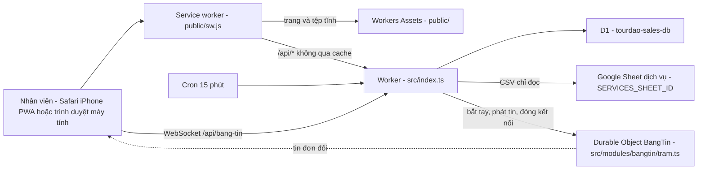
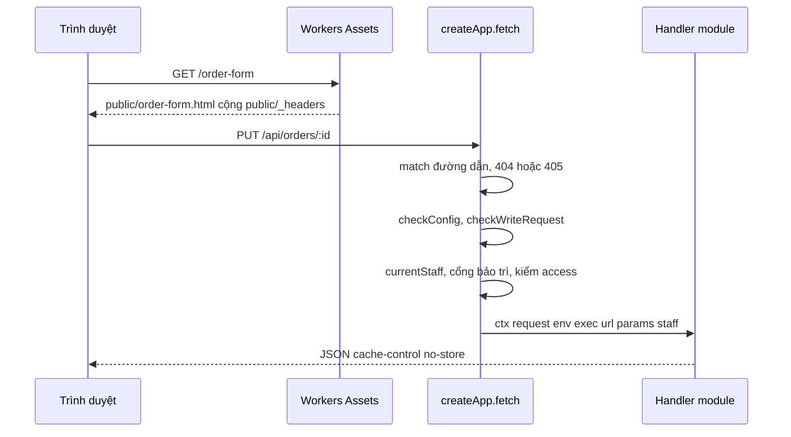
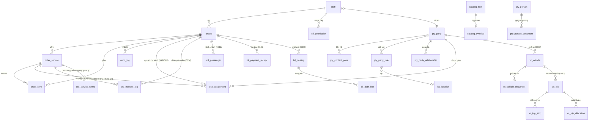
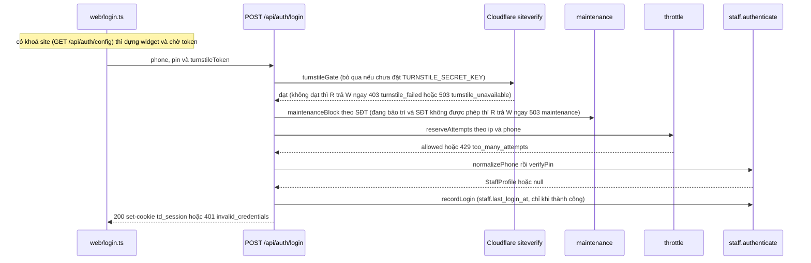

# Thiết kế hệ thống — tourdao-sales

> Mô tả **hiện trạng mã tại HEAD của nhánh này**, cho kỹ sư (hoặc một phiên Claude mới) chưa biết dự án và cần sửa nhanh, đúng.
> Luật kiến trúc: `docs/ARCHITECTURE.md` + `docs/adr/`. Đặc tả nghiệp vụ: `docs/SPEC-tourdao-sales.md`. Danh sách bảng/view và cột của view: `docs/DATA-DICTIONARY.md` (sinh từ `docs/data-dictionary.json`; sổ KHÔNG liệt kê cột của bảng — cột của bảng đọc ở tệp migration trong `migrations/`). Triển khai/hoàn tác: `docs/HANDOFF-N1.md`. PWA: `docs/PWA-IPHONE.md`.
> Tài liệu này KHÔNG chép lại các tệp đó; khi mâu thuẫn thì **mã thắng** — xem §16.
> Sơ đồ kiến trúc tổng quan theo chuẩn C4 (bối cảnh, khối triển khai, các phần máy chủ theo tầng, dữ liệu, vị trí như một SaaS): `docs/so-do-kien-truc/README.md`.

## Mục lục

1. [Mục đích, người dùng, phạm vi, ràng buộc nền tảng](#1-mục-đích-người-dùng-phạm-vi-ràng-buộc-nền-tảng)
2. [Bối cảnh và topology chạy thật](#2-bối-cảnh-và-topology-chạy-thật)
3. [Vòng đời một request](#3-vòng-đời-một-request)
4. [Xác thực và phiên](#4-xác-thực-và-phiên)
5. [Mô hình dữ liệu](#5-mô-hình-dữ-liệu)
6. [Luồng nghiệp vụ chính](#6-luồng-nghiệp-vụ-chính)
7. [Danh mục API](#7-danh-mục-api)
8. [Phân quyền](#8-phân-quyền)
9. [Giao diện](#9-giao-diện)
10. [Build, kiểm thử, triển khai](#10-build-kiểm-thử-triển-khai)
11. [Bảo mật](#11-bảo-mật)
12. [Giới hạn và hiệu năng](#12-giới-hạn-và-hiệu-năng)
13. [Quan sát và vận hành](#13-quan-sát-và-vận-hành)
14. [Lộ trình và điểm gắn tính năng tiếp theo](#14-lộ-trình-và-điểm-gắn-tính-năng-tiếp-theo)
15. [Thuật ngữ](#15-thuật-ngữ)
16. [Sai lệch tài liệu ↔ mã](#16-sai-lệch-tài-liệu--mã)
17. [Bản đồ lõi (mô tả hiện trạng theo Hiến chương kiến trúc)](#17-bản-đồ-lõi-mô-tả-hiện-trạng-theo-hiến-chương-kiến-trúc-docsarchitecturemd-phần-i)

---

## 1. Mục đích, người dùng, phạm vi, ràng buộc nền tảng

**Mục đích.** Sổ đơn hàng nội bộ của Công ty TNHH Tour Đảo: nhân viên lập đơn dịch vụ tour, ghi thông tin chuyến (ngày giờ khởi hành, đón, khách có mặt), xác nhận hoặc huỷ đơn; quản trị viên quản lý tài khoản + quyền, danh mục dịch vụ (đồng bộ từ Google Sheet), hồ sơ khách/đại lý và địa điểm.

**Người dùng** = nhân viên có tài khoản trong D1 (không có đăng ký công khai). Mười quyền của Nền tảng (`PERMISSION_CODES` ở `src/shared/permissions.ts`): `SALES` (Bán hàng), `ACCOUNTING` (Kế toán), `ADMIN` (Quản trị), `FIELD` (Hướng dẫn viên), `PARTNER` (Đối tác — ADR-0014), `SUPER_ADMIN` (nhãn "Toàn quyền", vai trên Quản trị — ADR-0014, ADR-0018), `INTERN` (Thực tập), `DRIVER` (Tài xế công ty — ADR-0040), `DRIVER_PARTNER` (Tài xế đối tác — ADR-0048; đứng một mình), `HR` (Nhân sự — ADR-0071; chỉ tạo/xem/sửa tài khoản). Một tài khoản mang **nhiều** quyền (ADR-0005).

**Trong phạm vi hiện tại:** đăng nhập (kèm Cloudflare Turnstile khi được bật, khối thông tin công ty và số phiên bản ở màn đăng nhập), sổ đơn (nháp → xác nhận/huỷ), sửa thông tin chuyến sau xác nhận, **người phụ trách đơn** (đặt/đổi/nhận; người phụ trách sửa được đơn như người lập — §6(j), §9), danh mục dịch vụ + ghi đè giá, tài khoản/quyền, hồ sơ (party) và địa điểm, nhật ký, và **Bảng tin** (báo tức thì cho mọi màn hình đang mở khi một đơn đổi — WebSocket + một Durable Object, ADR-0022; §2, §3, §9, §11; **đã lên production từ bản 1.16**).
**Ảnh xác nhận đơn (PNG) gửi khách:** ĐÃ có (v1.0), vẽ ở trình duyệt từ biên nhận do máy chủ dựng (§9). **Tiền** (lần thu, cọc, "Đã giao", "Hoàn thành", khoá tháng, hoa hồng đại lý) ĐÃ có — §6(m), §6(n). **Chưa có trong mã:** xuất PDF/in A4 bản xác nhận, hoá đơn (ô `invoice.request`/`invoice.issue` chưa có route — sổ hoãn `docs/quyen-hoan.json`), phân công NHIỆM VỤ (đón khách, lái cano — N2; riêng "người phụ trách" đã có), màn hình cho tài khoản chỉ-`FIELD` (xem §14).

**Ràng buộc nền tảng.**

| Ràng buộc | Chi tiết |
|---|---|
| Runtime và CSDL | Cloudflare Workers, một Worker duy nhất tên `tourdao-sales` (`wrangler.jsonc`), `compatibility_date` `2026-09-01`; Cloudflare D1 `tourdao-sales-db`, binding `DB`, `migrations_dir: migrations`; Durable Object `BangTin` (binding `BANG_TIN`, MỘT thực thể tên `cong-ty`, migration DO tag `v1` `new_sqlite_classes` ở `wrangler.jsonc` — chỉ cho Bảng tin, §2) |
| Tệp tĩnh | Workers Assets: thư mục `./public`, binding `ASSETS`, `run_worker_first: ["/api/*"]` |
| Ngôn ngữ và giao diện | TypeScript `strict` + `noUncheckedIndexedAccess` (`tsconfig.json`), không framework, không thư viện router; HTML tĩnh `public/*.html` + TypeScript thuần `web/*.ts` gom bằng **esbuild** vào `public/js/` (gitignored) |
| Phụ thuộc | Chỉ `devDependencies`: `esbuild`, `typescript`, `wrangler`. Không có dependency runtime. |

---

## 2. Bối cảnh và topology chạy thật



*Một tên miền `booking.tourdao.vn` (`routes` + `custom_domain: true`); vì khai `routes` mà không khai `workers_dev`, địa chỉ `workers.dev` đã bị TẮT có chủ ý. `run_worker_first: ["/api/*"]` khiến mọi `/api/*` vào Worker trước, còn lại do Workers Assets phục vụ.*

**Cron.** `triggers.crons: ["*/15 * * * *"]` → `scheduled()` trong `src/index.ts` gọi `ctx.waitUntil(runScheduledSync(env))` (module `catalog`) để kéo danh mục dịch vụ.

**Bảng tin — Durable Object `BangTin` (ADR-0022; đã lên production từ bản 1.16).** Thông báo tức thì "đơn vừa đổi" tới mọi màn hình đang mở, không cần bấm tải lại. Thành phần:

- **Trạm** `src/modules/bangtin/tram.ts` — lớp `BangTin extends DurableObject`, MỘT thực thể tên `cong-ty` cho cả công ty (`env.BANG_TIN.getByName("cong-ty")`); lưu trữ theo lớp SQLite (`new_sqlite_classes`) nhưng KHÔNG lưu gì ngoài một báo thức: không bảng, không lưu tin — tin đi rồi là thôi. Dùng WebSocket Hibernation API: `ctx.acceptWebSocket(server, nhãn)` (nhãn = tag), `serializeAttachment({ staffId, hetHan })` gắn vào kết nối; `setWebSocketAutoResponse("ping" → "pong")` trả lời mà không đánh thức trạm (BT-3); `webSocketMessage/Close/Error` không làm gì (mọi tin trình duyệt gửi lên bị bỏ). Bốn lối vào: `fetch` (chỉ nhận yêu cầu bắt tay do route dựng MỚI), RPC `phat(sự kiện, nhãn)` và RPC `dongCua(…)` (chỉ gốc lắp ráp gọi), và `alarm`.
- **Route bắt tay** `GET /api/bang-tin` (`src/modules/bangtin/index.ts`, module lá hạng `KHONG_DB` — không bảng, không SQL, không `env.DB`; `architecture.test.ts` ép) và luật thuần `bangtin/rules.ts` (`kiemOrigin`, `docHanGiay`, `keHoachTram` — MỌI quyết định đóng/gửi/báo thức nằm ở đây để `node --test` kiểm được; `tram.ts` chỉ là vỏ gọi API Cloudflare).
- **Gốc lắp ráp** `src/index.ts` — nơi DUY NHẤT nạp lớp `tram.ts` (`export { BangTin } from "./modules/bangtin/tram"`; `architecture.test.ts` cấm nơi khác) và nối hai hàm tiêm `baoThayDoi`/`dongBangTin` (§3). `orders`, `dispatch`, `accounts`, `maintenance` KHÔNG import `bangtin`, chỉ gọi `ctx.baoThayDoi`/`ctx.dongBangTin`.
- **Hàm thuần dùng chung server ↔ trình duyệt** `src/shared/bang-tin.ts` (§9): nhãn kết nối/sự kiện suy từ `can()`, kiểu sự kiện đúng 5 khoá, câu thông báo nổi, thời gian chờ nối lại.
- **Phía trình duyệt** `web/bangtin.ts` + `web/bangtin-logic.ts` + `web/toast.ts` + `web/lam-moi-logic.ts` (§9).
- **Sự kiện chuyến xe** (ADR-0052 D6.4, Vận chuyển Đợt 2): loại `chuyen`, đúng 4 khoá (mã chuyến, loại thay đổi, thời điểm — không id chuyến), tới nhóm `dieu-xe` (kết nối có `can(trip.view)` không ngữ cảnh: Bán hàng, Kế toán, Quản trị, Toàn quyền) + `nguoi:<tài xế có dòng lái lúc sự kiện>`; không bao giờ `tat-ca`. Route lệnh chuyến gọi `ctx.baoThayDoiChuyen({ tripId, requestId })` sau lô thành công; gốc lắp ráp đọc hành động theo `requestId`, phát cho chuyến nguồn + chuyến liên quan (dời khách). Trình duyệt phát `chuyen-thay-doi` (gộp 1 giây, không thông báo nổi); `/dieu-phoi`, `/chuyen`, `/cuoc`, `/cuoc-chuyen` và chuông tự tải lại.

Không có D1 migration; có MỘT migration Durable Object (tag `v1`) do `wrangler deploy` tự áp — cửa một chiều mềm (`docs/HANDOFF-N1.md`, mục runbook Bảng tin). Mỗi lần deploy ngắt mọi kết nối (Cloudflare khởi động lại Durable Object); trình duyệt tự nối lại trong 1–30 giây.

**Google Sheet — chỉ ĐỌC, công khai.** `src/shared/sheets.ts#fetchSheetCsv` gọi `https://docs.google.com/spreadsheets/d/<id>/export?format=csv`, `AbortSignal.timeout(8000)`. App **không bao giờ** ghi ngược vào Sheet.

**Biến và bí mật.**

| Tên | Loại | Đặt ở đâu | Dùng ở đâu |
|---|---|---|---|
| `SERVICES_SHEET_ID` | biến công khai (`vars`) | `wrangler.jsonc` | `catalog`: `syncCatalog` |
| `SESSION_SECRET` | **bí mật** | `wrangler secret put SESSION_SECRET` (production), `.dev.vars` (local — xem `.dev.vars.example`) | ký/kiểm cookie phiên (`src/modules/auth/session.ts`) |
| `MFA_ENCRYPTION_KEY` | **bí mật, cần cho bảo mật hai lớp** (32 byte base64, ADR-0074 Phần B) | `wrangler secret put MFA_ENCRYPTION_KEY` (production — chủ đặt TRƯỚC khi triển khai bản có Phần B, `docs/HANDOFF-N1.md`), `.dev.vars` (local — xem `.dev.vars.example`) | `auth`: mã hoá AES-GCM khoá TOTP lưu ở `aut_mfa_factor.secret_enc` và phiếu bật (`src/modules/auth/mfa-crypto.ts`). Vắng / sai dạng ⇒ mọi bước cần khoá TOTP trả 503 `mfa_unavailable` + log `mfa_key_missing` (không 500, không cấp phiên); mã dự phòng vẫn dùng được. Mất / đổi khoá ⇒ khoá TOTP đã lưu không giải được — mọi người phải bật lại |
| `TURNSTILE_SITE_KEY` | biến công khai, **tuỳ chọn** | `vars` của `wrangler.jsonc` khi có khoá thật (chưa thêm), `.dev.vars` (local) | `auth`: `GET /api/auth/config` trả cho trang đăng nhập dựng widget Turnstile |
| `TURNSTILE_SECRET_KEY` | **bí mật, tuỳ chọn** | `wrangler secret put TURNSTILE_SECRET_KEY` (production, chỉ khi chủ dự án ra lệnh), `.dev.vars` (local) | `auth`: `verifyTurnstile` (`POST /api/auth/login`). Vắng ⇒ Turnstile TẮT (xem mục 4) |
| `LAN_GUI_SECRET` | **bí mật, BẮT BUỘC** (≥ 32 ký tự, ADR-0094 đ4) | `wrangler secret put LAN_GUI_SECRET` (production), `.dev.vars` (local — xem `.dev.vars.example`) | `lan-gui`: khoá HMAC-SHA-256 của vân tay nội dung vé chống ghi trùng (`src/modules/lan-gui/rules.ts`, `checkLanGuiConfig`). Thiếu hoặc ngắn ⇒ mọi route trả 500 `server_misconfigured` (cùng cơ chế `SESSION_SECRET`) |
| `PASSKEY_RP_ID`, `PASSKEY_ORIGIN` | biến công khai, tuỳ chọn (Face ID) | `vars` của `wrangler.jsonc` (production); local phải ghi đè trong `.dev.vars` | `auth`: `passkeyRelyingParty` (`webauthn.ts`). Vắng, lệch nhau hoặc không https (trừ localhost) ⇒ Face ID TẮT |
| `VAPID_PUBLIC_KEY`, `VAPID_PRIVATE_KEY` | công khai (`vars`) / **bí mật** (`wrangler secret put`), tuỳ chọn | như cột trái | `shared/web-push.ts#khoaVapid` (Web Push, ADR-0036). Thiếu một khoá hoặc hai khoá lệch cặp ⇒ Web Push TẮT, không lỗi |
| `OPENAI_API_KEY`, `OPENAI_BASE_URL` | **bí mật** / biến, tuỳ chọn | `wrangler secret put OPENAI_API_KEY`; `OPENAI_BASE_URL` chỉ cho e2e / máy giả | `tro-ly` (ADR-0066). Vắng khoá ⇒ trợ lý trả 503 "chưa bật" |
| `EMAIL`, `FEEDBACK_NOTIFY_EMAIL`, `FEEDBACK_MAIL_FROM` | binding `send_email` / hai bí mật, tuỳ chọn | `wrangler.jsonc` (binding); `wrangler secret put` (hai địa chỉ) | `feedback/notify.ts#mailConfig` (email báo quản trị khi có Góp ý). Thiếu thì email tự tắt, yêu cầu Góp ý vẫn lưu |
| `DB` / `ASSETS` | binding D1 / binding Workers Assets | `wrangler.jsonc` | `env.DB` ở mọi module; `ASSETS` do nền tảng dùng |
| `BANG_TIN` | binding Durable Object (lớp `BangTin`) | `wrangler.jsonc` (`durable_objects.bindings` + `migrations` tag `v1`); kiểu khai TAY ở `worker-configuration.d.ts` | `src/modules/bangtin/index.ts` (`getByName("cong-ty")`); lớp ở `src/modules/bangtin/tram.ts`, export từ `src/index.ts` |
| `BANG_TIN_HAN_GIAY` | biến, **tuỳ chọn, KHÔNG đặt ở production** | chỉ `--var` khi chạy e2e (`tests/e2e/run.mjs` đặt `20`) hoặc `.dev.vars`; khai TAY dạng tuỳ chọn ở `worker-configuration.d.ts` | `bangtin/rules.ts#docHanGiay`: hạn sống một kết nối Bảng tin, giây; vắng hoặc không phải số nguyên dương → 900; kẹp trong [5, 3600] |

`SESSION_SECRET` ngắn hơn `MIN_SECRET_LENGTH` = 32 ký tự (`checkAuthConfig`) HOẶC `LAN_GUI_SECRET` thiếu / ngắn hơn 32 ký tự (`checkLanGuiConfig`) → **mọi** route trả 500 `server_misconfigured`; gốc lắp ráp nối hai kiểm này bằng `checkConfig: (env) => checkAuthConfig(env) ?? checkLanGuiConfig(env)` (`src/index.ts`). Hai biến Turnstile, cặp `PASSKEY_*`, cặp VAPID, `OPENAI_*` và email Góp ý KHÔNG đi qua `checkConfig` (vắng là trạng thái hợp lệ "tắt" tính năng đó). Kiểu của `Env` ở `worker-configuration.d.ts` (sinh bởi `npm run types` khi `.dev.vars` có đủ bí mật; hai biến Turnstile đang khai tay dạng tuỳ chọn — xem `docs/CHANGE-GUIDE.md` công thức l; `LAN_GUI_SECRET`, cặp VAPID, `OPENAI_*`, `BANG_TIN` và `BANG_TIN_HAN_GIAY` cũng khai tay — `npm run types` chỉ sinh lại `BANG_TIN_HAN_GIAY` nếu `.dev.vars` có tên đó, xem bẫy ở `docs/CHANGE-GUIDE.md` §4).

---

## 3. Vòng đời một request



*Tệp tĩnh không chạm Worker; `/api/*` đi qua `createApp` rồi mới tới handler của module.*

**`src/shared/router.ts`** — router tối giản, không import module nào (gốc lắp ráp `src/index.ts` tiêm `currentStaff`, `checkConfig` và `injected`):

- `route(method, path, access, handler)`; `Access = "public" | "staff" | "office" | "orders" | "admin" | "accounts"` (`accounts` — ADR-0071: Quản trị, Toàn quyền, Nhân sự; cổng `ACCOUNTS_GATE`, mục 8).
- Khớp đường dẫn bằng `split("/").filter(Boolean)`, tham số `:tên` giải mã bằng `decodeURIComponent`. Không khớp đường dẫn nào → **404** `not_found`; khớp đường dẫn nhưng sai phương thức → **405** `method_not_allowed` kèm header `allow`.
- `injected` (BẮT BUỘC, ADR-0007 điều 4(b)): các hàm nối chéo module do gốc lắp ráp cung cấp. **Danh sách đầy đủ là kiểu `AppOptions.injected` ở `src/shared/router.ts` và đối tượng `injected` ở `src/index.ts` — nay dài hơn nhiều so với phần mô tả dưới đây** (thêm: chuyến cho tin, mốc tối thiểu, ngưỡng hết hạn, nhãn nhân viên, hướng dẫn viên, gộp hồ sơ, bên đặt của tôi, dấu nhập kế toán, giao lô đẩy, lớp vé), mỗi hàm có chú thích lý do ngay tại gốc. Phần dưới kể các hàm đầu tiên; hai hàm đầu từ module `dispatch` — router đưa vào `ctx` thành `ctx.isAssigned(orderId)` (người đang đăng nhập có phải người phụ trách đang mở của đơn không; một truy vấn D1 mỗi lần gọi, chỉ route nào cần thì gọi) và `ctx.newOrderHandler(staffId)` (ADR-0030 S20-4, thay `defaultHandlerStatement` cũ — đơn mới KHÔNG BAO GIỜ tự gắn người lập: `dispatch` đọc tài khoản NGƯỜI ĐƯỢC CHỌN lúc lập đơn, xét bằng `checkAssignee`, trả `{ ok: true, statements(orderId, at) }` — các câu lệnh chưa chạy mở dòng `HANDLE` + nhật ký, dựng theo id đơn và mốc `at` của từng lần thử của `createOrder` — hoặc `{ ok: false, message }`; một truy vấn D1 mỗi lần gọi; chưa đăng nhập → không đạt, không truy vấn). `orders` dùng chúng mà KHÔNG import `dispatch`. **ADR-0030 S20-13** thêm hai hàm tra cứu nữa từ `dispatch`: `ordersWithHandler(env, orderIds)` → `ctx.ordersWithHandler(ids)` (trong các đơn này, đơn nào ĐANG có người phụ trách — trả `Set`; không phụ thuộc người gọi; mảng rỗng không truy vấn; Trang chủ đếm ô "Chưa phụ trách" bằng hàm này) và `handledOrderIdsOf(env, staffId)` → `ctx.myHandledOrderIds()` (đơn mà người ĐANG ĐĂNG NHẬP phụ trách, id lấy từ phiên; chưa đăng nhập → `[]`). `orders` không đọc view `v_dsp_*` của `dispatch` (bài `src/architecture.test.ts`, kể cả tệp test). Hàm thứ ba `maintenanceBlock(env, staff)` (từ module `maintenance`) là cổng chế độ bảo trì — bullet về `access` ngay dưới. **Bảng tin (ADR-0022)** thêm hai hàm BẮT BUỘC nữa: `baoThayDoi(env, người thao tác, { orderId, thayDoi, handlerTruoc? })` và `dongBangTin(env, { staffId } | "tat-ca")`; router đưa vào `ctx` thành `ctx.baoThayDoi(e)` và `ctx.dongBangTin(muc)` kiểu `void` — route KHÔNG `await` được: router bọc `exec.waitUntil(Promise.resolve().then(…).catch(…))` nên lỗi phát tin/đóng kết nối không làm hỏng hay chậm thao tác ghi, chỉ ghi một dòng log `bang_tin_loi` (`{ viec: "bao" | "dong", name }`, không SĐT/tên/nội dung lỗi — §13). `ctx.baoThayDoi` là no-op ở route công khai (không có người thao tác). Phía `src/index.ts`, `baoThayDoi` thoát ngay khi vắng CẢ binding `BANG_TIN` LẪN cặp khoá VAPID hợp lệ (`khoaVapid` — khung thử `tests/audit`, `router.test.ts`, e2e không có trạm cũng không có khoá gõ cửa; chỉ cần một trong hai là vẫn chạy tiếp, vì phát qua trạm và gõ cửa điện thoại là hai việc độc lập), rồi đọc song song `findOrderRef` (orders) + `handlerOf` (dispatch), dựng sự kiện đúng 5 khoá (`tao` mà không ai phụ trách → `tao_cho_nhan`), tính nhãn người nhận bằng `nhanSuKien` và gọi `phatDon`.
- `checkConfig` lỗi → **500** `server_misconfigured` (ghi log, không bao giờ in giá trị bí mật).
- `checkWriteRequest` với `POST/PUT/PATCH/DELETE`: so `Origin` với `url.origin` (thiếu `Origin` thì xét `Sec-Fetch-Site === "same-origin"`) → sai thì **403** `cross_origin`; thân không phải `application/json` → **415** `unsupported_media_type`.
- `access !== "public"` mà không có phiên → **401** `unauthenticated`; rồi **cổng bảo trì** (`injected.maintenanceBlock`): tài khoản bị chặn lúc này → **503** `maintenance` (mục 4), handler không chạy; RỒI mới kiểm quyền: `admin` mà `passesAdminGate(staff)` sai → **403** `forbidden`; `accounts` mà `passesAccountsGate(staff)` sai → **403** `forbidden`; `office` mà `isOffice(staff)` sai → **403** `forbidden`; `orders` mà `canAccessOrders(staff)` sai → **403** `forbidden` (bốn hàm đọc bốn danh sách `ADMIN_GATE`/`ACCOUNTS_GATE`/`OFFICE_GATE`/`ORDERS_GATE`, mục 8). Cổng đứng TRƯỚC kiểm quyền để người bị chặn thấy "đang bảo trì" chứ không phải "không đủ quyền". Cổng KHÔNG chạy cho route `public` (xem danh sách đầy đủ ở §7: sáu route `auth` — `config`, `login`, hai route `passkey`, `logout`, `session-ended` —, `GET /api/company`, `GET /giao-dien.css`, `GET /api/giao-dien.css`); `GET /api/auth/me` là route `staff` nên có qua cổng. Chi phí: MỘT truy vấn D1 (`getMaintenanceState`) mỗi request cần đăng nhập, cố ý KHÔNG đệm (hiệu lực ngay khi bật). `maintenanceBlock` là trường BẮT BUỘC của `injected` — thiếu là lỗi `tsc`, không phải chế độ bảo trì lặng lẽ mất tác dụng.
- **Lớp chống ghi trùng** (ADR-0094, bản mở rộng — giai đoạn 1; chi tiết đặc tả `docs/superpowers/specs/2026-10-02-lop-chong-ghi-trung-chung-de-xuat.md` §3.3, §3.5): SAU mọi cổng ở trên, TRƯỚC handler, cho mọi route `POST/PUT/PATCH/DELETE` có `access ≠ "public"` không nằm trong tệp miễn `src/shared/lan-gui-mien.ts` (hôm nay rỗng). Phần của module `lan-gui` đến qua `injected.lanGui` (BẮT BUỘC — thiếu ⇒ route ghi có đăng nhập trả **500** `server_misconfigured`, T18).
  1. Header `Idempotency-Key` (vé do máy khách sinh — `web/api.ts`): **thiếu** ⇒ giai đoạn 1 cho qua, log `{event:"thieu_ma_lan_gui", duong:"<METHOD> <mẫu route>"}` (bản siết sau này: 400); **sai dạng** (≠ 16–64 ký tự `[A-Za-z0-9-]`) ⇒ **400** `ma_lan_gui_sai_dang`.
  2. Vân tay = HMAC-SHA-256 (khoá `LAN_GUI_SECRET`) của phương thức + `pathname+search` + thân THÔ (đọc từ `request.clone()`).
  3. Tra trước `lg_lan_gui` theo (tài khoản, vé) bằng D1 gốc: khác vân tay ⇒ **422** `ma_lan_gui_khac_noi_dung`; chưa có kết quả, < 10 giây ⇒ **409** `dang_xu_ly`; đã có kết quả ⇒ **phát lại** (không chạy handler): 200 `{ da_ghi_truoc_do: true, ket_qua }` (hoặc mã + mã lỗi máy cũ + câu cố định khi lần đầu bị từ chối mà vẫn ghi vé) kèm header `Idempotent-Replayed: true`; kết quả 500 / chưa có sau 10 giây ⇒ 200 với `ket_qua: null`. Mỗi lần phát lại tăng `so_lan_lap` (waitUntil).
  4. Chưa có ⇒ handler chạy với `env.DB` BỌC (`src/shared/lan-gui-boc.ts`): câu chèn vé nối CUỐI lô ghi đầu tiên THÀNH CÔNG của lệnh ⇒ **có vé ⇔ lô ghi của lệnh đã thành công**; các lệnh ghi trong một yêu cầu chạy tuần tự. Hàm tiêm có câu vào chính lô (`newOrderHandler`, `gopHoSo`, các hàm đọc) nhận env bọc; việc bắn-và-quên (`baoThayDoi`, `baoThayDoiChuyen`, `dongBangTin`, `giaoLoDay`) dùng env gốc. Câu ghi phụ trước lô chính chỉ đi "ngoài vé" qua lối có tên `dbNgoaiVe` (danh sách `NGOAI_VE` ở `src/shared/lan-gui-no.ts` — hôm nay 4 chỗ: `demThanCu` của orders; `verifyPinThrottled` của auth (đếm lần sai PIN, dùng cả ở bật Face ID / đổi PIN); `limitChallenge`, `checkPasskeyAssertion` của auth/passkey).
  5. Lô đụng khoá vé (lần gửi đồng thời đã thắng) ⇒ bỏ phản hồi của handler, tra lại, trả như bước 3. 6. Đã ghi vé ⇒ ghi kết quả nền (`ma_tra`; `ma_loi` khi 4xx; `ket_qua` = header `Location` khi 2xx và là trang nội bộ chỉ chứa id). 7. Handler báo lỗi mà không ghi vé ⇒ tra lại một lần. 8. Handler ném: lỗi là ĐỤNG VÉ (D1 báo `UNIQUE constraint failed: lg_lan_gui.…`) ⇒ tra lại, có dòng thì phát lại như bước 3, không có ⇒ **409** `dang_xu_ly` (không 500); đã ghi vé ⇒ `ma_tra = 500`; khác ⇒ tra lại rồi ném tiếp.
  Route TẠO (201) gửi `Location` (`kemLocation`, `trangDon` của `src/shared/http.ts`). Log `lan_gui_ghi_nhieu_lan` khi lệnh ghi > 1 lần (H5 — danh sách nợ `GHI_NHIEU_LAN`), `lan_gui_dung_ve` / `lan_gui_loi_la` (không dữ liệu). Dòng vé KHÔNG có thân, SĐT, tên, PIN; `duong` là mẫu route. Ba cơ chế cũ (Góp ý, Thông báo `clientRequestId`; Vận chuyển `requestId`) giữ nguyên — lớp thứ hai vô hại.
- **Router KHÔNG bọc/dựng lại phản hồi của route** (trừ phản hồi PHÁT LẠI của lớp chống ghi trùng — chỉ ở route ghi, không bao giờ ở `GET /api/bang-tin`) (`fetch` trả thẳng `await dispatch(...)`, `dispatch` trả thẳng kết quả handler; `src/index.ts` `fetch: app.fetch`). Điều này BẮT BUỘC cho `/api/bang-tin`: phản hồi 101 của trạm mang thuộc tính `webSocket` — `new Response(body, res)`/thêm header chung lên nó làm rơi `webSocket` và bắt tay hỏng lặng lẽ. Đừng thêm bước bọc chung ở router mà không miễn `/api/bang-tin` (e2e `bangtin.mjs` ca 1 mở kết nối thật nên sẽ hỏng khi đó — nhưng chưa từng thử cố ý làm hỏng để thấy đỏ).
- **Một request bắt tay Bảng tin** (`GET /api/bang-tin`, `Upgrade: websocket`; không nằm trong `checkWriteRequest` vì là GET): khớp đường dẫn (404/405) → `checkConfig` (500) → **401** chưa đăng nhập → **503** chế độ bảo trì (cổng của router) → handler `bangtin`: thiếu `Upgrade: websocket` → **426** (kèm `upgrade: websocket`) → `kiemOrigin` (CÓ `Origin` VÀ bằng `url.origin`; vắng/lạ → **403** `cross_origin`; KHÔNG có nhánh `Sec-Fetch-Site` dự phòng như `checkWriteRequest`) → vắng binding `BANG_TIN` → **503** `unavailable` → tính nhãn `nhanKetNoi(staff)` bằng `can()` → dựng yêu cầu MỚI `https://bang-tin/ket-noi` chỉ với ba header do máy chủ đặt (`upgrade`, `x-bang-tin-nhan`, `x-bang-tin-nguoi`) — header `x-bang-tin-*` hay cookie của trình duyệt KHÔNG được chép sang (BT-2) → `getByName("cong-ty").fetch(...)` → trạm `acceptWebSocket` + đặt hạn/báo thức → **101**. Route dùng `access: "staff"` (mọi tài khoản đang đăng nhập, kể cả Đối tác và Hướng dẫn viên); Ai nhận được tin nào do nhãn quyết định, không do route.
- Bọc toàn cục: ngoại lệ → **500** `internal` kèm `requestId` (`cf-ray` hoặc `crypto.randomUUID()`), log JSON một dòng `{level, event: "unhandled", requestId, method, path, error}`.

**`src/shared/http.ts`** — `json()` (luôn `content-type: application/json; charset=utf-8` + `cache-control: no-store`), `error(status, code, message)`, `readJson()`, `intParam(v, fallback, min, max)`, `escapeLike()`, `getCookie()`, `UUID_RE`, `kemLocation(res, trang)` / `trangDon(id)` (header `Location` cho route tạo — ADR-0094 A-10).

**`public/_headers`** (chỉ áp cho tệp tĩnh): CSP `default-src 'self'; script-src 'self' https://challenges.cloudflare.com; style-src 'self' 'unsafe-inline'; img-src 'self' data: blob:; font-src 'self' data:; connect-src 'self' wss://booking.tourdao.vn https://challenges.cloudflare.com; frame-src https://challenges.cloudflare.com; object-src 'none'; base-uri 'none'; form-action 'self'; frame-ancestors 'none'` (Cloudflare mở duy nhất cho widget Turnstile ở màn đăng nhập — đúng ba directive này, không nới `style-src`/`img-src`; `frame-src` chỉ có Cloudflare nên khung cùng nguồn cũng bị chặn — app không dùng iframe nào; đã đo bằng Chrome thật, `docs/evidence/2026-09-21-v1-0/`; `connect-src` còn liệt kê rõ `wss://booking.tourdao.vn` cho WebSocket Bảng tin vì Safari cũ không coi `wss:` cùng máy là `'self'` — local/LAN dựa vào `'self'`, **chưa kiểm** trên Safari iPhone thật qua LAN), `X-Content-Type-Options: nosniff`, `Referrer-Policy: same-origin`, `X-Frame-Options: DENY`, `Permissions-Policy: camera=(), microphone=(), geolocation=()`; riêng `/sw.js` là `Cache-Control: no-store` (KHÔNG `no-cache` — lý do ở `docs/PWA-IPHONE.md`).

---

## 4. Xác thực và phiên

**Đăng nhập = số điện thoại + PIN 6 số.** `normalizePhone` (`src/shared/phone.ts`) chuẩn hoá về `0xxxxxxxxx`; `isValidPin` (`src/modules/staff/phone.ts`: đúng 6 chữ số) và `isWeakPin` (`src/modules/staff/rules.ts`) chặn PIN toàn số giống nhau hoặc chạy liên tiếp (kể cả cuộn vòng).

**Băm PIN** — `src/modules/staff/password.ts`: PBKDF2-SHA256, `PBKDF2_ITERATIONS = 100_000` (trần của Workers), muối 16 byte ngẫu nhiên, khoá 256 bit; chuỗi lưu `pbkdf2$sha256$<iter>$<salt>$<hash>` (base64url). So sánh bằng `timingSafeEqual`. `verifyDummy()` chạy một phép băm giả khi SĐT không tồn tại để thời gian phản hồi không lộ tài khoản nào có thật.

**Cookie phiên** — `src/modules/auth/session.ts`: tên `td_session`; token `"<staffId>.<issuedAt ms>.<mã phiên>.<HMAC-SHA256 base64url>"` ký bằng `SESSION_SECRET` (ADR-0075 điều 1 — token kiểu cũ 3 phần bị từ chối; mã phiên = khoá dòng `aut_session`); `SESSION_TTL_SECONDS = 60*60*24*7` (7 ngày). Thuộc tính: `Path=/; Max-Age=604800; HttpOnly; SameSite=Lax` và `Secure` khi request là `https:`. Chữ ký đúng nhưng `issuedAt > now + 60_000` → từ chối (đồng hồ lạ).

**Sổ phiên (ADR-0075).** Mỗi lần cấp phiên mới (đăng nhập PIN / Face ID, và từ Phần B ADR-0074: bước hai, bật lại khi đăng nhập) là một dòng `aut_session`, cấp ở MỘT nơi `issueLoginSession` — chỉ được gọi ở ĐÚNG bốn route `POST /api/auth/login`, `/api/auth/mfa/verify`, `/api/auth/mfa/enroll/confirm`, `/api/auth/passkey/login`, mỗi route qua cổng của mình trước (hàng rào đọc mã `src/modules/auth/cap-phien-bon-cua.test.ts`) — bằng một lô: dọn phiên hết hạn → (tài khoản KHÔNG được nhiều máy — được nhiều máy = giữ `SUPER_ADMIN`, hoặc vai `IT` đang mở, hoặc một quyền mà `aut_session_policy` đặt "Nhiều máy" — ADR-0085 Q1; Toàn quyền/IT là khoá cứng, chính sách không đổi được) kết thúc mọi phiên còn sống, lý do "bị thay" → chèn phiên mới; chỉ mục duy nhất có điều kiện `aut_session_one_live` là lưới khi hai lần đăng nhập chạy đua (lần thua nhận 409 `session_race`). `currentStaff` trả `{ staff, sessionId }`; router đưa `ctx.sessionId` cho route.

**Thu hồi phiên.** `currentStaff` kiểm chữ ký (sai thì loại NGAY, chưa đụng D1) → ba câu CÙNG LÚC (ADR-0102): dòng `aut_session` còn sống (chưa kết thúc, chưa hết hạn), `getActiveStaff(db, id, issuedAt)` và trạng thái chế độ bảo trì (chuyển cho cổng bảo trì của router qua `baoTri`, `/api/auth/me` dùng lại); `last_seen_at` ghi tối đa 5 phút một lần và ghi Ở NỀN (`waitUntil`, không chặn phản hồi) — `getActiveStaff`: tài khoản phải `active = 1`, và nếu `staff.credentials_changed_at` (mili-giây) **lớn hơn** thời điểm phát hành phiên thì phiên bị từ chối (lưới an toàn). Đổi PIN / đặt lại PIN cập nhật cột này ⇒ mọi thiết bị cũ bị đăng xuất; route đổi PIN / gỡ Face ID / đặt PIN bằng Face ID cấp lại cookie cho thiết bị hiện tại, GIỮ mã phiên (`reissueSessionCookie`).
Từ ADR-0075 điều 4–5, mọi thao tác đổi thông tin đăng nhập còn KẾT THÚC DÒNG phiên trong CÙNG lô ghi (lưới `credentials_changed_at` giữ nguyên): bốn route tự phục vụ (đổi PIN `doi_pin`, đặt PIN bằng Face ID `doi_pin`, gỡ một / gỡ mọi Face ID `doi_face_id`) kết thúc mọi phiên KHÁC (`endOtherSessionsStatement`) và đặt `last_seen_at` của phiên giữ lại = đúng mốc ghi vào `credentials_changed_at` (`markSessionReissuedStatement`, để `sessionStatus` — so lưới với max(`created_at`, `last_seen_at`) — không coi phiên đang dùng là "Đã đổi thông tin đăng nhập"); Quản trị đặt lại PIN (`dat_lai_pin`) / gỡ mọi Face ID (`doi_face_id`) kết thúc MỌI phiên (`endAllSessionsStatement`); ngưng tài khoản nối `session_end_all_if_suspended` (`ngung`, chỉ khi tài khoản đã ngưng — đọc `v_stf_staff_label`) vào CUỐI lô. Các câu mới luôn đứng CUỐI lô, không chen vào chuỗi `changes() > 0`. Gỡ một Face ID kiểm khoá có thuộc mình TRƯỚC lô (sai → 404, không đăng xuất máy nào); gỡ mọi Face ID (tự phục vụ / Quản trị) đếm khoá còn hiệu lực TRƯỚC lô — 0 khoá thì không thêm câu kết thúc / đánh dấu phiên nào (không có gì đổi). Hàng rào đọc mã: `src/modules/accounts/phien-cung-lo.test.ts`.

**Máy bị đăng xuất, mất miễn, xem/gỡ phiên (ADR-0075 điều 3, 6–8).** Mã kết thúc (`end_reason`): `dang_xuat`, `bi_thay`, `bi_go`, `doi_pin`, `dat_lai_pin`, `tat_hai_lop` (Phần B), `ngung`, `het_han`, `mat_mien`, `doi_face_id` (mã thứ mười — thêm lúc thi công vì gỡ Face ID cũng đẩy `credentials_changed_at`; ADR-0075 điều 4 chưa liệt kê, chờ chủ ghi nhận); nhãn tiếng Việt ở `END_REASON_LABEL` (`src/modules/auth/session-ledger.ts`; lời báo "bị thay" + giờ VN ở `src/shared/session-ended.ts`), trang đăng nhập hiện lời báo qua `POST /api/auth/session-ended`. Đăng nhập của tài khoản một máy (PIN / Face ID) lấy mã phiên bị thay bằng `RETURNING id` của câu "bị thay" rồi gọi `ctx.dongBangTin({ staffId, sessionIds, giuPhien })` **mọi lần, kể cả khi không ai bị thay**: trạm Bảng tin đóng kết nối nhãn `phien:<id>` (mã 4003 `dang-nhap-may-khac`), và mọi địa chỉ thông báo màn hình khoá của tài khoản bị tắt (`bi-thay`) trừ địa chỉ mang đúng phiên mới (`ntf_push_sub.session_id`, gắn lại khi shell mở trang — `ganPhienThongBaoMayNay` ở `web/shell.ts`). **Mất nhiều máy** (đổi quyền / vai làm tài khoản hết "được nhiều máy", qua `PUT /api/staff/:id/permissions` hoặc `…/roles`; ADR-0085 Q2 điều 7, thay ADR-0075 điều 3): `exemptionChangeStatements` chạy ở LÔ THỨ HAI, sau khi lô đổi quyền/vai đã thắng câu chốt "quản trị viên cuối" (không còn điều kiện SQL `NOT EXISTS v_stf_toan_quyen`) — dọn hạn → kết thúc mọi phiên trừ phiên CÒN HẠN mới nhất (`mat_mien`) → đánh dấu `single = 1`; được nhiều máy → `single = 0`. Lô thứ hai KHÔNG nguyên tử với lô quyền: lô hai hỏng ⇒ phiên thừa sống tới lần đăng nhập sau, `R-AUT-SESSION-3` thấy. **Chính sách đăng nhập (ADR-0085, bản 1.64, migration 0067):** Toàn quyền đặt cho từng quyền app (9 mã, không `SUPER_ADMIN`) "Một máy" / "Nhiều máy" ở mục "Chính sách đăng nhập" của trang `/sessions` (ô `auth.session.policy`, chỉ Toàn quyền); bảng trống = bản 1.58 (mọi quyền một máy). "Được nhiều máy" là MỘT mẩu SQL `nhieuMayDieuKien` (`auth/repository.ts`) dùng chung cho siết, đánh dấu, xem trước và `R-AUT-SESSION-3`; `isSingleDevice` là bản TypeScript (tham số chính sách bắt buộc). Lưu = MỘT lô all-or-nothing: đóng dòng hiện hành theo `id` đang xem + chèn dòng mới + nhật ký im-lặng-có-số `session_policy_changed` + **siết theo tập** (quyền chuyển sang Một máy ⇒ mọi tài khoản bị ảnh hưởng chỉ còn phiên còn hạn mới nhất, `mat_mien`); bản cũ ⇒ chỉ mục `aut_session_policy_one_current` vỡ ⇒ 409 `policy_stale`. Số "đăng xuất N máy của M người" trong nhật ký là số ước lượng đếm ngay trước lô (đặc tả §4.2 bước 2 nói số thực — chờ chủ). Sau lưu gọi `ctx.dongBangTin({ phienKetThuc: [mã phiên] })`: đóng Bảng tin và tắt thông báo CHỈ của các máy vừa bị kết thúc (`mat-mien`). Vai IT hết hạn theo NGÀY (không ai bấm) không có lô nào chạy — phiên cũ sống tới lần đăng nhập sau (hở đã biết). **Xem/gỡ:** `GET /api/account/sessions` (mọi tài khoản, của chính mình), `GET /api/sessions` + `POST /api/sessions/:id/revoke` (ô `auth.session.viewAll` / `auth.session.revoke`, chỉ Toàn quyền; route ở module `accounts` vì cần ghi nhật ký `session_revoked` — im lặng — cùng lô, mà cạnh `auth → audit` bị cấm). Gỡ phiên gọi `ctx.dongBangTin({ staffId, sessionIds: [id], chiPhien: true })`: trạm đóng kết nối của đúng phiên đó, và CHỈ đăng ký thông báo mang đúng mã phiên đó bị tắt (`bi-go`, câu `tat_may_cua_phien`) — máy khác của tài khoản và đăng ký cũ `session_id` NULL không đụng (ADR-0075 điều 6b). DTO không có User-Agent; trạng thái tính theo dòng → hạn → lưới `credentials_changed_at`. Trang `/sessions` (`web/sessions.ts`) và mục "Phiên đăng nhập của tôi" ở trang Tôi. Bất biến định kỳ: `R-AUT-SESSION-1` (không tài khoản một máy nào có hai phiên sống — lưới của chỉ mục), `R-AUT-SESSION-2` (tài khoản ngưng không còn phiên chưa kết thúc), `R-AUT-SESSION-3` (mức cảnh báo: tài khoản một máy THEO CHÍNH SÁCH HIỆN HÀNH mà có > 1 phiên sống).

**Cloudflare Turnstile (chỉ ở đăng nhập)** — `src/modules/auth/turnstile.ts` (thuần, có test). `POST /api/auth/login` nhận thêm `turnstileToken`; sau khi đầu vào hợp lệ (400 nếu thiếu SĐT/PIN) và **TRƯỚC** `verifyPinThrottled`, máy chủ gọi `https://challenges.cloudflare.com/turnstile/v0/siteverify` (POST form `secret`, `response`, `remoteip` — chỉ khi `cf-connecting-ip` đúng là IP), hạn chót `TURNSTILE_TIMEOUT_MS` = 5 giây, token dài tối đa 2048 ký tự (`MAX_TOKEN_LENGTH` — ngưỡng ĐÃ ĐỐI CHIẾU 2026-09-21 với tài liệu Cloudflare (tối đa 2048 ký tự); xem log sau khi bật khoá thật). Kẻ tấn công không có token nhận **403 `turnstile_failed`** ("Chưa xác minh được bạn là người thật. Hãy thử lại.") mà **không tiêu hao lượt thử** của SĐT nạn nhân (cũng không của IP). **Đóng khi lỗi**: siteverify không trả lời/HTTP lỗi/hết giờ/thân lạ/secret sai (`invalid-input-secret`, trả HTTP 400) → **503 `turnstile_unavailable`** ("Chưa kết nối được dịch vụ xác minh. Hãy thử lại sau ít phút."), ghi log `turnstile_unavailable` kèm mã ngắn `detail`. `GET /api/auth/config` (public) → `{ turnstileSiteKey }`: khoá site khi có CẢ secret lẫn khoá site, ngược lại `null`.
**Chưa đặt `TURNSTILE_SECRET_KEY` ⇒ TẮT**: bỏ qua kiểm (không khoá chết local/e2e/lần deploy đầu), `config` trả `null`, và mỗi lần đăng nhập máy chủ `console.warn` `turnstile_disabled` để mất secret không thành tắt lặng lẽ — sau deploy phải kiểm `GET /api/auth/config` khác `null`. Có secret mà thiếu khoá site ⇒ vẫn kiểm, trang không có widget nên không ai đăng nhập được (log `turnstile_misconfigured`). **Widget ở trang đăng nhập** (`web/login.ts`): chỉ khi `GET /api/auth/config` trả khoá site, trang tải `api.js` của Cloudflare (`?render=explicit`, script động — không nhúng trong HTML) rồi `turnstile.render` (`theme: "light"`, `language: "vi-vn"`, cỡ `flexible` hoặc `compact` khi lòng thẻ < 300 px). **`theme: "light"` là lệch có chủ ý so với đặc tả nháp v1.0 (ghi "chủ đề theo hệ thống", tức `auto`)**: app chỉ có giao diện sáng, `auto` cho widget tối trên thẻ trắng khi điện thoại bật chế độ tối; đổi lại khi app có chế độ tối. Trạng thái của trang:
- Trong lúc chờ nạp script (tối đa 15 giây) khung giữ chỗ hiện "Đang tải xác minh…" (`<p role="status">`, không phải `<div>` để không lẫn với widget) và nút Đăng nhập khoá; nút khoá tới khi có token; `turnstile.reset()` sau MỌI lần đăng nhập thất bại (token dùng một lần; cổng Turnstile chạy trước PIN nên token đã bị đốt dù PIN sai).
- Lỗi 403/503 của máy chủ hiện nguyên văn ở `#error`; script không tải/`render` lỗi thì thông báo + nút "Thử lại"; `error-callback` của widget cũng hiện thông báo + "Thử lại" và ghi `console.warn("Turnstile báo lỗi, mã:", <mã>)` (callback trả `true` = "đã xử lý" thì Cloudflare KHÔNG ghi mã lỗi ra console, nên lần deploy khoá thật đầu tiên sai tên miền sẽ chỉ còn thông báo chung nếu trang không tự ghi).
- **Hỏi lại cấu hình (tự phục hồi):** `GET /api/auth/config` lỗi lúc mở trang thì nút Đăng nhập mở NGAY (đăng nhập như không có widget; cấu hình chỉ chậm thì nút mở sau 3 giây) và trang hỏi lại NỀN sau 1,5 giây rồi 4 giây (không giữ nút); khi máy chủ đã bật Turnstile mà trang chưa có khoá site, mỗi lần đăng nhập bị 403 `turnstile_failed` / 503 `turnstile_unavailable` lại hỏi lại (ngay, sau 2 giây, sau 4 giây). Mỗi lúc chỉ MỘT vòng, có hạn số lần (không lặp vô hạn, không bão yêu cầu); lấy được khoá thì dựng widget và khoá nút tới khi có token. Đây cũng là lưới an toàn cho người đã mở trang đăng nhập GIỮA lúc deploy mã và lúc `wrangler secret put` (lúc mở, `config` trả `null` nên trang chưa có widget; secret đặt xong thì lần đăng nhập đầu bị 403 rồi trang tự dựng widget, không cần tải lại). Kịch bản Chrome `v1-dang-nhap.mjs` (bước l, o) kiểm cơ chế này. Bỏ cơ chế này thì `siteKey` kẹt `null` và MỌI lần đăng nhập 403 mãi — mà PWA trên iPhone không có nút tải lại. Cấu hình về muộn hơn 3 giây thì widget vẫn được dựng lúc đó.

Đặt secret ở production PHẢI kèm khoá site (`vars`). Đổi PIN không đòi Turnstile.

**Ghi nhận đăng nhập thành công.** `POST /api/auth/login` (PIN) VÀ `POST /api/auth/passkey/login` (Face ID — xem mục dưới) đều gọi `recordLogin` (module `staff`) → `staff.last_login_at` = giờ hiện tại (ISO UTC; migration `0015`; NULL = chưa từng đăng nhập kể từ khi có cột). KHÔNG ghi trong `verifyPinThrottled` (dùng chung với đổi PIN — ghi ở đó thì mỗi lần đổi PIN thành "một lần đăng nhập"), không ghi khi phiên được cấp lại sau đổi PIN. Lỗi ghi được log `record_login_failed` và KHÔNG làm hỏng đăng nhập (chỉ là thống kê). Chỉ lưu thời điểm — không SĐT/PIN nào vào nhật ký. Hiện ở cột "Đăng nhập gần nhất" của `/staff` (`GET /api/staff` → `lastLoginAt`).

**Đăng nhập bằng Face ID (passkey, ADR-0016 — accepted 2026-09-23).** Song song với SĐT + PIN, không thay thế: PIN luôn còn là đường dự phòng. Chuẩn WebAuthn, kiểm phía máy chủ **tự viết bằng Web Crypto** (`src/modules/auth/webauthn.ts`, không thư viện chạy lúc runtime) — CBOR tự giải mã (`src/modules/auth/cbor.ts`), khoá công khai ES256 (`algorithm -7`) hoặc RS256 (`-257`, đòi ≥ 2048 bit).
- **Bật/tắt tính năng theo cấu hình, không theo cột dữ liệu:** `passkeyRelyingParty(env)` (`src/modules/auth/webauthn.ts`) đọc hai biến `PASSKEY_RP_ID`/`PASSKEY_ORIGIN`; thiếu MỘT trong hai, hoặc `origin` không khớp `rpId`, hoặc giao thức không phải `https:` (trừ `localhost`/`127.0.0.1` được `http:`) ⇒ **TẮT** (`passkeyRp` trả `null`, mọi route passkey — cả 10, kể cả xem danh sách, gỡ và quản trị viên gỡ hộ, đặc tả §2.3 — trả 503 `passkey_unavailable` trước mọi truy vấn D1, test `src/passkey-off.test.ts`; khi tắt, đặt lại PIN (`POST /api/staff/:id/reset-pin`) VẪN gỡ hết Face ID, ngưng tài khoản cũng VẪN gỡ (không phụ thuộc công tắc — xem "8b" dưới); `console.warn` MỘT lần mỗi isolate — `passkey_disabled` khi thiếu cả hai biến, `passkey_misconfigured` khi có một trong hai mà cấu hình sai, giống cơ chế `turnstile_disabled` của mục Turnstile). `GET /api/auth/config` trả thêm `passkey: boolean` cho trang đăng nhập/trang Tôi biết có hiện nút hay không.
- **Bảng `aut_passkey`** (migration `0023`, module `auth`): `staff_id`, `credential_id` (UNIQUE — chặn đăng ký lại cùng một khoá), `public_key` (SPKI DER, base64url), `algorithm`, `user_handle` (16 byte ngẫu nhiên gửi làm `user.id` — KHÔNG chứa SĐT/thông tin cá nhân, ADR-0016 điều 8), `sign_count`, `label` (tên máy đoán từ `User-Agent`, vd "iPhone", "Máy Mac" — `src/modules/auth/device-label.ts`), `last_used_at`, hiệu lực `valid_from_at`/`valid_to_at` (gỡ = đóng cột này, KHÔNG xoá cứng).
- **Thách thức KHÔNG lưu D1** — cookie riêng `td_webauthn` (`src/modules/auth/challenge.ts`), ký HMAC **DẪN XUẤT** từ `SESSION_SECRET` bằng nhãn mục đích riêng (`KEY_LABEL`), TTL 300 giây (`CHALLENGE_TTL_SECONDS`), `Path=/api; HttpOnly; SameSite=Strict`. Token có **7 phần** (`w1.<mục đích>.<staffId|->.<ms phát hành>.<challenge>.<phụ|->.<chữ ký>`) — khác hẳn cấu trúc 4 phần của `td_session`, nên token thách thức không bao giờ qua được `verifySessionToken` và ngược lại (khoá dẫn xuất riêng là lớp thứ hai). Ba mục đích (`ChallengePurpose`): `login` (đăng nhập), `register` (bật Face ID, `extra` mang `user_handle`), `pin` (đặt PIN bằng Face ID, điều 2b).
- **Dùng một lần:** một thách thức chỉ xác nhận được đúng MỘT lần — `checkPasskeyAssertion` (`src/modules/auth/passkey.ts`) gọi `markPasskeyUsed` (ghi `last_used_at`) SAU khi kiểm chữ ký/bộ đếm/cổng bổ sung nhưng TRƯỚC khi trả kết quả; dùng lại token cũ ⇒ 400 `passkey_expired`.
- **Luồng đăng nhập** (`POST /api/auth/passkey/options` rồi `POST /api/auth/passkey/login`, cả hai `public`): xin thách thức (hạn mức riêng theo IP, `CHALLENGE_IP_LIMIT` = 120/15 phút — KHÔNG dùng chung bộ chống dò PIN vì không có PIN để dò) → trình duyệt gọi `navigator.credentials.get` → máy chủ tìm khoá theo `credential_id`, kiểm chữ ký (`verifyAssertion`) và bộ đếm (`counterRegressed`: từ chối nếu bộ đếm mới ≤ bộ đếm cũ VÀ cả hai > 0 — nghi khoá bị nhân bản) → cổng bảo trì theo SĐT chủ khoá (TRƯỚC khi tiêu thụ thách thức, đúng thứ tự đặc tả §2.6: kiểm → cổng bảo trì → dùng một lần) → `recordLogin` → cấp `td_session` + xoá `td_webauthn`. Không Turnstile (không phải chỗ để dò PIN) và không bộ chống dò PIN (chỉ hạn mức thách thức).
- **Bật Face ID cho một máy** (tự phục vụ, `staff`): `POST /api/account/passkeys/options` đòi nhập lại PIN hiện tại (cùng `verifyPinThrottled`/bộ chống dò của đăng nhập — điều 2a) rồi mới cấp thách thức `register`; `POST /api/account/passkeys` kiểm `verifyRegistration` và ghi `aut_passkey` + nhật ký `passkey_added`. **Hai lần chạm riêng trên iPhone** (`web/passkey.ts` `enableFlow`): chạm 1 gửi PIN (có `await fetch`), chạm 2 (nút "Tiếp tục với Face ID") gọi `navigator.credentials.create` NGAY, không `await` nào trước đó — Safari/iOS có thể chặn WebAuthn nếu không còn trong "cử chỉ người dùng" trực tiếp (đặc tả §2.7).
- **Gỡ Face ID:** `DELETE /api/account/passkeys/:id` (một khoá) hoặc `POST /api/account/passkeys/remove-all` (tự phục vụ, tất cả — dùng khi mất máy) đều đóng `valid_to_at`, đẩy `staff.credentials_changed_at` (đăng xuất MỌI máy khác) và cấp `td_session` mới cho máy đang thao tác cùng MỘT mốc `now`; admin gỡ hộ qua `POST /api/staff/:id/passkeys/remove-all` (theo luật "cấp dưới" — mục 8) không cần đặt lại PIN. `POST /api/staff/:id/reset-pin` (đặt lại PIN) cũng gỡ HẾT Face ID của tài khoản đó (điều 6) — đặt lại PIN là tình huống "có thể đã lộ", Face ID cũ không còn đáng tin.
- **Đặt PIN mới bằng Face ID** (điều 2b, không cần PIN cũ): `POST /api/account/pin-by-passkey/options` (thách thức mục đích `pin`, ràng buộc ĐÚNG `staff.id` của phiên) rồi `POST /api/account/pin-by-passkey` — bắt buộc một lần ký Face ID MỚI, phiên đang mở không đủ. Đặt xong thì gỡ khoá "sai PIN quá nhiều" của SĐT (`unlockPhone`, như admin `reset-pin` — chủ quyết 2026-09-23).
- **Mã lỗi riêng** (`PASSKEY_ERRORS`, `src/modules/auth/passkey.ts`): `passkey_unavailable` (503, tắt), `passkey_expired` (400, thách thức hết hạn/đã dùng), `passkey_unknown` (401, khoá đã gỡ/không thuộc tài khoản nào), `passkey_invalid` (401 "Không xác nhận được Face ID…" khi đăng nhập/đặt PIN bằng Face ID: chữ ký/bộ đếm sai; 400 "Không bật được Face ID. Hãy thử lại." khi bật Face ID: dữ liệu đăng ký không hợp lệ), `passkey_exists` (409, máy đã bật), `passkey_none` (409, chưa bật Face ID nào), `passkey_not_yours` (403, đặt PIN bằng Face ID — `POST /api/account/pin-by-passkey` — mà ký bằng khoá của người khác). Gỡ khoá không phải của mình qua `DELETE /api/account/passkeys/:id` KHÔNG dùng mã này: trả 404 `not_found` như khoá không tồn tại.
- **Nhật ký** (`passkey_added`, `passkey_removed`, `pin_set_by_passkey`) KHÔNG chứa id khoá/`credential_id` — chỉ ai, khi nào, đối tượng.
- **Ngưng tài khoản gỡ mọi Face ID trong CÙNG lô ghi ("8b", ADR-0016 điều 6; chủ chọn A-4 phương án 1):** `PATCH /api/staff/:id` với `active: false` nối năm câu vào CUỐI batch của `patchStaffStatements` (sau mọi mắt xích cũ, vì câu gỡ có thể đổi 0 dòng mà chuỗi cũ dựa vào `changes() > 0`): gỡ CÓ ĐIỀU KIỆN `passkey_revoke_all_if_suspended` (chỉ khi tài khoản đang ngưng — đọc qua view `v_stf_staff_label`; câu chốt "còn quản trị viên khác" thua thì không gỡ gì) → `touchCredentialsStatement(…, true)` NGAY SAU (đẩy `credentials_changed_at`, thu hồi phiên cũ) → nhật ký `passkey_removed` "gỡ khi ngưng tài khoản" (`changes() > 0`) → `session_end_all_if_suspended` (ADR-0075 điều 4: kết thúc mọi dòng phiên, lý do `ngung`, cùng điều kiện "đang ngưng") → `trusted_revoke_all_if_suspended` (ADR-0074 Phần B Task 8: thu hồi mọi máy được tin, lý do `ngung`, cùng điều kiện — cần vì câu touch ở trên chỉ chạy khi gỡ được Face ID). Kích hoạt lại tài khoản KHÔNG làm Face ID cũ hay máy được tin cũ sống lại. Bất biến `R-AUT-1` (§10, `scripts/audit-checks.mjs`) là lưới dữ liệu cho điều này: sau triển khai phải xanh; đỏ là lỗi thật.

**Bảo mật hai lớp bằng ứng dụng xác thực (ADR-0074 Phần B, migration `0101`; đặc tả `docs/superpowers/specs/2026-10-01-xac-thuc-hai-lop-dac-ta.md`; Phần C — mã qua email, migration `0102` — ở khối "Mã qua email" dưới đây; nhánh `worktree-hai-lop-email`, CHƯA gộp).** Yếu tố thuộc TÀI KHOẢN (module `auth`), không thuộc hồ sơ.
- **Cổng ở đăng nhập PIN** (`POST /api/auth/login`, sau Turnstile → bảo trì → chống dò PIN): luật thuần `loginStep` (`src/modules/auth/mfa-rules.ts`) trả một trong bốn: `session` (bên ngoài chưa bật; nội bộ chưa bật còn ân hạn; đã bật và máy được tin còn hạn) → cấp phiên như cũ (`PIN` / `PIN_TRUSTED`); `mfa` (đã bật, máy chưa được tin) → **chưa cấp phiên**, trả `{ next: "mfa", factors, emailMask }` + cookie chờ `td_mfa_pending`; `enroll` (trong cửa sổ 24 giờ sau khi Quản trị tắt lớp hai) → `{ next: "mfa_enroll" }` + cookie chờ mục đích `enroll`; `blocked_no_factor` (nội bộ chưa bật, ân hạn đã qua hoặc NULL — đóng cửa an toàn) → 403 `mfa_setup_required`. "Nội bộ" = có ít nhất một quyền ngoài `EXTERNAL_PERMISSIONS` (`isInternal`). Face ID **được miễn** bước hai (máy + sinh trắc học đã là hai yếu tố). `last_login_at` chỉ ghi khi phiên thật sự được cấp (qua bước hai mới tính).
- **Cookie chờ** `td_mfa_pending`: token `mfa1.…` ký bằng khoá DẪN XUẤT riêng (không dùng làm token phiên được và ngược lại), 300 giây, `Path=/api/auth/mfa; HttpOnly; SameSite=Lax` (+`Secure`), mang mục đích `verify` | `enroll`; lưới `credentials_changed_at` áp cả cho nó (đổi PIN giữa chừng ⇒ 401 `mfa_expired`).
- **Bước hai** `POST /api/auth/mfa/verify` (`public`, tự gọi cổng bảo trì): `{ method: "TOTP" | "EMAIL" | "RECOVERY", code, trustDevice }` (`EMAIL` từ Phần C). Hạn mức theo TÀI KHOẢN, khoá `mfa:<id>` trong `login_attempt`, 5 lần / 15 phút (`MFA_LIMIT`, đặt chỗ trước khi kiểm như PIN; mã dự phòng cũng tính); đúng thì xoá bộ đếm. TOTP (RFC 6238, HMAC-SHA1, 6 số, 30 giây, nhận bước −1/0/+1, `src/modules/auth/totp.ts`) chống dùng lại bằng `last_totp_step`. Mã dự phòng: 10 mã `xxxx-xxxx`, lưu `sha256(staffId:mã)`, dùng một lần (`used_at`), trả `recoveryLeft`. `trustDevice: true` ⇒ chèn `aut_trusted_device` (cơ sở dữ liệu chỉ giữ băm token) + cookie `td_trusted` 30 ngày `Path=/api/auth`; máy tin tạo TRƯỚC lần đổi PIN / đặt lại PIN / gỡ Face ID gần nhất mất tác dụng (lưới `credentials_changed_at`).
- **Bật lại khi đăng nhập** `POST /api/auth/mfa/enroll/start|confirm` (`public`, cổng = cookie chờ mục đích `enroll` + cửa sổ còn mở): như bật ở trang Tôi; xác nhận đúng ⇒ MỘT lô [TOTP mới → 10 mã dự phòng → đóng cửa sổ] rồi cấp phiên `PIN_MFA`. Không ghi nhật ký `mfa_enabled` (auth không import audit — dấu vết: dòng yếu tố + nhật ký `mfa_reset`).
- **Khoá TOTP** mã hoá AES-GCM 256 bằng `MFA_ENCRYPTION_KEY` (§2 bảng biến) thành `secret_enc` (`v1.<iv>.<ct>`); khoá thô chỉ đi ra MỘT lần ở bước bắt đầu bật (`secret` + `otpauth` + `setupToken` — phiếu bật ký, 10 phút, mang khoá đã mã hoá, CHƯA ghi CSDL). Nhãn trong `otpauth://` là TÊN (không SĐT), issuer "Tour Đảo", khai `digits=6&period=30`. Khoá, mã, mã dự phòng, token máy tin không vào nhật ký, log, DTO khác (bài `hai-lop-dang-nhap.test.ts` "KHÔNG LỘ"; phía trình duyệt: `src/hai-lop-khong-lo-khoa.test.ts`).
- **Ân hạn 14 ngày** (`staff.mfa_grace_until`, ISO UTC): đặt cho tài khoản nội bộ đang hoạt động lúc migration `0101` áp; lúc tạo tài khoản nội bộ (`mfaGraceOnCreate`); lúc kích hoạt lại / lúc tài khoản bên ngoài lên nội bộ — CHỈ khi cột còn NULL (hạn đã qua không gia hạn; lên nội bộ mà hết hạn và chưa bật thì mọi phiên kết thúc trong cùng lô — vòng sửa 1 Task 6). **Cửa sổ bật lại 24 giờ** (`staff.mfa_enroll_until`): Quản trị / Toàn quyền tắt lớp hai của người khác bằng `POST /api/staff/:id/mfa-reset` — MỘT lô: kết thúc mọi yếu tố, thu hồi mã dự phòng, thu hồi máy tin (`tat_hai_lop`), xoá bộ đếm `mfa:<id>`, kết thúc mọi phiên (`tat_hai_lop`), đẩy `credentials_changed_at`, mở cửa sổ (CHỈ tài khoản nội bộ — đối tác chưa bắt buộc, ADR-G1 chưa duyệt), nhật ký `mfa_reset` không chi tiết. Ai tắt được của ai: MỘT hàm `chanTatHaiLop` (`src/shared/roles.ts`) cho cả route lẫn cờ `canResetMfa` của `GET /api/staff` (Nhân sự không; không tự tắt của mình — 409; cấp dưới; người bị tắt giữ Quản trị/Toàn quyền hoặc quyền tiền → chỉ Toàn quyền — ADR-0074 đ5, ADR-0090 đ1 iv). Nút "Mở khoá" của Quản trị gỡ cả khoá `mfa:<id>`.
- **Tự phục vụ** (module `accounts`, vì lô ghi kèm nhật ký): `GET /api/account/mfa` (trạng thái, `required` + `graceUntil` cho dải nhắc, yếu tố, `allowed` — Quản trị, Toàn quyền, Kế toán chỉ TOTP —, số mã dự phòng còn, máy được tin + `thisDevice`), bật / đổi điện thoại (`totp/start|confirm`; đã bật thì đòi mã hiện tại hoặc mã dự phòng), tạo bộ mã mới, gỡ yếu tố (tài khoản nội bộ không gỡ được yếu tố cuối — 409 `mfa_last_factor`), quên một / mọi máy tin. Nhật ký `mfa_enabled`, `mfa_removed`, `mfa_recovery_regenerated` chỉ ghi loại yếu tố. Dải nhắc "Còn N ngày để bật bảo mật hai lớp" ở mọi trang (`web/shell.ts`) hỏi `GET /api/account/mfa` ở nền, nhớ trong `sessionStorage` cả phiên của thẻ (xem §16).
- **Ngưng tài khoản** thu hồi mọi máy tin (`ngung`) trong cùng lô (mục 8b ở trên). **Tự đổi PIN** (`change-pin`, `pin-by-passkey`) và **Quản trị đặt lại PIN** thu hồi mọi máy tin (`doi_pin` / `dat_lai_pin`, câu `trusted_revoke_all` cuối lô — đặc tả hai lớp §6 quy tắc 3); **Toàn quyền gỡ một phiên** thu hồi máy tin gắn với phiên đó (`bi_go`, câu `trusted_revoke_of_session` cuối lô, chỉ khi chính lô vừa kết thúc phiên — ADR-0075 điều 6c). Gỡ Face ID không thu hồi dòng (chỉ lưới `credentials_changed_at`). Bất biến định kỳ: `R-AUT-MFA-1` (nội bộ đang hoạt động có yếu tố sống hoặc ân hạn / cửa sổ khác NULL), `R-AUT-MFA-2` (không hai yếu tố sống cùng loại — lưới của chỉ mục `aut_mfa_factor_one_live`), `R-AUT-MFA-3` (không máy tin chưa thu hồi của tài khoản đã ngưng), `R-AUT-MFA-4` (Phần C: tài khoản giữ Quản trị / Toàn quyền / Kế toán — kể cả đã ngưng — không có yếu tố EMAIL sống). Chưa làm: bắt buộc với đối tác (ADR-G1).

**Mã qua email (ADR-0074 điều 4, 7, 8 — Phần C; migration `0102`; kế hoạch `docs/superpowers/plans/2026-10-01-dang-nhap-c-hai-lop-email.md`; nhánh `worktree-hai-lop-email`, CHƯA gộp).** Người KHÔNG giữ Quản trị / Toàn quyền / Kế toán tự chọn nhận mã 6 số qua email thay cho (hoặc kèm) ứng dụng xác thực; đối tác cũng tự bật được (ADR-G1 chưa duyệt — không bắt buộc ai).
- **Ai được:** MỘT luật thuần `allowedFactors(perms)` (`src/modules/auth/mfa-rules.ts`): có `ADMIN`/`SUPER_ADMIN`/`ACCOUNTING` → chỉ `TOTP`. Máy chủ trả `allowed` ở `GET /api/account/mfa`; giao diện không tự suy. Tài khoản quyền lớn có dòng EMAIL lệch (dữ liệu sửa tay) bị coi như không có email ở CẢ gửi (409), nhập mã (401), phản hồi đăng nhập PIN (`factors` / `emailMask` lọc qua `allowedFactors`) và nhãn "Hai lớp: Đã bật" của `GET /api/staff` (`daBatHaiLop` — chỉ tính yếu tố quyền hiện tại cho dùng). Từ vòng sửa 2 Phần C, CÙNG `daBatHaiLop` quyết "có yếu tố" ở `loginStep`, máy tin (`PIN_TRUSTED`) và dải nhắc của `GET /api/account/mfa`: vai lớn CHỈ có dòng EMAIL lệch được coi là chưa bật (ân hạn NULL / đã qua → 403; còn hạn → phiên PIN thường). Từ vòng sửa 3, cũng `daBatHaiLop` quyết "yếu tố cuối" ở `POST /api/account/mfa/remove` (tính trên các yếu tố CÒN LẠI sau khi gỡ: Quản trị có TOTP + dòng EMAIL lệch gỡ TOTP → 409 `mfa_last_factor`; gỡ dòng lệch thì được) và "đã bật rồi" ở cổng bật lại `congBatLai` (vai lớn chỉ có dòng lệch, cửa sổ `mfa_enroll_until` mở → bật lại TOTP được, không còn 409 `mfa_changed` ngõ cụt; dòng lệch vẫn nằm đó, R-AUT-MFA-4 vẫn báo). Lưới SQL "giữ một" của lô gỡ vẫn đếm mọi loại khi chạy đua.
- **Bật / đổi** (module `accounts` — lô ghi kèm nhật ký, auth không import audit): `POST /api/account/mfa/email/start` `{ email, currentCode? }` → 409 vai lớn (trước mọi ghi) → `normalizeEmail` (cắt khoảng trắng, chữ thường, ≤ 254) → đã có yếu tố thì đòi mã ứng dụng xác thực HOẶC một mã dự phòng (`kiemMaHienCo`, hạn mức `mfa:<id>`) → `guiMaBatEmail` (auth). `POST /api/account/mfa/email/confirm` `{ email, code }` → 409 vai lớn (kiểm lại) → mã mục đích `enroll` phải gửi tới ĐÚNG địa chỉ này và phát SAU yếu tố sống mới nhất → MỘT lô: kết thúc EMAIL cũ → chèn EMAIL mới (`aut_mfa_factor.email` = địa chỉ chuẩn hoá) → (yếu tố đầu tiên) 10 mã dự phòng → nhật ký `mfa_enabled` chi tiết "EMAIL". Gỡ: route `remove` chung (`kind: "EMAIL"`).
- **Gửi mã:** `phatMaEmail` (`src/modules/auth/mfa-email.ts`) — MỘT lô huỷ mã mở cũ của (người, mục đích) → chèn dòng `aut_mfa_email_code` (chỉ băm) — rồi MỚI gửi (Hiến chương 5.16: ghi trước, gửi sau). Hạn mức gửi `mfa-mail:<id>` 3 thư / 15 phút, CHUNG cho bước đăng nhập và trang Tôi; 429 câu riêng "Đã gửi quá nhiều mã qua email…". Gửi qua `src/shared/gui-thu.ts` (`cauHinhThu` = binding `EMAIL` + `FEEDBACK_MAIL_FROM`, `guiThu` không ném); hỏng → 502 `mail_failed` "Chưa gửi được email, thử lại hoặc dùng cách khác." + log `mfa_mail_failed` chỉ có lý do cố định (`no_binding` / `no_from` / `send_threw`). Thư: chủ đề "Mã xác minh đăng nhập Nền tảng Tour Đảo" (không có mã), thân chỉ mã + "Nếu không phải bạn, đổi PIN ngay và báo IT." — không liên kết.
- **Bước đăng nhập:** `POST /api/auth/mfa/email` (`public`, cookie chờ mục đích `verify`, bảo trì, yếu tố EMAIL sống được phép, không thì 409 `no_email_factor`) → `{ sent, emailMask }`. Nhập: `verify` với `method: "EMAIL"` (`useEmailCode`: mã mục đích `login`, đúng địa chỉ của yếu tố hiện hành, chưa hết hạn 10 phút, `attempts < 5`; sai → tăng `attempts` + 401). Dùng chung hạn mức `mfa:<id>`.
- **Đổi quyền / vai:** `PUT /api/staff/:id/permissions|roles` — quyền SAU lô không cho email mà có yếu tố email → CÙNG lô: kết thúc EMAIL (`factorEndKindStatement`) → nhật ký `mfa_removed` → thu hồi MỌI máy được tin (`tat_hai_lop`) → kết thúc MỌI phiên (`bi_go`) + `session_revoked` → ân hạn 14 ngày nếu hạn NULL và không còn yếu tố (`haiLopSauDoiQuyen`, luật thuần `mfaSauDoiQuyen` của `staff/rules.ts`). Hạn đã qua: không gia hạn (xem §16).
- **Không lộ:** địa chỉ đầy đủ chỉ ở ô người dùng gõ và trong thư; phản hồi chỉ dạng che `t***@gmail.com` (`maskEmail`); nhật ký và log không có `@`. Hàng rào `src/hai-lop-email-khong-lo.test.ts` đi qua MỌI route `/api/auth/mfa/*`, `/api/account/mfa*` (đọc danh sách route từ mã). Người chỉ có email đổi địa chỉ / thêm ứng dụng xác thực / gỡ email bằng MÃ DỰ PHÒNG và không tạo lại được bộ mã dự phòng (route tạo lại đòi TOTP) — chờ chủ quyết (§16).

**Chế độ bảo trì — chỉ Toàn quyền dùng được khi bật (ADR-0071 điều 3, thay miễn trừ theo SĐT).** Module `maintenance` (`src/modules/maintenance/`), luật thuần + thông điệp ở `src/shared/maintenance.ts` (dùng chung với giao diện), bảng `mnt_setting` (singleton `default`, migration `0016`, gieo TẮT; cột `allowed_phones` còn nhưng **thôi được đọc** — ADR-0071 điều 3d, expand–contract). **Tự tắt:** tới/qua `ends_at` thì máy chủ coi là TẮT dù dòng còn `enabled = 1` (`stateFromRow`, đọc theo giờ, không ghi lại dòng; chủ dự án 30/9); bật không kèm giờ (chỉ có khi sửa tay bằng SQL) thì giữ bật. BẬT thì máy chủ chặn MỌI tài khoản không giữ `SUPER_ADMIN` (`isBlocked(state, permissions)`; kể cả Quản trị), KỂ CẢ phiên đang mở, bằng **503** với thân `{ error: { code: "maintenance", message, endsAt } }` (`endsAt` = giờ dự kiến hoàn tất, ISO UTC hoặc `null`; giao diện dựng đồng hồ đếm ngược từ đó, không gọi thêm). Ba nơi ép, đều dùng `maintenanceBlock(db, () => quyền)` của module: (1) router — mọi route cần đăng nhập, sau `currentStaff` và trước kiểm quyền (mục 3), theo QUYỀN của phiên; (2) `POST /api/auth/login` — sau Turnstile, TRƯỚC `verifyPinThrottled`: khi bật, tra tài khoản theo SĐT (`findStaffByPhone`), không phải Toàn quyền đang hoạt động — kể cả SĐT không tồn tại, SĐT hỏng, tài khoản đã ngưng — nhận CÙNG một 503, không tiêu hao lượt thử PIN (lúc tắt không tra thêm gì); đăng nhập Face ID xét quyền của chủ khoá; (3) `GET /api/auth/config` trả `maintenance: { on, endsAt }` (công khai) cho banner ở trang đăng nhập; `GET /api/auth/me` trả thêm `maintenance` (chỉ Toàn quyền mới tới được nó khi đang bảo trì) cho dải "Đang ở chế độ bảo trì". Bật/tắt bằng `PUT /api/maintenance` (§7): chỉ ô `settings.ops` (Toàn quyền), không còn điều kiện SĐT; giờ dự kiến phải ở tương lai, tối đa 7 ngày (`MAX_MAINTENANCE_MS`); ghi nhật ký `maintenance_changed` (không ghi SĐT). Thông điệp đúng chữ chủ dự án đã chốt: "Hệ thống đang tạm đóng để bảo trì. Thời gian dự kiến hoàn tất là (đếm ngược), liên hệ quản trị viên khi cần hỗ trợ thêm (0989929373)." (từ 1 ngày trở lên đồng hồ hiện "3 ngày 5 giờ 10 phút"); hết giờ dự kiến hoặc chưa có giờ thì dùng biến thể không có đếm ngược (`maintenanceMessageParts`). `503 maintenance` KHÁC `503 turnstile_unavailable` (dịch vụ xác minh của Cloudflare lỗi). Cron đồng bộ danh mục không đi qua router nên không bị chặn. **Đường thoát khẩn** khi chủ bị khoá (tài khoản chủ mất `SUPER_ADMIN` hoặc bị ngưng): một câu `UPDATE mnt_setting` qua `wrangler d1 execute --remote` — `docs/HANDOFF-N1.md`. Giới hạn đã chấp nhận: Toàn quyền nhập sai PIN nhận 401/429 chứ không phải 503, nên về lý thuyết phân biệt được SĐT của tài khoản Toàn quyền với số khác.

**Phiên và Bảng tin (ADR-0022, KN-2).** Kết nối Bảng tin sống lâu hơn một request nên KHÔNG tự thấy phiên bị thu hồi. Vì vậy mọi route đổi thông tin đăng nhập/quyền của một tài khoản gọi `ctx.dongBangTin({ staffId })` sau khi ghi thành công, và `PUT /api/maintenance` (bật) gọi `dongBangTin("tat-ca")` — trạm đóng các kết nối đó với mã 4003 (danh sách route đầy đủ ở §11). Trình duyệt nối lại và nhận 401/503 như một request thường.
**Chống dò PIN** — `src/modules/auth/throttle.ts`, bảng `login_attempt`, cửa sổ trượt `LOGIN_WINDOW_MS = 15 * 60 * 1000`:

| Khoá | Hằng | Giá trị |
|---|---|---|
| `phone:<SĐT chuẩn hoá>` | `PHONE_LIMIT` | 5 lần / 15 phút |
| `ip:<cf-connecting-ip>` | `IP_LIMIT` | 30 lần / 15 phút |

Cơ chế **đặt chỗ trước khi kiểm**: đếm → nếu đã đủ thì chặn ngay và KHÔNG ghi thêm (kẻ tấn công không kéo dài khoá của nạn nhân) → chèn dòng → đếm lại; nếu vượt thì xoá dòng vừa chèn và chặn. Vượt → **429** `too_many_attempts` kèm `retry-after` giây. Thành công → `clearAttempts` xoá mọi lần thử của SĐT đó. `verifyPinThrottled` dùng chung cho **đăng nhập và đổi PIN** (đổi PIN không thành đường vòng dò PIN hiện tại). Admin mở khoá bằng `POST /api/staff/:id/unlock` (`unlockPhone`); danh sách đang khoá do `lockedPhones` trả về.

**`safeNext`** (`src/shared/safe-next.ts`): `/login?next=…` chỉ nhận đường dẫn nội bộ; chặn `//evil.com`, `/\evil.com`, ký tự điều khiển. Dùng ở `web/login.ts` và `goLogin()` của `web/api.ts`.

---

## 5. Mô hình dữ liệu

Module chủ sở hữu bảng của mình; bảng mới mang tiền tố module (ví dụ `pty_`, `loc_`, `stf_`, `bil_`, `prc_`; danh sách tiền tố đầy đủ là `TABLE_PREFIX` trong `src/architecture.test.ts`), bảng cũ giữ nguyên tên và được đánh dấu `legacy` trong `docs/data-dictionary.json` (**nguồn sự thật**, `src/architecture.test.ts` đối chiếu với schema thật).

| Bảng / view | Module | Mục đích |
|---|---|---|
| `staff` | staff | tài khoản đăng nhập (SĐT, `pin_hash`, `active`, `credentials_changed_at`, `last_login_at`, `party_id`; từ `0101`: `mfa_grace_until` hạn ân hạn 14 ngày bật bảo mật hai lớp, `mfa_enroll_until` cửa sổ 24 giờ bật lại sau khi bị tắt — cả hai ISO UTC hoặc NULL, §4); `role` và `full_name` là **cột chết** |
| `stf_permission_type` | staff | tra cứu 10 quyền app (ADR-0071 thêm `HR` "Nhân sự", 0057 — chỉ ba ô tài khoản): `SALES`, `ACCOUNTING`, `ADMIN`, `FIELD`, `PARTNER`, `SUPER_ADMIN` (hai mã: ADR-0014), `INTERN` (0024, ADR-0018), `DRIVER` "Tài xế" (0031, ADR-0040 D3 — lượt 1a mọi ô nghiệp vụ `none`, chỉ xem giấy tờ của chính mình), `DRIVER_PARTNER` "Tài xế đối tác" (0037, ADR-0048 D2 — mọi ô nghiệp vụ `none` kể cả mọi ô tiền, trừ góp ý và giấy tờ của chính mình; **đứng một mình** — LC-1b) |
| `stf_permission` | staff | quyền của một tài khoản, có hiệu lực `valid_from_at` / `valid_to_at` |
| `v_stf_staff_label` | staff | view công bố: `id, label, active, party_id` (`label` = tên hồ sơ, dự phòng `(chưa có hồ sơ)`) |
| `v_stf_staff_xung_ho` | staff | view công bố (0066, ADR-0084): `id, given_name, gender` theo tài khoản — đọc hồ sơ qua `v_pty_person_xung_ho`; KHÔNG họ, tên đệm, SĐT. Trợ lý đọc view này (cạnh `tro-ly → staff` sẵn có) để gọi tên người hỏi |
| `pty_party` | parties | hồ sơ: `party_kind` `PERSON` hoặc `ORGANIZATION`, `display_name`, `active` |
| `pty_person` / `pty_organization` | parties | phần cá nhân (`family_name`, `middle_name`, `given_name`, `gender` — 0066, ADR-0084: `'NAM'` / `'NU'` / NULL = chưa ghi, kiểm ở mã `kiemGioiTinh`, không CHECK liệt kê) / phần tổ chức (`legal_name`, `tax_code`, `address`, `invoice_email`) |
| `pty_contact_kind` / `pty_role_type` / `pty_relationship_type` | parties | tra cứu: loại liên hệ (`PHONE`, `EMAIL`); vai trò hồ sơ (`STAFF`, `GUIDE`, `DRIVER`, `AGENT`, `CUSTOMER`…, 0024 thêm 11 vai mô hình người–vai–quyền — ADR-0018; đến nay 15 vai tài khoản, xem §8; 0090 thêm vai hồ sơ `SUPPLIER` "Nhà cung cấp", nhóm `OTHER`, ADR-0078); loại quan hệ. `pty_role_type.role_group` (0024, `CHECK IN ('INTERNAL','EXTERNAL','OTHER')`, tập đóng theo ADR-0003 điều 3) phân biệt vai gắn với TÀI KHOẢN (`INTERNAL`/`EXTERNAL`, quản lý ở trang Nhân viên) với vai khác (`OTHER`, vẫn quản lý ở trang Hồ sơ như trước). 0031 (ADR-0040 D3): thêm vai tài khoản `DRIVER_INTERNAL` "Tài xế công ty" (nhóm `INTERNAL`, bộ quyền mặc định `DRIVER`); mã vai hồ sơ cũ `DRIVER` (nhóm `OTHER`) `active = 0` — ngưng gán mới, dòng đang có giữ nguyên. Máy chủ từ chối gán mới MỌI loại vai đã ngưng (409 `role_type_inactive`, Ruling R6; trừ đường đổi công ty chủ). ADR-0048: vai tài khoản bên ngoài `DRIVER_EXTERNAL` "Tài xế đối tác" (0037, sinh `DRIVER_PARTNER`); vai hồ sơ `CARRIER` "Nhà xe đối tác" (0038, nhóm `OTHER`, không sinh quyền, không gắn tài khoản) và loại quan hệ `DRIVES_FOR` "Tài xế của" (0038, người → nhà xe; trigger B1.2). 0095 (ADR-0117 lần 1) thêm cột `is_partner_label` (0/1, mặc định 0): **loại đối tác được hưởng hoa hồng là dữ liệu** — dòng mới nhóm `OTHER`, mã `LD_` + 8 chữ hoa do máy chủ sinh, tên do Kế toán / Quản trị / Toàn quyền nhập ở màn «Hoa hồng đối tác», không migration cho mỗi loại; hai trigger chặn loại ngoài nhóm `OTHER` và chặn đổi nhóm / cờ khi đã có hồ sơ dùng; view công bố `v_pty_role_type`, `v_pty_party_partner_label`. Hồ sơ nội bộ (vai nhóm `INTERNAL` đang mở, vai cũ `STAFF` / `SALES`, hoặc tài khoản giữ quyền nội bộ) không mang loại này — chặn cả hai chiều ở máy chủ, và ở CSDL bằng trigger trừ một vế: «tài khoản có quyền nội bộ mà hồ sơ không có vai nội bộ nào» chỉ máy chủ và kiểm định kỳ `R-PRC-6` canh (trigger của `parties` không đọc được bảng `staff`; trigger `stf_permission` chỉ chặn lúc MỞ quyền mới) (ADR-0117 điều 4) |
| `pty_contact_point` | parties | điểm liên hệ của hồ sơ, có `is_primary` và hiệu lực theo ngày |
| `pty_party_role` | parties | hồ sơ giữ vai trò nào, ở nơi nào, trong khoảng nào |
| `pty_party_relationship` | parties | quan hệ hồ sơ ↔ hồ sơ, có hiệu lực |
| `v_pty_party_label` | parties | view công bố: `id, display_name, party_kind, active, sort_key` |
| `v_pty_person_xung_ho` | parties | view công bố (0066, ADR-0084): `party_id, given_name, gender` của hồ sơ người — chỉ tên gọi + giới tính |
| `v_pty_open_role_group` (0024) | parties | view nội bộ dùng bởi trigger LC-3: mỗi hồ sơ đang giữ vai nhóm nào (`INTERNAL`/`EXTERNAL`) đang mở, để chặn giữ cả hai cùng lúc |
| `v_pty_owner_company` (0038) | parties | view công bố CHỈ KHOÁ `party_id`: hồ sơ đang mở vai công ty chủ (`OWNER_COMPANY`) — trigger chủ xe của `van-chuyen` (ADR-0048 B1.1) và cờ "xe của công ty chủ hiện tại" |
| `v_pty_carrier` (0038) | parties | view công bố CHỈ KHOÁ `party_id`: hồ sơ đang mở vai Nhà xe đối tác (`CARRIER`, ở bất kỳ nơi nào, `DISTINCT`) — "đang mở" = `valid_to_date IS NULL` |
| `v_pty_carrier_driver` (0038) | parties | view công bố `carrier_party_id, driver_party_id` — LUẬT "tài xế T thuộc nhà xe X" công bố MỘT lần (ADR-0048 D1): T = X (nhà xe CÁ NHÂN tự lái) HOẶC T có quan hệ `DRIVES_FOR` đang mở tới X; X phải đang mở vai Nhà xe. Hiện tại, không theo ngày |
| `pty_bank` (0087, ADR-0108 đ2) | parties | ngân hàng Việt Nam (mã, BIN 6 số của NAPAS, tên ngắn, tên đầy đủ), gieo từ danh sách công khai VietQR.io; thêm ngân hàng = migration mới. Cột: `migrations/0087_pty_tai_khoan_nhan_tien.sql` |
| `pty_bank_account` (0087, ADR-0108 đ2) | parties | **tài khoản nhận tiền của công ty chủ** — chính sách có hiệu lực: mỗi hồ sơ tối đa MỘT dòng mở, đóng một lần bằng `valid_to`, không sửa, không xoá; trigger chỉ cho hồ sơ đang giữ vai `OWNER_COMPANY`. Số tài khoản KHÔNG vào nhật ký, `CompanyDto` công khai hay kho tri thức Trợ lý. Ghi bằng ô `company.legal.write`. Cột: `migrations/0087_pty_tai_khoan_nhan_tien.sql` |
| `pty_person_document_type` / `pty_license_class` (0032) | parties | danh mục SỬA ĐƯỢC TRONG APP (khoá = `code`, `active`, `sort_order`, khoá lạc quan `updated_at`): loại giấy tờ của người (gieo `CCCD`, `GPLX`, `HEALTH_CHECK`, `TRANSPORT_TRAINING`; `has_expiry`; hai mã `CCCD`, `GPLX` CỐ ĐỊNH — không ngưng được) / hạng bằng lái (gieo 8 hạng: `B`, `D1`, `D2`, `D` và 4 hạng cũ). Nghĩa của hạng (chở tối đa bao nhiêu khách) để lượt 1b |
| `pty_person_document` (0032) | parties | giấy tờ của NGƯỜI (ADR-0040 D2, dữ liệu cá nhân): `party_id` → `pty_person`, loại, `document_number` + `number_key` (chuẩn hoá: bỏ khoảng trắng . - /, viết HOA), hạng (chỉ và bắt buộc với GPLX), ngày cấp, nơi cấp, ngày hết hạn (NULL = không hạn), `previous_id` (dòng này GIA HẠN dòng nào), `voided_at` (huỷ dòng nhập nhầm — không xoá). Dòng **hiện hành** = chưa huỷ và không có dòng gia hạn chưa huỷ nối vào. Số **che** trong mọi danh sách / DTO (`••••` + 4 ký tự cuối); xem đủ số là route riêng, ghi nhật ký KHÔNG kèm số |
| `vc_vehicle_document_type` (0033) | van-chuyen | danh mục loại giấy tờ xe sửa được trong app (gieo 6 loại: Đăng ký xe — không hạn; Kiểm định; Bảo hiểm trách nhiệm dân sự; Phù hiệu xe hợp đồng; Giám sát hành trình; Camera người lái), cùng khuôn danh mục trên |
| `vc_vehicle` (0033) | van-chuyen | xe: biển số (`plate_number` + `plate_key` chuẩn hoá), số khung (`chassis_*` — cột cho phép trống, **máy chủ bắt buộc** khi tạo / sửa, Ruling R9), tên, năm sản xuất, số người được chở KHÔNG kể tài xế, chủ xe `owner_party_id` → `pty_party` (lượt 1a: hồ sơ công ty chủ lúc thêm xe; đổi công ty chủ sau này KHÔNG tự đổi chủ xe; **ADR-0048 D1: hoặc hồ sơ đang mở vai Nhà xe đối tác** — trigger 0039 canh lúc thêm và lúc đổi chủ, sửa chủ khi nhập nhầm được theo Q1 = (a)), `status` `active` / `maintenance` / `retired` (tập đóng), `valid_from_date` / `valid_to_date` (ngừng ⇔ có ngày). Không xoá — chuyển sang Ngừng dùng; "Dùng lại xe" = đổi lại `active` |
| `vc_vehicle_document` (0033) | van-chuyen | giấy tờ XE: cùng khuôn gia hạn (`previous_id`) / huỷ dòng (`voided_at`) như giấy tờ của người; số **không che** (ADR-0040 D2 chỉ đòi che số CCCD, bằng lái) |
| `vc_expiry_policy` (0033) | van-chuyen | mốc nhắc giấy tờ sắp hết hạn (số ngày, gieo 30) — **chỉ-thêm**: đổi = chèn dòng mới có `valid_from_at`, dòng mới nhất đã tới hiệu lực là dòng đang dùng (trigger chặn sửa / xoá). Chỉ Toàn quyền đổi (`settings.ops`) |
| `vc_dispatch_policy` (0041) | van-chuyen | chính sách điều phối xe (ADR-0049 lát 1.1, đã lên production bản 1.38): `min_lead_minutes` (mốc tối thiểu — **một con số cho cả lúc đặt và lúc xếp**, gieo 360; `CHECK` 1–2880 — **không tắt được**, chủ trả lời lần 9), `warn_lead_minutes` (cảnh báo sát mốc, gieo 120), `rest_minutes` (khoảng nghỉ giữa hai chuyến, gieo 30), `require_manifest` (bắt đủ danh sách hành khách, gieo 1), `require_contract` **khoá ở 0 bằng `CHECK`** (ĐP7 — mở phải bằng migration + ADR hợp đồng), `proxy_backdate_max_minutes` (**ADR-0050 VK1-A** — kẹp lùi tối đa khi văn phòng bấm thay khai giờ xảy ra, gieo 180, `CHECK` 1–1440, **không `DEFAULT`**: câu chèn quên cột bị `NOT NULL` chặn), `duty_day_max_minutes` / `trip_no_break_max_minutes` (**0071, ADR-0055 VK2-B** — giờ lái tối đa một ngày, gieo 480, 60–1440; chuyến dài hơn thì nhắc nghỉ, gieo 240, 30–720; **chỉ cảnh báo**; thêm bằng `ADD COLUMN … DEFAULT` — lệch khuôn I43 có ghi, bù bằng bài "câu chèn liệt kê đủ cột" + thân bắt buộc hai số). **Chỉ-thêm** như `vc_expiry_policy`: `valid_from_at` UNIQUE, dòng mới nhất đã tới hiệu lực là dòng đang dùng. Chỉ Toàn quyền (`settings.ops`) |
| `vc_leg_template` (0059) | van-chuyen | **mẫu đưa đón theo dịch vụ** (ADR-0054 D10.1): `code` (mã dịch vụ — tham chiếu LOGIC, không khoá ngoại), `mode` `NONE`/`ONE_WAY`/`ROUND_TRIP` (CHECK), `return_time_hint` (HH:MM, chỉ hai chiều), `default_dropoff_location_id` (nơi trả mặc định — ADR nháp `docs/superpowers/specs/2026-10-01-de-xuat-adr-noi-tra-mac-dinh.md` đã duyệt 1/10; điểm danh mục, chỉ khi có đưa đón), `valid_from_at` (UNIQUE với `code`), bốn cột WHO. **Chỉ-thêm** (trigger `vc_leg_template_no_update` / `_no_delete`); dòng mới nhất đã tới là hiện hành, không dòng = không đưa đón. Quản trị / Toàn quyền ghi (`admin.manage`); form lập đơn đọc mẫu hiện hành (`order.create`). Chỉ là GỢI Ý (`changMacDinh`) — máy chủ không tự tạo chặng, không tự điền nơi trả; đồng bộ Sheet không chạm |
| `vc_departure_rule` (0041) | van-chuyen | điều kiện xuất bến theo cỡ xe: "xe từ `min_capacity` người → bắt buộc giấy tờ X của XE (`vehicle_document_type_code` → `vc_vehicle_document_type`) hoặc của TÀI XẾ (`person_document_type_code` → `pty_person_document_type`) còn hạn tới hết chuyến"; `CHECK` đúng một mã theo `subject`. Thêm và **đóng hiệu lực MỘT lần** (`valid_to_at`, `closed_by`), không sửa nội dung, không xoá. **Gieo hai dòng** (ADR-0050 VK1-C, chủ Q-L1-3): mọi xe (từ 1 người) phải có `INSPECTION` (Kiểm định) và `TPL_INSURANCE` (Bảo hiểm trách nhiệm dân sự) còn hạn tới hết chuyến; sàn cứng GPLX vẫn nằm trong mã. Chỉ Toàn quyền |
| `vc_license_capacity` (0041) | van-chuyen | hạng bằng lái (`license_class_code` → `pty_license_class`) → số khách tối đa KHÔNG kể lái (`NULL` = không giới hạn); chỉ-thêm, `UNIQUE (hạng, valid_from_at)`. Gieo theo bảng tra 27/9 (chưa có người chuyên môn kiểm): B 8, D1 16, D2 29, D không giới hạn, B2 cũ 8, C cũ 8, D cũ 29, E cũ không giới hạn. Hạng không có dòng → máy CHẶN (không đoán). Chỉ Toàn quyền |
| `vc_reason` (0041) | van-chuyen | danh mục lý do điều phối (bảng tra cứu, khoá `code`): nhóm `reason_group` là danh sách MỞ kiểm ở mã (`NHOM_LY_DO` — `src/shared/dieu-phoi-kieu.ts`; máy chỉ rẽ nhánh theo nhóm), nhãn, `active`, thứ tự. Gieo 13 lý do (+ 4 lý do nhóm `BAN_XE` "Lý do xe bận" ở `0071`: Bảo dưỡng, Đăng kiểm, Sửa chữa, Khác) (Phá lệ, Huỷ chuyến, Kết thúc gián đoạn, Đổi giờ xe tới, Bỏ qua điểm — mỗi nhóm có "Khác"; `BO_QUA_KHONG_CON_KHACH` là mã máy tự ghi). Không xoá (ngưng = `active` 0), không đổi mã / nhóm. Quản trị (`admin.manage`) |
| `vc_unavailability` (0071) | van-chuyen | **khung bận** (ADR-0055 VK2-A; hình dùng chung ADR-0053 D9.1): `subject` `VEHICLE` (xe vào xưởng, đăng kiểm…) / `DRIVER` (báo bận tài xế đối tác — **chưa mở**, trigger `vc_unavailability_driver_closed` chặn tới Đợt 6); đúng một đối tượng (`CHECK`); `start_ms`/`end_ms` nửa mở, phút tròn, `start_at`/`end_at` ISO UTC cùng mốc; lý do `vc_reason` nhóm `BAN_XE` (xe) / `BAN_TAI_XE` (tài xế) — trigger; **chỉ-thêm**, một kiểu sửa: rút MỘT lần (`withdrawn_*`, `version + 1`). Trigger hai chiều với `vc_trip`: chuyến chưa huỷ không chồng khung còn hiệu lực (`lc03_unavailable`), khung không chồng chuyến `PLANNED`/`RUNNING` (`unavailability_overlaps_trip`). Không cột ghi chú tự do. Mọi câu đọc đợt này lọc `subject = 'VEHICLE'`. Ghi / rút / xem: `vehicle.manage`; dải bận ở lịch chung: `trip.view`; DTO tài xế không có khung bận |
| `vc_route` (0072) | van-chuyen | ADR-0057 T1: danh mục TUYẾN để tra giá thuê xe (nhãn, không phải lộ trình; không khoá tới `loc_location`). Mã máy sinh (`T001…`, không hiện ra màn), tên, `active`, thứ tự. Không xoá, không đổi mã. Kế toán / Quản trị / Toàn quyền (`transport.rate.manage`); người xếp xe đọc TÊN (`trip.dispatch`) |
| `vc_vehicle_size` (0072) | van-chuyen | ADR-0057 T1: danh mục CỠ XE = khoảng số khách KHÔNG kể tài xế (`min_passengers`–`max_passengers`); máy suy cỡ của xe từ `passenger_capacity`. Khoảng của các cỡ đang dùng không chồng (trigger); mã + khoảng bất biến (đổi = thêm cỡ mới, ngưng cỡ cũ). Mã máy sinh (`S001…`), nhãn mặc định "a–b khách" |
| `vc_rental_rate` (0072) | van-chuyen | ADR-0057 T1: GIÁ THUÊ XE MỖI CHUYẾN theo nhà xe (`carrier_party_id`), theo CẢ tuyến LẪN cỡ (cả hai bắt buộc — ADR-0095 Q3), `unit` chỉ `PER_TRIP`, `amount` INTEGER VNĐ > 0, `valid_from_date`–`valid_to_date` (tính CẢ ngày cuối; trống = đang áp). CHỈ-THÊM: chỉ đặt `valid_to_date` MỘT lần; đổi giá = đóng dòng cũ (ngày trước) + thêm dòng mới (`replaces_id`) trong một lô. Không chồng hiệu lực cùng khoá. Thêm chỉ cho nhà xe đang mở vai `CARRIER` (đóng thì luôn được). Luật chọn dòng: `chonDongGiaThue` (`src/modules/van-chuyen/tien-xe.ts`) — khớp đủ tuyến + cỡ |
| `vc_trip` (0042) | van-chuyen | **chuyến xe** (ADR-0049 D1 lát 1.2, đã lên production bản 1.38): kế hoạch + thực thi MỘT thực thể — xe, chủ xe chụp lúc xếp (`carrier_party_id` = chủ hiện tại của xe lúc ghi), `service_date` (= ngày VN của `planned_start_ms` — `CHECK`), `planned_start_ms`/`planned_end_ms` (≤ 24 giờ), **`earliest_start_ms`** (khoá dính mốc lúc xếp — R-P6/R-P7, `≤ planned_start_ms`), `rest_minutes_snapshot`, trạng thái `PLANNED → RUNNING → ENDED` hoặc `ENDED_INTERRUPTED`, `PLANNED → CANCELLED` (`CHECK` + trigger đi tiến; `RUNNING → PLANNED` chỉ trong lô thu hồi xuất bến — 0085, ADR-0097 Đ4), `departed_*`/`ended_*` = giờ XẢY RA (ADR-0050 VK1-A; `ended_ms ≥ departed_ms`), `version` (khoá lạc quan) + `last_cmd_id` (DẤU LỆNH = id sự kiện = id nhật ký) |
| `vc_trip` + 0073 | van-chuyen | ADR-0057 T2: **`rented`** (cờ xe thuê CHỤP lúc xếp / đổi xe — chủ xe đang mở vai Nhà xe và không phải công ty chủ ⇒ 1; trigger buộc khớp lúc chèn / đổi xe, cấm hạ 1 → 0 trừ khi sang xe công ty, cấm đổi riêng; DEFAULT 0, không backfill — chủ xác nhận 0 chuyến xe thuê ngày 2/10), **`route_code`** (tuyến tra giá, đổi được khi PLANNED). Chuyến mới chỉ chèn ở PLANNED (siết) |
| `vc_trip` + 0077 | van-chuyen | ADR-0056 VK3-A (Đợt 7): dấu phá lệ cam kết xe riêng / số chỗ — `commitment_override_reason_code` (FK `vc_reason`) và `commitment_override_key` (khoá SO: chuỗi nối id xe, id chặng, số chỗ…, 3–4000 ký tự; **không bao giờ hiển thị**, không tên, không tiền). `CHECK` hai cột đi CẶP (có cả hai hoặc không có cả hai). Chuyến đã kết thúc / huỷ vẫn bị đóng băng (LC-06). Cột là DẤU phá lệ, không phải "giữ": khoá lệch (đổi xe, đổi cam kết) thì cổng xuất bến giữ lại |
| `vc_trip_cost_line` (0073) | van-chuyen | ADR-0057 T2: **chi phí chuyến xe thuê** (giá vốn) CHỈ-THÊM, dấu có nghĩa: `SNAPSHOT` (giá bảng chụp — `rate_id` + bản sao tuyến / cỡ / số chỗ / đơn giá), `AGREED` (giá thoả thuận trước), `ADJUSTMENT` (≠ 0, lý do nhóm `CHI_PHI_XE`), `REVERSAL` (= −gốc, `reverses_id` UNIQUE). `occurred_date` (ngày VN — ngày chạy cho chụp / thoả thuận / đảo tự động; Kế toán chọn cho điều chỉnh) tách `created_at`. Bất biến: một nguồn giá còn hiệu lực, tổng ≥ 0 sau MỌI dòng, đặt / đảo nguồn giá chỉ khi PLANNED, đặt giá chỉ cho chuyến xe thuê của nhà xe đang hợp tác. Tổng chỉ tính ở `tongChiPhiChuyen` (`src/modules/van-chuyen/tien-xe.ts`). Không vào DTO của orders, tài xế, lịch chung, chi tiết chuyến |
| `vc_trip_driver` (0042) | van-chuyen | ai lái — dòng có hiệu lực, một dòng MỞ mỗi chuyến; chỉ ĐÓNG một lần (`REASSIGNED`, `TRIP_CANCELLED`, `REFUSED`) |
| `vc_trip_stop` (0042) | van-chuyen | điểm dừng: `seq`, `PICKUP`/`DROPOFF`, đúng MỘT nơi (điểm danh mục `location_id` HOẶC chữ tự do đã che `place_text`), **`place_key`** = khoá so sánh nơi (`L:<id>` / `T:` + 64 hex SHA-256 chữ chưa che — ADR-0050 VK1-B; KHÔNG bao giờ hiển thị; `CHECK` khuôn), giờ xe tới ghi đè (`planned_date` + `planned_time`, cả hai NULL = theo giờ hẹn), trạng thái `PENDING → ARRIVED → DONE`, `→ SKIPPED` (lý do), `MOVED` (lượt 2); danh tính (chuyến, loại, nơi, khoá) cấm đổi |
| `vc_trip_allocation` (0042) | van-chuyen | **suất** — một người trên một chuyến, có hiệu lực: `PASSENGER` (chặng `leg_id`, người `passenger_key` = `person_key`, NULL = chưa có tên, đặt MỘT lần) hoặc `CREW`; điểm lên / xuống CỐ ĐỊNH (đổi = đóng `STOP_CHANGED` + mở suất mới); khoá người không còn trong đơn = đóng `PASSENGER_CHANGED` + mở lại (R-P29, chủ lần 16); trạng thái `WAITING → BOARDED → DROPPED`, `WAITING → NO_SHOW → BOARDED`, `WAITING → CANCELLED_AT_STOP`; rời chuyến = đóng dòng (`MOVED`, `REMOVED`, `TRIP_CANCELLED`, `TRIP_INTERRUPTED`, `TRANSFERRED`, `STOP_CHANGED`). LC-01: một suất mở mỗi (chặng, người). **`leg_id`, `passenger_key` KHÔNG khoá ngoại sang `ord_*` (R-P19 — chủ chốt 29/9, Trả lời lần 13)**: tham chiếu logic qua `v_ord_leg_key` / `v_ord_passenger_key` (trigger LC-09 / LC-10) |
| `vc_trip_event` (0042) | van-chuyen | sự kiện có kiểu, CHỈ THÊM, `id` = id dòng `audit_log` = dấu lệnh (không khoá ngoại — khuôn 0021); `kind` kiểm ở mã (`LOAI_SU_KIEN_CHUYEN`); `request_id` UNIQUE (lệnh lặp = một sự kiện); giờ ghi nhận `created_at` + giờ xảy ra `occurred_at/_ms/_source` (`MAY_CHU` ⇒ bằng nhau; `VAN_PHONG_KHAI` ⇒ có `policy_id`); phá lệ `override_rule_code` + `override_reason_code`; `related_trip_id` cho lệnh chạm hai chuyến (dời) |
| `vc_trip_departure_check` / `_item` (0042) | van-chuyen | bản chụp điều kiện xuất bến (một dòng mỗi lần kiểm + dòng con GPLX / giấy tờ xe / giấy tờ người / điều kiện), CHỈ THÊM; `cmd_id` = dấu lệnh của lô xuất bến (LC-05); chép biển số, số chỗ, hạng, hạn — KHÔNG số giấy tờ, không nơi cấp |
| `vc_trip_manifest` (0042) | van-chuyen | bản chốt danh sách lúc xuất bến, CHỈ THÊM: trỏ ID DÒNG hành khách đã dùng (`passenger_row_id`, không chép họ tên) hoặc người đi kèm; **không khoá ngoại sang `ord_passenger` (R-P19)** — trigger `vc_trip_manifest_scope` đọc view `v_ord_passenger_row` (dòng hiện hành của đúng người của suất, đúng đơn, đúng chuyến) |
| `v_ord_passenger_row` (0042) | orders (view) | view công bố CHỈ KHOÁ: `id`, `person_key`, `order_id`, `is_current` của mỗi dòng hành khách — cho trigger bản chốt của van-chuyen (R-P19); không tên, không năm sinh |
| `vc_leg_appt_ack` (0043) | van-chuyen | **mốc "giờ hẹn đã biết" của chặng** (ADR-0051 GB1 — đã lên production bản 1.38, cùng lần phát hành với 0042): chuỗi dòng CHỈ THÊM theo `seq` — `XEP` (máy chụp trong lô xếp khi chặng LẦN ĐẦU lên xe; không chụp lại khi dời / cập nhật điểm / rút rồi xếp lại), `DA_GOI` (người bấm "Đã gọi báo"; `id` = id nhật ký), `BO_DANH_DAU` (dòng đảo); `appt_*` = giờ "đã biết" sau dòng, `prev_appt_*` = trước dòng; `leg_id` tham chiếu LOGIC (không khoá ngoại — R-P19); `UNIQUE (leg_id, seq)`, `request_id` UNIQUE; `bo_gio_hen_doi` (CHỈ và BẮT BUỘC ở `BO_DANH_DAU` — GA-59, chủ lần 16) = kết quả lần đầu của lệnh "Bỏ đánh dấu": JSON `{"moi":{"ngay","gio"},"maChuyen":[…]}` hoặc JSON `null` (không còn mục), hình đóng bằng `CHECK`, mã chuyến phải có thật (trigger `vc_leg_appt_ack_snapshot`) — không tên / SĐT / chữ tự do. Trigger: chỉ-thêm, chuỗi liền mạch (so `IS` — giờ NULL = chưa chốt giờ), dòng người bấm chỉ khi chặng còn khách CHỜ ĐÓN trên xe chưa kết thúc, và `vc_trip_allocation_needs_appt` (suất khách chỉ mở được khi chặng đã có mốc) |
| `stf_permission_adjustment` (0024) | staff | dòng CHỈNH TAY cộng/bớt một mã quyền ngoài bộ mặc định của vai (`direction` `CHECK IN ('ADD','REMOVE')`, tập đóng); mỗi (tài khoản, mã quyền) tối đa MỘT dòng đang mở; nơi DUY NHẤT tính là `roleChangeStatements` (module `staff`) |
| `loc_location_type` | locations | tra cứu loại địa điểm (`OFFICE`, `TICKET_COUNTER`, `PIER`, `PORT`; 0034 thêm `HOTEL` Khách sạn, `AIRPORT` Sân bay, `CABLE_CAR` Ga cáp treo — ADR-0047) |
| `loc_location` | locations | địa điểm (`code`, `name`, `sort_order`, `active`); 0010 nạp sẵn 8 dòng |
| `v_loc_location_label` | locations | view công bố: `id, code, name, location_type_code, active` |
| `v_loc_location_dia_chi` (0091) | locations | view công bố: `id, address, active` — địa chỉ điểm danh mục cho chuỗi đích "Chỉ đường" của DTO tài xế (ADR-0105; mang `address` ngoài khuôn khoá + nhãn + cờ vì ADR do chủ duyệt nêu đích danh — G18-D); chỉ van-chuyen đọc (câu `stops_by_trips`) |
| `v_aud_cham_tai_khoan` (0107) | audit | view công bố CHỈ KHOÁ cho lát H-4 (ADR-0125 đ5): `actor_id, account_id, loai, at` — ai đã TẠO hay CHẠM QUYỀN TRUY CẬP tài khoản nào, tầng `TAO` / `VINH_VIEN` (đặt lại PIN, tắt lớp hai, hai sự kiện ADR-0121) / `CUA_SO_30` (gỡ Face ID, mở khoá, đổi quyền, đổi vai, kích hoạt lại, đổi SĐT đăng nhập). Danh sách hành động khớp từng chữ hằng ở `src/modules/audit/cham-tai-khoan.ts` (bài `cham-tai-khoan.test.ts`); thêm hành động nhóm `staff` mới thì phải xếp tầng (bài vét cạn) và tạo lại view bằng migration MỚI. `parties` đọc view này, không đọc `audit_log`. Đi kèm chỉ mục `idx_audit_target` |
| `dsp_task_kind` | dispatch | tra cứu loại việc: `HANDLE` (phụ trách), `PICKUP`, `DROPOFF`, `BOAT`; **bản v1.0 chỉ dùng `HANDLE`** (migration 0014; module `dispatch` ghi/đọc — `src/modules/dispatch/`) |
| `dsp_assignment_status` | dispatch | tra cứu trạng thái việc: chỉ `PENDING`, `DONE` (huỷ = đóng dòng, không có `CANCELLED`) |
| `dsp_release_kind` | dispatch | tra cứu loại sự kiện phân công (ADR-0032): `CLAIM` tự nhận, `ASSIGN` được giao / được chọn lúc lập đơn, `REFUSE` Từ chối, `ABORT` người phụ trách tự huỷ đơn, `RESET` Toàn quyền đặt lại |
| `dsp_release_event` | dispatch | sổ sự kiện phân công CHỈ THÊM (ADR-0032 điều 1; trigger cấm sửa / xoá): người, đơn (NULL chỉ ở `RESET`), loại, lúc (ISO UTC), người ghi, mã lý do (chỉ `REFUSE`); `seq` = thứ tự chèn toàn bảng do câu chèn cấp (luật «sau dòng đó» so theo `seq`). Ghi CÙNG LÔ với Nhận / Giao / đổi người / lập đơn có người phụ trách / Từ chối / HDV huỷ. Bộ đếm bắt đầu từ 0 ở ngày phát hành |
| `dsp_refuse_policy` | dispatch | cài đặt hạn mức Từ chối CHỈ THÊM, có hiệu lực (ADR-0032 điều 6–7): chế độ `OFF` / `MEASURE` / `BLOCK`, liên tiếp tối đa (1–10), mỗi tuần tối đa (1–100); dòng gieo `gieo-han-muc` (Chỉ đo 2/15) — `created_at` của nó là mốc phát hành của kiểm `R-DSP-5/6` |
| `dsp_assignment` | dispatch | một dòng = một người được giao một việc, thuộc ĐÚNG MỘT hạt: cả đơn (`order_id`) hoặc một dịch vụ (`order_service_id`); hiệu lực `valid_from_at`/`valid_to_at` (UTC, NULL = đang mở). Người phụ trách = dòng `HANDLE` hạt đơn đang mở (ADR-0006/0009). Mã ghi hạt dịch vụ chưa có (chờ N2) |
| `v_dsp_order_handler` | dispatch | view công bố: `order_id, party_id, staff_id, label, since` — người phụ trách ĐANG MỞ của đơn (`staff_id` NULL nếu hồ sơ không có tài khoản) |
| `orders` | orders | đơn: `order_code`, `staff_id`, `status`, thông tin khách (bản chụp `customer_*`), `booker_party_id` (0018, N2 lát 1 — NULL được, FK `pty_party` NO ACTION, chỉ mục `orders_booker_party_idx`; tên đọc qua `v_pty_party_label`, không đọc trực tiếp `pty_party`), các số tiền, `updated_at`, `confirmed_at` |
| `order_service` | orders | một dịch vụ trong đơn: số khách 4 loại + thông tin chuyến (ngày giờ, đón, khách có mặt — cột `checkin_*`, ghi chú). **Từ ADR-0047 (phát hành 1): `pickup_time`/`pickup_place` chỉ là BẢN SAO GHI KÉP của chặng chiều đi đầu** (mã không đọc nữa — dẫn xuất từ `ord_transfer_leg`; phát hành 2 thành cột chết). **0115 (ADR-0134 Đ1):** `pickup_choice` — `DON` / `KHONG_DON` (kiểm ở mã `laLuaChonDon`, `src/shared/khung-gio-don.ts`; không `CHECK` liệt kê); NULL = chưa chọn hoặc đơn cũ. Bắt buộc ở cửa xác nhận (xem §6 d), không ở lưu nháp |
| `ord_transfer_leg` (0034, ADR-0047 A1) | orders | **chặng đưa đón** — một lần hẹn đưa HOẶC đón khách của MỘT dòng dịch vụ: `direction` `OUT`/`RETURN` (tập đóng), `pickup_date` (giờ VN; trống chỉ khi đơn nháp chưa có ngày đi), `pickup_time` (trống = có hẹn chưa chốt giờ), nơi đón ĐÚNG MỘT (`pickup_location_id` điểm danh mục / `pickup_place` chữ), nơi trả TỐI ĐA MỘT, `closed_at` + `close_reason_code` (bỏ chặng sau xác nhận = đóng dòng; lý do ở mã `LY_DO_DONG_CHANG`), dấu vết, `updated_at` (khoá lạc quan của route sửa/đóng). Không mang tiền. Nguồn DUY NHẤT của "hẹn đưa, đón khách" (có dòng mở = "có hẹn đón", thực hiện ADR-0006 điều 6). **0040 (ADR-0049 D2, đã lên production bản 1.38):** năm cột "đặt gấp" `short_notice_reason` (mã thuộc `LY_DO_DAT_GAP` — kiểm ở mã; CSDL giữ khuôn chữ HOA + gạch dưới 1–40), `short_notice_note` (≤ 120, đã che dãy số, không vào nhật ký), `short_notice_by` (WHO, không khoá ngoại), `short_notice_at`, `short_notice_lead_minutes` (số phút mốc đã dùng, 1–2880); `CHECK` "có lý do thì có người + lúc + số phút" (vế `IS NOT NULL` tường minh). Chỉ route đặt gấp và nhánh `datGap` của lệnh sửa chặng ghi (I16). **0058 (kế hoạch 2026-10-01 ô mới của chặng):** `flight_code` (số hiệu chuyến bay — ADR-0055 VK2-C; chữ HOA 3–8, máy chủ chuẩn hoá + khuôn ở mã) và `pax_override` (số người RIÊNG của chặng VỀ — ADR-0054 D10.3; `CHECK` đúng chữ ADR: ≥ 1 và chỉ `RETURN`; NULL = theo số khách dịch vụ; ≤ số khách hiệu lực ở mã + R-ORD-14). Số người hiệu lực của chặng chỉ tính ở `soNguoiChang` (src/shared/so-nguoi-chang.ts). Khoá vắng ở thân = giữ giá trị đang lưu; `PUT /trip` không bao giờ ghi hai cột này **0077 (Đợt 7, ADR-0056 VK3-A):** hai ô cam kết với khách `exclusive_vehicle` (0/1, mặc định 0 — "xe riêng": không ghép khách đơn khác) và `min_vehicle_seats` (NULL hoặc 1–100, không kể tài xế). Không mang tiền, không mang tên. Khoá vắng ở thân = giữ giá trị đang lưu (như `flight_code`); `PUT /trip` không bao giờ ghi hai cột này; đổi chiều trong lưu nháp vẫn giữ cam kết của chặng cùng id. Luật đọc ở `src/shared/cam-ket-xe.ts` (xem §6). **0115 (ADR-0134 Đ3–Đ4):** `pickup_slot_end` — giờ CUỐI khung đón (HH:MM, giá trị chụp, không khoá tới bảng khung); `pickup_time` = giờ ĐẦU khung = giờ hẹn; NULL = «Giờ khác» hoặc chưa chọn; `CHECK` có cuối khung thì có giờ đón và cuối khung sau giờ đón. Đổi giờ đón qua route sửa chặng (đơn đã xác nhận) ⇒ cuối khung tự xoá; giữ giờ cũ (chỉ đổi nơi) ⇒ giữ cuối khung. |
| `ord_pickup_slot_policy` (0115, ADR-0134 Đ5–Đ6) | orders | **chính sách khung giờ đón**, chỉ-thêm (khuôn `ord_manual_service_policy`; trigger cấm sửa / xoá): `slots_json` (mảng `{tu, den}` 1–12 khung, kiểm ở mã `kiemDanhSachKhung`), `note` (câu lưu ý dưới hàng khung, 1–200 ký tự), `valid_from_at` (UNIQUE; dòng hiệu lực = lớn nhất ≤ bây giờ). Gieo sẵn 5 khung 07:30–10:00 và câu «Giờ đón thực tế có thể điều chỉnh cho phù hợp tình hình hoạt động.» Đổi = chèn dòng mới qua `POST /api/cai-dat/khung-gio-don` (§7). |
| `ord_passenger` (0035, ADR-0047 A2) | orders | **danh sách hành khách** — dòng nhẹ của đơn, KHÔNG phải hồ sơ Bên (dữ liệu cá nhân): `full_name` 1–100, `birth_year` (bắt buộc), `pax_code` (tuỳ chọn), chuỗi phiên bản `previous_id` + `person_key` (= id dòng đầu chuỗi), `voided_at`, `source` `OFFICE`/`DRIVER` (DRIVER chưa ADR nào mở). Đơn nháp: xoá–chèn lại khi lưu nháp; sau xác nhận CHỈ-THÊM (sửa tên = dòng mới cùng `person_key`, nhập nhầm = huỷ dòng) |
| `order_item` | orders | dòng tiền: `description`, `quantity`, `unit_price`, `line_total`, `catalog_code`, `catalog_price`, `pax_code`, `service_id` |
| `v_ord_order_label` | orders | view công bố: `id, order_code` |
| `bil_receipt_bank_txn` (0088, ADR-0092 Đ6, ADR-0108 đ4) | billing | nối một lần thu chuyển khoản – Công ty thu với **mã giao dịch ngân hàng** + số tiền thực chuyển theo sao kê; chỉ-thêm, `receipt_id` duy nhất; ba luật (trùng mã cùng đơn, số thực chuyển lệch, tổng vượt) ở trigger theo vị từ `hieuLuc`. Chỉ người giữ `ledger.write` thấy mã; nhật ký không chép mã. Cột: `migrations/0088_bil_ma_giao_dich.sql` |
| `bil_adjustment_request` (0094, ADR-0115 đợt 1) | billing | **yêu cầu điều chỉnh công nợ**, chỉ-thêm (khuôn `bil_outside_refund`): dòng `REQUEST` (người tạo khai hai bên, loại dòng, số tiền, lý do, ngày phát sinh, `direction` INCREASE\|DECREASE lúc tạo) + dòng quyết định `APPROVE` (chụp `direction` + `cap_snapshot` lúc duyệt) \| `REJECT` (lý do bắt buộc) \| `WITHDRAW` trỏ `target_id` UNIQUE (mỗi yêu cầu đúng MỘT quyết định). Hết hạn (7 ngày) **tính lúc đọc**, không có dòng. Cột thêm `bil_posting.request_id` (UNIQUE từng phần): phiếu `ADJUSTMENT` trỏ yêu cầu đã duyệt. Trigger: người duyệt ≠ người tạo (theo tài khoản), hết hạn, quyết định cùng đơn, chỉ người tạo rút, phiếu `ADJUSTMENT` chỉ khi có yêu cầu đã duyệt do người khác, dòng nợ khớp yêu cầu. Mốc kiểm định kỳ `R-BIL-14` ở `bil_audit_cutoff`; view công bố `v_aud_ledger_event` (chỉ khoá) cho tin báo. Cột: `migrations/0094_bil_dieu_chinh_duyet.sql` |
| `bil_payment_method`, `bil_collector_role`, `bil_receipt_kind`, `bil_receipt_stage`, `bil_posting_kind`, `bil_debt_kind` (0045; `REPLACEMENT` thêm vào `bil_posting_kind` ở 0083; sổ đại lý đợt 2 — 0112: loại phiếu `COUNTERPARTY_CONFIRMED` «Bên kia đã nhận», ba loại dòng `HOA_HONG` / `GIAM_GIA_BEN_DAT` / `GIA_VON`, vai người thu `SUPPLIER` bật) | billing | sáu bảng tra cứu của sổ tiền: hình thức thu, vai người thu, loại lần thu, giai đoạn, loại phiếu, loại dòng nợ |
| `bil_payment_receipt` (0045; cột `approval_id`, `transfer_of_id` 0079; `replacement_id` 0083) | billing | **lần thu**, chỉ-thêm (ADR-0026 đ2): dòng đảo trỏ `reverses_id`; trả lại khách là một loại lần thu; `approval_id` nối khoản duyệt hoàn cọc, `transfer_of_id` nối hai nửa của lệnh chuyển cọc sang đơn khác, `replacement_id` nối phiếu của lô "Thay lần thu" (§6 m) |
| `bil_posting` / `bil_debt_line` (0045; cột `bil_posting.gross_snapshot` 0112) | billing | phiếu sổ chỉ-thêm (Đã giao với `due_snapshot` = phải thu chụp lúc giao và — từ 0112 — `gross_snapshot` = Σ thành tiền trước giảm, `CHECK`: chỉ phiếu Đã giao mang, không âm, NULL vẫn hợp lệ cho phiếu cũ / Worker cũ sau hoàn tác; Hoàn thành; phiếu đánh dấu lô "Thay lần thu"; phiếu «Bên kia đã nhận») / dòng nợ hai chân chỉ-thêm (nguồn là đơn HOẶC chuyến; `trip_id` dự trữ, không khoá ngoại; dòng thương mại gốc của phiếu Đã giao mang `order_service_id`) |
| `bil_accounting_entry` (0051, ADR-0060) | billing | dấu «đã nhập phần mềm kế toán» + «Số hoá đơn đã nhập» của đơn, chỉ-thêm (§6 m) |
| `bil_deposit_approval` / `bil_outside_refund` (0079, ADR-0089) | billing | cọc đơn huỷ: khoản duyệt hoàn hoặc chuyển sang đơn mới (dòng huỷ duyệt trỏ khoản gốc) / «đã hoàn ngoài hệ thống» của đơn huỷ cũ (ghi → xác nhận hoặc từ chối); cả hai chỉ-thêm |
| `bil_audit_cutoff` (0080) | billing | mốc thời điểm áp migration cho các kiểm định kỳ sổ tiền (`R-BIL-1`, `R-BIL-8`, `R-BIL-13`, `R-BIL-D6`): vi phạm từ mốc là lỗi, cũ hơn mốc là cảnh báo; chỉ-thêm |
| `v_bil_order_paid`, `v_bil_party_balance` (0045), `v_bil_coc_don` (0079) | billing (view công bố) | đã thu ròng của đơn (cùng công thức hàm `conLai` ở `billing/rules.ts`) / số dư từng cặp bên theo đơn / tiền cọc của đơn huỷ theo định nghĩa `soTienCoc` |
| `ord_cancel_reason` (0078, ADR-0089 đ8) | orders | **lý do huỷ đơn**, chỉ-thêm: một dòng gốc mỗi đơn huỷ, dòng phân loại lại trỏ `reclassifies_id`; đơn huỷ cũ được gieo dòng «chưa kết luận» (`legacy = 1`) |
| `v_ord_order_state` (0044) / `v_ord_cancel_state` (0078) | orders (view công bố) | trạng thái tối thiểu của đơn (`status`, `delivered_at`, `completed_at`) / nhóm lý do huỷ + hạn hoàn cọc của đơn huỷ — cho `billing` và `dispatch` |
| `catalog_item` | catalog | dịch vụ lấy từ Sheet: `code`, `name`, `unit`, 4 mức giá, ghi chú, `in_sheet` |
| `catalog_override` / `catalog_sync` | catalog | ghi đè của admin (`hidden`, `prices_json`, `base_json` = giá Sheet lúc ghi đè) / trạng thái lần kéo gần nhất (đúng một dòng `default`) |
| `ctl_group` (0055) | catalog | **nhóm dịch vụ** (ADR-0058): `code` (mã ba chữ của Sheet, không hiện cho người dùng), `name` (1–40 ký tự), `sort_order`, `active`; gieo 14 nhóm MỘT lần từ ảnh chụp Sheet 30/9, sau đó Quản trị quản lý trong app (đồng bộ Sheet không đụng tới). Không xoá (trigger `ctl_group_no_delete` — tắt bằng `active = 0`); tên chỉ cấm trùng giữa nhóm ĐANG DÙNG (chỉ mục duy nhất một phần `ctl_group_name_active`) |
| `ctl_service_group` (0055) | catalog | **lịch sử gán nhóm** cho từng dịch vụ (ADR-0058): `service_code` → `catalog_item(code)`, `group_code` (NULL = Chưa phân loại), `seq` tăng theo từng dịch vụ (`UNIQUE (service_code, seq)`), dòng `seq` lớn nhất = nhóm hiện hành. CHỈ THÊM (trigger cấm sửa / xoá); gán vào nhóm đang tắt bị trigger `ctl_service_group_active_group` chặn. Gieo 110 cặp bằng `JOIN catalog_item` (mã chưa có trên D1 thì bỏ qua; mã mới trên Sheet ở lại Chưa phân loại) + một dòng nhật ký `catalog_groups_seeded` |
| `audit_log` | audit | nhật ký chỉ-thêm: `action`, `staff_id` (NULL = hệ thống), `order_id`, `target_type`, `target_id`, `detail` |
| `login_attempt` | auth | lần thử PIN theo `key` (`phone:`/`ip:`) và `at` (mili-giây) |
| `company_profile` | company | hồ sơ công ty cũ (singleton `default`). Từ T2b (ADR-0024 điều 6, 6.3) các cột pháp lý `company_name`, `tax_code`, `address`, `hotline`, `zalo_number`, `email` **thôi được đọc** (sổ dữ liệu đánh dấu cột chết) — nguồn định danh Tour Đảo là **hồ sơ công ty chủ** (tổ chức ở `pty_*` đang giữ vai `OWNER_COMPANY`, hàm công bố `ownerCompany` của `parties`); còn `logo_url` (thương hiệu) thuộc module `company`. Thu hồi bảng theo expand–contract ở lần phát hành sau |
| `mnt_setting` | maintenance | chế độ bảo trì (singleton `default`): `enabled` 0/1, `ends_at` (giờ dự kiến hoàn tất, ISO UTC), `allowed_phones` (cột cũ — SĐT được dùng app khi bật; **thôi được đọc từ ADR-0071**, miễn trừ nay theo quyền Toàn quyền; giữ cột, bỏ ở lần phát hành sau nếu chủ muốn) + cột kiểm toán ADR-0003 (`updated_by` = người bật/tắt lần cuối). Không CHECK chéo cột: tắt khẩn là MỘT câu `UPDATE … SET enabled = 0` |
| `lg_lan_gui` (0074) | lan-gui | vé chống ghi trùng (ADR-0094) — dữ liệu KỸ THUẬT, không dữ liệu cá nhân: khoá (`staff_id`, `khoa`), `van_tay` (HMAC), `duong` (mẫu route), `ma_tra` / `ma_loi` / `ket_qua` (kết quả lần đầu), `so_lan_lap`, cột WHO; `WITHOUT ROWID`, chỉ mục `created_at`. Chỉ router đọc, chỉ vé của chính tài khoản đang gửi. Không xoá ở bản này (đường dọn theo thời hạn: bản sau, A-11) |
| `lg_chinh_sach_giu` (0074) | lan-gui | thời hạn giữ vé (ADR-0094 đ8a): dòng hiệu lực = `valid_from_at` mới nhất; chỉ thêm (trigger); `so_ngay` NULL = Không dọn; sàn `CHECK` 90; gieo 365. Màn đổi thời hạn: bản sau |
| `gd_setting` (0069) | giao-dien | giao diện công ty (ADR-0087), singleton `default`: `tokens` (JSON `{ khoá núm: giá trị }`, chỉ phần ĐÃ ĐỔI so với mặc định ở `public/app.css`; `'{}'` = mặc định), `version` (khoá lạc quan), `updated_at`, `updated_by`. Gieo `'{}'`. Tắt khẩn: một câu `UPDATE gd_setting SET tokens = '{}', version = version + 1` (`docs/HANDOFF-N1.md`) |
| `tl_luot_hoi` (0050) | tro-ly | trợ lý Hỗ trợ (ADR-0066): MỘT dòng cho mỗi câu hỏi đã tới bước hỏi — người hỏi (`staff_id`, không khoá ngoại), `ngay_vn`, token vào / đã đệm / ra, `chi_phi_micro_usd` (micro-USD — ngoại lệ có tên với luật tiền VNĐ), `ket_qua` ok / het_tran / loi; từ 0060 (ADR-0073) thêm `mau` (mã mẫu của lượt; NULL = lượt cũ, hiểu là `gpt-5-nano`; dòng `het_tran` cũng NULL vì chưa gọi mẫu — mọi dòng khác có `mau`) và `la_thu` (1 = Thử key / ô thử: tính trần tiền tháng, không tính trần ngày). **Không cột nội dung hỏi / đáp** (bài `src/migrations-tro-ly.test.ts` ghim tập cột) — nội dung ĐÃ CHE nằm ở `tl_hoi_dap` (0054). Chỉ thêm (trigger `tl_luot_hoi_no_update` / `_no_delete`); từ ADR-0082 `chi_phi_micro_usd` = tiền mẫu + tiền embedding của lượt, token chỉ của mẫu |
| `tl_cai_dat` (0050) | tro-ly | cài đặt trợ lý, bản có hiệu lực CHỈ THÊM (bản hiện hành = `valid_from_at` lớn nhất): `bat`, `tran_thang_micro_usd`, `tran_ngay`; gieo bật / 5.000.000 / 30. Chỉ Toàn quyền thêm bản (ô `settings.ops`) |
| `tl_vai` (0054) | tro-ly | công tắc trợ lý theo MÃ QUYỀN (ADR-0069 điều 3), bản có hiệu lực CHỈ THÊM theo từng mã; mã không có dòng = tắt; gieo bật cả 9. Người hỏi được dùng khi ít nhất một quyền đang bật (`duocDungTroLy`) |
| `tl_loi_dan` (0054) | tro-ly | lời dặn của Toàn quyền (câu chào, giọng, lời dặn thêm, câu hỏi mẫu — mảng JSON), bản có hiệu lực CHỈ THÊM; mọi bản là "lịch sử bản", quay lại = bản mới cùng nội dung. Gieo câu chào của bản 1.44 |
| `tl_ngu_canh` (0054) | tro-ly | đoạn ngữ cảnh bổ sung (tiêu đề, nội dung, bật), bản có hiệu lực CHỈ THÊM theo `doan_id`; đoạn đang bật vào kho tìm đoạn của trợ lý (tên nguồn "Ngữ cảnh bổ sung › …") |
| `tl_bo_nao` (0060) | tro-ly | bộ não trợ lý Hỗ trợ (ADR-0073 Đ1, Đ2): `mau`, `muc_suy_nghi`, `do_dai`, `token_ra_toi_da` (800–4000), `loi_nhac` (TOÀN BỘ, 1–12.000 ký tự); bản có hiệu lực CHỈ THÊM (hiện hành = `valid_from_at` lớn nhất); không gieo — chưa có bản thì dùng bản mặc định trong mã. Chỉ Toàn quyền thêm bản (`settings.ops`) |
| `tl_van_nghia` (0062) | tro-ly | dấu vân nghĩa (embedding OpenAI `text-embedding-3-small`, 512 chiều — ADR-0082 Đ2) của đoạn kho tri thức trợ lý: `khoa` (SHA-256 của đoạn đã định dạng + mẫu + số chiều, 64 ký tự), `mau`, `so_chieu`, `vec` (BLOB float32, CHECK đúng `so_chieu × 4` byte); CHỈ nội dung kho, không câu hỏi / người hỏi; CHỈ THÊM (trigger chặn sửa / xoá), ghi `ON CONFLICT(khoa) DO NOTHING` khi máy chủ tính bù; không route nào đọc / ghi trực tiếp |
| `tl_hoi_dap` (0054) | tro-ly | lịch sử hỏi đáp (ADR-0069 điều 5, sửa ADR-0066 điều 7): câu hỏi ĐÃ CHE (CHECK chặn dãy 8 chữ số), câu trả lời, nguồn, `vai` (mảng JSON mã quyền), chi phí; `luot_id` UNIQUE → `tl_luot_hoi`, ghi CÙNG LÔ. Chỉ Toàn quyền đọc. Chỉ thêm, không xoá; từ 0060 thêm `cuoc_tro_chuyen` (mã cuộc trò chuyện, NULL = lượt cũ — khoá tra phần nhớ 3 lượt, luôn kèm `staff_id`) |
| `fbk_kind` / `fbk_status` | feedback | tra cứu: loại yêu cầu (`BUG`, `IDEA`, `QUESTION`) / trạng thái xử lý (`NEW`, `ACK`, `IN_PROGRESS`, `DONE`, `DECLINED`) |
| `fbk_ticket` | feedback | một yêu cầu Góp ý/Báo lỗi: `seq` (mã người đọc `YC-000n`), `kind_code`, `status_code`, `title`, `context` (JSON trình duyệt gửi, không đáng tin, đã lọc khoá ở `rules.ts`), `submitter_id`/`assignee_id` (WHO, không khoá ngoại), `client_request_id` (UUID chống gửi trùng), các mốc đã xem/hoạt động/phản hồi công khai/đã báo email; từ 0100 `team_id` (nhóm đang giữ phiếu — phiếu cũ mặc định Kỹ thuật; trigger đòi nhóm có thật). `admin_seen_at` là **cột chết** từ 0100 (mốc đã xem nay ở `fbk_ticket_read`), gỡ ở lần phát hành sau. Từ 0106 (ADR-0127, Vé hỗ trợ đợt 2a): `priority` (`NORMAL`/`HIGH`/`URGENT`, mặc định `NORMAL`; danh sách kiểm ở code, KHÔNG `CHECK` liệt kê; chỉ người xử lý đặt), `order_id` + `order_code` (đơn liên quan do chính người gửi lập, chụp lúc gửi; tham chiếu không khoá ngoại — đọc đơn qua ba view `v_ord_order_owner`/`v_ord_order_label`/`v_ord_order_state`; `CHECK` cùng có hoặc cùng trống) |
| `fbk_message` | feedback | một tin trong cuộc trao đổi của một `fbk_ticket`: `author_id` (WHO, không khoá ngoại), `body`, `internal` (1 = ghi chú nội bộ: chỉ người xử lý thấy — Toàn quyền mọi nhóm, thành viên nhóm chỉ ghi chú mang `team_id` của nhóm mình); từ 0100 `team_id` = nhóm đã viết tin (chỉ có nghĩa với ghi chú nội bộ; sau chuyển nhóm ghi chú cũ giữ nhóm cũ) |
| `fbk_team` (0100) | feedback | nhóm hỗ trợ nhận phiếu (ADR-0119): `code` (chữ HOA, không sửa), `name`, `description`, `sensitive` (1 = tiêu đề / nội dung không ra nhật ký và email), `active` (ngưng = 0, không xoá; Kỹ thuật không ngưng được — 409), `sort_order`. Gieo bốn nhóm: Kỹ thuật (`fbk-team-ky-thuat`, mặc định), Kế toán và Nhân sự (nhạy cảm), Điều hành |
| `fbk_team_member` (0100) | feedback | ai thuộc nhóm nào, vai `LEAD` (Trưởng nhóm) / `MEMBER`, hiệu lực `valid_from_at`/`valid_to_at` (gỡ = đóng dòng; đổi vai = đóng dòng cũ + mở dòng mới cùng lô); `staff_id` WHO không khoá ngoại; mỗi người tối đa một dòng mở mỗi nhóm (chỉ mục duy nhất có điều kiện). Tài khoản mang quyền bên ngoài không được gán (route 400; `quyenPhieu` cũng bỏ qua) |
| `fbk_ticket_event` (0100) | feedback | lịch sử phiếu, CHỈ THÊM (trigger chặn sửa / xoá): `type` ∈ `TEAM_CHANGED`, `ASSIGNED`, `CLAIMED`, `from_value`/`to_value`, `actor_id`, `at`. Lịch sử trạng thái vẫn ở nhật ký hệ thống |
| `fbk_ticket_read` (0100) | feedback | mốc đã xem RIÊNG từng người (`ticket_id`, `staff_id`, `seen_at`, khoá chính kép) — "chưa đọc" của hàng đợi, huy hiệu tính theo người xem, thay `admin_seen_at` dùng chung |
| `ntf_notice` | thongbao | tin thủ công do Toàn quyền gửi (ADR-0034): `tieu_de`/`noi_dung` (1–120/1–2000 ký tự), `quan_trong`, `client_request_id` (chống gửi trùng, khoá duy nhất cùng `created_by`), `valid_to` (thu hồi = đặt mốc, không xoá cứng) |
| `ntf_notice_target` | thongbao | tin gửi cho ai: `tag` = `noi-bo` (Toàn công ty) hoặc `quyen:<mã quyền>` (một hoặc nhiều dòng mỗi tin) |
| `ntf_ack` | thongbao | ai đã bấm "Đã hiểu" tin nào, lúc nào — **chỉ-thêm** (trigger chặn `UPDATE`/`DELETE`, cùng khuôn `audit_log`) |
| `ntf_read_mark` | thongbao | mốc "đã đọc hộp" của từng tài khoản (`doc_den_luc`) — mở hộp = đọc hết tới mốc này |
| `ntf_push_sub` (0026, ADR-0036) | thongbao | địa chỉ nhận thông báo màn hình khoá (Web Push) của từng máy: `staff_id` (WHO, không khoá ngoại), `endpoint` (do trình duyệt cấp, kiểm bằng `kiemDiaChi` — chỉ dịch vụ đẩy thật, `docs/SO-HANG-RAO.md`), `thiet_bi` (nhãn máy ngắn), `revoked_at`/`revoke_reason` (NULL = đang bật; không xoá cứng); không lưu khoá mã hoá của máy, không lưu nội dung |
| `aut_session` (0065, ADR-0075) | auth | sổ phiên đăng nhập: mỗi lần cấp phiên một dòng (`method` PIN / PIN_MFA / PIN_TRUSTED / PASSKEY, `single`, `device_label`, `ip`, `user_agent`, `created_at`, `last_seen_at`, `expires_at`, `ended_at` + `end_reason` đi cặp, `ended_by`); KHÔNG xoá; chỉ mục duy nhất có điều kiện `aut_session_one_live (staff_id) WHERE ended_at IS NULL AND single = 1`. `ntf_push_sub.session_id` (0065) = phiên đã đăng ký máy nhận thông báo (NULL = trước phát hành). `ip`/`user_agent` không vào nhật ký, DTO không trả `user_agent` |
| `aut_mfa_factor` (0101, ADR-0074) | auth | yếu tố bảo mật hai lớp của tài khoản: `kind` `TOTP` (khoá mã hoá `secret_enc`, `last_totp_step` chống dùng lại) / `EMAIL` (Phần C: `email` = địa chỉ đã chuẩn hoá, chỉ đọc ra dạng che); hiệu lực `valid_from_at`/`valid_to_at` (gỡ = đóng, không xoá); chỉ mục duy nhất có điều kiện `aut_mfa_factor_one_live (staff_id, kind) WHERE valid_to_at IS NULL` |
| `aut_mfa_email_code` (0102, ADR-0074 Phần C) | auth | mã 6 số gửi qua email: `purpose` `login` / `enroll`, chỉ băm `email_hash` (địa chỉ chuẩn hoá) + `code_hash` (`sha256(staffId:id:mã)`), `expires_at` (10 phút), `attempts` ≤ 5, `used_at`, `revoked_at` (gửi mã mới huỷ mã mở cũ); chỉ mục duy nhất có điều kiện `aut_mfa_email_code_one_open (staff_id, purpose)` — mỗi (người, mục đích) một mã mở. Không xoá dòng |
| `aut_mfa_recovery_code` (0101) | auth | mã dự phòng: chỉ giữ băm `code_hash` (gắn với tài khoản), `batch_id`, `used_at` (dùng một lần), `revoked_at` (bộ mới / tắt lớp hai) |
| `aut_trusted_device` (0101) | auth | máy được tin 30 ngày: `token_hash` (băm token của cookie `td_trusted`), `label` (tên máy từ User-Agent), `last_used_at`, `expires_at`, `revoked_at` + `revoke_reason` (`quen_may`, `quen_moi_may`, `doi_pin`, `dat_lai_pin`, `tat_hai_lop`, `bi_go` — ADR-0075 điều 6c, `ngung`). `aut_session.trusted_device_id` = máy tin đã dùng để vào |
| `aut_session_policy` (0067, ADR-0085) | auth | chính sách đăng nhập theo quyền app: `permission_code` (CHECK 9 mã, KHÔNG `SUPER_ADMIN`), `multi` 0/1 (1 = Nhiều máy), `valid_from_at` / `valid_to_at`, `created_*`, `updated_*`; mỗi quyền tối đa MỘT dòng hiện hành (chỉ mục duy nhất có điều kiện `aut_session_policy_one_current (permission_code) WHERE valid_to_at IS NULL` — lưới chống lưu đè); KHÔNG xoá (đổi = đóng + chèn dòng mới cùng lô); bảng trống = mọi quyền Một máy. Chỉ module `auth` ghi |
| `v_stf_quyen_mo` / `v_stf_nhieu_may_co_dinh` | staff | view công bố (0067, ADR-0085 Q1 điều 2) cho SQL "được nhiều máy" của auth: `v_stf_quyen_mo (staff_id, permission_code)` = quyền app còn hiệu lực; `v_stf_nhieu_may_co_dinh (staff_id)` = tài khoản giữ `SUPER_ADMIN` hoặc có vai hồ sơ `IT` đang mở (không gắn nơi, chưa đóng) — khoá cứng, chính sách không đổi được. Chỉ khoá + mã, không tên/SĐT |
| `v_aud_order_event` | audit (view cho thongbao) | hình chiếu `audit_log` cho tin về đơn: 6 hành động (`created`, `order_claimed`, `order_handler_changed`, `confirmed`, `cancelled`, `order_cancelled_by_field`), chỉ dòng có `order_id` |
| `v_aud_account_event` | audit (view cho thongbao) | hình chiếu `audit_log` cho tin "ngưng tài khoản giữ tiền" (ADR-0090 đ3, `0075`): chỉ hành động `staff_suspended` (`target_type = 'staff'`), chỉ khoá (id, tài khoản bị ngưng, người làm, hành động, lúc) — không `detail`. `thongbao` ghép quyền hiện tại của tài khoản qua `staff`; chỉ Toàn quyền nhận, trừ người làm, khi tài khoản có quyền tiền (`coQuyenTien`) — luật ở `locHopThongBao` |
| `v_aud_trip_event` | audit (view cho thongbao) | hình chiếu `audit_log` cho tin CHUYẾN (ADR-0052 D6.1, `0070`): mọi hành động `trip_*` có `target_type = 'trip'`, chỉ khoá (id = id lệnh = id `vc_trip_event`, chuyến, người làm, hành động, lúc) — không `detail`. Hộp thông báo lọc theo `HANH_DONG_TIN_CHUYEN`; dữ kiện chuyến (mã, ngày, khoảng lái, đơn của suất vắng) tới `thongbao` qua hàm tiêm `ctx.chuyenChoTin` (gốc lắp ráp → `van-chuyen.chuyenChoTinTheoId`); người nhận = MỘT hàm `tinChuyenCho` ở `src/shared/tin-chuyen.ts` (dùng chung hộp thông báo, gõ cửa, nhãn Bảng tin tài xế). **ADR-0104 Đ1 mục 6:** danh sách thêm `trip_allocated`, `trip_allocation_removed`, `trip_allocation_moved` — sinh tin CÓ ĐIỀU KIỆN: sự kiện mang luật bị bỏ qua — **mọi luật** (`override_rule_code IS NOT NULL`; CAO-C, lời chủ 2026-10-08, lệch có chủ ý ở §16) (dữ kiện `ChuyenChoTin.khanCap` = id sự kiện, `ChuyenChoTin.vuotMoc` = tập con mang `MOC_TOI_THIEU`, câu `khan_cap_cho_tin`; hỏi theo `suKienIds` qua `canHoiTheoSuKien`) và người nhận là tài xế có dòng lái lúc sự kiện (loại `khan_cap`; luật mốc: "Văn phòng vừa điều chỉnh khẩn cấp chuyến … (xếp thêm khách / rút khách / chuyển khách tới) — mở để xem"; luật khác: câu trung tính "Văn phòng vừa điều chỉnh chuyến … (…) — mở để xem", `cauLenhKhach`); văn phòng, người làm không nhận; dời: tài xế chuyến ĐÍCH ("chuyển khách tới") VÀ tài xế chuyến NGUỒN ("chuyển khách đi", liên kết chuyến nguồn — phiếu kiểm D1 CAO-2; cùng vị từ mọi luật — CAO-C; nguồn = `related_trip_id` của sự kiện ghi ở đích: dữ kiện `ChuyenChoTin.khanCapNguon`, câu chuyến / khoảng lái tự nạp kèm chuyến nguồn; `DongChuyen.nguon`; không thêm hành động, không thêm dòng nhật ký). Phiếu kiểm D1 CAO-3: hộp đọc hai nhóm, mỗi nhóm một trần (nhóm cũ 3000; ba lệnh khách `GIOI_HAN_TIN_KHACH` = 1000 — dòng xếp / rút / dời không đẩy tin cũ ra khỏi hộp); chuông gọi lại sau xếp / rút / dời CHỈ ở máy có quyền Tài xế (`thayDoiCoTheCoTin(t, coCuocCuaToi(staff))`); gốc lắp ráp chỉ gõ cửa khi `dongCoTheSinhTin` (ba lệnh khách chỉ khi có cờ bỏ qua luật). **ADR-0104 Đ2.10:** danh sách thêm `trip_order_synced` (máy đồng bộ chuyến theo đơn — nhóm tin THƯỜNG, không vào `HANH_DONG_TIN_KHACH`): CHỈ tài xế có dòng lái lúc sự kiện nhận (loại `khach_doi`, "Đơn vừa đổi khách ở … — mở để xem", liên kết cuốc của tài xế); người sửa đơn và văn phòng không nhận; chuông gọi lại cùng khuôn ba lệnh khách (loại thay đổi `cap_nhat` ở `THAY_DOI_CHI_TAI_XE`) |
| `v_aud_order_change` | audit (view cho thongbao — CHỈ thongbao đọc) | hình chiếu `audit_log` cho tin "đơn đổi sau xác nhận" (ADR-0062 Đ1, `0086`) và tin "giờ hẹn chặng đổi khi đã xếp" (ADR-0052 D6.2 MQ-07): sáu hành động `HANH_DONG_TIN_DOI` (`trip_updated`, `order_leg_updated`, `order_leg_added`, `order_leg_closed`, `order_money_adjusted_by_field`, `order_money_adjusted` — cái cuối khai trước cho ADR-0063), chỉ dòng có `order_id`. **Có cột `detail`** (ngoại lệ có tên: chữ có khuôn do máy chủ viết, chỉ hàm `phanDoiCuaTin` của `src/shared/tin-doi-don.ts` đọc, không in mẩu thô) và `leg_id` (dòng sửa / bỏ chặng mới ghi `target_id` = id chặng; dòng cũ NULL). Bài `src/architecture.test.ts` chặn module khác nhắc tên view |
| `v_aud_order_cmd` (0089, ADR-0104 Đ2.2) | audit (view cho van-chuyen) | hình chiếu `audit_log` cho CÂU CỔNG CHUYẾN của máy đồng bộ chuyến theo đơn: chỉ khoá + nhãn (`id, order_id, action`), bảy hành động cổng đơn `HANH_DONG_CONG_DON` (`src/shared/dong-bo-chuyen.ts` — bài so tập `src/migrations-dong-bo-chuyen.test.ts`), chỉ dòng có `order_id`. Câu `TRIP_GATE_THEO_DON` hỏi `EXISTS (… WHERE id = :auditIdDon AND order_id = :orderId)` — đơn thua lặng lẽ thì cổng chuyến thua theo |
| `v_ord_order_owner` / `v_dsp_first_handler` | orders / dispatch (view cho thongbao) | người lập đơn; mốc đơn có người phụ trách LẦN ĐẦU (phân biệt tin "lập"/"chờ nhận" khỏi "giao" — X2) |
| `v_ord_order_flag` / `v_ord_leg_key` / `v_ord_passenger_key` (0035, ADR-0047 A3) | orders | view công bố CHỈ khoá + cờ cho trigger của module khác về sau (chưa ai đọc): `id, is_confirmed, is_cancelled`; `id, order_id, order_service_id, is_open`; `person_key, order_id, has_current_row`. Không tên, năm sinh, tiền |
| `v_ord_leg_commit` (0089, ADR-0104 Đ2, phán quyết G10) | orders (view cho van-chuyen) | bốn cột cam kết của chặng (`id, order_id, exclusive_vehicle, min_vehicle_seats` — ADR-0056 VK3-A) để máy đồng bộ xét `kiemCamKet` khi người không xếp xe sửa đơn; gốc lắp ráp không gọi `lichChungChang`. Không tên, không nơi |
| `prc_beneficiary_role` (0090, ADR-0077 điều 3, C3 = A) | pricing | **danh sách vai được hưởng hoa hồng** (gieo các vai bên ngoài «Công ty lữ hành», «Hướng dẫn viên độc lập», «Lễ tân khách sạn», «Tài xế taxi (giới thiệu khách)», «Cộng tác viên»; vai bên ngoài khác, ví dụ Tài xế đối tác, không nằm trong danh sách nên bên đặt mang vai đó cho bản chụp «thiếu mức»): khoá `role_type_code` → `pty_role_type`, `active`. Tắt một vai = `active = 0` (không xoá; dòng mức cũ giữ, kiểm định kỳ `R-PRC-2` báo). Trigger chặn xoá và chặn đổi khoá / cột tạo. View `v_prc_beneficiary_role` (chỉ vai đang bật) cho module khác. 0095 (ADR-0117): một loại đối tác mới thêm ở màn «Hoa hồng đối tác» là thêm MỘT dòng ở bảng này (trigger `prc_beneficiary_role_kind` chỉ nhận vai bên ngoài hoặc loại có cờ `is_partner_label`); tắt / bật loại đặt cả `active` của bảng này lẫn của `pty_role_type` trong một lô; kiểm định kỳ `R-PRC-6` |
| `prc_commission_rule` (0090, ADR-0077 điều 4; dựng lại ở 0097, ADR-0117 lần 2) | pricing | **bảng mức hoa hồng**: đúng một trong ba đích (`target_party_id` hồ sơ đối tác, `target_role_code` vai, `target_tier_code` mức TA → `prc_rate_tier`); phạm vi `scope` `SERVICE` (`catalog_code`) / `GROUP` (`group_code` → `ctl_group`) / `ALL`; kiểu `kind` `RATE` (`rate_bp` phần vạn, 0–10000) hoặc `PER_PAX` (`per_pax_amount` đ/khách); `valid_from_date` – `valid_to_date` (tính cả ngày cuối). **Chỉ-thêm**: dòng chỉ được ĐÓNG một lần (trigger `close_only`), không xoá; hai dòng cùng đối tượng (khoá gồm cả mức TA) + phạm vi không chồng ngày; đối tượng phải đang mang vai được hưởng; dòng đích mức chỉ thêm được khi mức tồn tại và đang bật. Luật chọn mức (chín bậc: 1–3 riêng đối tác, 4–6 riêng loại, 7–9 mức TA mà loại hồ sơ mang được gắn ở ngày tra; trong mỗi nhóm dịch vụ thắng nhóm thắng mọi dịch vụ): `chonMuc` ở `src/modules/pricing/rules.ts`. View `v_prc_commission_rule` (cột `target_tier_code` ở cuối) |
| `prc_commission_rule_pax` (0116, ADR-0133) | pricing | **ba số «mỗi khách» theo loại** của MỘT dòng mức kiểu đ/khách (chỉ-thêm, không sửa): người lớn = `per_pax_amount`, trẻ em, người cao tuổi; em bé không có ô. Không có dòng phụ ⇒ tính như cũ. Máy chủ và giao diện bắt buộc điền ô trẻ em và người cao tuổi (gõ 0 nếu không trả), không có «ô trống = 0». View công bố `v_prc_commission_rule_pax` cho `orders` |
| `prc_rate_tier` (0096, ADR-0117 lần 2) | pricing | **mức TA** — bộ hoa hồng có tên dùng chung: `code` (máy sinh `MT_` + 8 chữ, không hiển thị), `name`, `name_key` UNIQUE (khoá so tên do máy chủ ghi bằng `khoaTen`, không đọc ra), `active`. Không xoá; chỉ đổi tên / `active`. Mức tắt: không gắn mới, không thêm dòng mới; dòng và gắn đang có vẫn áp (giả định N-23) |
| `prc_role_tier` (0096, ADR-0117 lần 2) | pricing | **gắn loại đối tác ↔ mức TA theo ngày**: `role_type_code` (phải trong danh sách được hưởng đang bật), `tier_code` (mức đang bật), `valid_from_date` – `valid_to_date`. Chỉ-thêm, đóng một lần; mỗi loại tối đa một mức tại một ngày (đổi mức = kết thúc gắn cũ, mở gắn mới — không đổi trong cùng ngày) |
| `prc_supply_term` (0090, ADR-0078 điều 2–3) | pricing | **điều khoản người bán dịch vụ**: phạm vi như trên; `seller_party_id` (người bán), `supplier_party_id` + `cost_rate_bp` (nhà cung cấp và tỷ lệ MUA LẠI a%, phần vạn) — có cả hai ⇔ người bán không phải công ty chủ, và khi có thì nhà cung cấp chính là người bán. Chỉ-thêm như bảng mức. Người bán là công ty chủ hoặc hồ sơ đang mang vai `SUPPLIER`; dòng «mọi dịch vụ» chỉ cho công ty chủ; **luật X3: nhóm Thuê xe (`TXE`) không ghi nhà cung cấp mua lại**. Gieo MỘT dòng «công ty chủ bán mọi dịch vụ» từ 2025-01-01. View `v_prc_supply_term` |
| `ord_service_terms` (0090, ADR-0077 điều 8, ADR-0078 điều 5) | orders | **bản chụp thương mại của từng dòng dịch vụ**, ghi LÚC XÁC NHẬN đơn và không bao giờ sửa: bên hưởng (`beneficiary_party_id`), `commission_status` `NONE` / `SET` / `MISSING` (+ `missing_reason`: `NO_RULE`, `RULE_CONFLICT`, `MANUAL_LINE`, `BOOKER_NOT_BENEFICIARY`, `NOT_CAPTURED`), kiểu và số của mức (`commission_kind`, `_rate_bp` hoặc `_per_pax`, trỏ `commission_rule_id`), `supply_status` `SET` / `MISSING` + người bán, nhà cung cấp, `cost_rate_bp`, `supply_term_id`; `source` `AUTO` (máy chọn mức) / `MANUAL` (Kế toán ghi tay, bắt buộc `reason` 10–500 ký tự và `supersedes_id`); `captured_date`. **Chỉ-thêm theo chuỗi**: bản mới trỏ bản hiện hành qua `supersedes_id` (UNIQUE), mỗi dòng dịch vụ đúng một bản hiện hành. Trigger: chỉ chụp cho đơn đã xác nhận và chưa Đã giao, dịch vụ phải thuộc đơn, bản AUTO phải trỏ dòng mức / điều khoản còn hiệu lực ở ngày chụp VÀ chép đúng số của nó. View `v_ord_terms_missing` = đơn còn bản hiện hành thiếu mức (chặn «Đã giao» ở đợt 2). Số tiền hoa hồng / giá đại lý / giá vốn KHÔNG lưu: dẫn xuất ở server từ bản chụp + số khách + thành tiền (`src/shared/hoa-hong-dong.ts`, làm tròn nửa lên theo từng dòng) |
| `ord_service_terms_pax` (0116, ADR-0133) | orders | **bản chụp ba số «mỗi khách» theo loại khách** (người lớn / trẻ em / người cao tuổi), CHỈ-THÊM, một dòng cho mỗi bản chụp hoa hồng đ/khách có tách loại; số người lớn bằng `commission_per_pax`; bản AUTO phải khớp dòng phụ của mức nguồn (`terms_pax_rule_stale`); không gắn vào bản đã bị thay hay đơn đã Đã giao |
| `v_ord_terms_uncaptured` (0112, sổ đại lý đợt 2) | orders (view công bố) | dòng dịch vụ của đơn đã xác nhận CHƯA có bản chụp thương mại nào — chỉ khoá (`order_id`, `order_service_id`), không tên, không tiền; lớp 1 (`THIEU_BAN_CHUP`) và lớp 2 (trigger `bil_posting_delivered_terms`) của «Đã giao» cùng đọc (cùng `v_ord_terms_missing` của 0090). Không lọc `delivered_at` (Ruling R-12 sổ thi công) |
| `ord_audit_cutoff` (0090) | orders | mốc thời điểm áp migration cho kiểm định kỳ `R-ORD-T1` (đơn xác nhận trước mốc + ân hạn 60 phút chỉ cảnh báo `R-ORD-T1w`); một dòng, chỉ-thêm, cùng khuôn `bil_audit_cutoff` |
| `ky_period_close` (0090, ADR-0080 D1) | ky-so | **tháng đã khoá sổ**: khoá `period` (`YYYY-MM`), `closed_at`, `closed_by`, `note`. Chỉ khoá được tháng NGAY SAU tháng đã khoá gần nhất (trigger `ky_period_close_adjacent`), không sửa, không xoá — **tháng đã khoá không mở lại** (cứu khoá nhầm chỉ bằng Time Travel — `docs/HANDOFF-N1.md`). View công bố `v_ky_closed_period (period)`. Bốn bảng tiền có ngày phát sinh (`bil_payment_receipt`, `bil_posting`, `bil_outside_refund`, `vc_trip_cost_line`) có trigger `*_period_closed` chặn chèn vào tháng đã khoá (câu báo `period_closed`, route dịch ra 409) |
| `v_pty_open_role` / `v_ctl_service_group` (0090) | parties / catalog (view công bố) | `v_pty_open_role (party_id, role_type_code, role_group)`: vai đang mở của mỗi hồ sơ, CHỈ khoá — cho trigger của `pricing`; `v_ctl_service_group (catalog_code, group_code)`: nhóm hiện hành của mã dịch vụ (dòng `seq` lớn nhất; `group_code` NULL = Chưa phân loại) — cho luật X3 và `pricing` |

Tin về đơn KHÔNG có bảng riêng — là hình chiếu của `audit_log` qua ba view trên, lọc/gắn nhãn ở MỘT hàm thuần `locHopThongBao` (`src/shared/thong-bao.ts`), dùng chung cho số đỏ trên chuông lẫn danh sách hai ngăn. Xem đặc tả `docs/superpowers/specs/2026-09-27-thong-bao-he-thong-design.md`, ADR-0034.

**Tin "đơn đổi sau xác nhận" (ADR-0062) và tin MQ-07 "giờ hẹn chặng đổi khi đã xếp" (ADR-0052 D6.2)** — nguồn thứ ba của hộp thư: view `v_aud_order_change` (chỉ `thongbao` đọc), câu `list_doi` ở `src/modules/thongbao/repository.ts` (cột `sau_xac_nhan` = có dòng `confirmed` của đơn TRƯỚC dòng đổi, đọc `v_aud_order_event` không cửa sổ; chỉ dòng từ `MOC_TIN_DOI`). Dòng đổi đi CHUNG mảng `don` vào `locHopThongBao`: thành tin khi đã xác nhận trước đó, trong 30 ngày, từ mốc, và hàm đọc `phanDoiCuaTin` nhận ra phần đổi (giờ theo `TRUONG_GIO_TINH_LUOT`, "đổi nơi đón" không ghi nơi mới, thêm / bỏ chặng, số khách); cùng đơn + người làm + mốc = một tin. Mỗi người nhận TỐI ĐA MỘT tin cho một lần sửa: xét MQ-07 trước (`tinGioHenCho`, `src/shared/tin-chuyen.ts` — dòng `order_leg_updated` đổi ngày / giờ đón của chặng có suất mở lúc sự kiện: người lập / phụ trách qua `trip.view` + `trip.call_ack` nhận "Đơn … giờ hẹn đổi ở chuyến … — gọi báo khách", tài xế có dòng lái lúc đó nhận "Văn phòng vừa đổi giờ đón ở chuyến … — mở để xem"); còn lại nhận tin loại `doi_sau_xac_nhan` nếu qua `duocThayTinDoi` (`src/shared/bang-tin.ts` — văn phòng, HDV, và Đối tác / Thực tập là người lập) và là người lập / người phụ trách (ngăn "Của tôi") hoặc xem mọi đơn (ngăn "Tất cả"). Người sửa không nhận. Dữ kiện chuyến của chặng tới qua hàm tiêm `ctx.chuyenChoTin({ …, legIds })` (gốc lắp ráp → `van-chuyen.chuyenChoTinTheoId`, câu `suat_chang_cho_tin`). Màn hình khoá: route vẫn chỉ truyền `{ orderId, thayDoi }` cho `baoThayDoi` (bài khoá tham số ở `src/hanh-khach-khong-lo-ten.test.ts` giữ nguyên); với `thayDoi` "chuyen" / "tien" gốc lắp ráp đọc lại LÔ DÒNG ĐỔI mà CHÍNH request đó ghi (`dayGoCuaDoi`, câu `doi_vua_ghi`: của người này trên đơn, `created_at` ≥ mốc `batDau` router chụp trước handler và truyền riêng cho `injected.baoThayDoi`, mọi dòng ở mốc mới nhất — cùng cột `sau_xac_nhan` như hộp thư), ghép chuyến của chặng rồi gõ cửa qua `nguoiNhanDay` (cùng `locHopThongBao`). "Sửa thông tin chuyến" (`PUT /api/orders/:id/trip`) ghi thêm một dòng `order_leg_updated` (id chặng, cùng mốc, chỉ ngày / giờ — không nơi) cho mỗi chặng đổi ngày / giờ đón, nên dời ngày đi của đơn có chặng đã xếp cũng báo tài xế đang lái (G17, 2026-10-09); route vẫn không gọi máy đồng bộ chuyến (ADR-0104 Đ2.4). Lệnh báo "chuyen" / "tien" mà không ghi dòng đổi (ghi lần thu, đặt gấp, số khách y nguyên) → không gõ cửa. Không thêm khoá sự kiện Bảng tin, không thông báo nổi.

**Hồ sơ mở rộng (ADR-0122, ADR-0126 đ1; migration `0103` — lát H-1 Gói 2).** `pty_person.birth_date` (ngày dân sự, NULL = chưa khai); liên hệ loại `ADDRESS` (chỉ hồ sơ cá nhân — trigger `pty_contact_point_address_person_*`); `pty_organization_document_type` + `pty_organization_document` (khuôn giấy tờ người: gia hạn là dòng mới, huỷ dòng nhầm, một số GPKD một tổ chức); `pty_verification` (kết quả xác minh theo từng dòng, chỉ-thêm); `pty_privacy_policy` (phiên bản liên tiếp, chỉ-thêm, không gieo) và `pty_consent` (đồng ý / rút theo cả phiên bản, chỉ-thêm). Lát H-1 chưa có route ghi giấy tờ tổ chức, xác minh, chính sách hay đồng ý (lát H-2, H-4). Bất biến: `R-PTY-7…10`.

**Kho tệp hồ sơ (ADR-0123; migration `0104`; lát H-2 Gói 2 — CHƯA lên production).** Nội dung ảnh / PDF giấy tờ KHÔNG nằm trong D1 mà ở kho R2 riêng (binding `HO_SO`, kho `tourdao-sales-ho-so`), khoá `pty/<32 hex ngẫu nhiên>`. `pty_attachment` (một dòng một tệp: hồ sơ nhận lúc tải, khoá kho, loại theo chữ ký, cỡ, băm SHA-256; không tên tệp gốc) đi theo ba mốc một chiều `stored_at` → `purged_at` (+ mã lý do, băm về rỗng) → `r2_deleted_at`; không xoá dòng. `pty_attachment_link` (chỉ-thêm) nối tệp với dòng giấy tờ người / tổ chức; gộp hồ sơ thêm dòng nối sang dòng giấy tờ mới của hồ sơ chính. `storage_key`, `content_hash` hạng N3. Tải lên ghi D1 trước rồi mới đặt kho; xoá kho chạy sau lô D1, hỏng thì nằm ở hàng "chờ xoá" (`R-PTY-12`). Bất biến: `R-PTY-11` (mỗi tệp có dòng nối), `R-PTY-12` (mức warn). Môi trường máy (`wrangler dev`, e2e) dùng kho R2 MÔ PHỎNG; production cần chủ tạo kho một lần (`docs/HANDOFF-N1.md`; cổng 1e của `npm run trien-khai` dừng nếu chưa có).

**Phiếu tự khai (ADR-0124, ADR-0126 đ1; migration `0105`; lát H-3 Gói 2 — CHƯA lên production).** `pty_self_submission` giữ ĐỀ XUẤT của chính người dùng (ba loại mở: `NGAY_SINH`, `DIA_CHI`, `GIAY_TO`) cho hồ sơ CÁ NHÂN của phiên (`staff.party_id`, không bao giờ từ đường dẫn / thân). Giá trị khai KHÔNG chép vào `pty_person` / `pty_contact_point` / `pty_person_document` cho tới khi người khác xác minh (Hiến chương 5.23 — lát H-4); trước đó chỉ route `/api/parties/cua-toi*` đọc bảng này (rào `src/tu-khai-khong-len-nhan.test.ts`), không có view `v_pty_*`. Nội dung phiếu bất biến; trạng thái đi MỘT chiều `CHO_XAC_MINH` → `DA_CHAP_NHAN` \| `TU_CHOI` \| `RUT` (lát H-3 chỉ ghi `RUT`), kèm `decided_at` + `decided_by`; không xoá, không ghi đè; mỗi (hồ sơ, loại, loại giấy tờ) chỉ một phiếu đang chờ. Mỗi phiếu ghi phiên bản chính sách người khai đã đồng ý: gửi phiếu cần quyết định mới nhất với phiên bản HIỆN HÀNH (lớn nhất) là `DONG_Y` (trigger + lính gác trong câu ghi). Rút đồng ý một phiên bản (ruling I-2: được rút MỌI phiên bản đang đồng ý, không chỉ bản hiện hành) rút luôn các phiếu đang chờ ghi ĐÚNG phiên bản đó trong cùng lô; phiếu ghi phiên bản khác không bị đụng. Bất biến `R-PTY-13`. Chính sách riêng tư (`pty_privacy_policy`, 0103) chỉ Toàn quyền đăng, hiệu lực ngay, không gieo bản nào: chưa có chính sách thì chưa ai gửi được phiếu. `birth_date`, `address_value` hạng N2; `document_number`, `number_key`, `issued_place` hạng N3 — không vào nhật ký, câu lỗi; DTO chỉ trả số che. Ảnh của phiếu (loại nối `SELF_SUBMISSION`) vẫn đóng tới lát H-5 (`src/cong-phat-hanh-anh-tu-khai.test.ts`).

**Xác minh phiếu tự khai (ADR-0125; migration `0107`; lát H-4 Gói 2 — CHƯA lên production).** Người có ô `party.verify` (Quản trị, Nhân sự, Toàn quyền) xem hàng chờ, CHẤP NHẬN NGUYÊN VĂN (không sửa giá trị) hoặc TỪ CHỐI theo danh sách lý do đóng (`LY_DO_TU_CHOI`, `src/shared/xac-minh-hien-thi.ts`; máy chủ chỉ nhận mã, không chữ tự do). Chấp nhận là MỘT `db.batch` theo thứ tự: câu quyết có lính gác → ghi giá trị lên hồ sơ (ngày sinh / liên hệ địa chỉ mới / dòng giấy tờ mới, giấy tờ cùng loại hiện hành thì `previous_id` nối dòng cũ, GPLX chỉ nối cùng hạng) → làm mới hồ sơ → dòng `pty_verification` (có cờ `verifier_touched_account`) → nhật ký (mã phiếu + tên loại, KHÔNG giá trị). Từ chối chỉ đổi trạng thái phiếu + nhật ký (kèm tên lý do), không dòng xác minh. **Luật tách nhiệm vụ (đ5)** nằm TRONG câu quyết (`DECIDE` + `CHAM_CUA_NGUOI` ở `parties/repository.ts`, 0 dòng nếu bị chặn) và lặp ở route (`xetNguoiXacMinh`, `src/modules/parties/xac-minh.ts`): người khai không xác minh phiếu của mình; người từng TẠO hoặc chạm vĩnh viễn tài khoản chủ phiếu, hoặc chạm trong 30 ngày trước lúc phiếu gửi, không xác minh được (Toàn quyền là người chốt cuối, không bị chặn; từ chối của Toàn quyền không có cờ). Cấp bậc: người không phải Toàn quyền chỉ thấy phiếu của tài khoản cấp dưới (Nhân sự không thấy phiếu của Quản trị / Nhân sự khác); phiếu mất gắn tài khoản cũng ẩn (404). Trigger `pty_self_submission_decider_not_author` chặn tự quyết ở tầng CSDL. Người KHÔNG xác minh được nhưng nhìn được phiếu (bị tách nhiệm vụ) chỉ nhận loại, tên chủ phiếu, lý do bị chặn — không giá trị khai. **Ruling Q1:** phiếu giấy tờ chưa có ảnh KHÔNG chấp nhận được (409 `can_anh_giay_to`; từ chối vẫn được; ảnh của phiếu mở ở lát sau). Giá trị đổi qua đường thủ công (sửa ngày sinh, sửa / gia hạn giấy tờ) đánh dấu dòng đã xác minh là cần xác minh lại (ADR-0122 đ3). Bất biến `R-PTY-14` (phiếu chấp nhận có đúng dòng xác minh), `R-PTY-15` (người quyết ≠ người khai), `R-PTY-16` (cờ chạm đúng). Hạn chế nói thẳng: `mfa_grace_reopened` / `mfa_exception_set` chưa ai ghi (lát ADR-0121, `docs/BACKLOG.md` mục 39 `BL-XM-ADR0121`); nhật ký đổi SĐT cũ trước 2026-09-21 không khớp view (`BL-XM-NHAT-KY-SDT-CU`).

**Xoá dữ liệu / ẩn danh hoá (ADR-0126; migration `0108`; lát H-5 Gói 2 — CHƯA lên production).** Người dùng gửi `pty_erasure_request` (phiếu yêu cầu xoá) cho hồ sơ cá nhân của mình; Quản trị / Toàn quyền (ô `party.erasure.process`, luật người xử lý ≠ người gửi, cấp bậc) xem trước (chỉ số đếm) rồi THỰC HIỆN. Thực hiện là MỘT `db.batch` theo thứ tự cố định: câu quyết → nhật ký `party_erased` (chỉ mã phiếu + số đếm) → câu chặn lô `erasure_batch_abort_if_lost` → tám câu ẩn danh (`anDanhStatements`, mỗi câu mang lính gác `DA_THANG_XOA` so cả `decided_by` lẫn `decided_at`) → câu sổ phiên của auth. **Ẩn danh hoá không xoá dòng**: giấy tờ giữ dòng, số và nơi cấp thành dấu (`'XOA' || id` không dấu gạch), `erased_at` đặt MỘT lần rồi đóng băng (trigger `*_erase_shape` / `*_erased_frozen`); ngày sinh thành NULL; liên hệ đóng và thay giá trị bằng dấu; phiếu tự khai mất giá trị khai; tên hồ sơ thành "Người đã xoá dữ liệu" khi `name_kept = 0`; ảnh quyết xoá + xoá kho R2; IP / User-Agent của phiên gắn tài khoản thành NULL (`aut_session`, câu do `auth` cấp, tiêm qua gốc lắp ráp — parties không ghi bảng `aut_*`). **Dấu ẩn danh KHÔNG được hiện như dữ liệu**: DTO nhìn `erased_at` (`daXoa`), danh sách "hiện hành" loại dòng ẩn danh, giao diện không in `1900-01-01` hay `XOA…`; gia hạn từ dòng giấy tờ đã ẩn danh bị CHẶN 409 `document_erased` (dấu 35 ký tự lọt luật mã giấy tờ "khác" nên không chặn sẽ chép sang dòng sống); xem đủ số của dòng đã ẩn danh 409 `document_erased`. **Phần giữ lại** (đ4) liệt kê trong phiếu bằng MÃ (`retained_codes`) và `PHAN_GIU_LAI` ở `src/shared/xoa-an-danh-hien-thi.ts`: đơn kèm bản chụp thông tin khách, danh sách hành khách, lần thu, sổ tiền, yêu cầu hoá đơn, họ tên trong nhật ký, nhật ký cũ có SĐT, dòng phiên (IP / trình duyệt đã bỏ; TÊN MÁY vẫn giữ), giới tính, thư điện tử của lớp xác thực thứ hai, tên đặt cho khoá đăng nhập nhanh và máy tin cậy, ngày cấp / ngày hết hạn / hạng của giấy tờ đã ẩn danh, chữ tự do chưa rà, tên hồ sơ (khi giữ tên), SĐT đăng nhập (đ9 — `staff.phone` giữ). Chưa cột nào bị xoá thêm (chờ chủ + luật sư, Q4). **Thời hạn không có con số trong mã**: `erasure_days` (hạn xử lý phiếu) và `session_retention_days` (số ngày giữ IP / trình duyệt phiên đã kết thúc) chỉ đọc từ dòng chính sách riêng tư; để rỗng = "chưa có số luật sư": phiếu không hạn, `POST /api/sessions/an-danh-cu` 409 `chua_co_thoi_han` (rào `src/xoa-khong-so-thoi-han.test.ts`). Gộp hồ sơ bị chặn khi một trong hai hồ sơ có phiếu xoá đang chờ hoặc đã thực hiện (`merge_erasure`; trigger `pty_party_merge_erasure` lớp hai); phiếu xoá đang chờ chặn phiếu tự khai mới (`erasure_open`). Bất biến kiểm toán `R-PTY-17` (dòng ẩn danh còn số thật), `R-PTY-18` (phiếu đã thực hiện mà hồ sơ còn dữ liệu cũ chưa ẩn danh), `R-PTY-19` (bản ngoài D1 chưa chép sau 1 giờ), `R-PTY-20` (phiên cấp trước lúc thực hiện còn IP / User-Agent). Bản ngoài D1 của phiếu (kho `HO_SO`, tiền tố `xoa/`) để khôi phục khi D1 mất dòng — công cụ chạy lại là nợ `BL-XOA-KHOI-PHUC`. Phần việc của chủ: `docs/HANDOFF-N1.md`, mục "Lần phát hành kế tiếp có xoá dữ liệu". Nợ: `docs/BACKLOG.md` mục 40.

### Quan hệ cốt lõi



*Ba nhánh chính: đơn → dịch vụ → dòng tiền; tài khoản → hồ sơ → vai trò/liên hệ/quan hệ; vai trò → địa điểm. Thêm ba nhánh sau này: đơn → chặng/hành khách (`ord_*`); đơn → lần thu/phiếu sổ/dòng nợ (`bil_*`, kèm bản chụp thương mại `ord_service_terms`); xe → chuyến → điểm dừng/suất (`vc_*`). Sơ đồ chỉ vẽ CÁC KHOÁ NGOẠI CÓ THẬT; `vc_trip_allocation` và `vc_trip_manifest` cố ý KHÔNG có khoá ngoại sang `ord_*` (R-P19), `bil_debt_line.trip_id` là cột dự trữ không khoá ngoại, `catalog_code` của `prc_*` cũng không khoá ngoại tới `catalog_item`; khoá ngoại còn lại của `prc_*` (hồ sơ, nhóm, vai) và `ord_service_terms` có trong `migrations/0090_so_dai_ly_dot_1.sql` (`docs/data-dictionary.json` chỉ ghi các cạnh toàn vẹn giữa module ở mục `integrityEdges`). `order_item.catalog_code` cố ý KHÔNG có khoá ngoại tới `catalog_item` (nhập tay luôn phải chạy được).*

### Bất biến do SQL giữ (lưới cuối, luật chính vẫn ở code)

| Cơ chế | Nơi | Giữ điều gì |
|---|---|---|
| `orders_money_insert` / `_update`, `order_item_money_insert` / `_update` | 0007 | `total = subtotal − discount`, `remaining = total − deposit`, không âm, có cọc phải có `deposit_method`; `line_total = quantity * unit_price`. **Từ sổ tiền lượt 1 (ADR-0026 đ9):** ba cột cọc NGỪNG được đọc (hàng rào `src/coc-cu-khong-doc.test.ts`); đơn mới ghi `0` / `NULL` / `total` chỉ để thoả trigger này |
| `orders_milestone_insert`, `orders_delivered_from_confirmed`, `orders_completed_after_delivered`, `orders_delivered_lock`, `*_delivered_lock_{ins,upd,del}` trên `order_service` / `order_item` / `ord_transfer_leg` / `ord_passenger`, `order_money_adjustment` (chèn), `dsp_assignment_delivered_lock_{ins,upd}` | 0044 | Mốc "Đã giao – đã thu đủ" chỉ đặt một lần từ đơn `confirmed`; "Hoàn thành" chỉ sau Đã giao; sau Đã giao không sửa gì của đơn (trừ đặt mốc Hoàn thành) — chữ lỗi bắt đầu `order_delivered:` / `order_completed:` (ADR-0025 đ4) |
| `bil_*_no_update` / `_no_delete`, `bil_*_reversal_match`, `bil_debt_line_trip_not_yet`, `bil_posting_reason_required`, `bil_posting_order_required`, `bil_posting_delivered_paid`, `bil_posting_completed_settled`, `bil_payment_receipt_refund_within_paid` (hoàn khách không vượt số đã thu — canh trong lô); `CHECK` một nguồn (đơn XOR chuyến — ADR-0057 T3), chỉ mục duy nhất một phiếu Đã giao / Hoàn thành mỗi đơn | 0045 | Sổ chỉ-thêm, sai thì ghi dòng đảo khớp gốc; phiếu Đã giao chỉ chèn khi tổng lần thu còn hiệu lực = số phải thu chụp (`due_snapshot`) và không còn lần thu chưa rõ người thu; phiếu Hoàn thành chỉ chèn khi không còn ai nợ công ty vì đơn (ADR-0025 đ3–7, ADR-0026 đ2–8) |
| `bil_accounting_entry_no_update` / `_no_delete`; `CHECK` bỏ dấu ⇒ có lý do, không số; số hoá đơn 1–50 ký tự | 0051 | Dấu "đã nhập phần mềm kế toán" chỉ-thêm (ADR-0060): trạng thái hiện tại = dòng rowid lớn nhất của đơn; đánh dấu chỉ khi đơn đã xác nhận (lính gác trong câu INSERT của route — không ở trigger) |
| `order_item_service_scope_insert` / `_update` | 0008 | `service_id` phải thuộc đúng đơn đó |
| `order_service_frozen_insert` / `_delete` / `_update` | 0008 | đơn không còn `draft` thì không thêm/xoá dịch vụ, không đổi dịch vụ hay số khách (trường vận hành vẫn sửa được) |
| `order_service_confirmed_keeps_date` | 0008 | đơn đã xác nhận không được xoá `depart_date` |
| `orders_confirm_requires_trip` | 0008 | lúc chuyển sang `confirmed`: có ≥ 1 dịch vụ, mọi dịch vụ có ngày khởi hành và ≥ 1 khách |
| `pty_party_role_no_overlap_ins` / `_upd`, `pty_relationship_no_overlap_ins` / `_upd`; `pty_contact_primary_uq` | 0011 | vai trò và quan hệ không chồng lấn khoảng hiệu lực; chỉ mục duy nhất **một phần**: mỗi hồ sơ tối đa một liên hệ chính cho mỗi loại (dòng còn mở) |
| `pty_party_role_open_uq`, `pty_relationship_open_uq`, `stf_permission_open_uq` | 0011/0012 | mỗi bộ khoá tối đa **một dòng đang mở** (`valid_to… IS NULL`) |
| `staff_party_uq` | 0012 | một hồ sơ tối đa một tài khoản (`WHERE party_id IS NOT NULL`) |
| `dsp_assignment_handler_open_uq`, `dsp_assignment_grain_ck`, `dsp_assignment_handle_grain_ck` | 0014 | mỗi đơn tối đa **một `HANDLE` đang mở** (chỉ mục duy nhất một phần); đúng MỘT trong `order_id`/`order_service_id`; `HANDLE` chỉ ở hạt đơn (không thì `order_id` NULL lọt chỉ mục). Cố ý KHÔNG có trigger chống chồng lấn khoảng đã đóng — **LỆCH ADR-0003 điều 7 có chủ ý**: đổi người đóng dòng cũ và mở dòng mới cùng một thời điểm, mà vị từ chồng lấn mẫu của ADR coi hai đầu mút trùng là chồng lấn nên sẽ chặn chính đường đổi người. **Lưới thay thế: kiểm `R-DSP-3` của `audit-invariants`** (khoảng NỬA MỞ `[từ, đến)` của các dòng `HANDLE` cùng đơn không chồng nhau; mức đỏ; có test chạy đúng câu SQL ở `src/audit-invariants.test.ts`). Muốn chặn ngay ở CSDL thì cần trigger dùng vị từ nửa mở — việc của một migration mới + ADR |
| `CHECK` | 0003/0011… | tập ĐÓNG: `orders.status`, `deposit_method`, `party_kind`, khuôn dạng ngày `YYYY-MM-DD` / giờ `HH:MM` |
| `lc1_stf_permission_external_partner_only` (LC-1) | 0024, **tạo lại cùng tên ở 0037** | tài khoản đang giữ vai nhóm EXTERNAL chỉ được thêm **quyền bên ngoài** — từ 0037 (ADR-0048 B2.1) là `PARTNER` hoặc `DRIVER_PARTNER` (= hằng `EXTERNAL_PERMISSIONS`); chặn `INSERT` vào `stf_permission`, kể cả câu `INSERT OR IGNORE` |
| `lc1b_stf_permission_driver_partner_alone` (LC-1b) | 0037 | tài khoản giữ `DRIVER_PARTNER` không giữ quyền nào khác (hai chiều, chỉ đếm dòng đang mở — lô đổi quyền đóng cũ trước, mở mới sau); chỉ canh `INSERT`, lưới thứ hai `R-LC-1b` |
| `pty_relationship_drives_for_person` / `_carrier` | 0038 | quan hệ `DRIVES_FOR` đi từ hồ sơ cá nhân, tới hồ sơ đang mở vai `CARRIER` lúc mở quan hệ (ADR-0048 B1.2); chỉ canh `INSERT`, lưới thứ hai `R-PTY-5` (vế "từ người") |
| `vc_vehicle_owner_ins` / `_upd` | 0039 | chủ xe ∈ {công ty chủ đang hiệu lực, hồ sơ đang mở vai Nhà xe} lúc thêm xe và lúc ĐỔI `owner_party_id` (vế `IS NOT` bắt buộc: `UPDATE OF` chạy cả khi giá trị không đổi); đọc `v_pty_owner_company`, `v_pty_carrier`; xe cũ không bị chạm |
| `pty_party_role_group_conflict_ins` / `_upd` (LC-3) | 0024 | một hồ sơ không được giữ cùng lúc vai nhóm INTERNAL và EXTERNAL đang mở — chặn cả mở mới (`INSERT`) lẫn mở lại vai đã đóng (`UPDATE`) |
| `ntf_ack_frozen_update` / `_delete` | 0025 | "Đã hiểu" một tin thủ công là chỉ-thêm — không sửa/xoá được (cùng khuôn `audit_log_no_update`/`_delete`) |
| `pty_person_document_no_delete` / `_superseded` / `_voided` / `_identity` / `_renew_ins`; chỉ mục `pty_person_document_next_uq`; `pty_person_document_cccd_one_person_ins` / `_upd`; `CHECK` hạng ⇔ GPLX, CCCD/GPLX phải có số | 0032 | giấy tờ của người (ADR-0040 D2): không xoá; không sửa đè dòng đã có dòng gia hạn chưa huỷ; dòng đã huỷ không sửa / bỏ huỷ được; không đổi người, loại, dòng trước, mốc tạo; dòng gia hạn nối đúng người + loại, dòng trước chưa huỷ; mỗi dòng tối đa MỘT dòng gia hạn chưa huỷ (không tách nhánh); **một số CCCD thuộc đúng một người** (dòng chưa huỷ). Lưới thứ hai: `R-PTY-2`, `R-PTY-3` (nhật ký không số: `R-PTY-4`, mức `warn-unless-strict`) |
| `vc_vehicle_plate_open_uq` (một phần: xe chưa ngừng), `vc_vehicle_chassis_uq`; `CHECK` ngừng ⇔ có ngày; `vc_vehicle_no_delete`; `vc_vehicle_document_*` (5 trigger + `_next_uq` của 0033; `vc_vehicle_document_one_current` của `0068` — một dòng hiện hành mỗi loại, ADR-0056 VK3-B); `vc_expiry_policy_no_update` / `_no_delete` | 0033 | biển số không trùng giữa các xe chưa ngừng ("dùng lại xe" khi biển đã thuộc xe khác cũng vấp — máy chủ kiểm trước, mã `vehicle_plate_taken`; lớp CSDL `vehicle_plate_conflict`); số khung không trùng; không xoá xe / giấy tờ xe; chính sách mốc nhắc chỉ-thêm. Lưới thứ hai: `R-VC-1`, `R-VC-2` |
| `vc_dispatch_policy_no_update` / `_no_delete`, `vc_license_capacity_no_update` / `_no_delete` (câu báo `vc_policy_append_only`); `CHECK (require_contract = 0)`; `vc_departure_rule_close_once` / `_no_delete`; `vc_reason_no_delete`, `vc_reason_identity` | 0041 (ADR-0049, bản 1.38) | chính sách điều phối và bảng hạng bằng chỉ-thêm; hợp đồng vận chuyển không bật được; điều kiện xuất bến chỉ đóng một lần, không sửa nội dung; lý do không xoá, không đổi mã / nhóm / mốc tạo. Bằng chứng chặn thật: `docs/SO-HANG-RAO.md` (2026-09-29) |
| `pty_party_role_owner_company_switch` / `_keep_last` / `_no_reopen` / `_start_today` | 0030 | **đúng một hồ sơ công ty chủ, không lúc nào trống** (ADR-0043, thay 6.5(ii) của ADR-0024 — chủ 2026-09-28 "cho Super Admin đổi"): chèn một dòng `OWNER_COMPANY` đang mở ⇒ trigger đóng mọi dòng `OWNER_COMPANY` đang mở khác trong cùng câu (ngày đóng = ngày trước ngày bắt đầu của dòng mới, không trước ngày bắt đầu của chính nó); không đóng được dòng mở cuối cùng; không mở lại dòng đã đóng; dòng mở mới phải có `valid_from_date` = `date(created_at, '+7 hours')` (ngày tạo theo giờ VN — không đọc giờ hiện tại trong SQL). KHÔNG chặn các cách sửa tay khác (đổi mã vai, đổi hồ sơ, xoá, chèn dòng đã đóng — câu Q1 của kế hoạch T2b, chủ giữ (a)); lưới thứ hai: kiểm `R-PTY-1` của `audit-invariants` |
| `ord_transfer_leg_scope_ins` / `_upd`, `_no_delete`, `_identity`, `_closed`, `_date_ins` / `_upd`, `orders_confirm_requires_leg_date`, **`orders_no_delete`**; `CHECK` nơi đón đúng một / nơi trả tối đa một / đóng ⇔ lý do / chiều | 0034 | chặng đưa đón (ADR-0047 A1): cùng đơn với dịch vụ; không xoá khi đơn không còn nháp (đơn NHÁP xoá–chèn lại khi lưu — ngoại lệ có tên `XOA_CUNG_NHAP`, lệch hẹp Hiến chương 5.5 chủ xác nhận Q0 2026-09-29, CHỜ duyệt tệp đề xuất luật); không đổi đơn/dịch vụ/chiều/mốc tạo sau xác nhận; chặng đã đóng không sửa, không mở lại; chặng mở của đơn không nháp phải có ngày đón; xác nhận đơn còn chặng mở thiếu ngày → `incomplete_trip` (máy chủ tự điền ngày đi trước — không bao giờ gặp); **không xoá cứng ĐƠN không còn nháp (`orders_no_delete` → `order_frozen`; chủ "Trả lời lần 15", sửa tại chỗ `0034` trước khi áp remote — ADR-0049; đã lên production bản 1.38): đóng lỗ xoá đơn trước khi khoá ngoại TẮT / HOÃN làm trigger chặng / khách / dịch vụ không chạy**. Lưới thứ hai: `R-ORD-7` (ghi kép), `R-ORD-8`, `R-ORD-12`, `R-VC-19` |
| `ord_passenger_no_delete`, `_frozen_update`, `_voided`, `_superseded`, `_chain_ins`; chỉ mục `ord_passenger_next_uq` | 0035 | hành khách (ADR-0047 A2): không xoá, không sửa đè nội dung khi đơn không còn nháp; dòng đã huỷ không sửa / bỏ huỷ; dòng đã có dòng thay thế chưa huỷ không sửa ("huỷ người" huỷ mới trước cũ sau); chuỗi đúng người, đúng đơn, nối dòng chưa huỷ; mỗi dòng tối đa MỘT dòng thay thế chưa huỷ. Lưới thứ hai: `R-ORD-10`, `R-ORD-11`; cờ `R-ORD-9` |
| **0042 — luật lõi LC-01…LC-16 lớp CSDL** (`vc_trip*`, ba trigger trên `vc_vehicle`) | 0042 | LC-01 chỉ mục `vc_trip_allocation_person_open_uq`; LC-02 `vc_trip_allocation_capacity_ins`/`_upd`, `vc_trip_vehicle_capacity`, `vc_vehicle_trip_capacity`, `vc_vehicle_trip_retire` (mỗi suất MỘT câu `INSERT`); LC-03 `vc_trip_overlap_ins`/`_upd` (xe + tài xế đang mở khi đổi giờ — K-03 (a)), `vc_trip_driver_overlap_ins`, `vc_trip_driver_one_running`, chỉ mục `vc_trip_one_running_vehicle`; LC-04 `…_no_delete` tám bảng, `…_no_update` sự kiện / bản chụp / bản chốt, `vc_trip_identity`, `vc_trip_driver_close_once`, `vc_trip_stop_identity` (có `place_key`), `vc_trip_allocation_identity` (có điểm lên / xuống — K-03 (b)), `_close_once`, `_name_once`, `_stop_scope`; LC-05 `vc_trip_running_requires_check`; LC-06 `vc_trip_final_frozen` + `…_trip_final_*`, `vc_trip_event_trip_final`; LC-07 `…_status_forward` (ba bảng; `ARRIVED → SKIPPED` chỉ trong lô gián đoạn); LC-09 `vc_trip_allocation_leg_open`; LC-10 `vc_trip_allocation_person_order_ins`/`_upd`, `vc_trip_manifest_scope` (R-P19); LC-11 `UNIQUE (request_id)`; LC-13 `vc_trip_carrier_ins`, `vc_trip_driver_carrier_ins`, `vc_trip_vehicle_carrier_upd`, `vc_vehicle_trip_owner_upd`; LC-15 `vc_trip_running_locked_*` (ngoại lệ duy nhất: đóng `TRIP_INTERRUPTED` khi sự kiện mang dấu lệnh HIỆN HÀNH là `ENDED_INTERRUPTED`); LC-16 `vc_trip_end_requires_settled`; VK1-A `vc_trip_departed_after_plan` (xuất bến ≥ giờ ghi nhận mọi sự kiện trước, kể cả dời vào chuyến; trừ dấu lệnh hiện hành), `vc_trip_event_after_departure`, hai `CHECK` giờ xảy ra. Câu báo mang tiền tố `lc01_`…`lc16_`, `vk1a_`, `vc_trip_append_only`. Thân trigger chỉ đọc `vc_` + bảy view công bố (bài `src/architecture.test.ts`) **LC-13 nới ở `0109`** (ADR-0129 Q4, 2026-10-17): tài xế công ty lái được xe nhà xe thuê kèm cảnh báo `CHEO_XE_TAI_XE`; hai trigger `vc_trip_driver_carrier_ins`, `vc_trip_vehicle_carrier_upd` viết lại, chiều ngược vẫn chặn. |
| `ord_cancel_reason_no_update` / `_no_delete` / `_reclassify`, `orders_cancel_requires_reason` | 0078 | lý do huỷ chỉ-thêm; đơn không huỷ được khi chưa có dòng lý do (ADR-0089 đ8) |
| nhóm `bil_deposit_approval_*`, `bil_deposit_void_*`, `bil_outside_refund_*`, `bil_payment_receipt_coc_*` (25 trigger) | 0079 | cọc đơn huỷ (ADR-0089): khoản duyệt hoàn / chuyển và dòng huỷ duyệt, «đã hoàn ngoài hệ thống», lần trả lại khách đi qua khoản duyệt — chỉ-thêm; đã chi + đã chuyển ≤ đã duyệt ≤ tiền còn giữ lúc huỷ; người duyệt khác người chi |
| `bil_debt_line_settlement_no_flip`, `bil_debt_line_held_once`, `bil_audit_cutoff_no_update` / `_no_delete` | 0080 | sổ không đổi dấu: dòng quyết toán gốc gắn đơn không làm số dư cặp (bên, công ty) đổi dấu; một dòng giữ hộ tất toán đúng một lần (ADR-0092 Đ2, Đ2b) |
| `order_item_frozen_insert` / `_update` / `_delete`, `orders_money_frozen`, `orders_confirm_subtotal_matches` | 0081 | đơn không còn nháp thì dòng tiền, tạm tính, giảm giá, tổng không đổi; lúc xác nhận tạm tính phải bằng tổng thành tiền các dòng (lưới thứ hai `R-ORD-15`) |
| `bil_receipt_reversal_net_paid`, `bil_refund_within_held`, `bil_held_no_single_reversal`, `bil_adjustment_reason_length` | 0082 | sổ tiền không âm: đảo lần thu không làm đã thu ròng âm; trả lại khách ≤ số người đó đang nợ công ty; không đảo riêng dòng giữ hộ; lý do điều chỉnh ≥ 10 ký tự (ADR-0092 Đ1, Đ3, Đ4, Đ5c) |
| `bil_receipt_after_delivered`, `bil_posting_replacement_check`, `bil_posting_completed_due` | 0083 | sau «Đã giao» chỉ ghi lần thu trong lô «Thay lần thu» (dấu nối `replacement_id`); phiếu đánh dấu của lô phải kèm ít nhất một lần thu mới và, với đơn đã «Đã giao», buộc đã thu ròng = phải thu; «Hoàn thành» bị chặn khi lệch (ADR-0088) |
| `pty_bank_account_owner_only` / `_close_only` / `_no_delete` | 0087 | tài khoản nhận tiền chỉ cho hồ sơ đang giữ vai `OWNER_COMPANY`; chỉ đóng một lần, không sửa, không xoá (ADR-0108 đ2) |
| `bil_receipt_recon_*` (5 trigger: chỉ-thêm ×2, `declared`, `confirmed`, `confirmed_txn`), `bil_posting_delivered_reconciling`; view `v_bil_coc_don` và trigger `bil_payment_receipt_coc_reversal` được tạo lại | 0099 | khoản "Công ty thu" CHUYỂN KHOẢN do người không phải Kế toán khai là *đang đối chiếu* (dấu `DECLARED` chưa có `CONFIRMED`; trigger `declared` chỉ nhận lần thu chuyển khoản), không dòng nợ (ADR-0120 Điều 1); `CONFIRMED` cần `DECLARED`, lần thu chưa bị đảo, và mã giao dịch với chuyển khoản từ mốc `R-BIL-D6`; phiếu "Đã giao" bị chặn khi còn khoản đang đối chiếu |
| `bil_posting_delivered_terms`; chỉ mục `bil_debt_line_one_commercial` + `bil_debt_line_commercial_service` (i), `_direction` (ii), `_gross` (iii), `_discount` (iv); TẠO LẠI `bil_posting_order_required`, `bil_debt_line_held_once`, `bil_receipt_recon_declared`, `bil_receipt_recon_confirmed_txn`, view `v_bil_coc_don` + `bil_payment_receipt_coc_reversal` | 0112 | sổ đại lý đợt 2 (ADR-0079 điều 5–6, ADR-0132): phiếu Đã giao bị chặn khi đơn còn dòng chưa chụp hoặc bản chụp thiếu mức / người bán (tiền tố `delivered_terms:` — lệch chữ ADR, §16); mỗi (phiếu, dòng dịch vụ) tối đa một `HOA_HONG` và một `GIA_VON`, chiều đúng, Σ hoa hồng + giá vốn ≤ `gross_snapshot`, `GIAM_GIA_BEN_DAT` = `gross_snapshot − due_snapshot` đúng từng đồng (tiền tố `commercial_*:`; phiếu `gross_snapshot` NULL và dòng đảo được miễn); dấu `DECLARED` nhận thêm người thu `BOOKER` / `SUPPLIER` mọi hình thức (vẫn chỉ lần thu gốc, không dòng đảo, không nửa thu của lệnh chuyển cọc); mã giao dịch chỉ đòi cho người thu Công ty; giữ hộ tất toán một lần chỉ cộng `HELD` / `SETTLEMENT` / `REFUND` (P10); «đang đối chiếu» của cọc gồm vai mới. Không trigger nào đòi phiếu Đã giao MỚI có `gross_snapshot` (Ruling R-P8) — lưới là kiểm định kỳ `R-BIL-17` |
| `bil_receipt_bank_txn_*` (6 trigger), `bil_debt_line_company_received_txn`, `bil_posting_replacement_txn` | 0088 | mã giao dịch ngân hàng chỉ gắn vào lần thu chuyển khoản – Công ty thu còn hiệu lực; trùng mã cùng đơn, số thực chuyển lệch, tổng vượt đều bị chặn; «Công ty đã nhận» và lô «Thay lần thu» với khoản chuyển khoản – Công ty thu đòi có mã (ADR-0092 Đ6) |
| nhóm `prc_*` (14 trigger), `ord_service_terms_*` (9), `ord_audit_cutoff_*` (2), `ky_period_close_*` (3), bốn trigger `*_period_closed` | 0090 | sổ đại lý đợt 1: bảng mức và điều khoản chỉ-thêm, chỉ đóng một lần, không chồng ngày, đối tượng phải mang vai được hưởng, luật X3 (nhóm Thuê xe không mua lại); bản chụp thương mại chỉ chèn lúc xác nhận, chỉ-thêm theo chuỗi `supersedes_id`; khoá tháng chỉ khoá tháng liền kề, không mở lại, và chặn chèn tiền vào tháng đã khoá trên `bil_payment_receipt`, `bil_posting`, `bil_outside_refund`, `vc_trip_cost_line` |

### Migration

> **Trạng thái theo `docs/HANDOFF-N1.md` (đầu tệp, ghi 2026-10-12, bản 1.87; đọc lại 2026-10-13 khi ghép `main` có gói Vận chuyển A+C):** mọi migration của commit đã triển khai — tới `0090_so_dai_ly_dot_1` — đã áp trên production (`wrangler d1 migrations list tourdao-sales-db --remote` → "No migrations to apply!" lúc đó). Bảy tệp vào `main` cùng gói A+C (bản 1.88) — `0084`, `0085`, `0086`, `0089`, `0091`, `0092`, `0093` — không có trong commit đó nên tệp bàn giao chưa ghi là đã áp. Đây là lời ghi của tệp bàn giao, không phải kết quả kiểm trực tiếp lúc sửa tài liệu này: nguồn trạng thái triển khai là `docs/HANDOFF-N1.md` và lệnh chỉ đọc, không phải bảng dưới. Các ghi chú "CHƯA lên production" / "CHƯA gộp" / "số tạm" trong cột Nội dung là trạng thái **lúc thi công**, không phải hiện trạng. Số còn trống trong dãy (tính bằng `ls migrations`): `0019` (từng dự kiến cho B5, chưa dùng), `0029` (giữ cho ADR-0041), `0036` (đã trả lại), `0046`–`0049`, `0053`, `0061` và `0064` (đã đổi thành `0065`, `0066`); số kế tiếp phải tính lại từ MỌI nhánh chưa gộp (`CLAUDE.md` §10), không suy từ bảng này.

| # | Tệp | Nội dung |
|---|---|---|
| 0001 | `0001_staff.sql` | bảng `staff` |
| 0002 | `0002_company_profile.sql` | bảng `company_profile` (singleton `default`) |
| 0003 | `0003_orders.sql` | bảng `orders`, `order_item` và chỉ mục |
| 0004 | `0004_audit_log.sql` | bảng `audit_log` (ban đầu bắt buộc gắn đơn) |
| 0005 | `0005_admin_and_login_throttle.sql` | dựng lại `audit_log` cho hành động không thuộc đơn; `staff.credentials_changed_at`; bảng `login_attempt` |
| 0006 | `0006_catalog.sql` | `audit_log.staff_id` cho phép NULL (hệ thống); `catalog_item`, `catalog_override`, `catalog_sync` |
| 0007 | `0007_audit_open_actions_catalog_code_money_guards.sql` | bỏ `CHECK` liệt kê của `audit_log` (danh sách chuyển về code); `order_item.catalog_code`; 4 trigger bất biến tiền |
| 0008 | `0008_order_service.sql` | bảng `order_service`; `order_item.service_id/catalog_price/pax_code`; di trú đơn cũ; 6 trigger đóng băng và điều kiện xác nhận |
| 0009 | `0009_orders_label_view.sql` | view công bố `v_ord_order_label` |
| 0010 | `0010_locations.sql` | `loc_location_type`, `loc_location` (8 dòng nạp sẵn), `v_loc_location_label` |
| 0011 | `0011_parties.sql` | toàn bộ `pty_*` + trigger không chồng lấn + `v_pty_party_label` |
| 0012 | `0012_staff_permissions_party.sql` | `stf_permission_type`, `stf_permission`, `staff.party_id`, `v_stf_staff_label`, backfill hồ sơ/vai trò `STAFF`/quyền cho tài khoản có sẵn |
| 0013 | `0013_company_email.sql` | bản v1.0, ĐÃ lên production 2026-09-21: chỉ dữ liệu — điền `company_profile.email` (không đổi cấu trúc) |
| 0014 | `0014_dispatch.sql` | bản v1.0, ĐÃ lên production 2026-09-21: chỉ THÊM — `dsp_task_kind`, `dsp_assignment_status`, `dsp_assignment` (đủ cột cả hạt dịch vụ), `v_dsp_order_handler`; **backfill** mỗi đơn hiện có một dòng `HANDLE` đang mở = người lập đơn (qua `staff.party_id`; tài khoản chưa có hồ sơ thì đơn đó tạm chưa có người phụ trách) |
| 0015 | `0015_staff_last_login.sql` | ĐÃ lên production 2026-09-21: chỉ THÊM cột `staff.last_login_at` (TEXT NULL) |
| 0016 | `0016_maintenance.sql` | ĐÃ lên production 2026-09-21: chỉ THÊM bảng singleton `mnt_setting` (gieo TẮT, `allowed_phones` = `0989929373`) |
| 0016 | `0016_feedback.sql` | Góp ý / Báo lỗi: chỉ THÊM `fbk_kind`, `fbk_status` (bảng tra cứu), `fbk_ticket`, `fbk_message` |
| 0017 | `0017_order_status_audit_guards.sql` | ĐÃ lên production 2026-09-21: chỉ THÊM trigger `orders_status_transition` (CSDL chặn đơn chuyển trạng thái sai chiều) và `audit_log_no_update`/`audit_log_no_delete` (nhật ký chỉ-thêm), đối chiếu Oracle TCA |
| 0018 | `0018_orders_booker_party.sql` | đã lên production 2026-09-22: chỉ THÊM cột `orders.booker_party_id` (TEXT, NULL được, FK `pty_party(id)` NO ACTION) + chỉ mục `orders_booker_party_idx` — người đặt trên đơn (N2 lát 1, ADR-0011) |
| 0020 | `0020_partner_super_admin_permission_types.sql` | ADR-0014 điều 1: chỉ THÊM dữ liệu — hai mã quyền app `PARTNER` "Đối tác" và `SUPER_ADMIN` vào `stf_permission_type`, dùng lại cơ chế quyền đa trị của ADR-0005 (không đổi cấu trúc; việc gán `SUPER_ADMIN` cho tài khoản chủ làm bằng SQL runbook, không bằng migration). Số `0019` còn giữ chỗ B5 |
| 0021 | `0021_order_money_adjustment.sql` | ADR-0014 điều 6: bảng chỉ-thêm `order_money_adjustment` (`before_json`/`after_json`, `seq` duy nhất theo đơn) — dòng điều chỉnh số khách / tiền của đơn ĐÃ xác nhận do người phụ trách cấp hẹp ghi; hai trigger cấm sửa / xoá; nối `audit_log` qua id chung |
| 0022 | `0022_field_permission_label_huong_dan_vien.sql` | chỉ dữ liệu: đổi tên hiển thị quyền `FIELD` từ "Thực hiện" sang "Hướng dẫn viên" (chủ chốt 2026-09-22; nguồn hiển thị thật là `PERMISSION_LABEL`) |
| 0023 | `0023_auth_passkey.sql` | ADR-0016 (Face ID): chỉ THÊM bảng `aut_passkey` + chỉ mục (§4) |
| 0024 | `0024_vai_quyen_mac_dinh.sql` | đã lên production bản 1.8: chỉ THÊM — cột `pty_role_type.role_group` (`CHECK`), 11 dòng vai mô hình người–vai–quyền (ADR-0018) vào `pty_role_type`, bảng `stf_permission_adjustment` (`CHECK direction`), view `v_pty_open_role_group`, trigger `lc1_stf_permission_external_partner_only` (LC-1), `pty_party_role_group_conflict_ins`/`_upd` (LC-3). Số `0019` chưa dùng (giữa 0018 và 0020, xem `docs/CHANGE-GUIDE.md` bẫy số migration) |
| 0025 | `0025_thong_bao.sql` | Thông báo hệ thống lượt 1 (ADR-0034), đã lên production bản 1.22: chỉ THÊM — 4 bảng `ntf_notice`, `ntf_notice_target`, `ntf_ack` (chỉ-thêm), `ntf_read_mark`; 3 view công bố `v_aud_order_event`, `v_ord_order_owner`, `v_dsp_first_handler` |
| 0026 | `0026_thong_bao_may.sql` | Thông báo màn hình khoá / Web Push lượt 2 (ADR-0036), đã lên production bản 1.24: chỉ THÊM — bảng `ntf_push_sub` (địa chỉ nhận của từng máy) + chỉ mục duy nhất một phần (một endpoint đang bật thuộc đúng một tài khoản) |
| 0027 | `0027_v_stf_toan_quyen.sql` | ADR-0038, đã lên production bản 1.26: chỉ THÊM view `v_stf_toan_quyen` (tài khoản đang giữ `SUPER_ADMIN`) cho bộ lọc thao tác im lặng của `GET /api/audit`; không đổi bảng/dữ liệu. Số 0026 dùng cho Thông báo màn hình khoá |
| 0028 | `0028_vai_it.sql` | ADR-0044, đã lên production bản 1.30: chỉ THÊM một dòng `pty_role_type` — vai `IT` (nội bộ; bộ quyền mặc định ở `src/shared/roles.ts`) |
| 0030 | `0030_ho_so_cong_ty_chu.sql` | T2b — ADR-0024 điều 6 (+ câu trả lời của chủ 2026-09-28 cho 6.5), đã lên production bản 1.34: chỉ THÊM — mã vai `OWNER_COMPANY` "Công ty chủ" (nhóm OTHER, `active = 0` = ngưng gán thường), MỘT hồ sơ tổ chức Tour Đảo + `pty_organization` + liên hệ Hotline/Zalo/email **chép** từ `company_profile` bằng `INSERT … SELECT` (không số viết tay; id cố định), dòng vai công ty chủ (gieo TRƯỚC khi tạo trigger), bốn trigger đổi/giữ (bảng trên). Số 0028 dùng cho vai IT (ADR-0044); 0029 còn giữ chỗ cho ADR-0041 (đính kèm tệp thông báo, chưa làm) |
| 0031 | `0031_vai_quyen_tai_xe.sql` | Vận chuyển lượt 1a — ADR-0040 D3, đã lên production bản 1.35: chỉ THÊM quyền app `DRIVER` "Tài xế" và vai tài khoản `DRIVER_INTERNAL` "Tài xế công ty"; ngưng gán mới mã vai hồ sơ cũ `DRIVER` (`active = 0`, dòng đang có giữ nguyên — số dòng trên production: chủ đếm bằng lệnh chỉ đọc) |
| 0032 | `0032_giay_to_cua_nguoi.sql` | Vận chuyển lượt 1a — ADR-0040 D2, đã lên production bản 1.35: chỉ THÊM `pty_person_document_type`, `pty_license_class` (có gieo), `pty_person_document` + 7 trigger + chỉ mục `_next_uq` (bảng bất biến trên) |
| 0033 | `0033_van_chuyen_xe.sql` | Vận chuyển lượt 1a — ADR-0040 D1, đã lên production bản 1.35: chỉ THÊM `vc_vehicle_document_type` (gieo 6 loại), `vc_vehicle`, `vc_vehicle_document`, `vc_expiry_policy` (gieo một dòng 30 ngày, id cố định) + trigger / chỉ mục (bảng bất biến trên) |
| 0034 | `0034_chang_dua_don.sql` | ADR-0047 A1 (phát hành 1 — expand, đã lên production bản 1.38): bảng `ord_transfer_leg` + chỉ mục; ba loại điểm `HOTEL`/`AIRPORT`/`CABLE_CAR`; **CHÉP** mọi dịch vụ có giờ HOẶC nơi đón cũ (mọi trạng thái đơn) thành một chặng chiều đi (ngày đón = ngày đi; nơi trả = nơi check-in nếu có; giờ mà không nơi → "(chưa ghi nơi đón)" — Q1 (a), giả định chờ truy vấn đếm; id khuôn 8-4-4-4-12); trigger (bảng bất biến trên). Hai cột cũ KHÔNG bị đụng |
| 0035 | `0035_hanh_khach.sql` | ADR-0047 A2/A3 (phát hành 1, đã lên production bản 1.38): bảng `ord_passenger` + chỉ mục + trigger; ba view `v_ord_order_flag`, `v_ord_leg_key`, `v_ord_passenger_key`. `0036` bỏ trống (trả lại — Ruling R11 không làm); `0037`–`0039` dùng cho ADR-0048 |
| 0037 | `0037_tai_xe_doi_tac.sql` | ADR-0048 D2, đã lên production bản 1.37: quyền app `DRIVER_PARTNER` "Tài xế đối tác" (thứ tự 9), vai tài khoản `DRIVER_EXTERNAL` (nhóm EXTERNAL, thứ tự 25); `DROP` + tạo lại trigger LC-1 cùng tên với tập quyền bên ngoài mới (NỚI — chờ chủ xác nhận ở tệp đề xuất luật ADR-0048 mục 1); thêm trigger LC-1b. Không đổi quyền, vai của ai |
| 0038 | `0038_nha_xe_doi_tac.sql` | ADR-0048 D1, đã lên production bản 1.37: chỉ THÊM — vai hồ sơ `CARRIER` (OTHER, thứ tự 31), loại quan hệ `DRIVES_FOR` (thứ tự 2), ba view công bố `v_pty_owner_company`, `v_pty_carrier`, `v_pty_carrier_driver`, hai trigger `pty_relationship_drives_for_*` |
| 0039 | `0039_chu_xe_nha_xe.sql` | ADR-0048 B1.1, đã lên production bản 1.37: chỉ THÊM hai trigger `vc_vehicle_owner_ins` / `_upd`. Số `0034`, `0035` dùng cho ADR-0047 (`0036` bỏ trống). Số kế tiếp trong `migrations/`: `0044` — nhưng `0044`, `0045` đã được kế hoạch sổ tiền lượt 1 giữ (migration A, B — `docs/superpowers/plans/2026-09-29-so-tien-luot-1-ke-hoach.md`); `0019` giữ chỗ B5, `0029` giữ chỗ ADR-0041 |
| 0040 | `0040_dat_gap_chang.sql` | Điều phối xe lượt 1 — ADR-0049 D2 lát 1.4 (bổ sung ADR-0047 A1), đã lên production bản 1.38: chỉ `ALTER TABLE ord_transfer_leg ADD COLUMN` năm cột đặt gấp + `CHECK` trên cột thêm sau cùng (cách 1 — đã thử thật trên node:sqlite và D1 local, nhật ký ADR-0049 mục 2.1). Không trigger mới |
| 0041 | `0041_chinh_sach_dieu_phoi.sql` | Điều phối xe lượt 1 — ADR-0049 D2, đã lên production bản 1.38: chỉ THÊM `vc_dispatch_policy` (gieo 360/120/30/1/0 + kẹp lùi 180 — ADR-0050 VK1-A), `vc_departure_rule` (gieo Kiểm định + Bảo hiểm cho mọi xe — ADR-0050 VK1-C; tệp đã sửa tại chỗ TRƯỚC khi lên `main`/remote; nay đã áp remote nên không sửa tệp nữa), `vc_license_capacity` (gieo 8 hạng), `vc_reason` (gieo 13 lý do) + 8 trigger (bảng bất biến trên). Số `0037`–`0039` (ADR-0048) lên production 1.37; `0034`, `0035` (ADR-0047) và `0040` (đặt gấp, ADR-0049 A9) lên cùng bản 1.38; `0036` bỏ trống (đã trả) |
| 0042 | `0042_chuyen_xe.sql` | Điều phối xe lượt 1 — ADR-0049 D1, D2 lát 1.2 + ADR-0050 VK1-A, VK1-B, đã lên production bản 1.38: chỉ THÊM tám bảng `vc_trip*`, view công bố `v_ord_passenger_row` (R-P19), luật lõi LC-01…LC-16 + VK1-A ở lớp CSDL (xem bảng trigger ở trên), ba trigger mới trên `vc_vehicle`. Không khoá ngoại sang `ord_*` (R-P19). Cần 0034/0035 (view `v_ord_*`), 0038 (view `v_pty_*`), 0041 (`vc_reason`, `vc_dispatch_policy`) |
| 0044 | `0044_orders_da_giao.sql` | Sổ tiền lượt 1 — ADR-0025 (đã lên production bản 1.42): bốn cột `delivered_at/by`, `completed_at/by` trên `orders`, view `v_ord_order_state`, 19 trigger khoá đơn sau Đã giao (bảng trên). |
| 0045 | `0045_billing_so_cong_no.sql` | Sổ tiền lượt 1 — ADR-0024 đ1–5, ADR-0026, ADR-0057 T3 (đã lên production bản 1.42): 6 bảng tra (hình thức thu, vai người thu, loại lần thu, giai đoạn, loại phiếu, loại dòng nợ), `bil_payment_receipt`, `bil_posting` (`due_snapshot`), `bil_debt_line` (`trip_id` dự trữ), view `v_bil_order_paid`, `v_bil_party_balance`; **chuyển cọc cũ một lần** thành lần thu người thu CHƯA RÕ (Q3: ngày tạo đơn giờ VN, hình thức `NULL` → `OTHER`); trigger sổ. |
| 0043 | `0043_nhac_goi_bao.sql` | ADR-0051 GB1 (đã lên production bản 1.38, cùng lần với 0042): bảng `vc_leg_appt_ack` + sáu trigger (`vc_leg_appt_ack_no_update`, `_no_delete`, `_chain`, `_snapshot` (GA-59), `_active`, `vc_trip_allocation_needs_appt` trên bảng suất của 0042). **Đã lên cùng lần phát hành với 0042** (tách ra sẽ cần bước bù mốc). Câu báo `gb_…` → 409 (`gio_hen_vua_doi` / `trip_rule`) |
| 0050 | `0050_tro_ly.sql` | Trợ lý Hỗ trợ — ADR-0066 (lúc thi công chưa lên production): chỉ THÊM `tl_luot_hoi`, `tl_cai_dat` + bốn trigger chỉ-thêm, gieo một bản cài đặt. `0046`–`0049` giữ chỗ cho nhánh khác |
| 0051 | `0051_billing_nhap_ke_toan.sql` | ADR-0060 (lúc thi công chưa lên production): bảng chỉ-thêm `bil_accounting_entry` (dấu "đã nhập phần mềm kế toán" + "Số hoá đơn đã nhập" của một đơn — module `billing`) + hai trigger chỉ-thêm + chỉ mục theo đơn. Số do điều phối cấp lại 30/9 (0050 đã dùng cho trợ lý) |
| 0052 | `0052_chinh_sach_nhap_tay.sql` | ADR-0061 (chính sách «Dịch vụ nhập tay», công tắc của Toàn quyền; module `orders`): chỉ THÊM bảng chỉ-thêm `ord_manual_service_policy` (khuôn `vc_dispatch_policy`: dòng hiệu lực = `valid_from_at` lớn nhất) + hai trigger; gieo MỘT dòng TẮT. Số do điều phối cấp lại 30/9 |
| 0054 | `0054_tl_bang_dieu_khien.sql` | Bảng điều khiển trợ lý — ADR-0069 (lúc thi công chưa lên production): chỉ THÊM `tl_vai`, `tl_loi_dan`, `tl_ngu_canh`, `tl_hoi_dap` + tám trigger chỉ-thêm; gieo 9 công tắc bật + lời dặn mặc định (chín câu `INSERT` riêng — D1 từ chối `UNION ALL` chín vế). `0051`–`0053` đã dùng ở nhánh khác chưa gộp |
| 0055 | `0055_nhom_dich_vu.sql` | ADR-0058 (nhóm dịch vụ, lượt 1a; lúc thi công chưa lên production; số tạm giữ chỗ `0046` đã đổi thành `0055` vì `0050`–`0054` lên main trước): hai bảng `ctl_group`, `ctl_service_group` (tiền tố `ctl_` → module `catalog`, nới `TABLE_PREFIX` đã duyệt), bốn trigger (`ctl_group_no_delete`, `ctl_service_group_no_update`, `_no_delete`, `_active_group`), chỉ mục `ctl_group_name_active`; gieo 14 nhóm / 110 cặp và một dòng `audit_log` `catalog_groups_seeded` (`detail` "gieo 14 nhóm, N dịch vụ", N đếm lúc áp — D1 chưa đồng bộ Sheet thì N = 0). Số 0055 chỉ được lên production SAU `0044` / `0045`. Bài: `src/migrations-0055.test.ts` |
| 0056 | `0056_gop_ho_so.sql` | ADR-0068 Đ3 (gộp hồ sơ cá nhân trùng): chỉ THÊM — hai cột `pty_party.merged_into_id` (khoá ngoại tới `pty_party`) và `merged_at`, chỉ mục `pty_party_merged_into_ix`, bốn trigger `pty_party_merge_no_insert` / `_set_once` / `_target` / `_no_reopen` (hồ sơ mới không sinh ra ở trạng thái đã gộp; dấu gộp đặt MỘT lần; gộp chỉ từ hồ sơ cá nhân sang hồ sơ cá nhân đang dùng, chưa gộp, không chuỗi; không mở lại hồ sơ đã gộp) |
| 0057 | `0057_hanh_chinh_nhan_su.sql` | ADR-0071 (lúc thi công chưa lên production; số = lớn nhất trên các nhánh cục bộ + 1 lúc thi công 2026-10-01): chỉ THÊM quyền app `HR` "Nhân sự" (thứ tự 10), vai tài khoản `HR_STAFF` "Hành chính nhân sự" (nhóm INTERNAL, thứ tự 18), công tắc trợ lý `tl_vai` bật cho `HR` (như 0054 gieo cho mọi mã). Không trigger mới: LC-1 (0037, `NOT IN ('PARTNER', 'DRIVER_PARTNER')`) tự chặn `HR` trên tài khoản vai bên ngoài — bài `src/migrations-hanh-chinh-nhan-su.test.ts` |
| 0058 | `0058_chang_so_nguoi_chuyen_bay.sql` | Kế hoạch 2026-10-01 ô mới của chặng (lúc thi công chưa gộp; số chốt lúc gộp — bài tìm theo đuôi tên): chỉ `ALTER TABLE ord_transfer_leg ADD COLUMN` `flight_code` (CHECK nguyên chữ ADR-0055 C1) và `pax_override` (CHECK nguyên chữ ADR-0054 D10.3 — CHECK cột tham chiếu `direction`, tiền lệ 0040; không trigger). Bài: `src/migrations-chang-o-moi.test.ts` |
| 0059 | `0059_mau_chang.sql` | ADR-0054 D10.1 + nơi trả mặc định (lúc thi công chưa gộp): bảng `vc_leg_template` + 2 trigger chỉ-thêm; cột nơi trả mặc định trong CÙNG `CREATE TABLE` (CHECK bảng NT-D1). Bài: `src/migrations-mau-chang.test.ts` |
| 0060 | `0060_tl_bo_nao.sql` | ADR-0073 (lúc thi công chưa lên production; số = lớn nhất trên main `0059` + 1 lúc gộp 1.53 ngày 2026-10-01): chỉ THÊM `tl_bo_nao` (+ trigger chỉ-thêm) và ba cột `tl_luot_hoi.mau`, `tl_luot_hoi.la_thu`, `tl_hoi_dap.cuoc_tro_chuyen`; không gieo |
| 0062 | `0062_tl_van_nghia.sql` | ADR-0082 (lúc thi công chưa lên production; số TẠM — main tới 0060, `0061_aut_session` ở nhánh đăng nhập lúc đó — nay là `0065`; người gộp đổi số): chỉ THÊM `tl_van_nghia` (+ trigger chỉ-thêm, CHECK BLOB). Không gieo — lần hỏi đầu sau triển khai tính bù cả kho (~0,001 USD) |
| 0063 | `0063_ten_vai_tai_xe_taxi.sql` | ADR-0083 điều 3 (lúc thi công chưa lên production; 0061, 0062 đã có nhánh khác giữ): một câu `UPDATE pty_role_type` đổi tên vai `TAXI_DRIVER` thành "Tài xế taxi (giới thiệu khách)" — mã, nhóm, quyền giữ nguyên. Bài: `src/migrations-ten-vai-tai-xe-taxi.test.ts` |
| 0065 | `0065_aut_session.sql` | ADR-0075 Phần A (lúc thi công chưa gộp; thi công ghi `0061`, đánh lại lúc gộp main 1.57 ngày 2026-10-01 = lớn nhất trên các nhánh + 1 — `0064` do nhánh `tro-ly-mai` giữ; bài tìm theo đuôi tên `_aut_session.sql`): chỉ THÊM bảng `aut_session` + chỉ mục duy nhất có điều kiện + cột `ntf_push_sub.session_id`. Bài: `src/migrations-aut-session.test.ts` |
| 0066 | `0066_pty_person_gender.sql` | ADR-0084 (lúc thi công chưa lên production; số = lớn nhất trên main `0065` + 1 lúc gộp 2026-10-01; thi công ghi 0064): THÊM cột `pty_person.gender` (NULL), hai view `v_pty_person_xung_ho`, `v_stf_staff_xung_ho`; không đổi trigger. Gieo có điều kiện: thêm MỘT bản `tl_loi_dan` câu chào Mai (chép giọng / lời dặn / câu hỏi mẫu) CHỈ KHI bản hiện hành vẫn là bản gieo `gieo-0054` — bản Toàn quyền đã lưu không tự đổi |
| 0067 | `0067_aut_session_policy.sql` | ADR-0085 (lúc thi công chưa gộp; số = lớn nhất trên mọi nhánh `0066` + 1, KIỂM LẠI lúc gộp): chỉ THÊM bảng `aut_session_policy` + chỉ mục duy nhất có điều kiện `aut_session_policy_one_current` + hai view công bố `v_stf_quyen_mo`, `v_stf_nhieu_may_co_dinh`; không đổi bảng cũ, không gieo (bảng trống = bản 1.58). Bài: `src/migrations-aut-session-policy.test.ts` |
| 0068 | `0068_mot_giay_to_xe_hien_hanh.sql` | ADR-0056 VK3-B (lúc thi công chưa lên production; số = lớn nhất trên mọi nhánh `0067` + 1): chỉ THÊM trigger `vc_vehicle_document_one_current` (mỗi xe, mỗi loại giấy tờ tối đa MỘT dòng hiện hành; chỉ canh dòng mới không nối dòng nào). Không sửa dữ liệu cũ; `R-VC-11` còn đếm dòng song song cũ |
| 0069 | `0069_gd_setting.sql` | ADR-0087 (lúc thi công chưa lên production; số = lớn nhất trên main `0068` + 1, đã kiểm lúc gộp main 1.66 ngày 2026-10-02): chỉ THÊM bảng singleton `gd_setting` (gieo `tokens = '{}'`) |
| 0070 | `0070_tin_chuyen.sql` | ADR-0052 D6.1 — Vận chuyển Đợt 2 (lúc thi công chưa lên production; số do điều phối cấp): chỉ THÊM view công bố `v_aud_trip_event` (audit; chỉ khoá, không `detail`). Không bảng, không trigger, không cột |
| 0071 | `0071_khung_ban_gio_lai.sql` | ADR-0055 VK2-A, VK2-B — Vận chuyển Đợt 3 (lúc thi công chưa lên production; số do điều phối cấp): bảng `vc_unavailability` + 8 trigger (hai chiều với `vc_trip`, chỉ-thêm, chưa mở `DRIVER`, lý do đúng nhóm), gieo nhóm lý do `BAN_XE` (4 mã), hai cột `vc_dispatch_policy.duty_day_max_minutes` / `trip_no_break_max_minutes` (`ADD COLUMN` có `DEFAULT` + `CHECK`). Không sửa `0041`/`0042` |
| 0072 | `0072_vc_bang_gia_thue.sql` | ADR-0057 T1 (lúc thi công chưa gộp; số do điều phối Đợt 4 cấp — `0070`, `0071` của làn khác): chỉ THÊM `vc_route`, `vc_vehicle_size`, `vc_rental_rate` + 10 trigger (không xoá / không đổi mã, khoảng cỡ không chồng, giá chỉ-thêm đóng một lần, giá không chồng hiệu lực, vai nhà xe lúc thêm). Bài: `src/migrations-tien-xe-thue.test.ts` |
| 0073 | `0073_vc_chi_phi_chuyen.sql` | ADR-0057 T2 (lúc thi công chưa gộp; số do điều phối Đợt 4 cấp): `ALTER TABLE vc_trip ADD COLUMN rented` (DEFAULT 0, không backfill) + `route_code`; bảng `vc_trip_cost_line`; 17 trigger (cờ xe thuê, tuyến khoá, chèn chỉ PLANNED, chi phí chỉ-thêm / một nguồn / tổng ≥ 0 / chỉ PLANNED / vai nhà xe / đúng dòng giá / lý do nhóm, `thieu_gia` chặn xuất bến); gieo 9 lý do nhóm `CHI_PHI_XE` (2 mã hệ thống `CPX_DOI_CHUYEN`, `CPX_HUY_CHUYEN`). Chưa trigger khoá kỳ (`ky-so` chưa trên main — ADR-0080 điều 3). Bài: `src/migrations-tien-xe-thue.test.ts` |
| 0074 | `0074_lan_gui.sql` | ADR-0094 — lớp chống ghi trùng, bản mở rộng (lúc thi công chưa lên production; số = lớn nhất trên mọi nhánh `0073` + 1, đo 2026-10-02; đo lại lúc gộp main `a6fd0a3d`: không nhánh nào khác dùng `0074`. Áp SAU `0075` vẫn đúng — wrangler theo dõi theo TÊN tệp): chỉ THÊM `lg_lan_gui` (vé) + `lg_chinh_sach_giu` (chỉ-thêm, sàn `CHECK` 90 ngày, gieo 365) |
| 0075 | `0075_tin_tai_khoan.sql` | ADR-0090 đ3 + đ4 bổ sung — Đợt 0 luồng Q (lúc thi công chưa lên production; số đo ở sổ `docs/superpowers/plans/2026-10-02-dot-0-quyen-tien-nhat-ky.md`): chỉ THÊM view công bố `v_aud_account_event` (audit; chỉ khoá). Không bảng, không trigger, không cột |
| 0076 | `0076_xe_dang_chay.sql` | ADR-0052 D5 — Vận chuyển Đợt 5 "Xe đang chạy" (đã lên main 1.79; số = lớn nhất trên mọi nhánh + 1 lúc thi công 2026-10-05 — Đợt 4 giữ `0072`/`0073`; nhánh `dot5-sau-dot4` đã gộp Đợt 4, áp từ đầu trên CSDL trống theo thứ tự 0072–0076 đạt): cột `vc_trip_allocation.opened_cmd_id` / `closed_cmd_id` (dấu lệnh mở / đóng), `office_cancel_at/_by/_reason_code` (văn phòng báo huỷ — ba cột cùng có / vắng), `vc_trip_stop.added_while_running`; dựng lại hai trigger bất biến và BA trigger LC-15 (ba đường có tên trên chuyến RUNNING: thêm điểm, đổi điểm theo đơn, kết thúc gián đoạn); trigger mới báo huỷ một lần + câu chốt D5.3a `vc_trip_stop_changed_balance`; gieo 4 lý do nhóm `BAO_HUY_DIEM`. Bài: `src/modules/van-chuyen/xe-dang-chay-csdl.test.ts` |
| 0077 | `0077_cam_ket_chang.sql` | ADR-0056 VK3-A — Vận chuyển Đợt 7 (nhánh `van-chuyen-dot-7`, bản 1.81; số = lớn nhất trong `migrations/` + 1, nhánh chưa gộp lớn nhất là `0050`): chỉ-thêm (expand) bốn cột — `ord_transfer_leg.exclusive_vehicle`, `.min_vehicle_seats`, `vc_trip.commitment_override_reason_code`, `.commitment_override_key` (`CHECK` cặp; SQLite/D1 nhận CHECK nhắc cột khác ngay trong `ADD COLUMN`, đã thử cả hai). Không trigger mới, không đụng trigger cũ |
| 0078 | `0078_ly_do_huy_don.sql` | Năm lỗi tiền Đợt 1, ADR-0089 đ8: bảng chỉ-thêm `ord_cancel_reason`, view công bố `v_ord_cancel_state`, bốn trigger (bảng bất biến trên); gieo MỘT dòng «chưa kết luận» (`legacy = 1`) cho MỌI đơn huỷ cũ. Không đổi cột nào của `orders`. Bài: `src/migrations-ly-do-huy.test.ts` |
| 0079 | `0079_billing_coc_don_huy.sql` | Cọc đơn huỷ, ADR-0089 đ2, đ4–6, đ15–16: hai bảng chỉ-thêm `bil_deposit_approval`, `bil_outside_refund`; hai cột NULL `bil_payment_receipt.approval_id` / `transfer_of_id`; view công bố `v_bil_coc_don`; 25 trigger (bảng bất biến trên). Không đổi dữ liệu cũ |
| 0080 | `0080_bil_khong_doi_dau.sql` | Sổ không đổi dấu, ADR-0092 Đ2, Đ2b, đ8: bảng mốc `bil_audit_cutoff` + trigger `bil_debt_line_settlement_no_flip`, `bil_debt_line_held_once`; gieo mốc `R-BIL-13` |
| 0081 | `0081_khoa_tien_don_xac_nhan.sql` | F-03 / GD-B-02: chỉ THÊM năm trigger khoá tiền của đơn đã xác nhận ở CSDL (bảng bất biến trên). Không đổi bảng, không đổi dữ liệu |
| 0082 | `0082_bil_so_khong_am.sql` | ADR-0092 Đ1, Đ3, Đ4, Đ5c: chỉ THÊM bốn trigger sổ tiền không âm + dòng mốc `R-BIL-8` (vào bảng mốc của 0080) |
| 0083 | `0083_bil_thay_lan_thu.sql` | ADR-0088 đ1–7 («Thay lần thu», bất biến I1 mọi lúc sau «Đã giao»): loại phiếu `REPLACEMENT` vào `bil_posting_kind`, cột `bil_payment_receipt.replacement_id`, ba trigger + dòng mốc `R-BIL-1` |
| 0086 | `0086_aud_order_change.sql` | ADR-0062 Đ1 + ADR-0052 D6.2 MQ-07 — gói A3 (CHƯA lên production; số do điều phối cấp): chỉ THÊM view công bố `v_aud_order_change` (audit; có `detail` + `leg_id`). Không bảng, không trigger, không cột. Hoàn tác: migration sau `DROP VIEW` |
| 0087 | `0087_pty_tai_khoan_nhan_tien.sql` | QR thanh toán, ADR-0108 đ2 (đã lên production bản 1.86): chỉ THÊM `pty_bank` (bảng tra ngân hàng, có gieo) và `pty_bank_account` (tài khoản nhận tiền của công ty chủ — chính sách có hiệu lực) + ba trigger |
| 0088 | `0088_bil_ma_giao_dich.sql` | Mã giao dịch ngân hàng của lần thu, ADR-0092 Đ6 + ADR-0108 đ4 (đã lên production bản 1.86): chỉ THÊM `bil_receipt_bank_txn` + tám trigger (bảng bất biến trên) + dòng mốc `R-BIL-D6` |
| 0089 | `0089_aud_order_cmd.sql` | ADR-0104 Đ2 (CHƯA lên production; số = lớn nhất trên mọi nhánh + 1 — `0087`/`0088` (vé QR) đã lên `main` nhưng chưa có ở nhánh này; quét lại 2026-10-08: `0089` chỉ có ở nhánh này; đo lại lúc gộp): chỉ THÊM hai view công bố `v_aud_order_cmd` (audit) và `v_ord_leg_commit` (orders). Không bảng, không trigger, không cột. Hoàn tác (Down) ghi ở đầu tệp trong chú thích, kèm điều kiện an toàn: migration sau `DROP VIEW` hai view, chỉ sau khi mã không còn nhắc chúng |
| 0090 | `0090_so_dai_ly_dot_1.sql` | Sổ đại lý đợt 1 (ADR-0077, ADR-0078 điều 1–5, ADR-0080 D1; đã lên production bản 1.87, 2026-10-12; đặc tả `docs/superpowers/specs/2026-10-08-so-dai-ly-dot-1/README.md` §3). Chỉ THÊM: vai hồ sơ `SUPPLIER` "Nhà cung cấp" + view `v_pty_open_role`; view `v_ctl_service_group`; các bảng của `pricing` (`prc_beneficiary_role`, `prc_commission_rule`, `prc_supply_term`); `ord_service_terms` và `ord_audit_cutoff` của `orders`; `ky_period_close` + view `v_ky_closed_period`; bốn trigger khoá tháng trên `bil_payment_receipt`, `bil_posting`, `bil_outside_refund`, `vc_trip_cost_line`. Mô tả từng bảng ở bảng trên; bài `src/migrations-so-dai-ly.test.ts`. Gieo MỘT dòng điều khoản «công ty chủ bán mọi dịch vụ» và MỘT dòng mốc kiểm `R-ORD-T1` lúc áp. Thứ tự phát hành và hoàn tác: `docs/HANDOFF-N1.md` |
| 0091 | `0091_loc_location_dia_chi.sql` | ADR-0105 mục 6 — nút "Chỉ đường" (CHƯA lên production; số = lớn nhất trên mọi nhánh + 1 — quét 2026-10-09: `0090_so_dai_ly_dot_1.sql` thuộc nhánh Sổ đại lý, phát hành trước; đo lại lúc gộp): chỉ THÊM view công bố `v_loc_location_dia_chi` (`id, address, active`). Không bảng, không trigger, không cột. Hoàn tác ghi ở đầu tệp: migration sau `DROP VIEW`, chỉ sau khi mã van-chuyen đã bỏ `LEFT JOIN` ở bản phát hành trước đó. **Áp TRƯỚC mã**: câu `stops_by_trips` đọc view — thiếu view thì lịch chung, chi tiết chuyến, cuốc tài xế đều hỏng |
| 0093 | `0093_chuyen_khach_giua_xe.sql` | ADR-0111 Đ1–Đ6 (áp ADR-0052 D4, D5c) — gói A5 chuyển khách giữa hai xe (CHƯA lên production; số = lớn nhất trên mọi nhánh + 1 lúc thi công 2026-10-08): danh mục điều kiện `vc_transfer_rule` (11 dòng, tầng `LOI` / `CAU_HINH`, bất biến, không xoá); đề nghị `vc_transfer_request` (LC-14 có vế Đ4 "`ONBOARD` chỉ sang xe đang chạy", đồ thị trạng thái, cột quyết định theo trạng thái, người nhận = tài xế đang lái xe nhận, hạn chờ theo dòng chính sách LÚC GỬI, công tắc tự đồng ý theo dòng LÚC QUYẾT, `ESCALATED → CONFIRMED` đọc mọi dòng kiểm, mọi lần đóng nằm trong lô của nguồn hoặc đích `dong_trong_lo`); dòng kiểm `vc_transfer_check` (chỉ-thêm, tầng khớp danh mục); cột `vc_trip_allocation.transfer_id` / `closed_transfer_id`; `vc_dispatch_policy.accept_wait_minutes` (10) / `auto_confirm_transfer` (1); dựng lại năm trigger (định danh suất, ba nhánh LC-15 thêm đường chuyển khách, thu hồi xuất bến Đ5 — đề nghị gửi rồi bị từ chối / hết hạn / rút / bác không chặn); gieo bốn lý do `TU_CHOI_NHAN`. Hoàn tác: đầu tệp (DROP trigger mới, dựng lại năm trigger theo `0085` / `0076`; bảng chỉ DROP khi rỗng). Bài: `src/modules/van-chuyen/chuyen-khach-csdl.test.ts` |
| 0095 | `0095_loai_doi_tac_la_du_lieu.sql` | ADR-0117 lần 1 (CHƯA lên production; số = lớn nhất trên mọi nhánh + 1 lúc thi công 2026-10-14; cần `npm run trien-khai` sau `day-len`): chỉ THÊM — cột `pty_role_type.is_partner_label`, hai view công bố `v_pty_role_type` / `v_pty_party_partner_label`, và sáu trigger (`pty_role_type_partner_label_other` / `_immutable`, `pty_party_role_partner_label_conflict_ins` / `_upd`, `prc_beneficiary_role_kind`, `adr0117_permission_partner_label_internal`) khoá luật «nhân viên nội bộ không mang loại đối tác được hưởng hoa hồng» ở CSDL. Không sửa dòng dữ liệu cũ |
| 0096 | `0096_muc_ta_bang_moi.sql` | ADR-0117 lần 2 (CHƯA lên production; cần `npm run trien-khai` sau `day-len`): chỉ THÊM hai bảng `prc_rate_tier`, `prc_role_tier` + bảy trigger (không xoá, chỉ đổi tên / `active`, đóng một lần, chồng ngày, loại ngoài danh sách, mức đã tắt) và hai chỉ mục. Không động bảng cũ |
| 0097 | `0097_dung_lai_muc_hoa_hong.sql` | ADR-0117 lần 2, cửa MỘT CHIỀU (ngoại lệ ADR-0003 điều 10; hoàn tác chỉ bằng Time Travel): dựng lại `prc_commission_rule` thêm đích `target_tier_code` (CHECK đúng một trong ba đích), giữ nguyên mọi dòng và mã dòng; tạo lại chỉ mục, trigger (`close_only`, `overlap` viết lại có mức; thêm `target_tier`), view và `ord_service_terms_rule_valid`. Câu đầu `PRAGMA defer_foreign_keys = ON`, không BEGIN/COMMIT (wrangler chạy cả tệp trong một lô) |
| 0100 | `0100_ve_ho_tro_nhom.sql` | Vé hỗ trợ đợt 1, ADR-0119 (CHƯA lên production; số = lớn nhất trên mọi nhánh + 1 lúc thi công 2026-10-15 — `0096`–`0099` đã có ở nhánh khác chưa gộp; kiểm lại lúc gộp). Chỉ THÊM: `fbk_team` (gieo 4 nhóm), `fbk_team_member`, `fbk_ticket_event` (chỉ thêm), `fbk_ticket_read`; cột `team_id` cho `fbk_ticket` và `fbk_message` (mặc định HẰNG `fbk-team-ky-thuat` — phiếu và tin cũ vào nhóm Kỹ thuật, không viết lại dòng nào); ba trigger đòi nhóm có thật. Không sửa `0016_*`; `admin_seen_at` thành cột chết (gỡ ở lần phát hành sau) |
| 0102 | `0102_aut_mfa_email.sql` | Mã đăng nhập qua email, ADR-0074 Phần C (nhánh `worktree-hai-lop-email`, CHƯA lên production; số = lớn nhất trên mọi nhánh + 1, kiểm lại 2026-10-16 sau khi gộp main — không nhánh nào khác có `0102`). Chỉ THÊM bảng `aut_mfa_email_code` (chỉ băm địa chỉ và mã) + chỉ mục `aut_mfa_email_code_staff` + chỉ mục duy nhất có điều kiện `aut_mfa_email_code_one_open`. Không đổi bảng cũ (`aut_mfa_factor.email` có từ `0101`) |
| 0103 | `0103_ho_so_mo_rong.sql` | Hồ sơ mở rộng, ADR-0122 + ADR-0126 đ1 — Gói 2 lát H-1 (nhánh `worktree-ho-so-rieng-tu-2fa`, CHƯA lên production; kiểm lại số lúc gộp). Chỉ THÊM: cột `pty_person.birth_date`, loại liên hệ `ADDRESS` (chỉ hồ sơ cá nhân — trigger), `pty_organization_document_type` + `pty_organization_document`, `pty_verification_attribute` + `pty_verification` (chỉ-thêm), `pty_privacy_policy` + `pty_consent` (chỉ-thêm). Không gieo dữ liệu cá nhân, không gieo văn bản chính sách, chưa có thời hạn xoá (lát H-5). Bất biến `R-PTY-7…10` |
| 0104 | `0104_ho_so_tep.sql` | Kho tệp hồ sơ, ADR-0123 — Gói 2 lát H-2 (nhánh `worktree-ho-so-rieng-tu-2fa`, CHƯA lên production; bài `src/migrations-ho-so-tep.test.ts` nhận theo đuôi `_ho_so_tep.sql`, đòi đứng sau mọi tệp khác). Chỉ THÊM `pty_attachment` (ba mốc một chiều, không xoá dòng) + `pty_attachment_link` (chỉ-thêm) và trigger bảo vệ (kể cả chặn `INSERT OR REPLACE`). Nội dung tệp ở kho R2 `HO_SO`, chủ tạo kho trước lần phát hành (`docs/HANDOFF-N1.md`) |
| 0105 | `0105_ho_so_tu_khai.sql` | Phiếu tự khai, ADR-0124 + ADR-0126 đ1 — Gói 2 lát H-3 (nhánh `worktree-ho-so-rieng-tu-2fa`, CHƯA lên production; áp sau `0103`, `0104`; bài `src/migrations-ho-so-tu-khai.test.ts` nhận theo đuôi `_ho_so_tu_khai.sql`). Chỉ THÊM `pty_self_submission` (nội dung bất biến, trạng thái một chiều, một phiếu chờ mỗi loại — chỉ mục duy nhất có điều kiện) + trigger bảo vệ (đồng ý phiên bản hiện hành, loại phiếu mở, không xoá, không ghi đè) + vá `INSERT OR REPLACE` cho `pty_consent`, `pty_privacy_policy`, `pty_verification` của `0103`. Không gieo chính sách, không gieo phiếu, chưa có thời hạn xoá (lát H-5). Bất biến `R-PTY-13` |
| 0106 | `0106_ve_ho_tro_2a.sql` | Vé hỗ trợ đợt 2a, ADR-0127 (ĐÃ LÊN production cùng bản 2.10, 2026-10-17; ADR ghi dự kiến `0104`, số thật = lớn nhất trên mọi nhánh + 1 lúc thi công 2026-10-17). Chỉ THÊM ba cột `fbk_ticket.priority`, `order_id`, `order_code` (ba `ALTER TABLE … ADD COLUMN`); không view / chỉ mục / trigger; mã cũ chạy nguyên vẹn (`INSERT` không nêu cột mới) |
| 0107 | `0107_xac_minh_ho_so.sql` | Người xác minh hồ sơ, ADR-0125 — Gói 2 lát H-4 (nhánh `worktree-ho-so-rieng-tu-2fa`, CHƯA lên production; SỐ TẠM: `0106` (`0106_ve_ho_tro_2a.sql`) đã ở `main` — kiểm lại số kế tiếp ở mọi nhánh chưa gộp lúc phát hành; áp sau `0103`–`0105`). Chỉ THÊM: chỉ mục `idx_audit_target`, view `v_aud_cham_tai_khoan` (xem §5 phần view), trigger `pty_self_submission_decider_not_author`. Không bảng mới, không cột mới, không gieo, không mở loại nối ảnh `SELF_SUBMISSION`. Bài `src/migrations-xac-minh-ho-so.test.ts` |
| 0108 | `0108_xoa_an_danh.sql` | Xoá dữ liệu / ẩn danh hoá, ADR-0126 — Gói 2 lát H-5 (nhánh `worktree-ho-so-rieng-tu-2fa`, CHƯA lên production; áp SAU `0103`–`0107`; `0106` là vé hỗ trợ đợt 2a, đã ở `main` — kiểm lại số lúc gộp). THÊM cột `erased_at` (`pty_person_document`, `pty_self_submission`), bảng `pty_erasure_request` (phiếu yêu cầu xoá, một chiều) và hai cột số ngày `erasure_days` / `session_retention_days` của `pty_privacy_policy` (rỗng được, không DEFAULT); TẠO LẠI bốn trigger chặn sửa của giấy tờ / phiếu tự khai (DROP rồi CREATE, vô hại khi bảng rỗng hay có dữ liệu) để cho đúng MỘT dạng chuyển "ẩn danh" và đóng băng dòng đã ẩn danh. Migration KHÔNG gieo chính sách, KHÔNG gieo con số thời hạn. Bài `src/migrations-xoa-an-danh.test.ts`. |
| 0112 | `0112_so_dai_ly_dot_2.sql` | Sổ đại lý đợt 2, lớp CSDL (ADR-0079 điều 2, 5, 6; ADR-0078 điều 7, 9; ADR-0132; CHƯA lên production; số tạm — trước là `0111`, đổi lúc gộp main 19/10 vì main đã dùng `0111_ten_luat_chuyen_khach`). Chỉ THÊM dòng tra cứu, cột `gross_snapshot`, một chỉ mục, view `v_ord_terms_uncaptured`, năm trigger mới, mốc kiểm `R-BIL-2` / `R-BIL-5` / `R-BIL-12` / `R-BIL-16` / `R-ORD-DC1`; sáu đối tượng cũ tạo lại cùng tên (DROP + CREATE từ migration số lớn nhất tạo chúng). Không đổi dữ liệu cũ. Hoàn tác: `wrangler rollback` KHÔNG gỡ trigger — xem `docs/HANDOFF-N1.md` mục chuẩn bị phát hành sổ đại lý đợt 2 |
| 0113 | `0113_chup_bu_khach_le.sql` | Chụp bù MỘT LẦN đơn khách lẻ (b1) đã xác nhận trước 0090 chưa có bản chụp (ADR-0079 7b1; CHƯA lên production; số tạm — trước là `0112`). Một câu `INSERT … SELECT` vào `ord_service_terms`: hoa hồng `NONE`, người bán = công ty chủ theo điều khoản `ALL` phủ ngày xác nhận, `created_by = 'he-thong:0113'`; điều kiện = đúng câu đếm (b1) của `docs/superpowers/specs/2026-10-18-so-dai-ly-dot-2/cau-dem-chi-doc.sql` (bài «hai nơi» `src/chup-bu.test.ts`). Đơn KHÔNG có dòng điều khoản `ALL` phủ ngày xác nhận bị bỏ im lặng — câu đếm (b1 không có điều khoản ALL phủ ngày xác nhận) phải bằng 0 trước phát hành |
| 0115 | `0115_chon_don_khung_gio.sql` | ADR-0134 Đ1, Đ3–Đ6 — đón / không đón theo dịch vụ, khung giờ đón (nhánh `worktree-xac-nhan-don`, CHƯA lên production; ADR ghi số tạm 0114, lúc tạo tệp 0112–0114 đã bị nhánh khác giữ ⇒ 0115). Chỉ THÊM: cột `order_service.pickup_choice`, cột `ord_transfer_leg.pickup_slot_end` (+ `CHECK`), bảng chỉ-thêm `ord_pickup_slot_policy` (gieo 5 khung mặc định + câu lưu ý; trigger cấm sửa / xoá) |
| 0116 | `0116_chiet_khau_theo_loai_khach.sql` | ADR-0133 — chiết khấu «mỗi khách» tách theo loại khách (ĐÃ áp trên production 19/10/2026, bản 2.25 (đổi từ số tạm 0114 lúc gộp)). Chỉ THÊM hai bảng phụ `prc_commission_rule_pax`, `ord_service_terms_pax` + view + trigger chỉ-thêm; không động bảng cũ. Ai dựng lại hai bảng cha (như 0097) phải gỡ rồi tạo lại trigger + view này. Cần `npm run trien-khai` |
| 0117 | `0117_han_muc_tu_choi.sql` | ADR-0032 — bộ đếm sự kiện phân công + hạn mức Từ chối (CHƯA lên production; số tạm — ai gộp sau đổi số, bài kiểm tìm theo đuôi). Chỉ THÊM ba bảng `dsp_release_kind`, `dsp_release_event`, `dsp_refuse_policy` + năm chỉ mục + bốn trigger chỉ-thêm; gieo `gieo-han-muc` = «Chỉ đo» 2/15 (mốc = lúc áp). Không chép dữ liệu cũ. Cần `npm run trien-khai` |

**Hai tệp cùng tiền tố `0016`** (`0016_maintenance.sql` và `0016_feedback.sql`) — chấp nhận được: wrangler theo dõi migration theo **tên đầy đủ**, không theo số, và thứ tự áp là thứ tự tên (`0016_feedback` trước `0016_maintenance`). Hai tệp hoàn toàn độc lập (bảng `fbk_*` ↔ `mnt_setting`) nên thứ tự nào cũng dựng được schema. KHÔNG đổi tên `0016_feedback.sql` (đã áp production đúng tên đó).

Migration siết B5 (`staff_party_required`: bắt buộc `staff.party_id`) **chưa có trong `migrations/`** — cố ý, theo expand–contract (`docs/HANDOFF-N1.md`); số thứ tự của nó chưa chốt: `0019` từng được dự kiến nhưng vẫn bỏ trống, và số mới phải tính lại từ MỌI nhánh chưa gộp (`CLAUDE.md` §10); `src/migrations-n1.test.ts` nhận nó theo TÊN tệp, không theo số.

**Hạng dữ liệu cá nhân (Hiến chương 5.20, từ lát H-0 Gói 2).** Mỗi cột của mỗi bảng và view mang một hạng N0–N4 ở `docs/data-dictionary.json` (khoá `hangDuLieu`; bản đọc: mục cuối `docs/DATA-DICTIONARY.md`). Bài `src/hang-du-lieu.test.ts` đỏ khi cột mới chưa có hạng. Nhật ký không chứa giá trị N3/N4: kiểm dữ liệu `R-PTY-4`, `R-PD-1` (N3, chạy cả production) và bộ dò `tests/audit/nhat-ky-hang.mjs` trong các bài chạy cả ứng dụng (N3 + N4).

---

## 6. Luồng nghiệp vụ chính

### (a) Đăng nhập



*Turnstile rồi cổng bảo trì đứng TRƯỚC bộ chống dò: không có token, hoặc SĐT bị chặn vì bảo trì, thì không chạm bộ đếm. `web/login.ts` gửi `turnstileToken` của widget (khi máy chủ báo có khoá), reset widget sau mỗi lần thất bại và hỏi lại cấu hình sau 403/503 khi chưa có khoá site (mục 4). SĐT không tồn tại vẫn chạy `verifyDummy` để không lộ tài khoản; thành công thì `clearAttempts` xoá bộ đếm của SĐT.*

**Đăng nhập bằng Face ID (passkey, song song với luồng trên — mục 4):**

```mermaid
sequenceDiagram
  participant W as web/passkey.ts
  participant O as POST /api/auth/passkey/options
  participant L as POST /api/auth/passkey/login
  participant A as Authenticator (Face ID/Touch ID)
  participant M as maintenance
  participant S as staff.getActiveStaff
  W->>O: (không thân)
  O-->>W: 503 passkey_unavailable nếu TẮT; hạn mức theo IP (429) nếu quá
  O-->>W: 200 challenge + cookie td_webauthn (mục đích "login")
  W->>A: navigator.credentials.get NGAY trong lần chạm
  A-->>W: assertion đã ký
  W->>L: credential + cookie td_webauthn
  L->>L: tìm khoá theo credential_id, kiểm chữ ký + bộ đếm (không tăng lùi)
  L->>S: getActiveStaff(chủ khoá)
  S-->>L: StaffProfile hoặc null (401 passkey_unknown)
  L->>M: maintenanceBlock theo SĐT (TRƯỚC khi dùng thách thức)
  M-->>L: đạt (không đạt thì 503 maintenance)
  L->>L: đánh dấu thách thức đã dùng (400 passkey_expired nếu dùng lại)
  L->>S: recordLogin (staff.last_login_at)
  L-->>W: 200 set-cookie td_session, xoá td_webauthn
```

*Không Turnstile, không bộ chống dò PIN (không có PIN để dò) — chỉ hạn mức xin thách thức theo IP. Thứ tự "kiểm chữ ký/bộ đếm → cổng bảo trì → dùng một lần" đúng đặc tả §2.6: cổng bảo trì chạy TRƯỚC khi tiêu thụ thách thức để một SĐT bị chặn không "đốt" thách thức của chính khoá đó. `getActiveStaff` lọc `active = 0` nên tài khoản đã ngưng luôn bị từ chối ở đây, kể cả khi Face ID còn hiệu lực vì lọt lưới (vd. ngưng bằng SQL) — đường API ngưng tài khoản đã gỡ Face ID trong cùng lô (8b, xem mục 4).*

### (b) Lập đơn nháp

`web/order-form.ts` (thẻ dịch vụ + bộ đếm + đơn giá) → `POST /api/orders` → `validationContext(db, null)` nạp danh mục hiệu lực → `validateOrder` (`orders/rules.ts`) → với mỗi dịch vụ `validateService` (`orders/service-rules.ts`) → `buildLines` (`shared/order-lines.ts`) sinh dòng tiền → `createOrder` (`orders/repository.ts`) ghi **một `db.batch`**: `INSERT orders` (mã đơn `TD-YYYYMMDD-NNNN` sinh ngay trong câu `INSERT` bằng `MAX(...)+1`, thử lại tối đa 3 lần nếu đụng `UNIQUE`) + `INSERT order_service`… + `INSERT order_item`… + `auditStatement(action: "created", detail: summarizeDeviations(...))`. Mọi số tiền do **server** tính, không nhận từ client.
**Ba kiểm riêng sau `validateOrder`, theo thứ tự R1 → R2 → R3 (DK-T3-01, chủ dự án trả lời 2026-09-26; luật thuần `orders/price-guards.ts`, route gọi qua `priceGuard` ở `POST`/`PUT /api/orders`):**
- **R1 — dịch vụ nhập tay đã ngừng (mọi tài khoản):** máy chủ **không nhận dịch vụ nhập tay MỚI** → **400 `invalid_input`** "Dịch vụ N: dịch vụ nhập tay đã ngừng — …". Dịch vụ nhập tay CŨ đã lưu của chính đơn (đơn nháp lập trước bản vá) bị **đóng băng**: chỉ nhận lại khi có `id` trỏ đúng dịch vụ nhập tay đã lưu (không mượn được id của dịch vụ danh mục) VÀ tên + các dòng tiền (mô tả, chi tiết, số lượng, đơn giá — so sau khi bỏ khoảng trắng; chi tiết `null` ≡ `""`) giống hệt bản đã lưu (`manualFreezeViolation`); thông tin chuyến, ngày cả đơn (ADR-0021) và số khách vẫn sửa được; bỏ dịch vụ nhập tay khỏi đơn nháp thì được. Dữ liệu cũ không bị xoá. `validateService` (phân tích dữ liệu) không đổi. Giao diện: nút "+ Dịch vụ nhập tay" vẫn ẩn; thẻ nhập tay đã lưu ở form sửa đơn **chỉ xem** tên và dòng tiền (`isFrozenManual`, `web/service-card.ts`), còn bộ đếm số khách, khối chuyến và nút xoá dịch vụ (từ 18/10/2026 là biểu tượng thùng rác, tên "Xoá dịch vụ <tên>").
- **R2 — giá bán lẻ cho tài khoản CÓ quyền Đối tác hoặc Thực tập** (`chiGiaDanhMuc` ở `src/shared/permissions.ts` = `holdsPartner` hoặc `holdsIntern`; Thực tập thêm bởi ADR-0100, thi công 2026-10-12, cũng theo khuôn "có quyền … là áp" nên kể cả khi kèm Bán hàng/Quản trị/HDV; câu báo riêng của Thực tập "Tài khoản Thực tập chỉ dùng giá danh mục, không giảm giá — nhờ nhân viên Bán hàng nếu cần giá khác."; tài khoản có CẢ HAI quyền dùng câu của Đối tác. Phần dưới nói về Đối tác: có `PARTNER`, kể cả khi kèm quyền khác — `holdsPartner`; chủ dự án chốt 2026-09-26 "Có quyền Đối tác là áp", vì đường quản trị cũ gán được `PARTNER` kèm quyền nội bộ mà LC-1 không chạy): mọi dòng tiền phải có giá danh mục và **đơn giá = giá danh mục** (`retailPricesOnly`) → sai **403 `forbidden`** "Tài khoản đối tác dùng đúng giá bán lẻ theo danh mục; muốn giá khác, nhờ văn phòng." Áp ở lập, sửa **và xác nhận** (mục d). Nhân viên nội bộ (SALES/ADMIN/…) lập/sửa/xác nhận với đơn giá thoả thuận như cũ. Lưu ý: tài khoản Đối tác nhận 403 ở `GET /api/catalog` nên hôm nay KHÔNG lập được đơn trên giao diện (chỉ qua API trực tiếp) — mở danh mục cho Đối tác là quyết định quyền, chưa làm.
- **R3 — tài khoản có quyền Đối tác chưa được giảm giá; tài khoản có quyền Thực tập không được giảm giá** (Thực tập: trần riêng `INTERN_DISCOUNT_CAP` = **0** theo ADR-0100, KHÔNG đi theo bảng chiết khấu Đối tác về sau; có cả hai quyền thì lấy số nhỏ. Phần dưới nói về Đối tác — chủ dự án chốt 2026-09-26: giá luôn là giá bán lẻ; đối tác được giảm cho khách nhưng luôn trả công ty một mức giá cố định, **mức giảm tối đa = mức chiết khấu Tour Đảo dành cho đối tác**; app CHƯA có bảng mức chiết khấu nên chủ chọn **"Tạm không cho giảm"**): giảm giá cấp đơn phải ≤ trần `PARTNER_DISCOUNT_CAP` = **0** (`discountWithinCap(discount, trần)`) → sai **403 `forbidden`** "Tài khoản đối tác chưa được giảm giá: mức giảm tối đa bằng mức chiết khấu Tour Đảo dành cho đối tác, mà mức này chưa được thiết lập. Muốn giảm cho khách, nhờ văn phòng." Áp ở lập, sửa **và xác nhận** (xác nhận đọc giảm giá ĐÃ LƯU — mục d); đơn nháp cũ của Đối tác có giảm giá phải sửa giảm giá về 0 rồi mới xác nhận được. Nhân viên nội bộ giảm giá như cũ. Khi có bảng chiết khấu (việc sau, chưa làm): route tính trần từ bảng đó thay hằng 0 và đổi câu lỗi. **Từ sổ đại lý đợt 2 (Task 7; ADR-0079 điều 8, 9 — C8 = A, C11 = A; CHƯA phát hành):** trần xét theo **người hưởng của ĐƠN**, không còn theo người thao tác. Đơn **có** người hưởng (bản chụp — dự kiến hoặc đã chụp — mang người hưởng, kể cả bên đặt mang vai bên ngoài không còn được hưởng) ⇒ trần = **tổng hoa hồng của đơn** cho MỌI người sửa đơn (Bán hàng, Quản trị, Đối tác…) → vượt **400 `discount_exceeds_commission`** «Giảm tối đa X ₫ (bằng hoa hồng của đơn).»; Thực tập vẫn 0 (403 câu cũ). Đơn **không** người hưởng ⇒ đúng luật trên (Đối tác kể cả lai 0, Thực tập 0, còn lại không trần). Lập / lưu nháp: kiểm SAU `resolveBooker` (`tranGiamGiaNhap` ở `orders/index.ts`), hoa hồng tính thử theo bảng mức hôm nay, dòng thiếu mức tính 0; Xác nhận: kiểm SAU khi tính bản chụp (cùng các dòng chèn trong lô); `priceGuard` chỉ còn R1 + R2 (`viPhamGiaDanhMuc`). Sau Xác nhận bớt khách làm hoa hồng < giảm giá: không chặn, `GET /api/orders/:id` trả `canhBaoGiamGia: { vuot }` (giảm giá hiệu lực − hoa hồng theo bản chụp hiện hành; chỉ người xem được phần thương mại theo `cheDoThuongMai`). Đổi bên đặt sau Xác nhận (đơn có bản chụp) sang bên đặt có người hưởng mà giảm giá hiệu lực > tổng hoa hồng mới ⇒ **409 `discount_exceeds_commission`** nêu hai số, bên đặt không đổi. Luật thuần: `tranGiamGiaDon`, `viPhamTranGiamGia`, `canhBaoGiamGiaDon`, `cauDoiBenDatVuotHoaHong` (`price-guards.ts`); tổng hoa hồng `tongHoaHongDon` (`thuong-mai.ts`, cùng phép tính dòng với DTO phần thương mại).

### (c) Sửa đơn nháp

`PUT /api/orders/:id` kiểm `can(staff, "order.modify", {ownerId})`, `status === "draft"`, `validateOrder` rồi ba kiểm R1/R2/R3 của mục (b), và **khoá lạc quan** `expectedUpdatedAt`. `updateDraftOrder` chạy một `db.batch`: `UPDATE orders … WHERE status = 'draft' AND updated_at = ?` → dòng nhật ký `updated` có `id` riêng chỉ chèn khi `changes() > 0` → `DELETE order_item` → `DELETE order_service` → chèn lại, mọi câu sau mang `wonGuard` = `EXISTS (SELECT 1 FROM audit_log WHERE id = ?)`. Thua → route đọc lại và trả **409 `stale`** (hoặc `not_editable` nếu đơn đã đổi trạng thái).
Xung đột giá: nếu `catalogPriceSeen` của form khác giá danh mục hiện tại, `validateService` trả **409 `catalog_changed`** kèm `changes[]` (`serviceIndex`, `catalogCode`, `pax`, `seen`, `current`); `classifyOrderError` (`shared/order-errors.ts`) biến nó thành banner "Giá danh mục vừa đổi". Nháp cũ giữ **bản chụp** (`snapshotService`): dịch vụ đã lưu, cùng mã và cùng số khách thì không tra lại danh mục nên dịch vụ đã ẩn/đổi giá vẫn sửa được.

### (d) Xác nhận và huỷ đơn

`POST /api/orders/:id/status` với `status: "confirmed" | "cancelled"`; `canTransition` cho `draft → confirmed|cancelled` và `confirmed → cancelled`, không có đường quay lại.
`confirmOrder` đặt điều kiện **trong chính câu `UPDATE`**: còn `draft`, có ≥ 1 dịch vụ, không dịch vụ nào thiếu ngày khởi hành, ngoài khoảng `[hôm nay, hôm nay + MAX_DAYS_AHEAD]` hoặc có tổng khách < 1. Thua → route đọc lại: đã đổi trạng thái thì **409 `invalid_transition`**, thiếu chuyến thì **409 `incomplete_trip`** kèm `missing[]` do `confirmGaps` dựng (`no_date`, `past_date`, `too_far`, `no_guests`); đơn đổi sau lúc route đọc (`updated_at` lệch mốc đã đọc — Task 4b) thì **409 `stale`** (câu `STALE()` có sẵn). Trigger `orders_confirm_requires_trip` là lưới thứ hai.
`cancelOrder` dùng điều kiện `status = <from>`; thua → **409 `invalid_transition`**. Cả hai ghi nhật ký với `changes() > 0`.
**Lý do huỷ bắt buộc (ADR-0089 đ8, migration `0078`, năm lỗi tiền Đợt 1; đã lên production):** thân huỷ `{ status: "cancelled", lyDo, ghiChu? }` — `lyDo` thuộc danh sách đóng `src/shared/ly-do-huy.ts` (nhóm khách huỷ / công ty huỷ / lập lại – trùng / chưa kết luận cho "Khác", "Khác" bắt `ghiChu` không SĐT); thiếu/sai → 400; nhóm "Công ty huỷ" chỉ khi có ô `order.cancel.classify` (Quản trị, Toàn quyền) → không thì 403. Lô huỷ: dòng `ord_cancel_reason` (cùng điều kiện khoá lạc quan) → đổi trạng thái (trigger `orders_cancel_requires_reason` chặn huỷ thiếu lý do, kể cả SQL tay) → nhật ký ghi nhãn lý do. HDV huỷ qua `handler-cancel` cũng lưu dòng lý do (lời chủ (a): "không liên hệ được khách" = khách huỷ). Phân loại "chưa kết luận" sang nhóm khác: `POST /api/orders/:id/cancel-reason` `{ nhom, lyDo }` (ô `order.cancel.classify`, một lần, 201 + `Location`). Đơn huỷ cũ được gieo một dòng "chưa kết luận" `legacy = 1`. Tiền đơn huỷ: `conLai` trả còn lại 0, dư 0 (đ1); lần thu lên đơn huỷ chỉ Kế toán, Toàn quyền (đ13).
**Xác nhận bởi tài khoản có quyền Đối tác hoặc Thực tập (DK-T3-01 R2 + R3, ADR-0100, mục b):** trước `confirmOrder`, route đọc đơn (`findOrder`) và từ chối **403 `forbidden`** nếu có dòng không đúng giá danh mục (R2 — kể cả đơn nháp CŨ lập trước bản vá, và dòng nhập tay — không có giá danh mục), hoặc giảm giá ĐÃ LƯU vượt trần (R3 — hôm nay trần 0). Khe đua cũ (NHÂN VIÊN NỘI BỘ sửa giá/giảm giá đúng lúc Đối tác bấm xác nhận) đã đóng từ Task 4b (lời chủ 2026-10-08): câu `UPDATE` xác nhận khoá `updated_at` đã đọc, nên sửa chen giữa làm xác nhận trả **409 `stale`** "Đơn vừa được người khác sửa, hãy tải lại rồi sửa tiếp." (Đối tác tự mình không ghi được giá lệch hay giảm giá — R2/R3 chặn ở PUT). Hệ quả của "có quyền Thực tập là áp" (ADR-0100 Đ2, ADR không nêu rõ): tài khoản Thực tập kèm Quản trị cũng nhận 403 khi xác nhận hoặc sửa nháp CÓ giá thoả thuận / giảm giá do người khác lập; Bán hàng chủ đơn tự xác nhận vẫn 200.
**Mỗi đơn có ít nhất một người lớn đi cùng (ADR-0114 D3, chủ duyệt 2026-10-13; không migration):** trẻ em và em bé không đi một mình. "Người đi kèm" = người lớn + người cao tuổi (`soNguoiDiKem`, `src/shared/nguoi-di-kem.ts`); đơn thiếu người đi kèm khi TỔNG cả đơn (mọi dịch vụ, kể cả nhập tay) nhỏ hơn 1 (`donThieuNguoiLon`, tính trên cả đơn chứ không từng dịch vụ). Dịch vụ nhập tay / tính theo nhóm có ô "số khách" lưu ở cột `adult` nên tính là người lớn (giới hạn đã biết). Máy chủ chặn ở bốn cửa bằng cùng câu `CAU_THIEU_NGUOI_LON` (không chữ số): lập đơn và lưu nháp (`validateOrder` → 400 `invalid_input`, không mã riêng), chuyển sang xác nhận (route `status`, đọc số khách đã lưu → 409 `thieu_nguoi_lon`), sửa số khách ở cả hai đường (`planMoneyEdit` → 409 `thieu_nguoi_lon`; CHỈ khi người đi kèm của cả đơn đi từ ≥ 1 xuống 0, nên đơn cũ vốn không có người lớn không bị chặn thêm). Không có trigger CSDL: luật chỉ ở máy chủ. Đơn đã xác nhận mà vẫn 0 người đi kèm (lập trước luật) hiện ở kiểm định kỳ `R-ORD-16w` — mức cảnh báo, thoát 0 (`scripts/audit-checks.mjs`; đếm theo số khách hiệu lực sau dòng điều chỉnh gần nhất).
**Phải chọn Đón / Không đón trước khi xác nhận (ADR-0134 Đ2, migration `0115`, CHƯA lên production):** mỗi dịch vụ mang `pickupChoice` (`DON` / `KHONG_DON`, cột `order_service.pickup_choice`). Lưu nháp không bắt buộc (nháp chưa chọn vẫn lưu được); cửa xác nhận dùng luật thuần `thieuChonDon` (`src/shared/cong-chon-don.ts`) trên dịch vụ + chặng còn hiệu lực đã lưu: dịch vụ chưa chọn, chọn «Đón» mà không còn chặng mở, hoặc chọn «Không đón» mà vẫn còn chặng mở ⇒ **409 `pickup_choice_required`** «Dịch vụ thứ N chưa chọn Đón hay Không đón.» (một câu chung cho ba ca, N là dịch vụ đầu tiên vướng), đơn vẫn nháp. Thứ tự cổng ở route: giá danh mục (403) → `thieu_nguoi_lon` → `pickup_choice_required` → mốc → câu xác nhận (`incomplete_trip` đứng sau). Huỷ và mọi lệnh trên đơn đã xác nhận không qua cổng này, nên đơn xác nhận trước ngày áp dụng (`pickup_choice` NULL) vẫn huỷ / sửa chặng được. Thân cũ: MỌI dịch vụ vắng khoá `pickupChoice` ⇒ giữ giá trị đã lưu (đơn mới: NULL); vắng ở dịch vụ này mà có ở dịch vụ kia ⇒ 400 (xem §16). Khung giờ đón: chặng có `pickupSlotEnd` (cuối khung) khi người lập chọn một khung; «Giờ khác» = chỉ `pickupTime`. Danh sách khung + câu lưu ý: `GET /api/cai-dat/khung-gio-don` (§7).

### (e) Sửa thông tin chuyến sau xác nhận

`PUT /api/orders/:id/trip` (quyền `order.trip.edit`) chấp nhận cả đơn `draft` và `confirmed`, từ chối đơn `cancelled`. `validateTripUpdate` nhận gửi **một phần** dịch vụ (mỗi dịch vụ gửi lên thì thay toàn bộ trường chuyến của nó; dịch vụ vắng giữ nguyên — giao diện `web/trip-sheet.ts` luôn gửi đủ); với đơn đã xác nhận, `departDate` không được xoá và nếu **đổi** thì ngày mới phải nằm trong cửa sổ cho phép. **Một ngày cho cả đơn** (ADR-0021, đặc tả `docs/superpowers/specs/2026-09-25-mot-ngay-ca-don.md`): `validateOrder` (lập/sửa nháp) từ chối các dịch vụ khác `departDate` ("chưa có ngày" cũng là một giá trị); `validateTripUpdate` chỉ khi yêu cầu **đổi** ngày của ít nhất một dịch vụ thì trạng thái sau khi sửa phải cùng một ngày — không đổi ngày thì đơn cũ đang lệch vẫn sửa được. Hàm thuần dùng chung: `sameDepartDate`, `tripUpdateKeepsOneDate` (`src/shared/trip-rules.ts`). Dữ liệu vẫn lưu theo từng `order_service.depart_date`; chưa có bất biến dữ liệu cho luật này (đơn cũ có thể lệch). `describeTripUpdates` dựng dòng nhật ký `trip_updated` — ngày/giờ ghi "trước → sau", còn điểm đón / nơi check-in / ghi chú **chỉ ghi "đổi"** (không đưa dữ liệu cá nhân vào nhật ký). `updateTrip` dùng cùng cặp khoá lạc quan + `wonGuard`. Giao diện: `web/trip-sheet.ts`.

### (f) Đồng bộ danh mục dịch vụ

Hai lối vào cùng một hàm `syncCatalog(env, actorId, {force})` (`catalog/service.ts`): Cron 15 phút (`actorId = null` → nhật ký ghi là hệ thống) và `POST /api/catalog/sync` của admin. Ngoài ra `GET /api/catalog` và `GET /api/catalog/for-order` (cùng hàm nội bộ `catalogForOrderForm`, gọi SAU khi route đã kiểm quyền — ADR-0033) gọi `bootstrapIfNeverSynced` — chỉ request giành được quyền (`claimFirstSync`) mới kéo Sheet lần đầu.
Các bước: `markAttempt` → `fetchSheetCsv` → `parseCatalogSheet` (cột bắt buộc `Mã tour`, `Tên tour`, `Đơn vị`, `Giá người lớn`; **cố ý không đọc** `Khoá giá`, `Đường dẫn`, `Ghi chú nội bộ`) → `planSync` (`added` / `changed` / `missing` / `unchanged`) → **chốt chặn `syncGuard`**: Sheet không còn dịch vụ hợp lệ nào, hoặc sẽ ẩn quá nửa số dịch vụ khi đang có ≥ 4 → **409 `sync_guard`**, chưa áp thay đổi nào (admin có thể gửi `force: true`). Lỗi mạng → 502 `sheet_unreachable`; mất quyền chia sẻ / sai định dạng → 424. Dịch vụ biến mất khỏi Sheet chỉ bị **đặt `in_sheet = 0`**, không xoá.
**Ghi đè của admin không bị lần đồng bộ sau đè mất**: nằm ở bảng riêng `catalog_override`; `applyOverride` phủ lên giá Sheet và so `base_json` để báo `conflicts` khi Sheet đổi giá; `acknowledge` ("Giữ ghi đè") chụp lại mốc mới; `DELETE /api/catalog/:code/override` quay về theo Sheet.

### (g) Nạp nhân viên từ Sheet

**Đồng bộ nhân viên từ Google Sheet ĐÃ GỠ (ADR-0071 điều 2, bản 1.52):** không còn `GET /api/staff/sheet`, `POST /api/staff/sheet/apply`, `src/modules/staff/sheet.ts`, `scripts/import-staff.mjs`, biến `STAFF_SHEET_ID`. Tài khoản chỉ tạo trong app bằng `POST /api/staff` (ô `account.create` — Hành chính nhân sự, Toàn quyền). Dữ liệu tài khoản đã nạp trước đây giữ nguyên; dòng nhật ký `staff_synced` cũ vẫn đọc được (nhãn còn ở `audit-actions.ts`).

### (h) Cấp/đổi quyền và đổi PIN

- `PUT /api/staff/:id/permissions`: `cleanPermissions` (mảng không rỗng, mã hợp lệ, theo thứ tự chuẩn) → `checkAccountChange` chặn tự đổi quyền của chính mình và chặn mất quản trị viên cuối → `setPermissionStatements` đóng dòng cũ (`valid_to_at`) và mở dòng mới; khi bỏ `ADMIN`, câu chốt đứng đầu batch và mọi câu sau mang `changes() > 0` → thua trả **409 `account_rule`**.
- `PATCH /api/staff/:id` (tên, SĐT, ngưng/kích hoạt): `patchStaffStatements` giữ thứ tự chốt → nhật ký → đổi tên ở hồ sơ (`renameAccountStatements`), khi ngưng thì thêm ở CUỐI: gỡ Face ID có điều kiện → đẩy `credentials_changed_at` → nhật ký `passkey_removed` (mục 4, 8b); SĐT trùng → **409 `phone_taken`**; chưa có hồ sơ → **409 `no_party`**; đổi SĐT KHÔNG còn đụng tới chế độ bảo trì (ADR-0071 điều 3d: bảo trì miễn trừ theo QUYỀN Toàn quyền, không theo SĐT — luật `phoneChangeProblem` và cạnh `accounts → maintenance` đã gỡ). `POST /api/staff/:id/reset-pin` sinh PIN mới, ghi `pin_reset` **không chứa PIN**, mở khoá đăng nhập, trả PIN một lần; **không áp cho chính người gọi** → **403 `forbidden`** trước mọi ghi (DK-T3-02: route này không hỏi PIN cũ; tự đổi PIN của mình chỉ ở trang Tôi — `POST /api/account/change-pin` có PIN hiện tại, hoặc `pin-by-passkey` với một lần ký Face ID mới).
- `POST /api/account/change-pin`: kiểm PIN hiện tại qua `verifyPinThrottled` (PIN sai → 403 `invalid_credentials`), `validateNewPin` chặn PIN yếu và trùng PIN cũ, ghi `pin_changed`, rồi cấp cookie phiên mới.
- **Tạm khoá** = ngưng tài khoản (`active = false`) ở màn Nhân viên (`PATCH /api/staff/:id`, trên) — hồ sơ `pty_party` giữ nguyên đang hoạt động, chỉ đăng nhập bị chặn (và Face ID bị gỡ, mục 8b). **Nghỉ việc** = ngưng tài khoản (`PATCH /api/staff/:id` với `active: false`, màn Nhân viên) **và** kết thúc vai trò Nhân sự (`STAFF`) ở màn Hồ sơ, bằng `POST /api/parties/:id/roles/:rid/end` (chỉ **admin** — ADR-0013 điều 5). `PUT /api/parties/:id` với `active` khác giá trị hiện tại **không** phải đường làm việc này: với hồ sơ gắn tài khoản, route đó luôn 409 `account_rule` (đổi "đang dùng" của hồ sơ có tài khoản chỉ làm được ở màn Nhân viên, mục (i) dưới) — kể cả admin. Máy chủ giữ bất biến một chiều: tài khoản đang hoạt động thì hồ sơ của nó phải đang hoạt động (`R-ADR13-1`, §10) — chiều ngược lại (tài khoản ngưng, hồ sơ còn hoạt động = "tạm khoá") là hợp lệ.

### (i) Hồ sơ và địa điểm

`web/parties.ts` → `/api/parties*`: `GET /api/parties/meta` (loại vai trò + loại quan hệ), `GET /api/parties/lookup?phone=` cảnh báo trùng SĐT trước khi tạo, `GET/POST /api/parties`, `GET/PUT /api/parties/:id` (khoá lạc quan → 409 `stale`). Liên hệ: thêm và **đóng** (`/contacts`, `/contacts/:cid/end`) — nhân sự văn phòng làm được với hồ sơ **không** gắn tài khoản; hồ sơ gắn tài khoản chỉ quản trị viên cấp trên (ADR-0013: ô `party.staff.write` + kết luận cấp bậc qua `ctx.partyAccount`), và ba route ghi này không đổi "đang dùng" ở đây — gửi `active` khác giá trị hiện tại cho hồ sơ gắn tài khoản luôn là 409 `account_rule` (đổi "đang dùng" của tài khoản làm ở màn Nhân viên). Vai trò và quan hệ (`/roles`, `/relationships` và hai đường `…/end`) chỉ **admin**; đụng ràng buộc chồng lấn → 409 `role_overlap` / `relationship_overlap`.
**Hồ sơ công ty chủ (T2b — ADR-0024 điều 6, 6.4, 6.5; ADR-0038 điều 7; câu trả lời của chủ 2026-09-28):** Tour Đảo là MỘT hồ sơ tổ chức giữ vai `OWNER_COMPANY` "Công ty chủ" (gieo ở migration 0030). Sửa tên/MST/địa chỉ, thêm/đóng liên hệ và mọi công việc của hồ sơ này chỉ người giữ ô `company.legal.write` (hôm nay: chỉ Toàn quyền) — Bán hàng, Kế toán, Quản trị nhận 403 "Chỉ người phụ trách hệ thống…" (chữ không nói "Toàn quyền": vai ẩn); `editable` tính cùng điều kiện nên Danh bạ tự ẩn nút sửa. **Đổi công ty chủ** = người giữ ô gán "Công ty chủ" cho một hồ sơ TỔ CHỨC khác (không gắn nơi, không ngày kết thúc, từ hôm nay; phải đang dùng và đủ tên pháp lý, MST, địa chỉ, liên hệ "Hotline" đang dùng — không thì 409 `owner_company_inactive` / `owner_company_incomplete`; câu xác nhận ở Danh bạ). Hồ sơ đang là công ty chủ không ngưng dùng được (409 `owner_company_keep_active` — Ruling D17) → trigger đóng dòng cũ, `GET /api/company` và chân trang đăng nhập đọc hồ sơ mới ngay; nhật ký ghi ở cả hai hồ sơ (chỉ tên). **Kết thúc** dòng "Công ty chủ" luôn 409 `owner_company_locked` (kể cả Toàn quyền) — muốn đổi thì gán cho hồ sơ khác. Cơ chế và quy ước ngày: ADR-0043 (thay 6.5(ii) của ADR-0024). Quan hệ "Người liên hệ của" với hồ sơ này giữ `admin.manage` (chủ chọn 2A). Gộp hồ sơ (ADR-0068, dưới) từ chối hồ sơ công ty chủ (409 `merge_owner_company`).

**Gộp hồ sơ cá nhân (ADR-0068).** Quản trị / Toàn quyền gộp hồ sơ phụ A vào hồ sơ chính B (`POST /api/parties/:id/merge/preview` → `…/merge`, ô `admin.manage` + luật cấp bậc). Một `db.batch()`: liên hệ, công việc nhóm OTHER, quan hệ, giấy tờ còn hiệu lực của A đóng / huỷ ở A và mở ở B (không nhân đôi, tránh chồng lấn ngày); đơn nháp / đã xác nhận chưa giao đổi người đặt sang B (câu của `orders` qua `ctx.gopHoSo`); A `active = 0`, `merged_into_id = B`; hai dòng nhật ký `party_merged`. Sổ sách (đơn đã giao / huỷ, chuyến, phiếu thu, công nợ, nhật ký) giữ A — gom "theo người" thì đi `merged_into_id` một bước. Hồ sơ đã gộp ẩn khỏi danh sách, tra SĐT, ô chọn khách; mở theo id thấy "Đã gộp vào …", mọi route ghi trả 409 `party_merged`. Không tách lại. `GET /api/parties/duplicates` liệt kê cặp nghi trùng (SĐT, tên chuẩn hoá giữ dấu, SĐT đăng nhập). `POST /api/staff` không kèm `partyId` mà có hồ sơ khớp → 409 `party_match_exists` trừ khi `taoHoSoMoi: true`. Bất biến: trigger `pty_party_merge_*` + `R-PTY-MERGE-1..5`.
`web/locations.ts` → `/api/locations`: mọi tài khoản đăng nhập **đọc** được (nhãn không nhạy cảm, người làm hiện trường cũng cần), chỉ admin thêm/sửa; mã trùng → 409 `code_taken`. Không có đường xoá cứng — ngưng dùng bằng `active = 0`.

### (j) Người phụ trách đơn (module `dispatch`, ADR-0006/0009)

**Người phụ trách** = dòng `HANDLE` hạt đơn đang mở của `dsp_assignment`: người nhận trách nhiệm chăm sóc khách (gọi xác nhận, đón), một người mỗi đơn (chỉ mục duy nhất `dsp_assignment_handler_open_uq`), và **sửa được đơn như người lập** (`order.modify`, `order.history.view`, `order.trip.edit`, `dispatch.assign` là `ownOrAssigned`; `order.money.edit` KHÔNG mở qua cơ chế này). Riêng `FIELD` đang phụ trách có một cơ chế RIÊNG, hẹp hơn (`order.money.edit` phạm vi `assigned`, ADR-0014 điều 6): sửa số khách qua route `POST /api/orders/:id/handler-money-edit`, không qua `ownOrAssigned`; huỷ đơn đã xác nhận qua `POST /api/orders/:id/handler-cancel` (`order.cancel` phạm vi `assigned`, ADR-0014 điều 11, lý do đóng ba lựa chọn — hai mã cố định cộng "Khác" gõ tự do có chặn số điện thoại/dãy số dài, ADR-0037) — **trừ khi tour đã qua ngày đi** (DK-T4-02, chủ dự án chốt 2026-09-26): ngày đi = ngày khởi hành LỚN NHẤT trong các dịch vụ, đã qua ⇔ < hôm nay giờ VN (luật thuần `tripDeparted`, `src/shared/trip-rules.ts`; `dispatch` đọc ngày qua `findOrderDepartDates` của `orders`) → **409 `departed`**; ngay trong ngày đi vẫn huỷ được; từ hôm sau chỉ văn phòng huỷ (`POST /api/orders/:id/status`). Sửa số khách (`handler-money-edit`) cũng bị mốc này chặn từ 2026-09-30 (chủ dự án duyệt "Cho sửa đến hết ngày đi"): qua ngày đi → **409 `departed`** "Đơn đã qua ngày đi — không sửa số khách được nữa. Cần sửa, nhờ tài khoản Toàn quyền."; đúng ngày đi vẫn sửa được; tài khoản `SUPER_ADMIN` không bị chặn. Lý do sửa số khách (chữ tự do, vào `audit_log.detail`) cũng bị chặn dãy số dài giống SĐT bằng cùng `hasLongDigitRun` và cùng câu (`PHONE_IN_TEXT_MESSAGE`, `src/shared/text-guards.ts`) như lý do "Khác" khi huỷ → 400 `invalid_input`. Trang Tôi ("Việc của tôi") ẩn nút "Huỷ đơn này" và "Sửa số khách" theo cùng luật (`myJobActions`). **"Việc của tôi"** (`GET /api/dispatch/mine`, ADR-0030 S23-8 — từ lượt 1) trả mọi đơn CHƯA HUỶ mà người gọi đang phụ trách, **kể cả đơn chờ xác nhận** (nháp), mỗi mục kèm `status`; giao diện ẩn "Huỷ đơn này" và "Lưu số khách mới" với đơn chưa xác nhận (hàm thuần `myJobActions`, `src/shared/handler-view.ts` — route huỷ/sửa số khách của HDV vẫn chỉ nhận đơn đã xác nhận ở lượt 1), và hiện một dòng "HDV: <tên mình>" đọc từ phiên đăng nhập (không gọi `GET /api/dispatch/handlers`).
- **Đơn mới (ADR-0030 S20-4, ADR-0020 điều 1, Q-C — từ lượt 1 của ADR-0030):** đơn mới **không bao giờ tự gắn người lập**. Thân `POST /api/orders` có trường tuỳ chọn `handlerStaffId` (mã tài khoản; vắng/`null` = không chọn — form cũ trong bộ nhớ đệm không gửi trường này, đơn "chờ nhận", nhận sau bằng `dispatch.claim`/`dispatch.assign`; form lập đơn hiện nay gửi trường này khi người lập đã chọn ở khối "Người phụ trách" — §9, Task 1.8 phần b). Có chọn: (1) route hỏi `can(staff, "dispatch.assign", { ownerId: staff.id })` NGAY sau khi đọc thân, trước mọi 400 và mọi đọc CSDL — Thực tập, Đối tác → **403** (G4); (2) dạng mã sai → 400 `invalid_input` (`parseHandlerPick`, `orders/rules.ts`); (3) sau `validateOrder`/`priceGuard`/người đặt, route gọi `ctx.newOrderHandler(staffId)` — `dispatch` đọc tài khoản và xét bằng `checkAssignee` (kể cả chặn tài khoản lai, S20-5); không đạt → **400 `invalid_assignee`, KHÔNG tạo đơn**; (4) đạt → `createOrder` gộp vào CÙNG `db.batch()` tạo đơn, sau câu INSERT đơn và dòng nhật ký `created`: [INSERT dòng `HANDLE` của người được chọn; nhật ký `order_handler_changed` "từ chưa có người phụ trách sang <tên>" `WHERE changes() > 0`] (`newOrderHandlerStatements`, `dispatch/service.ts`) — dựng theo id đơn và mốc `at` của TỪNG lần thử (id đơn đổi khi thử lại vì trùng mã). **Một mốc `at` cho cả lô:** `orders.created_at`, `created_at` của dòng `created`, `dsp_assignment.valid_from_at` và `created_at` của dòng `order_handler_changed` bằng nhau tuyệt đối (bài `src/modules/orders/don-moi-chon-hdv.test.ts`). Bảng tin phát `tao` (không kèm `handlerTruoc`; gốc lắp ráp đổi thành `tao_cho_nhan` khi đơn không có người), không bao giờ phát `giao` cho đơn vừa lập. Hàm thuần `defaultHandlerPartyId` cũ đã gỡ.
- **Ai được đặt/đổi** (`mayChangeHandler`, và `handlerChangeVerdict` cho route): `dispatch.assign` (người lập — kể cả đã giao lại —, người phụ trách hiện tại, quản trị) hoặc `dispatch.claim` (SALES/ADMIN và — từ ADR-0030 S20-6/S20-12, lượt 1 — hướng dẫn viên `FIELD` nhận CHO CHÍNH MÌNH khi đơn chưa có người). Kế toán, Đối tác, Thực tập không (403 ngay đầu thân). `FIELD` không có `dispatch.assign`: chỉ tự Nhận, giao hộ người khác (kể cả khi đang phụ trách) → 403. Người có quyền nhận mà đơn ĐÃ có người phụ trách → 409 `stale`, không phải 403 (ghi chú dưới bảng API, §7).
- **Chốt Nhận (ADR-0030 S20-5, lượt 1):** chỉ áp cho "Nhận" thật (đơn CHƯA có người và người gọi tự đặt CHÍNH MÌNH), với **mọi người** kể cả Toàn quyền: tài khoản có quyền Đối tác (kể cả tài khoản lai Đối tác + quyền khác — `holdsPartner`) → **403 `forbidden`**; đơn đã huỷ → **409 `cancelled`**; đơn đã qua ngày đi (`tripDeparted`, ngày khởi hành lớn nhất < hôm nay giờ VN) → **409 `departed`**. **Giao** cho người khác (kể cả trên đơn đã huỷ) không bị chốt này. Chốt chỉ ở mã máy chủ (đọc rồi mới ghi — đơn bị huỷ đúng lúc vẫn có thể được Nhận): lệch có chủ ý 5.1, §16.
- **Từ chối (ADR-0030 điều 1, lượt 2 — nhánh `tu-choi-han-muc`, CHƯA phát hành):** người ĐANG phụ trách tự trả đơn bằng `POST /api/orders/:id/handler-refuse` `{ lyDo }` (danh sách đóng `src/shared/ly-do-tu-choi.ts`: `BAN_LICH`, `OM_VIEC_RIENG`, `KHONG_PHU_HOP`, `OTHER` — mã là hợp đồng với ADR-0032; không ô chữ). Lô (`refuseStatements`, `dispatch/service.ts`): [đóng dòng `HANDLE` đang mở mang `party_id` của chính người gọi (`CLOSE_HANDLER` — câu chốt), nhật ký `order_handler_refused` (chỉ NHÃN lý do, Q2 (a)) `WHERE changes() > 0`]; KHÔNG mở dòng mới — đơn về hàng chờ. Thắng/thua chỉ hỏi `tuChoiThang(kq)` (ADR-0032 sẽ chèn câu `REFUSE` có điều kiện lên đầu lô, route không đổi). Chặn: người gọi không đúng là người đang phụ trách → 403 (áp cả Toàn quyền); nháp → 409 `order_not_confirmed` (Q1 (a)); đã huỷ → 409 `cancelled`; "Đã giao" → 409 `order_delivered`; ngày đi (lớn nhất) ≤ ngày mai giờ VN → 409 `too_late` "…Gọi văn phòng để đổi người." (`tuChoiQuaMuon`, `src/shared/trip-rules.ts`). Bảng tin phát `tu_choi` (gắn `cho-nhan` + `nguoi:<người trả>`; thông báo nổi "Đơn … vừa được trả lại, đang chờ người nhận", không cho tài khoản mang quyền Đối tác; không gõ cửa màn hình khoá — Q4 (a)). Cờ "được trả lại" (lần thay đổi phụ trách gần nhất là `order_handler_refused`) đọc qua hàm công bố `donDuocTraLai` của `audit` → `PoolOrderDto.traLai`, `HandlersResponse.traLai`; chip "Chờ nhận · được trả lại" ở thẻ hàng chờ và trang đơn văn phòng (danh sách đơn giữ "Chờ nhận"). Không đồng bộ chuyến (người phụ trách không ở trong chuyến; người đi kèm chuyến đổi tay). Bất biến phát hiện `R-DSP-4` (LC-8 mới, mức cảnh báo — `scripts/audit-checks.mjs`). Luật chỉ ở mã máy chủ: lệch có chủ ý 5.1, §16.
- **Hạn mức Từ chối (ADR-0032 — cùng nhánh, CHƯA phát hành; migration `0117`):** mọi đường mở dòng phụ trách ghi sự kiện ở CUỐI lô, sau câu nhật ký `changes() > 0` (`dispatch/service.ts` `suKienMo`): tự Nhận đơn chưa có người → `CLAIM`; giao, đổi người, chọn lúc lập đơn → `ASSIGN` cho người MỚI (người bị gỡ không có sự kiện); mốc = `valid_from_at` của dòng mở. HDV tự huỷ (`handler-cancel`) → `ABORT` (chỉ thống kê, Q-P2) — câu do `dispatch` dựng, `orders` nối vào lô huỷ qua tham số `cauSauHuy` của `cancelOrderByHandler`, chỉ khi người gọi đang phụ trách. Lô Từ chối thành [`chen_tu_choi` — chèn `REFUSE` ⇔ người gọi đang có dòng phụ trách mở VÀ không bị chặn hạn mức (câu chốt), `close_handler_sau_chot` (`… AND changes() > 0`), nhật ký]; `tuChoiThang` đọc `kq[1]`. **Luật đếm** (`src/shared/han-muc-tu-choi.ts` + bản SQL `dispatch/han-muc-repo.ts`, bài song sinh): chuỗi = số `REFUSE` sau mốc gần nhất (RESET, hoặc CLAIM/ASSIGN của đơn KHÁC mà sau đó không REFUSE/ABORT đơn đó); tuần = số `REFUSE` từ thứ Hai 00:00 giờ VN và sau RESET. **Ai bị chặn:** bộ quyền của phiên có `FIELD` và không có `SALES`/`ACCOUNTING`/`ADMIN`/`SUPER_ADMIN`. Route: đọc số trước lô — thiếu cài đặt → 503 `refuse_policy_missing`; chế độ «Chặn» và vượt mức → nhật ký `refuse_limit_hit` (lô riêng, chỉ số) + 409 `refuse_limit` «Bạn đã từ chối đủ số lần cho phép. Hãy gọi văn phòng.»; lô không thắng → đọc lại (còn phụ trách và nay bị chặn → 409 `refuse_limit`, còn lại 409 `stale`); «Chỉ đo» lẽ ra bị chặn → vẫn 200 + `refuse_limit_hit` «Chỉ đo (không chặn)». Văn phòng vẫn giao cho người hết lượt. Giao diện: thẻ «Hạn mức Từ chối của hướng dẫn viên» ở `/chinh-sach-dieu-phoi`, dòng «Bạn còn được từ chối …» trong hộp Từ chối, dòng «Đã từ chối đơn này lúc … — lý do» ở bảng chọn người (nguồn sổ sự kiện, không nhật ký). Kiểm định kỳ `R-DSP-5` (fail), `R-DSP-6` (warn-unless-strict — khe migration → deploy), `R-DSP-7` (fail).
- **Người được giao** (`checkAssignee`): đang hoạt động, có hồ sơ, **không mang quyền Đối tác** (`holdsPartner` — tài khoản lai Đối tác + quyền khác bị loại, ADR-0030 S20-5; câu kiểm dữ liệu `R-DSP-2a` cũng loại tài khoản lai), và `can(người đó, "order.modify", { assigned: true })` (cấp đầy đủ — SALES/ADMIN/SUPER_ADMIN) HOẶC ô `order.money.edit` của một quyền người đó giữ đúng bằng `assigned` (cấp hẹp — FIELD, ADR-0014 điều 6). `PARTNER` chưa đủ điều kiện (cấp thứ ba, điều 10, chưa làm). Không hợp lệ → 400 `invalid_assignee` kèm lý do (cả ở `PUT …/handler` lẫn lúc lập đơn kèm `handlerStaffId`).
- **Đổi người = một `db.batch()`** (`handlerChangeStatements`): [đóng dòng cũ — câu chốt, chỉ áp dụng nếu người phụ trách đang mở VẪN là người route đã đọc; mở dòng mới `WHERE changes() > 0`; nhật ký `order_handler_changed` "từ A sang B" `WHERE changes() > 0`]; hoặc khi chưa có người: [mở dòng mới `WHERE NOT EXISTS (dòng đang mở)`; nhật ký]. `changes` của câu đầu = 0 → **409 `stale`** và KHÔNG dòng nào thay đổi, không nhật ký. Đổi sang chính người đang phụ trách → 409 `no_change`. Chỉ mục duy nhất là lưới cuối (lỗi của nó cũng ra 409 `stale`, không 500).
- **Đọc:** `GET /api/dispatch/handlers?orderIds=…` (một lời gọi mỗi trang danh sách; hỏi `order.view` KHÔNG ngữ cảnh — hướng dẫn viên vẫn 403, ruling điều phối của kế hoạch ADR-0030: người phụ trách chỉ cần thấy tên CHÍNH MÌNH, giao diện đọc từ phiên đăng nhập), `GET /api/dispatch/assignees`; `orders` hỏi "đang được giao" bằng `ctx.isAssigned(orderId)`, "trong các đơn này đơn nào có người" bằng `ctx.ordersWithHandler(ids)` (ADR-0030 S20-13; Trang chủ và hàng chờ nhận), "các đơn tôi đang phụ trách" bằng `ctx.myHandledOrderIds()` (danh sách đơn của hướng dẫn viên) — `orders` không SQL nào đọc view `v_dsp_*` (bài `src/architecture.test.ts`).
- **Hướng dẫn viên xem đơn (ADR-0030 S23-1…5, lượt 1) — ba đường tách nhau:** (1) `GET /api/orders` → CHỈ đơn mình đang phụ trách, đủ tiền và SĐT khách (`order.view`/`money.view`/`contact.view` = `assigned`); (2) `GET /api/orders/pool` → hàng chờ nhận: đơn không có dòng `HANDLE` đang mở, chưa huỷ, chưa qua ngày đi, ở **phần hẹp** (mã đơn, ngày đi, tên dịch vụ, số khách, nơi đón, giờ đón — không tên/SĐT/email khách, không tiền, ghi chú, lịch sử, người lập; mọi dãy từ 8 chữ số ở nơi đón/tên dịch vụ bị che bằng "•" — `src/modules/orders/pool.ts`); (3) `GET /api/orders/:id` → 200 đủ với đơn mình phụ trách, **404** với mọi đơn khác kể cả đơn chờ nhận (như đơn không tồn tại — `seesOnlyAssignedOrders`). Tài khoản chỉ-HDV mở "/" được chuyển sang `/orders` (`homeRedirect`, `src/shared/start-page.ts`).
- **Giao diện** (dòng "HDV: <tên>" / chip "Chờ nhận" ở thẻ đơn, khối "Người phụ trách" và bảng chọn ở trang đơn): mục "Người phụ trách ở giao diện" của §9. Màn hàng chờ nhận của hướng dẫn viên và ô chọn HDV trong form lập đơn **chưa có** (chờ bản thiết kế của chủ — kế hoạch ADR-0030 Task 1.8); máy chủ đã sẵn sàng.

### (k) Chặng đưa đón và hành khách (ADR-0047)

- **Đọc (Ruling R2a):** chi tiết đơn trả `services[].legs` (chặng CÒN HIỆU LỰC, xếp ngày → giờ → chiều); hai khoá cũ `pickupTime`/`pickupPlace` ở MỌI DTO (chi tiết, danh sách, Trang chủ, hàng chờ HDV, "việc của tôi", biên nhận) là DẪN XUẤT của chặng chiều đi đầu qua MỘT hàm `chieuDiDau` (`src/shared/chang-dua-don.ts`) — nơi = tên điểm danh mục hoặc chữ. "Chuyến đón hôm nay" ở Trang chủ GIỮ chọn theo ngày đi (Q3), giờ/nơi lấy từ chặng. Hàng chờ HDV giữ ĐÚNG bốn khoá (không `legs`), vẫn che dãy số.
- **Lập / sửa nháp (Ruling R1, R2b, R4):** thân `POST/PUT /api/orders` có `services[].legs` (mọi dịch vụ hoặc không dịch vụ nào) và/hoặc `passengers`. Khoá VẮNG = GIỮ (máy chưa tải bản mới): không `legs` → chặng đang lưu dời theo ngày đi mới (`doiNgayChang`) rồi trộn `pickupTime`/`pickupPlace` cũ vào chặng chiều đi đầu (`tronChangCu`; hai khoá rỗng → bỏ chiều đi); không `passengers` → giữ danh sách. Ngày đón trống → ngày đi (R4b); khoảng −1/+7 ngày quanh ngày đi (Q2); điểm danh mục phải đang dùng (R7, `resolveLegPlaces`); có khoá `passengers` thì hỏi thêm ô `order.passenger.write`. Lô lưu nháp: … xoá dòng tiền → **xoá chặng** → xoá dịch vụ → chèn dịch vụ → chèn dòng tiền → **chèn chặng** → (nếu có khoá) **xoá rồi chèn hành khách**; mọi câu sau nhật ký mang lính gác. **Ghi kép (R3):** hai cột cũ của `order_service` ghi giá trị dẫn xuất. Nhật ký `created`/`updated` thêm mẩu "danh sách khách: N người" khi có khoá.
- **Xác nhận (R4c):** câu đầu lô điền ngày đi vào chặng mở còn trống ngày, rồi mới đổi trạng thái (trigger `orders_confirm_requires_leg_date` là lưới; `confirmGaps` không đổi).
- **`PUT /trip` cũ (R2c, R4e):** khoá `pickupTime`/`pickupPlace` CÓ MẶT (kể cả rỗng) → trộn vào chặng chiều đi đầu (tạo nếu chưa có; rỗng cả hai → ĐÓNG chiều đi, lý do `NOT_NEEDED`, cả đơn nháp); VẮNG → không đụng chặng; đổi ngày đi → mọi chặng mở dời cùng số ngày (`keHoachChangTrip`, `src/modules/orders/service.ts`); ghi kép qua chính câu UPDATE dịch vụ.
- **Sau xác nhận:** chặng qua bốn route riêng (thêm / sửa trường vận hành / đóng có lý do / thay — ô `order.trip.edit`, khoá lạc quan: thêm và thay theo mốc ĐƠN, sửa/đóng theo mốc CHẶNG; mỗi lần ghi đẩy mốc đơn, ghi kép, nhật ký trước → sau che dãy số, Bảng tin `chuyen`); hành khách qua `POST /api/orders/:id/passengers` (ô `order.passenger.write`, mốc ĐƠN; thêm dòng, sửa = dòng mới cùng `person_key`, huỷ = mọi dòng của người đó MỚI trước CŨ sau — R8; nhật ký ĐÚNG khuôn "thêm N, sửa N, huỷ N khách"; Bảng tin `sua`). Đơn nháp gọi các route này → 409 `use_order_form`.
- **Thay chặng (C14, 2026-10-08):** `POST /api/orders/:id/legs/:legId/replace` đóng chặng cũ (lý do `REPLACED` "Đổi sang chặng khác" hoặc `WRONG_ENTRY` "Nhập nhầm"; vắng = `REPLACED`) và thêm chặng mới cùng dịch vụ, cùng chiều trong MỘT lô, dưới MỘT khoá lạc quan theo mốc ĐƠN — không còn cảnh bỏ được chặng cũ mà thêm chặng mới bị chặn. Mốc 6 giờ xét như lệnh SỬA: min(giờ chặng cũ, giờ chặng mới) (`duoiMocKhiSua`, `src/shared/moc-toi-thieu.ts`), TRƯỚC mọi câu ghi — dưới mốc mà không có `datGap` hợp lệ thì 409 và chặng cũ KHÔNG bị đóng. Nhật ký hai dòng trong cùng lô (`order_leg_closed` "bỏ — <nhãn lý do>", `order_leg_added`), Bảng tin `chuyen` một lần. Bảng "Sửa đưa đón" (`web/sheet-dua-don.ts`) ghép đúng một chặng bỏ (lý do "Đổi sang chặng khác" hoặc "Nhập nhầm") với đúng một chặng thêm cùng chiều, cùng dịch vụ thành lệnh thay (`ghepThayChang`, `src/shared/thay-chang.ts`); người không có ô đặt gấp được kiểm mốc CẢ kế hoạch trước lệnh đầu (`lenhChanMoc`, số phút mốc lấy từ `mocToiThieuPhut` của chi tiết đơn) — có lệnh chắc chắn bị chặn thì không gửi lệnh nào. Lệnh bỏ chặng đứng riêng vẫn không có luật mốc.
- **Thứ tự danh sách khách:** `GET /passengers` (và mọi nơi đọc qua `passengerRowsByOrders`) trả người theo THỨ TỰ NHẬP — câu đọc sắp `created_at, rowid` (cả lô cùng `created_at`; trước 2026-10-01 hoà giờ theo `id` UUID nên lộn — nợ PM-2); người sửa tên giữ chỗ (xếp theo dòng đầu chuỗi). **Khoá lạc quan lưu nháp:** `PUT /api/orders/:id` so `expectedUpdatedAt` với mốc đơn NGAY SAU các cổng quyền, TRƯỚC khi kiểm thân — mốc cũ → 409 `stale` (không còn 400 "chặng không thuộc dịch vụ" khi phiên khác vừa bỏ chặng — nợ PM-1); lính gác `updated_at = ?` trong câu ghi vẫn giữ.
- **Nhắc "Còn N khách chưa có tên" ở trang đơn / lúc xác nhận** (`src/shared/canh-bao-xac-nhan.ts`, `web/order.ts`) hiện **cả khi chính sách điều phối tắt `requireManifest`**: trang đơn không đọc được chính sách (route chỉ văn phòng) nên coi cờ là BẬT (Ruling R5 của nhật ký `docs/superpowers/plans/2026-10-01-giao-dien-dua-don-hanh-khach-nhat-ky.md`). Chỉ là lời nhắc, không chặn; cổng xuất bến và cảnh báo lúc xếp vẫn theo cờ thật. Có chủ ý — đừng "sửa" thành ẩn mà không hỏi chủ.
- **Hàm công bố cho module khác (ADR-0047 A3; hôm nay 0 nơi gọi):** `soKhachHieuLuc(db, serviceIds)` (số đã lưu phủ dòng điều chỉnh gần nhất qua đúng `parseAdjustmentAfter` — một nguồn với danh sách/Trang chủ) và `hanhKhachChoChuyen(db, legIds)` (phần hẹp: mã đơn, tên dịch vụ, chiều, ngày giờ, nơi đón/trả che dãy số, số khách hiệu lực, người có tên — không tiền/ghi chú/SĐT/email/người lập). **ADR-0049 A11 (bản 1.38):** `lichChungChang(db, tuNgay, denNgay)` → `{ chang, nhap }` (chặng MỞ của đơn ĐÃ XÁC NHẬN theo NGÀY ĐÓN: mã đơn, tên dịch vụ, chiều, ngày giờ, nơi đón / trả ĐÃ CHE + id điểm danh mục, số khách hiệu lực qua CÙNG `effectivePax`, khoá người của đơn (không tên), cờ đặt gấp, và hai KHOÁ SO SÁNH NƠI `khoaNoiDon` / `khoaNoiTra` tính trên chữ CHƯA che — chỉ để so, không bao giờ hiển thị; `nhap` chỉ khoá, mã đơn, ngày giờ, cờ đặt gấp — I11) và `lienHeChoTaiXe(db, orderIds)` (ĐÚNG bốn khoá: mã đơn + tên, SĐT người liên hệ của đơn ĐÃ XÁC NHẬN — route van-chuyen chỉ gọi trong ngày chạy). KHÔNG tự kiểm quyền — bài `src/orders-cong-bo.test.ts` buộc nơi gọi (cả bốn hàm) đứng sau `can()`.
- **SQL:** mọi câu mới ở tệp "nửa nghiêm" `src/modules/orders/chang-hanh-khach-repo.ts` (`defineSql`, bài EXPLAIN); ba ngoại lệ có tên ở `src/architecture.test.ts` (xoá cứng nháp, đọc `audit_log` làm lính gác — có hạn, `full_name`) ĐÃ DUYỆT 2026-09-29 (lần 5) (`docs/superpowers/plans/2026-09-29-adr-0047-de-xuat-luat.md`).

### (l) Điều phối xe (ADR-0049, ADR-0050, ADR-0051 — đã lên production bản 1.38, 2026-09-30; màn nhập tên khách có từ bản 1.62; dùng cho chuyến thật khi nào do chủ quyết)
- **Tiền xe thuê (ADR-0057 T2 — lên cùng màn nhập giá):** xếp / đổi sang xe của nhà xe đang hợp tác ⇒ cờ xe thuê; lô tạo chuyến CHỤP giá bảng (`chonDongGiaThue`: khớp đủ tuyến + cỡ, theo ngày chạy) cuối lô; lô sửa đổi xe / nhà xe / tuyến / NGÀY chạy (chủ chọn "giá ngày chạy" 2/10 — dời giờ trong cùng ngày không tính lại) ĐẢO mọi dòng còn hiệu lực (âm trước, dương sau — `thuTuDaoTatCa`) TRƯỚC câu ghi chuyến rồi chụp giá mới CUỐI lô; lô huỷ đảo hết trước câu trạng thái cuối. Câu cổng sửa / huỷ đếm dòng chi phí (phiên bản — chen giữa ⇒ cả lô 409). Nhà xe của chuyến đã thôi mà cần tính lại ⇒ 409 `carrier_inactive`. Thiếu giá ⇒ không dòng nào (không bao giờ 0 đồng), chuyến bị giữ `THIEU_GIA` (mọi người xem chuyến thấy, không số) và trigger `thieu_gia` chặn xuất bến — không phá lệ; Kế toán / Quản trị nhập giá thoả thuận hoặc lấy lại giá bảng. Sau xuất bến chỉ điều chỉnh có lý do.

> Hướng dẫn lời thường theo vai và checklist trước khi thử: `docs/VAN-CHUYEN.md`; lộ trình: `docs/superpowers/specs/2026-09-29-van-chuyen-lo-trinh.md`.

- **Mô hình (module `van-chuyen`, migration `0041`–`0043`):** chuyến `vc_trip` (xe + khung giờ dự kiến + `version` + dấu lệnh `last_cmd_id`), ai lái `vc_trip_driver`, điểm dừng `vc_trip_stop` (thứ tự, nơi danh mục hoặc chữ tự do, khoá so sánh `place_key`), suất `vc_trip_allocation` (khách của một chặng `leg_id` + `passenger_key`, hoặc người đi kèm), sự kiện `vc_trip_event` (id = id dòng nhật ký, hai giờ — xem bảng dưới), bản chụp xuất bến + bản chốt danh sách (trỏ DÒNG hành khách, không chép tên), mốc giờ hẹn `vc_leg_appt_ack` (ADR-0051). Mọi bảng chỉ thêm / đóng dòng, không sửa đè nội dung (LC-04).
- **Lịch xe bận (ADR-0055 VK2-A, Đợt 3, `0071`):** Quản trị / Toàn quyền (ô `vehicle.manage`) ghi khung bận của xe ở trang tuần `/lich-xe-ban` (`GET /api/van-chuyen/ban-xe?tu=`, `POST …/xe/:id/ban`, rút `POST …/xe/:id/ban/:bid/rut` kèm `version`). Luật lõi hai lớp: máy chủ nói trước bằng lời (ghi khung chồng chuyến chưa huỷ, chưa kết thúc → 409 `khung_ban_chong_chuyen` liệt kê mã chuyến; tạo / dời / đổi xe chuyến vào khung → 409 `TRUNG_GIO_XE` kèm "lịch xe bận: …" qua `kiemTaoSuaChuyen`), trigger CSDL là lưới thứ hai (mã lớp CSDL khác). Lịch chung trả `khungBanXe` của ngày D theo nửa đêm VN (Điều phối xe hiện dải "Xe bận"). Kiểm định kỳ `R-VC-21` (warn).
- **Tài xế đối tác dùng Nền tảng (ADR-0053 D7–D9 — A4, migration `0092`, CHƯA gộp):** tài xế nhà xe (quyền `DRIVER_PARTNER`) có "Cuốc của tôi" như tài xế công ty (ô `trip.view`, `trip.progress` = `assigned`), trừ bổ sung tên khách (`trip.passenger.add` giữ `none` — §16). **Hạn Từ chối theo cặp** `vc_refuse_deadline` (tài xế, chuyến): trigger `AFTER INSERT ON vc_trip_driver` chèn khi cặp được xếp LẦN ĐẦU (giờ xuất bến dự kiến − `refuse_lead_minutes` của chính sách hiệu lực; mặc định 720), xếp lại đúng người giữ dòng cũ, dời sớm chỉ GIẢM, không xoá. **Khung xem khách** (`trongKhungXemKhach`, gọi ở MỘT chỗ `khungCuaNguoiGoi` của `index.ts`): người có vế hạn (`can(trip.refuse, {assigned:true})` — tài xế đối tác, Toàn quyền khi tự lái) chỉ thấy tên, liên hệ, chỉ đường và MÃ ĐƠN khi `bayGio > hạn` và trong ngày chạy; thiếu dòng hạn = ngoài khung; tài xế công ty chỉ vế "trong ngày chạy". Cờ DTO `trongNgayChay` giữ tên, nay nghĩa "trong khung" (G-A4-6). **Từ chối** `POST /api/van-chuyen/cuoc-cua-toi/:id/tu-choi` (ô `trip.refuse` `assigned`; khi `bayGio ≤ hạn`, chuyến `PLANNED`, đang lái): một lô cổng `TRIP_GATE_TU_CHOI` → nhật ký `trip_driver_refused` → sự kiện `DRIVER_REFUSED` → đóng dòng lái `REFUSED` (lý do nhóm `TU_CHOI_CHUYEN`, người đóng = chính tài xế); trigger `tc82_` / `tc83_` (giờ CSDL — ngoại lệ có tên) / `tc84_` là lưới thứ hai; chuyến bị giữ `CHUA_CO_TAI_XE`, tin `tu_choi` tới người có `trip.dispatch` (không lý do, không tên); Chi tiết chuyến văn phòng có khối "Tài xế đã từ chối" (lý do chỉ khi `trip.dispatch` — Kế toán không thấy). **Báo bận** (`/ban`, ô `unavailability.self` `own`): `GET /api/van-chuyen/ban/cua-toi`, `POST …/ban` (201 + Location), `POST …/ban/:id/rut` — khung `vc_unavailability` `subject='DRIVER'` của `staff.partyId`; khung chồng chuyến mình đang được xếp → 409 `khung_ban_chong_chuyen_tai_xe` kèm mã + giờ chuyến của CHÍNH người gọi; văn phòng xếp tài xế vào khung bận → 409 `TRUNG_GIO_TAI_XE` câu không lý do (trigger B9.2 / B9.3 là lưới thứ hai); dải "Tài xế bận" của Điều phối xe và nhãn "Bận" ở ô Tài xế đọc `GET …/ban-tai-xe` (ô `trip.dispatch`; không lý do). Kiểm định kỳ R-VC-26…30. Số văn phòng (`office_phone` của chính sách) → nút "Gọi văn phòng" khi đã quá hạn. **Chặn khi có khách chuyển vào (ADR-0113):** chuyến còn ít nhất một suất đang mở mang `transfer_id` (ADR-0111) thì Từ chối → 409 `refuse_blocked_transferred_in` (đặt sau kiểm quá hạn; không tên, không mã đơn); DTO chi tiết cuốc thêm khoá tuỳ chọn `chanTuChoi` = `"KHACH_CHUYEN_VAO"` (lúc đó `tuChoiDuoc` = false, không `lyDoTuChoi`), dải hạn hiện "Chuyến có khách chuyển từ xe khác sang" + "Gọi văn phòng". Hai lớp ở máy chủ (kiểm trước + mệnh đề `NOT EXISTS` ở câu cổng), không trigger; lối ra: văn phòng đổi người lái, hoặc Dời / Rút khách chuyển vào.
- **Giờ lái (ADR-0055 VK2-B, Đợt 3) — CHỈ cảnh báo:** `src/shared/gio-lai.ts` cộng giờ lái của tài xế theo NGÀY CHẠY giờ VN (chuyến qua nửa đêm tính trọn cho ngày bắt đầu; đã chạy = giờ XẢY RA xuất bến → kết thúc), "quá" = lớn hơn hẳn `duty_day_max_minutes`; chuyến dài hơn `trip_no_break_max_minutes` → nhắc nghỉ. Hai loại cảnh báo lịch `GIO_LAI_VUOT`, `CHUYEN_DAI_CAN_NGHI` (Cần xử lý, Chi tiết chuyến) + `canhBaoLenh` ở phản hồi tạo / sửa chuyến lần đầu. Không vào `kiemXuatBen`, không mã `MA_GIU`.
- **Đọc:** lịch chung ngày D (`GET /api/van-chuyen/lich`) và chi tiết chuyến lấy chặng qua hàm hẹp `lichChungChang` của `orders` (gọi trong thân route SAU `can()`); "giữ" tính LÚC ĐỌC bằng `src/shared/ly-do-giu.ts` + `kiemXuatBen` (một hàm cho máy chủ và màn hình — K9), không lưu cột "giữ". Từ Đợt 7 DTO chặng của lịch chung và `hanhKhachChoChuyen` mang thêm `xeRieng`, `choToiThieu` (hai cờ cam kết, không tiền, không tên).
- **Cam kết xe riêng / số chỗ (ADR-0056 VK3-A — Đợt 7, `0077`, bản 1.81):** MỘT luật thuần `kiemCamKet` (`src/shared/cam-ket-xe.ts`) cho máy chủ và màn hình, hai vế: **R-XR** (chặng `exclusive_vehicle` thì chuyến không được có suất mở của chặng khác) và **R-CX** (xe có `soCho` nhỏ hơn `min_vehicle_seats` của chặng nào trên chuyến — số chỗ không kể tài xế). Chạy trong `kiemXep` (xếp, thêm điểm khi xe chạy, dời — chuyến đích), `kiemTaoSuaChuyen` (đổi xe) và `kiemXuatBen` (lý do giữ `CAM_KET`, `aiXuLy: QUAN_TRI`). Là luật CẤU HÌNH PHÁ LỆ ĐƯỢC (mã `CAM_KET` thêm vào `MA_LUAT_PHA_LE`, không phải luật lõi): Quản trị / Toàn quyền gửi `camKetPhaLe: {lyDo}` ⇒ máy ghi `commitment_override_*` trên `vc_trip` cùng lô; khoá phá lệ mang id xe nên đổi xe / đổi cam kết làm khoá lệch (phải phá lệ lại), khoá khớp thì gửi lại bị bỏ qua. Lệnh không thêm khách (rút, huỷ, bổ sung tên, báo huỷ) không bị chặn; lệnh giảm khách và xuất bến XOÁ cột khi hết vi phạm. Một ô phá lệ trên sự kiện: khi vừa thiếu mốc vừa thiếu cam kết, sự kiện ghi mốc (`MOC_TOI_THIEU`) trước, cam kết đứng sau (bẫy C6 ở CHANGE-GUIDE). Lưới thứ hai: kiểm định kỳ **R-VC-25** (`scripts/audit-checks.mjs`) — chuyến đã xuất bến mà vi phạm so với bản chụp xuất bến ĐẠT lại không có cột phá lệ. Giao diện: hai ô "Xe riêng", "Xe tối thiểu" trong khối Đưa đón của form đơn; nhãn `[XE RIÊNG][≥ N chỗ]` (`nhanCamKet`) trên trang đơn và bảng điều phối; hộp phá lệ dựng thân bằng `thanPhaLe` (mã `CAM_KET` → `camKetPhaLe`, không bao giờ qua `phaLe`).
- **Lệnh kế hoạch (văn phòng — ô `trip.dispatch`):** tạo / sửa / xếp / rút / dời / huỷ / cập nhật điểm. Một `db.batch` mỗi lệnh, thứ tự cố định: câu cổng `version` đặt dấu lệnh → nhật ký `changes() > 0` → sự kiện → các câu còn lại gác `EXISTS (… last_cmd_id = ?)` (bài `thu-tu-lo.test.ts`). Mốc 6 giờ lúc xếp theo giờ xuất bến SỚM NHẤT từng có (khoá dính, R-P6); vượt mốc là **điều chỉnh khẩn cấp** (ô `trip.urgent_adjust` — ADR-0104 Đ1, mục kế).
- **Điều chỉnh khẩn cấp và phá lệ (ADR-0104 Đ1 — CHƯA gộp):** cờ vượt luật CẤU HÌNH đi kèm lệnh (`phaLe` mốc tối thiểu, `nghiPhaLe` khoảng nghỉ, `camKetPhaLe` cam kết) được xếp LỚP bằng hàm thuần ở `src/shared/moc-toi-thieu.ts`, máy chủ và màn hình dùng chung: vượt mốc (bảy lệnh khoá theo mốc + thêm điểm khi xe đang chạy) luôn lớp `KHAN_CAP` (`lopVuotMoc`); vượt khoảng nghỉ / cam kết là `KHAN_CAP` khi chuyến DƯỚI mốc, `QUAN_TRI` khi ngoài mốc (`lopVuotNghiCamKet`). Lớp `KHAN_CAP` hỏi ô `trip.urgent_adjust` (Bán hàng, Quản trị, Toàn quyền), lớp `QUAN_TRI` hỏi `trip.override` (Quản trị, Toàn quyền). "Dưới mốc" = `chuyenDuoiMoc`: xe đang chạy luôn dưới mốc; chuyến chưa chạy so giờ xét mốc của lệnh với `min_lead_minutes` (còn ĐÚNG số phút mốc = ngoài mốc; không có chính sách → coi là ngoài mốc) — xếp / thêm khi chạy / rút / huỷ / dời (theo chuyến ĐÍCH) dùng `gioXetMocXep` (giờ xuất bến SỚM NHẤT từng có, R-P6), sửa chuyến dùng `gioXetSuaChuyen` = min(giờ cũ, giờ mới, sớm nhất) (sổ thi công lượt 8a, Q-1 = b), tạo chuyến dùng giờ bắt đầu của chuyến mới. Dấu đặt gấp của chặng chỉ miễn khoá mốc cho `XEP` / `DOI_DEN`, KHÔNG đưa chuyến ra ngoài mốc. Mỗi route trong bảy route nhận cờ vượt (tạo, sửa, xếp, thêm khi chạy, rút, dời, huỷ) có đúng MỘT biểu thức đổi lớp ra ô (`quyenVuot`; bài quét `src/modules/van-chuyen/lop-vuot.test.ts`). **Thứ tự kiểm đổi:** ô `trip.dispatch` 403 → thân 400 → chuyến không có 404 → lệnh lặp (LC-11, `traLenhLap` — 200 kết quả cũ, không ghi) → trạng thái chuyến 409 → suất / chuyến đích 400 → gửi cờ vượt mà thiếu ô của lớp 403 → lý do ngoài danh mục 400 → luật 409. Ngoại lệ (ghim — phiếu D1 THẤP-3): sửa chuyến và tạo chuyến không có bước 409 trạng thái / 400 suất trước cổng — 403 cờ vượt đứng ngay sau lệnh lặp, TRƯỚC mọi 400 ngữ nghĩa (lý do ngoài nhóm, xe / tuyến không có, điểm lạ), và sửa chuyến còn đặt nó trước 409 chuyến hết kế hoạch (luật thuần chặn sau cổng). Trước ADR-0104 câu 403 vì gửi cờ đứng ngay sau thân, TRƯỚC 404 / lệnh lặp / 409 trạng thái; nay người không có ô gửi lại lệnh đã thành công nhận 200 kết quả cũ (ghim — phiếu D1 THẤP-2). Thân 409 `can_pha_le` / `chua_du_nghi` / `can_pha_le_cam_ket` THÊM khoá `lop` (`KHAN_CAP` | `QUAN_TRI` — lớp cần cho mọi luật đang thiếu, một luật cần `QUAN_TRI` thì cả lệnh `QUAN_TRI`); `canQuyen` = người gọi giữ đủ ô cho từng luật thiếu; không khoá cũ nào đổi tên hay bị bỏ. Câu 409 lớp `KHAN_CAP` kết "— cần điều chỉnh khẩn cấp kèm lý do."; lớp `QUAN_TRI` giữ nguyên chữ cũ. Câu 403: lớp `QUAN_TRI` "Chỉ Quản trị hoặc Toàn quyền phá lệ được." (như cũ); lớp `KHAN_CAP` "Chỉ Bán hàng, Quản trị, Toàn quyền điều chỉnh khẩn cấp được." (hôm nay không chạm tới được vì `trip.urgent_adjust` trùng `trip.dispatch` từng cột). Luật lõi LC-* không ai vượt (vượt số chỗ vẫn 409 `vuot_so_cho`, chèn thẳng bị trigger LC-02 chặn). **Nhật ký và nhãn (mục 4, 5):** đuôi `detail` theo lớp quyết LÚC GHI, từng luật (`phaLeNhatKy`): lớp `KHAN_CAP` " · điều chỉnh khẩn cấp <luật>: <lý do>", lớp `QUAN_TRI` " · phá lệ <luật>: <lý do>"; lô có ít nhất một luật `KHAN_CAP` thêm MỘT lần " · còn N phút" (phút làm tròn xuống tới giờ xét mốc của lệnh; dời: giờ xét sớm nhất của hai chuyến; quá giờ mà chưa chạy " · quá giờ xuất bến N phút") hoặc " · xe đang chạy" (`gioKhanCapNhatKy`). Lệnh sửa chuyến gửi `nghiPhaLe` luôn lưu lý do vào cột `rest_override_reason_code`; sự kiện `UPDATED` mang `KHOANG_NGHI` khi luật nghỉ THẬT SỰ bị vượt (máy chủ kiểm nghỉ lại không tính cờ — phiếu kiểm D1 CAO-1, đúng chữ ADR-0104 Đ1.4) và không có mốc ưu tiên hơn; còn lại (mốc ưu tiên, hoặc gửi cờ mà không vi phạm) đuôi nhật ký ghi khoảng nghỉ theo cột. DTO văn phòng `ChuyenTomTatDto.khanCap` (lịch chung + chi tiết chuyến + phản hồi lệnh) = chuyến có sự kiện mang `override_rule_code = 'MOC_TOI_THIEU'` (mọi loại, kể cả dời vào / ra — GA-35), tính từ sự kiện đã đọc, không câu đọc mới; KHÔNG vào DTO tài xế. Dòng nhật ký chuyến (`dongNhatKy`): luật mốc → "điều chỉnh khẩn cấp: <lý do>", luật khác → "phá lệ: <lý do>". Lệch đã biết (ADR-0104 Đ1.5 — sự kiện chỉ lưu một mã luật, không lưu lớp): tạo chuyến dưới mốc + nghỉ, xếp chặng đặt gấp + cam kết, sửa chỉ đổi giờ + nghỉ, sửa chỉ gửi `camKetPhaLe` — Bán hàng làm được nhưng `khanCap` false (bài `src/modules/van-chuyen/nhan-khan-cap.test.ts`). **Giao diện và lý do (mục 9):** hộp xác nhận vượt luật lấy chữ theo `lop` của 409 (`lopHop` — vắng / lạ = `QUAN_TRI`): lớp `KHAN_CAP` tiêu đề "Điều chỉnh khẩn cấp", nhãn "Lý do điều chỉnh khẩn cấp", nút "Điều chỉnh khẩn cấp và xếp / thêm / rút / chuyển / lưu / huỷ"; lớp `QUAN_TRI` giữ "Phá lệ", "Phá lệ và …" (`HOP_VUOT`, `NUT_VUOT` ở `src/shared/dieu-phoi-man.ts` — nút là nguyên chuỗi cho bài hướng dẫn A2); dòng "Cần Quản trị phá lệ." chỉ khi lớp `QUAN_TRI` mà thiếu ô (lớp `KHAN_CAP` thiếu ô: "Cần người xếp xe điều chỉnh khẩn cấp."). Khoá theo mốc trên màn (câu khoá `cauKhoaMoc`, dòng khoá chặng quá mốc ở Cần xử lý, nút rút / chuyển trong vùng khoá, thêm khách khi xe chạy) hỏi ô `trip.urgent_adjust` — Bán hàng không còn dòng khoá; chuyến có `khanCap` mang chip "Điều chỉnh khẩn cấp" ở thẻ chuyến đang chọn (Điều phối xe) và đầu chi tiết chuyến. Nhóm lý do `PHA_LE` hiện tên "Điều chỉnh khẩn cấp, phá lệ" (một danh mục cho hai lớp; mã nhóm, mã lý do không đổi; nhật ký thêm / sửa lý do mang tên nhóm mới). Lý do kèm theo: `MOC_TOI_THIEU` nay "Trong mốc tối thiểu trước giờ xuất bến — người xếp xe điều chỉnh khẩn cấp kèm lý do", ai xử lý Văn phòng; `KHOANG_NGHI`, `NGHI_THIEU`, `CAM_KET` giữ câu gốc Quản trị phá lệ khi chuyến ngoài mốc, chuyến DƯỚI mốc đổi sang văn phòng (`lyDoTheoMoc` ở `src/shared/ly-do-giu.ts`) — áp ở 409 của lệnh (`loiKiem`, theo "dưới mốc" của lệnh) và ở lý do giữ của chuyến (`lyDoGiuCuaChuyen` ở `dieu-phoi-dto.ts`: lịch chung, chi tiết, cuốc tài xế, 409 xuất bến — "dưới mốc" lúc đọc theo `gioXetMocXep`).
- **Tiến độ:** tài xế bấm ở `…/cuoc-cua-toi/:id/*` (chỉ chuyến mình ĐANG lái — khác → 404, luôn giờ máy chủ); văn phòng bấm thay ở `…/chuyen/:id/*` (ô `trip.progress`, được khai giờ xảy ra `xayRaLuc` trong kẹp lùi của chính sách, qua `kiemGioXayRa`). Hai bộ route gọi CHUNG một hàm mỗi lệnh (`dieu-phoi-tien-do.ts`; bài `tien-do-mot-luat.test.ts`). Một mốc giờ `bayGioMs = Date.now()` mỗi request.
- **Họ tên + năm sinh hành khách:** CHỈ `GET /api/van-chuyen/chuyen/:id` (văn phòng) và `GET /api/van-chuyen/cuoc-cua-toi/:id` (tài xế, trong ngày chạy); phản hồi mọi lệnh ghi / tiến độ không kèm tên (TC-39, Task A18). Nhật ký, sự kiện, mọi cột chữ `vc_*` không tên, không năm sinh, không số giấy tờ, không khoá nơi.
- **Chuỗi đích chỉ đường (ADR-0105):** khoá `diem[].diaChiChiDuong` CHỈ ở `GET /api/van-chuyen/cuoc-cua-toi/:id` trong ngày chạy (mọi điểm, kể cả đã xong); phản hồi lệnh tiến độ, DTO văn phòng, lịch chung, route 19 không có (đối cuối `kemChiDuong` của `cuocChiTiet` là chữ `true` chỉ ở GET — bài 3 của `src/hanh-khach-khong-lo-ten.test.ts`). Giá trị = `chuoiDichCuaDiem` (cạnh `tenNoi`, luật thuần `chuoiDichChiDuong`): điểm danh mục → địa chỉ (view `v_loc_location_dia_chi`, đã trim) nếu có, không thì tên; chữ tự do → đúng `tenNoi` đã che; không bao giờ khoá nơi. Màn tài xế dựng hai liên kết Google / Apple Maps trong trình duyệt (`src/shared/chi-duong.ts`); máy chủ không gọi dịch vụ bản đồ nào.
- **Nơi dùng giờ nào** (tóm ADR-0050 VK1-A; giờ ghi nhận = lúc máy ghi, giờ xảy ra = lúc việc thật xảy ra — bằng nhau khi tài xế bấm):

| Nơi dùng | Giờ dùng |
|---|---|
| Chồng giờ LC-03 `[planned_start, COALESCE(ended_ms, planned_end))` | `ended_ms` = giờ XẢY RA kết thúc |
| "Một chuyến đang chạy mỗi xe, mỗi tài xế" | trạng thái, không theo giờ |
| Khoảng nghỉ lúc xuất bến | giờ xảy ra xuất bến − giờ xảy ra kết thúc chuyến trước; lệnh xuất bến và màn chi tiết (chuyến, cuốc) đọc mọi chuyến đã KẾT THÚC THẬT trong [khởi hành dự kiến − (trần cửa sổ 48 giờ + trần nghỉ 8 giờ), bây giờ] — không chỉ khung kế hoạch ±1 ngày (`docNguCanh` + `tripsEndedBetween`), nên cửa sổ > 24 giờ vẫn thấy chuyến vừa xong |
| Mốc 6 giờ (khoá dính) | giờ DỰ KIẾN + "bây giờ" |
| Hạn giấy tờ "tới hết chuyến" | giờ kết thúc DỰ KIẾN (ngày VN) |
| "Trong ngày chạy" (DTO tài xế) | ngày chạy + trạng thái + ngày VN của giờ xuất bến (ADR-0053 D7.2, Q-L3-B) |
| Khung xem khách của người có vế hạn (A4, G-A4-1) | "trong ngày chạy" VÀ bây giờ > hạn Từ chối của cặp (giờ máy chủ); Từ chối được khi bây giờ ≤ hạn — hai khoảng rời nhau |
| Hạn Từ chối `vc_refuse_deadline.deadline_ms` | giờ khởi hành DỰ KIẾN − số phút của chính sách hiệu lực lúc mở dòng lái; trigger B8.3 so với giờ CSDL |
| Lịch chung, màn chuyến, màn tài xế | hiện giờ xảy ra; khác giờ ghi nhận thì "07:31 · ghi lúc 07:45 — Lan" |
| Suất, dòng lái `valid_from_at` / `valid_to_at` | giờ GHI NHẬN (sổ kế hoạch) |
| "Ai thật sự trên xe lúc t" | từ sự kiện Đã đón tới Đã trả, giờ xảy ra |
| Nhật ký `audit_log.at` | giờ ghi nhận; `detail` thêm "xảy ra lúc HH:MM" khi văn phòng khai |
| Bản chụp xuất bến `checked_at` | giờ ghi nhận |
| Cửa sổ xuất bến LC-20 (ADR-0096 Đ2) | giờ XẢY RA xuất bến ≥ giờ khởi hành DỰ KIẾN − cửa sổ của dòng chính sách hiệu lực TẠI giờ xảy ra; màn chi tiết (văn phòng, tài xế) xét theo "bây giờ" |
| Giờ "Xuất bến" hiển thị (ADR-0097 Đ4) | giờ xảy ra của sự kiện `DEPARTED` CUỐI (sau thu hồi + xuất bến lại); DTO trả `null` khi chuyến đã thu hồi (`departed_at` NULL) |

  Khai lùi để lách khoảng nghỉ: lớp bù là nhật ký hai giờ + câu kiểm định kỳ R-VC-13 (`warn`) + màn chuyến hiện "giờ do văn phòng khai".
- **Vì sao có lý do giữ `NOI_HEN_DOI`** (ADR-0050 VK1-B): nơi đón / trả của chặng đổi SAU khi xếp thì xe vẫn chạy tới điểm cũ. Máy so KHOÁ NƠI (`L:<id điểm>` hoặc `T:` + SHA-256 của chữ CHƯA che, chuẩn hoá NFC / khoảng trắng / chữ thường — `src/shared/khoa-noi.ts`, một nguồn), KHÔNG so chữ hiển thị: chữ hiển thị đã che dãy ≥ 8 chữ số nên hai nơi chỉ khác ở dãy số dài che ra cùng một chữ. Khoá chỉ sống ở `vc_trip_stop.place_key` và trong bộ nhớ lúc so — không DTO, không nhật ký, không bản chụp (TC-50). Chuyến đang chạy mà lệch: chỉ cảnh báo `NOI_HEN_KHAC_DIEM`.
- **Khách đổi sau khi gắn tên (R-P29, chủ lần 16):** suất mang khoá người không còn là hành khách hiện hành của đơn (khách bị bỏ / thay SAU khi máy gắn tên lúc xếp — I19a) → giữ `KHACH_DA_DOI` ("Khách trong xe không còn trong đơn — bấm Cập nhật khách theo đơn"; chữ nút `NUT_CAP_NHAT_KHACH` ở `src/shared/ly-do-giu.ts`) trong CHÍNH `kiemXuatBen` — màn, lịch chung và lệnh xuất bến cùng kết luận (trước đây màn "đạt", lệnh 409 — kiểm độc lập K2d CAO). Lệnh xuất bến giữ một lưới thứ hai (đơn đổi giữa hai lần đọc của chính request): tính lại CHÍNH `kiemXuatBen` với danh sách người vừa đọc và trả ĐÚNG lý do màn sẽ hiện khi tải lại (KHACH_DA_DOI cho suất đã có tên, THIEU_TEN cho suất vừa gán tạm; vẫn đạt → 409 `stale` "tải lại" — K2e THẤP-3, GA-69). Văn phòng gỡ bằng `POST …/cap-nhat-khach` (§7). Từ ADR-0104 Đ2 máy đồng bộ (mục kế) đóng / mở suất ngay trong lô của lệnh đơn, nên lý do này chỉ còn khi máy không ghi được (xe đang chạy, thua cổng chuyến, vượt trần câu).
- **Đồng bộ chuyến theo đơn (ADR-0104 Đ2 — CHƯA gộp; migration `0089`):** tám lệnh đơn (huỷ đơn của văn phòng và của HDV, sửa số khách của văn phòng và của HDV, sửa danh sách hành khách, sửa / bỏ / thay chặng — danh sách `CAN` của bài `src/dong-bo-chuyen-guard.test.ts`) nối PHẦN CHUYẾN vào CÙNG `db.batch` với câu đơn. Máy là `dongBoChuyenChoDon` (`src/modules/van-chuyen/dong-bo-don.ts`) do gốc lắp ráp tiêm qua `ctx.dongBoChuyen` (orders / dispatch không import van-chuyen; HDV huỷ / sửa số khách truyền máy xuống `cancelOrderByHandler` / `editMoneyAsHandler` bằng tham số `noiChuyen`); máy đọc chặng qua view công bố (`v_ord_leg_key`, `v_ord_passenger_key`, `v_ord_leg_commit` — KHÔNG gọi `lichChungChang`, phán quyết G10). Luật THUẦN `dongBoChuyenTheoDon` (`src/shared/dong-bo-chuyen.ts`, dùng chung với nút tay) trên chuyến `PLANNED`: (i) đơn huỷ / không còn xác nhận (kể cả đã giao, hoàn thành — G9) / chặng đóng → đóng mọi suất của chặng, mã `REMOVED` (G7); (ii) khách không còn trong đơn → đóng `PASSENGER_CHANGED` rồi mở lại cho người mới (`moLaiSauDoiKhach`); (iii) thừa suất → đóng suất CHƯA TÊN trước, theo id tăng dần (`REMOVED`), còn thừa mà suất nào cũng có tên → giữ `THUA_SUAT`; (iv) lệnh vừa TĂNG người và chặng chỉ trên một chuyến → mở thêm tối đa số vừa tăng khi còn chỗ và cam kết cho phép (chủ Q-2 a), không đạt → giữ `THIEU_SUAT`. Điểm hết khách → `SKIPPED`. Chuyến `RUNNING`: KHÔNG ghi gì, phản hồi mang câu nhắc cố định "Đơn có khách trên xe đang chạy — văn phòng bấm Báo huỷ"; chuyến đã kết thúc / huỷ: không gì. Mỗi chuyến một KHÚC sau câu đơn: cổng `version + 1` hỏi `v_aud_order_cmd` theo id nhật ký của câu cổng đơn (đơn thua ⇒ khúc thua, không chèn gì) → nhật ký `trip_order_synced` (người sửa đơn; mã chuyến, mã đơn, nguyên nhân, SỐ ghế — không tên) → sự kiện `ALLOCATION_ORDER_SYNCED` cùng id → đóng → mở → bỏ điểm → cột cam kết; `requestId` riêng mỗi khúc. Trần phần chuyến `TRAN_CAU_CHUYEN` = 74 câu (§12): vượt thì không nối khúc nào; vượt trần hoặc khúc thua cổng ⇒ phản hồi `capNhatTay` ("Chuyến cần cập nhật tay — người xếp xe bấm Cập nhật khách theo đơn"). Lỗi trigger của phần chuyến → 409 `trip_rule` (lệnh đơn không ghi). Phản hồi tám lệnh thêm `dongBoChuyen: { nhac, capNhatTay }` — chỉ câu cố định + cờ, không dữ liệu chuyến (HDV, Đối tác, Thực tập không có `trip.view`; quyền ghép Đ2.13: người được sửa đơn kéo theo ghi chuyến qua máy, không qua route chuyến). Trang đơn và trang HDV hiện câu đó bằng dải vàng (`cauDongBoChuyen`, `src/shared/dong-bo-chuyen-cau.ts`). Không nối máy: `PUT /api/orders/:id/trip` (G8) và các route ở danh sách `KHONG_CAN` của bài trên. Màn "Xe đang chạy" hiện câu nhắc khi chuyến `RUNNING` còn suất chờ đón chưa báo huỷ của đơn đã huỷ (`coKhachDonHuy` của DTO lịch / chi tiết).
- **Route 40 "Cập nhật điểm theo đơn"** (`POST /api/van-chuyen/chuyen/:id/cap-nhat-diem`, ô `trip.dispatch`, chuyến `PLANNED`): máy tự tìm suất lệch nơi (`noiLechCuaSuat`), ĐÓNG suất cũ `STOP_CHANGED` rồi MỞ suất mới cùng chặng, cùng người ở điểm có nơi mới (thêm điểm nếu chưa có); điểm cũ hết khách → `SKIPPED` `BO_QUA_KHONG_CON_KHACH`; không khoá theo mốc 6 giờ (không đổi "ai đi xe nào"); không suất nào lệch → 200 `{ daCapNhat: 0 }`; nhật ký ghi tên điểm danh mục hoặc "nơi tự do", không chép chữ.
- **Xe đang chạy (ADR-0052 D5 — Đợt 5, `0076`, lên main 1.79; tầng 3 bổ sung tên ở bản 1.80):** chuyến RUNNING chỉ đổi kế hoạch qua BA đường có tên (LC-15 dựng lại — trigger + máy chủ): (1) văn phòng **thêm điểm / khách** `POST …/chuyen/:id/them-diem` (ô `trip.dispatch`; cùng luật `kiemXep` lệnh `THEM_KHI_CHAY` — xe đang chạy LUÔN trong mốc 6 giờ: chặng đặt gấp qua, chặng thường cần điều chỉnh khẩn cấp (ADR-0104 Đ1 — Bán hàng, Quản trị, Toàn quyền); điểm mới cờ `added_while_running`, suất cờ `added_after_departure`, suất CÓ tên thêm dòng bản chốt `check_id` NULL); (2) **cập nhật điểm theo đơn** khi xe chạy (route 40 — chỉ suất `WAITING` ở điểm lên `PENDING`; suất khác lệch trả `boQua`; không tự bỏ qua điểm cũ; câu CHỐT `TRIP_CHOT` cuối lô → trigger `vc_trip_stop_changed_balance` đòi "đóng `STOP_CHANGED` = mở lại cùng chặng, cùng người, cùng dấu lệnh"); (3) kết thúc gián đoạn (như cũ). **Văn phòng báo khách huỷ** `POST …/phan-bo/:aid/bao-huy` (ô `trip.dispatch`, lý do nhóm `BAO_HUY_DIEM`) CHỈ đặt cờ `office_cancel_*` — suất vẫn chiếm chỗ tới khi tài xế bấm "Khách đã huỷ" (hoặc "Đã đón" khi báo nhầm); trigger `vc_trip_allocation_office_cancel_once` cho đặt một lần, suất còn chờ, chuyến đang chạy, có sự kiện `ALLOCATION_OFFICE_CANCELLED` đúng suất. DTO văn phòng + tài xế: `diem[].themKhiChay`, `suat[].vanPhongBaoHuy { luc, lyDoNhan }` (không người bấm). Rút / dời khỏi xe đang chạy vẫn 409 `xe_dang_chay`. Tin báo: tài xế đang lái nhận tin cho ba hành động (`trip_stops_synced` chỉ khi đã xuất bến lúc sự kiện); Bảng tin loại `xe_chay`. Lưới thứ hai: R-VC-22/23/24. Giao diện (bản vẽ V11, V6 bổ sung): trang `/xe-dang-chay` (ô `trip.view`, đọc lịch hôm qua / hôm nay / ngày mai, lọc RUNNING); Chi tiết chuyến đang chạy có "Việc của văn phòng" (ô `trip.dispatch`: thêm điểm — Bán hàng thấy dòng khoá với chặng không đặt gấp, Quản trị qua hộp Phá lệ; cập nhật điểm theo đơn) và "Khách đang chờ" (link Báo huỷ; dòng đã báo: chip + "vẫn chiếm chỗ"); màn tài xế: dải "Văn phòng vừa thêm điểm" (máy nhớ "Đã xem" ở `localStorage`), chip "Mới thêm" / báo huỷ theo suất. Luật chữ: `src/shared/xe-dang-chay-man.ts`. **Cứu hộ đơn giản (D5c, A-1b — lời chủ 5.2b, 5.2c):** nút "Cứu hộ" ở "Việc của văn phòng" (ô `trip.progress` + `trip.dispatch`) mở hộp Kết thúc gián đoạn bấm thay; chuyến `ENDED_INTERRUPTED` có khối "Cứu hộ" (ô `trip.dispatch`, `GET …/cuu-ho`): chặng cần chuyển, xe cùng ngày của tài xế công ty (bấm mở chuyến đó để thêm / xếp), "Tạo chuyến cứu hộ"; hộp gián đoạn của tài xế có câu "Xe hỏng? Bấm Kết thúc gián đoạn — văn phòng nhận tin ngay và xếp xe cứu hộ". Không lệnh ghi mới; form giá cứu hộ chưa làm (Đợt 4). **Tài xế bổ sung tên (D5b, A-1b — chủ duyệt 5/10, bản 1.80; CHỈ tài xế công ty `DRIVER`, tài xế đối tác `DRIVER_PARTNER` không):** màn tài xế, trong ngày chạy, khối "Suất của khách" (không tên khách) + "Bổ sung tên" (ô `trip.passenger.add`); R-ORD-11 đổi nghĩa vế DRIVER (dòng DRIVER phải đầu chuỗi và có sự kiện `PASSENGER_NAMED` trên suất mang khoá đó).
- **Cổng xuất bến thêm hai luật lõi (ADR-0096 Đ1 + Đ2 — gói A1, migration `0084`, CHƯA gộp; không ai phá lệ):** **LC-19** — khách CHỜ LÊN (suất mở `WAITING`) phải có điểm đón đứng trước điểm trả (`seq` lên < `seq` xuống, bằng nhau cũng là sai): vi phạm ⇒ giữ `TRA_TRUOC_DON` (văn phòng đổi thứ tự điểm — nút ↑/↓ ở chi tiết chuyến kế hoạch đi qua `PUT /chuyen/:id` thân `diem` (ADR-0110)), trigger `vc_trip_departure_stop_order`. Lệnh đổi thứ tự (chuyến kế hoạch hoặc đang chạy) làm khách chờ lên bị đảo MỚI ⇒ 409 `thu_tu_dao` (đảo cũ sửa dần được — ADR-0110); khi đang chạy không có trigger theo dòng — kiểm định kỳ `R-VC-THU-TU` (fail). "Đã tới" điểm TRẢ khi còn khách chờ lên mà điểm đón chưa tới ⇒ 409 `con_khach_chua_don`; "Đã trả" khách còn chờ lên ⇒ 409 `khach_chua_len` (HT-02, HT-16). **LC-20** — cửa sổ xuất bến: chỉ xuất bến từ giờ khởi hành dự kiến − `vc_dispatch_policy.departure_window_minutes` (mặc định 720 phút = 12 giờ nằm ở BẢNG, Toàn quyền đổi ở màn Chính sách điều phối — ô theo giờ 1–48); ngoài cửa sổ ⇒ giữ `NGOAI_CUA_SO_XUAT_BEN` (câu có giờ + ngày khởi hành và giờ + ngày được xuất bến), trigger `vc_trip_departure_window` (không có dòng chính sách ⇒ chặn). Màn chi tiết chuyến của văn phòng và tài xế hiện lý do này ngay khi đọc; lịch chung không (dự phóng xuất bến đúng giờ); chip "Bị giữ" không tô chỉ vì cửa sổ. Chuyến thật sự chạy sớm ⇒ văn phòng sửa giờ chuyến (lệnh sửa sẵn có).
- **Sửa sai trên xe đang chạy bằng lô điều chỉnh (ADR-0097 Đ1–Đ5 — gói A1, migration `0085`, CHƯA gộp):** không ghi đè kết quả cũ; mỗi lần sửa là MỘT lô chỉ-thêm có lý do (nhóm `DIEU_CHINH`: Bấm nhầm, Khách đổi ý tại điểm, Khác), chỉ VĂN PHÒNG (ô `trip.progress` không ngữ cảnh — Bán hàng, Quản trị, Toàn quyền; tài xế và Kế toán 403). (1) **Điều chỉnh kết quả một khách** `POST …/chuyen/:id/phan-bo/:aid/dieu-chinh` (thân `{ version, requestId, trangThai, lyDo }`): đóng suất cũ (`REMOVED`, giữ trạng thái cũ để đọc "trước"), mở suất THAY THẾ trỏ `corrects_allocation_id` về suất cũ (cùng chặng, người, điểm; "sau" = trạng thái mới), sự kiện `CORRECTION`, nhật ký `trip_allocation_corrected` (đuôi "một suất Đã đón → Chưa xử lý · Bấm nhầm", không tên khách), bản chốt thêm dòng nếu khách có tên, điểm tự Xong khi hết khách. Cặp được phép theo BẢNG ĐIỀU CHỈNH (Đ2.4 — `src/shared/dieu-chinh-suat.ts`, chép lại trong trigger LC-15): Đã đón → Chưa xử lý / Vắng / Khách huỷ tại điểm; Khách huỷ tại điểm → Chưa xử lý / Đã đón / Vắng; Vắng → Chưa xử lý / Khách huỷ tại điểm (về "Chưa xử lý" chỉ khi điểm ĐÓN chưa Xong; Vắng → Đã đón không có — tài xế bấm "Đã đón"); Đã trả → "Còn trên xe" chỉ khi điểm TRẢ chưa Xong; ngoài bảng ⇒ 409 `dieu_chinh_ngoai_bang` / `diem_da_xong`. (2) **Thu hồi xuất bến** `POST …/chuyen/:id/thu-hoi-xuat-ben` (thân `{ version, requestId, lyDo }`): chỉ khi CHƯA có sự kiện tiến độ nào sau lần xuất bến cuối (409 `da_co_tien_do` — máy chủ + trigger `vc_trip_revoke_no_progress`) và trong khoảng kẹp lùi của chính sách tính từ giờ xuất bến (409 `qua_gio_thu_hoi`, câu chỉ sang "Điều chỉnh…" / "Kết thúc gián đoạn"); chuyến về `PLANNED` (cạnh LC-07 duy nhất đi lùi, có điều kiện sự kiện `DEPARTURE_REVOKED`), `departed_*` = NULL, xuất bến lại đi đủ cổng (phiếu kiểm, LC-19, LC-20). Giờ "Xuất bến" hiển thị = sự kiện `DEPARTED` cuối. Tin báo (Đ5): tài xế đang lái nhận "Văn phòng vừa điều chỉnh kết quả một khách…" / "…thu hồi xuất bến…"; người có ô `trip.dispatch` nhận tin khuôn "gián đoạn". Bảng tin: điều chỉnh = `xe_chay`, thu hồi = `sua`. Kiểm định kỳ `R-VC-SUA-1` (fail): suất thay thế thiếu / thừa / thiếu bản chốt, suất mang `corrects_allocation_id` mà không có lô CORRECTION, thu hồi không có xuất bến trước hoặc sau tiến độ. Màn Chi tiết chuyến (văn phòng, ô `trip.progress`): link "Điều chỉnh…" ở dòng khách đã có kết quả (chỉ khi bảng còn lựa chọn làm được), nút "Thu hồi xuất bến" khi nhật ký chuyến chưa có sự kiện nào sau lần xuất bến cuối (cùng hàm `coTienDoSauXuatBen` với máy chủ); màn tài xế không có hai nút này. LC-21 (Đ3 của ADR-0096) CHƯA làm.
- **Chuyển khách giữa hai xe (ADR-0111 Đ1–Đ6, áp ADR-0052 D4, D5c — gói A5, migration `0093`, CHƯA gộp):** tài xế xe NHỜ (đang chạy) gửi đề nghị `POST …/cuoc-cua-toi/:id/de-nghi` (ô `trip.transfer` ngữ cảnh lái — chỉ tài xế; không lái → 404 kể cả Toàn quyền): phạm vi `STOP` (một điểm đón còn Chờ, mọi suất ở điểm còn `WAITING`; xe nhận cùng ngày `PLANNED` / `RUNNING`) hoặc `ONBOARD` (cứu hộ cả xe — suất `WAITING` + `BOARDED` + người đi kèm; xe nhận PHẢI đang chạy — Đ4; có nơi gặp: địa điểm danh mục HOẶC chữ, chữ che dãy số, chỉ hiện ở DTO đề nghị). Văn phòng (ô `trip.progress`) gửi THAY chỉ `ONBOARD` qua `POST …/chuyen/:id/cuu-ho` (người gửi = tài xế xe nhờ, người bấm ở `proposed_by_staff_id`); danh sách xe nhận `GET …/cuoc-cua-toi/:id/xe-nhan` (tài xế) và `GET …/chuyen/:id/xe-nhan` (văn phòng) — năm khoá, không khách / biển số / SĐT. Một điểm gửi được cho nhiều xe cùng lúc (P4). Tài xế xe NHẬN bấm Nhận / Không nhận (lý do nhóm `TU_CHOI_NHAN`) trước hạn chờ (`accept_wait_minutes` của dòng chính sách lúc gửi; quá hạn: lần bấm kế ghi `EXPIRED` + tin, đọc thấy `HET_GIO` — MQ-08; không có tác vụ hẹn giờ). Nhận ⇒ đọc mới + `kiemChuyen` (11 điều kiện, `src/shared/chuyen-khach.ts`): đạt hết + công tắc tự đồng ý (dòng chính sách lúc bấm) bật ⇒ MỘT lô xác nhận (`MAY`): đóng suất xe nhờ `TRANSFERRED` (`closed_transfer_id`), mở suất xe nhận giữ trạng thái (`transfer_id`, mỗi suất một `INSERT`), điểm đón / trả ở xe nhận tạo hoặc ghép theo khoá nơi TRƯỚC khi mở suất, `ONBOARD` thêm điểm nơi gặp, điểm nguồn `MOVED`, bản chốt khi xe nhận đã xuất bến, đề nghị khác của cùng nguồn `VOID`; còn lại ⇒ `ESCALATED` (tin tới ô `trip.override`). Quản trị / Toàn quyền (ô `trip.override`, hỏi thẳng — nới N2 của lop-vuot) DUYỆT (lý do `PHA_LE`, chạy lại kiểm; có điều kiện tầng `LOI` không đạt ở BẤT KỲ lần kiểm ⇒ 409 không ghi; cam kết không đạt ⇒ ghi khoá phá lệ cam kết xe nhận — ADR-0056 A3) hoặc BÁC (lý do `TU_CHOI_NHAN`, tin hai tài xế) ở màn `/de-nghi`. Rút chỉ khi Chờ (Leo thang ⇒ 409 `da_leo_thang`). **Tự huỷ MQ-09:** mọi lệnh làm nguồn đổi (Đã tới / Bỏ qua điểm nguồn, Báo huỷ, Điều chỉnh suất, cập nhật điểm theo đơn khi xe chạy, Kết thúc / Kết thúc gián đoạn / Huỷ / Thu hồi xuất bến của một trong hai xe) ghi `VOID` CÙNG lô (`TRANSFERS_VOID_BY_*` ở `chuyen-repo.ts`, sau SU_KIEN, trước TRẠNG THÁI CUỐI — bài `thu-tu-lo.test.ts`), không sự kiện, không tin. Sự kiện ở xe NHẬN (`related_trip_id` = xe nhờ) bảy loại `TRANSFER_*`; tin đi đường tin chuyển khách riêng (`tin-chuyen.ts`). Đổi tài xế / xe của xe NHẬN không tự huỷ đề nghị tới nó (Nhận sau đó kiểm lại với tài xế mới — câu hỏi chủ, gói A5). Lưới thứ hai: R-VC-31…35; R-VC-16 miễn suất mở tại nơi gặp (N3). Giao diện: màn tài xế (khối đề nghị gửi đi / gửi tới, đếm ngược, "Nhờ xe khác đón", "Chuyển khách sang xe khác"), Chi tiết chuyến (khối "Đề nghị chuyển khách" chỉ đọc, "Gửi đề nghị cứu hộ"), màn `/de-nghi`. Luật chữ: `src/shared/xe-dang-chay-man.ts`.
- **Điều kiện gieo** (ADR-0050 VK1-C): `0041` gieo hai điều kiện xuất bến cho MỌI xe — Kiểm định (`INSPECTION`), Bảo hiểm trách nhiệm dân sự (`TPL_INSURANCE`) còn hạn tới hết chuyến; thiếu → giữ `DIEU_KIEN_GIAY_TO_XE` (ai xử lý: Quản trị). Khung thử / e2e có xuất bến phải gieo hai giấy này (`tests/audit/dieu-phoi-khung.mjs` `xe()`); đừng đóng hai điều kiện để "cho qua".
- **Gọi báo khách khi giờ hẹn đổi (ADR-0051, `0043`):** lần ĐẦU chặng lên xe, lô xếp chụp mốc `XEP` (giờ hẹn lúc xếp); dời / cập nhật điểm / rút rồi xếp lại KHÔNG chụp lại. Giờ hẹn hiện hành khác mốc hiện hành mà chặng còn khách chờ trên chuyến chưa kết thúc → mục "Giờ hẹn đổi — gọi báo khách" ở `GET /api/van-chuyen/nhac-goi-khach` và `goiBao[]` của chi tiết chuyến. "Đã gọi báo" / "Bỏ đánh dấu" (ô `trip.call_ack`) chỉ THÊM dòng (`seq` nối tiếp, trigger chặn sửa / xoá), không chạm `version` chuyến. Mở suất khách mới mà chặng chưa có mốc → trigger `vc_trip_allocation_needs_appt` chặn (khung thử gieo qua `gieoMocXep`).

---

### (m) Tiền của đơn: lần thu, "Đã giao – đã thu đủ", "Hoàn thành" (sổ tiền lượt 1 — ADR-0024 đ1–5, ADR-0025, ADR-0026; đã lên production từ bản 1.42, bổ sung ở các bản sau: cọc đơn huỷ `0079`, sổ không âm `0082`, «Thay lần thu» `0083`, QR thanh toán và mã giao dịch `0087`–`0088`)

- **Một nguồn số tiền:** "phải thu hiện hành" do `orders` tính (dòng dịch vụ + điều chỉnh gần nhất — `orders/hoan-tat.ts` gọi `computeEffectiveMoney`) bằng MỘT hàm `effectiveMoney` (`orders/money-adjustment.ts`): phải thu = max(0, tạm tính hiện hành − giảm giá) — **không bao giờ âm** (ADR-0109); hàm trả kèm **giảm giá hiệu lực** = min(giảm giá, tạm tính hiện hành) (`OrderDto.giamGiaHieuLuc`), giảm giá đã lưu không đổi; bài tĩnh `src/phai-thu-mot-ham.test.ts` cấm chỗ khác trừ / so / kẹp giảm giá ngoài danh sách cho phép; "đã thu / còn lại / dư / chưa rõ" chỉ do `billing/rules.ts:conLai` tính từ các lần thu còn hiệu lực. Mọi bề mặt (chi tiết đơn, danh sách, Trang chủ, "Việc của tôi", biên nhận) đọc qua billing (`GET /api/orders/:id/payments`, `POST /api/ledger/balances`, `GET /api/ledger/unpaid-summary`); ba cột cọc cũ của `orders` không còn được đọc.
- **Lần thu** (`bil_payment_receipt`, chỉ-thêm): người thu = Công ty / chính người ghi / (Kế toán chọn) người khác; người thu không phải Công ty ⇒ dòng *giữ hộ* (người đó nợ công ty); "Công ty thu" bằng CHUYỂN KHOẢN do người không phải Kế toán khai ⇒ KHÔNG dòng nợ nào, khoản ở trạng thái *đang đối chiếu* (dấu `DECLARED` ở `bil_receipt_recon`, migration 0099 — ADR-0120 Điều 1) tới khi Kế toán bấm "Công ty đã nhận" (dấu `CONFIRMED`); đơn còn khoản đang đối chiếu chưa "Đã giao" được (mã lý do `reconciling`; lớp CSDL: trigger `bil_posting_delivered_reconciling`); khai quá 3 ngày (`SO_NGAY_NHAC_DOI_CHIEU`, giờ VN) thì hiện ở `doiChieu` / `doiChieuQua3Ngay` của `/api/ledger/coc` và `/coc/dem`. TIỀN MẶT (hoặc hình thức khác) ghi "Công ty thu" giữ luật H3 cũ: dòng giữ hộ trên người khai tới khi Kế toán bấm "Công ty đã nhận" (chủ chốt 2026-10-15). Khoản khai TRƯỚC ngày áp luật giữ dòng giữ hộ cũ và đi đường cũ (đảo dòng giữ hộ khi xác nhận). Người thu còn có thể là **bên đặt** (`BOOKER` — bên đặt được hưởng theo bản chụp thương mại) hoặc **quầy nhà cung cấp** (`SUPPLIER`, "thu cho" `collected_for_party_id` = nhà cung cấp đó, trần = phần dịch vụ của họ trên đơn chưa thu) — ADR-0132, migration 0112: người không giữ `ledger.write` khai khoản loại này (mọi hình thức) ⇒ chỉ dấu `DECLARED`, không dòng nợ, tới khi Kế toán bấm "Bên kia đã nhận" (phiếu `COUNTERPARTY_CONFIRMED` + một dòng giữ hộ người thu → công ty, không mã giao dịch); chính bên đó tự ghi "tôi" hoặc Kế toán ghi thẳng ⇒ dòng giữ hộ ngay; khai loại này không đi kèm "Đã giao" trong cùng lệnh (400). Tài khoản giữ quyền Đối tác (kể cả lai) không có `ledger.write` chỉ tự ghi chính mình (Ruling R-P12): "khách trả tại quầy" ⇒ 400, "khách trả cho đại lý" khi bên đặt không phải chính họ ⇒ 400 (một câu chung, không lộ ai), bên đặt là chính họ ⇒ như "tôi". Form lập đơn: tiền trả trước ghi ở BƯỚC HAI sau khi lưu đơn (lỗi bước hai → chi tiết đơn hiện dải "chưa ghi được tiền trả trước"). Hiện trạng (mô tả mã, không phải quyết định cuối — ADR-0092 Đ6 / C1): người giữ `ledger.write` (Kế toán, Toàn quyền) KHÔNG thấy ô trả trước ở form lập đơn, vì khoản chuyển khoản – Công ty thu của họ cần mã giao dịch mà form không có chỗ nhập; họ ghi tiền ở trang đơn, mục Thanh toán.
- **"Đã giao – đã thu đủ"** (`POST /api/orders/:id/delivered`, ô `order.handover`: HDV đang phụ trách, Quản trị, Toàn quyền): điều kiện đơn đã xác nhận, hôm nay ≥ ngày đi muộn nhất, không dịch vụ thiếu ngày, mọi dòng dịch vụ có bản chụp thương mại hiện hành đủ mức hoa hồng và người bán (sổ đại lý đợt 2 — ADR-0079 điều 1, 5: lý do giữ `terms_missing` / `booker_not_beneficiary` / `terms_exceed_price`; lớp 1 = vế `THIEU_BAN_CHUP` ở `orders/hoan-tat-repo.ts`, lớp 2 = trigger `bil_posting_delivered_terms` của 0112; đơn CÓ người hưởng nay «Đã giao» được — thay luật M1 của lượt 1 và hằng `CO_NGUOI_HUONG` cũ), đã thu = phải thu, không còn lần thu chưa rõ. Route đọc phần thương mại bằng `phanThuongMaiCuaDon` (orders) SAU `can(` rồi truyền xuống billing. MỘT lô: [câu bảo vệ người phụ trách] → câu đặt mốc (kèm `updated_at` + seq điều chỉnh đã đọc) → [lần thu nhập ở bước này] → phiếu `DELIVERED` (chụp `due_snapshot` và `gross_snapshot` = thành tiền trước giảm) → dòng thương mại theo bản chụp (`HOA_HONG` công ty → người hưởng và `GIA_VON` công ty → nhà cung cấp, mỗi dòng dịch vụ một dòng, gắn `order_service_id`; `GIAM_GIA_BEN_DAT` người hưởng → công ty = `gross_snapshot − due_snapshot`) → nhật ký. Sau mốc: mọi route ghi của `orders` / `dispatch` trả 409 `order_delivered` (bài `billing/sau-da-giao.test.ts`) và trigger 0044 chặn ở CSDL.
- **"Hoàn thành"** (`POST /api/orders/:id/completed`, ô `order.complete`: Kế toán, Toàn quyền): chỉ khi không còn ai giữ tiền của công ty vì đơn (Kế toán ghi "Công ty đã nhận" / nộp tiền trước).
- **Thao tác Kế toán TẠM trên trang đơn** (điều phối 30/9, gỡ khi có màn sổ riêng): khung Thanh toán hiện cho người có `keToan` các nút "Xác nhận đã nhận", "Sửa khoản thu đã ghi", "Huỷ khoản thu" (bắt buộc lý do; tên cũ «Thay lần thu», «Đảo» — ADR-0130), "Đã nộp về công ty", "Ghi hoàn cho khách" — chỉ gọi route `/api/ledger/*` có sẵn.
- **Dấu "đã nhập phần mềm kế toán"** (ADR-0060, bảng `bil_accounting_entry` chỉ-thêm): Kế toán / Toàn quyền (ô `accounting.entry.mark`) bấm "Đánh dấu đã nhập" kèm "Số hoá đơn đã nhập" (tuỳ chọn, số tham chiếu trong phần mềm kế toán ngoài — KHÔNG phải luồng yêu cầu xuất hoá đơn ADR-0004) khi đơn đã xác nhận, kể cả sau Đã giao / Hoàn thành; sửa số = dòng mới; bỏ dấu bắt buộc lý do. Khoá lạc quan `truocDo` (id dòng hiện tại đang thấy) → 409 `stale`. Ô xem `accounting.entry.view` (bằng `order.view` trừ Đối tác none) quyết cả ba chỗ: khối "Phần mềm kế toán" ở trang đơn, nhãn trên thẻ danh sách (vắng khoá khi không qua ô), dòng `order_accounting_entry_*` trong lịch sử đơn. Bảng tin: loại `tien` (không gõ cửa điện thoại).
- **Điều chỉnh công nợ cần người thứ hai duyệt** (ADR-0115 đợt 1; migration `0094`; **chưa gộp**): lệnh `dieu_chinh` của `POST /api/ledger/adjustments` KHÔNG đổi số dư — trả 201 `{ choDuyet: true, yeuCauId }` (yêu cầu CHỜ DUYỆT, `Location: /dieu-chinh-cong-no`); số dư, biên nhận, trang đơn không đổi. Người có ô `ledger.adjust.approve` (Kế toán, Toàn quyền, Quản trị) khác người tạo bấm duyệt → MỘT `db.batch`: dòng APPROVE (cổng, lính gác tổng tăng nợ / số đang nợ ngay ở câu ghi) → nhật ký `ledger_adjustment_approved` → phiếu `ADJUSTMENT` → dòng nợ → nhật ký số dư trước / sau → tin «số dư của bạn đổi» cho nhân viên có tài khoản bị đổi (đóng ADR-0092 Đ5d). **Trần tăng nợ cộng dồn**: Σ tăng nợ còn hiệu lực + yêu cầu tăng nợ đang chờ (chưa hết hạn) + yêu cầu mới ≤ max(phải thu, đã thu ròng), kiểm bằng MỘT hàm (`rules.ts:kiemDieuChinh`) lúc tạo VÀ lúc duyệt; giảm nợ ≤ số đang nợ, kiểm lại lúc duyệt (409 `adjustment_flips_sign` nếu số dư đã đổi); ngày phát sinh phải thuộc tháng còn mở LÚC DUYỆT. Từ chối bắt buộc lý do; chỉ người tạo rút, khi chưa ai quyết; quá 7 ngày không duyệt được (409 `adjreq_expired`, không bao giờ tự duyệt). Lệnh đảo (`dao_lan_thu`, `dao_dong`) và «Thay lần thu» KHÔNG qua duyệt (ngoài đợt 1; dựa vào kỷ luật). Phiếu ADJUSTMENT cũ (trước 0094) giữ nguyên, ghi nhận ở kiểm định kỳ R-BIL-14w. Màn `/dieu-chinh-cong-no`. Nhật ký/tin: `ledger_adjustment_requested/_approved/_rejected/_withdrawn/_affected` (ẩn với Đối tác — `lich-su-doi-tac.ts`).
- **Sổ công nợ** (`/api/ledger*`): Kế toán xem số dư từng bên, khoản chờ xác nhận, lần thu chưa rõ người thu; ghi nộp / trả, hoàn khách, điều chỉnh (có lý do, không dãy ≥ 8 chữ số). Người thường xem "Sổ của tôi" (`GET /api/ledger/mine`). Hai màn sổ mới CHƯA dựng — ảnh phác ở `docs/evidence/2026-09-29-so-tien-luot-1/anh-phac/` chờ chủ xem.
- **Biên nhận** (module `receipt`, không bảng): `GET /api/orders/:id/receipt` trả `ReceiptDto` theo DANH SÁCH TRẮNG (không id, người lập, ghi chú nội bộ, giá danh mục, người thu, hình thức thu); ảnh xác nhận PNG dựng từ đó. Dòng "Giảm giá" in **giảm giá hiệu lực** (`ReceiptDto.discount` = `OrderDto.giamGiaHieuLuc`, ADR-0109 QĐ4) nên Tạm tính − Giảm giá = Tổng cộng luôn đúng; trang đơn nội bộ vẫn hiện giảm giá đã lưu kèm cảnh báo. Sổ đại lý đợt 2 (ADR-0078 điều 10): `ReceiptDto.phan[]` chia biên nhận theo NGƯỜI BÁN (bản chụp của orders, route đọc `phanThuongMaiCuaDon` sau `can(`) — phần Tour Đảo đứng đầu, mỗi nhà cung cấp một phần «thanh toán tại quầy», giảm giá trừ vào phần Tour Đảo trước, «đã trả» theo «thu cho ai» của khoản thu (`billing/rules.ts:daTraTheoThuCho`), dòng thiếu người bán / chưa chụp vào phần Tour Đảo, đơn huỷ không phần nào; luật ở `receipt/rules.ts:chiaPhanBienNhan`; danh sách trắng không đổi (không a%, giá vốn, hoa hồng, người thu, hình thức).
- **QR thanh toán và mã giao dịch ngân hàng** (ADR-0108, ADR-0092 Đ6; migration `0087`, `0088`; bản 1.86): công ty cài MỘT tài khoản nhận tiền ở Danh bạ → hồ sơ công ty chủ → mục «Tài khoản nhận tiền» (`GET`/`PUT /api/parties/:id/tai-khoan-nhan-tien`, ô `company.legal.write` — chỉ Toàn quyền; đổi = đóng dòng cũ + mở dòng mới ở `pty_bank_account`, số tài khoản không vào nhật ký). Trang đơn có nút «QR thanh toán» khi đọc được tiền của đơn, đơn chưa «Đã giao» và còn phải thu: máy chủ (`GET /api/orders/:id/qr-thanh-toan`, module `receipt`) dựng chuỗi VietQR và các dòng in dưới mã theo danh sách trắng; trình duyệt CHỈ vẽ ma trận lên canvas (`web/qr-ve.ts`, mã vẽ QR bên thứ ba chép nguyên ở `web/vendor/qrcode.js`), kèm «Lưu ảnh» và «Khách đã chuyển khoản» (mở form ghi lần thu điền sẵn số tiền). Lần thu chuyển khoản – Công ty thu phải kèm mã giao dịch ngân hàng và số thực chuyển theo sao kê (`bil_receipt_bank_txn`); chỉ người giữ `ledger.write` thấy mã.

### (n) Hoa hồng đại lý, giá vốn nhà cung cấp, khoá tháng (sổ đại lý đợt 1 — ADR-0077, ADR-0078 điều 1–5, ADR-0080 D1; đặc tả `docs/superpowers/specs/2026-10-08-so-dai-ly-dot-1/README.md`; đã lên production bản 1.87, 2026-10-12)

- **Bảng mức và điều khoản** (module `pricing`): Kế toán / Quản trị đặt MỨC HOA HỒNG theo đối tác, theo vai, hoặc theo MỨC TA dùng chung (ADR-0117 lần 2: mức có tên, loại đối tác gắn vào mức theo ngày; gắn loại còn dòng riêng thì cảnh báo, không chặn), cho một dịch vụ, một nhóm hay mọi dịch vụ (tỷ lệ hoặc đ/khách), và ĐIỀU KHOẢN NGƯỜI BÁN (công ty chủ bán, hay nhà cung cấp bán và Tour Đảo mua lại với tỷ lệ a%). Cả hai bảng chỉ-thêm: đổi mức = đóng dòng cũ rồi thêm dòng mới. Màn hình: «Hoa hồng đối tác», «Người bán dịch vụ» (§9).
- **Chụp lúc Xác nhận:** trong CHÍNH lô xác nhận đơn (§6 d), sau câu `UPDATE orders`, mỗi dòng dịch vụ được ghi một bản chụp `ord_service_terms` — người hưởng (suy từ bên đặt), mức thắng theo `chonMuc` (`src/modules/pricing/rules.ts`, chín bậc: riêng đối tác trước riêng loại trước mức TA, dịch vụ trước nhóm trước mọi dịch vụ; mức TA lấy theo gắn loại↔mức hiệu lực ở ngày tra) tính ở ngày xác nhận, và người bán / nhà cung cấp. Mọi câu chụp mang `WHERE changes() > 0` nên lệnh thua cuộc không ghi gì; câu `UPDATE` còn khoá `updated_at` đã đọc (đơn bị sửa chen giữa ⇒ 409 `stale`). Bảng mức đổi giữa lúc đọc và lúc ghi ⇒ cả lô rơi, 409 `bang_muc_doi`. Không tìm được mức hoặc có hai mức xung đột thì bản chụp ghi «thiếu mức» (`MISSING` + lý do) chứ không tự lấy 0; bên đặt là khách lẻ, nhân viên nội bộ hay công ty chủ thì «không có người hưởng» (`NONE`).
- **Số tiền dẫn xuất, không lưu:** `src/shared/hoa-hong-dong.ts` tính hoa hồng (tỷ lệ × thành tiền của dòng, hoặc đ/khách × số khách tính; **ADR-0133:** mức đ/khách có thể tách ba số theo loại — Σ số người × số tiền từng loại, em bé không tính, dịch vụ theo nhóm lấy số người lớn mỗi lượt; ba số được chụp cùng bản chụp nên sửa số khách sau xác nhận tính lại theo mức đã chụp), giá đại lý (thành tiền − hoa hồng) và giá vốn (a% × thành tiền TRƯỚC giảm giá), làm tròn NỬA LÊN theo từng dòng; mức lấy từ bản chụp, còn thành tiền và số khách là số HIỆN HÀNH của dòng (HDV sửa số khách sau xác nhận thì hoa hồng theo mức cũ nhưng số khách mới). Ca mẫu: `golden/so-cong-no-luot-2.json`.
- **Ghi mức tay:** Kế toán / Quản trị ghi đè mức hoặc người bán của MỘT dòng trên đơn đã xác nhận (`POST /api/orders/:id/thuong-mai/:serviceId`, §7): chèn bản `MANUAL` trỏ bản hiện hành, bắt buộc lý do, không xoá bản cũ. Đây cũng là cách gỡ dòng «thiếu mức». Đổi bên đặt của đơn đã xác nhận chụp lại mức theo bên đặt mới trong cùng lô và THAY mức ghi tay của dòng bằng mức tự động (nợ đã ghi ở `docs/BACKLOG.md`).
- **Ai thấy gì:** tài khoản giữ quyền Đối tác (kể cả tài khoản lai) chỉ mở được phần thương mại của đơn đặt qua hồ sơ của mình và chỉ nhận DTO hẹp (số tiền hoa hồng và giá đại lý, không tỷ lệ, không người bán, không giá vốn); không đọc / ghi bảng mức và điều khoản. Văn phòng thấy tỷ lệ và người bán; tỷ lệ mua lại và giá vốn của nhà cung cấp chỉ Kế toán, Quản trị, Toàn quyền (Bán hàng không). Nhật ký không ghi SĐT / email / MST. Giao diện chỉ hiển thị: ô, nút, khối ẩn–hiện nối với đúng cổng của route (§9).
- **Khoá tháng:** Kế toán / Toàn quyền khoá từng tháng đã qua theo thứ tự, không mở lại. Từ lúc khoá, mọi ghi tiền có NGÀY PHÁT SINH thuộc tháng đó — lần thu, phiếu sổ, hoàn ngoài hệ thống, dòng chi phí xe thuê — bị trigger chặn và các lô ghi dịch lỗi sang 409 `period_closed`; mã chọn ngày thì kiểm trước lô. Phát sinh cần ghi vào tháng đã khoá thì ghi vào tháng đang mở.
- **Đơn xác nhận trước khi có bảng mức** chưa có bản chụp; sổ đại lý đợt 2 (Task 6, ADR-0079 điều 7) chụp bù: migration `0113` chụp một lần đơn khách lẻ (b1), phần còn lại Kế toán cài mức rồi bấm «Chụp bù» (`POST /api/orders/:id/chup-bu`, §7 — mức theo NGÀY XÁC NHẬN; dòng danh mục còn thiếu mức ⇒ 409 không ghi gì, dòng nhập tay ra thiếu rồi ghi mức tay); kiểm định kỳ `R-ORD-T1` chỉ cảnh báo trong ân hạn 60 phút kể từ mốc migration. Từ sổ đại lý đợt 2 (Task 4), đơn có người hưởng «Đã giao» được và sổ ghi hoa hồng theo bản chụp của chính đơn; đơn xác nhận trước 0090 chưa có bản chụp bị giữ (`terms_missing`, câu «Chụp bù») bất kể vai hiện tại của bên đặt (view `v_ord_terms_uncaptured`, 0112). Chi tiết phát hành và hoàn tác: `docs/HANDOFF-N1.md`.

### (o) Sổ đại lý đợt 2: hoa hồng vào sổ lúc «Đã giao», khách trả bên kia, Chụp bù, trần giảm giá (ADR-0079, ADR-0078 điều 7–10, ADR-0132; đặc tả `docs/superpowers/specs/2026-10-18-so-dai-ly-dot-2/README.md`; migration `0112`, `0113` — số tạm; CHƯA lên production)

- **Sổ ghi lúc «Đã giao»:** xem bullet «Đã giao» ở (m). Đơn có người hưởng nay giao được; lô ghi `HOA_HONG`, `GIA_VON` mỗi dòng dịch vụ và một `GIAM_GIA_BEN_DAT` = Σ thành tiền trước giảm − phải thu lúc giao. Thiếu mức / người bán ⇒ giữ đơn (không bao giờ tự lấy 0). Hai lớp: máy chủ (lý do giữ có câu lời thường) và trigger 0112 (lưới cuối, dịch thành 409 `not_deliverable`).
- **Khách trả cho đại lý / tại quầy nhà cung cấp (ADR-0132):** người không phải Kế toán chọn «Khách trả cho đại lý» (`nguoiThu: "ben_dat"`) hoặc «tại quầy nhà cung cấp» (`{ nhaCungCapPartyId }`) ⇒ lần thu mang vai `BOOKER` / `SUPPLIER` và dấu `DECLARED` — KHÔNG sinh nợ, đơn chưa «Đã giao» được (`reconciling`). Kế toán bấm «Bên kia đã nhận» (`POST /api/ledger/counterparty-receipts/:receiptId/confirm`, thẻ «Chờ đối chiếu» ở Trang chủ) ⇒ một lô: dấu `CONFIRMED` → phiếu `COUNTERPARTY_CONFIRMED` → dòng giữ hộ bên kia → công ty. Đối tác ghi khoản do chính mình thu thì nợ ngay (không lời khai); Kế toán chọn hồ sơ bên đặt / nhà cung cấp thì ghi thẳng. «Thu cho» nhà cung cấp có trần = phần dịch vụ của họ chưa thu (tính TRƯỚC giảm giá — lệch với biên nhận chia SAU giảm, chờ chủ, sổ thi công Nợ cạnh R-81). Bên đặt / nhà cung cấp luôn đọc từ BẢN CHỤP của đơn.
- **Chụp bù (ADR-0079 điều 7):** `0113` chụp một lần đơn khách lẻ (b1); đơn còn lại (có người hưởng, có dòng nhập tay, khách lẻ chưa được chụp) nằm ở trang «Chụp bù mức» (`GET /api/orders/cho-chup-bu`), Kế toán cài mức rồi bấm (`POST /api/orders/:id/chup-bu`, mức theo NGÀY XÁC NHẬN). Dòng DANH MỤC thiếu mức / người bán ⇒ 409 không ghi gì; dòng nhập tay hoặc bên đặt không được hưởng thì vẫn chụp, rồi Kế toán ghi mức tay dòng đó (Ruling R-P13, R-61). Đơn «lai» (một số dòng đã chụp, một số chưa) không có lối thoát trên giao diện — câu đếm (lai) phải bằng 0 trước phát hành.
- **Trần giảm giá theo hoa hồng (ADR-0079 điều 8, 9):** đơn có người hưởng: giảm giá ≤ tổng hoa hồng của đơn (dòng thiếu mức tính 0) ở lập / sửa nháp / Xác nhận (400 `discount_exceeds_commission`, «Giảm tối đa X ₫ (bằng hoa hồng của đơn).»), đổi bên đặt sau Xác nhận (409); sau Xác nhận bớt khách làm giảm giá > hoa hồng thì chỉ CẢNH BÁO (`canhBaoGiamGia` ở `GET /api/orders/:id`), «Đã giao» vẫn ghi `GIAM_GIA_BEN_DAT`. Tài khoản Đối tác chỉ dùng trần này trên đơn mình được hưởng; đơn khác giữ trần Đối tác cũ (403). Luật thuần `tranGiamGiaDon` ở `orders/price-guards.ts`.
- **Điều chỉnh có duyệt loại thương mại:** yêu cầu điều chỉnh nhận thêm loại dòng `HOA_HONG`, `GIAM_GIA_BEN_DAT`, `GIA_VON` (Kế toán bổ sung giá vốn cho đơn b1x sau «Đã giao»); đơn CHƯA «Đã giao» ⇒ 409 ở cả lúc tạo lẫn lúc duyệt (Ruling R-P15). Tài khoản giữ quyền Đối tác không chạm yêu cầu điều chỉnh (R-P18).
- **Ai thấy gì:** tài khoản giữ quyền Đối tác (kể cả lai) không thấy tên người thu khác («Người thu tiền khác»), tiền người khác giữ, tên quầy trong câu giữ; người không có `supply.terms.view` không thấy số dư nhà cung cấp («còn khoản giữa công ty và nhà cung cấp — Kế toán xử lý»). Biên nhận gửi khách vẫn nêu tên người bán (ADR-0078 điều 10). Chi tiết: sổ thi công Ruling R-90…R-98.
- **Kiểm định kỳ (`scripts/audit-checks.mjs`, mốc = lúc áp 0112):** `R-BIL-2` (dòng hoa hồng / giá vốn của phiếu Đã giao từ mốc = số tính lại từ bản chụp; KHÔNG cộng phiếu điều chỉnh — lệch chữ ADR, §16) / `R-BIL-2w` (trước mốc, cảnh báo); `R-BIL-5` / `5w` (dòng dịch vụ của đơn Đã giao có người bán); `R-BIL-12` (thu cho = công ty chủ hoặc người bán của đơn; `R-BIL-S9` chỉ còn xét trước mốc); `R-BIL-16` (dòng giảm giá bên đặt đúng số, đúng bên); `R-BIL-17` (phiếu Đã giao từ mốc thiếu `gross_snapshot`); `R-BIL-18` (dòng thương mại gốc chỉ ở phiếu Đã giao / điều chỉnh); `R-BIL-19` / `19w` (dòng giữ hộ còn sống của khoản thu đã đảo); `R-ORD-DC1` / `DC1w` (giảm giá ≤ tổng hoa hồng theo bản chụp tự động gần nhất). Số tính lại bằng chính hàm thuần của máy chủ (trường `dem`), không viết công thức thứ hai trong SQL.

## 7. Danh mục API

Mọi route khai bằng `route(...)` trong `src/modules/*/index.ts` (288 tại 2026-10-13, sau khi ghép gói Vận chuyển A+C; đếm lại: `grep -ho 'route("' src/modules/*/index.ts | wc -l`; con số này ĐỔI theo thời gian, đừng tin số ghi ở đây hơn lệnh grep; ảnh chụp từng route × mức truy cập nằm ở `src/route-access.test.ts`). Mức truy cập có sáu giá trị: `public`, `staff`, `office`, `orders`, `admin`, `accounts`. Bảng dưới là danh mục theo mục đích, không bắt buộc một hàng một route: vài route cùng nhóm gộp chung một hàng.

| Phương thức | Đường dẫn | Mức truy cập | Module | Mục đích |
|---|---|---|---|---|
| GET | `/api/auth/config` | public | auth | `{ turnstileSiteKey, maintenance: { on, endsAt }, passkey, version, companyName, companyTaxCode }` — khoá site để trang đăng nhập dựng widget (`null` = Turnstile tắt), trạng thái chế độ bảo trì cho banner + đếm ngược (không lộ ai được phép), `passkey: boolean` (đăng nhập Face ID có bật hay không — ADR-0016), và `version` (số phiên bản đang chạy, từ nhật ký thay đổi — `src/shared/changelog.ts`); `companyName`/`companyTaxCode` = tên gọi + MST của hồ sơ công ty chủ cho chân trang đăng nhập (T2b, ADR-0024 6.2; đọc hồ sơ lỗi → hai trường `null`, cấu hình vẫn 200) |
| POST | `/api/auth/login` | public | auth | đăng nhập SĐT + PIN (+ `turnstileToken` khi Turnstile bật), đặt cookie phiên và ghi `staff.last_login_at`; 403 `turnstile_failed` / 503 `turnstile_unavailable`; 503 `maintenance` (đang bảo trì và tài khoản ứng với SĐT không giữ Toàn quyền — sau Turnstile, TRƯỚC PIN). Từ ADR-0074 Phần B, PIN đúng chưa chắc có phiên: `{ next: "mfa", factors, emailMask }` / `{ next: "mfa_enroll" }` + cookie chờ `td_mfa_pending` (chưa cấp `td_session`, chưa ghi `last_login_at`), hoặc 403 `mfa_setup_required` (nội bộ chưa bật, hết ân hạn) — §4 "Bảo mật hai lớp" |
| POST | `/api/auth/mfa/verify` | public | auth | (ADR-0074) bước hai: cookie chờ mục đích `verify` + `{ method: "TOTP" \| "EMAIL" \| "RECOVERY", code, trustDevice }` (`EMAIL` — Phần C: mã mục đích `login` gửi tới địa chỉ của yếu tố hiện hành; 401 câu riêng nhắc bấm "Gửi mã qua email") → `{ staff, recoveryLeft? }` + `td_session` (`PIN_MFA`) (+ `td_trusted` 30 ngày nếu tin máy); 401 `mfa_expired` (cookie chờ hỏng / hết 5 phút / đổi PIN), 401 `invalid_code`, 429 `too_many_attempts` (khoá `mfa:<id>`, 5 / 15 phút), 400 `invalid_input`, 503 `mfa_unavailable` (thiếu khoá máy chủ, chỉ cách TOTP), 503 `maintenance` |
| POST | `/api/auth/mfa/email` | public | auth | (ADR-0074 điều 4, Phần C) bước hai — gửi mã 6 số tới email của yếu tố EMAIL: cookie chờ mục đích `verify` → `{ sent: true, emailMask }` (chỉ dạng che); gửi mã mới huỷ mã cũ; 409 `no_email_factor` (không có yếu tố email, hoặc tài khoản giữ Quản trị / Toàn quyền / Kế toán), 429 `too_many_attempts` (khoá `mfa-mail:<id>`, 3 thư / 15 phút, chung với trang Tôi), 502 `mail_failed` (dòng mã đã ghi trước khi gửi), 401 `mfa_expired`, 503 `maintenance` |
| POST | `/api/auth/mfa/enroll/start` | public | auth | (ADR-0074 đ5) bật lại trong cửa sổ 24 giờ sau khi bị Quản trị tắt: cookie chờ mục đích `enroll` → `{ secret, otpauth, setupToken }` (không ghi CSDL); cửa sổ đóng → 403 `mfa_setup_required` |
| POST | `/api/auth/mfa/enroll/confirm` | public | auth | `{ setupToken, code }` đúng → MỘT lô (TOTP + 10 mã dự phòng + đóng cửa sổ) rồi cấp phiên `PIN_MFA`: `{ staff, recoveryCodes }`; 400 `setup_expired`, 401 `invalid_code`, 409 `mfa_changed` (đã bật ở lần chạy đua), 429 |
| GET | `/api/auth/me` | staff | auth | `{ staff, maintenance: { on, endsAt }, benDatCuaToi }` — hồ sơ nhân viên của phiên hiện tại; khi đang bảo trì chỉ người được phép tới được đây (người khác nhận 503 `maintenance` từ router). **Sổ đại lý đợt 1 (Task 11):** `benDatCuaToi: { partyId, ten } \| null` — khác null khi và chỉ khi tài khoản giữ quyền Đối tác, có hồ sơ và hồ sơ đang mang vai được hưởng hoa hồng (cùng điều kiện máy chủ ÉP bên đặt của đơn mới về hồ sơ đó, `benDatChoTaiKhoan`); form lập đơn dùng nó để hiện dòng chỉ đọc "Bên đặt: …", giao diện không tự suy. Tính bằng hàm tiêm `ctx.benDatCuaToi` của gốc lắp ráp (`auth` không import `pricing`); chỉ tài khoản giữ quyền Đối tác có hồ sơ tốn một câu đọc |
| POST | `/api/auth/logout` | public | auth | xoá cookie phiên VÀ kết thúc dòng `aut_session` (`end_reason = dang_xuat`) khi token đúng chữ ký; ghi dòng hỏng vẫn xoá cookie + 200 (log `logout_end_failed`, chỉ câu lỗi) |
| POST | `/api/auth/session-ended` | public | auth | trang đăng nhập hỏi vì sao máy này vừa bị đăng xuất: `{ reason, endedAt }` (nhãn tiếng Việt); chỉ khi chữ ký token đúng (hết hạn vẫn được), token rác → `{ reason: null, endedAt: null }` |
| POST | `/api/auth/passkey/options` | public | auth | xin thách thức đăng nhập Face ID (ADR-0016; hạn mức riêng theo IP, không Turnstile/chống dò PIN); 503 `passkey_unavailable` nếu tắt |
| POST | `/api/auth/passkey/login` | public | auth | đăng nhập bằng Face ID (assertion đã ký); cùng cổng bảo trì + ghi `last_login_at` như PIN; 401 `passkey_unknown`/`passkey_invalid`, 400 `passkey_expired`. Không qua bước hai (ADR-0074, đặc tả §4.2) |
| POST | `/api/account/change-pin` | staff | accounts | tự đổi PIN (kết thúc mọi phiên khác trong cùng lô — `doi_pin`; cấp lại cookie, giữ mã phiên) |
| POST | `/api/account/passkeys/options` | staff | accounts | bật Face ID bước 1: nhập lại PIN (bộ chống dò của đăng nhập) → thách thức đăng ký |
| POST | `/api/account/passkeys` | staff | accounts | bật Face ID bước 2: gửi khoá vừa tạo (một lần chạm riêng ở giao diện); 409 `passkey_exists` |
| GET | `/api/account/passkeys` | staff | accounts | danh sách Face ID còn hiệu lực của chính mình (nhãn máy, ngày bật, lần dùng gần nhất — không lộ id khoá) |
| POST | `/api/account/passkeys/remove-all` | staff | accounts | tự gỡ hết Face ID của mình (mất máy); đăng xuất mọi thiết bị khác, cấp phiên mới cho thiết bị hiện tại |
| DELETE | `/api/account/passkeys/:id` | staff | accounts | tự gỡ một Face ID; 404 `not_found` nếu không có HOẶC không phải khoá của mình (không phân biệt hai trường hợp) |
| POST | `/api/account/pin-by-passkey/options` | staff | accounts | xin thách thức đặt PIN mới bằng Face ID (không cần PIN cũ, điều 2b); 409 `passkey_none` nếu chưa bật |
| POST | `/api/account/pin-by-passkey` | staff | accounts | đặt PIN mới sau khi ký lại bằng Face ID (bắt buộc một lần ký MỚI, phiên đang mở không đủ) |
| GET | `/api/staff` | accounts | accounts | (ô `account.view`, ADR-0071) (ADR-0042: người không giữ Toàn quyền nhận quyền qua `quyenHienThi` — `SUPER_ADMIN` hiện thành `ADMIN`) danh sách tài khoản kèm cờ `locked` (đang bị khoá đăng nhập — gồm cả khoá bước hai `mfa:<id>`) và `lastLoginAt` (lần đăng nhập thành công gần nhất, ISO UTC; `null` = chưa từng); từ ADR-0074 Phần B thêm `mfa: { enabled, graceUntil }` và cờ `canResetMfa` (người gọi tắt được bảo mật hai lớp của dòng này — cùng hàm `chanTatHaiLop` với route `mfa-reset`; giao diện chỉ hiện nút theo cờ, bài `src/nut-tat-hai-lop-theo-co.test.ts`) |
| POST | `/api/staff` | accounts | accounts | tạo tài khoản (kèm hồ sơ, trả PIN một lần) — ô `account.create`: Hành chính nhân sự + Toàn quyền, **Quản trị KHÔNG** (ADR-0071 điều 1b); `GET /api/staff/ho-so-khop` cùng ô. Hồ sơ trùng (route đọc VÀ 409 `party_match_exists`, cùng hàm `hoSoKhopKhiTaoTaiKhoan`) thu hẹp theo ô `party.view` của người gọi (ADR-0071 điều 3b): không xem Danh bạ (Hành chính nhân sự) → chỉ hồ sơ đang mở vai tài khoản hoặc đã có tài khoản, và trường `vai` của hồ sơ đó chỉ gồm tên vai tài khoản (bỏ "Khách hàng", "Lái cano"… — chủ dự án 2026-10-01; người có `party.view` thấy đủ vai như cũ); khách / hồ sơ khác chỉ thành cờ `coHoSoKhacTrongDanhBa` (không id, tên, vai); `partyId` trỏ hồ sơ không được thấy → cùng câu "Không tìm thấy hồ sơ đã chọn.". Mỗi mục khớp kèm `vaiTaiKhoan` (mã vai tài khoản đang mở) để form chọn sẵn vai (Ruling R26) mà không đọc Danh bạ |
| PATCH | `/api/staff/:id` | accounts | accounts | sửa tên, SĐT đăng nhập, ngưng/kích hoạt (ô `account.edit` + cấp bậc `canManageAccount`) |
| PUT | `/api/staff/:id/permissions` | accounts | accounts | đặt tập quyền app của tài khoản CHƯA gán vai mô hình người–vai–quyền (ADR-0018); **chỉ Toàn quyền** (`admin.manage.superadmin`, ADR-0083 điều 1a — Quản trị, HCNS → 403, đổi quyền bằng gán vai); tập quyền vừa bên ngoài (Đối tác, Tài xế đối tác) vừa nội bộ → 400 (ADR-0083 điều 1b, sau LC-1b); tài khoản ĐÃ gán vai (role-managed) → **409 `role_managed`**, sửa qua `PUT /api/staff/:id/roles` |
| GET | `/api/staff/:id/roles` | accounts | accounts | trạng thái vai + chỉnh tay của một tài khoản: vai đang giữ (nhóm INTERNAL/EXTERNAL), quyền hiệu lực (mặc định của vai ± chỉnh tay), dòng chỉnh tay đang mở kèm `reason` — dữ liệu để trang Nhân viên xem trước trước khi lưu |
| PUT | `/api/staff/:id/roles` | accounts | accounts | đổi vai và/hoặc chỉnh tay quyền của tài khoản trong MỘT lần lưu; LC-4 (`roleAssignmentProblem`/`highPermissionProblem`) chặn người không phải Toàn quyền cấp/gỡ quyền Quản trị/Toàn quyền/Nhân sự, hay gán vai chỉ Toàn quyền gán (Giám đốc, Điều hành chung, IT, Hành chính nhân sự) qua đường này — kể cả qua dòng chỉnh tay chưa có hiệu lực hôm nay ("ngủ"); vi phạm LC-1/LC-3 (trigger CSDL) → 409 `rule_violation`; tự sửa vai của chính mình → 403 |
| POST | `/api/staff/:id/reset-pin` | admin | accounts | đặt lại PIN và mở khoá đăng nhập; cũng gỡ HẾT Face ID của tài khoản đó (ADR-0016 điều 6); tài khoản của chính người gọi → 403 (DK-T3-02) |
| POST | `/api/staff/:id/passkeys/remove-all` | admin | accounts | quản trị viên gỡ hết Face ID của một tài khoản (mất máy, nghi lộ khoá) mà không cần đặt lại PIN; luật "cấp dưới" như các route quản lý tài khoản khác (mục 8) |
| POST | `/api/staff/:id/unlock` | admin | accounts | mở khoá đăng nhập (xoá bộ đếm theo SĐT và bộ đếm bước hai `mfa:<id>`) |
| POST | `/api/staff/:id/mfa-reset` | admin | accounts | (ADR-0074 đ5) Quản trị / Toàn quyền tắt bảo mật hai lớp của người khác (mất điện thoại, hết mã dự phòng): MỘT lô — yếu tố, mã dự phòng, máy tin, bộ đếm `mfa:`, mọi phiên (`tat_hai_lop`), `credentials_changed_at`, cửa sổ bật lại 24 giờ (chỉ nội bộ), nhật ký `mfa_reset`. Nhân sự 403; chính mình 409 `self_mfa_reset`; không phải cấp dưới 403; người bị tắt giữ Quản trị/Toàn quyền → chỉ Toàn quyền; giữ quyền tiền → chỉ Toàn quyền (ADR-0090 đ1 iv) |
| GET | `/api/account/mfa` | staff | accounts | (ADR-0074 đ5) bảo mật hai lớp của CHÍNH MÌNH: `{ required, graceUntil, factors, allowed, recoveryLeft, trustedDevices[{ id, label, createdAt, lastUsedAt, thisDevice }] }` — không khoá, không băm. Dải nhắc ở mọi trang cũng đọc route này (§16) |
| POST | `/api/account/mfa/totp/start` | staff | accounts | bắt đầu bật / đổi điện thoại: `{ secret, otpauth, setupToken }` (khoá thô trả MỘT lần, không ghi CSDL); 503 `mfa_unavailable` |
| POST | `/api/account/mfa/totp/confirm` | staff | accounts | `{ setupToken, code, currentCode? }` (đã bật thì `currentCode` = mã hiện tại hoặc mã dự phòng, có hạn mức) → lô TOTP mới (+ 10 mã dự phòng nếu là yếu tố đầu) + nhật ký `mfa_enabled`; 400 `setup_expired` / `current_code_required`, 401 `invalid_code`, 409 `mfa_changed` |
| POST | `/api/account/mfa/email/start` | staff | accounts | (ADR-0074 điều 4, 7 — Phần C) `{ email, currentCode? }` (đã có yếu tố thì `currentCode` = mã ứng dụng xác thực hoặc một mã dự phòng, hạn mức `mfa:<id>`) → ghi dòng mã mục đích `enroll` rồi gửi tới địa chỉ MỚI → `{ sent: true, emailMask }`; mã hiện có được chứng minh TRƯỚC khi gửi, nhưng mã DỰ PHÒNG chỉ bị tiêu SAU khi thư đã đi (429 / 502 không làm mất mã; tiêu thua vì dùng song song → huỷ mã bật vừa phát + 401); 409 `email_not_allowed` (Quản trị / Toàn quyền / Kế toán, trước mọi ghi), 400 `invalid_input` / `current_code_required`, 401 `invalid_code`, 429 (gửi thư `mfa-mail:<id>` hoặc nhập `mfa:<id>`), 502 `mail_failed`. Ngoài vé có tên (`lan-gui-no.ts`), thân vào `BI_MAT` |
| POST | `/api/account/mfa/email/confirm` | staff | accounts | `{ email, code }` → mã gửi tới đúng địa chỉ này, phát sau yếu tố sống mới nhất → MỘT lô: kết thúc EMAIL cũ → chèn EMAIL mới → (yếu tố đầu) 10 mã dự phòng → nhật ký `mfa_enabled` "EMAIL"; 409 `email_not_allowed` (kiểm lại) / `mfa_changed`, 401 `invalid_code`, 429, 400 `invalid_input` |
| POST | `/api/account/mfa/recovery/regenerate` | staff | accounts | `{ code }` (mã TOTP hiện tại) → bộ 10 mã mới, bộ cũ thu hồi, nhật ký `mfa_recovery_regenerated`; 409 `mfa_off` |
| POST | `/api/account/mfa/remove` | staff | accounts | `{ kind, code }` gỡ một yếu tố; tài khoản nội bộ không gỡ được yếu tố cuối → 409 `mfa_last_factor` (kiểm trước khi tiêu lượt thử); gỡ yếu tố cuối (bên ngoài) thu hồi luôn mã dự phòng và máy tin; nhật ký `mfa_removed` |
| POST | `/api/account/mfa/trusted/:id/forget`, `/api/account/mfa/trusted/forget-all` | staff | accounts | quên một / mọi máy được tin của chính mình (`quen_may` / `quen_moi_may`); máy không phải của mình → 404 |
| GET | `/api/account/sessions` | staff | accounts | (ADR-0075 điều 7) tự phục vụ: 30 phiên đăng nhập gần nhất của CHÍNH MÌNH — `SessionDto` (tên máy, IP, cách đăng nhập, lúc vào, lần cuối, trạng thái tính theo dòng → hạn → lưới `credentials_changed_at`, `thisDevice`); không User-Agent thô |
| GET | `/api/sessions` | admin | accounts | (ô `auth.session.viewAll` — chỉ Toàn quyền) sổ phiên mọi tài khoản, tối đa 200 dòng mới nhất; lọc `staffId`, `live=1` (đang hiệu lực, kể cả theo lưới); `StaffSessionDto` thêm `staffId`, `staffName`, `datLaiPinDuoc` (người xem đặt lại được PIN của chủ phiên — cùng luật route `reset-pin`: hai ô, không phải chính mình, cấp bậc; giao diện chỉ hiện nút "Gỡ phiên + đặt lại PIN" khi true) |
| GET | `/api/sessions/policy` | admin | accounts | (ô `auth.session.policy` — chỉ Toàn quyền) chính sách đăng nhập hiện hành: `{ rows }` — 9 dòng (quyền, `multi`, bản `id` đang xem để lưu có kiểm phiên bản); bảng trống = mọi quyền Một máy |
| GET | `/api/sessions/policy/preview` | admin | accounts | (ô `auth.session.policy`) xem trước siết: `?nhieuMay=<mã,…>` (tập quyền Nhiều máy sau khi lưu; 400 `invalid_input` nếu sai) → `{ soPhien, soNguoi }` — cùng mẩu SQL `nhieuMayDieuKien` với lô siết thật |
| PUT | `/api/sessions/policy` | admin | accounts | (ô `auth.session.policy`) lưu chính sách: `{ thayDoi: [{ permissionCode, multi, banDangXem }] }` (`banDangXem` = `banId` của dòng đang xem, null nếu chưa có) — MỘT lô: đóng dòng cũ theo `banDangXem` + chèn dòng mới + nhật ký `session_policy_changed` + siết theo tập; 409 `policy_stale` (có người vừa lưu, không ghi gì); trả `{ rows, soPhien, soNguoi }`; sau lô gọi `dongBangTin({ phienKetThuc })` |
| POST | `/api/sessions/:id/revoke` | admin | accounts | (ô `auth.session.revoke` — chỉ Toàn quyền) gỡ một phiên: một lô kết thúc dòng (`bi_go`, `ended_by`) + nhật ký im lặng `session_revoked` (mã phiên, không IP); đóng Bảng tin của phiên đó và tắt CHỈ máy nhận thông báo mang đúng phiên đó (`bi-go`; máy khác của tài khoản không đụng — ADR-0075 điều 6b); 404 không có, 409 `already_ended`, 409 `self_session` (phiên của chính mình — dùng Đăng xuất). Nút "Gỡ phiên + đặt lại PIN" của giao diện gọi tuần tự route này rồi `reset-pin` |
| GET | `/api/orders` | orders | orders | danh sách đơn, lọc `q` / `status`, phân trang `limit`/`offset`. Ba nhánh lọc (ADR-0030 S23-4), mỗi nhánh hỏi `order.view`/`money.view`/`contact.view` với đúng ngữ cảnh: xem mọi đơn (`any`) → không lọc; "mình lập" (`own` — Đối tác, Thực tập) → người lập = chính mình; "mình phụ trách" (`assigned` — hướng dẫn viên) → tập đơn qua `ctx.myHandledOrderIds` (chưa phụ trách đơn nào = danh sách rỗng, không phải "không lọc"); tài khoản ghép thấy hợp các tập. Không nhánh nào → 403 ADR-0060: mỗi thẻ có `nhapKeToan: true` khi đơn đang "đã nhập phần mềm kế toán" VÀ người xem qua ô `accounting.entry.view` với đơn đó (vắng khoá trong mọi trường hợp khác); tham số `nhapKeToan=da\|chua` chỉ cho ô xem `any` (người khác 403 — đứng trước mọi 400), bắt buộc `tu` + `den` ≤ 92 ngày (400), tập ứng viên tối đa 5000 đơn (400 "thu hẹp khoảng ngày"); `orders` lấy tập ứng viên (cùng bộ dựng điều kiện với trang) rồi hỏi hàm tiêm `ctx.nhapKeToanCuaDon` của `billing`, lọc + phân trang trên tập đã lọc |
| GET | `/api/orders/dashboard` | orders | orders | ba ô số liệu Trang chủ (toàn công ty, chuyến đón hôm nay — kèm `tomorrow`/`dayAfter` cùng luật cho nút Ngày mai / Ngày kia, góp ý YC-0007 30/9, doanh thu của người xem); hỏi `order.view` + `money.view` + `contact.view` (thiếu một ô → 403); chuyển từ `office` sang `orders` ở ADR-0019 phần B. Sổ tiền lượt 1: bỏ khối `unpaid` (Trang chủ đọc `GET /api/ledger/unpaid-summary`) |
| GET | `/api/orders/dem-nhap` | orders | orders | `{ draftCount }` — số đơn CHƯA XÁC NHẬN toàn công ty, MỘT câu D1 (huy hiệu "Đơn hàng" ở thanh bên máy tính; trước đó tải nguyên `/api/orders/dashboard`). CÙNG ba ô quyền với dashboard (`order.view` + `money.view` + `contact.view`) — bài `dem-nhap.test.ts` ép cùng mã trạng thái cho mọi loại tài khoản. Khai TRƯỚC `GET /api/orders/:id` (ADR-0102) |
| GET | `/api/orders/pool` | orders | orders | hàng chờ nhận (ADR-0030 S23-1, S23-2): `{ orders: [{ orderId, orderCode, departDate, services: [{ name, pax, pickupPlace, pickupTime }], traLai }] }` (`traLai`: cờ "được trả lại" — ADR-0030 điều 3, nhánh `tu-choi-han-muc`) — PHẦN HẸP của đơn không có người phụ trách đang mở, chưa huỷ, chưa qua ngày đi (ngày đi gần nhất trước, chưa có ngày xuống cuối); dãy ≥ 8 chữ số ở nơi đón và tên dịch vụ bị che. Hỏi `order.pool.view` (Hướng dẫn viên, Toàn quyền) VÀ không mang quyền Đối tác (tài khoản lai → 403) TRƯỚC mọi đọc; người khác 403. Khai TRƯỚC `GET /api/orders/:id` (router khớp theo vị trí). Không chia trang |
| POST | `/api/orders` | orders | orders | lập đơn nháp; nhận thêm `bookerPartyId` (gắn hồ sơ có sẵn) **hoặc** `newBooker: { fullName, phone }` (tạo hồ sơ cá nhân mới + vai `CUSTOMER` cùng `db.batch()`, ADR-0011 điều 1) — không gửi cả hai, vắng cả hai = không gắn. **Sổ đại lý đợt 1 (K1, lời chủ 2026-10-09):** tài khoản giữ quyền Đối tác (kể cả tài khoản lai Bán hàng + Đối tác) gửi `bookerPartyId` là hồ sơ CÓ SẴN đang được hưởng hoa hồng (đại lý, cộng tác viên; cá nhân hay tổ chức) mà khác hồ sơ của chính tài khoản và khác bên đặt đang lưu trên đơn → 403 `partner_booker_forbidden` — đơn qua đại lý do văn phòng lập hộ; cùng luật ở `PUT /api/orders/:id` và `PUT /api/orders/:id/booker` (hàm thuần `benDatDoiTacBiCam`, `src/shared/booker.ts`); thứ tự nhánh khi lập / lưu nháp: ép bên đặt (Đối tác có hồ sơ mang vai được hưởng ⇒ bên đặt = hồ sơ đó) → 409 `partner_no_party` (chưa gắn hồ sơ) → 403 này. Trường tuỳ chọn `handlerStaffId` (ADR-0030 S20-4): người phụ trách được chọn ngay lúc lập, cùng lô tạo đơn; vắng/`null` = đơn chờ nhận (đơn mới KHÔNG tự gắn người lập). Có chọn mà không có `dispatch.assign` trên đơn của mình (Thực tập, Đối tác) → 403 `forbidden` trước mọi 400; mã sai dạng → 400 `invalid_input`; người được chọn không đủ điều kiện (`checkAssignee`) → 400 `invalid_assignee` và KHÔNG tạo đơn (§6 j). Dịch vụ nhập tay mới → 400 `invalid_input`; tài khoản chỉ Đối tác với đơn giá ≠ giá danh mục hoặc giảm giá > 0 → 403 `forbidden` (DK-T3-01 R2/R3, §6 b) **ADR-0049 D2 (A10):** nháp CÓ chặng gọi `ctx.mocToiThieu` đúng một lần (chưa có mốc → **503 `moc_toi_thieu_chua_co`**, không tạo đơn); phản hồi thêm `canhBaoMoc: { legKey, phutConLai }[]` (chặng có giờ, chưa đặt gấp, dưới mốc — KHÔNG chặn lưu) và `mocToiThieuPhut` (null khi nháp không chặng). Thân không ghi được năm cột đặt gấp (danh sách trắng — TC-25). |
| GET | `/api/orders/:id` | orders | orders | chi tiết đơn + lịch sử + cờ `canModify`; **`history` có ba lớp (ADR-0131, 18/10/2026):** Đối tác (danh sách cho phép D-1) / đầy đủ kèm tên người làm cho `audit.view` không giữ quyền Đối tác / nội bộ không tên (`staffId: null`, `staffName: ""`) cho người còn lại — chi tiết ở dòng ô `order.history.view`; `OrderDto` có `bookerPartyId`, `bookerName` (tên đọc qua `v_pty_party_label`, `null` = chưa gắn). Tài khoản CHỈ xem đơn mình phụ trách (chỉ-HDV, `seesOnlyAssignedOrders`) mở đơn không phụ trách — kể cả đơn chờ nhận — → **404 `not_found`** như đơn không tồn tại (ADR-0030 S23-4); Đối tác/Thực tập mở đơn người khác vẫn 403 **ADR-0049 I31:** thêm `mocToiThieuPhut` (mốc tối thiểu đang hiệu lực, null = chưa có chính sách — đọc không bị chặn). **Chủ H4 / N-14 (29/9, bản 1.38):** mỗi chặng có `datGap` — `null` (không đặt gấp); văn phòng (ô `order.leg.short_notice.view`: Bán hàng, Kế toán, Quản trị, Toàn quyền) nhận ĐỦ `{ daDuyet, lyDo, lyDoNhan, nguoiDuyet (tên hiển thị qua `v_stf_staff_label`, không SĐT), luc, ghiChu (đã che số) }`; Đối tác, HDV, Thực tập CHỈ nhận `{ daDuyet: true }`. Áp cho MỌI phản hồi chi tiết đơn (qua `loadOrderView(…, xemDuDatGap)` — tham số bắt buộc). **ADR-0114 D1, D2 (13/10/2026):** thêm hai khoá luôn có mặt — `canhBaoKhuyenMai` (câu nhắc khuyến mại hoặc `null`; tính từ trạng thái hiện hành bằng `nhacKhuyenMaiCuaDon`, cùng hàm với phản hồi `money-edit`) và `lichSuSoKhach` (mảng `{ buoc, lanSua, soKhach: [{ tenDichVu, pax }], tamTinh }` hoặc `null` khi người xem không có `order.history.view` với đơn này — cùng điều kiện khối `history`). Lịch sử dựng bằng `dungLichSuSoKhach` (`src/shared/lich-su-so-khach.ts`) từ số khách đã lưu lúc xác nhận + các dòng `order_money_adjustment` theo `seq`, KHÔNG đọc chữ nhật ký: dòng `khoi_tao` (lúc xác nhận) → `dieu_chinh` (mọi lần sửa trừ lần cuối) → `hien_hanh` (kết quả lần sửa cuối); đơn chưa sửa lần nào: `khoi_tao` + `hien_hanh` trùng số; tạm tính mỗi dòng tính lại bằng `effectiveSubtotal`, không đọc cột `subtotal_after` đã lưu; dịch vụ nhập tay mang nhãn "dịch vụ nhập tay". **R-P21:** khối `history` cũng theo vai — Đối tác, HDV, Thực tập thấy dòng đặt gấp (`order_leg_short_notice` và dòng sửa / thêm chặng kèm `datGap`) dạng "Đặt gấp — Quản trị đã duyệt", người làm "Quản trị" (không tên, không id); nhật ký trong CSDL vẫn ghi đủ. **D-1 (kiểm toán 13/10/2026):** `history` của người giữ quyền Đối tác (`holdsPartner` — kể cả tài khoản lai) theo DANH SÁCH CHO PHÉP `LICH_SU_DOI_TAC_CHO_PHEP` (`src/shared/lich-su-doi-tac.ts`): chỉ các hành động tạo / sửa / sửa chuyến, chặng đưa đón (kể cả đặt gấp rút gọn), danh sách hành khách, xác nhận, huỷ (chữ chi tiết chỉ còn NHÃN NHÓM lý do huỷ), sửa số khách (đã cắt lý do tự gõ), ghi lần thu, đã giao, hoàn thành; chữ `detail` của từng hành động theo cách đã khai (giữ / bỏ / chỉ nhóm huỷ / cắt lý do); tên người làm giữ nguyên (ẩn tên nhân viên là việc chờ chủ quyết). Mọi hành động khác — dòng sổ tiền, duyệt hoàn cọc, phân loại lý do huỷ, nhập phần mềm kế toán, mức hoa hồng, phụ trách / nhận đơn, đổi khách, xuất ảnh — ẩn. Hành động mới trong `AUDIT_ACTIONS` phải được xếp vào MỘT trong hai danh sách (`npm run typecheck` và `src/lich-su-don-doi-tac.test.ts` đỏ nếu thiếu). Ngoại lệ có tên: tài khoản lai có ô `accounting.entry.view` vẫn thấy hai dòng `order_accounting_entry_*` (ADR-0060). Dấu đặt gấp luôn rút gọn cho Đối tác, kể cả tài khoản lai. Người nội bộ không đổi. **`canhBaoGiamGia`** (sổ đại lý đợt 2, Task 7): `{ vuot }` khi đơn đã xác nhận có người hưởng mà giảm giá hiệu lực > tổng hoa hồng theo bản chụp hiện hành (không chặn), null khi không / khách lẻ / còn dòng thiếu mức / người xem không được xem phần thương mại (`cheDoThuongMai`). |
| PUT | `/api/orders/:id` | orders | orders | sửa đơn nháp (khoá lạc quan `expectedUpdatedAt`); nhận `bookerPartyId`/`newBooker` như `POST` (đổi hoặc bỏ gắn hồ sơ khách của đơn nháp; tài khoản Đối tác chịu cùng luật 403 `partner_booker_forbidden` như `POST`, trừ khi gửi lại đúng bên đặt đang lưu do văn phòng gắn) — RIÊNG đường này: thân yêu cầu KHÔNG có cả hai khoá `bookerPartyId`/`newBooker` (client PWA cũ chưa biết trường người đặt) thì **giữ nguyên** người đặt đang lưu, không gọi lại `resolveBooker`; `bookerPartyId: null` tường minh vẫn bỏ gắn. `POST /api/orders` và `PUT /api/orders/:id/booker` không có ngoại lệ này — vắng cả hai khoá ở hai đường đó vẫn là "không gắn"/"không đổi" như đọc trực tiếp từ `parseBooker`. Dịch vụ nhập tay: chỉ nhận lại NGUYÊN dịch vụ nhập tay đã lưu (tên + dòng tiền), khác → 400 `invalid_input`; tài khoản chỉ Đối tác với đơn giá ≠ giá danh mục hoặc giảm giá > 0 → 403 `forbidden` (DK-T3-01 R2/R3, §6 b) **ADR-0049 D2 (A10):** như lập nháp (mốc một lần, 503, `canhBaoMoc`, `mocToiThieuPhut`); **Q1 = (a):** chặng mới khớp ĐÚNG MỘT chặng cũ đã đặt gấp (mã danh mục + vị trí dịch vụ, chiều, ngày, giờ, nơi đón, nơi trả) mang lại năm cột dấu đọc từ CSDL; đổi giờ / ngày / nơi hoặc khớp không một-một → mất dấu. |
| PUT | `/api/orders/:id/trip` | orders | orders | sửa thông tin chuyến (kể cả đơn đã xác nhận); ADR-0047: khoá `pickupTime`/`pickupPlace` có mặt → trộn vào chặng chiều đi đầu (rỗng cả hai → đóng chiều đi), vắng → không đụng chặng; đổi ngày đi dời mọi chặng mở **ADR-0049 I14 (A10):** đơn ĐÃ XÁC NHẬN mà lệnh đổi / thêm chặng có min(giờ cũ, giờ mới) dưới mốc → cần khoá `datGap: { lyDo, ghiChu? }` + ô `order.leg.short_notice` (403 nếu không có ô; vắng → **409 `short_notice_required`**); chặng đổi mà không dấu mới → dấu cũ BỎ (I16). Đơn nháp: không xét mốc ở đây. |
| POST | `/api/orders/:id/legs` | orders | orders | ADR-0047 A1: thêm chặng cho đơn ĐÃ XÁC NHẬN (`order.trip.edit` { ownerId, assigned }); thân `{ expectedUpdatedAt (của đơn), serviceId, leg }` → 201 `{ order }`; 400 `invalid_input`, 403, 404, 409 `use_order_form` (nháp) / `not_editable` (huỷ) / `stale` **ADR-0049 I14 (A10):** chặng mới dưới mốc → `datGap` + ô `order.leg.short_notice` (vắng → 409 `short_notice_required`; có khoá mà thiếu ô → 403); dấu ghi cùng dòng; nhật ký thêm "· đặt gấp: <nhãn>". |
| PUT | `/api/orders/:id/legs/:legId` | orders | orders | sửa trường vận hành của chặng mở (không đổi chiều); thân `{ expectedUpdatedAt (của CHẶNG), leg }` → 200 `{ order, dongBoChuyen }` — `dongBoChuyen: { nhac, capNhatTay }` (ADR-0104 Đ2, §6 l); không đổi gì → `{ order }`; 404 `leg_not_found`, 409 `leg_closed` / `stale` / `use_order_form` / `not_editable` / `trip_rule` (phần chuyến vấp luật lúc ghi — cả lô huỷ, chặng không đổi) **ADR-0049 I14 (A10, Q3 chủ):** min(giờ cũ, giờ mới) dưới mốc → `datGap` + ô `order.leg.short_notice` — dấu CŨ không miễn; không dấu mới → dấu cũ bỏ (I16). **Ô mới của chặng:** `leg.flightCode` / `leg.paxOverride` (vắng = giữ; L-R1 cho giá trị mới/đổi → 400); CHỈ đổi hai ô này → không xét mốc và GIỮ dấu đặt gấp (chủ Q-B 1/10) trừ khi thân có `datGap`. **Nhánh NHÁP:** đơn nháp + thân chỉ `{ expectedUpdatedAt (của chặng), paxOverride }` → ghi số người chiều về (ADR-0054 D10.3 "đường mới"); khoá khác → 409 `use_order_form`. |
| POST | `/api/orders/:id/legs/:legId/close` | orders | orders | bỏ chặng = đóng dòng có lý do (`NOT_NEEDED`/`WRONG_ENTRY`/`REPLACED`); thân `{ expectedUpdatedAt (của CHẶNG), reasonCode }` → 200 `{ order, dongBoChuyen }` (`dongBoChuyen: { nhac, capNhatTay }` (ADR-0104 Đ2, §6 l)); mã lỗi như trên, kể cả 409 `trip_rule` |
| POST | `/api/orders/:id/legs/:legId/replace` | orders | orders | C14 (2026-10-08): THAY chặng = đóng chặng cũ + thêm chặng mới cùng dịch vụ, cùng chiều trong MỘT lô (`order.trip.edit` { ownerId, assigned }, hỏi TRƯỚC khi đọc thân); thân `{ expectedUpdatedAt (của ĐƠN), leg, reasonCode?: "REPLACED" hoặc "WRONG_ENTRY" (vắng = "REPLACED"), datGap? }` → 200 `{ order, dongBoChuyen }` (`dongBoChuyen: { nhac, capNhatTay }` (ADR-0104 Đ2, §6 l)); 400 `invalid_input` (thân sai, lý do ngoài hai mã, khác chiều chặng cũ), 403, 404 (đơn) / 404 `leg_not_found`, 409 `order_delivered` / `use_order_form` (nháp) / `not_editable` (huỷ) / `leg_closed` / `stale` / `trip_rule`, 503 `moc_toi_thieu_chua_co`. **ADR-0049 I14:** min(giờ chặng cũ, giờ chặng mới) dưới mốc → `datGap` + ô `order.leg.short_notice` (vắng → 409 `short_notice_required`, chặng cũ KHÔNG đóng; có khoá mà thiếu ô → 403); dấu ghi lên chặng mới, nhật ký thêm "· đặt gấp: <nhãn>". |
| POST | `/api/orders/:id/legs/:legId/short-notice` | orders | orders | **ĐẶT GẤP** (ADR-0049 D2, D3 — đã lên production bản 1.38): thân `{ lyDo, ghiChu? }` — `lyDo` ∈ `LY_DO_DAT_GAP` (`KHACH_DOAN_GOI_GAP` "Khách đoàn gọi gấp", `CHUYEN_BAY_DOI_GIO` "Chuyến bay đổi giờ", `DON_BU_LO_CHUYEN` "Đơn bù cho khách bị lỡ chuyến", `KHAC` "Lý do khác" — theo bản vẽ của chủ, ruling R-P18), ghi chú ≤ 120 ký tự SAU khi che dãy số (lưu trên chặng, KHÔNG vào nhật ký); đóng năm cột `short_notice_*` lên chặng còn mở của đơn nháp hoặc đã xác nhận, số phút = mốc tối thiểu HIỆN HÀNH (`ctx.mocToiThieu` — chưa có → **503 `moc_toi_thieu_chua_co`**); đóng dấu lại được (dấu mới thay dấu cũ). Đơn lạ 404, chặng lạ 404 `leg_not_found`, chặng đã bỏ 409 `leg_closed`, đơn huỷ 409. Nhật ký `order_leg_short_notice` (mã đơn · chiều · nhãn lý do). Bảng tin "chuyen". Ô `order.leg.short_notice` (chỉ Quản trị, Toàn quyền) hỏi ĐẦU thân |
| GET | `/api/orders/nguoi-lap` | orders | orders | **Người đã lập đơn** cho ô "Người lập" của bộ lọc danh sách đơn (ADR-0067, chủ duyệt 30/9): `{ nguoiLap: [{ id, ten, ganNhat }] }` — mọi người đã lập ít nhất một đơn (mọi trạng thái), kể cả người đã nghỉ và tài khoản Đối tác, không nhãn vai / trạng thái nghỉ / SĐT; `ten` qua view `v_stf_staff_label`, `ganNhat` = ngày giờ Việt Nam của đơn gần nhất (để phân biệt tên trùng); xếp đơn gần nhất trước rồi theo tên. Hỏi ĐÚNG ba ô của nhánh "xem mọi đơn" của `GET /api/orders` (`order.view` + `money.view` + `contact.view`, không ngữ cảnh) TRƯỚC mọi đọc — HDV, Đối tác, Thực tập → 403; ghép bằng bài ghim hành vi trên mọi tập con quyền (`1 << PERMISSION_CODES.length`) (`src/modules/orders/nguoi-lap-route.test.ts`). Câu SQL ở tệp nửa nghiêm `chang-hanh-khach-repo.ts`. Chỉ đọc, không nhật ký. Khai TRƯỚC `GET /api/orders/:id`. |
| GET | `/api/orders/moc-toi-thieu` | orders | orders | **MỐC TỐI THIỂU cho biểu mẫu đơn chưa lưu** (ruling R-P15 của điều phối, 29/9 — ADR-0049 kế hoạch I31 cách (a); đã lên production bản 1.38): ô `order.create` hỏi đầu thân (Kế toán, HDV → 403); trả `{ mocToiThieuPhut, canhBaoPhut }` của chính sách điều phối HIỆN HÀNH qua hàm tiêm `ctx.mocToiThieu` (không đọc bảng `vc_`); thiếu hàm tiêm / chính sách rỗng → **503 `moc_toi_thieu_chua_co`**. CHỈ để hiển thị — máy chủ vẫn quyết lúc lưu (`canhBaoMoc`) và xác nhận (409 `short_notice_required`). Khai TRƯỚC `GET /api/orders/:id` (":id" cũng khớp chữ này). |
| GET | `/api/orders/:id/passengers` | orders | orders | ADR-0047 A2: danh sách hành khách (dòng hiện hành) + cờ `vuotSoKhach` (R9); khuôn chi tiết đơn: `order.view` rồi `contact.view` theo phạm vi đơn (chỉ-HDV không phụ trách → 404) |
| POST | `/api/orders/:id/passengers` | orders | orders | thêm / sửa (dòng mới) / huỷ hành khách của đơn ĐÃ XÁC NHẬN (`order.passenger.write`); thân `{ expectedUpdatedAt (của đơn), them, sua, huy }` → 200 danh sách kèm `dongBoChuyen: { nhac, capNhatTay }` (ADR-0104 Đ2, §6 l) (không đổi gì → danh sách, không có khoá này); 409 `trip_rule` (phần chuyến vấp luật lúc ghi); 409 `use_order_form` (nháp — gửi `passengers` trong `PUT /api/orders`) |
| POST | `/api/orders/:id/money-edit` | office | orders | **Văn phòng sửa số khách sau xác nhận** (ADR-0063 D1, chủ duyệt 2026-10-08 — gói A2): hỏi `can(staff, "order.money.edit", { ownerId })` KHÔNG truyền `assigned` (Bán hàng chỉ đơn MÌNH LẬP — đang phụ trách không mở cửa; Kế toán, Quản trị, Toàn quyền mọi đơn). Thân `{ lyDo, services: [{ id, pax }] }` — `lyDo` ∈ `THEM_NGUOI` / `BOT_NGUOI` / `DOI_DICH_VU` / `KHAC` (mã đóng ADR-0023 điều 4, không ô chữ; trường lạ kể cả số tiền → 400), `services` đủ mọi dịch vụ danh mục (như đường HDV). Thứ tự: 404 → 403 → 409 `order_delivered` → 409 `use_order_form` (nháp) → 409 `not_editable` (huỷ) → 400. Đơn đã xác nhận, chưa "Đã giao", KỂ CẢ sau ngày đi. Tiền do máy chủ tính (`planMoneyEdit`, một luật với đường HDV — `orders/index.ts:soanSuaSoKhach`); ghi một dòng `order_money_adjustment` + nhật ký `order_money_adjusted` (detail `doanSoKhach` + `ghepLyDo`, ghi NHÃN lý do) trong MỘT `db.batch` cùng phần chuyến của máy đồng bộ (ADR-0104 Đ2, `chayLoSuaSoKhach`); y nguyên → không ghi. Phản hồi `{ order, daGhi, canhBaoTongAm, canhBaoKhuyenMai }`, khi đã ghi kèm `dongBoChuyen: { nhac, capNhatTay }` (ADR-0104 Đ2, §6 l); phần chuyến vấp luật lúc ghi → 409 `trip_rule`, không dòng điều chỉnh nào — giảm giá lớn hơn tạm tính sau khi bớt khách KHÔNG chặn: phải thu kẹp 0 (ADR-0109), `canhBaoTongAm` (tên khoá giữ) là câu tiếng Việt khi giảm giá > tạm tính hiện hành (`canhBaoGiamGiaVuot`), null khi không. **ADR-0114 (chủ duyệt 2026-10-13):** (D1) `canhBaoKhuyenMai` là câu nhắc (không chữ số) khi đơn có giảm giá HIỆU LỰC (`giamGiaHieuLuc` > 0, số do `effectiveMoney` trả; tạm tính hiện hành về 0 thì không nhắc vì lúc đó đã có `canhBaoTongAm`) mà số khách trả tiền (người lớn + trẻ em + người cao tuổi, mọi dịch vụ) hiện hành nhỏ hơn số ĐÃ LƯU lúc xác nhận (`canhBaoKhuyenMai` ở `src/shared/so-khach-van-phong.ts`; tính từ trạng thái hiện hành, không lưu cờ; 10 → 2 → 3 vẫn nhắc), null khi không; chạy ĐỘC LẬP với `canhBaoTongAm` (hai câu có thể cùng có), không đổi số tiền, không chặn; có ở cả nhánh `daGhi` false và true. (D3) lần sửa đưa tổng người đi kèm (người lớn + người cao tuổi, cả đơn) từ ≥ 1 xuống 0 → **409 `thieu_nguoi_lon`** (sau bước đọc thân 400; `planMoneyEdit`, cùng mã và câu với đường hướng dẫn viên; đơn cũ vốn 0 người đi kèm không bị chặn thêm). Đụng `seq` → 409 `stale`; trigger `0044` lưới cuối sau "Đã giao". `GET /api/orders/:id` kèm `suaSoKhach` (loại khách sửa được từng dịch vụ danh mục; `null` khi người xem không được sửa đơn này) |
| PUT | `/api/orders/:id/booker` | orders | orders | đổi khách (hồ sơ người đặt + tên/SĐT chụp trên đơn) của đơn **nháp hoặc đã xác nhận** — cùng quyền `order.trip.edit` với sửa chuyến (ADR-0011 điều 2); nhận `bookerPartyId`/`newBooker` (không gửi cả hai); 400 `invalid_input`, 403 `forbidden` / `partner_booker_forbidden` (tài khoản giữ quyền Đối tác, kể cả lai, chọn đại lý / cộng tác viên khác — như `POST /api/orders`), 404 `not_found`, 409 `stale` (khoá lạc quan, hoặc bên đặt mới vừa mất điều kiện được hưởng ngay trước lô ghi — cả lô không ghi gì) / `not_editable` (đơn đã huỷ); nhật ký `booker_changed` "từ A sang B" bằng tên, không SĐT Sổ đại lý đợt 2 (Task 7): đơn đã xác nhận có bản chụp, bên đặt mới làm đơn có người hưởng mà giảm giá hiệu lực > tổng hoa hồng theo bản chụp mới ⇒ **409 `discount_exceeds_commission`** (câu nêu hai số), không ghi gì. |
| POST | `/api/orders/:id/status` | orders | orders | xác nhận hoặc huỷ đơn (huỷ bắt buộc `lyDo` — ADR-0089 đ8, xem §6 d; xác nhận đơn nháp chỉ còn trẻ em / em bé → 409 `thieu_nguoi_lon`, ADR-0114 D3, §6 d; dịch vụ chưa chọn Đón / Không đón hoặc lựa chọn lệch chặng → 409 `pickup_choice_required`, ADR-0134 Đ2, §6 d); tài khoản có quyền Đối tác hoặc Thực tập xác nhận đơn có dòng ≠ giá danh mục hoặc giảm giá đã lưu > 0 → 403 `forbidden` (DK-T3-01 R2/R3, §6 d) **ADR-0049 D2 (A10, I15):** xác nhận gọi `ctx.mocToiThieu` (chưa có → 503); câu xác nhận nay là `defineSql("orders", "order_confirm")` ở tệp nửa nghiêm, thêm vế "không chặng mở có giờ, chưa đặt gấp, `ngày giờ` < `nguongMocVn(bây giờ, mốc)`"; thua vì mốc → **409 `short_notice_required`** `{ legs: [{ legId, phutConLai }] }` (sau khi đã loại lý do `incomplete_trip`). Chặng chưa chốt giờ không chặn (I13). **Khoá phiên bản (sổ đại lý đợt 1, Task 4b):** câu `order_confirm` gác thêm `updated_at` = mốc route đã đọc; đơn vừa được sửa sau lúc đọc ⇒ lô không ghi gì, trả **409 `stale`** "Đơn vừa được người khác sửa, hãy tải lại rồi sửa tiếp." **Chụp mức (Task 4, §6 n):** cùng lô ghi bản chụp thương mại của từng dòng dịch vụ; bảng mức hay điều khoản đổi giữa lúc đọc và lúc ghi ⇒ cả lô rơi, đơn vẫn nháp, **409 `bang_muc_doi`** "Bảng mức vừa đổi — thử lại". Câu **409 `invalid_transition`** nêu trạng thái bằng nhãn tiếng Việt (`cauKhongDoiDuocTrangThai`, `src/shared/order-status-label.ts`), không lộ mã thô. Phản hồi 200 `{ order }`; khi HUỶ kèm `dongBoChuyen: { nhac, capNhatTay }` (ADR-0104 Đ2, §6 l); phần chuyến vấp luật lúc ghi → 409 `trip_rule` (đơn không huỷ). |
| POST | `/api/orders/:id/cancel-reason` | orders | orders | `{ nhom, lyDo }` phân loại lý do huỷ "chưa kết luận" sang khách huỷ / công ty huỷ / lập lại (ADR-0089 đ8, X-2): ô `order.cancel.classify` (Quản trị, Toàn quyền); đơn chưa huỷ hoặc đã kết luận → 409 `invalid_state`; người khác vừa phân loại → 409 `stale`; 201 + `Location`; nhật ký `order_cancel_reason_classified` |
| GET | `/api/dispatch/handlers` | orders | dispatch | `?orderIds=a,b,c` (tối đa 100; thiếu/rỗng = rỗng; giá trị lạ 400) → `{ handlers: { [orderId]: { partyId, staffId, name } \| null } }` — người phụ trách đang mở của từng đơn (chỉ tên, không SĐT). Hỏi `order.view` KHÔNG ngữ cảnh: Đối tác, Thực tập và **hướng dẫn viên** → 403 (HDV thấy tên chính mình từ phiên đăng nhập, không qua route này — ruling kế hoạch ADR-0030 Task 1.6) Từ ADR-0030 điều 3 (nhánh `tu-choi-han-muc`) phản hồi THÊM `traLai: string[]` — id các đơn CHƯA có người mà lần thay đổi phụ trách gần nhất là Từ chối (chỉ id, không tên, không lý do). |
| GET | `/api/dispatch/assignees` | office | dispatch | `{ assignees: [{ staffId, partyId, name, roleLabel }] }` — nhân sự có thể được giao phụ trách (`checkAssignee`: đang hoạt động, có hồ sơ, không mang quyền Đối tác, có quyền Bán hàng/Quản trị/Toàn quyền hoặc Hướng dẫn viên); `roleLabel` = nhãn nhóm HIỂN THỊ cho bảng chọn ("Hướng dẫn viên" / "Bán hàng" / "Quản trị", một nhãn mỗi người, ưu tiên Hướng dẫn viên > Quản trị > Bán hàng — `assigneeRoleLabel`, `src/shared/assignee-pick.ts`; Task 1.8 phần b ADR-0030; KHÔNG phải luật quyền); hỏi `dispatch.assign` (ngữ cảnh chính mình) |
| PUT | `/api/orders/:id/handler` | orders | dispatch | `{ staffId }` đặt/đổi người phụ trách (hoặc tự nhận khi đơn chưa có người — Bán hàng, Quản trị, Toàn quyền, Hướng dẫn viên); trả `{ handler }`. 403 `forbidden` (không có ô nhận/giao; giao hộ khi không được; tự Nhận bằng tài khoản có quyền Đối tác — ADR-0030 S20-5), 400 `invalid_assignee` (người được giao không đủ điều kiện — `checkAssignee`, §6 j) / `invalid_input`, 404, 409 `cancelled` / `departed` (chốt Nhận: tự Nhận đơn đã huỷ / đã qua ngày đi — không áp cho Giao), 409 `no_change` / `stale` (mọi kết quả "thua đua" là MỘT mã — xem ghi chú dưới bảng) |
| POST | `/api/orders/:id/handler-cancel` | staff | dispatch | `{ reason, note? }` (`not_reachable` \| `customer_requested` \| `other`) — hướng dẫn viên (`FIELD`) đang phụ trách huỷ đơn ĐÃ XÁC NHẬN (ADR-0014 điều 11). `reason: "other"` bắt buộc `note` (chữ tự do, đã `.trim()`, không rỗng, không chứa dãy ≥ 8 chữ số liền — `hasLongDigitRun`, ADR-0037): nhật ký ghi ĐÚNG NGUYÊN VĂN `note`; hai mã cũ ghi nhãn cố định. Trả `{ ok: true, dongBoChuyen }` (`dongBoChuyen: { nhac, capNhatTay }` (ADR-0104 Đ2, §6 l)), nhật ký `order_cancelled_by_field`, không đổi cột tiền; phần chuyến vấp luật lúc ghi → 409 `trip_rule` (đơn không huỷ). Thứ tự: 404 → 403 `forbidden` (không phải người phụ trách cấp hẹp) → 409 `not_editable` (không phải đơn đã xác nhận) → **409 `departed`** (tour đã qua ngày đi — ngày khởi hành lớn nhất < hôm nay giờ VN; DK-T4-02) → 400 `invalid_input` (lý do sai dạng, hoặc `note` rỗng/chứa dãy số dài khi chọn "Khác") → ghi (thua khoá lạc quan → 409 `stale`/`not_editable`) |
| POST | `/api/orders/:id/handler-refuse` | orders | dispatch | `{ lyDo }` (`BAN_LICH` \| `OM_VIEC_RIENG` \| `KHONG_PHU_HOP` \| `OTHER`; khoá khác → 400) — người ĐANG phụ trách tự trả đơn (ADR-0030 điều 1, ô `dispatch.refuse`). Trả `{ ok: true }` (không dữ liệu đơn). Thứ tự: 403 sàng sớm (không có ô — Kế toán, Thực tập, Đối tác; trước mọi đọc) → 404 → 403 (không đúng người đang phụ trách, kể cả Toàn quyền) → 409 `order_not_confirmed` (nháp) → 409 `cancelled` → 409 `order_delivered` → 409 `too_late` (ngày đi ≤ ngày mai) → 400 `invalid_input` → ghi (thua đua → 409 `stale`; trigger Đã giao lúc ghi → 409 `order_delivered`). Bảng tin `tu_choi`. §6 j |
| GET | `/api/orders/:id/han-muc-tu-choi` | orders | dispatch | «Còn N lần» (ADR-0032 điều 9): `{ conLai: { lienTiep, tuan } \| null }` — null khi chế độ ≠ Chặn hoặc người gọi không bị giới hạn. 403 sàng sớm (không có ô `dispatch.refuse`) → 404 → 403 (không đúng người đang phụ trách) |
| GET | `/api/orders/:id/tu-choi-truoc` | orders | dispatch | Bảng chọn người (ADR-0032 điều 10): `{ tuChoi: { [partyId]: { luc, lyDo } } }` — lần Từ chối MỚI NHẤT của chính đơn này mỗi người; nguồn `dsp_release_event`, KHÔNG nhật ký. 404 → 404 → 403 nếu thiếu `dispatch.assign` { người lập, đang phụ trách } |
| POST | `/api/orders/:id/handler-money-edit` | staff | dispatch | người phụ trách cấp hẹp (FIELD, ô `order.money.edit`) sửa SỐ KHÁCH của đơn đã xác nhận (ADR-0014 điều 6): ghi thêm dòng điều chỉnh chỉ-thêm `order_money_adjustment`, KHÔNG sửa đè dịch vụ / dòng tiền; phản hồi `{ ok: true }` (không lộ giá), khi đã ghi kèm `dongBoChuyen: { nhac, capNhatTay }` (ADR-0104 Đ2, §6 l); một luật tiền với route văn phòng `money-edit` (`soanSuaSoKhach`), kể cả luật người lớn ADR-0114 D3 (lần sửa đưa người đi kèm từ ≥ 1 xuống 0 → 409 `thieu_nguoi_lon`; phản hồi giữ dạng hẹp `{ ok }` của đường này (ADR-0014 điều 6: không lộ giá) nên KHÔNG có `canhBaoKhuyenMai` — lệch có chủ ý so với chữ ADR-0114 D1, ghi ở §16; hướng dẫn viên đang phụ trách vẫn thấy câu này khi mở chi tiết đơn, vì họ giữ `money.view` phạm vi `assigned`). Thứ tự: 404 → 403 → 409 đã giao → 409 `departed` (qua ngày đi; Toàn quyền không bị chặn) → 409/400 do `editMoneyAsHandler` (kể cả 409 `trip_rule` khi phần chuyến vấp luật lúc ghi) → 409 `stale` |
| GET | `/api/orders/:id/payments` | orders | billing | tiền của đơn (sổ tiền lượt 1): `OrderPaymentsResponse` — phải thu, đã thu, còn lại, dư, số lần thu chưa rõ, danh sách lần thu, hai mốc, lý do chưa Đã giao / chưa Hoàn thành (kèm "ai xử lý"), số người xem đang giữ, `coTheGhiThu`, `quyenGiao`, `quyenHoanThanh`, `laKeToan` và `keToan` — `{ dangGiu: [{ partyId, ten, soTien }], choXacNhan: [receiptId], choBenKia: [receiptId] }` CHỈ khi người xem có ô `ledger.write` (Kế toán, Toàn quyền), còn lại `null`: ai đang giữ tiền của công ty VÌ ĐƠN NÀY + lần thu "Công ty thu – CK" chờ xác nhận (`choXacNhan`) + lần thu khách trả cho bên đặt / tại quầy nhà cung cấp chờ "Bên kia đã nhận" (`choBenKia`, ADR-0132), phục vụ thao tác Kế toán đặt TẠM trên trang đơn (quyết định tạm của điều phối 30/9; GỠ khi dựng hai màn sổ theo bản vẽ Claude Design của chủ); hỏi `order.view` + `money.view` với phạm vi của đơn. **D-1:** với người giữ quyền Đối tác (kể cả tài khoản lai) khối `coc` BỎ khoá `lyDo`, `nguoiDuyet` (khoản duyệt) và `lyDo`, `nguoiGhi` (dòng đã hoàn ngoài hệ thống), còn `lanThu[]` bỏ khoá `nguoiGhi`, `ghiChu` ở lần thu do người khác ghi (lần thu chính họ ghi giữ nguyên) — khoá VẮNG, không phải `null`; số tiền và trạng thái giữ nguyên. **Sổ đại lý đợt 2 Task 9 (đặc tả P8):** người giữ quyền Đối tác (kể cả lai Bán hàng / Kế toán + Đối tác) thấy `lanThu[].nguoiThu` = «Người thu tiền khác» ở lần thu không do Công ty / chính hồ sơ họ thu, `nguoiThuPartyId` null, `keToan.dangGiu` chỉ dòng của mình, câu `lyDoChuaHoanThanh` chỉ dòng của mình + «còn khoản của bên khác — Kế toán xử lý»; người không có `supply.terms.view` (hoặc giữ quyền Đối tác) nhận câu `terms_exceed_price` chung «Đơn đang chờ Kế toán xem lại mức của một dịch vụ.» (cả thân 409 của `POST …/delivered`) và số dư nhà cung cấp gộp thành «còn khoản giữa công ty và nhà cung cấp — Kế toán xử lý»; đơn huỷ giữa hai lần đọc ⇒ lý do `stale` «Đơn vừa thay đổi — tải lại trang rồi thử lại.» **Task 12:** `benKia` = `{ benDat: { ten } \| null, nhaCungCap: [{ partyId, ten }] }` — hai lựa chọn người thu tiền mới của form «Ghi khoản thu», tính bằng CÙNG `benDatHuong` / `nhaCungCapCuaDon` của lệnh ghi; `null` với người giữ quyền Đối tác (kể cả lai), người không ghi thu được, đơn đã giao, đơn nháp / chưa chụp / không đại lý lẫn quầy. |
| POST | `/api/orders/:id/payments` | orders | billing | ghi một lần thu `{ soTien, hinhThuc: CASH\|BANK_TRANSFER\|OTHER, nguoiThu: "toi"\|"cong_ty"\|"ben_dat"\|{partyId}\|{nhaCungCapPartyId}, thuChoNhaCungCapPartyId?, ngayPhatSinh?, ghiChu? }` (ô `payment.receive`; `{partyId}` và ngày khác hôm nay chỉ Kế toán / Toàn quyền); 409 `order_delivered` sau Đã giao; 201. **Sổ đại lý đợt 2 (ADR-0132; route đọc bản chụp `phanThuongMaiCuaDon` sau `can(`):** `"ben_dat"` = khách trả cho đại lý đặt đơn (người thu `BOOKER`), `{nhaCungCapPartyId}` = khách trả tại quầy nhà cung cấp của một dịch vụ trên đơn (`SUPPLIER`, thu cho chính họ) — người không phải Kế toán chọn ⇒ LỜI KHAI: không dòng giữ hộ, dấu `DECLARED` chờ «Bên kia đã nhận»; Đối tác ghi «tôi» trên đơn mình là bên đặt ⇒ `BOOKER`, nợ ngay; đơn khách lẻ / nháp / nhà cung cấp không bán dòng nào ⇒ 400; «thu cho» nhà cung cấp có trần = phần còn chưa thu cho họ (400). **Đ6 (ADR-0092, từ mốc `R-BIL-D6`):** thân có thêm `maGiaoDich?` + `soThucChuyen?` — Kế toán / Toàn quyền ghi chuyển khoản – Công ty thu BẮT BUỘC cả hai (400 `bank_txn_required`); người khác gửi → 400; 409 `bank_txn_duplicate` / `bank_txn_amount_mismatch` (mang `soThucChuyen` đã ghi) / `bank_txn_over`. Đường 2 này (Kế toán / Toàn quyền tự ghi lần thu chuyển khoản – Công ty thu) bắt buộc mã CHỈ ở máy chủ — không có phiếu nào để gắn trigger; lưới thứ hai là `R-BIL-D6b` (`docs/SO-HANG-RAO.md`), chạy ở bước kiểm dữ liệu sau deploy |
| GET | `/api/orders/:id/qr-thanh-toan` | orders | receipt | **QR thanh toán VietQR** của một đơn (ADR-0108 đ3): query `soTien?` (số nguyên dương đồng, mặc định và trần là "còn lại"); trả `{ qr }` danh sách trắng (`QrThanhToanDto`: chuỗi payload, số tiền, còn lại, mã đơn, nội dung chuyển khoản, tên công ty, ngân hàng, số và chủ tài khoản) — KHÔNG hoa hồng, giá vốn, nợ nội bộ, tên người thu. Chỉ đọc, không ghi nhật ký. Cổng `orders` (HDV, Đối tác, Thực tập vào được); thứ tự: `order.view` (chỉ-HDV không phụ trách → 404) → `money.view` phạm vi đơn → số tiền → tài khoản. Lỗi: 400 `invalid_input` (số tiền sai dạng / lớn hơn còn lại), 409 `order_delivered`, 409 `nothing_due`, 409 `bank_account_missing` (công ty chưa cài), 409 `bank_account_invalid`, 503 `money_unavailable` |
| POST | `/api/orders/:id/delivered` | orders | billing | "Đã giao – đã thu đủ", thân tuỳ chọn `{ lanThu }` (ô `order.handover`, lô xem §6 m); 409 `not_deliverable` kèm câu lý do / `order_delivered` / `stale` |
| POST | `/api/orders/:id/completed` | office | billing | "Hoàn thành" (ô `order.complete`); 409 khi còn người giữ tiền của công ty |
| GET | `/api/orders/:id/nhap-ke-toan` | orders | billing | ADR-0060: `NhapKeToanResponse` `{ hienTai, truocDo, coTheGhi, donDaXacNhan }` — `order.view` phạm vi đơn (chỉ-HDV không phụ trách → 404) rồi `accounting.entry.view` (sai → 403); `truocDo` (các lần trước) CHỈ cho người có `accounting.entry.mark`, còn lại `null` |
| POST | `/api/orders/:id/nhap-ke-toan` | office | billing | ADR-0060: `{ daNhap, soHoaDon?, lyDo?, truocDo }` (ô `accounting.entry.mark` — Kế toán, Toàn quyền); 400 bỏ dấu thiếu lý do / kèm số / lý do có dãy ≥ 8 chữ số; 409 `order_not_confirmed` (đánh dấu đơn nháp / đã huỷ), `stale`; trùng trạng thái → 200 `{ doi: false }` không thêm dòng; chạy được sau Đã giao / Hoàn thành |
| GET | `/api/orders/:id/receipt` | orders | receipt | biên nhận theo danh sách trắng (`ReceiptDto`); cùng khuôn quyền chi tiết đơn |
| GET | `/api/orders/:id/thuong-mai` | orders | orders | **phần thương mại của đơn** (sổ đại lý đợt 1, ADR-0077 điều 10–11): bản chụp hiện hành từng dòng dịch vụ + số tiền hoa hồng / giá đại lý / giá vốn dẫn xuất ở máy chủ. Ô `order.view` theo phạm vi đơn rồi `order.terms.view`. **Luật «của mình»** (`cheDoThuongMai`, MỘT hàm thuần, route gọi hai lần): tài khoản giữ quyền Đối tác (kể cả tài khoản lai) chỉ mở được đơn có bên hưởng là hồ sơ của mình, còn lại 404 (không phân biệt «không có» với «của người khác»); Đối tác nhận **DTO hẹp theo danh sách trắng** (số tiền hoa hồng và giá đại lý từng dòng, không tỷ lệ, không người bán, không giá vốn), văn phòng nhận DTO đủ; tỷ lệ mua lại và giá vốn của nhà cung cấp chỉ khi có ô `supply.terms.view` |
| POST | `/api/orders/:id/thuong-mai/:serviceId` | office | orders | **ghi mức tay** cho MỘT dòng dịch vụ (ô `order.terms.override`: Kế toán, Quản trị, Toàn quyền; không bao giờ cho tài khoản giữ quyền Đối tác): đơn đã xác nhận, chưa Đã giao, đã có bản chụp; thân `{ hoaHong?, nguoiBan?, lyDo }` (gửi ít nhất một phần) do `kiemThanGhiTay` kiểm (lý do 10–300 ký tự và không dãy ≥ 8 chữ số; tỷ lệ tối đa 100%, đ/khách tối đa `MOI_KHACH_TOI_DA`; tổ hợp người bán mà CSDL sẽ chặn thì máy chủ báo 400/409 trước). MỘT lô: chèn bản `MANUAL` trỏ bản hiện hành → đổi `orders.updated_at` (lô «Đã giao» đang chạy dở thua 409 — chủ duyệt 19/10) → nhật ký `order_terms_manual` (`changes() > 0`); hai người ghi cùng lúc ⇒ người sau 409 (`supersedes_id` UNIQUE). Mã lỗi: 409 `not_confirmed`, `chua_chup`, `order_delivered`, `stale` |
| GET | `/api/orders/cho-chup-bu` | office | orders | danh sách đơn chờ **chụp bù** (sổ đại lý đợt 2, Task 6; ô `order.terms.override`, không tài khoản giữ quyền Đối tác): đơn đã xác nhận, chưa Đã giao, CHƯA có bản chụp nào — `{ don: { orderId, maDon, ngayXacNhan, benDat, lyDo: nhap_tay \| co_nguoi_huong \| khach_le } }`; không tên / SĐT khách, không tiền; chỉ đọc |
| POST | `/api/orders/:id/chup-bu` | office | orders | **chụp bù** một đơn (cùng ô): cùng `docBangChoChup` + `chupDon` với Xác nhận, mức ở NGÀY XÁC NHẬN (giờ VN; trống ⇒ ngày tạo). MỘT lô: câu cổng (khoá lạc quan `updated_at`, chưa có bản chụp; đổi `updated_at`) → bản chụp mỗi dòng → nhật ký `ord_terms_backfilled`. Mã lỗi: 404; 409 `not_confirmed`, `order_delivered`, `da_co_ban_chup`, `chup_bu_thieu_muc` (dòng danh mục thiếu mức / người bán — không ghi gì; dòng nhập tay không chặn), `bang_muc_doi`, `stale`. Phản hồi `{ chup }` |
| GET | `/api/pricing/hoa-hong`, `/api/pricing/thu-tra`, `/api/pricing/loai-doi-tac` | office | pricing | bảng mức hoa hồng (ô `partner.commission.view`) và «thử tra» một đối tác + một dịch vụ + một ngày ⇒ mức nào thắng (cùng hàm `chonMuc` với lúc Xác nhận đơn, chỉ đọc). `GET /api/pricing/loai-doi-tac` (ADR-0117 lần 1): các loại được hưởng hoa hồng — mã, tên, `coSan` (năm vai bên ngoài có từ đầu), `dangBat` (cả cờ loại vai lẫn cờ danh sách được hưởng cùng bật). Tài khoản giữ quyền Đối tác (kể cả lai) bị chặn ở mọi route `pricing` văn phòng |
| POST | `/api/pricing/hoa-hong`, `/api/pricing/hoa-hong/:id/dong` | office | pricing | thêm dòng mức / đóng dòng mức (ô `partner.commission.write`; chỉ-thêm, đóng một lần; nhật ký `prc_commission_rule_added` / `_closed`); 409 `stale` khi dòng vừa được đóng |
| POST | `/api/pricing/loai-doi-tac`, `/api/pricing/loai-doi-tac/:code/tat`, `/api/pricing/loai-doi-tac/:code/bat` | office | pricing | loại đối tác là dữ liệu (ADR-0117 lần 1; ô `partner.commission.write`): thêm một loại `{ ten }` (máy chủ sinh mã `LD_` + 8 chữ hoa; 409 `loai_trung` khi trùng tên không phân biệt dấu / hoa; tên không chứa số điện thoại / email), tắt / bật loại do người dùng thêm (đặt cả cờ `pty_role_type.active` lẫn `prc_beneficiary_role.active`; mã không phải loại đối tác, kể cả năm vai bên ngoài có sẵn ⇒ 404; đã đúng trạng thái ⇒ 409 `stale`). Nhật ký `prc_partner_type_added` / `_off` / `_on` (chỉ tên loại) |
| GET / POST | `/api/pricing/muc-ta`, `/api/pricing/muc-ta/:code/tat`, `/:code/bat`, `/:code/dong`, `/api/pricing/muc-ta/gan`, `/api/pricing/muc-ta/gan/:id/ket-thuc` | office | pricing | mức TA (ADR-0117 lần 2; xem ô `partner.commission.view`, ghi ô `partner.commission.write`, tài khoản giữ quyền Đối tác 403): danh sách mức kèm dòng và gắn; tạo mức `{ ten }` (mã `MT_` do máy chủ sinh, 409 `muc_trung`); tắt / bật (409 `stale`); thêm một dòng cho mức (thân như bảng mức, không `doiTuong`; mức tắt 409 `muc_tat`); gắn loại↔mức `{ loai, muc, tuNgay, denNgay? }` ⇒ 201 kèm `dongRieng` (dòng riêng theo loại — kể cả loại khác mà cùng hồ sơ mang — còn hiệu lực, để cảnh báo; chồng ngày 409 `prc_tier_overlap`); kết thúc gắn `{ denNgay }`. Đóng một dòng của mức: route đóng dòng chung. Nhật ký `prc_rate_tier_added` / `_off` / `_on`, `prc_role_tier_set` / `_closed` |
| GET | `/api/pricing/cung-ung` | office | pricing | điều khoản người bán dịch vụ + danh sách nhà cung cấp + công ty chủ (ô `supply.terms.view`; Bán hàng KHÔNG xem tỷ lệ mua lại) |
| POST | `/api/pricing/cung-ung`, `/api/pricing/cung-ung/:id/dong` | office | pricing | thêm / đóng điều khoản người bán (ô `supply.terms.write`; nhật ký `prc_supply_term_added` / `_closed`); luật X3 và «mọi dịch vụ chỉ cho công ty chủ» kiểm ở trigger, dịch sang 400 |
| GET | `/api/pricing/nguoi-huong` | orders | pricing | tìm hồ sơ mang vai được hưởng theo tên cho ô «Đặt qua đối tác» của form lập đơn (ô `order.create`, và KHÔNG cho tài khoản giữ quyền Đối tác): chỉ id, tên, loại hồ sơ — không liên hệ |
| GET | `/api/ledger/ky` | office | billing | **khoá sổ tháng** (ADR-0080 D1; module `ky-so` giữ bảng): tháng đã khoá, tháng khoá được kế tiếp, bảng kiểm của tháng đó (chỉ mã đơn, số tiền, ngày). Ô `ledger.view` (Kế toán, Toàn quyền), kèm cờ `coTheKhoa` theo ô `ledger.period.close` |
| POST | `/api/ledger/ky/:period/khoa` | office | billing | khoá MỘT tháng đã qua, lần lượt từng tháng, **không mở lại** (ô `ledger.period.close`: Kế toán, Toàn quyền; Quản trị KHÔNG). Thân tuỳ chọn `{ ghiChu? }` (không dãy ≥ 8 chữ số). MỘT lô: câu khoá + nhật ký; trigger 0090 kiểm lại «liền kề» và «không sửa / xoá». 201 + `Location`; 400 `period_not_past`; 409 `period_already_closed`, `period_not_adjacent`, `stale`. Mọi route ghi tiền vào tháng đã khoá trả 409 `period_closed` |
| POST | `/api/ledger/balances` | orders | billing | `{ orderIds: [...≤100] }` → `{ balances: { [id]: { phaiThu, daThu, conLai, du, chuaRo, daGiao, hoanThanh } } }`; đơn không được xem tiền bị BỎ khỏi kết quả (không 403 cả lô) |
| GET | `/api/ledger/unpaid-summary` | orders | billing | số đơn / tổng còn phải thu trong phạm vi người xem + `earliestDate` (Trang chủ, thay khối `unpaid` cũ của dashboard) |
| GET | `/api/ledger/mine` | staff | billing | "Sổ của tôi": `{ dangGiu, dong: [{ maDon, ngay, loai, soTien, soDu }] }` — tiền của công ty người xem đang giữ; mã đơn chỉ để đối chiếu |
| GET | `/api/ledger` | office | billing | "Sổ công nợ" (ô `ledger.view` any — Kế toán, Toàn quyền): số dư từng bên, khoản chờ xác nhận (`choXacNhan[].loai` = `cong_ty` \| `ben_dat` \| `nha_cung_cap`, `benKia` = tên bên đặt / nhà cung cấp), lần thu chưa rõ người thu |
| POST | `/api/ledger/company-receipts/:receiptId/confirm` | office | billing | "Công ty đã nhận" (ô `ledger.write`) — khoản MỚI: ghi dấu `CONFIRMED` + mã giao dịch + nhật ký, không sinh dòng nợ (ADR-0120); khoản CŨ (còn dòng giữ hộ): đảo dòng giữ hộ của người khai. **Đ6:** thân `{ maGiaoDich, soThucChuyen }`, bắt buộc với khoản chuyển khoản ghi từ mốc `R-BIL-D6` (khoản khai trước mốc xác nhận được không cần mã; nhập thì vẫn gắn và kiểm); cùng các mã lỗi `bank_txn_*` như trên |
| POST | `/api/ledger/counterparty-receipts/:receiptId/confirm` | office | billing | "Bên kia đã nhận" (ô `ledger.write`; ADR-0132 điều 2) — khoản khách trả cho bên đặt / tại quầy nhà cung cấp còn `DECLARED`: MỘT lô dấu `CONFIRMED` → phiếu `COUNTERPARTY_CONFIRMED` → một dòng giữ hộ người thu → công ty (mang `receipt_id` gốc) → nhật ký `ledger_counterparty_confirmed`. Thân `{ ngayPhatSinh? }`; gửi `maGiaoDich` / `soThucChuyen` ⇒ 400 (điều 4); không phải khoản bên kia / không còn chờ ⇒ 409 |
| POST | `/api/ledger/settlements` | office | billing | nộp / trả `{ chieu: "nop"\|"tra", partyId, phanBo: [{ orderId, soTien }], ngayPhatSinh?, ghiChu? }` (ô `ledger.write`). Tài khoản giữ quyền Đối tác (kể cả lai) ⇒ 403 `forbidden` (`ghiSoNoiBo`, người kiểm I-1 19/10). |
| POST | `/api/ledger/refunds` | office | billing | hoàn tiền cho khách (ô `payment.refund`; Tài khoản giữ quyền Đối tác (kể cả lai) ⇒ 403 `forbidden` (`ghiSoNoiBo`, người kiểm I-1 19/10).; không quá số đã thu; **đơn huỷ → 409 `coc_needs_approval`** — ADR-0089, hoàn qua khoản duyệt) |
| POST | `/api/orders/:id/coc/duyet` | office | billing | **Cọc đơn huỷ (ADR-0089, migration `0079`):** duyệt hoàn / duyệt chuyển `{ loai: "hoan" \| "chuyen", soTien, lyDo, donNhan? (mã đơn) }` — duyệt HOÀN: ô `deposit.refund.approve` (Quản trị, Toàn quyền); duyệt CHUYỂN: ô `deposit.transfer.approve` (Kế toán, Quản trị, Toàn quyền; ADR-0120 Điều 2); chưa kết luận / khách huỷ quá hạn / vượt tiền còn giữ lúc huỷ / đơn nhận không hợp lệ → 409 (máy chủ + trigger); 201 + `Location` |
| POST | `/api/orders/:id/coc/duyet/:duyetId/huy` | office | billing | huỷ duyệt phần chưa chi `{ soTien, lyDo }` — khoản hoàn: ô `deposit.refund.approve`, khoản chuyển: ô `deposit.transfer.approve`; mỗi khoản một lần |
| POST | `/api/orders/:id/coc/chi` | office | billing | ghi chi hoàn theo khoản duyệt `{ duyetId, soTien, hinhThuc, nguoiTra, ngayPhatSinh?, ghiChu? }` — ô `payment.refund`; người chi ≠ người duyệt (409 `coc_same_person`); không vượt phần còn lại / số người trả đang giữ |
| POST | `/api/orders/:id/coc/chuyen` | office | billing | chuyển tiền sang đơn mới `{ duyetId, soTien, nguoiGiu, ngayPhatSinh? }` — ô `ledger.write`; MỘT lô hai đơn (chi khỏi đơn huỷ gắn khoản TRANSFER + thu vào đơn nhận trỏ nửa chi, cùng số, cùng người giữ), nhật ký cả hai đơn |
| POST | `/api/orders/:id/coc/hoan-ngoai` | office | billing | ghi "đã hoàn ngoài hệ thống" cho đơn huỷ cũ `{ soTien, lyDo, ngayPhatSinh? }` — ô `deposit.outside.record` (chỉ Toàn quyền); một dòng đang hiệu lực mỗi đơn |
| POST | `/api/orders/:id/coc/hoan-ngoai/:ghiId/xac-nhan` | office | billing | xác nhận / từ chối dòng hoàn ngoài `{ dongY, lyDo? }` — ô `deposit.refund.approve`; người xác nhận ≠ người ghi |
| GET | `/api/ledger/coc`, `/api/ledger/coc/doi-chieu`, `/api/ledger/coc/dem` | office | billing | danh sách "Cần chi hoàn" / "Đơn huỷ giữ cọc" / đơn huỷ còn người giữ tiền; danh sách đối chiếu đơn huỷ cũ (đ16); ô đếm Trang chủ — ô `ledger.view` any (Kế toán, Toàn quyền); không tên / SĐT khách; mỗi khoản `doiChieu[]` kèm `loai` (`cong_ty` / `ben_dat` / `nha_cung_cap`) và `benKia` (tên bên đặt / quầy nhà cung cấp, `null` với Công ty thu — ADR-0132) |
| POST | `/api/ledger/adjustments` | office | billing | điều chỉnh có lý do (ô `ledger.write`). **ADR-0115:** lệnh `dieu_chinh` (Kế toán chọn hai bên + loại dòng) chỉ TẠO yêu cầu chờ duyệt → 201 `TaoYeuCauDieuChinhResponse`; lệnh đảo (`dao_lan_thu`, `dao_dong`) vẫn ghi ngay — nhưng tài khoản giữ quyền Đối tác (kể cả lai) bị 403 ở cả hai (`duocHuyKhoanSo`), và `dao_dong` trên dòng `HOA_HONG` / `GIAM_GIA_BEN_DAT` / `GIA_VON` (dòng đảo của chúng: «dòng huỷ») trả 409 `commercial_line_needs_approval` — sửa bằng `dieu_chinh` có duyệt (BL-SDL2-DAO-DONG-TM, 19/10; xem §16); đảo lời khai bên đặt / quầy nhà cung cấp mà Kế toán khác vừa bấm "Bên kia đã nhận" giữa lúc đọc và lúc ghi ⇒ 409 `stale` (câu đảo có lính gác "chưa CONFIRMED" — tải lại rồi đảo, đảo cả dòng giữ hộ) |
| GET | `/api/ledger/adjustment-requests` | office | billing | danh sách yêu cầu điều chỉnh (ô `ledger.write` HOẶC `ledger.adjust.approve`): `YeuCauDieuChinhListResponse`; người chỉ có ô duyệt (Quản trị) chỉ thấy yêu cầu CHỜ DUYỆT; `coTheDuyet/coTheTuChoi/coTheRut` do máy chủ tính |
| POST | `/api/ledger/adjustment-requests/:requestId/approve` | office | billing | duyệt (ô `ledger.adjust.approve`; người duyệt ≠ người tạo; MỘT lô — xem §6(m)); 201 `{ ok }` |
| POST | `/api/ledger/adjustment-requests/:requestId/reject` | office | billing | từ chối `{ lyDo }` (bắt buộc; ô `ledger.adjust.approve`); số dư không đổi |
| POST | `/api/ledger/adjustment-requests/:requestId/withdraw` | office | billing | rút (ô `ledger.write` + đúng người tạo, khi chưa ai quyết) |
| POST | `/api/ledger/receipt-replacements` | office | billing | "Thay lần thu" (ADR-0088 đ2; ô `ledger.write`; Tài khoản giữ quyền Đối tác (kể cả lai) ⇒ 403 `forbidden` (`ghiSoNoiBo`, người kiểm I-1 19/10).): N lần thu cũ → M lần thu mới trong một lô; sau Đã giao là đường sửa sai duy nhất, giữ I1. **Đ6:** mỗi lần thu MỚI chuyển khoản – Công ty thu mang `maGiaoDich` + `soThucChuyen` (lần cũ được thay không còn tính vào luật tổng); cùng các mã lỗi `bank_txn_*` |
| GET | `/api/cai-dat/nhap-tay` | orders | orders | ADR-0061: công tắc "Dịch vụ nhập tay" — `{ batNhapTay, duocDung, doiDuoc }`; `duocDung` = `duocNhapTay` của CHÍNH người gọi (form lập đơn hiện nút theo trường này). **Hai điểm thi công thêm ngoài văn bản ADR-0061 / trang ghép (ghi ở nhật ký thi công, chờ chủ biết):** (a) thân hỏi `order.create` — trang ghép ghi "đọc: không cần ô", nhưng hàng rào 2 luật (1b) (`src/route-write-guard.test.ts`) buộc mọi route sau cổng `orders` phải hỏi bảng; hệ quả: chỉ-HDV, Kế toán → 403 (không lập đơn nên không cần công tắc); (b) trường thêm `doiDuoc` = `can(settings.ops)` để trang Tôi biết hiện khối bật/tắt (ADR chỉ nêu `{ batNhapTay, duocDung }`) |
| POST | `/api/cai-dat/nhap-tay` | admin | orders | ADR-0061: `{ batNhapTay }` — chỉ Toàn quyền (`settings.ops`; Quản trị 403); chèn dòng mới `ord_manual_service_policy` (không lùi, đi sau dòng mới nhất) + nhật ký `manual_service_policy_changed` (không gắn đơn) trong MỘT `db.batch`; gửi cùng trạng thái = 200, không ghi; hai lệnh đổi cùng lúc cùng mốc ⇒ lệnh thua va UNIQUE `valid_from_at` ⇒ 409 `stale` "Công tắc vừa được đổi — tải lại rồi thử lại." (lô không áp). Miễn trừ có tên ở bài NT-F7 (không ghi đơn nào) |
| GET | `/api/cai-dat/khung-gio-don` | orders | orders | ADR-0134 Đ5–Đ6: `{ khung: [{ tu, den }], luuY, doiDuoc }` — danh sách khung giờ đón đang hiệu lực + câu lưu ý cho form Tạo đơn; chỉ tài khoản có ô `order.create` (không thì 403); dòng hỏng ⇒ trả bộ mặc định, không 500; `doiDuoc` = có ô `settings.ops` |
| POST | `/api/cai-dat/khung-gio-don` | admin | orders | ADR-0134 Đ5: `{ khung, luuY }` — chỉ Toàn quyền (`settings.ops`; Bán hàng / Quản trị 403); kiểm 1–12 khung, `tu < den`, không chồng, sắp tăng (`kiemDanhSachKhung`) và câu lưu ý (`kiemCauLuuY`) → sai 400; chèn dòng mới `ord_pickup_slot_policy` (`valid_from_at` = max(lúc ghi, mới nhất + 1 ms)) + nhật ký `pickup_slot_policy_changed` (chỉ ghi số khung, không chép chữ) trong MỘT `db.batch`; va UNIQUE ⇒ 409 `stale`. Trả **200** (không 201 vì không có `Location` — luật H7). Không ghi đơn nào |
| POST | `/api/tro-ly/hoi` | staff | tro-ly | trợ lý Hỗ trợ (ADR-0066): `{ cauHoi }` → `{ traLoi, nguon: [tên mục] }` (ô `assistant.ask` — mọi quyền). Máy chủ che SĐT / email / số giấy tờ rồi cắt 500 ký tự, chọn đoạn hướng dẫn liên quan (≤ ~6.000 token), gọi OpenAI Responses API (mẫu / lời nhắc = bộ não hiện hành, mặc định `gpt-5-nano`; đoạn ngữ cảnh đang bật vào cùng kho), ghi CÙNG LÔ một dòng `tl_luot_hoi` không nội dung + một dòng `tl_hoi_dap` (câu hỏi đã che). 403 `tro_ly_vai_tat` (mọi quyền của người hỏi đang tắt — ADR-0069 điều 3, kiểm TRƯỚC trần, không gọi OpenAI), 503 `tro_ly_chua_bat` (tắt / thiếu `OPENAI_API_KEY`), 429 `tro_ly_het_tran_thang` / `tro_ly_het_tran_ngay` (không gọi OpenAI), 502 `tro_ly_loi`. ADR-0073: thân thêm `cuocTroChuyen` (mã ngẫu nhiên, tuỳ chọn) — máy chủ tự lấy ≤ 3 lượt trước của chính người hỏi; dùng bộ não hiện hành; không khớp đoạn nào vẫn gọi mẫu; câu trả lời ẩn số tiền; nguồn chỉ khi mẫu ghi; trần tháng kiểm cả chi phí tối đa trước khi gọi. ADR-0082: chọn đoạn trộn theo nghĩa (OpenAI Embeddings, hạn 8 giây) + từ khoá; kiểm trần bằng mức trần trên TRƯỚC mọi lần gọi; Embeddings lỗi / sát trần ⇒ lùi từ khoá, vẫn 200; tiền embedding vào lượt. ADR-0084: máy chủ đọc tên gọi + giới tính của CHÍNH người hỏi (theo phiên, qua `v_stf_staff_xung_ho`; tên / giới tính trong thân yêu cầu bị bỏ qua) và nối dòng "Tên bạn là Mai… gọi là '…', xưng '…'." sau lời nhắc, trước khối TÀI LIỆU; chỉ tên gọi (không họ, tên đệm, SĐT, id); thân yêu cầu vẫn không có `user`. |
| GET | `/api/tro-ly/cai-dat` | office | tro-ly | chỉ Toàn quyền (ô `settings.ops`): bật / tắt, trần tháng (USD), trần ngày, có khoá chưa + TỐI ĐA 4 ký tự cuối (`khoaCuoi`, null khi khoá < 16 ký tự — không bao giờ trả đủ khoá), chi phí + số câu tháng này (giờ VN), số câu hôm nay, công tắc 9 vai, số câu + chi phí theo vai (từ `tl_hoi_dap`). ADR-0073 T6: số câu hôm nay / tháng KHÔNG gồm lượt thử (`la_thu = 1`); chi phí tháng GỒM lượt thử; `soLuotThuThang` đếm riêng |
| GET | `/api/tro-ly/khung` | staff | tro-ly | ADR-0069: `{ duocDung, cauChao, cauHoiMau, goi, xung }` — cờ ẩn / hiện nút Hỗ trợ (cùng hàm `duocDungTroLy` với route hỏi) + chữ của khung. ADR-0084: `goi` / `xung` = cách gọi / cách xưng ĐÃ TÍNH của người đăng nhập (vd "anh Vũ" / "em"; chưa ghi giới tính ⇒ "bạn" / "mình"); khung thay `{ten}` trong câu chào bằng `goi`; KHÔNG trả giới tính thô |
| POST | `/api/tro-ly/cai-dat` | office | tro-ly | chỉ Toàn quyền: thêm bản cài đặt mới `{ bat, tranThangUsd, tranNgay }` — hiệu lực ngay, không cần deploy; ghi nhật ký `tro_ly_settings_changed` (không nội dung) |
| POST | `/api/tro-ly/vai` | office | tro-ly | chỉ Toàn quyền (ADR-0069 điều 3): `{ vai: {9 mã: boolean} }` — thêm bản cho mã ĐỔI; nhật ký "công tắc theo vai" |
| POST | `/api/tro-ly/thu-khoa` | office | tro-ly | chỉ Toàn quyền (ADR-0069 điều 2): gửi OpenAI một câu cố định (không dữ liệu công ty) bằng MẪU của bộ não hiện hành (ADR-0073 B10), ghi `tl_luot_hoi` chi phí thật với `mau` + `la_thu = 1` (tính tiền tháng, không tính trần ngày); `{ ma, cau }` được / sai key (401) / hết tiền (429 `insufficient_quota`) / giới hạn / mẫu không nhận cấu hình thử (400 `mau_tu_choi`) / lỗi mạng / lỗi khác / chưa đặt — chỉ đọc mã trạng thái + mã lỗi danh sách trắng, không chuyển tiếp chữ lỗi của OpenAI |
| GET, POST | `/api/tro-ly/loi-dan` | office | tro-ly | chỉ Toàn quyền (ADR-0069 điều 4): lời dặn hiện hành + 30 bản gần nhất; POST lưu bản mới (qua `viPhamChu` — SĐT / email / số tiền ⇒ 400) |
| GET, POST | `/api/tro-ly/ngu-canh` | office | tro-ly | chỉ Toàn quyền: đoạn ngữ cảnh hiện hành; POST thêm đoạn (tối đa 30) |
| PUT | `/api/tro-ly/ngu-canh/:id` | office | tro-ly | chỉ Toàn quyền: sửa / bật / tắt đoạn = bản mới cùng `doan_id` |
| GET, PUT | `/api/tro-ly/bo-nao` | office | tro-ly | chỉ Toàn quyền (ô `settings.ops` trong thân; ADR-0073 Đ1, Đ2): bộ não hiện hành `{ mau, mucSuyNghi, doDai, tokenRaToiDa, loiNhac }` + cờ `macDinh` + lời nhắc mặc định + danh sách mẫu đóng (giá micro-USD / 1M token, mức suy nghĩ có nhãn, ngày tra giá, ước tính một câu) + nhãn độ dài. PUT = thêm bản mới `tl_bo_nao` (chỉ-thêm) qua `kiemBoNao` (sai ⇒ 400 lời thường, không ghi) + nhật ký `tro_ly_settings_changed` chỉ nêu PHẦN đổi (không nội dung lời nhắc) trong MỘT lô. "Quay lại bản cũ" / "Khôi phục mặc định" = PUT lại nội dung. Bản lưu trỏ mẫu đã bỏ ⇒ câu hỏi dùng thông số mặc định, giữ lời nhắc |
| GET | `/api/tro-ly/bo-nao/lich-su` | office | tro-ly | chỉ Toàn quyền (ADR-0073 B6): 30 bản mới nhất — thời điểm, tên người lưu (`v_stf_staff_label`), nội dung bản, `phanDoi` so với bản trước |
| POST | `/api/tro-ly/thu` | office | tro-ly | chỉ Toàn quyền (ô `settings.ops` trong thân; ADR-0073 Đ5 — ô thử): thân `{ boNao (CHƯA lưu, qua `kiemBoNao` — sai ⇒ 400), cauHoi, vai (một mã quyền giả định; chỉ tên nhóm vai vào lời nhắc) }` → `{ traLoi, nguon, tokenVao, tokenRa, chiPhiMicroUsd, chiPhiUsd, chiPhiVanNghiaMicroUsd, mau, doanDaChon: [{ ten, theoNghia, theoTuKhoa }] }` (ADR-0082 H1: `chiPhiMicroUsd` = tiền mẫu, `chiPhiVanNghiaMicroUsd` = tiền tìm theo nghĩa; dòng lượt giữ tổng). Đường ống thật (che, tìm đoạn trộn nghĩa + từ khoá theo vai (ADR-0082; lỗi ⇒ lùi từ khoá), gọi, tách nguồn, ẩn tiền); chạy được khi trợ lý TẮT; thiếu khoá ⇒ 503 `tro_ly_chua_bat`; trần tiền tháng (kể cả ước chi phí tối đa trước khi gọi) ⇒ 429 `tro_ly_het_tran_thang`; mẫu từ chối (OpenAI 400) ⇒ 502 `mau_tu_choi` câu lời thường. Ghi MỘT dòng `tl_luot_hoi` (`la_thu = 1`, có `mau`) — tính tiền tháng, không tính trần câu mỗi ngày; KHÔNG ghi `tl_hoi_dap`, không nhớ, không đổi bộ não đã lưu, không nhật ký. ADR-0084: dòng Mai theo tên gọi + giới tính của CHÍNH Toàn quyền đang thử (không theo vai giả định, không theo thân yêu cầu) |
| GET | `/api/tro-ly/lich-su` | office | tro-ly | chỉ Toàn quyền (ADR-0069 điều 5): `?tu&den&nguoi&vai&q&trang` — 30 dòng / trang, câu hỏi đã che, tên người qua `v_stf_staff_label`, vai bằng nhãn tiếng Việt. Không route xoá |
| GET | `/api/dispatch/mine` | staff | dispatch | "Việc của tôi": `{ assignments: [{ orderId, orderCode, customerName, customerPhone, status, total, services }] }` (sổ tiền lượt 1: đã thu / còn thu lấy qua `POST /api/ledger/balances`) — mọi đơn CHƯA HUỶ mà chính người gọi đang phụ trách, **kể cả đơn chờ xác nhận** (từ ADR-0030 S23-8, lượt 1; trước đó chỉ đơn đã xác nhận); từ Task 1.8 (chủ dự án quyết 2026-09-27) có ĐÚNG ba trường tiền cấp đơn — số hiện hành sau điều chỉnh, trùng chi tiết đơn (ADR-0017 điều 5) — dịch vụ vẫn không có trường tiền nào. Hỏi `contact.view` VÀ `money.view` ngữ cảnh `assigned` (Thực tập, Đối tác thuần → 403) |
| GET | `/api/dispatch/han-muc-tu-choi` | admin | dispatch | Bảng số lần (ADR-0032 điều 8; `admin.manage`): `{ caiDat: { cheDo, lienTiep, moiTuan, tuLuc } \| null, doiDuoc, nguoi: [{ partyId, ten, biGioiHan, tuChoiTuan, huyTuan, chuoi, tuChoiCuoi: { luc, lyDo } \| null }] }` — tài khoản đang hoạt động có quyền `FIELD`, theo tên. Không SĐT, không tên khách, không mã đơn |
| POST | `/api/dispatch/han-muc-tu-choi/chinh-sach` | admin | dispatch | Đổi cài đặt (`settings.ops`): `{ cheDo, lienTiep, moiTuan }` (1–10, 1–100, không khoá lạ → 400). Chèn dòng mới hiệu lực ngay (sau dòng mới nhất), nhật ký `refuse_policy_changed` «trước → sau»; va UNIQUE → 409 `stale` |
| POST | `/api/dispatch/han-muc-tu-choi/dat-lai` | admin | dispatch | Đặt lại (`settings.ops`): đúng MỘT trong `{ partyId }` / `{ tatCa: true }` (khác → 400); hồ sơ không phải HDV đang hoạt động → 404. Mỗi người một dòng `RESET` + một nhật ký `refuse_counter_reset`, một lô. Trả `{ soNguoi }` |
| GET | `/api/catalog` | office | catalog | danh mục dịch vụ đang bán (giá hiệu lực) + trạng thái đồng bộ (kể cả chữ lỗi đồng bộ) — CHỈ ĐỌC, cho văn phòng; Đối tác, Thực tập, Hướng dẫn viên 403 ở cổng (ADR-0033 đưa về `office` — bản 1.15–1.18 là `orders`) |
| GET | `/api/catalog/for-order` | orders | catalog | danh mục cho form lập đơn — người có `order.create` (Bán hàng, Quản trị, Toàn quyền, Đối tác, Thực tập; Kế toán và tài khoản chỉ-Hướng dẫn viên không có; ADR-0033): cùng `CatalogPublicResponse` như `GET /api/catalog`; chữ lỗi đồng bộ (`sync.error`) chỉ cho văn phòng, người khác nhận `null`. 403 `forbidden` ở thân khi không có `order.create` (Kế toán; Hướng dẫn viên kể cả sau Phần C). ADR-0058 Đ5 (cả hai route, cùng `catalogForOrderForm`): mỗi dịch vụ thêm `groupCode` (`null` = chưa phân loại HOẶC nhóm đang tắt) và cấp trên thêm `groups: { code, name }[]` — chỉ nhóm đang dùng có ≥ 1 dịch vụ đang hiện, xếp `sort_order`; nhóm do Quản trị quản lý trong app, KHÔNG đọc từ Sheet |
| GET | `/api/catalog/dem-xung-dot` | admin | catalog | `{ conflictCount }` — số dịch vụ có xung đột giá với Sheet (huy hiệu "Dịch vụ & giá" ở thanh bên; trước đó tải nguyên `/api/catalog/admin`). Cổng admin + ô `admin.manage` như route danh mục, cùng phép đếm `conflicts.length > 0`; bài `dem-xung-dot.test.ts` ép (ADR-0102) |
| GET | `/api/catalog/admin` | admin | catalog | danh mục đầy đủ: giá Sheet, ghi đè, ẩn, xung đột; từ ADR-0058 thêm `groupCode` mỗi dịch vụ (nhóm hiện hành thật, kể cả nhóm tắt) và `groups` (mọi nhóm kèm `sortOrder`, `active`, `soDichVu`, `updatedAt`) |
| POST | `/api/catalog/sync` | admin | catalog | "Đồng bộ ngay" (nhận `force` để vượt chốt chặn) |
| PATCH | `/api/catalog/:code` | admin | catalog | ghi đè giá và/hoặc ẩn/hiện một dịch vụ |
| POST | `/api/catalog/:code/ack` | admin | catalog | "Giữ ghi đè" sau khi Sheet đổi giá |
| DELETE | `/api/catalog/:code/override` | admin | catalog | bỏ toàn bộ ghi đè, quay về theo Sheet |
| GET | `/api/catalog/groups` | admin | catalog | nhóm dịch vụ (ADR-0058 Đ4): mọi nhóm kể cả đã tắt, kèm `soDichVu` hiện hành, `updatedAt`, và `chuaPhanLoai` = số dịch vụ của danh mục (kể cả ẩn / đã rời Sheet) không có nhóm hiện hành |
| POST | `/api/catalog/groups` | admin | catalog | thêm nhóm `{ name, sortOrder? }` → 201 `{ group }` (mã máy sinh; thứ tự vắng = lớn nhất + 1); tên 1–40 ký tự; trùng tên nhóm đang dùng → 409; nhật ký `catalog_group_created` |
| PATCH | `/api/catalog/groups/:code` | admin | catalog | đổi `name` / `sortOrder` / `active`, khoá lạc quan `expectedUpdatedAt` (sai → 409); 404 mã lạ; 409 trùng tên, bật lại nhóm tắt mà tên trùng nhóm đang dùng, tắt nhóm còn dịch vụ ("Nhóm còn N dịch vụ, chuyển chúng sang nhóm khác trước."); nhật ký `catalog_group_updated` (trước → sau) |
| PUT | `/api/catalog/group-assignments` | admin | catalog | chuyển nhóm một lô `{ codes (1–50), groupCode \| null }` → `{ doi, boQua }`; máy chủ kiểm TRƯỚC khi ghi: nhóm lạ 404, nhóm tắt 409, mã dịch vụ không có trong danh mục 404 (cả lô không ghi); mã đã đúng nhóm bỏ qua; mỗi dịch vụ đổi một dòng `ctl_service_group` + một dòng `catalog_group_assigned` trong CÙNG một `db.batch`; đua `seq` → 409 |
| GET | `/api/catalog/:code/group-history` | admin | catalog | lịch sử nhóm của một dịch vụ, mới nhất trước: `{ luc, createdBy (id tài khoản, null = Hệ thống gieo), nhom (tên, null = Chưa phân loại) }` — tên người do màn Quản trị ghép từ `GET /api/staff` (`catalog` không phụ thuộc `staff`) |
| GET | `/api/audit` | admin | audit | chỉ Toàn quyền (`audit.view`, ADR-0038 điều 6); nhật ký toàn hệ thống, lọc `action` / `q`, phân trang; người không có `admin.manage.superadmin` không nhận thao tác im lặng (`SILENT_AUDIT_ACTIONS`) do người đang giữ Toàn quyền làm — lọc trong SQL qua view `v_stf_toan_quyen` (ADR-0038); người xem giữ quyền Đối tác (`holdsPartner`, kể cả tài khoản lai Toàn quyền + Đối tác) không nhận dòng chở mức thương mại (`THUONG_MAI_AUDIT_ACTIONS` = `order_terms_*`, `prc_*`) — cũng lọc trong SQL trước `LIMIT` (sổ đại lý đợt 1, bước K-a; bài `src/so-la-thuong-mai-toan-nen-tang.test.ts`) |
| GET | `/api/locations` | staff | locations | danh sách địa điểm + loại địa điểm |
| POST | `/api/locations` | admin | locations | thêm địa điểm |
| PUT | `/api/locations/:id` | admin | locations | sửa địa điểm (khoá lạc quan) |
| GET | `/api/company` | public | company | thông tin công ty công khai cho biên nhận `{ company }`: tên pháp lý, MST, địa chỉ, hotline, email (không Zalo/logo/người sửa). Từ T2b đọc **hồ sơ công ty chủ** qua `ownerCompany` của `parties` (ADR-0024 6.2; hotline = liên hệ PHONE đang mở ghi chú "Hotline"); thiếu tên pháp lý/MST/địa chỉ/Hotline → 404 |
| GET | `/api/maintenance` | admin | maintenance | `{ on, endsAt, canToggle }` — ô `settings.ops` (chỉ Toàn quyền; người khác 403); `canToggle` luôn `true` khi qua chốt (giữ trường để giao diện không đổi hợp đồng — ADR-0071 điều 3c); KHÔNG trả danh sách số điện thoại |
| PUT | `/api/maintenance` | admin | maintenance | `{ on, endsAt? }` bật/tắt chế độ bảo trì; trả `{ on, endsAt, canToggle: true }`. 403 `forbidden` (không giữ ô `settings.ops`, 403 đứng TRƯỚC đọc thân), 400 `invalid_input` (thiếu/sai `on`; bật mà thiếu/sai giờ dự kiến, giờ không ở tương lai, hoặc quá 7 ngày). Ghi nhật ký `maintenance_changed` (không SĐT) cùng một `db.batch()` với câu cập nhật |
| GET | `/api/parties/meta` | office | parties | loại vai trò (TẤT CẢ, kể cả 12 vai mô hình người–vai–quyền — ADR-0018, ADR-0044 thêm `IT` — kèm `group` INTERNAL/EXTERNAL/OTHER và `active`) và loại quan hệ |
| GET | `/api/parties/lookup` | office | parties | tra hồ sơ theo SĐT (cảnh báo trùng) |
| GET | `/api/parties` | office | parties | danh sách hồ sơ, tìm/lọc, phân trang |
| POST | `/api/parties` | office | parties | tạo hồ sơ cá nhân hoặc tổ chức. ADR-0084: cá nhân nhận thêm `gender` (`NAM` / `NU` / trống; lạ ⇒ 400); tổ chức gửi giới tính ⇒ 400 |
| GET | `/api/parties/:id` | office | parties | chi tiết hồ sơ (liên hệ, vai trò, quan hệ). **Trường riêng tư (ADR-0122 đ5):** `PartyDto.birthDate` (ngày sinh, chỉ hồ sơ cá nhân) và liên hệ loại `ADDRESS` (`ContactPointDto.kind`) chỉ có khi người gọi giữ ô `party.personal.view` (và qua luật cấp bậc nếu hồ sơ gắn tài khoản) hoặc là chính chủ; ngược lại **vắng khoá `birthDate`** và dòng `ADDRESS` bị bỏ khỏi `contacts`. Ghi hai trường khi thiếu ô: 403 `personal_forbidden`; chính chủ tự ghi: 403 `personal_self` (cần người khác xác minh — Hiến chương 5.23); `PUT` vắng `birthDate` = giữ nguyên. `GET /api/parties?q=` chỉ khớp tên, SĐT, email (chữ số của địa chỉ không ra hồ sơ). Luật ở `src/modules/parties/rieng-tu.ts` |
| PUT | `/api/parties/:id` | office | parties | sửa hồ sơ (khoá lạc quan). 403 nếu hồ sơ có tài khoản và người gọi không phải quản trị cấp trên (chính mình hoặc cấp dưới); hồ sơ công ty chủ: 403 nếu thiếu ô `company.legal.write` (T2b), và 409 `owner_company_keep_active` nếu đặt `active = false` (Ruling D17 — muốn thôi dùng thì đổi công ty chủ trước); 409 `account_rule` khi đổi `active` của hồ sơ có tài khoản (kể cả admin). ADR-0084: hồ sơ người nhận thêm `gender` (`NAM` / `NU`; `""` hoặc `null` = xoá; VẮNG = giữ giá trị đang lưu; lạ ⇒ 400 "Giới tính chỉ nhận Nam, Nữ hoặc để trống."), cùng cổng quyền với ô tên; nhật ký `party_updated` chỉ thêm "— đổi giới tính", không giá trị. DTO hồ sơ có `gender` |
| POST | `/api/parties/:id/contacts` | office | parties | thêm điểm liên hệ. 403 nếu hồ sơ có tài khoản và người gọi không phải quản trị cấp trên; hồ sơ công ty chủ: 403 nếu thiếu `company.legal.write` |
| POST | `/api/parties/:id/contacts/:cid/end` | office | parties | đóng một điểm liên hệ. 403 nếu hồ sơ có tài khoản và người gọi không phải quản trị cấp trên; hồ sơ công ty chủ: 403 nếu thiếu `company.legal.write` |
| GET | `/api/parties/:id/tai-khoan-nhan-tien` | office | parties | tài khoản nhận tiền đang mở của công ty chủ + danh sách ngân hàng chọn (`TaiKhoanNhanTienResponse`; ADR-0108 đ2). CHỈ ô `company.legal.write` (Toàn quyền; 403 câu "người phụ trách hệ thống"); hồ sơ không phải công ty chủ → 409 `not_owner_company` |
| PUT | `/api/parties/:id/tai-khoan-nhan-tien` | office | parties | cài / đổi tài khoản nhận tiền `{ maNganHang, soTaiKhoan, chuTaiKhoan, truocDo }` (`truocDo` = id dòng mở người sửa đã thấy; `null` = chưa có). Cổng như GET; một lô: đóng dòng cũ + mở dòng mới + nhật ký `party_bank_account_changed` (chỉ chữ "cài" / "đổi", KHÔNG chép số). 400 `invalid_input` (ngân hàng ngoài danh sách, số 4–19 chữ số…), 409 `stale` (dòng đã bị người khác đổi), 409 `not_owner_company` |
| GET | `/giao-dien.css` | **public** | giao-dien | ADR-0087 điều 3 (sửa bởi ADR-0102): bản CSS `:root { … }` dựng từ `gd_setting` (`dungCss`), `ETag` `"v<version>"` + `cache-control: no-cache` (khớp thì 304). **Ngoài `/api`** để service worker nạp sẵn và phục vụ "dùng ngay bản có sẵn, làm mới ở nền" (`sw-policy.ts` `STATIC_FILE` + `PRECACHE`); Worker chạy trước cho đường này (`assets.run_worker_first`). **Công khai có chủ ý**: trang Đăng nhập cũng nạp nó trước khi có phiên; nội dung chỉ là màu/phông/cỡ chữ, không dữ liệu cá nhân. Mọi trang nạp ngay SAU `/app.css` nên ghi đè token mặc định; đổi giao diện tới máy khác sau một đến hai lần chuyển trang (bản đệm cũ phục vụ trước, cập nhật ở nền) |
| GET | `/api/giao-dien.css` | **public** | giao-dien | ĐƯỜNG CŨ của `/giao-dien.css` (cùng thân, cùng ETag; ADR-0102) — cho trang đã đệm trước khi đổi; service worker KHÔNG đệm đường này. ADR-0087: bản CSS `:root { … }` dựng từ `gd_setting` (`dungCss`), `ETag` `"v<version>"` + `cache-control: no-cache` (khớp thì 304). **Công khai có chủ ý**: trang Đăng nhập cũng nạp nó trước khi có phiên; nội dung chỉ là màu/phông/cỡ chữ, không dữ liệu cá nhân. Mọi trang nạp ngay SAU `/app.css` nên ghi đè token mặc định |
| GET | `/api/giao-dien` | admin | giao-dien | `{ tokens, version }` — chỉ ô `settings.ops` (Toàn quyền), khác → 403 |
| PUT | `/api/giao-dien` | admin | giao-dien | `{ tokens, version }` thay toàn bộ tập ghi đè; `settings.ops`; kiểm `kiemGiaoDien` (khoá núm lạ, màu sai dạng, cỡ/độ đậm ngoài khoảng, cặp chữ/nền dưới tương phản 4,5:1 → 400 `invalid_input` kèm `loi`); `version` lệch → 409 `stale`. Ghi nhật ký `giao_dien_changed` (chỉ nêu núm đã đổi) cùng một `db.batch()` |
| POST | `/api/parties/:id/roles` | admin | parties | gán vai trò hồ sơ (kèm nơi, khoảng hiệu lực); vai nhóm INTERNAL/EXTERNAL (mô hình người–vai–quyền, ADR-0018) → **409 `role_via_account`** — vai này chỉ gán được ở trang Nhân viên (`GET/PUT /api/staff/:id/roles`), không qua route Hồ sơ. T2b: mọi vai trên hồ sơ công ty chủ, và mã `OWNER_COMPANY` trên bất kỳ hồ sơ nào (= ĐỔI công ty chủ), cần `company.legal.write` (403); gán `OWNER_COMPANY` cho hồ sơ cá nhân / có nơi / có ngày kết thúc / ngày bắt đầu khác hôm nay → 400; gán lại cho chính hồ sơ đang là công ty chủ → 409 `owner_company_already`; hồ sơ đang ngưng dùng → 409 `owner_company_inactive` (Ruling D17); hồ sơ thiếu tên pháp lý / MST / địa chỉ / liên hệ "Hotline" đang dùng → 409 `owner_company_incomplete` nêu mục thiếu (Ruling T8 — cùng danh sách mà `GET /api/company` cần, `thieuChoCongTyChu`); đổi LẠI trong ngày về hồ sơ vừa thôi vai → 409 `owner_company_same_day` ("làm vào ngày mai" — ADR-0043 điều 2). Loại vai ĐÃ NGƯNG (`pty_role_type.active = 0` — `DRIVER` cũ, `STAFF`, `SALES`, `GUIDE`, `AGENT`…) → **409 `role_type_inactive`** (Ruling R6 của Vận chuyển 1a; trừ đường đổi công ty chủ — `OWNER_COMPANY` vốn `active = 0`) |
| POST | `/api/parties/:id/roles/:rid/end` | admin | parties | kết thúc một vai trò; vai nhóm INTERNAL/EXTERNAL → **409 `role_via_account`** cùng lý do trên. T2b: vai trên hồ sơ công ty chủ cần `company.legal.write` (403); dòng `OWNER_COMPANY` → **409 `owner_company_locked`** kể cả Toàn quyền (đổi bằng cách gán cho hồ sơ khác; lớp CSDL: trigger `_keep_last`, ánh xạ 409 `owner_company_last_open`) |
| POST | `/api/parties/:id/relationships` | admin | parties | thêm quan hệ giữa hai hồ sơ. Loại `DRIVES_FOR` "Tài xế của" (ADR-0048 B1.2, lớp route): đầu từ phải là hồ sơ cá nhân (409 `drives_for_not_person`), đầu tới đang mở vai Nhà xe đối tác (409 `drives_for_not_carrier`), không đặt trước ngày kết thúc (400 — G2); lớp CSDL (trigger 0038) trả 409 `drives_for_rule` |
| POST | `/api/parties/:id/relationships/:rid/end` | admin | parties | kết thúc một quan hệ |
| GET | `/api/parties/duplicates` | admin | parties | hồ sơ cá nhân NGHI TRÙNG (ADR-0068 Đ8), chỉ đọc, ô `admin.manage`; khai trước `GET /api/parties/:id`. SĐT đăng nhập tới qua hàm tiêm `ctx.gopHoSo` (parties không import staff) |
| POST | `/api/parties/:id/merge/preview` | admin | parties | XEM TRƯỚC gộp hồ sơ phụ `:id` vào hồ sơ chính `{ into }` (ADR-0068 Đ1, Đ2, Đ5): ô `admin.manage` + luật cấp bậc; không ghi gì (§6 i) |
| POST | `/api/parties/:id/merge` | admin | parties | GỘP hồ sơ phụ vào hồ sơ chính: tính lại kế hoạch rồi chạy MỘT `db.batch()` (§6 i) |
| GET | `/api/parties/documents/mine` | staff | parties | giấy tờ của CHÍNH MÌNH (ADR-0040 D2; Ruling R4, R5 — mọi nhân viên nội bộ kể cả Tài xế): `{ documents: PersonDocumentDto[], warnDays }` (`warnDays` = mốc sắp hết hạn, tiêm từ van-chuyen qua `ctx.nguongHetHan`), CHỈ dòng hiện hành, ngày hết hạn tăng dần (không hạn cuối — R15 điểm 6), số che (`maskedNumber` `••••` + 4 ký tự cuối). Hỏi `party.document.view` ngữ cảnh chính mình (Đối tác → 403) rồi chặn MỌI tài khoản mang quyền Đối tác, kể cả lai với quyền nội bộ (`holdsPartner` → 403 cùng câu — Ruling R18, tiền lệ ADR-0030); tài khoản chưa có hồ sơ → danh sách rỗng |
| GET | `/api/parties/documents/meta` | office | parties | danh mục loại giấy tờ của người + hạng GPLX (cả mục đã ngưng, kèm `updatedAt` cho khoá lạc quan); hỏi `party.document.write` hoặc `admin.manage` |
| POST | `/api/parties/document-types` | admin | parties | thêm loại giấy tờ của người (`code` chữ HOA, `name`, `hasExpiry`, `sortOrder`); 409 `code_taken`. Nhật ký `party_document_catalog_changed` (mã + tên, không gắn đối tượng) |
| PUT | `/api/parties/document-types/:code` | admin | parties | sửa tên / có hạn / thứ tự / ngưng (khoá lạc quan `expectedUpdatedAt` → 409 `stale`); ngưng `CCCD` hay `GPLX` → **409 `fixed_type`** |
| POST | `/api/parties/license-classes` | admin | parties | thêm hạng giấy phép lái xe; 409 `code_taken` |
| PUT | `/api/parties/license-classes/:code` | admin | parties | sửa / ngưng hạng (khoá lạc quan → 409 `stale`) |
| GET | `/api/parties/:id/documents` | office | parties | giấy tờ của một người, ĐỦ lịch sử (dòng đã gia hạn, đã huỷ — cờ `current`, `voided`), số che; hỏi `party.document.write` (`party.view` KHÔNG mở giấy tờ); hồ sơ tổ chức → danh sách rỗng; kèm `warnDays` (mốc sắp hết hạn, tiêm từ van-chuyen); ba route ghi cũng trả `warnDays` |
| POST | `/api/parties/:id/documents` | office | parties | thêm giấy tờ (loại, số, hạng — chỉ và bắt buộc với GPLX, ngày cấp, nơi cấp, ngày hết hạn). Thứ tự: 403 ô `party.document.write` → 404 hồ sơ → **403 cấp bậc** (hồ sơ gắn tài khoản cấp trên — Ruling R8) → 400 (hồ sơ tổ chức, thân sai, loại / hạng đã ngưng) → ghi + nhật ký `party_document_added` cùng lô (tên loại, hạng, hạn — KHÔNG số, không nơi cấp). CCCD đã có ở hồ sơ khác → **409 `cccd_taken`** (câu không kèm số) |
| POST | `/api/parties/:id/documents/:did/renew` | office | parties | gia hạn = chèn dòng MỚI nối `previous_id`; không gửi số thì CHÉP số (và hạng) dòng trước — số đầy đủ không phải ra trình duyệt. Dòng không hiện hành → **409 `document_not_current`** (lớp route); thua đua ở CSDL → 409 `document_changed`. Nhật ký `party_document_renewed` (hạn trước → sau) |
| POST | `/api/parties/:id/documents/:did/correct` | office | parties | "Sửa sai" dòng hiện hành với **lý do bắt buộc** trong danh sách đóng (`LY_DO_SUA_SAI`: sai số, sai ngày cấp, sai ngày hết hạn, sai hạng, sai nơi cấp, nhập nhầm — huỷ dòng) và `expectedUpdatedAt`; mỗi lần sửa ĐÚNG một trường theo lý do; "nhập nhầm" = đặt `voided_at` (dòng trước thành hiện hành lại). 409 `document_not_current` / `document_changed` / `stale`. Nhật ký `party_document_corrected` (lý do; trước → sau chỉ cho ngày và hạng) |
| POST | `/api/parties/:id/documents/:did/reveal` | office | parties | "Xem đủ số" — route DUY NHẤT trả số đầy đủ: `{ number }`. Hỏi `party.document.reveal` (chỉ Toàn quyền — ADR-0083 điều 2) → 404 hồ sơ → 403 cấp bậc (R8) → 404 dòng → 409 `no_number` (giấy không số) → **ghi nhật ký `party_document_number_viewed` TRƯỚC** (chi tiết = tên loại, KHÔNG số) rồi mới trả số; ghi lỗi → 500, không số (R15 điểm 5). Tự che lại sau 10 giây là việc của giao diện |
| POST | `/api/parties/:id/documents/:did/tep` | office | parties | Tải ảnh / PDF giấy tờ (ADR-0123; JSON `{ noiDung: base64 }`, ≤ 10 MB, JPG/PNG/HEIC/PDF theo chữ ký — sai loại 415, quá cỡ 413 xét `Content-Length` trước khi đọc thân) — `party.document.write` + `party.attachment.view` (chỉ Toàn quyền); kho chưa bật → 503; chỉ dòng giấy tờ hiện hành (409 `document_not_current`). Lô D1 trước (dòng tệp + dòng nối + nhật ký `party_attachment_added` chỉ mã), rồi đặt kho, rồi đánh dấu đã lưu; trả 201 `{ tep: { id, loai, kichThuoc, taiLuc } }` |
| GET | `/api/parties/:id/documents/:did/tep` | office | parties | Danh sách ảnh của một dòng giấy tờ (chỉ mã, loại, cỡ, lúc) — `party.attachment.view` |
| GET | `/api/parties/:id/documents/:did/tep/:tid` | office | parties | Mở ảnh: chặn yêu cầu từ trang khác (`Sec-Fetch-Site` ngoài same-origin / none → 403); nhật ký `party_attachment_viewed` TRƯỚC, rồi đọc kho; `no-store`, `nosniff`, CSP sandbox, PDF luôn `attachment` — `party.attachment.view` |
| GET | `/api/parties/tep-cho-xoa` | office | parties | Hàng chờ xoá kho (chỉ mã, trạng thái, lý do, lúc; 50 dòng cũ nhất + `conNua`) — `party.attachment.view` |
| POST | `/api/parties/tep-cho-xoa/chay-lai` | office | parties | Chạy lại xoá kho sau lô quyết xoá; quyết xoá tệp tải dở dang quá 10 phút; không có việc → `{ daXoa: 0, conLai: 0 }`, không nhật ký — `party.attachment.view` |
| POST | `/api/parties/chinh-sach-rieng-tu` | admin | parties | **Đăng phiên bản chính sách riêng tư mới** (ADR-0124 đ3, ruling Q4 — lát H-3; CHƯA lên production): hỏi `admin.manage` rồi `party.privacy.policy` (chỉ Toàn quyền; Quản trị 403). Thân `{ mucDich, noiDung }` (`kiemChinhSach`); phiên bản = lớn nhất + 1, hiệu lực ngay → 201 `{ phienBan }` + `Location: /account`. Hai người đăng cùng lúc → 409 `policy_version_race`. Nhật ký `privacy_policy_published` chỉ ghi "phiên bản N". Không gieo bản nào — chưa đăng thì không ai gửi được phiếu |
| GET | `/api/parties/cua-toi` | staff | parties | **Hồ sơ của tôi** (ADR-0124 đ1; lát H-3): `party.self.view` { ownerId: phiên } — mọi tài khoản, kể cả Đối tác, Tài xế đối tác. Hồ sơ LUÔN là `staff.partyId` của phiên. Trả `{ hoSo, chinhSach, dongY, dongYPhienBan, coTheGui, lyDoKhongGui, phieu, loaiGiayTo, hangGplx }`: `hoSo` theo danh sách cho phép (loại, họ tên, ngày sinh, địa chỉ, điện thoại, email, giấy tờ SỐ CHE — không vai, quan hệ, gộp, tài khoản, mốc tạo); `dongY` = đã đồng ý phiên bản HIỆN HÀNH; `dongYPhienBan` = mọi phiên bản mà quyết định mới nhất đang là đồng ý `[{ id, phienBan }]` (mới trước — ruling I-2); `phieu` = phiếu của chính mình (giấy tờ số che) |
| POST | `/api/parties/cua-toi/dong-y` | staff | parties | Đồng ý / rút đồng ý chính sách (ADR-0124 đ3; `party.self.submit` { ownerId }). Thân `{ chinhSachId, quyetDinh: "DONG_Y" \| "RUT" }`. `DONG_Y`: chỉ phiên bản HIỆN HÀNH (mã khác → 409 `policy_changed`; đã đồng ý → 409 `consent_unchanged`). `RUT`: phiên bản nào đang đồng ý cũng rút được (ruling I-2), không thì 409 `consent_unchanged`; cùng lô rút luôn các phiếu ĐANG CHỜ ghi đúng phiên bản đó (ruling Q2 — bất biến `R-PTY-13`), phiếu của phiên bản khác giữ nguyên. Một `db.batch`: dòng `pty_consent` chỉ-thêm → nhật ký `privacy_consent_given` / `_withdrawn` ("phiên bản N") → (khi rút) câu rút phiếu → nhật ký `self_submission_withdrawn` chỉ khi có phiếu bị rút. Chưa có chính sách → 409 `no_privacy_policy`; không hồ sơ / hồ sơ tổ chức / hồ sơ đã gộp → 409 `no_party` / `self_person_only` / `party_merged` → 200 `{ dongY }` |
| POST | `/api/parties/cua-toi/phieu` | staff | parties | **Gửi phiếu tự khai** (ADR-0124 đ1, đ2; `party.self.submit` { ownerId }; route trong `BI_MAT` — vé chống ghi trùng không ra `localStorage`). Thân `{ chinhSachId, loai: "NGAY_SINH" \| "DIA_CHI" \| "GIAY_TO", ngaySinh? , diaChi?, giayTo? }` (`kiemPhieuTuKhai`: ngày sinh tương lai / trước 1900 / sai khuôn → 400). Thứ tự kiểm: hồ sơ (`no_party` / `self_person_only` / `party_merged`) → chính sách (`no_privacy_policy`) → mã chính sách khác bản hiện hành → 409 `policy_changed` → chưa đồng ý → 409 `consent_required` → trùng giá trị đang có (ngày sinh, địa chỉ đang mở; giấy tờ không kiểm) → 409 `same_as_current` → đã có phiếu cùng loại đang chờ → 409 `submission_pending`. Câu ghi có lính gác đồng ý (đồng ý bị rút trong khe → 409 `consent_required`). KHÔNG kiểm trùng CCCD với người khác (không dò được số). → 201 `{ phieuId }` + `Location: /account`. Nhật ký `self_submission_created` chỉ mã phiếu + nhãn loại — không số, ngày sinh, địa chỉ |
| POST | `/api/parties/cua-toi/phieu/:pid/rut` | staff | parties | Rút phiếu của chính mình (`party.self.submit` { ownerId }): phiếu tìm theo mã + hồ sơ PHIÊN — phiếu người khác / không có → 404 `not_found`; đã xử lý / đã rút → 409 `submission_not_pending` → 200 `{ phieuId, trangThai: "RUT" }`. Nhật ký `self_submission_withdrawn` (mã phiếu + nhãn loại) |
| GET | `/api/parties/xac-minh?trang=cho\|da-xu-ly` | accounts | parties | **Hàng chờ xác minh** (ADR-0125 đ1, đ6; lát H-4; ô `party.verify`; khai TRƯỚC `/api/parties/:id`). `cho`: tối đa 50, người xác minh được trước rồi cũ trước, lọc cấp bậc, mỗi dòng `{ id, loai, tenHoSo, guiLuc, chuyenToanQuyen, xacMinhDuoc, lyDoKhong }` — không giá trị khai, SĐT, email, vai. `da-xu-ly`: 50 mới nhất `{ id, loai, ketLuan, lyDo (chữ trong danh sách đóng), nguoiXuLy, luc, coChamTaiKhoan }`. Lỗi: 403 `forbidden` (không có ô), 400 `invalid_input` (trang lạ) |
| GET | `/api/parties/xac-minh/:pid` | accounts | parties | **Chi tiết phiếu ĐANG CHỜ** (`party.verify`): ngày sinh / địa chỉ / giấy tờ (số CHE, hạng, ngày, cờ `trungHoSoKhac`, `coDongHienHanhCungLoai`), `daGop`, `coAnh` (luôn false — ruling R4). Người không xác minh được: DTO hẹp (`xacMinhDuoc: false`, `lyDoKhong`, giá trị = null). Lỗi: 404 `not_found` (không có / ngoài cấp bậc / mất gắn tài khoản — không lộ), 403 `submission_processed` (đã xử lý / đã rút — không xem lại) |
| POST | `/api/parties/xac-minh/:pid/xem-so` | accounts | parties | **Xem đủ số giấy tờ** của phiếu đang chờ (ô `party.verify.attachment`; thân rỗng). Thứ tự: 403 ô → 404 → 403 `submission_processed` → 404 (phiếu không có số) → 409 `verify_conflict` (bị tách nhiệm vụ) → GHI NHẬT KÝ `self_submission_number_viewed` (mã phiếu + tên loại, KHÔNG số) → mới trả `{ so }` (ghi nhật ký lỗi thì 500, không trả số). `Cache-Control: no-store` |
| POST | `/api/parties/xac-minh/:pid/chap-nhan` | accounts | parties | **Chấp nhận nguyên văn** (`party.verify`; thân `{}`): một `db.batch` (quyết có lính gác → ghi giá trị → làm mới hồ sơ → dòng xác minh → nhật ký `self_submission_accepted`). Lỗi: 404 (cấp bậc), 409 `submission_not_pending` (đã xử lý), 409 `verify_self` (phiếu của chính mình), 409 `verify_conflict` (đã chạm tài khoản — cũng khi bị chặn đúng lúc bấm), 409 `can_anh_giay_to` (giấy tờ chưa có ảnh — Q1), 409 `ho_so_da_gop` (chỉ từ chối được), 409 `document_number_taken` (số đã thuộc hồ sơ khác), 409 `verify_target_changed` (dòng đích đổi trong lúc xử lý) |
| POST | `/api/parties/xac-minh/:pid/tu-choi` | accounts | parties | **Từ chối** (`party.verify`; thân `{ lyDo: <mã trong LY_DO_TU_CHOI> }`, mã khác → 400 `invalid_input`): chỉ đổi trạng thái phiếu + nhật ký `self_submission_rejected` (mã phiếu · loại · tên lý do). Cùng cổng và mã lỗi 404 / 409 như chấp nhận (trừ `can_anh_giay_to`, `ho_so_da_gop`) |
| POST | `/api/parties/cua-toi/phieu-xoa` | staff | parties | **Gửi yêu cầu xoá dữ liệu của chính mình** (ADR-0126 đ2; ô `party.erasure.request` tuPhucVu; thân `{ xacNhan: true }`): hồ sơ CÁ NHÂN của phiên (`staff.party_id`, không bao giờ từ đường dẫn / thân), không phải công ty chủ, chưa có phiếu chờ. MỘT `db.batch`: chèn phiếu `CHO_XU_LY` (chụp chính sách + `due_at` từ `erasure_days`; chưa có số ⇒ không hạn) → rút phiếu tự khai đang chờ → nhật ký. 201 `{ id }`; 409 `erasure_pending_exists` / `erasure_person_only` / `owner_company_protected` / `no_party` / `party_merged`. Sau đó `POST …/cua-toi/phieu` → 409 `erasure_open`. |
| POST | `/api/parties/cua-toi/phieu-xoa/:pid/rut` | staff | parties | **Rút yêu cầu xoá** của chính mình khi còn `CHO_XU_LY` (chỉ người gửi; trigger `pty_erasure_request_withdraw` lớp hai). 409 `erasure_not_pending` nếu đã xử lý / rút. |
| GET | `/api/parties/phieu-xoa` | admin | parties | **Hàng chờ xử lý yêu cầu xoá** (ô `party.erasure.process` quanTri, hỏi `admin.manage` TRƯỚC; khai TRƯỚC `/api/parties/:id`). Hai danh sách: `phieu` (chờ, tối đa 50, quá hạn lên đầu rồi cũ trước; `trangThaiHan` = `qua_han` / `con_han` / `chua_co_han`; `xuLyDuoc` + `lyDoKhong` lời thường) và `daXuLy` (50, lọc cấp bậc). Lọc cấp bậc (Quản trị không thấy phiếu của Quản trị khác / Nhân sự / Toàn quyền) theo danh sách tài khoản rồi cắt 50 rồi mới hỏi việc đang mở: dùng cờ `nhe` (3 truy vấn D1 mỗi dòng, không hỏi số dòng nợ / công ty chủ — hai thứ đó chỉ tính ở xem trước và Thực hiện). Không lộ giá trị nào. |
| GET | `/api/parties/phieu-xoa/:pid` | admin | parties | **Xem trước** một phiếu: CHỈ SỐ ĐẾM (`seXoa`: giấy tờ, phiếu tự khai, liên hệ, ngày sinh, tệp, phiên đăng nhập), `phanGiuLai` (mã), `giuTen`, `hoSoGopVao`, `xuLyDuoc`. `no-store`. Ngoài cấp bậc → 404 như không có phiếu. |
| POST | `/api/parties/phieu-xoa/:pid/thuc-hien` | admin | parties | **Thực hiện (ẩn danh hoá — cửa MỘT CHIỀU)** (thân `{ xacNhan: true }`; người xử lý ≠ người gửi — 409 `erasure_self`; còn việc đang mở — 409 `erasure_busy`; công ty chủ — 409; ngoài cấp bậc — 404). MỘT `db.batch` theo thứ tự cố định: câu quyết (`DA_THUC_HIEN`, có `created_by <> ?2`) → nhật ký `party_erased` (chỉ mã phiếu + số đếm) → câu CHẶN LÔ `erasure_batch_abort_if_lost` → tám câu `anDanhStatements` (rút phiếu tự khai chờ, phiếu tự khai, xác minh lại, giấy tờ, liên hệ, người, tên hồ sơ, tệp) → câu sổ phiên của auth (IP / User-Agent). Thua cuộc đua (người dùng vừa rút / người khác vừa quyết): câu chặn lô vấp trigger `status_one_way` ⇒ D1 huỷ cả lô ⇒ 409 `erasure_not_pending`, KHÔNG câu nào chạy. Sau lô: xoá kho R2 + chép bản ngoài (lỗi kho không đổi kết quả lô; `conChoXoaKho`, `chuaChepNgoai`). **Cơ chế huỷ lô này CHƯA kiểm trên D1 thật** (khung thử giả D1 bằng SQLite). Ghi nhiều lần ở một route: có tên trong `GHI_NHIEU_LAN`. |
| POST | `/api/parties/phieu-xoa/:pid/tu-choi` | admin | parties | **Từ chối** (thân CHỈ `{ lyDo }` thuộc danh sách đóng `CAN_GIU_THEO_LUAT` \| `NGUOI_DUNG_HUY_QUA_KENH_KHAC`): chỉ câu từ chối + nhật ký; không ẩn danh gì, không đụng sổ phiên. |
| POST | `/api/parties/phieu-xoa/chay-lai` | admin | parties | **Chạy lại tự lặp an toàn**: chép bản ngoài D1 còn thiếu + xoá kho R2 tệp lý do `PHIEU_XOA` / `HET_LY_DO_GIU` còn chờ; MỖI LƯỢT TỐI ĐA 100 mục (`LIMIT 100` ở hai câu đọc). Không có việc ⇒ không nhật ký. |
| GET | `/api/parties/anh-can-xoa` | admin | parties | **Ảnh giấy tờ hết lý do giữ** (ADR-0126 đ6): tối đa 500 dòng cũ nhất trong PHẠM VI người bấm — phạm vi lọc NGAY TRONG SQL (`json_each` mã hồ sơ ngoài phạm vi), không đọc 500 rồi mới lọc. Mỗi dòng: mã ảnh, tên hồ sơ, loại giấy tờ, `lyDo` (mã đóng), thời điểm tải; không khoá kho. |
| POST | `/api/parties/anh-can-xoa/xoa` | admin | parties | **Quyết xoá 1–50 ảnh** (thân `{ ids }`): mỗi ảnh một cặp (câu quyết có lính gác `NOT GIU_ANH` + nhật ký chỉ mã); ảnh ngoài phạm vi / đã có lại lý do giữ ⇒ đếm vào `boQua`; kho R2 xoá SAU lô. |
| GET | `/api/sessions/an-danh-cu` | admin | accounts | (ô `auth.session.policy` — chỉ Toàn quyền) **Đếm phiên cũ sẽ ẩn danh**: `{ hanNgay, soPhien }`. `hanNgay` = số ngày giữ phiên của chính sách riêng tư HIỆN HÀNH (`hanGiuPhienNgay`, lọc `valid_from_at <= bây giờ`); chưa có số ⇒ `hanNgay: null`, `soPhien: 0`. Phiên tính là phiên đã kết thúc quá hạn HOẶC đã hết hạn mà chưa ai đóng. |
| POST | `/api/sessions/an-danh-cu` | admin | accounts | (ô `auth.session.policy`) **Ẩn danh phiên cũ**: làm rỗng `ip` + `user_agent` (không xoá dòng; số phiên, mốc, phương thức, tên máy nguyên). Chưa có số ngày trong chính sách ⇒ 409 `chua_co_thoi_han`, không làm gì. Nhật ký `sessions_anonymized` (số đếm + mốc, không IP). |
| GET | `/api/van-chuyen/xe` | office | van-chuyen | danh sách xe (`VehicleDto`: biển, số khung, tên, năm, số người được chở, trạng thái, ngày, và ba trường cảnh báo suy ra `alert` / `alertTypeName` / `alertDaysLeft` / `alertCount` theo mốc nhắc đang hiệu lực — xe đã ngừng không cảnh báo; ADR-0048 D1: `ownerPartyId`, `ownerName` (tên, qua `v_pty_party_label`), `ownerIsCompany` (chủ là công ty chủ HIỆN TẠI)). `?chu=<partyId>` lọc theo chủ xe (vắng / rỗng = mọi xe; sai khuôn → 400). Mọi route xe, giấy tờ xe, danh sách sắp hết hạn, nhà xe (`/api/van-chuyen/xe*`, `…/sap-het-han`, `…/nha-xe`) cổng `office` hỏi `vehicle.manage` (Quản trị, Toàn quyền) ở ĐẦU thân, trước khi đọc thân yêu cầu; route chính sách điều phối (ADR-0049, dưới) hỏi `settings.ops` |
| POST | `/api/van-chuyen/xe` | office | van-chuyen | thêm xe (số khung **bắt buộc** — Ruling R9); chủ xe = `ownerPartyId` (ADR-0048 D1) hoặc, khi vắng, hồ sơ công ty chủ lúc thêm (chưa có → 409 `no_owner_company`); chủ không phải công ty chủ / nhà xe đang hợp tác (`nhaXeDangHopTac`) → **409 `vehicle_owner_not_carrier`** (lớp CSDL — trigger 0039 — trả `vehicle_owner_conflict`); nhật ký thêm "chủ: <tên nhà xe>"; biển số đã thuộc xe khác chưa ngừng → **409 `vehicle_plate_taken`** "Biển số này đang dùng cho xe khác."; số khung trùng → **409 `vehicle_chassis_taken`** "Số khung này đã có ở xe khác." (lớp route, R15 điểm 3; thua đua ở CSDL → `vehicle_plate_conflict` / `vehicle_chassis_conflict`). Nhật ký `vehicle_created` |
| GET | `/api/van-chuyen/xe/:id` | office | van-chuyen | một xe + giấy tờ xe đủ lịch sử (`VehicleDocumentDto`, số KHÔNG che) |
| PUT | `/api/van-chuyen/xe/:id` | office | van-chuyen | sửa xe / đổi trạng thái (Đang dùng / Bảo dưỡng / Ngừng dùng — ngừng thì có ngày); **"Dùng lại xe"** (Ngừng → Đang dùng / Bảo dưỡng) khi biển đã thuộc xe khác chưa ngừng → 409 `vehicle_plate_taken` (R15 điểm 1); khoá lạc quan → 409 `stale`. **Sửa chủ xe khi nhập nhầm** (ADR-0048, chủ chọn Q1 = (a) ngày 29/9): `ownerPartyId` vắng hoặc bằng chủ hiện tại → giữ chủ (kể cả xe của công ty chủ cũ); khác → phải là công ty chủ / nhà xe đang hợp tác (409 `vehicle_owner_not_carrier`); chuyển chủ có lịch sử vẫn là việc riêng. Nhật ký `vehicle_updated` (biển số mở đầu; số khung chỉ ghi "số khung" đã đổi; "chủ xe <tên cũ> → <tên mới>") |
| POST | `/api/van-chuyen/xe/:id/giay-to` | office | van-chuyen | thêm giấy tờ xe (loại trong danh mục, số, ngày cấp, hạn); xe đã ngừng → **409 `vehicle_retired`**. Nhật ký `vehicle_document_added` (biển số + tên loại + hạn, KHÔNG số) |
| POST | `/api/van-chuyen/xe/:id/giay-to/:did/gia-han` | office | van-chuyen | gia hạn giấy tờ xe (dòng mới, chép số khi không gửi); xe đã ngừng → 409 `vehicle_retired`; 409 `document_not_current` / `document_changed` |
| POST | `/api/van-chuyen/xe/:id/giay-to/:did/sua-sai` | office | van-chuyen | sửa sai giấy tờ xe, lý do bắt buộc (sai số, sai ngày cấp, sai ngày hết hạn, nhập nhầm — huỷ dòng); cả với xe đã ngừng (sửa lịch sử được phép); 409 `document_not_current` / `stale` |
| GET | `/api/van-chuyen/nha-xe` | office | van-chuyen | ADR-0048 D1: `{ ownerCompany, carriers }` — công ty chủ + nhà xe đang hợp tác (hàm công bố `nhaXeDangHopTac` của `parties`, xếp theo tên), mỗi nhà xe có `vehicleCount` (xe CHƯA NGỪNG — G5) và `driverCount` (tài xế "thuộc" theo `v_pty_carrier_driver`); không liên hệ, không MST. Hỏi `vehicle.manage` |
| GET | `/api/van-chuyen/bang-gia?nha-xe=&ngay=` | office | van-chuyen | ADR-0057 T1: ô `transport.rate.view` (Kế toán, Quản trị, Toàn quyền). MỌI dòng giá của nhà xe + `trangThai` theo ngày xem (`DANG_AP`/`SAP_AP`/`DA_KET_THUC` — không lọc), tuyến, cỡ xe (kèm `soDongGiaDangAp`), nhà xe (đang hợp tác + đã thôi mà còn giá chưa kết thúc, `dangHopTac`) |
| POST | `/api/van-chuyen/bang-gia` | office | van-chuyen | ô `transport.rate.manage`. Thân `{ requestId (= id dòng giá — gửi lại → 200 dòng cũ), nhaXePartyId, tuyen, coXe, soTien, tuNgay, denNgay, ghiChu, thayDongId }`; "thay dòng X" = đóng X ngày trước + thêm mới, một lô. 409 `gia_chong`, `nha_xe_khong_hop_tac` ("Nhà xe này đã thôi hợp tác — không thể thêm giá mới."), `thay_khong_hop_le`; nhật ký `rental_rate_added` (tên nhà xe, tuyến / cỡ, số tiền) |
| POST | `/api/van-chuyen/bang-gia/:id/ket-thuc` | office | van-chuyen | ô `transport.rate.manage`. `{ denNgay }`; được cả với nhà xe đã thôi hợp tác (ADR-0057 B4); kết thúc lần hai 409 |
| GET / POST / PUT | `/api/van-chuyen/tuyen`, `/tuyen/:code` | office | van-chuyen | ĐỌC tên: `trip.dispatch` HOẶC `transport.rate.view` (không giá); GHI: `transport.rate.manage`. POST `{ ten, thuTu? }` (máy sinh mã); PUT `{ ten?, dangDung?, thuTu? }` |
| GET / POST / PUT | `/api/van-chuyen/co-xe`, `/co-xe/:code` | office | van-chuyen | như tuyến. POST `{ tuSoKhach, denSoKhach, nhan? }` (máy sinh mã, nhãn mặc định "a–b khách"); PUT `{ nhan?, dangDung? }`; khoảng chồng cỡ đang dùng → 409 `co_xe_chong` |
| GET | `/api/van-chuyen/chuyen/:id/chi-phi` | office | van-chuyen | ADR-0057 C9: ô `transport.cost.view`. `{ chiPhi }`: nhà xe, tuyến, nguồn giá (`BANG`/`THOA_THUAN`/null), `tong` (máy chủ), `phienBanChiPhi`, `coTheNhapThoaThuan`, `coTheChupLai`, `lyDoChon`, dòng (`loai`, `soTien`, `lyDo {ma, nhan}`, `daDao`, `daoDoDoiChuyen`, `daoDuoc`, `tuDong`, người ghi, lúc) |
| POST | `/api/van-chuyen/chuyen/:id/chi-phi/{dieu-chinh,dao,chup-lai,gia-thoa-thuan}` | office | van-chuyen | ô `transport.cost.adjust`. Thân có `requestId` (= id dòng — gửi lại → 200) + `phienBanChiPhi` (lệch → 409 `chi_phi_vua_doi`). Điều chỉnh `{ soTien ≠ 0, lyDo, ghiChu, ngay? }` — tổng sẽ âm → 409 `tong_am`, chuyến chưa có dòng → 409; đảo `{ dongId, lyDo, ghiChu, ngay? }` — nguồn giá sau xuất bến → 409; chụp lại / thoả thuận `{ soTien, ghiChu bắt buộc }` chỉ PLANNED, xe thuê, chưa có giá, nhà xe đang hợp tác. Nhật ký `trip_cost_*` (mã chuyến, nhà xe, tổng trước → sau, nhãn lý do) |
| GET | `/api/van-chuyen/chi-phi?tu=&den=&nha-xe=&trang-thai=` | office | van-chuyen | ô `transport.cost.view`. **Bảng kê** (≤ 92 ngày theo ngày chạy): `tongCong`, `soChuyen`, `soNhaXe`, `soThieuGia`, nhóm theo nhà xe (`soChuyen`, `tongNhom`), dòng (`nhomTrangThai` DA_PHAT_SINH/CHUA_CHAY/DANG_CHAY/DA_HUY/THIEU_GIA, `nguonGia`, `tong`, `tongDieuChinh` TIỀN, `soDieuChinh`, `soDieuChinhBiDao`) — mọi tổng / đếm do máy chủ |
| GET | `/api/van-chuyen/meta` | office | van-chuyen | `{ documentTypes, warnDays }` — danh mục loại giấy tờ xe (cả loại đã ngưng) + mốc nhắc đang hiệu lực; hỏi `vehicle.manage` hoặc `admin.manage` |
| POST | `/api/van-chuyen/loai-giay-to-xe` | admin | van-chuyen | thêm loại giấy tờ xe (luật kiểm chung với loại giấy tờ của người, `src/shared/giay-to.ts`); 409 `code_taken`. Nhật ký `vehicle_document_type_changed` |
| PUT | `/api/van-chuyen/loai-giay-to-xe/:code` | admin | van-chuyen | sửa / ngưng loại giấy tờ xe (khoá lạc quan → 409 `stale`) |
| POST | `/api/van-chuyen/nguong-het-han` | admin | van-chuyen | đổi mốc nhắc (số ngày) = chèn dòng chính sách MỚI, hiệu lực ngay; **chỉ Toàn quyền** (`settings.ops` — Quản trị 403). Nhật ký `expiry_policy_changed` (cũ → mới). Hai lần gọi cùng một mili-giây vấp khoá duy nhất `valid_from_at` → **409 `stale`** "Vừa có người đổi mốc nhắc, tải lại rồi thử lại." (Ruling R19; cả lô huỷ) |
| GET | `/api/van-chuyen/sap-het-han` | office | van-chuyen | `{ warnDays, count, items[] }` — giấy tờ hiện hành có hạn ≤ hôm nay + mốc nhắc (kể cả đã quá hạn) của xe CHƯA NGỪNG và của tài xế ĐANG giữ vai `DRIVER_INTERNAL` (qua hàm công bố `expiringDriverDocuments` của `parties` — KHÔNG số, không nơi cấp, không id giấy tờ), gộp, gần hạn trước; `count` cho huy hiệu trên menu (R15 điểm 2) |
| GET | `/api/van-chuyen/mau-chang` | orders | van-chuyen | ADR-0054 D10.1: `MauChangFormResponse` `{ mauChang: { <mã>: { mode, returnTimeHint, noiTraMacDinh: { id, ten } \| null } } }` — CHỈ mẫu hiện hành, ba khoá mỗi mã (điểm đã ngưng → null). Thân hỏi `order.create` đầu tiên (HDV, Kế toán, tài xế → 403) |
| GET | `/api/van-chuyen/mau-chang/:code` | admin | van-chuyen | `MauChangLichSuResponse` `{ code, hienHanh, lichSu }` (mới trước; nơi trả kèm `dangDung`; `createdBy` = id tài khoản người ghi, không SĐT — màn ghép tên qua `GET /api/staff` cho cột "Người đổi" của bản vẽ M7). `admin.manage`. Màn dùng: khung "Đưa đón" ở `/catalog` (`web/catalog.ts`; câu "Cũ → mới" do `src/shared/lich-su-mau-chang.ts`), cùng `GET /api/van-chuyen/mau-chang` (chip chế độ mỗi dòng) và `GET /api/locations` (ô "Nơi trả gợi ý" — điểm đang dùng) |
| POST | `/api/van-chuyen/mau-chang/:code` | admin | van-chuyen | thêm bản MỚI hiệu lực ngay: `mode` + khoá `returnTimeHint` bắt buộc (null = không gợi ý; chỉ hai chiều), `noiTraMacDinhId` tuỳ chọn (vắng = chép bản hiện hành trừ khi `NONE`; null = bỏ; điểm phải đang dùng — kể cả khi chép); ngày hiệu lực trong thân → 400; cùng mili-giây → 409 `stale`. 201. Nhật ký `transfer_template_set` (tên điểm, không id). `admin.manage` |
| GET | `/api/van-chuyen/chinh-sach-dieu-phoi` | office | van-chuyen | ADR-0049 D2 lát 1.1 (bản 1.38): `DispatchPolicyResponse` `{ current, history }` — chính sách điều phối đang hiệu lực (mốc tối thiểu, cảnh báo sát mốc, khoảng nghỉ, bắt đủ danh sách, hợp đồng luôn `false`, `proxyBackdateMaxMinutes` kẹp lùi giờ khai, `nguoiLuu` — "ai lưu" = TÊN hiển thị qua hàm tiêm `ctx.nhanNhanVien`, ruling R-P23; bản gieo / khung thử không tiêm → `null`; không SĐT, không id) + mọi bản, mới trước. Thân hỏi `settings.ops` (**chỉ Toàn quyền, kể cả route đọc**) → 403 "Chỉ người phụ trách hệ thống xem và đổi được chính sách điều phối xe." |
| POST | `/api/van-chuyen/chinh-sach-dieu-phoi` | office | van-chuyen | thêm bản MỚI, hiệu lực ngay (`valid_from_at` = lúc ghi): đủ NĂM giá trị (`minLeadMinutes` 1–2880 — 0 bị từ chối vì mốc không tắt được, `warnLeadMinutes` 0–1440, `restMinutes` 0–480, `requireManifest`, `proxyBackdateMaxMinutes` 1–1440 — **bắt buộc**, thiếu → 400, không chép ngầm từ bản cũ); thân có khoá kiểu ngày hiệu lực (`validFrom`…) hoặc `requireContract: true` → 400; cùng một mili-giây → **409 `stale`**. 201. Nhật ký `dispatch_policy_changed` (cũ → mới, chỉ con số). `settings.ops` |
| GET | `/api/van-chuyen/moc-ra-lenh` | office | van-chuyen | ADR-0128 Q1: mốc ra lệnh hiện hành `{ minLeadMinutes, warnLeadMinutes }`; thân hỏi ô `dispatch.policy.lead` (Quản trị, Toàn quyền). |
| POST | `/api/van-chuyen/moc-ra-lenh` | office | van-chuyen | ADR-0128 Q1: đặt hai con số mốc (chỉ hai khoá này; khoá khác → 400); sinh bản chính sách mới chép nguyên mọi cột khác, một dòng nhật ký `dispatch_policy_changed`; ô `dispatch.policy.lead`. Các cột khác của chính sách vẫn chỉ `settings.ops`. |
| GET | `/api/van-chuyen/dieu-kien` | office | van-chuyen | `DepartureRuleListResponse` — điều kiện xuất bến theo cỡ xe, đang áp trước; loại giấy tờ XE có tên, loại giấy tờ của NGƯỜI chỉ có mã (danh mục của `parties`). `settings.ops` |
| POST | `/api/van-chuyen/dieu-kien` | office | van-chuyen | thêm điều kiện `{ minCapacity, subject: "VEHICLE" \| "DRIVER", documentTypeCode }`; loại giấy tờ xe lạ → 400 (kiểm trước); loại giấy tờ người lạ → 400 (khoá ngoại của CSDL chặn — `van-chuyen` không đọc thẳng bảng `parties`). 201. Nhật ký `departure_rule_added`. `settings.ops` |
| POST | `/api/van-chuyen/dieu-kien/:id/dong` | office | van-chuyen | đóng hiệu lực MỘT lần; đã đóng → 409 `rule_closed`; id lạ → 404. Nhật ký `departure_rule_closed`. `settings.ops` |
| GET | `/api/van-chuyen/hang-bang` | office | van-chuyen | `LicenseCapacityResponse` `{ current, history }` — hạng bằng → số khách tối đa (`null` = không giới hạn), một dòng đang hiệu lực mỗi hạng. `settings.ops` |
| POST | `/api/van-chuyen/hang-bang` | office | van-chuyen | thêm dòng MỚI cho một hạng (dòng cũ giữ nguyên); hạng lạ → 400 (khoá ngoại); cùng mili-giây → 409 `stale`. 201. Nhật ký `license_capacity_changed` ("hạng bằng D2: 29 khách → 30 khách"). `settings.ops` |
| GET | `/api/van-chuyen/ly-do` | admin | van-chuyen | `TripReasonListResponse` — danh mục lý do điều phối (mã, nhóm + nhãn nhóm, nhãn, đang dùng, thứ tự). `admin.manage` viết thẳng (luật 4) |
| POST | `/api/van-chuyen/ly-do` | admin | van-chuyen | thêm lý do (mã chữ HOA 2–40 ký tự; nhóm thuộc `NHOM_LY_DO` — kiểm ở mã; nhãn 1–80 ký tự); trùng mã → 409 `code_taken`. 201. Nhật ký `trip_reason_added` |
| PUT | `/api/van-chuyen/ly-do/:code` | admin | van-chuyen | sửa nhãn / thứ tự / ngưng; khoá lạc quan `expectedUpdatedAt` → 409 `stale`; gửi `code` / `group` → 400 (không đổi mã, nhóm — CSDL cũng chặn); mã lạ → 404. Nhật ký `trip_reason_updated` |
| GET | `/api/van-chuyen/lich?ngay=` | office | van-chuyen | **LỊCH CHUNG ngày D** (ADR-0049 D1 — hình chiếu lúc đọc, không bảng; Task A13, đã lên production bản 1.38): ô `trip.view` (Bán hàng, Kế toán, Quản trị, Toàn quyền). Chặng (hàm hẹp `lichChungChang` của orders, đọc SAU `can()`) + trạng thái (`trangThaiChang`), chuyến + tải + lý do GIỮ (`kiemXuatBen` dự phóng xuất bến đúng giờ) + khoá mốc (R-P13, khoá dính) + mốc tiến độ, cảnh báo (`dungLichChung`: sát / quá mốc, xếp thiếu / thừa, giữ, nơi hẹn khác điểm, giờ xe tới muộn — K-02), số đơn nháp; `nhapChoDatGap` CHỈ khi người xem có `order.leg.short_notice`; `mocToiThieuPhut`, `canhBaoPhut` (R-P12); lý do đang dùng, xe / tài xế để chọn. Chặng mang `soHieuChuyenBay` (ADR-0055 C3 — không chỉ ra người; thẻ chặng hiện "✈︎ VN1553"). `khungBanXe` (ADR-0055 A4, Đợt 3): khung bận còn hiệu lực của xe giao ngày D giờ VN — danh sách trắng `id, xeId, bienSo, batDau, ketThuc, lyDo`. Không tên khách, không SĐT, không khoá so sánh nơi **ADR-0104 Đ1 mục 5:** `chuyen[].khanCap` (nhãn "Điều chỉnh khẩn cấp" — §6 (l)). |
| GET | `/api/van-chuyen/ban-xe?tu=` | office | van-chuyen | **Trang tuần Lịch xe bận** (ADR-0055 VK2-A, Đợt 3): ô `vehicle.manage` ĐẦU thân (403 trước 400 — câu 3.4: chỉ Quản trị + Toàn quyền). `tu` bất kỳ ngày → chuẩn về thứ Hai bằng `vnWeekRange`; vắng → tuần hôm nay (ngày VN); khoảng `[00:00 VN thứ Hai, 00:00 VN thứ Hai sau)`. Trả `xe` (trừ xe ngừng), `khung` (`KhungBanXeDto`, chỉ `VEHICLE`, chưa rút), `chuyen` (chỉ khi `can(trip.view)`; danh sách trắng `id, ma, xeId, batDauMs, ketThucMs, trangThai` — không mã đơn, tên khách, tài xế; bỏ chuyến huỷ), `lyDo` (danh mục `BAN_XE` đang dùng) |
| GET | `/api/van-chuyen/xe/:id/ban` | office | van-chuyen | Khung bận của một xe (ô `vehicle.manage`): `dangCo` (chưa rút, chưa qua), `lichSu`, `lyDo` |
| POST | `/api/van-chuyen/xe/:id/ban` | office | van-chuyen | Ghi khung bận (ô `vehicle.manage`): thân `{ batDau: {ngay, gio}, ketThuc: {ngay, gio}, lyDo }` giờ VN; xe ngừng 409; kết thúc ≤ bắt đầu / đã qua / > 31 ngày / lý do ngoài nhóm `BAN_XE` → 400; chồng chuyến chưa huỷ, chưa kết thúc → 409 `khung_ban_chong_chuyen` (+ `chuyen[]` mã + giờ); lớp CSDL → 409 `khung_ban_chong_chuyen_csdl`. Nhật ký `vehicle_unavailability_added` (biển số + giờ VN + lý do) |
| POST | `/api/van-chuyen/xe/:id/ban/:bid/rut` | office | van-chuyen | Rút khung một lần (ô `vehicle.manage`, thân `{ version }`): đã rút / sai version → 409 `khung_ban_vua_doi_route`; khung đã qua → 409 `khung_ban_da_qua`; nhật ký `vehicle_unavailability_withdrawn` chỉ khi câu rút đổi dòng (`changes() > 0`) |
| GET | `/api/van-chuyen/chuyen/:id` | office | van-chuyen | **CHI TIẾT CHUYẾN** (văn phòng — R-P1): ô `trip.view`. A-GB (ADR-0051): `goiBao[]` — mỗi chặng trên chuyến còn mục "Giờ hẹn đổi — gọi báo khách" (`gioHenDoi`) hoặc mang dấu "đã gọi báo" (`daGoiBao: { cu, moi, luc, nguoiBam (tên), phienBan, boDuoc }`). A15: `gioSomNhatKhai` (R-P14 — giờ sớm nhất văn phòng khai được cho xuất bến, kết thúc, từng điểm chưa tới, từng suất; tính bằng CHÍNH `kiemGioXayRa` / `somNhatKhai`). Tóm tắt + điểm (tên nơi đã che, giờ hẹn, giờ xe tới, số người, cờ `lechDon` — R-P16, không khoá) + suất mở (họ tên + năm sinh qua `hanhKhachChoChuyen` SAU `can()`; `trip.view = any` ⇒ `contact.view = any`) + cảnh báo + nhật ký chuyến (nhãn người bấm qua hàm tiêm `ctx.nhanNhanVien` — R-P20) + bản chụp xuất bến (không số giấy tờ). Lý do giữ CỤ THỂ cho chặng rơi khỏi lịch (đơn huỷ / chặng bỏ / ngày đón ngoài chuyến — I38). Không SĐT, không khoá so sánh nơi. **Họ tên + năm sinh CHỈ ở route này và `GET /cuoc-cua-toi/:id`** (TC-39, Task A18): phản hồi mọi lệnh ghi / bấm thay của van-chuyen dựng cùng DTO nhưng KHÔNG kèm tên (`chiTietChuyen(…, kemTen = false, …)`) — bài `src/hanh-khach-khong-lo-ten.test.ts` khối van-chuyen **ADR-0104 Đ1 mục 5:** `chuyen.khanCap`; dòng nhật ký có `phaLe.luat` (mã luật) — §6 (l). |
| POST | `/api/van-chuyen/chuyen` | office | van-chuyen | **TẠO CHUYẾN**: ô `trip.dispatch` (+ ô theo lớp khi gửi `nghiPhaLe` — ADR-0104 Đ1: chuyến mới bắt đầu dưới mốc → `trip.urgent_adjust`, ngoài mốc → `trip.override`; xét SAU thân 400 và lệnh lặp); thân `{ requestId, xeId, taiXePartyId, batDau{ngay,gio}, ketThuc, nghiPhaLe? }`. `kiemTaoSuaChuyen` (giờ, xe, LC-03 trùng giờ, CH-02 khoảng nghỉ → 409 `chua_du_nghi`, LC-12 → 409 `khong_du_dieu_kien_lai`, LC-13 → 409 `cheo_xe_tai_xe` — kể cả hồ sơ KHÔNG có trong `taiXeChoDieuPhoi`); tạo trong mốc KHÔNG cần phá lệ (Q2 = (a)). Mã `CX-DDMM-NN`. Lô: INSERT chuyến (câu cổng) → nhật ký `trip_created` → sự kiện `CREATED` → dòng tài xế. Lệnh lặp cùng `requestId` → 200 cùng chuyến. 201 + chi tiết |
| PUT | `/api/van-chuyen/chuyen/:id` | office | van-chuyen | **SỬA KẾ HOẠCH** (khoá `version`): xe, tài xế, giờ, thứ tự + giờ xe tới của điểm chưa tới; ô `trip.dispatch` (+ ô theo lớp cho `phaLe` / `nghiPhaLe` / `camKetPhaLe` — ADR-0104 Đ1; dưới mốc xét theo min(giờ cũ, giờ mới, sớm nhất)). Trong mốc: đổi xe / đổi tài xế → 409 `can_pha_le` (khoá DÍNH theo `earliest_start_ms` — R-P6/R-P7; cột mới tính bằng `batDauSomNhatSauDoiGio`); dời giờ, đổi thứ tự không khoá. Không đổi gì → 200 không ghi. Nhật ký `trip_edited` (không phải `trip_updated` — tên đó của orders, GA-37) **Đợt 7 (ADR-0056 VK3-A):** đổi xe chạy thêm `kiemCamKet` (R-XR / R-CX) cho khách đang trên chuyến; thân nhận `camKetPhaLe: {lyDo}` (ADR-0104 Đ1: chuyến dưới mốc — Bán hàng gửi được; ngoài mốc CHỈ Quản trị / Toàn quyền — Bán hàng gửi → 403). Thiếu phá lệ → 409 `can_pha_le_cam_ket` (thứ tự khi thiếu nhiều: `can_pha_le` > `chua_du_nghi` > `can_pha_le_cam_ket`). Lệnh sửa kiểm cam kết trên chuyến SAU lệnh ở mọi lần sửa; hết vi phạm thì xoá cột phá lệ trong cùng lô |
| GET | `/api/van-chuyen/huong-dan-vien` | office | van-chuyen | **NGƯỜI ĐI KÈM gắn được** (lời chủ 1/10, "Chỉ hướng dẫn viên"): tài khoản quyền `FIELD` đang hoạt động, có hồ sơ — `{ nguoi: [{ partyId, ten }] }`, KHÔNG SĐT. Ô `trip.dispatch`. Danh sách do hàm tiêm `ctx.huongDanVien` của gốc lắp ráp (đọc `staff`; `van-chuyen` không có cạnh tới `staff`). Hướng dẫn viên CHƯA thấy chuyến (không mở `trip.view` cho `FIELD` — ADR-0064 còn proposed). Tên hiện ở chi tiết chuyến văn phòng và DTO tài xế (khoá `tenNguoiDiKem`, mọi lúc, chỉ tên) |
| POST | `/api/van-chuyen/chuyen/:id/phan-bo` | office | van-chuyen | **XẾP** chặng (tách đoàn: `soSuat` < số người; `personKeys` gắn tên ngay; KHÔNG gửi / gửi thiếu thì MÁY gắn khoá người RẢNH theo thứ tự — I19(a), `khoaNguoiRanh` + `tenLucXep`, MỘT luật với gắn tên lúc xuất bến I19(b); hết khoá rảnh → suất chưa tên) và / hoặc người đi kèm (`nguoiDiKem` — CREW; CHỈ hướng dẫn viên đang hoạt động — lời chủ 1/10, 409 `nguoi_di_kem_khong_hop_le`); ô `trip.dispatch` (+ ô theo lớp cho `phaLe` / `camKetPhaLe` — ADR-0104 Đ1). `kiemXep` (LC-09, I13, L-D1, LC-02, LC-10, LC-01 theo tên, mốc — chặng đặt gấp qua); điểm dựng từ khoá nơi của chặng (I40 — gộp theo `place_key`, dùng lại điểm chưa tới cùng khoá); mỗi suất MỘT câu INSERT. Chặng không có trong lịch → 409 `chang_khong_hop_le` + lý do cụ thể. **Cảnh báo sớm** (lời chủ 1/10, chỉ nhắc): `kiemXep` trả thêm `canhBao` (CHUA_CO_NOI_TRA, THIEU_TEN — cùng hàm `lyDoNoiTra` / `lyDoThieuTen` với cổng xuất bến, THIEU_TEN theo cờ `requireManifest`) → phản hồi 200 mang `canhBaoXep: LyDoGiuDto[]` (vắng khi không có; lần gửi lại cùng `requestId` không tính lại); bảng điều phối hiện dải vàng "Đã xếp …" **Đợt 7:** `kiemXep` thêm `kiemCamKet` — chặng `exclusive_vehicle` không ghép khách chặng khác (R-XR); xe nhỏ hơn `min_vehicle_seats` của chặng nào trên chuyến (R-CX). Thân nhận `camKetPhaLe: {lyDo}` (403 nếu thiếu ô của lớp: chuyến dưới mốc `trip.urgent_adjust`, ngoài mốc `trip.override` — ADR-0104 Đ1); thiếu → 409 `can_pha_le_cam_ket` (khoá `lop`) |
| POST | `/api/van-chuyen/chuyen/:id/rut` | office | van-chuyen | **RÚT** suất (đóng `REMOVED`); điểm chưa tới hết khách → `SKIPPED` `BO_QUA_KHONG_CON_KHACH` (I20); trong mốc → 409 `can_pha_le` lớp `KHAN_CAP` (gửi `phaLe` cần `trip.urgent_adjust` — ADR-0104 Đ1) |
| POST | `/api/van-chuyen/chuyen/:id/doi` | office | van-chuyen | **DỜI** suất sang chuyến khác — CỔNG ĐÔI (`version` + `denVersion`): cổng đích chỉ thắng khi cổng nguồn đã thắng, mọi câu sau gác theo chuyến ĐÍCH (không nửa lô). Đóng `MOVED` ngay trước khi mở ở đích (cùng chặng, cùng người). Mốc: `DOI_DI` ở nguồn, `DOI_DEN` ở đích (chặng đặt gấp qua); lớp vượt cam kết xét theo mốc của chuyến ĐÍCH (ADR-0104 Đ1) **Đợt 7:** cam kết xét cho chuyến ĐÍCH (như xếp; `camKetPhaLe`, 403 / 409 như trên); chuyến NGUỒN hết vi phạm thì xoá cột phá lệ cùng lô, còn vi phạm thì giữ. Rút (`/rut`) và cập nhật khách / điểm không nhận `camKetPhaLe`, chỉ xoá cột khi hết vi phạm (không bao giờ ghi mới) |
| POST | `/api/van-chuyen/chuyen/:id/huy` | office | van-chuyen | **HUỶ CHUYẾN** (lý do nhóm HUY_CHUYEN): còn khách + trong mốc → 409 `can_pha_le` lớp `KHAN_CAP` (Bán hàng huỷ được kèm lý do — ADR-0104 Đ1). Lô: cổng → nhật ký → sự kiện `CANCELLED` → đóng suất `TRIP_CANCELLED` → đóng tài xế → bỏ điểm → trạng thái CUỐI (đứng cuối lô) |
| POST | `/api/van-chuyen/chuyen/:id/cap-nhat-diem` | office | van-chuyen | **CẬP NHẬT ĐIỂM THEO ĐƠN** (ADR-0050 VK1-B, route 40, I42): máy tự tìm mọi suất khách mở LỆCH nơi (`noiLechCuaSuat` — cùng hàm với lý do giữ `NOI_HEN_DOI`), đóng `STOP_CHANGED` ngay trước khi mở suất mới ở điểm theo khoá nơi hiện hành; điểm cũ hết khách → SKIPPED. Chuyến PLANNED; từ Đợt 5 cả chuyến RUNNING — chỉ suất `WAITING` ở điểm lên `PENDING`, suất lệch khác đếm vào `boQua` (khoá phản hồi chỉ khi xe chạy), không bỏ qua điểm cũ, câu chốt cuối lô; KHÔNG khoá theo mốc (hỏi chính `kiemMocXep` với `DOI_DIEM_THEO_CHANG`). Không suất nào lệch → 200 `daCapNhat: 0`, không ghi (xét TRƯỚC cổng version). Nhật ký `trip_stops_synced`: tên nơi danh mục / "nơi tự do" |
| POST | `/api/van-chuyen/chuyen/:id/cap-nhat-khach` | office | van-chuyen | **CẬP NHẬT KHÁCH THEO ĐƠN** (R-P29, chủ lần 16 "Giữ xe + nút cập nhật"; khuôn route 40 — bản 1.38): thân `{ version, requestId }`; ô `trip.dispatch` (Kế toán 403); KHÔNG khoá theo mốc (lệnh `DOI_KHACH_THEO_DON` ngoài `LENH_KHOA_THEO_MOC`); chỉ chuyến `PLANNED` (`RUNNING` → 409 `xe_dang_chay`). Từ ADR-0104 Đ2.11 nút dùng CÙNG luật thuần với máy đồng bộ (`dongBoChuyenTheoDon` qua `changChoNutTay` — `src/shared/dong-bo-chuyen.ts`): mọi chặng có suất khách mở trên chuyến, gỡ được năm lý do giữ `MA_GIU_CAP_NHAT_KHACH` (`src/shared/ly-do-giu.ts`): `KHACH_DA_DOI` (đóng `PASSENGER_CHANGED`, mở lại mang khoá rảnh — `khoaNguoiRanh`, MỘT luật với I19 — hoặc chưa tên), `DON_DA_HUY` / `CHANG_DA_DONG` / `CHANG_KHONG_HOP_LE` (đóng `REMOVED`), `THUA_SUAT` (đóng suất chưa tên — suất nào cũng có tên thì vẫn giữ, người xếp xe tự rút); KHÔNG gỡ `GIO_HEN_NGOAI_CHUYEN` (người xếp xe dời / rút tay) và không mở thêm khi thiếu suất; điểm hết khách → `SKIPPED` `BO_QUA_KHONG_CON_KHACH`. Không gì để làm → 200 `{ daCapNhat: 0 }`, không ghi (kể cả `version` cũ); còn việc + `version` cũ → 409 `stale`; lệnh lặp → kết quả cũ. Phản hồi `CapNhatKhachResponse` = chi tiết chuyến (KHÔNG tên — GA-55) + `daCapNhat` (= số suất đóng). Nhật ký `trip_passengers_synced` ("<mã chuyến>: cập nhật khách theo đơn — <mã đơn> (<nguyên nhân>): trả N ghế, thêm M ghế" — không tên) + sự kiện `ALLOCATION_PASSENGER_CHANGED` (`count` = số suất đóng) |
| POST | `/api/van-chuyen/cuoc-cua-toi/:id/hanh-khach` | staff | van-chuyen | **TÀI XẾ BỔ SUNG TÊN** (ADR-0052 D5b — Đợt 5 A-1b, **chủ duyệt 5/10**, bản 1.80): ô `trip.passenger.add` (DRIVER assigned; văn phòng / tài xế đối tác 403); chuyến mình đang lái (khác → 404), trong ngày chạy (ngoài → 404); thân `{ requestId, suatId, fullName, birthYear, paxCode }` (cùng luật nhập tên ở đơn — `kiemHanhKhachTaiXe`); suất khách mở chưa tên (đã có → 409 `suat_da_co_ten`; đơn đủ tên → 409 `don_du_ten`). Lô `loBoSungTen`: cổng (version máy chủ đọc) → nhật ký `trip_passenger_named` (mã chuyến, mã đơn, số người) → sự kiện `PASSENGER_NAMED` → câu orders `cauThemHanhKhachTaiXe` (nhãn `GHI_NGOAI`, dòng `ord_passenger` source DRIVER, gác id nhật ký) → gắn tên suất → bản chốt dòng thêm sau xuất bến (xe đang chạy). Phản hồi `{ ok, soNguoi }` — KHÔNG tên |
| GET | `/api/van-chuyen/chuyen/:id/cuu-ho` | office | van-chuyen | **CỨU HỘ ĐƠN GIẢN** (ADR-0052 D5c — Đợt 5 A-1b): chỉ đọc, ô `trip.dispatch` (Kế toán 403); chuyến không có 404; chuyến chưa `ENDED_INTERRUPTED` → 409 `chua_gian_doan`. Trả `CuuHoResponse`: `chuyenHong { soKhachCanChuyen }`, `changChoXep[]` (chặng có suất đóng `TRIP_INTERRUPTED` trên chuyến hỏng mà còn người chưa xếp; số người = min), `xeNhan[]` (chuyến cùng ngày PLANNED / RUNNING có tài xế công ty — lời chủ 5.2b; chỗ trống, điểm sắp tới, `version`). KHÔNG tên khách, SĐT, mã đơn. Xếp lại bằng `them-diem` / `phan-bo` / tạo chuyến có sẵn — không lệnh ghi mới. Luật thuần `cuu-ho.ts` (`cuuHoTu`) |
| GET | `/api/van-chuyen/chuyen/:id/xe-nhan` | office | van-chuyen | **XE NHẬN CHO VĂN PHÒNG GỬI THAY CỨU HỘ** (ADR-0111 Đ4, gói A5 T14): ô `trip.progress` (Kế toán 403); xe nhờ phải `RUNNING` có tài xế (409 `ck_nguon_khong_chay`). Chỉ xe đang chạy khác cùng ngày, tài xế khác tài xế xe nhờ; cùng hàm lọc + năm khoá (`tripId, maChuyen, tenTaiXe, choTrong, diemSapToi`) với danh sách của tài xế |
| POST | `/api/van-chuyen/chuyen/:id/cuu-ho` | office | van-chuyen | **VĂN PHÒNG GỬI THAY ĐỀ NGHỊ CỨU HỘ** (ADR-0111 Đ3 (b), Đ4; NT-A5-15): ô `trip.progress`; chỉ `ONBOARD` (`STOP` → 403), thân `{ requestId, denChuyenId, phamVi, noiGap: { diaDiemId } \| { chu } }`; người gửi = tài xế đang lái xe nhờ, `proposed_by_staff_id` = người bấm; cùng lô với route tài xế. 200 `DeNghiLenhResponse` |
| GET | `/api/van-chuyen/de-nghi?ngay=` | office | van-chuyen | **ĐỀ NGHỊ CHUYỂN KHÁCH TRONG NGÀY** (ADR-0111): ô `trip.view`; `DeNghiNgayResponse` — đề nghị có chuyến chạy ngày đó, kèm dòng kiểm lần bấm gần nhất + hộp duyệt (`CHI_BAC` / `DUYET_HOAC_BAC`) và lý do đang dùng nhóm `PHA_LE`, `TU_CHOI_NHAN`. Không tên / SĐT khách; nơi gặp là chữ đã che |
| POST | `/api/van-chuyen/de-nghi/:rid/duyet`, `/bac` | office | van-chuyen | **DUYỆT / BÁC ĐỀ NGHỊ LEO THANG** (ADR-0111 Đ3 (b), (d); NT-A5-11, -12): ô `trip.override` hỏi thẳng (nới N2); thân `{ requestId, lyDo }` (Duyệt: nhóm `PHA_LE`; Bác: `TU_CHOI_NHAN`). Duyệt chạy lại kiểm — điều kiện `LOI` không đạt ở bất kỳ lần kiểm ⇒ 409 không ghi; được ⇒ `CONFIRMED` `NGUOI`. Bác ⇒ `REJECTED`, tin hai tài xế |
| GET | `/api/van-chuyen/cuoc-cua-toi/:id/xe-nhan?phamVi=` | staff | van-chuyen | **XE NHẬN CHO TÀI XẾ** (ADR-0111; NT-A5-2): ô `trip.transfer` ngữ cảnh lái; xe nhờ phải đang chạy; `STOP`: xe cùng ngày `PLANNED` / `RUNNING`, `ONBOARD`: chỉ `RUNNING`; tài xế mở khác người gửi. Năm khoá như route văn phòng |
| POST | `/api/van-chuyen/cuoc-cua-toi/:id/de-nghi` | staff | van-chuyen | **TÀI XẾ GỬI ĐỀ NGHỊ CHUYỂN KHÁCH** (ADR-0111 Đ3, Đ4; NT-A5-3, -4, -5, -21): khuôn hai bước lệnh tài xế (không có ô `trip.transfer` ngữ cảnh lái → 403 ở cổng đầu; có ô mà không lái → 404 kể cả Toàn quyền); thân `{ requestId, denChuyenId, phamVi, diemId }` (`STOP`) hoặc `{ …, noiGap }` (`ONBOARD`). Đề nghị Chờ quá hạn của cùng điểm đóng `EXPIRED` trong lô gửi. Mã lệnh dùng lại khác đề nghị → 409 `request_id_reused` |
| POST | `/api/van-chuyen/de-nghi/:rid/rut`, `/nhan`, `/khong-nhan` | staff | van-chuyen | **RÚT (tài xế xe nhờ) / NHẬN, KHÔNG NHẬN (tài xế xe nhận)** (ADR-0111 Đ3; NT-A5-6…10, -20, -24): khuôn hai bước lệnh tài xế (văn phòng không bấm thay → 403 (không có ô `trip.transfer`); Toàn quyền không lái xe nhận → 404). Nhận: `DA_CHUYEN` / `LEO_THANG` / `HET_HAN`; Không nhận: lý do nhóm `TU_CHOI_NHAN`; Rút chỉ khi Chờ (Leo thang 409 `da_leo_thang`). Đề nghị đã tự huỷ → 409 `da_huy` |
| GET | `/api/van-chuyen/de-nghi-cua-toi` | staff | van-chuyen | **ĐỀ NGHỊ CỦA CHUYẾN TÀI XẾ ĐANG LÁI** (gói A5 T13): ô `trip.transfer` ngữ cảnh lái; `DeNghiCuaToiResponse` — `guiDi`, `guiToi`, lý do Không nhận đang dùng |
| POST | `/api/van-chuyen/chuyen/:id/them-diem` | office | van-chuyen | **THÊM ĐIỂM KHI XE ĐANG CHẠY** (ADR-0052 D5.1 — Đợt 5): thân như `phan-bo` (`chang[].soSuat`, `personKeys`, `phaLe`) nhưng KHÔNG người đi kèm (400); ô `trip.dispatch` (Kế toán 403), gửi `phaLe` / `camKetPhaLe` cần `trip.urgent_adjust` (xe đang chạy luôn dưới mốc — ADR-0104 Đ1; trước đó `trip.override`). Chỉ chuyến RUNNING (chưa chạy → 409 `chuyen_chua_chay`; đã kết thúc → 409 `chuyen_da_ket_thuc`). Luật `kiemXep` lệnh `THEM_KHI_CHAY`: số người chặng (409 `vuot_so_nguoi_chang`), số chỗ, tên; mốc như Xếp với xe luôn trong mốc — chặng không đặt gấp → 409 `can_pha_le` "Khách không đặt gấp — cần điều chỉnh khẩn cấp kèm lý do." + `canQuyen` + `lop` `KHAN_CAP`. Lô: cổng `version` + RUNNING → nhật ký `trip_stop_added_running` → sự kiện `STOP_ADDED_RUNNING` (`count`, phá lệ) → điểm (cờ) → sắp thứ tự → mốc `XEP` khi chặng chưa có → suất (cờ, `opened_cmd_id`) → bản chốt suất có tên. Phản hồi = chi tiết chuyến KHÔNG tên **Đợt 7:** cũng qua `kiemXep` ⇒ cùng luật cam kết (một luật cho mọi đường đưa khách lên xe); `camKetPhaLe` 403 / 409 như `phan-bo` |
| POST | `/api/van-chuyen/chuyen/:id/phan-bo/:aid/bao-huy` | office | van-chuyen | **VĂN PHÒNG BÁO KHÁCH HUỶ** (ADR-0052 D5.2 — Đợt 5): thân `{ version, requestId, lyDo }` (mã nhóm `BAO_HUY_DIEM`, sai nhóm 400); ô `trip.dispatch` (Kế toán 403). Chỉ chuyến RUNNING, suất khách đang mở còn chờ (báo lần hai 409 `da_bao_huy`; đã có kết quả 409 `suat_da_co_ket_qua`). CHỈ đặt cờ — suất vẫn chiếm chỗ. Lô: cổng `version` + RUNNING → nhật ký `trip_allocation_office_cancelled` (mã chuyến, mã đơn, nhãn lý do) → sự kiện `ALLOCATION_OFFICE_CANCELLED` (`allocation_id`) → câu đặt cờ |
| GET | `/api/van-chuyen/cuoc-cua-toi?tu=&den=` | staff | van-chuyen | **CUỐC CỦA TÔI** (ADR-0049 D3, route 19, R-P17; Task A15, đã lên production bản 1.38): `can(trip.view, { assigned: true })` (tài xế công ty; Bán hàng / văn phòng qua được bước này nhưng chỉ thấy chuyến MÌNH đang lái → rỗng; tài xế đối tác → 403). Chuyến có dòng lái MỞ của người gọi, ngày chạy trong [tu, den] (mặc định hôm nay + 6 ngày, tối đa 31) hoặc đang chạy: mã, giờ xuất bến dự kiến, trạng thái, biển số, số khách, số điểm đón / trả, điều kiện còn thiếu (mã, câu, ai xử lý — `kiemXuatBen` dự phóng). Không tên, không SĐT |
| GET | `/api/van-chuyen/cuoc-cua-toi/:id` | staff | van-chuyen | **CHI TIẾT CUỐC** (route 20): khuôn hai bước (mục 1.2) — `can(trip.view, { assigned: true })` → 403; không phải chuyến mình đang lái (kể cả người có ô `any`) → 404. DTO tài xế (`tai-xe-dto.ts`, danh sách trắng): chuyến, điểm (tên nơi đã che, giờ hẹn, giờ xe tới, số người, mốc đã tới), suất (mã đơn, điểm lên / xuống, trạng thái, mốc đã đón / đã trả), điều kiện còn thiếu, lý do kết thúc gián đoạn. CHỈ trong ngày chạy (`trongNgayChay`: hôm nay là ngày chạy HOẶC đang chạy đã xuất bến từ ngày chạy trở đi — ADR-0053 D7.2, Q-L3-B: bấm Xuất bến tối hôm trước không mở tên / SĐT sớm; chuyến qua nửa đêm vẫn thấy): `suat[].hoTen/namSinh` (suất đã gắn tên) + `lienHe[]` (mã đơn, tên + SĐT người liên hệ — `lienHeChoTaiXe`, CHỈ route này); ngoài ngày chạy các khoá đó VẮNG MẶT. Mốc văn phòng khai giờ có `nguoiBam` (tên, R-P11). ADR-0105: trong ngày chạy mọi điểm có `diaChiChiDuong` (chuỗi đích "Chỉ đường": điểm danh mục → địa chỉ hoặc tên; chữ tự do → tên nơi đã che), ngoài ngày chạy VẮNG MẶT |
| POST | `/api/van-chuyen/cuoc-cua-toi/:id/{xuat-ben, diem/:sid/da-toi, phan-bo/:aid/don, …/vang, …/khach-huy, …/tra, ket-thuc, ket-thuc-gian-doan, thu-tu}` | staff | van-chuyen | **LỆNH TIẾN ĐỘ CỦA TÀI XẾ** (route 21–29): 403 → 404 (`can(trip.progress, { assigned })` + dòng lái mở) → 400 (thân). `requestId` bắt buộc (lệnh lặp → 200 kết quả hiện tại; mã đã thuộc sự kiện của **thao tác khác** — khác chuyến, khác loại sự kiện, khác suất / điểm trên đường dẫn, hoặc với lệnh dời khác cặp chuyến đích–nguồn → **409 `request_id_reused`** "Mã lệnh đã dùng cho thao tác khác — tải lại trang rồi thử lại.", không ghi gì; cùng luật cho mọi lệnh chuyến của văn phòng: `traLenhLap` ở route, `chayLo` so theo câu sự kiện của lô — C38); `xayRaLuc` → **400 `xay_ra_khong_nhan`** (tài xế bấm = giờ máy chủ, `MAY_CHU`). Gọi ĐÚNG hàm xử lý của route văn phòng cùng lệnh (`dieu-phoi-tien-do.ts` — R-P1, bài TC-41). Phản hồi: DTO tài xế KHÔNG kèm `lienHe`, **không `hoTen` / `namSinh`** (A18, TC-39 — màn tải lại `GET /cuoc-cua-toi/:id`), không `diaChiChiDuong` (ADR-0105, kể cả trong ngày chạy) |
| POST | `/api/van-chuyen/chuyen/:id/{xuat-ben, diem/:sid/da-toi, phan-bo/:aid/don, …/vang, …/khach-huy, …/tra, ket-thuc, ket-thuc-gian-doan, thu-tu}` | office | van-chuyen | **VĂN PHÒNG BẤM THAY** (route 31–39, R-P1): `can(trip.progress)` đầu thân (Bán hàng, Quản trị, Toàn quyền; Kế toán → 403). Route 31–38 nhận `xayRaLuc` (ISO có múi giờ — văn phòng khai giờ xảy ra; `kiemGioXayRa` với kẹp lùi của chính sách hiện hành; ngoài khoảng → **409 `gio_xay_ra_ngoai_khoang`** kèm `maGio`, `somNhat`, `mocChan` — R-P14); route 39 (đổi thứ tự) không nhận. Nhật ký ghi "văn phòng bấm thay" (+ "xảy ra lúc HH:MM" khi khai). Xuất bến: `kiemXuatBen` với giờ XẢY RA (khoảng nghỉ đo từ đó — I37) → lô: cổng version (máy chủ đọc — I23) → nhật ký → sự kiện DEPARTED → gắn tên còn thiếu (I19b) → bản chụp ĐẠT + dòng con (không số) → bản chốt (trỏ DÒNG hành khách hiện hành) → RUNNING (`departed_at/_ms` = đúng cặp giờ xảy ra). Suất / điểm: câu CHUYỂN trạng thái đứng đầu lô (tự gác "đang chạy" + trạng thái nguồn + điểm đã tới), cổng `changes() > 0`, điểm tự DONE khi hết người phải xử lý (I20). Kết thúc: LC-16 → 409 `con_khach_chua_xong` + `goiY: "KET_THUC_GIAN_DOAN"`. Kết thúc gián đoạn: sự kiện ENDED_INTERRUPTED TRƯỚC khi đóng suất `TRIP_INTERRUPTED` / bỏ điểm (ngoại lệ LC-15, LC-07) **Đợt 7:** cổng xuất bến (`kiemXuatBen`) thêm lý do giữ `CAM_KET` (Quản trị xử lý): cam kết xe riêng / số chỗ của mọi chặng trên chuyến được giữ, HOẶC chuyến đã mang phá lệ cam kết khớp khoá; hết vi phạm thì lô xuất bến xoá cột phá lệ |
| POST | `/api/van-chuyen/chuyen/:id/{phan-bo/:aid/dieu-chinh, thu-hoi-xuat-ben}` | office | van-chuyen | **ĐIỀU CHỈNH / THU HỒI XUẤT BẾN** (ADR-0097 — gói A1, `0085`, CHƯA gộp): `can(trip.progress)` đầu thân (Bán hàng, Quản trị, Toàn quyền; Kế toán, tài xế → 403). Thân `{ version, requestId, lyDo }` (+ `trangThai` cho điều chỉnh: `WAITING` / `BOARDED` / `NO_SHOW` / `CANCELLED_AT_STOP`); lý do nhóm `DIEU_CHINH` đang dùng (sai → 400). Lặp qua `traLenhLap` (loại `CORRECTION` + suất / `DEPARTURE_REVOKED`): lần đầu 201 + `Location`, lặp 200. 409: chuyến chưa xuất bến / đã kết thúc, `chi_suat_khach`, `dieu_chinh_ngoai_bang`, `diem_da_xong`, `don_khong_con`, `khach_khong_thuoc_don`, `da_co_tien_do`, `qua_gio_thu_hoi`, `stale`. Trả chi tiết chuyến KHÔNG tên khách. Mục §6 (l) "Sửa sai trên xe đang chạy" |
| GET | `/api/van-chuyen/nhac-goi-khach` | office | van-chuyen | **DANH SÁCH NHẮC "GỌI BÁO KHÁCH"** (ADR-0051 GB1, Q-GB-3 = (a) "Hiện ngay hôm nay"; bản 1.38): `can(trip.view)` (Kế toán đọc được, không nút). Chặng có khách CHỜ ĐÓN trên chuyến `PLANNED`/`RUNNING` có ngày CHUYẾN trong [hôm nay − 1, hôm nay + 14] (`NHAC_GOI_SO_NGAY`) mà giờ hẹn HIỆN HÀNH (đọc theo id — `hanhKhachChoChuyen`, sau `can()`) khác mốc "đã biết" → `{ tu, den, muc: [{ legId, orderCode, chieu, noiDon, ngayChuyen, gioHenDoi: { cu, moi, phienBan, maChuyen[], baoDuoc } }] }`, sắp theo giờ mới. `baoDuoc` = ĐÚNG lời gọi `can(trip.call_ack, { ownerId, assigned })` của route ghi. Không tên khách / năm sinh / SĐT / người lập. `GET /lich` KHÔNG lặp mục này |
| POST | `/api/van-chuyen/chang/:legId/da-goi-bao`, `…/bo-danh-dau-goi-bao` | office | van-chuyen | **"ĐÃ GỌI BÁO" / "BỎ ĐÁNH DẤU"** (ADR-0051 GB1, GB2): thứ tự mã CỐ ĐỊNH 403 (thô: `trip.view` + `trip.call_ack` ≠ none ở một cột) → 404 (chặng lạ — `v_ord_leg_key`) → 403 (`can(trip.call_ack, { ownerId: người lập, assigned: ctx.isAssigned })`) → 400 (thân `{ requestId, phienBan, gioMoi }` / `{ requestId, phienBan }`) → lệnh lặp 200 (trả KẾT QUẢ LẦN ĐẦU, dựng từ dòng mốc mang `requestId` — `phanHoiLenhLap`, K2a T2; phản hồi LẦN ĐẦU của CẢ HAI lệnh cũng dựng từ dòng vừa ghi bằng cùng hàm (R-P30 — lệnh khác chen giữa lô và lần đọc không đổi kết quả); "Đã gọi báo": mọi trường suy từ dòng; "Bỏ đánh dấu": `moi` + `maChuyen` lấy từ bản chụp `bo_gio_hen_doi` tính trước lô bằng `mucGioHenDoi` ⇒ y hệt kể cả khi giữa hai lần gửi giờ hẹn đổi thêm / khách dời chuyến — GA-59, GA-67 ĐÓNG; `baoDuoc` / `boDuoc` = quyền của người gọi lúc gọi, GA-68) → 409 `khong_con_can_goi` / `gio_hen_vua_doi`. Lô ĐÚNG HAI câu: câu cổng `CONG_MOC` (`INSERT … WHERE max(seq) = phienBan`) + nhật ký `trip_appt_called` / `trip_appt_call_undone` (`orderId` NULL; detail "TD-… · chiều đi · giờ hẹn đón A → B · CX-…"). Không chạm `vc_trip` (không version) — được cả khi chuyến đang chạy, chừng nào khách còn chờ đón. Phản hồi = khối `GoiBaoChangDto` |
| GET | `/api/van-chuyen/xe-cua-don/:orderId` | office | van-chuyen | **XE TRÊN CHI TIẾT ĐƠN** (ADR-0059, bổ sung ADR-0049 D3; bản 1.46): thân hỏi `trip.view` VÀ `order.view` KHÔNG ngữ cảnh TRƯỚC mọi truy vấn (Bán hàng, Kế toán, Quản trị, Toàn quyền; Tài xế công ty — `assigned` — 403; HDV, Đối tác, Thực tập, Tài xế đối tác 403; bài ghim `trip.view = any ⇒ order.view = any` ở `src/shared/permissions.test.ts`); đơn lạ 404. DANH SÁCH TRẮNG `XeCuaDonResponse`: mỗi chặng ĐANG MỞ của đơn `{ legId, xe: [{ bienSo, tenTaiXe \| null, soKhach, trangThai }] }` — một dòng mỗi chuyến chưa huỷ có suất khách đang mở của chặng (chặng chia nhiều xe → nhiều dòng; chưa xếp → `xe` rỗng); đọc qua view công bố `v_ord_order_label`, `v_ord_leg_key`, `v_pty_party_label`. Không SĐT, tên / năm sinh khách, khoá so sánh nơi, id / mã chuyến. Không ghi nhật ký; `trip_*` vẫn `order_id` NULL |
| POST | `/api/feedback` | staff | feedback | gửi yêu cầu tới MỘT nhóm hỗ trợ (`teamId`, vắng = Kỹ thuật; nhóm phải có thật và đang dùng — sai 400; tài khoản bên ngoài gửi nhóm khác Kỹ thuật ⇒ 403 — `choPhepNhomGui`, ADR-0119 điều 6). `clientRequestId` chống gửi trùng; trần 5 yêu cầu/giờ giữ bằng MỘT câu `INSERT … SELECT … WHERE (đếm) < trần`; báo email nhóm chạy trong `waitUntil`, lỗi không làm hỏng yêu cầu; nhóm nhạy cảm: nhật ký và email không mang tiêu đề / nội dung. ADR-0127: `orderId` tuỳ chọn — hỏi `can(staff, "order.view", { ownerId: staff.id })` rồi đơn phải do chính người gửi lập (`DON_CUA_NGUOI`); mọi cách hỏng (đơn người khác, không có, sai dạng, không có quyền xem đơn) ⇒ CÙNG một câu 400 `CAU_DON_LIEN_QUAN_SAI`; mã đơn chụp vào phiếu, nhật ký không ghi mã đơn. `priority` trong thân bị BỎ QUA (phiếu luôn `NORMAL`) |
| GET | `/api/feedback/teams` | staff | feedback | nhóm đang dùng để chọn khi gửi (bên ngoài chỉ thấy Kỹ thuật) + `mine` (tư cách thành viên của chính người gọi; bên ngoài luôn rỗng) + `isSuper` |
| GET | `/api/feedback/my-orders` | staff | feedback | (ADR-0127) danh sách chọn «Đơn liên quan»: tối đa 30 đơn gần nhất do người gọi lập, sắp `order_code` giảm dần, CHỈ `{ id, orderCode, status }` (không khách, tiền, SĐT; có cả đơn nháp / đã huỷ — `BL-VE-DON-NHAP-HUY`). `can(staff, "order.view", { ownerId: staff.id })` trong thân, không qua ⇒ 403 (Nhân sự, tài xế). Không ghi gì. Khai trước `/api/feedback/:id` |
| GET | `/api/feedback/teams/:id/members` | staff | feedback | (ADR-0127) danh sách để «Giao cho người khác»: thành viên đang hiệu lực, tài khoản còn hoạt động, KHÔNG phải tài khoản bên ngoài (lọc bằng `getStaffAccount` + `isExternalPermission`, R6); `?ticket=<id>` loại người gửi phiếu đó chỉ khi phiếu thuộc đúng nhóm này (phiếu nhóm khác / id lạ: không loại ai, không báo lỗi). Nhóm không có ⇒ 404; `quyenPhieu.giaoViecChoNguoiKhac` (Trưởng nhóm của nhóm, Toàn quyền) không qua ⇒ 403. Trả `{ members: [{ staffId, name, role }] }`, không SĐT; không ghi gì |
| GET / POST | `/api/feedback/admin/teams` | staff | feedback | quản lý nhóm hỗ trợ: danh sách mọi nhóm kèm thành viên đang hiệu lực / tạo nhóm (mã trùng 409). Chỉ Toàn quyền — `can(staff, "feedback.team.manage")` trong thân, khác ⇒ 403 |
| PATCH | `/api/feedback/admin/teams/:id` | staff | feedback | sửa tên / mô tả / cờ nhạy cảm / ngưng – dùng lại nhóm (mã không sửa được; ngưng Kỹ thuật ⇒ 409). Chỉ Toàn quyền |
| PUT / DELETE | `/api/feedback/admin/teams/:id/members/:staffId` | staff | feedback | gán hoặc đổi vai (`LEAD`/`MEMBER`: đóng dòng cũ + mở dòng mới cùng lô) / gỡ thành viên (đóng dòng; không phải thành viên ⇒ 404). Tài khoản khoá hoặc mang quyền bên ngoài ⇒ 400. Chỉ Toàn quyền |
| GET | `/api/feedback/mine` | staff | feedback | danh sách yêu cầu của chính mình |
| GET | `/api/feedback/badge` | staff | feedback | số chưa đọc cho chấm đỏ: `mine` (tin mới trên phiếu mình gửi) + `queue` (phiếu chưa đọc — theo mốc đã xem RIÊNG người gọi — ở các nhóm mình đang thuộc, trừ phiếu tự gửi; Toàn quyền mọi nhóm; bên ngoài luôn 0) |
| GET | `/api/feedback/queue` | staff | feedback | hàng đợi MỘT nhóm (`team` bắt buộc, `loc` = `ALL`/`MINE`/`UNASSIGNED`, `status` tuỳ chọn — rỗng ⇒ 400) + thống kê tuần CHỈ của nhóm đó. Thành viên đang hiệu lực của nhóm hoặc Toàn quyền; người khác (kể cả Quản trị, Nhân sự) 403. Loại phiếu chính người gọi gửi |
| GET | `/api/feedback` | admin | feedback | tuyến CŨ, giữ cho bản web cũ tới lần phát hành sau: hàng đợi mọi nhóm, lọc trạng thái/loại, thống kê, `mailPending`. Chỉ Toàn quyền (`feedback.triage`; Quản trị qua cổng `admin` vẫn 403) |
| POST | `/api/feedback/:id/claim` | staff | feedback | nhận việc cho mình (Mới ⇒ Đã tiếp nhận). Quyền = `quyenPhieu.xuLy`; không đọc được phiếu ⇒ 404; người gửi ⇒ 403. Câu cập nhật có điều kiện: đã có người giữ HỢP LỆ (tài khoản hoạt động và còn là thành viên nhóm giữ phiếu, hoặc Toàn quyền) / phiếu đã đóng ⇒ 409 `taken`; phiếu vừa đổi nhóm ⇒ 409 `stale` |
| PATCH | `/api/feedback/:id/xu-ly` | staff | feedback | đổi trạng thái (bảng `canTransition`, khoá lạc quan theo trạng thái cũ và nhóm đã kiểm quyền) / người xử lý theo nhóm. Quyền `quyenPhieu.xuLy`; đổi người xử lý (kể cả gỡ) cần `giaoViecChoNguoiKhac` (Trưởng nhóm, Toàn quyền) — thành viên thường 403; người nhận phải là thành viên đang hoạt động của nhóm, không phải người gửi và (ADR-0127, R6) không phải tài khoản bên ngoài còn dòng thành viên cũ ⇒ khác 400 (phép kiểm bên ngoài chỉ chạy khi ĐỔI người; gửi lại đúng người đang giữ vẫn 200). ADR-0127: thêm `priority` (`NORMAL`/`HIGH`/`URGENT`; lạ ⇒ 400; thân chỉ có `priority` hợp lệ) cùng cổng `xuLy`, cùng khoá lạc quan; nhật ký `feedback_priority_changed` (mã phiếu + mức cũ → mới, không tiêu đề); không đổi `last_activity_at` |
| POST | `/api/feedback/:id/transfer` | staff | feedback | chuyển phiếu sang nhóm khác (`teamId`, `reason` 1–300 ký tự). Quyền `quyenPhieu.chuyenNhom` (Trưởng nhóm của nhóm ĐANG giữ phiếu, Toàn quyền); bỏ người xử lý, Đang xử lý ⇒ Đã tiếp nhận; lý do ghi thành ghi chú nội bộ của nhóm MỚI; phiếu đã đóng ⇒ 409; cùng nhóm ⇒ 409. Trưởng nhóm cũ nhận 200 với phiếu + tin công khai, mọi quyền `false` |
| GET | `/api/feedback/:id/messages` | staff | feedback | (ADR-0127) tuyến LÀM MỚI, chỉ đọc: `?since=<ISO>` bắt buộc (`parseSince` chuẩn hoá về `toISOString()` vì SQL so chuỗi; thiếu / sai ⇒ 400 — xét SAU quyền đọc, nên người không đọc được luôn 404). Trả tin `created_at > since` theo `created_at, rowid` tăng dần, tối đa `MESSAGES_SINCE_LIMIT` = 100, cùng bộ lọc ghi chú nội bộ (`TIN_CHO_NGUOI_XEM`) như tuyến chi tiết, kèm `ticket { status, assigneeId, assigneeName, assigneeActive, priority, teamId }`. **KHÔNG ghi mốc đã xem** (không `markSeen`). Khai ngay trước `/api/feedback/:id` |
| GET | `/api/feedback/:id` | staff | feedback | một yêu cầu + cuộc trao đổi + `perms` (`xuLy`, `giaoViec`, `chuyenNhom` — tính bằng `quyenPhieu`). Đọc được: người gửi, thành viên nhóm đang giữ phiếu, Toàn quyền; khác ⇒ 404. Ghi chú nội bộ: Toàn quyền thấy mọi nhóm, thành viên chỉ thấy ghi chú của nhóm mình, người gửi không thấy. Ghi mốc đã xem riêng người xem |
| POST | `/api/feedback/:id/messages` | staff | feedback | thêm tin vào cuộc trao đổi (trần 30 tin/giờ); ghi chú nội bộ chỉ người `xuLy` (người gửi ⇒ 403); không đọc được phiếu ⇒ 404; người gửi trả lời khi yêu cầu đã đóng thì mở lại về `ACK` |
| PATCH | `/api/feedback/:id` | admin | feedback | tuyến CŨ (giữ tới lần phát hành sau, giao diện mới gọi `/xu-ly`): đổi trạng thái / người xử lý / (ADR-0127) mức ưu tiên, chỉ Toàn quyền (`feedback.triage`); khoá lạc quan theo trạng thái hiện tại → sai bước trả 409 `bad_transition`; giao cho tài khoản bên ngoài ⇒ 400 như `/xu-ly` |
| GET | `/api/bang-tin` | staff | bangtin | mở kết nối WebSocket Bảng tin (BT-1) — chỉ nhận yêu cầu `Upgrade: websocket`; **426** thiếu `Upgrade`, **403** `cross_origin` (Origin vắng/lạ), **503** `unavailable` (vắng binding trạm), **101** kèm khung tin `{ loai: "don", orderId, maDon, thayDoi, luc }` (đúng 5 khoá — §11). 401 (chưa đăng nhập) và 503 `maintenance` do router. Phản hồi 101 của trạm đi nguyên tới trình duyệt, router không bọc lại (§3) |
| GET | `/api/thong-bao/tom-tat` | staff | thongbao | `{ soChuaDoc, quanTrongChuaHieu[] }` cho chuông + dải tin quan trọng — `quanTrongChuaHieu` tính TRƯỚC khi cắt trần 100 tin (X4 đứng trên trần) |
| GET | `/api/thong-bao?ngan=cua-toi\|tat-ca` | staff | thongbao | hộp thông báo hai ngăn: `{ tin[], soChuaDoc, quanTrongChuaHieu[] }`, một hàm lọc duy nhất `locHopThongBao` (tin về đơn là hình chiếu `audit_log`, tin thủ công đọc `ntf_notice*`) |
| POST | `/api/account/thong-bao/da-doc` | staff | thongbao | tự đặt mốc "đã đọc hộp" của chính mình (mở hộp = đọc hết) — đường `/api/account/*` (không phải `/api/thong-bao/…` như đặc tả ban đầu ghi — `src/route-write-guard.test.ts` chỉ nhận ngoại lệ dưới tiền tố đó, xem đặc tả §6.4) |
| POST | `/api/account/thong-bao/:id/da-hieu` | staff | thongbao | tự bấm "Đã hiểu" một tin quan trọng (chỉ-thêm ở `ntf_ack`); tin không tồn tại/đã thu hồi/không thuộc nhóm nhận/của chính mình gửi → 404; bấm lần hai (đã hiểu) vẫn 200 |
| GET | `/api/account/thong-bao/may[?endpoint=…]` | staff | thongbao | `{ khoa, soMay, mayNay }` — `khoa` = `VAPID_PUBLIC_KEY` chỉ khi CẢ HAI khoá VAPID có mặt VÀ khớp cặp (`khoaVapid`; thiếu/lệch → `null`, trang Tài khoản ẩn cả mục); `soMay` = số địa chỉ đang bật của chính tài khoản; `mayNay` = địa chỉ `endpoint` gửi kèm có đang bật cho CHÍNH tài khoản này không (chỉ xét dòng của người gọi; thiếu `endpoint` → `false`) — nhãn "Đang bật trên máy này" dùng cờ này (ADR-0036) |
| POST | `/api/account/thong-bao/may` | staff | thongbao | tự đăng ký địa chỉ nhận của máy đang dùng: `{ endpoint, thietBi }`; 400 nếu `endpoint` không qua `kiemDiaChi` (không phải địa chỉ dịch vụ đẩy thật) hoặc `thietBi` sai độ dài; cùng máy đăng ký lại = không đổi gì; endpoint đã thuộc tài khoản KHÁC → huỷ dòng cũ đó (lý do `doi-tai-khoan`, máy dùng chung) |
| POST | `/api/account/thong-bao/may/huy` | staff | thongbao | tự tắt: `{ endpoint }` (một máy, người dùng bấm "Tắt", lý do `tu-tat`); `{ endpoint, dangXuat: true }` (ĐÚNG máy đang đăng xuất, lý do `dang-xuat` — `logout()` gọi, ADR-0046); `{ tatCa: true }` (chủ động tắt mọi máy của chính mình, lý do `dang-xuat`; đăng xuất KHÔNG còn dùng) — chỉ đổi dòng của tài khoản trong phiên, không ghi thay tài khoản khác |
| GET | `/api/thong-bao/moi-nhat` | staff | thongbao | `{ tin: { cau, lienKet } \| null, imLang }` — tin CHƯA ĐỌC đầu tiên của ngăn "Của tôi" (cùng `locHopThongBao` như hộp thông báo); service worker tự gọi route này khi nhận cú gõ cửa Web Push để biết hiện câu gì (ADR-0036); `imLang` = đang giờ yên lặng 22:00–06:00 VN VÀ tin không quan trọng (ADR-0039) → service worker hiện `silent: true` (không rung/kêu), tin quan trọng luôn rung; hỏng/401/quá giờ → service worker hiện câu chung, KHÔNG im lặng, không gọi lại route khác |
| POST | `/api/thong-bao` | admin | thongbao | Toàn quyền gửi tin thủ công (`can(staff,"notice.send")` trước mọi truy vấn); `clientRequestId` chống gửi trùng (bấm lại/mạng chậm → cùng id, 200 thay vì tạo dòng mới) |
| GET | `/api/thong-bao/da-gui` | admin | thongbao | danh sách tin Toàn quyền đã gửi kèm `soNguoiNhan`/`soDaHieu` (loại người GỬI khỏi cả hai số) |
| GET | `/api/thong-bao/:id/nguoi-da-hieu` | admin | thongbao | ai đã/chưa bấm "Đã hiểu" một tin quan trọng (tên · quyền · giờ), loại người gửi khỏi danh sách |
| POST | `/api/thong-bao/:id/thu-hoi` | admin | thongbao | thu hồi tin (đặt `ntf_notice.valid_to`, không xoá cứng); thu hồi lần hai → 409 `conflict` |

**Ô quyền máy chủ hỏi trong thân route (ADR-0019 phần B — cổng chỉ là lớp thô, `can()` mới là lớp quyết định):** mọi route sau cổng `office`/`orders`/`admin`/`accounts` (đọc lẫn ghi) phải gọi `can(staff, "<ô>")` và dùng kết quả để từ chối (`src/route-write-guard.test.ts`, hàng rào 2). **Luật (1c) — ADR-0049 D3, Task A16 (bản 1.38):** route cổng `staff` cũng vậy, trừ tự phục vụ `/api/account/*` và bảy route tự phục vụ có tên ở `TU_PHUC_VU_STAFF` (phiên của mình, Bảng tin, góp ý của mình, tên địa điểm, ba route hộp thông báo) — thêm mục = nới hàng rào. Đối chiếu nhanh: `/api/orders*` hỏi `order.view`/`order.create`/`order.modify`/`order.trip.edit`/`money.view`/`contact.view`/`order.history.view` tuỳ route; `GET /api/orders/dashboard` và `GET /api/orders/nguoi-lap` (ADR-0067) hỏi `order.view` + `money.view` + `contact.view`; `GET /api/orders/pool` hỏi `order.pool.view` (+ `holdsPartner`); `GET /api/dispatch/handlers` hỏi `order.view`; `GET /api/dispatch/assignees` hỏi `dispatch.assign` (ngữ cảnh chính mình); `PUT /api/orders/:id/handler` hỏi `dispatch.assign`/`dispatch.claim` (`mayChangeHandler`/`handlerChangeVerdict` ở `src/modules/dispatch/rules.ts`); `POST /api/orders` có `handlerStaffId` hỏi thêm `dispatch.assign` (ngữ cảnh chính mình); `GET /api/catalog` (cổng `office`, ADR-0033) hỏi `money.view` (ngữ cảnh chính mình); `GET /api/catalog/for-order` (cổng `orders`, ADR-0033) hỏi `order.create` TRƯỚC mọi truy vấn rồi `money.view` (ngữ cảnh chính mình); các route Hồ sơ `office` hỏi `party.view`/`party.write` (hồ sơ gắn tài khoản: `party.staff.write` + luật cấp bậc); vai/quan hệ của hồ sơ (`/api/parties/:id/roles*`, `…/relationships*`) hỏi `admin.manage` + luật cấp bậc khi hồ sơ gắn tài khoản; route `admin` khác hỏi `admin.manage` (`/api/staff*`, danh mục, địa điểm, nhật ký), `admin.manage.superadmin` (để biết người gọi có phải Toàn quyền cho luật LC-4 ở `POST /api/staff`, `PUT /api/staff/:id/roles` — không phải cổng chặn; riêng `PUT /api/staff/:id/permissions` — đường gán quyền kiểu cũ — là **cổng chặn** từ ADR-0083 điều 1a: chỉ Toàn quyền, Quản trị/HCNS nhận 403 "Chỉ người phụ trách hệ thống…", rồi chặn lai nội bộ + bên ngoài `laiNoiBoBenNgoaiProblem` (400) sau LC-1b — luật lai cũng áp ở `POST /api/staff` không `roles`), `feedback.triage` (hàng đợi Góp ý), `settings.ops` (`GET` và `PUT /api/maintenance`, `canToggle` luôn true khi qua chốt — ADR-0071 điều 3c; `POST /api/cai-dat/nhap-tay` — ADR-0061), `notice.send` (bốn route `admin` của `thongbao` — gửi/xem đã gửi/xem ai đã hiểu/thu hồi; ô này = **chỉ SUPER_ADMIN**, `ADMIN` không đủ dù cổng `admin` của router cho cả hai qua). Vận chuyển 1a (ADR-0040): route giấy tờ của người hỏi `party.document.view` (của mình — cổng `staff`), `party.document.write` (xem danh sách người khác, thêm, gia hạn, sửa sai) + luật cấp bậc khi hồ sơ gắn tài khoản, `party.document.reveal` (xem đủ số); danh mục loại giấy tờ / hạng hỏi `admin.manage`; route xe / giấy tờ xe / sắp hết hạn của `/api/van-chuyen/*` cổng `office` hỏi `vehicle.manage`, danh mục loại giấy tờ xe hỏi `admin.manage`, mốc nhắc hỏi `settings.ops`. Điều phối xe lượt 1 (ADR-0049 D2/D3, bản 1.38): chính sách điều phối, điều kiện xuất bến, hạng bằng (`/api/van-chuyen/chinh-sach-dieu-phoi`, `…/dieu-kien*`, `…/hang-bang` — cổng `office`) hỏi `settings.ops` ở ĐẦU thân kể cả route đọc; danh mục lý do (`/api/van-chuyen/ly-do*` — cổng `admin`) hỏi `admin.manage` viết thẳng. Không thêm ô mới ở lát này. Route `admin` phải có dòng `if (!can(…, "admin.manage" | "admin.manage.superadmin" | "feedback.triage" | "settings.ops")) return …` viết thẳng trong thân (hàng rào cùng tệp — không đưa ô qua biến/hàm bọc).

**Ghi chú về 503 `maintenance` (mã lỗi mới):** chỉ trả khi chế độ bảo trì BẬT và tài khoản (hoặc tài khoản ứng với SĐT gõ ở đăng nhập) không giữ quyền Toàn quyền (ADR-0071 điều 3a; `allowed_phones` không còn được đọc); thân `{ error: { code: "maintenance", message, endsAt } }` (`endsAt` là trường thêm so với các lỗi khác — `web/api.ts` đã chuyển thân `error` vào `ApiError.details`). Router trả nó cho MỌI route không công khai, kể cả `GET /api/auth/me` và các route `admin`/`office`/`orders` (cổng chạy trước kiểm quyền); route công khai không bao giờ trả nó, trừ `POST /api/auth/login` (chủ ý, sau Turnstile).

**Ghi chú về Bảng tin (ADR-0022) — route nào phát tin / đóng kết nối:**
- **Phát tin đơn** (`ctx.baoThayDoi`, ngay trước `return` thành công, sau `db.batch`; KHÔNG ở các nhánh lỗi 400/403/404/409 và nhánh "không đổi gì" của `trip`/`booker`): `POST /api/orders` (`tao`, hoặc `tao_cho_nhan` khi không ai phụ trách), `PUT /api/orders/:id` (`sua`), `PUT …/trip` (`chuyen`), `PUT …/booker` (`sua`), `POST …/status` (`xac_nhan`/`huy`), `PUT …/handler` (`nhan` khi tự nhận đơn chưa có người, còn lại `giao`), `POST …/handler-cancel` (`huy`), `POST …/handler-money-edit` (`tien`), `POST …/handler-refuse` (`tu_choi`, ADR-0030 điều 1), `POST …/money-edit` (`tien`, chỉ khi đã ghi — gói A2). `src/bang-tin-guard.test.ts` canh QUÊN gọi ở các route này (`docs/SO-HANG-RAO.md`). **Lệch nhỏ đã biết (R16):** `handler-money-edit` phát `tien` cả khi số khách y nguyên (`editMoneyAsHandler` trả `{ ok: true }` không ghi gì mà route vẫn gọi) — thêm một lần làm mới thừa, không thông báo nổi vì `tien` không hiện toast; sửa thật đụng hợp đồng tiền orders↔dispatch nên chờ chủ.
- **Đóng kết nối** (`ctx.dongBangTin`): mười vị trí — `POST /api/account/change-pin`, `POST /api/account/passkeys/remove-all`, `DELETE /api/account/passkeys/:id`, `POST /api/account/pin-by-passkey`, `PATCH /api/staff/:id` (chỉ khi `active: false` hoặc đổi SĐT), `PUT /api/staff/:id/permissions`, `PUT /api/staff/:id/roles`, `POST /api/staff/:id/reset-pin`, `POST /api/staff/:id/passkeys/remove-all` (chín route `accounts`, đóng theo `{ staffId }`), và `PUT /api/maintenance` khi bật (`"tat-ca"`). Mới hai vị trí có e2e (`bangtin.mjs` ca 9, 10).
- **Tự tắt địa chỉ Web Push** (ADR-0036, cùng gốc lắp ráp `dongBangTin`, chạy `Promise.allSettled` cả khi không có binding `BANG_TIN`): trong CHÍN vị trí `staffId` ở trên (không có ở `PUT /api/maintenance`/"tat-ca" — bật bảo trì KHÔNG tắt địa chỉ, có ghi ở đặc tả §9 "Lệch có ghi"), BẢY vị trí là thao tác bảo mật (`tatThongBao: true` — đổi/đặt lại PIN, đổi PIN bằng Face ID, gỡ Face ID một/tất cả, quản trị gỡ Face ID, ngưng tài khoản / đổi SĐT) huỷ mọi địa chỉ đang bật của tài khoản đó (lý do `tai-khoan-doi`); HAI vị trí đổi quyền / đổi vai (`PUT /api/staff/:id/permissions`, `…/roles`) truyền `tatThongBao: false` — chỉ đóng Bảng tin, KHÔNG tắt thông báo (ADR-0046, thay ADR-0036 điều 6: người nhận tính lúc gửi và nội dung đọc bằng phiên của máy theo quyền hiện tại). Đăng xuất (`POST /api/auth/logout`, route công khai, không đọc phiên) huỷ bằng trình duyệt TRƯỚC khi gọi route (`web/shell.ts#logout`) — CHỈ địa chỉ của máy đang đăng xuất (`{ endpoint, dangXuat: true }`, ADR-0046), máy khác của cùng tài khoản vẫn nhận — **dựa vào kỷ luật phía trình duyệt**, lỡ thì service worker vẫn rung nhưng chỉ hiện câu chung (401 ở `GET /api/thong-bao/moi-nhat`).
**Ghi chú về `PUT /api/orders/:id/handler` (đã chủ ý — đừng "sửa" mà không đọc):**
- **Nhận phụ trách thua đua = luôn 409 `stale`.** Người có quyền nhận (SALES/ADMIN và, từ ADR-0030 lượt 1, hướng dẫn viên) tự đặt CHÍNH MÌNH khi đơn ĐÃ có người phụ trách nhận 409 `stale` (giao diện tải lại), không phải 403: nếu thua đúng lúc ghi thì câu chốt của batch không áp dụng (409), nếu đến sau thì route thấy đơn đã có người — cả hai là cùng một chuyện nên cùng một mã. 403 chỉ còn cho vượt quyền thật (giao hộ người khác khi không phải người lập/người phụ trách/quản trị; hướng dẫn viên giao hộ; kế toán, Đối tác, Thực tập; tự Nhận bằng tài khoản có quyền Đối tác). Luật ở `handlerChangeVerdict` (`src/modules/dispatch/rules.ts`, `allow`/`stale`/`forbidden`).
- **GIAO được cả đơn đã xác nhận và đơn ĐÃ HUỶ; tự NHẬN thì không** (chốt Nhận, ADR-0030 S20-5 — lệch có chủ ý 5.1, §16): giao không xét trạng thái đơn — khách của đơn huỷ vẫn cần người theo dõi. Với đơn huỷ, việc này chỉ mở thêm cho người phụ trách quyền xem nhật ký (`order.history.view`); sửa nội dung đơn vẫn bị các luật trạng thái của `orders` chặn như với mọi người (PUT đơn chỉ nháp, `PUT /trip` từ chối đơn huỷ, đơn huỷ là trạng thái cuối).
- **Khoá lạc quan của đổi người theo GIÁ TRỊ `party_id`** (câu đóng `… AND party_id = <người route đã đọc>`), không theo phiên bản dòng ⇒ KHÔNG chặn ABA: nếu giữa lúc đọc và lúc ghi người phụ trách đi A → B → A thì câu chốt vẫn thắng. Đây là "lost update" lành tính có chủ ý — trạng thái thật lúc ghi vẫn là "A phụ trách" như người thao tác đã thấy, lịch sử và nhật ký giữ mọi lần đổi, bất biến "một `HANDLE` đang mở" còn nguyên. Ghi tại `src/modules/dispatch/repository.ts`.

---

## 8. Phân quyền

Hai tầng, cả hai **mặc định từ chối**:

1. **Router** (`access` của từng route) — lớp thô: `public` / `staff` (mọi tài khoản đăng nhập) / `office` (`isOffice(staff)` = giữ một mã trong `OFFICE_GATE` = Bán hàng, Kế toán, Quản trị, Toàn quyền) / `orders` (`canAccessOrders(staff)` = giữ một mã trong `ORDERS_GATE` = văn phòng, Hướng dẫn viên (`FIELD` — từ ADR-0030 S23-4, lượt 1; `OFFICE_GATE` KHÔNG có), Đối tác, Thực tập, dùng cho `/api/orders*`) / `admin` (`passesAdminGate(staff)` = giữ một mã trong `ADMIN_GATE` = Quản trị, Toàn quyền — ADR-0014 điều 2) / `accounts` (`passesAccountsGate(staff)` = giữ một mã trong `ACCOUNTS_GATE` = Quản trị, Toàn quyền, Nhân sự — ADR-0071, dùng cho nhóm route tài khoản `/api/staff*`). Bốn danh sách khai tường minh ở `src/shared/permissions.ts` và được khoá bằng `src/shared/cong-quyen.test.ts` (ADR-0019, không suy từ ô `order.view`); Tài xế (`DRIVER`, ADR-0040 D3) KHÔNG nằm trong cổng nào — tài khoản chỉ-`DRIVER` chỉ qua cổng `staff` (bài `src/tai-xe-cong.test.ts` gọi MỌI route thật bằng tài khoản đó); "xem được mọi đơn" (hiện Trang chủ/Đơn hàng ở giao diện) là câu hỏi riêng `seesAllOrders(staff)`.
2. **`can(who, op, ctx)`** (`src/shared/permissions.ts`) — bản đồ ADR-0007 + ADR-0014, MỘT nguồn dùng chung server ↔ `web/`. Thao tác lạ hoặc ô không khai → `false`.

**Phạm vi (`Scope`)**: `none` không được · `own` chỉ đơn của mình (`orders.staff_id`) · `assigned` chỉ việc đang được giao (nguồn hiện có: người phụ trách đang mở của `dispatch`, qua `ctx.isAssigned`; nhiệm vụ đón/lái cano là N2) · `ownOrAssigned` một trong hai · `any` tất cả. Quyền của một người là **hợp** các ô của mọi quyền họ có. `SUPER_ADMIN` = `any` ở **mọi** thao tác dưới đây, không ngoại lệ (ADR-0014 điều 2).

**Giá trị từng ô nằm ở MỘT nơi: `MATRIX` trong `src/shared/permissions.ts`** (mỗi dòng một thao tác, mười ô theo thứ tự `PERMISSION_CODES`; đếm thao tác: `grep -c '^  "[A-Za-z._]*": row(' src/shared/permissions.ts`). Bảng dưới KHÔNG chép lại giá trị các ô (bản chép từng lệch mã) mà chỉ nói thao tác ấy được **thi hành ở đâu**; cần biết ai được gì thì đọc `MATRIX`. Tóm tắt theo cột, để định hướng:
- **Bán hàng** (`SALES`): lập đơn, xem mọi đơn và tiền, sửa đơn / chỉnh chuyến / ghi hành khách của đơn mình lập hoặc mình phụ trách, nhận đơn chưa ai phụ trách, thu tiền đơn của mình, xem và ghi hồ sơ (hồ sơ không gắn tài khoản), xếp và theo dõi chuyến, xem (không ghi) hoa hồng đại lý; sổ cái chỉ phần của mình (`ledger.view` = `own`); KHÔNG hoàn tiền, hoàn tất đơn, giá thuê xe và chi phí xe.
- **Kế toán** (`ACCOUNTING`): xem mọi đơn và tiền, sửa số tiền sau xác nhận, thu và hoàn, sổ cái đầy đủ và ghi sổ, khoá tháng, hoa hồng và điều khoản cung ứng (xem và ghi), hoàn tất đơn, đánh dấu nhập kế toán, bảng giá và chi phí xe thuê; KHÔNG lập / sửa đơn, KHÔNG duyệt hoàn cọc đơn huỷ.
- **Quản trị** (`ADMIN`): gần hết thao tác văn phòng — lập / sửa đơn, thu tiền, giao đơn, duyệt hoàn cọc đơn huỷ, hoa hồng và điều khoản cung ứng (xem và ghi), danh mục, hồ sơ, điều phối, giá và chi phí xe, tài khoản cấp dưới (xem và sửa, KHÔNG tạo mới); sổ cái chỉ phần của mình (`ledger.view` = `own`); KHÔNG hoàn tiền, hoàn tất đơn, ghi sổ cái, khoá tháng, đánh dấu nhập kế toán và mọi ô chỉ Toàn quyền.
- **Hướng dẫn viên** (`FIELD`) và **Đối tác** (`PARTNER`): chỉ phạm vi hẹp (`assigned` / `own`); HDV nhận đơn từ hàng chờ và huỷ/giao đơn mình phụ trách; Đối tác lập đơn theo giá bán lẻ.
- **Toàn quyền** (`SUPER_ADMIN`): `any` ở mọi dòng; nhiều dòng chỉ cột này có (`settings.ops`, `audit.view`, `notice.send`, `company.legal.write`, `party.document.reveal`, ba ô `auth.session.*`, `admin.manage.superadmin`, `feedback.triage`, `deposit.outside.record`).
- **Thực tập** (`INTERN`), **Tài xế** (`DRIVER`), **Tài xế đối tác** (`DRIVER_PARTNER`), **Nhân sự** (`HR`): xem đoạn ngay sau bảng.

| Thao tác | Thi hành ở đâu |
|---|---|
| `order.view` | router `orders`; `GET /api/orders` ba nhánh lọc (`any` mọi đơn / `own` người lập = mình / `assigned` tập đơn mình phụ trách qua `ctx.myHandledOrderIds` — ADR-0030 S23-4) và `GET /api/orders/:id` (D-01, ADR-0014 điều 3; chỉ-`assigned` mở đơn khác → 404, `seesOnlyAssignedOrders`); `GET /api/orders/dashboard`, `GET /api/dispatch/handlers` hỏi không ngữ cảnh (`own`/`assigned` → 403); giao diện hỏi qua `seesAllOrders(who)` = `can(who, "order.view")` (Trang chủ, mục Đơn hàng). Ngoài `orders` (ADR-0127): module `feedback` hỏi `can(staff, "order.view", { ownerId: staff.id })` ở `GET /api/feedback/my-orders` và khi `POST /api/feedback` kèm `orderId` (`own` qua vì chủ đơn là chính người gọi; `assigned` không truyền nên HDV chỉ-FIELD không qua; Nhân sự, tài xế `none` ⇒ 403 / cùng câu 400); `web/feedback.ts` hỏi cùng ô để quyết có gọi `my-orders` không |
| `money.view` | `GET /api/catalog` và `GET /api/catalog/for-order` (bảng giá, ngữ cảnh chính mình — chỉ bắt ô `none`; hướng dẫn viên vẫn 403 ở hai route này: cổng `office` / thân `order.create`), `GET /api/orders/dashboard`, `GET /api/orders/:id` và danh sách đơn (403 khi thiếu; FIELD `assigned` = tiền đơn mình phụ trách, ADR-0030 S23-5), `GET /api/dispatch/mine` (ngữ cảnh `assigned`, từ Task 1.8 — PARTNER `own` → 403); `web/` (hiển thị tiền) |
| `order.history.view` | `GET /api/orders/:id` (rỗng nếu không được; FIELD: đơn mình phụ trách, ADR-0030 S23-3). Ô chỉ quyết CÓ xem khối lịch sử hay không. **Ba lớp (ADR-0131, 18/10/2026):** (1) người giữ quyền Đối tác (kể cả lai) bị danh sách cho phép `LICH_SU_DOI_TAC_CHO_PHEP` quyết xem DÒNG nào (D-1, 13/10/2026); (2) người giữ `audit.view` mà không giữ quyền Đối tác (Toàn quyền) thấy lịch sử đầy đủ kèm tên người làm; (3) mọi người còn lại thấy lịch sử NỘI BỘ không tên (`staffId: null`, `staffName: ""`) theo danh sách `src/shared/lich-su-noi-bo.ts`. |
| `contact.view` | nay gồm HỌ TÊN + NĂM SINH hành khách (ADR-0047 A2 — `GET /api/orders/:id/passengers`, cùng `order.view` theo phạm vi đơn); `GET /api/orders/dashboard`, `GET /api/orders/:id`, danh sách đơn, `GET /api/dispatch/mine` (ngữ cảnh `assigned`) — 403 khi thiếu (PARTNER: own + assigned sau khi được duyệt "xin nhận" — Phase C, chưa thi công) |
| `order.create` | `POST /api/orders`; `GET /api/catalog/for-order` (chốt chặn trước mọi truy vấn — ADR-0033; bài khoá "`order.create` ≠ none ⇒ `money.view` ≠ none" ở `src/shared/permissions.test.ts`); `web/shell.ts`, `web/orders.ts`, `web/order-form.ts` |
| `order.modify` | `PUT /api/orders/:id`, `POST /api/orders/:id/status`, cờ `canModify` |
| `order.trip.edit` | `PUT /api/orders/:id/trip`; bốn route chặng sau xác nhận (thêm, sửa, đóng — ADR-0047 A1; thay — C14) |
| `order.leg.short_notice` (ADR-0049 D3) | `POST /api/orders/:id/legs/:legId/short-notice` (đặt gấp); nhánh `datGap` của lệnh sửa / thêm / thay chặng dưới mốc (A10 — Q3 chủ: chỉ Quản trị, Toàn quyền). Toàn quyền any. Tài xế, tài xế đối tác, Thực tập none |
| `order.leg.short_notice.view` (chủ H4 / N-14, 29/9 — bản 1.38) | XEM ĐỦ dấu đặt gấp trên chi tiết đơn (lý do, người duyệt, lúc, ghi chú đã che) — `loadOrderView(…, xemDuDatGap(staff))` ở mọi phản hồi chi tiết đơn; mã `none` chỉ nhận cờ `{ daDuyet: true }`. Toàn quyền any; Thực tập, hai mã tài xế none. Bài ghim: `src/shared/permissions.test.ts` ("H4/N-14 …"), hành vi: `src/modules/orders/dat-gap-hien-thi.test.ts` |
| `order.passenger.write` | ADR-0047 A2 (ô MỚI, bằng `order.modify` — bài suy từ MATRIX; INTERN own, DRIVER none): `POST /api/orders/:id/passengers`; `POST`/`PUT /api/orders` khi thân có khoá `passengers` (bài khoá văn bản) |
| `order.service.manual` (ADR-0061) | dịch vụ nhập tay (không có trong danh mục) khi Toàn quyền bật chính sách: Bán hàng, Kế toán, Quản trị, Toàn quyền; Đối tác không bao giờ (`holdsPartner`). MỘT hàm quyết là `lyDoKhongNhapTay` / `duocNhapTay` ở `src/modules/orders/price-guards.ts` (thứ tự: Đối tác → công tắc → ô; bài tĩnh `src/nhap-tay-guard.test.ts`); mọi đường ghi dịch vụ của `POST`/`PUT /api/orders` đi qua hàm này |
| `task.progress` | **chưa có route** (N2; PARTNER chỉ có tác dụng sau khi được duyệt "xin nhận" — Phase C) |
| `order.money.edit` | `POST /api/orders/:id/handler-money-edit` (module `dispatch` — ADR-0014 điều 6, FIELD đang phụ trách sửa số khách; ghi qua bảng `order_money_adjustment`, không sửa đè `order_service`/`order_item`/cột tiền) VÀ `POST /api/orders/:id/money-edit` (module `orders`, cổng `office` — ADR-0063 D1: ô `own`/`any` của Bán hàng, Kế toán, Quản trị nay có route; hỏi `{ ownerId }` không `assigned`). Hai route chung `soanSuaSoKhach`. Phản hồi `handler-money-edit`: `{ ok: true }`, khi đã ghi kèm `dongBoChuyen: { nhac, capNhatTay }` (ADR-0104 Đ2, §6 l); 409 `trip_rule` khi phần chuyến vấp luật lúc ghi |
| `order.cancel` | `POST /api/orders/:id/handler-cancel` (module `dispatch` — ADR-0014 điều 11, huỷ đơn đang phụ trách, lý do đóng ba lựa chọn — kể cả "Khác" gõ tự do có chặn số điện thoại/dãy số dài, ADR-0037; tour đã qua ngày đi → 409 `departed`, DK-T4-02) |
| `dispatch.refuse` (ADR-0030 điều 1) | `POST /api/orders/:id/handler-refuse` (module `dispatch`): Bán hàng / Quản trị / Hướng dẫn viên `assigned`, Toàn quyền `any`, còn lại `none`. Ô chỉ là sàng sớm + câu hỏi ẩn/hiện nút; route còn chốt "người gọi ĐÚNG là người đang phụ trách" áp cả Toàn quyền (không ai trả đơn hộ người khác — văn phòng đổi người bằng `PUT …/handler`) |
| Hạn mức Từ chối (ADR-0032 — không ô mới) | Xem bảng số lần: `admin.manage`; đổi cài đặt / đặt lại: `settings.ops` (Toàn quyền); «còn N lần»: `dispatch.refuse` { assigned } + chốt đúng người; dòng «đã từ chối đơn này»: `dispatch.assign` { người lập, đang phụ trách }. **Ai bị chặn** là câu hỏi DANH TÍNH (`biGioiHanTuChoi`: có `FIELD`, không có `SALES`/`ACCOUNTING`/`ADMIN`/`SUPER_ADMIN`), không phải ô MATRIX |
| `order.cancel.classify` (ADR-0089 đ8) | Quản trị, Toàn quyền: chọn nhóm lý do "Công ty huỷ" khi huỷ (`POST /api/orders/:id/status` sang `cancelled`, cờ `coTheChonCongTy`) và phân loại lý do "chưa kết luận" (`POST /api/orders/:id/cancel-reason`, 403 khi thiếu); cờ `coThePhanLoai` ở `GET /api/orders/:id/payments` |
| `dispatch.assign` | `PUT /api/orders/:id/handler` (module `dispatch`, `mayChangeHandler`), `GET /api/dispatch/assignees` (ngữ cảnh chính mình); hiện nút đổi: `handlerControls` (`src/shared/handler-view.ts`) |
| `dispatch.claim` | `PUT /api/orders/:id/handler` với `staffId` = chính mình khi đơn CHƯA có người phụ trách (FIELD `any` từ ADR-0030 S20-6/S20-12; route còn sàng sớm: người không có cả `dispatch.claim` lẫn `dispatch.assign` nhận 403 ngay đầu thân, trước mọi đọc CSDL/thân yêu cầu; chốt Nhận đơn đã huỷ/đã qua ngày đi + chặn tài khoản có quyền Đối tác ở thân route — §6 j) — điều kiện "chưa có người" do dịch vụ của `dispatch` kiểm (câu chốt trong batch), không phải ô này; hiện nút nhận: `handlerControls` (`handler === null && can(…)`) |
| `order.pool.view` | `GET /api/orders/pool` (hàng chờ nhận, phần hẹp — ADR-0030 S23-1/S23-2; kèm chặn tài khoản có quyền Đối tác). Quản trị KHÔNG có ô này (đã thấy mọi đơn qua `order.view`); SUPER_ADMIN `any`. Ngoại lệ có tên của `contact.view`: nơi đón/giờ đón ở phần hẹp không đòi ô đó (bù bằng che dãy số) |
| `dispatch.guides.view` | **chưa có route** (Phase C, ADR-0014 điều 9 — danh sách hẹp hướng dẫn viên nội bộ) |
| `payment.receive` | `POST /api/orders/:id/payments`, lần thu kèm `POST …/delivered` (sổ tiền lượt 1; Thực tập `own`, Toàn quyền `any`, tài xế `none`) |
| `payment.refund` | `POST /api/ledger/refunds` và `POST /api/orders/:id/coc/chi` (Quản trị `any` → `none` ở sổ tiền lượt 1 — ADR-0026) |
| `deposit.transfer.approve` (ADR-0120 Điều 2) | Kế toán, Quản trị, Toàn quyền: `POST /api/orders/:id/coc/duyet` với `loai: "chuyen"` và `…/coc/duyet/:duyetId/huy` cho khoản chuyển (module `billing`, cổng `office`); cờ `coTheDuyetChuyen` ở `GET /api/orders/:id/payments` |
| `deposit.refund.approve` (sổ tiền lượt 2) | Quản trị, Toàn quyền: `POST /api/orders/:id/coc/duyet` với `loai: "hoan"`, `…/coc/duyet/:duyetId/huy` cho khoản hoàn, `…/coc/hoan-ngoai/:ghiId/xac-nhan` (module `billing`, cổng `office`; hai bước chi và chuyển sau khi duyệt: `…/coc/chi` hỏi `payment.refund`, `…/coc/chuyen` hỏi `ledger.write`); cờ `coTheDuyet` / `coTheXacNhanHoanNgoai` ở `GET /api/orders/:id/payments` |
| `deposit.outside.record` (sổ tiền lượt 2) | CHỈ Toàn quyền: `POST /api/orders/:id/coc/hoan-ngoai` (ghi "đã hoàn ngoài hệ thống" cho đơn huỷ cũ); cờ `coTheGhiHoanNgoai` |
| `order.handover` | `POST /api/orders/:id/delivered` (ADR-0025 đ2; Toàn quyền `any`) |
| `order.complete` | `POST /api/orders/:id/completed` (ADR-0025 đ6; Toàn quyền `any`; Quản trị KHÔNG) |
| `ledger.view` | `GET /api/ledger` (chỉ `any`), `GET /api/ledger/mine` (Thực tập `own`, Toàn quyền `any`) |
| `ledger.adjust.approve` (ADR-0115) | Toàn quyền, Quản trị, Kế toán (`any`): `POST /api/ledger/adjustment-requests/:id/approve` + `/reject`, xem danh sách yêu cầu (Quản trị chỉ yêu cầu chờ duyệt). KHÔNG nằm trong `O_GHI_TIEN`; không đổi `ledger.view` của Quản trị |
| `ledger.write` | `/api/ledger/company-receipts/*/confirm`, `counterparty-receipts/*/confirm`, `settlements`, `adjustments`, `receipt-replacements` (`refunds` hỏi `payment.refund`, không phải ô này) và `POST /api/orders/:id/coc/chuyen`; cũng là ô "là Kế toán" khi ghi lần thu (chọn người thu khác, ngày khác) |
| `invoice.request` | **chưa có route** (N3) |
| `invoice.issue` | **chưa có route** (N3) |
| `accounting.entry.mark` (ADR-0060) | `POST /api/orders/:id/nhap-ke-toan` (Toàn quyền `any`; Quản trị KHÔNG — lời chủ; không dùng lại `invoice.issue`) |
| `accounting.entry.view` (ADR-0060) | `GET /api/orders/:id/nhap-ke-toan`; nhãn `nhapKeToan` + tham số lọc (chỉ `any`) của `GET /api/orders`; dòng `order_accounting_entry_*` trong lịch sử của `GET /api/orders/:id`. Thực tập `own`, Toàn quyền `any`, tài xế `none`; bài ghim ⊆ `order.view` từng cột; lai SALES+PARTNER thấy (hợp ô) |
| `party.view` | `can()` trong 4 route GET (`meta`, `lookup`, `GET /api/parties`, `GET /api/parties/:id`, module `parties`) |
| `party.write` | `can()` trong 4 route GHI (`POST /api/parties` tạo mới, `PUT /api/parties/:id`, `POST …/contacts`, `POST …/contacts/:cid/end`, module `parties`) — chỉ áp dụng khi hồ sơ **không** gắn tài khoản; hồ sơ gắn tài khoản dùng `party.staff.write` thay thế |
| `party.personal.view` (ADR-0122 đ5) | xem / ghi NGÀY SINH và liên hệ ĐỊA CHỈ của hồ sơ người KHÁC trong `GET/POST/PUT /api/parties*`, `…/contacts`, `…/contacts/:cid/end` và bảng xem trước gộp (module `parties`, luật ở `rieng-tu.ts`). Quản trị (`any`, còn theo cấp bậc khi hồ sơ gắn tài khoản) và Toàn quyền; Bán hàng, Kế toán KHÔNG. Chính chủ xem của mình nhưng không ghi trực tiếp |
| `party.staff.write` | `can()` trong 3 route ghi trên (`PUT /api/parties/:id`, `POST …/contacts`, `POST …/contacts/:cid/end`), CHỈ khi `ctx.partyAccount(id)` báo hồ sơ gắn tài khoản (`acc.linked`); còn cần `acc.manageable` — ADMIN chỉ quản được chính mình hoặc cấp dưới (ADR-0014 điều 8), SUPER_ADMIN quản mọi tài khoản (ADR-0013) |
| `admin.manage` | router `access: "admin"` VÀ `can(staff, "admin.manage")` viết thẳng trong thân mọi route `admin` (danh mục, địa điểm, nhật ký, vai/quan hệ hồ sơ, hỗ trợ đăng nhập `reset-pin`/`unlock`/`passkeys/remove-all`; danh mục lý do điều phối `/api/van-chuyen/ly-do*` — ADR-0049, bản 1.38) — hàng rào `src/route-write-guard.test.ts`; route Quản lý tài khoản KHÔNG còn hỏi ô này (ADR-0071: cổng `accounts` + `account.*`). Giới hạn "cấp dưới" ở tầng `canManageAccount` (ADR-0014 điều 8 + ADR-0071 điều 1c, NGOÀI bản đồ quyền — `src/shared/roles.ts`): Quản trị / HCNS không quản tài khoản giữ `ADMIN`/`SUPER_ADMIN`/`HR`; `reset-pin`, `unlock`, `passkeys/remove-all` dùng luật này (`mayManage`) VÀ hỏi thêm ô `account.access.manage` (ADR-0042: Quản trị + Toàn quyền; HCNS không); `GET /api/audit` hỏi thêm `audit.view` |
| `admin.manage.superadmin` | `PUT /api/staff/:id/permissions` (đổi thành/khỏi `SUPER_ADMIN`), `PUT /api/staff/:id/roles` (gán/gỡ vai cấp cao, LC-4), `POST /api/staff` (tạo mới với `SUPER_ADMIN`) — chỉ `SUPER_ADMIN` gọi được, ADR-0014 điều 2/8 |
| `settings.ops` | cài đặt vận hành (ADR-0019): **chỉ `SUPER_ADMIN` = any**. `GET` và `PUT /api/maintenance` chỉ hỏi ô này (ADR-0071 điều 3c — bỏ điều kiện SĐT; `canToggle` luôn true khi qua chốt); ADR-0049 (bản 1.38): bảy route chính sách điều phối / điều kiện xuất bến / hạng bằng (`/api/van-chuyen/chinh-sach-dieu-phoi`, `…/dieu-kien*`, `…/hang-bang` — cổng `office`, cả GET) |
| `account.access.manage` (ADR-0038 điều 6, ADR-0042) | `POST /api/staff/:id/reset-pin`, `POST /api/staff/:id/passkeys/remove-all`, `POST /api/staff/:id/unlock` — ADMIN (chỉ cấp dưới, `mayManage`) + `SUPER_ADMIN`; hỏi SAU `admin.manage` |
| `account.create` / `account.view` / `account.edit` (ADR-0071 điều 1b) | cột HR (Nhân sự) = any ở cả ba, SUPER_ADMIN any; Quản trị có `account.view` + `account.edit`, KHÔNG `account.create`. Cổng router `accounts` (`ACCOUNTS_GATE` = ADMIN, SUPER_ADMIN, HR): `POST /api/staff` + `GET /api/staff/ho-so-khop` (create), `GET /api/staff` + `GET /api/staff/:id/roles` (view), `PATCH /api/staff/:id`, `PUT …/permissions`, `PUT …/roles` (edit) — thân hỏi ô viết thẳng (hàng rào luật 4b ở `src/route-write-guard.test.ts`), rồi cấp bậc + LC-4. Ô `staff.sheet.sync` đã XOÁ (gỡ đồng bộ Sheet nhân viên). Quyền HR chỉ có ba ô này + các ô của mọi tài khoản nội bộ (góp ý của mình, trợ lý, giấy tờ của mình) — bài ghim nguyên dòng ở `permissions.test.ts` |
| `audit.view` (ADR-0038 điều 6) | `GET /api/audit` (trang Nhật ký) — **chỉ `SUPER_ADMIN` = any**; hỏi SAU `admin.manage`, trước bộ lọc thao tác im lặng |
| `feedback.submit` | `POST /api/feedback`, `POST /api/feedback/:id/messages` (mọi tài khoản đăng nhập đều gửi được) |
| `assistant.ask` (ADR-0066) | `POST /api/tro-ly/hoi` — mọi tài khoản đăng nhập (cả 9 mã; ngoại lệ có tên ở hai bài ghim hàng tài xế). Trợ lý không đọc dữ liệu nghiệp vụ. ADR-0069: thêm công tắc theo vai ở `tl_vai` (điều kiện DỮ LIỆU sau ô này — chỉ siết: vai tắt ⇒ 403 `tro_ly_vai_tat`) |
| `feedback.view` | mọi quyền `own` (Quản trị `own` từ ADR-0038; Toàn quyền `any`): `GET /api/feedback/mine`; ở các route theo id ô này chỉ là MỘT nhánh bên trong `quyenPhieu` (nhánh người gửi) — "của mình" ở đây là NGƯỜI GỬI yêu cầu (không phải người lập đơn) |
| `feedback.triage` | chỉ Toàn quyền `any` (Quản trị `none` từ ADR-0038). Hai tuyến CŨ `GET /api/feedback` (hàng đợi mọi nhóm) và `PATCH /api/feedback/:id` gọi `can(staff, "feedback.triage")` viết thẳng trong thân và từ chối 403 — Quản trị, Nhân sự qua được cổng `admin` vẫn 403. Ở mọi tuyến theo nhóm (ADR-0119) ô này là nhánh «Toàn quyền» của `quyenPhieu` (đọc / xử lý / giao việc / chuyển nhóm mọi phiếu, thấy ghi chú nội bộ mọi nhóm); `GET /api/feedback/badge`, `GET /api/feedback/teams` chỉ dùng cờ để đổi nội dung trả về |
| `feedback.team.manage` (ADR-0119) | chỉ Toàn quyền `any` (hằng chung `chiToanQuyen()` của `permissions.ts`): năm route `…/admin/teams*` (xem, tạo, sửa / ngưng nhóm, gán / đổi vai / gỡ thành viên) — `can()` viết thẳng đầu thân, khác ⇒ 403 |
| Tư cách thành viên nhóm (ADR-0119 — DỮ LIỆU, không phải ô `MATRIX`) | `fbk_team_member` đang hiệu lực, nạp mỗi request qua helper `memberships()` (tài khoản mang quyền bên ngoài ⇒ luôn rỗng), rồi MỘT hàm thuần `quyenPhieu` (`src/modules/feedback/quyen.ts`) quyết `doc` / `xuLy` / `giaoViecChoNguoiKhac` / `chuyenNhom` / `noiBo`: Toàn quyền mọi thứ; thành viên nhóm đang giữ phiếu đọc + xử lý + ghi chú nội bộ của nhóm mình; Trưởng nhóm thêm giao việc + chuyển nhóm; người gửi chỉ đọc phiếu mình (kể cả khi là thành viên nhóm nhận — không xử lý, không thấy ghi chú nội bộ); Quản trị / Nhân sự KHÔNG có đường tắt. Mọi route theo id gọi `quyenPhieu` thẳng trong thân (hàng rào 2 nhận nó trong `GUARDS`); không đọc được ⇒ 404, đọc được mà không xử lý được ⇒ 403. `choPhepNhomGui`: tài khoản bên ngoài chỉ gửi Kỹ thuật. ADR-0127: tuyến làm mới `…/:id/messages` dùng `doc` + `noiBo` y như tuyến chi tiết; tuyến thành viên `…/teams/:id/members` dùng `giaoViecChoNguoiKhac` (gọi với `submitterId: ""`); mức ưu tiên dùng `xuLy` (người gửi không đặt được, kể cả lúc gửi) |
| `notice.send` (ADR-0034) | gửi/xem đã gửi/xem ai đã hiểu/thu hồi tin thủ công (module `thongbao`): **chỉ `SUPER_ADMIN` = any** (cùng khuôn `settings.ops`); `ADMIN` qua được cổng router `admin` nhưng bị `can(staff,"notice.send")` chặn 403 ngay đầu thân, TRƯỚC mọi truy vấn (`src/modules/thongbao/index.ts`) |
| `auth.session.viewAll` (ADR-0075 điều 7) | `GET /api/sessions` (sổ phiên mọi tài khoản) — **chỉ `SUPER_ADMIN` = any**; trang `/sessions` và lối vào ở thanh bên / trang Tôi ẩn-hiện bằng `can()` của ô này |
| `auth.session.policy` (ADR-0085) | `GET`/`GET …/preview`/`PUT /api/sessions/policy` — **chỉ `SUPER_ADMIN` = any**; mục "Chính sách đăng nhập" ở `/sessions` ẩn-hiện bằng `can()` của ô này (chỗ giao diện chưa có bài máy canh tên ô — kịch bản Chrome `chinh-sach.mjs`); chính sách KHÔNG đổi được cho Toàn quyền / vai IT |
| `auth.session.revoke` (ADR-0075 điều 8) | `POST /api/sessions/:id/revoke` — **chỉ `SUPER_ADMIN` = any**; nhật ký `session_revoked` thuộc nhóm im lặng (`SILENT_AUDIT_ACTIONS`); nút "Gỡ phiên + đặt lại PIN" thêm điều kiện hai ô của route đặt lại PIN |
| `company.legal.write` (ADR-0038 điều 7, ADR-0024 6.4 — T2b) | **chỉ `SUPER_ADMIN` = any**. Sửa hồ sơ công ty chủ (tên, MST, địa chỉ), liên hệ và công việc của nó; gán vai "Công ty chủ" (= đổi công ty chủ). Hỏi thẳng trong thân năm route ghi của `parties` (`PUT /api/parties/:id`, `…/contacts`, `…/contacts/:cid/end`, `…/roles`, `…/roles/:rid/end`) khi đụng hồ sơ hoặc mã vai công ty chủ; `party.write`/`party.staff.write`/`admin.manage` từ chối hồ sơ này. Câu 403 nói "người phụ trách hệ thống" (vai ẩn, ADR-0038 điều 8). **Nghĩa mở rộng (ADR-0108 đ2):** ô này cũng canh **tài khoản nhận tiền của công ty chủ** — hỏi thẳng trong thân `GET` / `PUT /api/parties/:id/tai-khoan-nhan-tien`; bản đồ quyền KHÔNG đổi ô nào (giá trị các cột giữ nguyên), chỉ THÊM hai chỗ hỏi ô này |
| `party.document.view` (ADR-0040 D2) | `GET /api/parties/documents/mine` (ngữ cảnh chính mình — Ruling R5: MỌI nhân viên nội bộ, kể cả `INTERN` và `DRIVER` = `own`; Đối tác `none` → 403, Ruling R4; tài khoản LAI mang `PARTNER` cũng 403 — `holdsPartner` trong thân, Ruling R18). Xem giấy tờ NGƯỜI KHÁC không qua ô này mà qua `party.document.write` |
| `party.document.write` (ADR-0040 D2) | `GET /api/parties/:id/documents` (danh sách đủ lịch sử, số che), `POST …/documents`, `…/:did/renew`, `…/:did/correct`, `GET /api/parties/documents/meta` (hoặc `admin.manage`); cộng luật cấp bậc khi hồ sơ gắn tài khoản (`ctx.partyAccount(id).manageable` — Ruling R8: Quản trị không ghi giấy tờ của tài khoản cấp trên). `party.view` KHÔNG mở giấy tờ |
| `party.document.reveal` (ADR-0040 D2, sửa bởi ADR-0083 điều 2) | **chỉ `SUPER_ADMIN` = any**. `POST /api/parties/:id/documents/:did/reveal` — route DUY NHẤT trả số đầy đủ; cộng luật cấp bậc (R8); ghi nhật ký (không số) TRƯỚC khi trả |
| `party.attachment.view` (ADR-0124 đ4; lát H-2 — ADR-0123) | **chỉ `SUPER_ADMIN` = any**. Mở / liệt kê ảnh giấy tờ (`GET …/documents/:did/tep`, `…/tep/:tid`); lát H-2 dùng thêm cho tải lên (`POST …/documents/:did/tep`, kèm `party.document.write`) và hàng chờ xoá (`GET /api/parties/tep-cho-xoa`, `POST …/chay-lai`) — ruling Q1, Q4 kế hoạch H-2. Cộng luật cấp bậc như giấy tờ |
| `party.self.view` (ADR-0124 đ1, đ4; lát H-3 — CHƯA lên production) | **mọi mã quyền = `own`, `SUPER_ADMIN` = any** (hàng "tự phục vụ" `tuPhucVu()`); NỚI có chủ ý cho Đối tác, Tài xế đối tác (ADR-0124 Hệ quả — `party.document.view` KHÔNG đổi). `GET /api/parties/cua-toi`; route hỏi `{ ownerId: staff.id }` và chỉ phục vụ hồ sơ của PHIÊN (`staff.partyId`), kể cả với Toàn quyền. Bài: 1024 tập con quyền (`permissions.test.ts`), ghim dòng PARTNER / DRIVER / DRIVER_PARTNER / HR |
| `party.self.submit` (ADR-0124 đ1, đ3, đ4; lát H-3) | cùng giá trị `tuPhucVu()`. `POST /api/parties/cua-toi/dong-y`, `POST /api/parties/cua-toi/phieu`, `POST /api/parties/cua-toi/phieu/:pid/rut` (cổng staff); hồ sơ luôn từ phiên — `partyId` trong thân bị bỏ qua |
| `party.verify` (ADR-0125 đ1; lát H-4) | `ADMIN`, `HR`, `SUPER_ADMIN` = any; mọi cột khác none. Bốn route `GET …/xac-minh*`, `…/chap-nhan`, `…/tu-choi` (cổng accounts, ô hỏi trước mọi thứ). Nhân sự KHÔNG vì ô này mà vào được Danh bạ (`party.view` vẫn none). Luật tách nhiệm vụ và cấp bậc ở tầng route + câu ghi (xem §5 "Xác minh phiếu tự khai") |
| `party.verify.attachment` (ADR-0125 đ2; lát H-4) | cùng giá trị `party.verify` (hôm nay chưa có ảnh nào nối với phiếu; ô dành cho "xem đủ số" `POST …/xac-minh/:pid/xem-so` và mở ảnh phiếu khi có). Hai ô tách để sau này nới / siết riêng (xem số là quyền nặng hơn) |
| `party.erasure.request` (ADR-0126 đ2; lát H-5) | `tuPhucVu()` — MỌI vai có tài khoản gắn hồ sơ cá nhân, chỉ với CHÍNH hồ sơ của phiên (`ownerId = staff.id`). Hai route `POST …/cua-toi/phieu-xoa` và `…/rut`. Người bị chặn gửi ở ba lớp: route, câu ghi, trigger. |
| `party.erasure.process` (ADR-0126 đ3; lát H-5) | `quanTri()` — `ADMIN`, `SUPER_ADMIN`; mọi cột khác none, **kể cả Nhân sự**. Chín route xử lý (`phieu-xoa*`, `anh-can-xoa*`), cổng admin: hỏi `admin.manage` TRƯỚC rồi mới tới ô này. **Luật người xử lý ≠ người gửi** (409 `erasure_self`, trigger `pty_erasure_request_decider` lớp hai) áp cả Toàn quyền; **cấp bậc** (Quản trị không xử lý phiếu của Quản trị khác / Nhân sự / Toàn quyền; ngoài cấp bậc ⇒ 404) xét ở hàng chờ, xem trước, Thực hiện, Từ chối và danh sách ảnh. |
| `party.privacy.policy` (ADR-0124 đ3; lát H-3) | **chỉ `SUPER_ADMIN` = any** (`chiToanQuyen()`). `POST /api/parties/chinh-sach-rieng-tu` (cổng admin; route hỏi `admin.manage` TRƯỚC rồi mới tới ô này — hàng rào `route-write-guard`) |
| `vehicle.manage` (ADR-0040 D1) | route xe, giấy tờ xe, danh sách sắp hết hạn của `/api/van-chuyen/*` cổng `office` (KHÔNG gồm route chính sách điều phối của ADR-0049 — những route đó hỏi `settings.ops`; `GET /api/van-chuyen/meta` nhận thêm `admin.manage`). Danh mục loại giấy tờ xe hỏi `admin.manage`; mốc nhắc hỏi `settings.ops` (chỉ Toàn quyền) |
| `transport.rate.view` / `transport.rate.manage` (ADR-0057 T1) | Kế toán, Quản trị, Toàn quyền (Bán hàng KHÔNG): xem hỏi `…rate.view` — `GET /api/van-chuyen/bang-gia` (mục `bangGiaXe` ở `src/shared/muc-giao-dien.ts`); ghi hỏi `…rate.manage` — `POST /api/van-chuyen/bang-gia`, `…/bang-gia/:id/ket-thuc`, `POST`/`PUT /api/van-chuyen/tuyen`, `POST`/`PUT /api/van-chuyen/co-xe` (cổng `office`). `GET …/tuyen` và `GET …/co-xe` mở cho người có `trip.dispatch` hoặc `…rate.view` (giá chỉ kèm khi có `…rate.view`) |
| `transport.cost.view` / `transport.cost.adjust` (ADR-0057 T2) | cùng ba mã quyền: xem — `GET /api/van-chuyen/chuyen/:id/chi-phi`, `GET /api/van-chuyen/chi-phi` (bảng kê; mục `bangKeXe`); sửa — `POST …/chi-phi/dieu-chinh`, `…/dao`, `…/chup-lai`, `…/gia-thoa-thuan`; Bán hàng không thấy khối chi phí chuyến |
| `trip.view` (ADR-0049 D3) | lịch chung, chi tiết chuyến (cổng office); Toàn quyền any; **Tài xế công ty `assigned`** (chuyến mình đang lái — route tài xế, A15; NỚI bài ghim DRIVER — ĐÃ DUYỆT 2026-09-30 (lần 17)); Thực tập, Tài xế đối tác none. Bài ghim: mọi mã `trip.view = any` có `contact.view = any` |
| `trip.dispatch` (ADR-0049 D3) | tạo / sửa / xếp / rút / dời / huỷ chuyến, cập nhật điểm theo đơn (route 2, 4–8, 40); Toàn quyền any. **Quyền ghép (ADR-0104 Đ2.13 — ngoại lệ có tên):** người KHÔNG có ô này (HDV qua `handler-cancel` / `handler-money-edit`, Đối tác, Thực tập qua lệnh đơn của mình) vẫn làm máy đồng bộ ghi suất — chỉ suất `PASSENGER` của chặng thuộc đúng đơn vừa sửa, chỉ đóng hoặc mở trong số người vừa tăng và số chỗ xe, không đổi xe / tài xế / giờ, không trả dữ liệu chuyến (§6(l) "Đồng bộ chuyến theo đơn") |
| `trip.progress` (ADR-0049 D3, A15) | lệnh tiến độ: văn phòng bấm thay qua route 31–39 (cổng office); **Tài xế công ty `assigned`** qua route 21–29 (chuyến mình đang lái; NỚI bài ghim DRIVER — ĐÃ DUYỆT 2026-09-30 (lần 17)); Toàn quyền any; Kế toán, HDV, Đối tác, Thực tập, Tài xế đối tác none |
| `trip.call_ack` (ADR-0051 GB2) | ghi / bỏ dấu "đã gọi báo khách" giờ hẹn mới của chặng đang trên xe — Bán hàng CHỈ đơn mình lập hoặc mình đang phụ trách (route truyền `ownerId` + `assigned` của người phụ trách ĐƠN); Toàn quyền any. Bài ghim: không rộng hơn `order.trip.edit` ở mọi cột; ≠ none ⇒ `trip.view = any`, `contact.view ≠ none` |
| `trip.passenger.add` (ADR-0052 D5b; Vận chuyển Đợt 5 A-1b) | CHỈ **Tài xế công ty** `assigned` (chuyến mình đang lái, trong ngày chạy) và Toàn quyền: `POST /api/van-chuyen/cuoc-cua-toi/:id/hanh-khach` (cổng `staff`) — bổ sung họ tên, năm sinh cho khách chưa có tên; Tài xế đối tác `none`. Câu ghi dòng hành khách do `orders` cấp (bài `src/orders-cong-bo.test.ts`) |
| `trip.override` (ADR-0049 D3; ADR-0104 Đ1 thu hẹp) | phá lệ luật CẤU HÌNH lớp `QUAN_TRI`: vượt khoảng nghỉ (`nghiPhaLe`) / cam kết (`camKetPhaLe`) khi chuyến NGOÀI mốc; Bán hàng gửi → 403; Toàn quyền any. Vượt mốc (`phaLe`) và vượt nghỉ / cam kết khi chuyến dưới mốc nay hỏi `trip.urgent_adjust` (dòng kế). Luật lõi LC-01…18 không ai phá lệ **Đợt 7 (ADR-0056):** thêm luật cấu hình phá lệ `CAM_KET` (cam kết xe riêng / số chỗ, thân `camKetPhaLe`) — không đổi ai giữ ô; ở bốn route (sửa chuyến, xếp, dời, thêm điểm khi xe đang chạy) gửi `phaLe` / `camKetPhaLe` mà thiếu ô → 403 (từ ADR-0104 Đ1: thiếu ô của LỚP, xét sau 404 / lệnh lặp / 409 trạng thái) |
| `trip.urgent_adjust` (ADR-0104 Đ1) | **điều chỉnh khẩn cấp**: cờ vượt lớp `KHAN_CAP` — vượt mốc tối thiểu (`phaLe`: xếp, rút, dời, đổi xe, đổi tài xế, huỷ chuyến còn khách, thêm điểm khi xe đang chạy) và vượt khoảng nghỉ / cam kết khi chuyến DƯỚI mốc; Bán hàng, Quản trị, Toàn quyền any, mọi quyền khác none. Bài ghim: ⊆ `trip.dispatch` từng cột (hôm nay trùng hệt). Không phải mã quyền mới — một ô của bản đồ |
| `partner.commission.view` / `partner.commission.write` (ADR-0077; sổ đại lý đợt 1) | `GET /api/pricing/hoa-hong`, `GET /api/pricing/thu-tra`, `GET /api/pricing/loai-doi-tac`, `GET /api/pricing/muc-ta` (xem) và `POST /api/pricing/hoa-hong[/:id/dong]`, `POST /api/pricing/loai-doi-tac[/:code/tat|bat]`, `POST /api/pricing/muc-ta[…]` (ghi); Toàn quyền any ở cả hai. **Bán hàng xem được, không ghi.** Tài khoản giữ quyền Đối tác bị chặn thêm bằng `holdsPartner` dù kèm quyền nội bộ |
| `supply.terms.view` / `supply.terms.write` (ADR-0078; sổ đại lý đợt 1) | `GET`/`POST /api/pricing/cung-ung[/:id/dong]`; Toàn quyền any. **Bán hàng KHÔNG xem tỷ lệ mua lại**; ô `supply.terms.view` cũng quyết việc DTO phần thương mại của đơn có kèm tỷ lệ mua lại và giá vốn |
| `order.terms.view` / `order.terms.override` (ADR-0077 điều 10–11; sổ đại lý đợt 1) | `GET /api/orders/:id/thuong-mai` (xem; khuôn `order.view` ở mọi cột — bài ghim) và `POST /api/orders/:id/thuong-mai/:serviceId` (ghi mức tay; không bao giờ cho tài khoản giữ quyền Đối tác); `order.terms.override` cũng mở «Chụp bù» (`GET /api/orders/cho-chup-bu`, `POST /api/orders/:id/chup-bu` — sổ đại lý đợt 2, cùng luật không Đối tác). Thực tập xem `own`; Toàn quyền any ở cả hai. **Luật «của mình» ngoài `MATRIX`** (`cheDoThuongMai`): tài khoản giữ quyền Đối tác chỉ mở đơn có bên hưởng là hồ sơ của mình |
| `ledger.period.close` (ADR-0080 D1; sổ đại lý đợt 1) | `POST /api/ledger/ky/:period/khoa` — Kế toán, Toàn quyền; **Quản trị KHÔNG** (xem tháng đã khoá dùng ô `ledger.view`) |

Bốn ô `feedback.*` là mở rộng của module Góp ý (spec 2026-09-21; `feedback.team.manage` thêm ở ADR-0119), KHÔNG thuộc bảng ADR-0007 gốc. **Cột `DRIVER`** (Tài xế công ty, ADR-0040 D3, Ruling R2): mọi ô `none`, trừ `party.document.view` = `own`, `feedback.submit` = `any`, `feedback.view` = `own`, `assistant.ask` = `any` và bốn ô chuyến `trip.view` / `trip.progress` / `trip.passenger.add` / `trip.transfer` = `assigned` (chuyến mình đang lái — ADR-0049 D3, ADR-0052 D5b, ADR-0111); **Cột `DRIVER_PARTNER`** (Tài xế đối tác, ADR-0048 D2; gói A4 — ADR-0053 D7–D9): mọi ô `none` kể cả MỌI ô tiền, trừ `party.document.view` = `own`, `feedback.submit` = `any`, `feedback.view` = `own`, `assistant.ask` = `any`, bốn ô chuyến `trip.view` / `trip.progress` / `trip.transfer` / `trip.refuse` = `assigned` (chuyến mình đang lái; KHÔNG có `trip.passenger.add`) và `unavailability.self` = `own` (Báo bận của chính mình); không vào cổng `office` / `orders` / `admin` (chỉ `staff`); **Cột `INTERN`** (Thực tập): lập đơn (`order.create` = `any`), xem/sửa đơn, tiền, lịch sử, liên hệ, thu tiền và sổ cái của CHÍNH MÌNH (`own`); mọi thao tác quản trị / người phụ trách / hoàn tiền khác `none`. **Cột `HR`** (Nhân sự, ADR-0071): ba ô `account.*` + các ô chung của tài khoản nội bộ. `row()` có MƯỜI ô, theo thứ tự `PERMISSION_CODES` (bài ghim nguyên dòng cho `DRIVER`, `DRIVER_PARTNER`, `HR` ở `src/shared/permissions.test.ts`; các bài "mọi tập con quyền" chạy 2^10 = 1024 tập). Tài khoản chỉ-`DRIVER_PARTNER` cũng về `/tai-xe` (`coPhanTaiXe`, giả định I2/G1). Tài khoản chỉ-`DRIVER` về trang đầu `TRANG_DAU_TAI_XE` = `/tai-xe` (`src/shared/start-page.ts`; Ruling R10 để tạm `/account`, Phần B đã đổi sang `/tai-xe`). Ba thao tác `order.cancel`, `dispatch.guides.view`, `admin.manage.superadmin` là ADR-0014 (điều 2/8/9/11); `order.pool.view` là ADR-0030 (S23-1, lượt 1); ô `dispatch.request` (ADR-0014 điều 10) đã bỏ khỏi bản đồ ở ADR-0019 vì không còn route dự kiến.
Các ô "chưa có route" có mặt để **khoá bản đồ bằng test** (`src/shared/permissions.test.ts`) trước khi N2/N3/Phase B/C tới.
**Luật giá và giảm giá cho tài khoản có quyền Đối tác (DK-T3-01 R2 + R3, 2026-09-26) nằm NGOÀI `MATRIX`:** ô `order.create`/`order.modify` của `PARTNER` không đổi; route `POST`/`PUT /api/orders` và xác nhận (`POST /api/orders/:id/status`) thêm kiểm `isPartnerOnly(staff) && !retailPricesOnly(dòng tiền)` (R2) và `isPartnerOnly(staff) && !discountWithinCap(giảm giá, PARTNER_DISCOUNT_CAP)` (R3, trần hôm nay 0 — "tạm không cho giảm") → 403 `forbidden` (`src/modules/orders/price-guards.ts`, §6 b/d). Chỉ xét mã quyền (mọi quyền là `PARTNER`), không xét vai hồ sơ; tài khoản `PARTNER` kèm quyền khác và tài khoản Thực tập (`INTERN`) KHÔNG thuộc luật này.
Nơi `can()` thực sự được gọi trong mã (từ ADR-0019 phần B mọi module có route sau cổng `office`/`orders`/`admin`/`accounts` đều gọi; liệt kê module gọi: `grep -rlE '\bcan\(' src/modules --include='*.ts'` rồi bỏ tệp `*.test.ts`; danh sách dưới chỉ kể chi tiết `orders`/`dispatch`/`feedback`): `src/modules/orders/index.ts` (các lời gọi: `order.create`, `order.history.view`, `order.modify` ở `canModify`/`PUT`/`status`, `order.trip.edit`; các route đó truyền `assigned` từ `ctx.isAssigned(id)`, `GET /api/orders/:id` tính MỘT lần cho cả nhật ký và `canModify` để cờ và máy chủ luôn khớp nhau), `src/modules/dispatch/rules.ts` (`dispatch.assign`, `dispatch.claim`, và `order.modify` với `assigned: true` để xét ai được giao phụ trách), `web/shell.ts`, `web/orders.ts`, `web/order-form.ts`, và `src/shared/handler-view.ts` (`handlerControls`: nút đổi/nhận người phụ trách của `web/order.ts`; Sửa/Xác nhận/Huỷ ở trang đơn KHÔNG gọi `can()` mà theo cờ `canModify` của máy chủ), `src/modules/feedback/index.ts` (`feedback.submit`, `feedback.view` với `ownerId` = người gửi, `feedback.triage`; từ ADR-0127 thêm `order.view` với `ownerId` = chính người gọi ở `GET /api/feedback/my-orders` và khi `POST /api/feedback` kèm `orderId`) và `web/feedback.ts` + `web/shell.ts`/`web/account.ts` (chấm đỏ, tab hàng đợi). Giao diện chỉ **ẩn/hiện**; máy chủ luôn kiểm lại.
Vai trò hồ sơ (HDV, tài xế…) **không bao giờ** là điều kiện cho phép — `src/architecture.test.ts` bắt mọi tệp ngoài `src/modules/parties/` nhắc tới `pty_party_role`. Điểm cần người kiểm xét (kế hoạch Vận chuyển 1a mục 14): hàm công bố `expiringDriverDocuments` (trong `parties`) LỌC danh sách giấy tờ sắp hết hạn theo vai `DRIVER_INTERNAL` đang mở — lọc NỘI DUNG báo cáo, không quyết ai được xem (ô `vehicle.manage` quyết). Tương tự, hàm công bố `taiXeChoDieuPhoi` (ADR-0049 D2, bản 1.38) lọc danh sách tài xế cho điều phối theo vai `DRIVER_INTERNAL` đang mở hoặc view `v_pty_carrier_driver` — lọc DỮ LIỆU (ai là tài xế), không quyết ai được gọi route; trả giấy tờ hiện hành KHÔNG số, không nơi cấp.
Phạm vi (`Scope`) hiện chỉ theo sở hữu/phân công; **thêm phạm vi theo nơi (chi nhánh, đại lý tự xem đơn) chỉ khi đạt ngưỡng của `docs/adr/ADR-0010-nguong-mo-rong-sau-doi-chieu-oracle.md` điều 1** (accepted 2026-09-21); tác nhân tự động ghi dữ liệu thay người dùng theo điều 3 của ADR đó. Hai ngoại lệ đã quyết cho N2 lát 1 (migration `0018` đã lên production 2026-09-22): lập/sửa đơn được tạo hồ sơ khách + vai `CUSTOMER` (`POST`/`PUT /api/orders`), và đổi người đặt của đơn đã xác nhận theo `order.trip.edit` (`PUT /api/orders/:id/booker`) — `docs/adr/ADR-0011-khach-tren-don-ngoai-le-quyen.md`.

### Vai → quyền (ADR-0018, mô hình người–vai–quyền, GĐ1 — migration `0024`, đã lên production bản 1.8)

Các cột quyền của `MATRIX` **không đổi một ô nào** vì có thêm vai: vai chỉ SINH bộ quyền, không phải cổng. Tài khoản có thể được gán MỘT hoặc nhiều trong **15 vai** (9 nhóm INTERNAL, 6 nhóm EXTERNAL; đếm: số phần tử `ROLE_CODES`) khai ở `src/shared/roles.ts` (đối chiếu `pty_role_type` bằng `src/roles-schema.test.ts`): Giám đốc, Điều hành chung, Hướng dẫn viên nội bộ, Nhân viên kinh doanh, Kế toán (dùng lại mã `ACCOUNTANT` cũ), IT (`IT`, ADR-0044), Tài xế công ty (`DRIVER_INTERNAL`, ADR-0040 D3, bộ mặc định `DRIVER`, migration 0031), Hành chính nhân sự (`HR_STAFF`, ADR-0071, bộ mặc định `HR`, migration 0057), Thực tập sinh (`INTERN`, mã vai TRÙNG mã quyền, tạm hẹp giai đoạn 1 — xem cột `INTERN` của `MATRIX` ở `src/shared/permissions.ts`: lập đơn được (`order.create` = `any`), chỉ xem/sửa đơn, tiền, lịch sử, liên hệ của CHÍNH MÌNH (`own`), gửi Góp ý được nhưng chỉ xem yêu cầu của mình; mọi thao tác quản trị/thu chi/người phụ trách khác = `none`) — nhóm INTERNAL; Công ty lữ hành, Hướng dẫn viên độc lập, Lễ tân khách sạn, Tài xế taxi (giới thiệu khách) (tên đổi ở ADR-0083 điều 3, migration 0063), Cộng tác viên, Tài xế đối tác (`DRIVER_EXTERNAL`, ADR-0048, bộ mặc định `DRIVER_PARTNER`) — nhóm EXTERNAL. Vai nhóm INTERNAL/EXTERNAL chỉ gán/đổi/kết thúc được ở **trang Nhân viên** (`GET`/`PUT /api/staff/:id/roles`); route vai của Hồ sơ (`POST /api/parties/:id/roles`, `.../end`) từ chối các vai này bằng 409 `role_via_account` (§7). Vai nhóm OTHER (khách, HDV/tài xế/đại lý kiểu cũ…) vẫn quản lý ở trang Hồ sơ như trước, không đổi — trừ loại vai ĐÃ NGƯNG (`active = 0`, trong đó mã cũ `DRIVER` từ 0031): gán mới bị từ chối 409 `role_type_inactive` (Ruling R6), dòng đang có giữ nguyên. **Bộ quyền mặc định của vai quản lý** (`ROLES[…].defaults`): Giám đốc = Quản trị (`ADMIN`) — ADR-0072 điều 1 (2026-10-01) bỏ Toàn quyền khỏi vai này (việc kỹ thuật); Giám đốc cần thêm thì Toàn quyền cộng tay có lý do (`ACCOUNTING` hoặc `SUPER_ADMIN`). Quyền được tính lúc gán vai rồi lưu, nên tài khoản đang giữ vai không tự đổi; Điều hành chung = Quản trị; IT = Quản trị + Toàn quyền (ADR-0044, ADR-0072 điều 2); Hành chính nhân sự = Nhân sự (`HR`, ADR-0071). Năm vai (Giám đốc, Điều hành chung, IT, Hành chính nhân sự và Kế toán — ADR-0090 đ1(ii), vai mang quyền tiền) chỉ Toàn quyền gán/gỡ (`superAdminOnly`). Luật "còn ít nhất một quản trị viên" đếm `ADMIN`, nên Giám đốc vẫn được đếm.

**Loại đối tác không phải vai đăng nhập (ADR-0117 lần 1).** Năm vai bên ngoài có sẵn (§ trên) là vai gắn với TÀI KHOẢN; loại đối tác do Kế toán thêm là vai hồ sơ nhóm `OTHER` mang cờ `is_partner_label` — gắn cho hồ sơ ở Danh bạ (ô `admin.manage`: Quản trị, Toàn quyền), không cấp quyền đăng nhập, không đổi `ROLE_CODES`. Luật «nội bộ» (`hoSoNoiBo` ở `src/modules/parties/rules.ts`): hồ sơ có vai nhóm `INTERNAL` đang mở, hoặc vai cũ `STAFF` / `SALES` đang mở, hoặc tài khoản mang ít nhất một quyền không thuộc nhóm bên ngoài thì KHÔNG mang loại đối tác (409 `role_partner_label_conflict`); chặn cả hai chiều (gắn loại cho hồ sơ nội bộ, và cho hồ sơ mang loại nhận vai / quyền nội bộ — kể cả `PUT /api/staff/:id/roles` và gộp hồ sơ ADR-0068) ở máy chủ lẫn trigger — riêng vế «tài khoản có quyền nội bộ mà hồ sơ không có vai nội bộ nào» chỉ máy chủ và `R-PRC-6` canh, trigger không thấy được. Loại nhãn không nhận ngày kết thúc đặt trước (400) và không nhận ngày BẮT ĐẦU trong tương lai (400; phía tiền đọc vai «đang mở» chỉ theo `valid_to_date IS NULL`, bỏ qua `valid_from_date`): có hiệu lực từ hôm nay, hết hiệu lực chỉ bằng nút «Kết thúc» ở hôm nay hoặc ngày đã qua.

**LC-1 mới và LC-1b (ADR-0048 B2.1, B2.2):** tài khoản mang vai bên ngoài chỉ giữ **quyền bên ngoài** = hằng `EXTERNAL_PERMISSIONS` (`PARTNER`, `DRIVER_PARTNER`) — lọc ở `effectivePermissions`, chặn cộng tay ở `roleAssignmentProblem`, trigger LC-1 tạo lại ở 0037 (nới — chờ chủ xác nhận ở tệp đề xuất luật mục 1). Tài khoản giữ `DRIVER_PARTNER` **không giữ quyền nào khác** (LC-1b, Q4 = (a)): hàm thuần `taiKhoanLaiProblem` gọi ở CẢ NĂM đường ghi quyền (POST có vai / đường cũ, `sheet/apply` — vai cố định, PUT `…/permissions`, PUT `…/roles`) → 400 `invalid_input`; gán cùng lúc "Tài xế đối tác" với vai bên ngoài khác → 400 "một người chọn một"; lớp CSDL trigger LC-1b → 409 `account_rule` (không 500). Nghĩa "Toàn công ty" (`laNoiBo`): có ít nhất một quyền KHÔNG thuộc `EXTERNAL_PERMISSIONS` — tài xế đối tác không nhận, tài xế công ty vẫn nhận.

**Quyền hiệu lực của một tài khoản đã gán vai** = quyền MẶC ĐỊNH của (các) vai đang giữ, **cộng** mã trong dòng chỉnh tay `direction = 'ADD'` đang mở, **trừ** mã trong dòng chỉnh tay `direction = 'REMOVE'` đang mở (bảng `stf_permission_adjustment`), rồi **lọc bởi LC-1** (tài khoản giữ vai EXTERNAL chỉ còn lại mã `PARTNER`, nếu có). `stf_permission` (bảng cũ) là bản **hiện thực hoá** của phép tính này tại thời điểm lưu — nơi DUY NHẤT tính lại là `roleChangeStatements` (module `staff`); không nơi nào khác được tự suy ra quyền từ vai.

**LC-4 (không ai tự cấp/gỡ Quản trị+Toàn quyền+Nhân sự trừ Toàn quyền — ADR-0071 thêm `HR` vào `SUPER_ADMIN_GRANTED`)** áp dụng ở MỌI đường cấp quyền, kể cả đường vai và đường chỉnh tay "ngủ" (chưa đổi quyền ròng hôm nay nhưng sẽ tự kích hoạt khi vai đổi sau): `roleAssignmentProblem`/`highPermissionProblem` (`src/shared/roles.ts`) so `currentAdjustments` (dòng chỉnh tay THẬT đang có của tài khoản) với dòng mới, cả hai chiều cấp/gỡ. Ba đường gọi: `PUT /api/staff/:id/roles` (route mới), `PUT /api/staff/:id/permissions` (route cũ), `POST /api/staff` (tạo mới; đường nạp từ Sheet đã gỡ — ADR-0071).

**Route quyền cũ khoá với tài khoản đã gán vai (role-managed):** `PUT /api/staff/:id/permissions` trả 409 `role_managed` cho tài khoản đã có vai mô hình mới — sửa quyền của tài khoản đó phải qua `PUT /api/staff/:id/roles`. Tài khoản CHƯA gán vai không đổi gì (không có câu nào tự tính lại quyền của họ khi phát hành 0024).

**Tạo tài khoản theo vai trên hồ sơ có sẵn** (`POST /api/staff` kèm `roles` + `partyId`, `createAccountWithRolesStatements`): hồ sơ phải là cá nhân, đang hoạt động, chưa có tài khoản, không lẫn nhóm (LC-3), và **vai được chọn phải gồm mọi vai tài khoản hồ sơ đang giữ** (không gắn nơi, `valid_to_date IS NULL`) — thiếu thì 409 `account_rule` "Hồ sơ này đang giữ vai …: chọn cả vai này (hoặc đổi vai sau khi tạo)." (Ruling R26, để quyền không lệch vai). Vai đã có không chèn lại. Trang Nhân viên chọn sẵn các vai đó khi bấm "Dùng hồ sơ có sẵn" (đọc `GET /api/parties/:id`).

**Giao diện** (`web/staff.ts`, `web/role-picker.ts`): chọn vai theo nhóm, xem trước quyền hiệu lực TRƯỚC khi lưu, chặn LC-3 ngay ở giao diện (chọn vai nội bộ tắt lựa chọn nhóm bên ngoài và ngược lại); ADR-0048 Task B1: ô vai / ô cộng tay CHƯA chọn bị tắt nếu chọn nó tạo xung đột LC-1b ("Tài xế đối tác" cùng vai bên ngoài khác, hoặc tài khoản lai) — dùng chung hàm thuần `vaiTaiXeDoiTacXungDot` / `taiKhoanLaiProblem` với máy chủ — máy chủ luôn kiểm lại. Trang Hồ sơ hiện dòng "Đổi ở trang Nhân viên" thay nút "Kết thúc" cho vai do trang Nhân viên quản lý (ADR-0018, R18), và ô thêm vai trò của Hồ sơ không còn liệt kê các vai Nội bộ/Bên ngoài này.

---

## 9. Giao diện

| Trang | HTML | Bundle | API gọi | Ai vào được |
|---|---|---|---|---|
| Trang chủ | `public/index.html` | `web/home.ts` | `/api/auth/me`, `GET /api/orders/dashboard` (ba ô số liệu toàn công ty, "Chuyến đón" Hôm nay / Ngày mai / Ngày kia, "Doanh thu của tôi" — riêng người xem); ADMIN thêm `/api/catalog/admin` + `/api/feedback` cho khối "Cần xem lại" (Đợt D Task 3, chỉ gọi khi `canSeeReviewAlerts()` xác nhận). Điện thoại ≤640px (bản vẽ "Trang chu dien thoai.dc.html", 2026-09-30): dải chào = `#topbar` đổi kiểu (`body.trang-chu`), ô tìm đơn → `/orders?q=`, lưới MỘT hàng 4 chỗ theo `luoiDienThoai()` (`src/shared/trang-chu-o.ts`; bản 1.73 bỏ ô đã có tab — `KHOA_CO_TAB`; thừa → 3 ô + bảng trượt "Tất cả"), thẻ số liệu 2×2 `#dash-so`, "Cần xem lại" trước "Chuyến đón". Máy tính ≥641px (bản vẽ "Trang chu Quan tri.dc.html", 2026-10-02, bản 1.73): lời chào `#dash-dai` nằm trong `main` (ngày, lời chào theo buổi, tóm tắt "N chuyến đón hôm nay · M việc cần xem lại", viên bảo trì thay dải mảnh, nhãn vai) — KHÔNG còn lưới ô chức năng (đã có ở thanh bên); thẻ số liệu `#dash-so-mt` — **từ menu máy tính theo việc (15/10, bản 1.97) chỉ còn MỘT ô «Doanh thu của tôi»** (biểu đồ tuần); ba ô Còn thiếu tiền / Chờ xác nhận / Chưa phụ trách nay là thẻ trong khối «Việc của bạn» `#dash-viec` (xem dưới); điện thoại vẫn đủ bốn ô ở `#dash-so`; thẻ Chuyến đón có dòng thời gian `dongThoiGian()` (`src/shared/trang-chu-may-tinh.ts`; chỉ Hôm nay có "Bây giờ", chuyến sắp tới / đã qua; đồng hồ phút vẽ lại, không gọi máy chủ); cột phải "Cần xem lại" + thẻ "Lối tắt" `#dash-loi-tat` (`loiTatMayTinh()`: 7 ô + "Tất cả" mở hộp bốn cột theo `nhomMayTinh()`). **Khối «Việc của bạn» (máy tính, bản 1.97; đặc tả `docs/superpowers/specs/2026-10-14-menu-may-tinh-viec-cua-ban/DAC-TA.md`)**: bảng thẻ `THE` + `viecCuaBan(who, nguon)` + `nguonCanTai(who)` ở `src/shared/viec-cua-ban.ts` (thuần; chỉ `web/home.ts` import — KHÔNG import từ `shell.ts`/`muc-giao-dien.ts` vì gói `web/orders.ts` sát trần); bảy thẻ (Cần xem lại, Điều chỉnh công nợ chờ duyệt, Đơn nháp, Đơn còn thiếu tiền, Đơn chưa có người phụ trách, Chuyến hôm nay, Góp ý chờ xử lý), thẻ hiện theo quyền thật (người không xem mọi đơn không có thẻ đơn/tiền/chuyến) và chỉ khi số khác 0, tối đa bốn thẻ gấp nhất rồi dòng «Còn N việc nữa», mỗi số mang nhãn phạm vi từ `PHAM_VI_O_TRANG_CHU` (`src/shared/pham-vi-so.ts`); chỉ gọi route ngoài (điều chỉnh công nợ, góp ý) khi thẻ đòi VÀ khối thật sự hiện; lỗi một nguồn → thẻ hiện «—» + Thử lại, không biến thành 0. Thứ tự DOM của `#dash-grid` = số liệu → Cần xem lại → Chuyến đón → Lối tắt (thứ tự đọc khi một cột); hai cột từ 1200px bằng grid-template-areas. "Cần xem lại" có thêm dòng giấy tờ sắp hết hạn (ô `vehicle.manage`, chung lời gọi với huy hiệu). Huy hiệu ô "Giấy tờ sắp hết hạn" (`GET /api/van-chuyen/sap-het-han`) và "Góp ý" (`GET /api/feedback/badge`) dùng chung MỘT lời gọi với thanh bên (hai hàm đếm giữ lời hỏi đang chạy), "Đơn hàng"/"Dịch vụ & giá" dùng lại số trang đã tải | `orders` (cổng) + ba ô `order.view`/`money.view`/`contact.view` không ngữ cảnh trong thân (ADR-0019); tài khoản dùng được Đơn hàng nhưng không xem được mọi đơn (`!seesAllOrders && canAccessOrders`, thực tế: Đối tác, Thực tập) được `location.replace("/orders")` ngay sau `/api/auth/me`, KHÔNG gọi dashboard (`homeRedirect()` ở `src/shared/start-page.ts`, sửa sau phát hành 2026-09-24); tài khoản chỉ-`DRIVER` (Tài xế, ADR-0040 D3) được đưa sang `TRANG_DAU_TAI_XE` = `/tai-xe` (trang đầu tài xế — Phần B; Ruling R10 từng để tạm `/account`), cũng KHÔNG gọi dashboard (kịch bản Chrome `docs/evidence/2026-09-28-van-chuyen-1a/kich-ban/tai-xe-trang-dau-smoke.mjs`); chỉ-FIELD vẫn thấy banner lỗi 403 |
| Đơn hàng (danh sách) | `public/orders.html` | `web/orders.ts` | `/api/auth/me`, `/api/orders`, `/api/dispatch/handlers` (MỘT lời gọi mỗi lần tải một trang; lỗi thì ẩn dòng "Phụ trách", danh sách vẫn hiện) | cổng `orders` (`ORDERS_GATE`: văn phòng, Đối tác, Thực tập; cả `/api/orders` lẫn `/api/dispatch/handlers` là `access: "orders"`); `/api/dispatch/handlers` hỏi `order.view` KHÔNG ngữ cảnh nên Đối tác/Thực tập (`own`) không được hỏi: từ lỗi báo 30/9 trang KHÔNG gọi route này cho họ (`hoiDuocNguoiPhuTrach`, `src/shared/handler-view.ts`) và không có dòng "Phụ trách"; hướng dẫn viên (chỉ thấy đơn mình phụ trách, `seesOnlyAssignedOrders`) KHÔNG gọi route này — mọi thẻ là đơn của chính họ, dòng "HDV: <tên>" lấy tên từ phiên (`nguoiPhuTrachTuPhien`, `src/shared/handler-view.ts`; vòng sửa 1 sau kiểm độc lập lượt 1 ADR-0030) |
| Đăng nhập | `public/login.html` | `web/login.ts` | `/api/auth/login`, `/api/auth/me`, `/api/auth/config` (widget Turnstile; lỗi thì hỏi lại — mục 4; và banner + đếm ngược khi đang bảo trì) (chân trang: tên + MST thay từ `/api/auth/config` — hồ sơ công ty chủ, T2b; địa chỉ và số hỗ trợ là chữ tĩnh theo bản thiết kế 2026-09-24 — KHÔNG gọi `/api/company`) | công khai |
| Lập/sửa đơn | `public/order-form.html` | `web/order-form.ts` | `/api/catalog/for-order` (ADR-0033), `/api/orders`; khối "Người phụ trách" (chỉ LẬP đơn mới, chỉ khi `mayPickHandlerOnCreate` = `dispatch.assign` trên đơn của mình — Bán hàng/Quản trị/Toàn quyền): bảng chọn `web/assignee-picker.ts` gọi `/api/dispatch/assignees` KHI MỞ bảng; lựa chọn đi kèm thân `POST /api/orders` (`handlerStaffId`); ADR-0049 V12 (Phần B7): `GET /api/orders/moc-toi-thieu` (R-P15 — mốc để cảnh báo "dưới mốc" ngay trên đơn CHƯA lưu, chỉ hiển thị), "Duyệt đặt gấp" của Quản trị / Toàn quyền = lưu nháp rồi `POST /api/orders/:id/legs/:legId/short-notice` (lỗi → sang trang đơn kèm `datgap=loi`) | có `order.create` |
| Chi tiết đơn | `public/order.html` | `web/order.ts` | `/api/orders/:id`, `/api/orders/:id/status`, `/api/orders/:id/trip`; khối "Xe đón" dưới thông tin chuyến (ADR-0059): `GET /api/van-chuyen/xe-cua-don/:orderId` song song với đơn, CHỈ khi `duocXemXeTrenDon` (`src/shared/xe-tren-don.ts` — `trip.view` + `order.view` không ngữ cảnh); lỗi / 403 → không hiện khối; khối "Người phụ trách": `/api/dispatch/handlers?orderIds=<id>` (song song với đơn; lỗi riêng; gọi SỚM chỉ khi bản nhớ khung ADR-0035 ghi `seesAll`; Đối tác/Thực tập KHÔNG gọi và KHÔNG có khối — `hoiDuocNguoiPhuTrach`, lỗi báo 30/9; hướng dẫn viên KHÔNG gọi — người phụ trách = chính họ, tên từ phiên, `nguoiPhuTrachTuPhien`; câu "không sửa được" riêng cho HDV, `khongQuyenSuaText`), bảng chọn (`web/handler-sheet.ts`): `/api/dispatch/assignees`, `PUT /api/orders/:id/handler` (đổi) và cùng route đó với `staffId` của chính mình (nhận); hộp thoại ảnh xác nhận: `GET /api/orders/:id/receipt` (biên nhận do máy chủ dựng theo danh sách trắng, module `receipt` — hồ sơ công ty, đơn, đã trả trước / còn lại; trình duyệt không tự dựng), `/api/dispatch/handlers` (tên người phụ trách — hướng dẫn viên: tên chính họ từ phiên, không gọi route; BỐN trạng thái — có tên, CHẮC CHẮN chưa có → câu chờ nhận, 403 (Đối tác/Thực tập) → ẩn hẳn dòng, KHÔNG BIẾT → không tạo ảnh, xem §9); ADR-0049 V12 (Phần B7): nhãn đặt gấp theo `legs[].datGap` (đủ / chỉ cờ — đúng khoá DTO), đơn nháp dưới mốc (`mocToiThieuPhut` + `changDuoiMoc`) khoá "Xác nhận đơn" và (Quản trị / Toàn quyền) nút "Đặt gấp" → `POST /api/orders/:id/legs/:legId/short-notice`; bảng "Sửa thông tin chuyến" gửi lại `PUT /api/orders/:id/trip` kèm `datGap` sau 409 `short_notice_required` (chỉ người có `order.leg.short_notice`); nút "QR thanh toán" ở khối thanh toán (ADR-0108 đ3, bản 1.86) khi đọc được tiền của đơn, đơn chưa Đã giao và còn lại > 0: `GET /api/orders/:id/qr-thanh-toan[?soTien=]` (máy chủ dựng chuỗi VietQR và các dòng in dưới mã; trình duyệt chỉ vẽ ma trận lên canvas — `web/qr-ve.ts`), nút "Lưu ảnh" và "Khách đã chuyển khoản" (mở sẵn form Ghi lần thu với số tiền đã nhập) | cổng `orders` (`/api/orders/:id*`, `/api/dispatch/handlers`); `/api/dispatch/assignees` là `office` (hỏi `dispatch.assign`) |
| Tôi | `public/account.html` | `web/account.ts` (+ `web/viec-cua-toi.ts`) | `/api/auth/me`, `/api/account/change-pin`, `/api/maintenance` (mục "Chế độ bảo trì", chỉ Toàn quyền — ô `settings.ops`), `GET/POST /api/account/thong-bao/may`, `POST …/may/huy` (mục "Thông báo trên điện thoại" — ADR-0036, mọi tài khoản kể cả Đối tác; ẩn cả mục khi `khoa === null`); khối "Việc của tôi" (chỉ tài khoản có quyền Hướng dẫn viên — Task 1.8 ADR-0030, theo bản thiết kế `docs/design/tour-o-booking-hdv/project/Viec cua toi - HDV v2.dc.html`): `GET /api/orders/pool` (hàng chờ, phần hẹp; tài khoản lai 403 → khối hàng chờ ẩn), `PUT /api/orders/:id/handler` `{ staffId: chính mình }` (Nhận), `GET /api/dispatch/mine` (đơn mình phụ trách, có Tổng tiền/Đã cọc/Còn thu), `POST /api/orders/:id/handler-money-edit` (bảng "Sửa số khách": gửi ĐỦ mọi dịch vụ danh mục của đơn, một lý do chung, nút chọn nhanh chỉ điền ô; máy chủ chặn lý do có SĐT; nút ẩn khi đơn đã qua ngày đi), `POST /api/orders/:id/handler-cancel` (bảng "Huỷ đơn": chọn lý do rồi mới bấm được, "Khác" cho gõ tự do — ADR-0037). Tên "HDV: <tên>" lấy từ phiên (không gọi `/api/dispatch/handlers`). Vận chuyển 1a (ADR-0040): khối "Giấy tờ của tôi" (`GET /api/parties/documents/mine`, số che, không nút; chỉ khi `coMucGiayToCuaToi` — ô `party.document.view` của chính mình và KHÔNG giữ `PARTNER`, Ruling R18 — và có giấy tờ hoặc là tài xế); tài khoản có `vehicle.manage` thấy nhóm VẬN CHUYỂN (Xe, Giấy tờ sắp hết hạn + huy hiệu số — `GET /api/van-chuyen/sap-het-han`; dòng "Loại giấy tờ xe" cần thêm `admin.manage`); Quản trị (`admin.manage`) có dòng "Loại giấy tờ người" ngay sau "Địa điểm" (hai dòng này tách từ dòng "Danh mục giấy tờ" cũ theo chủ dữ liệu, 2026-09-28) | mọi tài khoản |
| Giao diện công ty (ADR-0087) | `public/giao-dien.html` | `web/giao-dien.ts` | `GET/PUT /api/giao-dien` (xem trước tức thì bằng biến CSS, "Áp dụng cho mọi người" mới lưu) | Toàn quyền (`settings.ops`); lối vào ở mục Giao diện trong Tôi và thanh bên. Mọi trang khác chỉ nạp `/giao-dien.css` (ADR-0102; đường cũ `/api/giao-dien.css` còn phục vụ); "Áp dụng cho mọi người" xong thì trang làm mới bản đệm của máy mình ngay, máy khác thấy sau một đến hai lần chuyển trang. Thanh trên bản máy tính nay theo `--c-bar-bg` / `--c-on-bar` (cùng nhóm núm với thanh trên điện thoại) |
| Hồ sơ | `public/parties.html` | `web/parties.ts` | `/api/parties*`, `/api/locations`; mở thẳng một hồ sơ bằng `/parties?id=<id>` (dòng người ở "Giấy tờ sắp hết hạn"); mục "Giấy tờ" dưới "Người liên hệ, tài xế" (hồ sơ cá nhân — ADR-0040 D2): `GET /api/parties/:id/documents` (số che, đủ lịch sử), `POST …/documents`, `…/renew`, `…/correct`, "Xem đủ số" `POST …/:did/reveal` (hộp xác nhận "Mỗi lần xem đều được ghi nhật ký", số hiện 10 giây theo token `--t-reveal` rồi tự che, không lưu vào kho trình duyệt); mục quan hệ tên "Người liên hệ, tài xế" — ô "Loại" có thêm "Hồ sơ này LÀ tài xế của nhà xe…" / "Hồ sơ này là nhà xe CÓ tài xế…" (gửi `DRIVES_FOR` đúng chiều, ADR-0048 Task B2); vai "Nhà xe đối tác" tự có ở ô "Công việc" và ô lọc; mục "Tài khoản nhận tiền" (ADR-0108 đ2, bản 1.86 — chỉ hồ sơ đang là công ty chủ): `GET`/`PUT /api/parties/:id/tai-khoan-nhan-tien` (xem, cài / đổi; số tài khoản luôn đọc từ máy chủ, không viết thẳng ở mã) | office (vai trò/quan hệ: `admin.manage` — Quản trị hoặc Toàn quyền; hồ sơ công ty chủ, mục "Tài khoản nhận tiền" và lựa chọn "Công ty chủ" = đổi công ty chủ: chỉ `company.legal.write`, kèm câu xác nhận — T2b; mục "Giấy tờ": `party.document.write`, nút "Xem đủ số" `party.document.reveal` — chỉ Toàn quyền từ ADR-0083 (Quản trị thấy số che, không có nút) + cấp bậc — hồ sơ tài khoản cấp trên chỉ xem, Ruling R8) |
| Trang đầu tài xế | `public/tai-xe.html` | `web/tai-xe.ts` | `/api/auth/me`, `GET /api/parties/documents/mine` (HAI giấy gần hạn nhất, số che); khối "Cuốc xe": tài xế công ty → liên kết sang `/cuoc` (Q5 ADR-0049), tài xế đối tác → câu giữ chỗ; tab "Trang chủ" của tài xế | tài khoản "chỉ tài xế" (`chiTaiXe`: `homeRedirect` → `/cuoc` hoặc `/tai-xe`); người khác mở → về "/" |
| Cuốc của tôi | `public/cuoc.html` | `web/cuoc.ts` | `GET /api/van-chuyen/cuoc-cua-toi?tu=&den=` (hôm nay + ngày mai; không tên, không SĐT khách — R-P17); điều kiện còn thiếu "(văn phòng lo)" — ADR-0049 V5, bản vẽ 04; TRANG MỞ ĐẦU của tài xế công ty (Q5); tài khoản vừa tài xế công ty vừa văn phòng mở từ mục thanh bên / dòng ở trang Tôi, trang đầu không đổi (K2b T2) | `coCuocCuaToi` (quyền `DRIVER`) |
| Chuyến của tài xế (xuất bến / đang chạy) | `public/cuoc-chuyen.html` | `web/cuoc-chuyen.ts` (khối chung `web/tien-do-ui.ts`) | `GET /api/van-chuyen/cuoc-cua-toi/:id` (tên + liên hệ CHỈ trong ngày chạy — đọc lại sau MỖI lệnh vì phản hồi lệnh không kèm tên, GA-55), `POST …/cuoc-cua-toi/:id/{xuat-ben, diem/:sid/da-toi, phan-bo/:aid/{don, vang, khach-huy, tra}, ket-thuc, ket-thuc-gian-doan, thu-tu}` (KHÔNG `xayRaLuc`); mất mạng → dòng "Chưa gửi được" + "Bấm lại" cùng requestId, không tự gửi lại — ADR-0049 V6, V7, bản vẽ 05, 06. ADR-0105: nhóm "Chỉ đường" ở điểm chưa xong (chuyến kế hoạch / đang chạy, trong ngày chạy) — Google Maps mọi máy, Apple Maps chỉ máy Apple (`nutChiDuongCuaDiem` của `src/shared/chi-duong.ts`), liên kết `<a>` mở tab mới `noreferrer noopener`; trang không đọc vị trí | `coCuocCuaToi`; máy chủ chỉ cho chuyến mình lái |
| Đề nghị chuyển khách | `public/de-nghi.html` | `web/de-nghi.ts` | `GET /api/van-chuyen/de-nghi?ngay=` (mặc định hôm nay; ô chọn ngày); đề nghị Leo thang đứng đầu với bảng điều kiện (`hopDuyetDeNghi`) — `CHI_BAC` không có nút Duyệt, chỉ câu giải thích + Bác; hộp lý do (Duyệt: nhóm Phá lệ; Bác: nhóm Không nhận) → `POST …/de-nghi/:rid/duyet` / `bac` (mã lệnh giữ khi lỗi mạng — `taoLenh`); đề nghị khác trong ngày chỉ đọc (`dongDeNghiVanPhong`), neo `#dn-<id>` cho link "Mở hộp duyệt" từ Chi tiết chuyến. Gói A5 (ADR-0111), bản vẽ V10 | xem: `trip.view` (`thayDieuPhoiXe`); nút Duyệt / Bác và mục menu: `trip.override` (Quản trị, Toàn quyền); cổng `office` |
| Xe | `public/xe.html` | `web/xe.ts` | `GET /api/van-chuyen/xe` (lọc trạng thái ở trình duyệt; điện thoại: thẻ, máy tính: bảng); ADR-0048 Task B3: `GET /api/van-chuyen/nha-xe` cho ô lọc "Chủ xe" (`?chu=`, chỉ hiện khi đã có nhà xe), dòng phụ "Nhà xe: <tên>" khi chủ không phải công ty chủ | `vehicle.manage` (Quản trị, Toàn quyền) |
| Thêm / sửa xe | `public/xe-sua.html` | `web/xe-sua.ts` | `POST /api/van-chuyen/xe`, `GET/PUT /api/van-chuyen/xe/:id` ("Ngừng dùng xe" có hộp xác nhận, gửi ngay; "Dùng lại xe"); ô "Chủ xe" dưới "Tên / đời xe" (`GET /api/van-chuyen/nha-xe`; chỉ hiện khi đã có nhà xe; sửa được khi nhập nhầm — ADR-0048 Q1 = (a)) | `vehicle.manage` |
| Chi tiết xe | `public/xe-chi-tiet.html` | `web/xe-chi-tiet.ts` | `GET /api/van-chuyen/xe/:id`, `GET /api/van-chuyen/meta`, `POST …/giay-to`, `…/giay-to/:did/gia-han`, `…/giay-to/:did/sua-sai` (số giấy tờ XE hiện đủ); dòng "Chủ xe: <tên>" ở đầu thẻ (ADR-0048) | `vehicle.manage` |
| Giấy tờ sắp hết hạn | `public/giay-to-sap-het-han.html` | `web/giay-to-sap-het-han.ts` | `GET /api/van-chuyen/sap-het-han` (xe + tài xế một danh sách, không số); KHÔNG có ô đổi mốc (Ruling R23 — route `POST /api/van-chuyen/nguong-het-han` chỉ gọi bằng API); dòng có `ownerLabel` thêm nhãn phụ "Nhà xe: <tên>" (ADR-0048 Task B4) | `vehicle.manage` |
| Loại giấy tờ xe | `public/loai-giay-to-xe.html` | `web/loai-giay-to-xe.ts` (khối dùng chung `web/danh-muc-giay-to-khoi.ts`) | `GET /api/van-chuyen/meta`, `POST/PUT /api/van-chuyen/loai-giay-to-xe*` (một khối, khuôn trang Địa điểm; breadcrumb "Vận chuyển › Loại giấy tờ xe"). Lối vào: mục con thứ ba dưới "Vận chuyển" ở thanh bên, dòng cuối nhóm VẬN CHUYỂN ở trang Tôi | `admin.manage` (lối vào nằm trong nhóm `vehicle.manage`) |
| Loại giấy tờ người | `public/loai-giay-to-nguoi.html` | `web/loai-giay-to-nguoi.ts` (cùng khối dùng chung) | `GET /api/parties/documents/meta`, `POST/PUT /api/parties/document-types*`, `POST/PUT /api/parties/license-classes*` (hai khối: loại giấy tờ của người, hạng giấy phép lái xe — danh mục chung của Danh bạ). Lối vào: mục nhóm QUẢN TRỊ ngay sau "Địa điểm", dòng sau "Địa điểm" ở trang Tôi. Đường dẫn cũ `/danh-muc-giay-to` (trang gộp ba khối của bản 1.35, Task A19) nay là trang chuyển hướng không JS về đây (`public/danh-muc-giay-to.html`, khuôn `public/home.html`) | `admin.manage` |
| Chính sách điều phối | `public/chinh-sach-dieu-phoi.html` | `web/chinh-sach-dieu-phoi.ts` (Quản trị không có `settings.ops` thấy chế độ hẹp: chỉ hai ô mốc, route `GET/POST /api/van-chuyen/moc-ra-lenh`, ADR-0128 Q1) | `GET/POST /api/van-chuyen/chinh-sach-dieu-phoi` (bản mới hiệu lực ngay khi lưu; hai ô theo giờ đổi ra phút), `GET /api/van-chuyen/dieu-kien` (chip điều kiện đang áp), `GET /api/parties/documents/meta` (chỉ khi có điều kiện giấy tờ tài xế); lịch sử bản ở cột phải / bảng trượt (điện thoại) — ADR-0049 B8, bản vẽ `docs/design/van-chuyen-dieu-phoi/project/08` | chỉ `can(staff, "settings.ops")` (Toàn quyền); cổng `office` |
| Điều kiện xuất bến | `public/dieu-kien-xuat-ben.html` | `web/dieu-kien-xuat-ben.ts` | `GET/POST /api/van-chuyen/dieu-kien`, `POST …/dieu-kien/:id/dong`, `GET/POST /api/van-chuyen/hang-bang`, `GET /api/van-chuyen/meta`, `GET /api/parties/documents/meta` (khuôn danh mục, không bản vẽ; mở từ trang Chính sách điều phối) | chỉ `settings.ops`; cổng `office` |
| Lý do điều phối | `public/ly-do-dieu-phoi.html` | `web/ly-do-dieu-phoi.ts` | `GET/POST /api/van-chuyen/ly-do`, `PUT /api/van-chuyen/ly-do/:code` (mã lý do mới SINH từ nhãn, trùng → hậu tố) — bản vẽ 08 khung 8c / 8d | `admin.manage` (Quản trị, Toàn quyền); cổng `admin` |
| Điều phối xe | `public/dieu-phoi.html` | `web/dieu-phoi.ts` (khối chung `web/dieu-phoi-ui.ts`) | `GET /api/van-chuyen/lich?ngay=` (một lần mỗi ngày xem), `POST …/chuyen/:id/phan-bo` (hộp "Xếp vào chuyến": chọn chuyến lên kế hoạch + số khách — ít hơn = tách đoàn; kéo thả thẻ chặng vào khối chuyến mở cùng hộp), `POST …/chuyen/:id/cap-nhat-diem`, `POST …/chuyen/:id/cap-nhat-khach` (vòng 5e — lý do giữ `KHACH_DA_DOI`, nút ở thẻ đang chọn + Cần xử lý, không phá lệ); 409 `can_pha_le` + `canQuyen` → hộp vượt luật, chữ theo `lop` ("Điều chỉnh khẩn cấp" / "Phá lệ" — ADR-0104 Đ1; không nút vượt đứng riêng); chip "Điều chỉnh khẩn cấp" ở thẻ chuyến đang chọn khi `khanCap`. Cột "Cần xử lý" thêm danh sách nhắc `GET /api/van-chuyen/nhac-goi-khach` (ADR-0051 — theo hôm nay, hiện ở mọi ngày đang xem; nút "Đã gọi báo" khi `baoDuoc` → `POST /api/van-chuyen/chang/:legId/da-goi-bao`, dải kết quả có "Bỏ đánh dấu"). Ba cột Chưa xếp / Dòng thời gian theo xe (+ thẻ chuyến đang chọn) / Cần xử lý ở máy tính (≥ 900px), ba thẻ ở điện thoại. Khoá theo `khoaMoc` từng chuyến; vạch mốc chỉ để nhìn — ADR-0049 B1, bản vẽ `docs/design/van-chuyen-dieu-phoi/project/01`. Gói C3 (đánh giá ERP 7/10, CHƯA gộp): cột Chưa xếp có tổng khách/ghế trống, lọc ca·chiều·nơi trả, chọn nhiều chặng rồi MỘT lệnh `phan-bo` (≤ 50, trọn hoặc không), bảng trượt "Chuyến mới" (cùng lệnh tạo chuyến), hộp chọn chuyến ưu tiên chuyến hợp giờ hẹn (chỉ làm mờ / nhắc, máy chủ vẫn quyết), thanh tải theo mức; chi tiết chuyến hiện giờ hẹn từng đoàn ở điểm gộp (`SuatChuyenDto.gioHen`); luật thuần ở `src/shared/dieu-phoi-loc.ts` | `thayDieuPhoiXe` = `can(staff, "trip.view")` (Bán hàng, Kế toán, Quản trị, Toàn quyền; tài xế không); nút xếp theo `trip.dispatch` (Kế toán chỉ xem); cổng `office` |
| Chi tiết chuyến | `public/chuyen.html` | `web/chuyen.ts` | `GET /api/van-chuyen/chuyen/:id`, `POST …/cap-nhat-diem`, `POST …/cap-nhat-khach` (vòng 5e: dải "Khách trong đơn đã đổi" + nút `NUT_CAP_NHAT_KHACH`, không hộp xác nhận, không phá lệ; đọc lại GET — GA-55), `POST …/huy` (hộp Huỷ chuyến; trong vùng khoá còn khách → hộp "Điều chỉnh khẩn cấp" — ADR-0104 Đ1, chữ theo `lop`); chip "Điều chỉnh khẩn cấp" ở đầu trang khi `khanCap`; điểm "Lệch đơn" theo cờ `lechDon`, điều kiện xuất bến từ lý do giữ, nhật ký chuyến. BẤM THAY tài xế (A15, route 31–39; bản vẽ 5c, 6d): "Xuất bến thay tài xế" (khoá khi bị giữ), chuyến đang chạy hiện từng điểm + khách với "Đã tới" / "Đã đón" / "Vắng" / "Khách đã huỷ" / "Đã trả", "Kết thúc chuyến", "Kết thúc gián đoạn" — mỗi lệnh qua hộp có ô "Xảy ra lúc" (CHỈ gửi `xayRaLuc` khi đã đổi giờ — I34; "Sớm nhất" từ `gioSomNhatKhai`); đọc lại GET sau mỗi lệnh (GA-55). Thẻ "Khách trong chuyến" (chuyến lên kế hoạch, vòng 5b): "Rút khỏi xe" (`POST …/rut`) / "Chuyển sang xe khác" (`POST …/doi`, chuyến đích cùng ngày từ `GET /lich`) theo `trip.dispatch`; vùng khoá theo `khoaMoc` — Bán hàng chỉ câu "cần Quản trị phá lệ", Quản trị qua hộp Phá lệ. Dòng "Giờ hẹn đổi — gọi báo khách" ở điểm đón (`goiBao[]`, ADR-0051) + "Đã gọi báo" / "Bỏ đánh dấu" theo `baoDuoc` / `boDuoc` — ADR-0049 B2, bản vẽ 02 | `trip.view`; nút Sửa / Huỷ / Cập nhật điểm theo `trip.dispatch`; bấm thay theo `trip.progress` (Kế toán không); cổng `office` |
| Tạo / sửa chuyến | `public/chuyen-sua.html` | `web/chuyen-sua.ts` | `GET /api/van-chuyen/chuyen/:id` hoặc `GET /api/van-chuyen/lich?ngay=` (danh sách xe, tài xế, lý do + cột "<biển số> trong ngày"), `POST /api/van-chuyen/chuyen`, `PUT /api/van-chuyen/chuyen/:id` (chỉ ô đã đổi + `version`); 409 → câu dưới đúng ô (`truongLoiChuyen`); vượt mốc / khoảng nghỉ / cam kết qua hộp vượt luật khi `canQuyen`, chữ theo `lop` (dưới mốc "Điều chỉnh khẩn cấp và lưu", ngoài mốc "Phá lệ và lưu" — ADR-0104 Đ1) — ADR-0049 B3, bản vẽ 03 | `trip.dispatch` (Bán hàng, Quản trị, Toàn quyền); cổng `office` |
| Xe đang chạy (ADR-0052 D5, Vận chuyển Đợt 5) | `public/xe-dang-chay.html` | `web/xe-dang-chay.ts` | `GET /api/van-chuyen/lich?ngay=` (hôm qua, hôm nay, ngày mai; lọc chuyến đang chạy) | `thayDieuPhoiXe` = `can(staff, "trip.view")`; cổng `office` |
| Bảng giá thuê xe (ADR-0057 T1) | `public/bang-gia-xe.html` | `web/bang-gia-xe.ts` | `GET`/`POST /api/van-chuyen/bang-gia`, `POST …/bang-gia/:id/ket-thuc`, `GET`/`POST /api/van-chuyen/tuyen`, `PUT …/tuyen/:code`, `GET`/`POST /api/van-chuyen/co-xe`, `PUT …/co-xe/:code` | xem = `transport.rate.view`, ghi = `transport.rate.manage` (Kế toán, Quản trị, Toàn quyền); cổng `office` |
| Bảng kê chi phí xe (ADR-0057 T2) | `public/bang-ke-xe.html` | `web/bang-ke-xe.ts` | `GET /api/van-chuyen/chi-phi?tu=&den=` (khối chi phí từng chuyến nằm ở trang Chi tiết chuyến: `web/chi-phi-chuyen.ts`, `GET …/chuyen/:id/chi-phi`, `POST …/chi-phi/{dieu-chinh, dao, chup-lai, gia-thoa-thuan}`) | xem = `transport.cost.view`, sửa chi phí = `transport.cost.adjust` (Kế toán, Quản trị, Toàn quyền); cổng `office` |
| Lịch xe bận (ADR-0055 VK2-A) | `public/lich-xe-ban.html` | `web/lich-xe-ban.ts` | `GET /api/van-chuyen/ban-xe?tu=` (tuần chứa ngày `tu`), `GET`/`POST /api/van-chuyen/xe/:id/ban`, `POST …/ban/:bid/rut` (ghi và rút khung bận) | `vehicle.manage`; cổng `office` |
| Địa điểm | `public/locations.html` | `web/locations.ts` | `/api/locations` | admin |
| Dịch vụ | `public/catalog.html` | `web/catalog.ts` | `/api/catalog/admin`, `/api/catalog/sync`, `/api/catalog/:code*`; nhóm dịch vụ (ADR-0058 Đ4, Đ8 — Task A7, khuôn sẵn của trang): `GET/POST /api/catalog/groups`, `PATCH /api/catalog/groups/:code` (kèm `expectedUpdatedAt`), `PUT /api/catalog/group-assignments`, `GET /api/catalog/:code/group-history`, `GET /api/staff` (tải MỘT lần khi mở màn, chỉ để ghép tên người vào lịch sử nhóm). Khối **"Nhóm dịch vụ"** đầu trang: tên + số dịch vụ mỗi nhóm (cả nhóm đã tắt, nhãn "Đã tắt"), "Thêm nhóm", mỗi dòng "Đổi tên" / "Lên" / "Xuống" (đổi `sortOrder` với nhóm kề — hai PATCH) / "Tắt"–"Bật"; lỗi 400/409 hiện đúng câu tiếng Việt của máy chủ (vd "Nhóm còn N dịch vụ, chuyển chúng sang nhóm khác trước."); dòng "Chưa phân loại (kể cả dịch vụ ẩn): N dịch vụ" lấy `chuaPhanLoai` (đếm cả dịch vụ ẩn / đã rời Sheet — nên khác chip "Chưa phân loại" ở form đơn). Bảng / thẻ thêm cột / dòng "Nhóm" và ô chọn; ô lọc thêm "Nhóm: …" (nhóm đang dùng) + "Chưa phân loại". Thanh chọn nhiều (trong dòng chảy trang, không cố định): "Chọn tất cả đang hiện", "Đã chọn N dịch vụ", "Chuyển sang nhóm", nút "Chuyển N dịch vụ" — quá 50 thì nút đổi thành "Tối đa 50 dịch vụ một lần", khoá, không gửi. Hộp "Sửa giá" thêm ô "Nhóm của dịch vụ này" + "Đổi nhóm" và "Lịch sử nhóm" (mới nhất trước, "30/09 14:05 — Lan: Tour đảo → Thể thao biển"; người `null` → "Hệ thống", id không có trong danh sách → "Người dùng cũ" — luật thuần `src/shared/lich-su-nhom.ts`). Kịch bản Chrome `docs/evidence/2026-09-30-nhom-dich-vu/kich-ban/danh-muc-nhom-smoke.mjs` | admin |
| Nhân viên (nhãn thanh bên: "Quản lý tài khoản") | `public/staff.html` | `web/staff.ts` | `/api/staff*` (cột "Đăng nhập gần nhất": `lastLoginAt`, "Chưa đăng nhập" khi `null`) | cổng `accounts` (`ACCOUNTS_GATE`: Quản trị, Toàn quyền, Nhân sự — ADR-0071); mục hiện theo `account.view`; từng thao tác hỏi `account.create` / `account.edit` / `account.access.manage` |
| Nhật ký | `public/audit.html` | `web/audit.ts` | `/api/audit` | cổng `admin`, thân hỏi `audit.view` — chỉ Toàn quyền (ADR-0038 điều 6) |
| Phiên đăng nhập (ADR-0075, ADR-0085) | `public/sessions.html` | `web/sessions.ts` (mục "Chính sách đăng nhập": `web/chinh-sach-dang-nhap-ui.ts`) | `GET /api/sessions[?live=1]`, `POST /api/sessions/:id/revoke` (nút gộp "Gỡ phiên + đặt lại PIN" gọi tiếp `POST /api/staff/:id/reset-pin`), `GET`/`PUT /api/sessions/policy`, `GET …/policy/preview` | cổng `admin`; xem = `auth.session.viewAll`, gỡ phiên = `auth.session.revoke`, chính sách = `auth.session.policy` — cả ba chỉ Toàn quyền |
| Góp ý / Báo lỗi | `public/feedback.html` | `web/feedback.ts` | `/api/feedback*` (gửi yêu cầu tới nhóm, "Yêu cầu của tôi", cuộc trao đổi; tab «Hàng đợi nhóm» cho thành viên nhóm và Toàn quyền — nhận việc, đổi trạng thái, chuyển nhóm; tab «Quản lý nhóm» chỉ Toàn quyền). Nhãn menu «Hỗ trợ» (mã mục `gopY` giữ) | mọi tài khoản |
| Trợ giúp | `public/help.html` | `web/help.ts` | phiên bản, nhật ký thay đổi (`src/shared/changelog.ts`), lối tắt Góp ý; chấm đỏ theo `localStorage` `td_help_seen` | mọi tài khoản |
| Gửi thông báo | `public/gui-thong-bao.html` | `web/gui-thong-bao.ts` | `GET /api/thong-bao/da-gui`, `POST /api/thong-bao` (gửi), `GET /api/thong-bao/:id/nguoi-da-hieu`, `POST /api/thong-bao/:id/thu-hoi` | chỉ `can(staff,"notice.send")` = SUPER_ADMIN (ADR-0034); mục điều hướng hiện cho tài khoản chỉ-SUPER_ADMIN dù không có ADMIN |
| Trợ lý Hỗ trợ (ADR-0069, chỉ Toàn quyền — mục nhóm THIẾT LẬP + dòng ở trang Tôi) | `public/tro-ly-cai-dat.html` | `web/tro-ly-cai-dat.ts` | `GET`/`POST /api/tro-ly/cai-dat`, `POST /api/tro-ly/vai`, `POST /api/tro-ly/thu-khoa`, `GET`/`POST /api/tro-ly/loi-dan`, `GET`/`POST /api/tro-ly/ngu-canh`, `PUT /api/tro-ly/ngu-canh/:id`, `GET /api/tro-ly/lich-su`, `GET`/`PUT /api/tro-ly/bo-nao`, `GET /api/tro-ly/bo-nao/lich-su` (ADR-0073 — giao diện ở task sau). Nút nổi Hỗ trợ ở mọi trang (`web/tro-ly.ts`) hỏi `GET /api/tro-ly/khung` rồi mới dựng nút | chỉ `settings.ops` (Toàn quyền); mục hiện theo `TRANG.troLy`; nút nổi Hỗ trợ ở mọi trang theo `GET /api/tro-ly/khung` |
| Khoá sổ tháng (ADR-0080 phần D1; sổ đại lý đợt 1, Task 12) | `public/khoa-thang.html` | `web/khoa-thang.ts` (chữ ở `src/shared/khoa-thang-hien-thi.ts`) | `GET /api/ledger/ky` (các tháng đã khoá, tháng khoá được kế tiếp, bảng kiểm, `coTheKhoa`), `POST /api/ledger/ky/:period/khoa` (thân tuỳ chọn `{ ghiChu }`; 201 trả lại cả trạng thái mới, trang vẽ lại theo đó); bảng kiểm KHÔNG chặn khoá; khoá không mở lại được (hộp xác nhận trong trang) | xem = `ledger.view` (Kế toán, Toàn quyền); nút khoá thêm `ledger.period.close` VÀ máy chủ báo `coTheKhoa`; mục nhóm QUẢN TRỊ + dòng ở trang Tôi |
| Điều chỉnh công nợ cần duyệt (ADR-0115 đợt 1) | `public/dieu-chinh-cong-no.html` | `web/dieu-chinh-cong-no.ts` (chữ ở `src/shared/dieu-chinh-hien-thi.ts`) | `GET /api/ledger/adjustment-requests`, `POST /api/ledger/adjustments` (lệnh `dieu_chinh`), `POST …/adjustment-requests/:id/{approve,reject,withdraw}`; ba khối «Chờ duyệt» / «Gửi yêu cầu mới» / «Yêu cầu của tôi»; ô tìm đơn và hai bên bằng `/api/orders?q=` và `/api/parties?q=` | gửi = `ledger.write`; duyệt / từ chối = `ledger.adjust.approve`; mục nhóm QUẢN TRỊ + dòng ở trang Tôi (hiện khi có một trong hai ô) |
| Hoa hồng đối tác (ADR-0077; sổ đại lý đợt 1, Task 10) | `public/hoa-hong.html` | `web/hoa-hong.ts` (khối chung `web/so-dai-ly-ui.ts`; chữ ở `src/shared/hoa-hong-hien-thi.ts`, đọc ô ở `src/shared/so-dai-ly-nhap.ts`) | `GET /api/pricing/hoa-hong` (mọi dòng mức, một lời gọi; ô tìm lọc trên máy theo tên đối tượng hoặc nhãn phạm vi/dịch vụ), `POST /api/pricing/hoa-hong` (thêm mức), `POST /api/pricing/hoa-hong/:id/dong` (`{ denNgay }`), `GET /api/pricing/thu-tra` (máy chủ chọn mức thắng, trang chỉ dịch bậc ra lời), `GET /api/pricing/loai-doi-tac` + `POST /api/pricing/loai-doi-tac` (thêm loại) + `POST /api/pricing/loai-doi-tac/:code/tat` và `/bat` (mục «Loại đối tác», ADR-0117 lần 1: nút Tắt / Bật chỉ ở loại `coSan = false`, ẩn theo ô `partner.commission.write`; thêm / tắt / bật xong tải lại cả bảng mức để ô «Loại đối tác» của «Thêm mức» có loại mới), `GET /api/pricing/muc-ta` + các `POST /api/pricing/muc-ta…` (mục «Mức TA», ADR-0117 lần 2: mỗi mức một khối có dòng và loại đang gắn; dòng của mức TA không lặp ở «Các mức hiện có»; khung vàng sau khi gắn lấy nguyên `dongRieng` của máy chủ; câu luật đổi mức trong ngày luôn hiện; biểu mẫu và nút ẩn theo ô `partner.commission.write`), `GET /api/catalog` (tên dịch vụ / nhóm cho ô chọn; lỗi thì ô chọn trống, trang vẫn mở), `GET /api/pricing/nguoi-huong?q=` (ô «Một đối tác» và Thử tra — CHỈ khi `coTheTimDoiTac`: route đó hỏi `order.create`, Kế toán chưa có nên chỉ chọn «Loại đối tác», Ruling 26); mức không sửa, không xoá — chỉ thêm và đóng | xem = `partner.commission.view` (Bán hàng, Kế toán, Quản trị, Toàn quyền), thêm / đóng = `partner.commission.write` (Kế toán, Quản trị, Toàn quyền); tài khoản giữ quyền Đối tác (kể cả lai) không thấy mục và bị route chặn 403; mục nhóm QUẢN TRỊ + dòng ở trang Tôi |
| Người bán dịch vụ (ADR-0078 B1; sổ đại lý đợt 1, Task 10) | `public/nguoi-ban.html` | `web/nguoi-ban.ts` (khối chung `web/so-dai-ly-ui.ts`; chữ ở `src/shared/hoa-hong-hien-thi.ts`) | `GET /api/pricing/cung-ung` (mọi dòng điều khoản, nhà cung cấp chọn được, công ty chủ), `POST /api/pricing/cung-ung` (thêm điều khoản), `POST /api/pricing/cung-ung/:id/dong` (`{ denNgay }`; đóng dòng «Mọi dịch vụ» của công ty chủ có hộp xác nhận riêng), `GET /api/catalog`; luật nghiệp vụ (nhóm Thuê xe, dòng «Mọi dịch vụ» chỉ của Tour Đảo, không trùng khoảng ngày) ở máy chủ — trang hiện câu máy chủ trả | xem = `supply.terms.view` (Kế toán, Quản trị, Toàn quyền; Bán hàng KHÔNG xem tỷ lệ mua lại), thêm / đóng = `supply.terms.write` (cùng ba quyền); tài khoản giữ quyền Đối tác không thấy mục và bị route chặn 403; mục nhóm QUẢN TRỊ + dòng ở trang Tôi |
| Chụp bù mức (sổ đại lý đợt 2, Task 12) | `public/chup-bu.html` | `web/chup-bu.ts` (nhãn lý do ở `src/shared/ben-kia-hien-thi.ts`) | `GET /api/orders/cho-chup-bu` (danh sách), `POST /api/orders/:id/chup-bu` (từng đơn; nút «Chụp bù cả danh sách» gọi lần lượt từng đơn — 409 thiếu mức hiện câu dưới đơn đó) | `order.terms.override` (Kế toán, Quản trị, Toàn quyền), không tài khoản giữ quyền Đối tác; mục nhóm THIẾT LẬP + dòng ở trang Tôi |
| Ô «Đặt qua đối tác» và dòng «Bên đặt» (ADR-0077; sổ đại lý đợt 1, Task 11) | `public/order-form.html`; bảng «Đổi khách» ở `public/order.html` | `web/dat-qua-doi-tac.ts` nối vào `web/order-form.ts`, `web/booker-sheet.ts`, `web/booker-picker.ts`, `web/shell.ts` (đọc `benDatCuaToi`); luật hiện–ẩn thuần ở `src/shared/phan-doi-tac-hien-thi.ts`, chữ ghi chú hồ sơ ở `src/shared/booker.ts` (`matchNote`) | `GET /api/pricing/nguoi-huong` (tìm hồ sơ được hưởng theo tên); `GET /api/auth/me` trường `benDatCuaToi` (bên đặt máy chủ SẼ ép cho tài khoản này) | ô chỉ hiện cho người giữ `order.create` mà KHÔNG giữ quyền Đối tác (đúng cổng của route; tài khoản lai không thấy ô); tài khoản Đối tác có hồ sơ được hưởng thấy dòng «Bên đặt» chỉ đọc — giao diện chỉ hiển thị, máy chủ vẫn ép bên đặt lúc lập đơn |
| Khối «Phần đối tác» và bảng «Ghi mức tay» (ADR-0077 điều 10–11; sổ đại lý đợt 1, Task 11) | `public/order.html` | `web/phan-doi-tac.ts` (chữ và luật thuần ở `src/shared/phan-doi-tac-hien-thi.ts`; khối CSS riêng cuối `public/app.css`, tiền tố `.pdt*`, `.dqdt*`) | `GET /api/orders/:id/thuong-mai` (nạp song song sau khi vẽ đơn), `POST /api/orders/:id/thuong-mai/:serviceId` (ghi mức tay; 409 giữ bảng mở và hiện nguyên câu máy chủ rồi nạp lại khối) | khối hiện cho người được route trả 200: văn phòng thấy mức, hoa hồng, giá đại lý, người bán (và tỷ lệ mua lại / giá vốn nếu có `supply.terms.view`); Đối tác thấy số tiền hoa hồng và giá đại lý của đơn mình. 404 ⇒ khối ẩn lặng lẽ; lỗi khác ⇒ dòng lỗi «Hoa hồng» kèm «Tải lại». Nút «Ghi mức tay» chỉ khi đơn đã xác nhận, chưa Đã giao, có bản chụp, và người xem có `order.terms.override` mà không giữ quyền Đối tác. **Mọi số tiền lấy từ DTO, trình duyệt không tự tính.** Hai điều «404 ⇒ ẩn» và «tiền chỉ từ DTO» chỉ kịch bản Chrome `docs/evidence/2026-10-08-so-dai-ly-dot-1/kich-ban/so-dai-ly-smoke.mjs` canh (chạy tay) |

Cột «Ai vào được» ở bảng trên mô tả cổng và ô của đường gọi chính; **nơi duy nhất quyết ai thấy lối vào trang nào** là bảng `TRANG` ở `src/shared/muc-giao-dien.ts`. Mọi đường trang nằm trong `PAGES` (`src/shared/sw-policy.ts`). Hai trang chỉ chuyển hướng, không có tệp trong `web/`: `public/home.html` → `/` và `public/danh-muc-giay-to.html` → `/loai-giay-to-nguoi`; mọi trang còn lại có một tệp `web/<tên>.ts` trong lệnh `esbuild` của `build:web` (trang `/` dùng `public/index.html` + `web/home.ts`). Đếm: số phần tử `PAGES` trừ số tệp `web/*.ts` trong `build:web` = số trang chỉ chuyển hướng.

**Lớp logic thuần dùng chung server ↔ `web/`** (`src/shared/`, không import `src/modules/` — `src/architecture.test.ts` kiểm):

| Tệp | Vai trò |
|---|---|
| `contracts.ts` | hợp đồng API: **chỉ kiểu**, `web/api.ts` re-export |
| `permissions.ts` | bản đồ quyền → thao tác, `can`, bốn danh sách cổng (`ADMIN_GATE`/`ACCOUNTS_GATE`/`OFFICE_GATE`/`ORDERS_GATE`), `passesAdminGate`, `passesAccountsGate`, `isOffice`, `canAccessOrders`, `seesAllOrders`, `hasPermission` |
| `order-lines.ts` | `buildLines`, `parseUnit`, `PAX_*`, `priceDeviation`, `MAX_AMOUNT_VND`, `MAX_GUESTS_PER_SERVICE`, `CATALOG_CODE_RE` |
| `hoa-hong-dong.ts` (sổ đại lý đợt 1) | MỘT nơi tính tiền thương mại của một dòng dịch vụ: `lamTronNuaLen`, `hoaHongDong`, `giaVonDong`, `tinhDongDoiTac` (giá đại lý = thành tiền − hoa hồng); không import gì. Ca mẫu: `golden/so-cong-no-luot-2.json` |
| `so-dai-ly-nhap.ts` (+ `so-dai-ly-nhan.ts`) | đọc ô nhập của màn «Hoa hồng đối tác» / «Người bán dịch vụ» (tỷ lệ phần vạn, tiền, ngày) và `MOI_KHACH_TOI_DA` — MỘT định nghĩa của trần «Số tiền mỗi khách», máy chủ (`pricing/rules.ts`, `orders/thuong-mai.ts`) nhập lại từ đây |
| `muc-giao-dien.ts` | bảng mục giao diện `TRANG`: MỘT nơi khai lối vào trang cho thanh bên, tab điện thoại, thanh trên và trang «Tôi»; mục hiện ⇔ gọi đường chính của trang bằng chính tài khoản đó không bị từ chối (rào `src/muc-hien-mo-duoc-*.test.ts`). Thêm trang mới = thêm một dòng `TRANG`. **Thanh bên máy tính (menu theo việc, 15/10)** = bảng `THANH_BEN` + `thanhBen(người xem, đường hiện tại)` + `thietLapMoSan`: năm nhóm `HẰNG NGÀY` (không tiêu đề, đầu là nút nổi bật «Tạo đơn»), `VẬN CHUYỂN`, `TIỀN`, `THIẾT LẬP` (nút thu gọn, mở sẵn khi đang đứng trong nhóm hoặc không còn nhóm nào khác ngoài chân), `CHÂN MENU` (không tiêu đề: Của tôi, Góp ý / Báo lỗi, Trợ giúp); nhóm rỗng ẩn cả tiêu đề; mục gộp (`gom`): «Xe & giấy tờ» (Xe, Lịch xe bận, Giấy tờ sắp hết hạn) và «Giá & chi phí» (Bảng giá thuê xe, Bảng kê chi phí xe) — các trang gom cùng điều kiện hiện, bài `src/muc-giao-dien-menu-moi.test.ts` ép trên mọi tập quyền (không mất lối vào, không thấy thêm); trần số mục hiện sẵn do bài `src/muc-giao-dien-menu-moi.test.ts` ép. Muốn biết số mục từng vai: chạy hàm `thanhBen()`, không ghi số ở đây. |
| `muc-giao-dien-gom.ts` | `traAnhEm(đường, người xem)` — danh sách trang anh em của mục gộp theo `gom` (một nguồn với thanh bên); tệp RIÊNG vì `muc-giao-dien.ts` nằm trong gói mọi trang (trần gói `web/orders.ts`); chỉ `web/dai-trang-anh-em.ts` (dải nút chuyển nhanh đầu trang của 5 trang xe / giá) import |
| `viec-cua-ban.ts` | thẻ «Việc của bạn» ở Trang chủ máy tính: bảng `THE`, `viecCuaBan`, `nguonCanTai`, `soXemLai`, `cauTomTatViec`; thuần, chỉ `web/home.ts` import |
| `trip-rules.ts` | `MAX_SERVICES`, `MAX_LINES_PER_ORDER`, `MAX_DAYS_AHEAD`, `confirmWindow`, `MISSING_LABEL` |
| `trip-form.ts` | giá trị ô thông tin chuyến, cảnh báo ngày/giờ, thân `PUT /trip` |
| `service-form.ts` | bản nháp một thẻ dịch vụ, dòng tiền xem trước, lỗi chặn Lưu |
| `order-errors.ts` | `classifyOrderError`: phản hồi lỗi → một banner (giọng, tiêu đề, dòng, hành động) |
| `order-view.ts` | DTO → mô hình hiển thị trang đơn, bộ nút theo trạng thái và quyền |
| `handler-view.ts` | người phụ trách ở giao diện: `handlerControls` ("ai thấy nút nào" — nút đổi = `can(…, "dispatch.assign", { ownerId, assigned })` với `assigned` = người phụ trách là chính mình; nút nhận = đơn CHƯA có người và `can(…, "dispatch.claim")`; chưa biết người phụ trách → không nút nào), `handlerFailure` (409 `stale`/`no_change` và 403 → tải lại + banner cảnh báo tiếng Việt; 400 giữ chữ máy chủ; mất mạng câu riêng; không lộ mã lỗi), `handlerSaved`, `NO_HANDLER_TEXT` ("Chờ nhận" — từ ADR-0030 điều 3, lượt 1; ảnh gửi khách giữ hằng riêng "Chưa có người phụ trách" ở `order-confirmation.ts`), `handlerText` ("HDV: <tên>" — áp cho MỌI người phụ trách, kể cả nhân viên Bán hàng), `myJobActions` (nút "Huỷ đơn này"/"Lưu số khách mới" của "Việc của tôi" chỉ cho đơn đã xác nhận); thuần, có test. Nhãn trạng thái đơn `STATUS_LABEL` ở `src/shared/order-status-label.ts` (đơn nháp hiện "Chờ xác nhận"; `web/format.ts` xuất lại) |
| `viec-cua-toi.ts` | "Việc của tôi" của hướng dẫn viên (Task 1.8 ADR-0030): `relLabel` ("Hôm nay"/"Ngày mai"/"Còn N ngày"/"Đã đi N ngày trước", tính trên chuỗi ngày, không theo giờ máy), `departLabel` ("Thứ Hai, 28/09"), `orderDepartDate` (ngày khởi hành lớn nhất — cùng định nghĩa `tripDeparted`), `paxSummary`, `myJobChip` (chờ xác nhận / đã xác nhận / đã đi tour), `sortMyJobs`, `telHref`, `EDIT_REASON_QUICK` (ba chữ chọn nhanh), `moneyEditServices` (thân sửa số khách: đủ mọi dịch vụ danh mục) |
| `order-confirmation.ts` | đơn + hồ sơ công ty + tên người phụ trách → mô hình nội dung ảnh xác nhận (khối/dòng đã định dạng chữ, đã làm sạch ký tự điều khiển/bidi); KHÔNG biết canvas |
| `bang-tin.ts` | Bảng tin (ADR-0022): `THAY_DOI` (9 loại thay đổi), `SuKienDon` (đúng 5 khoá `loai/orderId/maDon/thayDoi/luc`), `nhanKetNoi` (nhãn kết nối suy từ `can()`), `nhanSuKien` (nhãn người nhận một sự kiện), `thayDoiCuaHandler`, `choNoiLai` (chờ nối lại), `thongBaoNoi` (có hiện thông báo nổi không, câu gì), `laSuKienHopLe`; import `./permissions.ts`, không I/O |
| `text-wrap.ts` | ngắt dòng theo bề rộng đo được (hàm đo tiêm vào): dấu cách thường, NBSP không ngắt, ngắt cứng theo cụm ký tự |
| `audit-actions.ts` | nguồn duy nhất của `audit_log.action` và `target_type` + nhãn tiếng Việt (nhóm `system` "Hệ thống" cho `maintenance_changed`; nhóm `trip` **"Điều phối xe"** — ADR-0049, bản 1.38: sáu hành động chính sách / lý do `dispatch_policy_changed`, `departure_rule_added`, `departure_rule_closed`, `license_capacity_changed`, `trip_reason_added`, `trip_reason_updated`, không `order_id`, không `target`; ADR-0050 VK1-B thêm `trip_stops_synced` "Cập nhật điểm theo đơn" (route ở A13, chưa có); bộ lọc trang Nhật ký `web/audit.ts` tự thêm mục nhóm) |
| `maintenance.ts` | luật chế độ bảo trì: `stateFromRow`, `isBlocked` (chặn mọi tài khoản không giữ Toàn quyền — ADR-0071, không theo SĐT; không còn `isAllowedPhone` / `parseAllowedPhones`), `checkMaintenanceInput`, `formatCountdown`, `maintenanceMessageParts` / `maintenanceMessage` (thông điệp đúng chữ chủ dự án chốt), `MAINTENANCE_CODE`, `MAINTENANCE_CONTACT_PHONE`, `MAX_MAINTENANCE_MS`; thuần, có test — MÁY CHỦ ép, giao diện chỉ hiển thị thông điệp/đếm ngược từ cùng nguồn |
| `feedback-catalog.ts` | danh mục Góp ý dùng chung: loại (`FeedbackKind`), trạng thái (`FeedbackStatus`) + nhãn tiếng Việt, bảng chuyển trạng thái hợp lệ; thuần, có test — migration `0016_feedback` gieo đúng các mã này (`src/shared/feedback-catalog.test.ts` đối chiếu) |
| `giay-to.ts` | giấy tờ (người, xe) dùng chung server ↔ `web/` (ADR-0040): `LOAI_CO_DINH` (CCCD, GPLX), `LY_DO_SUA_SAI` (lý do sửa sai — danh sách đóng, nhãn tiếng Việt, trường được sửa, có dùng cho xe không), `TRANG_THAI_XE` + nhãn, `soNgayConLai` / `mucHan` (mức cảnh báo theo mốc nhắc), luật ngày cấp / ngày hết hạn, luật kiểm danh mục loại giấy tờ (chung cho người và xe). Che số (`cheSo`) và luật riêng giấy tờ người ở `src/modules/parties/giay-to.ts`; luật xe ở `src/modules/van-chuyen/rules.ts` |
| `trang-chu-o.ts` | `oTrangChu(who)` — ô chức năng của Trang chủ điện thoại theo quyền (cùng câu hỏi `can()` / `isOffice` / `coMucDonHang` / `thayDieuPhoiXe` / `coCuocCuaToi` với thanh bên và trang Tôi): tối đa 8 chỗ (hơn 8 → 7 ô ưu tiên + "Tất cả"), bốn nhóm của bảng trượt; `luoiDienThoai(who)` — lưới điện thoại 1.73 (bỏ ô đã có tab `KHOA_CO_TAB`, 4 chỗ); `loiTatMayTinh(who)` — thẻ Lối tắt máy tính (bỏ Tạo đơn, 7 ô + "Tất cả"); `nhomMayTinh(who)` — cùng bốn nhóm cho hộp "Tất cả" máy tính, thêm ô "Tôi" (`O_TOI`, chỉ máy tính); bài mọi tổ hợp quyền ở `trang-chu-o.test.ts` |
| `trang-chu-may-tinh.ts` | Luật thuần Trang chủ máy tính (bản vẽ v2 1.68; bản 1.73 bỏ `cotNhom` cùng lưới ô ở lời chào): `loiChao(phut)` (mốc buổi là giả định của phiên thi công), `phutVN(now)`, `conLai(phut)`, `dongThoiGian(gioDon, bayGio)` (vạch giờ, "Bây giờ" chỉ trong khoảng, chuyến sắp tới = giờ sớm nhất từ bây giờ, đã qua); test ở `trang-chu-may-tinh.test.ts` |
| `start-page.ts` | `homeRedirect(who)` — trang đầu theo tổ hợp quyền (xem mọi đơn → Trang chủ; dùng được Đơn hàng mà không xem mọi đơn → `/orders`; chỉ Tài xế công ty → `TRANG_CUOC` = `/cuoc` (Q5 ADR-0049); chỉ Tài xế đối tác → `TRANG_DAU_TAI_XE` = `/tai-xe`); `chiTaiXe`, `coCuocCuaToi` cho thanh tab / menu tài xế; `coMucDonHang` — tab / mục "Đơn hàng" cho người xem mọi đơn HOẶC lập được đơn (Đối tác, Thực tập — lỗi báo 30/9); bài 256 tập con quyền ở `start-page.test.ts` |
| `giay-to-hien-thi.ts` | luật hiển thị giấy tờ / xe cho `web/` (Vận chuyển 1a): chip hạn theo số ngày còn (`chipHan`, "Hết hạn hôm nay" tông cát), tên giấy kèm hạng, xếp theo hạn, HAI giấy gần hạn nhất, chuỗi lịch sử theo dòng trước, nhãn / tông trạng thái xe, bộ lọc xe, thân gửi thêm / sửa / ngừng / dùng lại xe, dòng cảnh báo xe, tóm tắt giấy tờ xe, lý do sửa sai lọc theo xe / loại giấy, đường dẫn dòng "sắp hết hạn", `coMucGiayToCuaToi` (Ruling R18); bài ở `giay-to-hien-thi.test.ts` |
| `dieu-phoi-kieu.ts` | điều phối xe (ADR-0049, bản 1.38): tập ĐÓNG bốn máy trạng thái (chuyến, suất, điểm dừng — khớp `CHECK` của migration lõi chuyến sau này), danh sách MỞ kiểm ở mã (`NHOM_LY_DO` bảy nhóm, `LOAI_SU_KIEN_CHUYEN` 16 loại — thêm `ALLOCATION_STOP_CHANGED` của ADR-0050 VK1-B, `LOAI_SU_KIEN_KHAI_GIO` tám loại tiến độ văn phòng được khai giờ xảy ra (VK1-A), `NGUON_GIO_XAY_RA`, `MA_LUAT_PHA_LE` = mốc tối thiểu + khoảng nghỉ), bảng `LENH_DONG_SUAT` (lệnh → mã đóng suất; "cập nhật điểm theo đơn" = `STOP_CHANGED`, không dùng lại `MOVED`), kiểu VÀO của luật thuần (đúng hình dữ liệu nguồn: tài xế = `taiXeChoDieuPhoi` không số; chặng = `lichChungChang` chỉ khoá — kèm hai KHOÁ SO SÁNH NƠI `khoaNoiDon` / `khoaNoiTra`, điểm kèm `placeKey`, suất kèm `moTuMs` (ADR-0050); khoá nơi chỉ để so, không bao giờ vào DTO / nhật ký) và kiểu RA (`KetQuaKiem`, `KetQuaXuatBen`, `BanChup` khớp cột bản chụp) |
| `ly-do-giu.ts` | **chỗ sống duy nhất của "giữ"** (Hiến chương 5.7; K9): kiểu `LyDoGiu { ma, loiNhan, aiXuLy }`, bộ mã ĐÓNG `MA_GIU` (32 mã — thêm `NOI_HEN_DOI` "nơi đón / trả đã đổi sau khi xếp", văn phòng — ADR-0050 VK1-B; câu tiếng Việt, "ai xử lý": văn phòng / Quản trị / Toàn quyền), `lyDoGiu(ma, chiTiet?)` — chi tiết chỉ mã đơn, mã chuyến, biển số, con số |
| `moc-toi-thieu.ts` | mốc tối thiểu (ADR-0049 D2): `nguongMocVn` (ngưỡng CHUỖI "YYYY-MM-DD HH:MM" giờ VN, làm tròn LÊN phút — cho câu SQL xác nhận; luôn trả chuỗi, không có nhánh "tắt"), `kiemMocDat` (lúc đặt; chặng chưa có giờ không kiểm; đặt gấp qua), `kiemMocXep` + `LENH_XEP` / `LENH_KHOA_THEO_MOC` + `gioXetMocXep` + `batDauSomNhatSauDoiGio` (lúc xếp, **khoá dính** R-P6/R-P7 — xét theo min(giờ xuất bến sớm nhất khi đã vào vùng, giờ hiện tại); sửa giờ khi đang trong vùng khoá thì giữ giờ sớm nhất, ngoài vùng thì đặt lại: khoá xếp / rút / dời / đổi xe / đổi tài xế / huỷ chuyến còn khách; tạo chuyến trong mốc không khoá — Q2 = (a)), `mucMoc` (sát / quá mốc), kiểu `MocToiThieu`. Bài tương đương chuỗi ↔ hàm ở `moc-toi-thieu.test.ts` |
| `dieu-phoi-kiem.ts` | luật thuần điều phối — MỘT hàm cho máy chủ và màn hình, không biết quyền (ADR-0050: `noiLechCuaSuat` — MỘT hàm so nơi hẹn cho cả lý do giữ `NOI_HEN_DOI` của `kiemXuatBen` lẫn cảnh báo K-02 của lịch chung; `kiemXuatBen` nhận `diem` + `xuatBenMs` — khoảng nghỉ đo từ giờ XẢY RA xuất bến): `kiemTaoSuaChuyen` (LC-03 trùng giờ nửa mở, CH-02 khoảng nghỉ → cần phá lệ, LC-12 hạng / hạn GPLX tới hết chuyến theo ngày VN, LC-13 chéo xe – tài xế, mốc khi đổi xe / tài xế), `kiemXep` (LC-09, I13, L-D1, LC-02, LC-10, LC-01 theo tên, mốc), `kiemXuatBen` (cổng xuất bến — trả lý do giữ, bản chụp không số, danh sách gắn tên còn thiếu), `kiemKetThuc` (LC-16), `trongNgayChay`. Chính sách rỗng / hạng lạ → chặn |
| `chinh-sach-hien-thi.ts` | hiển thị V13 (ADR-0049 B8): giờ ↔ phút của form chính sách (`docFormChinhSach`, câu lỗi theo đơn vị của ô), tóm tắt / lịch sử bản, nhãn điều kiện xuất bến, năm nhóm lý do lượt 1, mã lý do sinh từ nhãn (`maLyDoMoi`) |
| `dat-gap-hien-thi.ts` | hiển thị V12 (ADR-0049 B7): câu mốc "Giờ đón cách bây giờ … — dưới mốc …", nhãn đặt gấp theo khoá DTO (`nhanDatGap`), chặng nháp còn phải đặt gấp (`changDuoiMoc` — dùng `kiemMocDat`), cảnh báo trên biểu mẫu chưa lưu, thân lệnh đặt gấp (`LY_DO_DAT_GAP`, ghi chú ≤ 120) |
| `dieu-phoi-hien-thi.ts` | hai giờ của mốc tiến độ "07:31 · ghi lúc 07:45 — Hoa" (`nhanMocTienDo` — nhận giờ TRẦN "HH:MM"), dòng điều kiện màn tài xế "(văn phòng lo)" (`dongDieuKienTaiXe`). Câu "Sớm nhất" và câu từ chối giờ khai CHỈ ở `tien-do-man.ts` |
| `chi-duong.ts` | "Chỉ đường" (ADR-0105): CHỖ DUY NHẤT viết hai địa chỉ gốc bản đồ — `lienKetChiDuong` (hai liên kết từ cùng một chuỗi đích, chỉ tham số `destination`, quá 2 048 ký tự → không nút nào), `laMayApple` (iPhone / iPad / iPod / Mac — G13), `chuoiDichChiDuong` (luật chọn chuỗi đích), `nutChiDuongCuaDiem` (điểm nào có nút), `giuChiDuong` (giữ chuỗi đích khi đọc lại GET hỏng); bài tĩnh `src/chi-duong-tinh.test.ts` |
| `tien-do-man.ts` | hiển thị TIẾN ĐỘ chuyến (ADR-0049 D3, ADR-0050 VK1-A — A15): ô "Xảy ra lúc" (`xayRaLucTu` — giờ sau lúc bấm là hôm qua; `goiYKhaiGio` — "Sớm nhất" từ máy chủ), câu từ chối 409 `gio_xay_ra_ngoai_khoang` theo mã + mốc gây chặn (`cauTuChoiKhaiGio`), `con_khach_chua_xong` (`cauConKhach`), bước từng điểm + khách của chuyến đang chạy (`buocDiem`), `ketThucDuoc`, thẻ Cuốc của tôi (`nhomCuoc`), giữ tên khách theo id suất khi đọc lại hỏng (`giuTenKhach`, GA-55) |
| `dieu-phoi-man.ts` | luật hiển thị ba màn văn phòng B1–B3 (ADR-0049) + nhắc gọi báo khách (ADR-0051: `viecGoiBao`, `dongGoiBao`): thẻ chặng + cột Chưa xếp (`chipChang`, `changChuaXep`), dải số liệu, màu / nhãn chuyến (`kieuChuyen`), cột "Cần xử lý" (`viecCanXuLy` — chỉ nhãn DTO, nút theo cờ quyền, không "Gọi tài xế" / "Đã gọi báo"), hình dòng thời gian (`hinhDongThoiGian` — khoảng giờ theo dữ liệu, cờ khoá từ `khoaMoc`), câu khoá (`cauKhoaMoc` — theo ô `trip.urgent_adjust`), chữ hộp / nút vượt luật theo lớp (`HOP_VUOT`, `NUT_VUOT`, `lopHop`, chip `NHAN_KHAN_CAP` — ADR-0104 Đ1), điều kiện xuất bến, điểm dừng, nhật ký chuyến, 409 → ô (`truongLoiChuyen`), `requestId` lặp lại sau mất mạng (`idChoLenh`), cổng mục menu `thayDieuPhoiXe` |
| `gio-xay-ra.ts` | **giờ xảy ra thật khi văn phòng bấm thay** (ADR-0050 VK1-A, bản 1.38): `kiemGioXayRa` — kẹp lùi theo chính sách, không tương lai, thứ tự trong chuyến (xuất bến ≤ tiến độ; đã tới ≤ sự kiện suất ở điểm; đã đón ≤ đã trả), xuất bến ≥ kết thúc thật chuyến trước cùng xe / tài xế, không sớm hơn lần sửa kế hoạch / đổi thứ tự / mở suất (so GIỜ GHI NHẬN); chỉ tám loại tiến độ được khai (`LOAI_SU_KIEN_KHAI_GIO`); mã `MA_GIO_XAY_RA` + nhãn. Route bấm thay (A15) chưa có |
| `khoa-noi.ts` | **khoá so sánh nơi — một nguồn** (ADR-0050 VK1-B): `chuanHoaNoi` (NFC → cắt → gộp khoảng trắng → `toLowerCase`), `khoaNoi` → `L:<id điểm>` \| `T:<SHA-256 hex của chữ CHƯA che>` \| null (Web Crypto `crypto.subtle`, thử thật Node 22 = Worker ở A0 bước 15). Chỉ để so; KHÔNG vào DTO, nhật ký, bản chụp. Cửa MỘT CHIỀU: đổi khuôn = mọi `place_key` cũ lệch |
| `dieu-phoi-trang-thai.ts` / `dieu-phoi-lich-chung.ts` | `trangThaiChang` (hình chiếu trạng thái một chặng: nháp, chưa xếp, đã xếp, chờ đón, đã đón n/N, đã trả, xong, giữ, đã bỏ + nhãn sát / quá mốc, đặt gấp, xếp một phần, vắng…); `dungLichChung` (lịch chung ngày D dựng lúc đọc: trạng thái chặng, tải + lý do giữ của chuyến chưa chạy — chính `kiemXuatBen` dự phóng xuất bến đúng giờ — cảnh báo MQ-04 lượt 1 + hai cảnh báo K-02 `NOI_HEN_KHAC_DIEM`, `GIO_XE_TOI_MUON_HON_HEN` (ADR-0050), nhãn ở `NHAN_CANH_BAO_LICH`, đơn nháp dưới mốc chờ Quản trị duyệt đặt gấp). Bộ ca mẫu xe A / xe B: `golden/dieu-phoi/`, bài `src/dieu-phoi-ca-mau.test.ts` (đáp án CHỜ CHỦ XÁC NHẬN) |
| `vn-date.ts` | `vnToday`, `addDays`, `isISODate`, `isHHMM`, `vnLocalToMs` (ADR-0047 A1) / `msToVnLocal` (ADR-0049 — hàm ngược, bỏ giây), `vnDateTimeText` ("HH:MM DD/MM/YYYY" giờ VN, dùng cho câu chữ ghi vào nhật ký) theo giờ Việt Nam (UTC+7) |
| `app-info.ts` | `APP_NAME`, `APP_VERSION`, `APP_RELEASE_DATE`, `formatReleaseLine()` (dạng "Phiên bản 1.0 · ngày 21 tháng 9 năm 2026") — số phiên bản và ngày dẫn xuất từ MỤC ĐẦU của nhật ký thay đổi `src/shared/changelog.ts` (không viết tay), hiện ở màn đăng nhập (`web/login.ts`), hằng trong mã, không ở D1; thông tin pháp lý công ty ở hồ sơ công ty chủ (`ownerCompany` của `parties`), đọc qua `GET /api/company` và `GET /api/auth/config` |
| `phone.ts` / `safe-next.ts` | chuẩn hoá SĐT Việt Nam / chặn open redirect cho `?next=` |
| `sw-policy.ts` | `PAGES`, `PRECACHE`, `routeFor`, `isCacheable`, `CACHE_NAME` |
| `router.ts`, `http.ts`, `csv.ts`, `encoding.ts`, `sheets.ts`, `sql-registry.ts` | hạ tầng chỉ dùng ở server |

**Thành phần DOM** (`web/`): `dom.ts` (`h()` — chỉ `textContent`/`createTextNode`, **không bao giờ `innerHTML`**), `icons.ts` (SVG bằng `createElementNS`), `shell.ts` (thanh đầu trang + thanh tab + điều hướng theo quyền + gọi `ganThongBao()`), `thong-bao-logic.ts`/`thong-bao-ui.ts` (chuông, huy hiệu số đỏ, ngăn "Của tôi"/"Tất cả", hộp đọc tin thủ công, dải tin quan trọng — ADR-0034, không phải trang riêng), `banner.ts`, `counter.ts` (− / ô số / +), `money-input.ts`, `service-card.ts`, `catalog-picker.ts`, `order-services.ts`, `trip-fields.ts`, `trip-sheet.ts`, `handler-sheet.ts` (bảng chọn người phụ trách của đơn đã có), `assignee-picker.ts` (bảng chọn người phụ trách ngay lúc lập đơn — Task 1.8 phần b), `confirmation-image.ts` (bộ vẽ PNG), `confirmation-dialog.ts` (hộp thoại xác nhận gửi khách), `maintenance-screen.ts` (lớp phủ + thông điệp bảo trì có đếm ngược), `format.ts`, `pwa.ts`; Vận chuyển 1a: `bang-truot.ts` (bảng trượt dùng chung: nền trơ, Esc / chạm nền đóng, trả tiêu điểm), `giay-to-ui.ts` (form thêm / gia hạn / sửa sai giấy tờ, bộ che số `taoBoCheSo` + hộp xác nhận "Xem đủ số", chip, breadcrumb), `vc-dem.ts` (một lần đọc danh sách sắp hết hạn cho huy hiệu thanh bên / trang Tôi), `danh-muc-giay-to-khoi.ts` (khối danh mục thêm / sửa / ngưng, khoá lạc quan — dùng chung hai trang Loại giấy tờ xe / người); `shell.ts` vẽ thanh bên từ `thanhBen()` (từ 15/10 KHÔNG còn mục cha «Vận chuyển» mở sẵn: nhóm `VẬN CHUYỂN` có mục «Xe & giấy tờ» gộp «Xe» / «Lịch xe bận» / «Giấy tờ sắp hết hạn»; «Loại giấy tờ xe» và «Loại giấy tờ người» ở nhóm `THIẾT LẬP`, ô `admin.manage`) và thanh tab / mục «Trang chủ» → `/tai-xe` của tài xế; `dai-trang-anh-em.ts` (dải nút chuyển nhanh giữa các trang của mục gộp, đặt đầu `main` của 5 trang xe / giá).

**Người phụ trách ở giao diện — v1.0** (module `dispatch`, §6(j); luật thuần ở `src/shared/handler-view.ts`; bằng chứng `docs/evidence/2026-09-21-v1-0/`, kịch bản `v1-nguoi-phu-trach.mjs`). Người phụ trách có BA trạng thái, không hai: **có tên** · **`null` = đơn chưa có người phụ trách** (trạng thái hợp lệ và — từ ADR-0030 S20-4, lượt 1 — THƯỜNG GẶP NHẤT: mọi đơn lập mà không chọn người phụ trách; ngoài ra đơn của tài khoản chưa có hồ sơ lúc áp `0014`, đơn do mã cũ tạo giữa lúc áp migration và lúc deploy, hoặc dòng `HANDLE` đã bị đóng) · **chưa biết** (lời gọi lỗi, thiếu khoá hoặc phản hồi sai dạng). Gộp "chưa biết" vào `null` là lỗi: một lần mạng chập chờn sẽ làm mọi đơn hiện chip "Chờ nhận" và mời nhận đơn đã có người.
- **Danh sách** (`web/orders.ts`): trang danh sách vốn là MỘT thẻ (`.order-row`) cho mỗi đơn ở MỌI khổ màn hình — không có "bảng máy tính" riêng (đặc tả nháp ghi khác; mã thắng, §16) — nên dòng "HDV: <tên>" (hoặc chip "Chờ nhận"; trước ADR-0030 điều 3 là "Phụ trách: <tên>" / "Chưa có người phụ trách") nằm trong thẻ ở cả điện thoại lẫn máy tính. MỘT lời gọi `GET /api/dispatch/handlers?orderIds=…` cho mỗi lần tải một trang (≤ 30 mã; "Tải thêm" gọi thêm cho các thẻ mới) và KHÔNG chờ nó: danh sách hiện ngay, mỗi thẻ có sẵn chỗ một dòng (không nhảy bố cục). Chưa biết → dòng bị ẩn, KHÔNG chip, không banner lỗi. Thẻ đã bị thay (gõ tìm kiếm mới trong lúc chờ) thì bỏ qua kết quả.
- **Trang đơn** (`web/order.ts`): khối "Người phụ trách" (tên hoặc chip) nằm trong `#order`, tải SONG SONG với đơn nhưng lỗi riêng (`loadHandler` không bao giờ ném: đơn luôn hiện). Nút theo `handlerControls`: "Đổi người phụ trách" (nhãn "Chọn người phụ trách" khi đơn chưa có người) và "Nhận phụ trách" (nhận cho chính mình khi đơn chưa có người; người lập và quản trị ở đơn chưa có người thấy cả hai). Chưa biết → "Chưa tải được người phụ trách." + "Thử lại" (tải lại đơn) và KHÔNG nút đổi/nhận (mời nhận khi không biết đơn đã có người chưa là khẳng định điều chưa biết). Hai nút này nằm NGOÀI `#actions`; Sửa/Xác nhận/Huỷ vẫn theo `canModify` của máy chủ (đã tính người phụ trách, ADR-0009) — client KHÔNG tự tính lại quyền sửa đơn. "Sửa thông tin chuyến" / "Đổi khách" của đơn đã xác nhận thêm ô `order.trip.edit` (`suaChuyenDuoc`, `src/shared/order-view.ts` — phạm vi suy từ `canModify`; Đối tác/Thực tập không có hai nút, lỗi báo 30/9). Người không được hỏi người phụ trách (Đối tác, Thực tập) không có khối này. Sau đổi/nhận thành công: tải lại đơn, banner thông tin ("Đã đổi người phụ trách sang <tên>." / "Bạn đã nhận phụ trách đơn này."), trả focus. Câu giải thích cho người không được sửa: "Chỉ <người lập> (người lập đơn), người phụ trách đơn hoặc quản trị viên mới được sửa, xác nhận hoặc huỷ đơn này." (`web/order.ts`; `web/order-form.ts` có câu tương ứng).
- **Bảng chọn** (`web/handler-sheet.ts`, cùng khuôn `trip-sheet.ts`, dùng chung CSS `.sheet*`): `role=dialog`, `aria-modal`, nền `inert`, Esc/✕/chạm nền, trả focus; danh sách là các ô radio GỐC (bàn phím và trình đọc màn hình miễn phí) lấy từ `GET /api/dispatch/assignees` lúc mở; người đang phụ trách bị khoá + chip "Đang phụ trách"; "Lưu người phụ trách" chỉ mở khi đã chọn. KHOÁ khi đang lưu: nút ("Đang lưu…"), danh sách và ✕ khoá, Esc/chạm nền KHÔNG đóng, bấm đúp chỉ gửi một PUT. Lỗi máy chủ đi qua `handlerFailure`: 409 `stale`/`no_change` và 403 = màn hình đã cũ → bảng đóng, đơn tải lại, banner tiếng Việt (bảng này không có dữ liệu gõ tay để mất nên không giữ mở như `trip-sheet`); 400 `invalid_assignee` (người vừa nghỉ) → bảng GIỮ MỞ, hiện chữ của máy chủ, làm mới danh sách và bỏ lựa chọn cũ; lỗi tải danh sách → thông báo + "Thử lại". Focus luôn ở trong bảng (nút đang giữ focus mà bị khoá/gỡ làm focus rơi ra `body` — bẫy ở `docs/CHANGE-GUIDE.md` §4). `stale` thật không đến được từ bảng: `PUT` đọc lại người phụ trách hiện tại NGAY trong yêu cầu nên đổi sau lưng giao diện ra 200 (người khác), 409 `no_change` hoặc 403; chỉ "nhận đơn vừa có người" ra 409 `stale` xác định được từ giao diện. Không có test tự động cho `handler-sheet.ts` — bằng chứng là `v1-nguoi-phu-trach.mjs`.
- **Chọn người phụ trách NGAY LÚC LẬP ĐƠN** (Task 1.8 phần b ADR-0030; bản thiết kế "Nguoi phu trach - Form lap don.dc.html" của chủ dự án, phương án 1b; bằng chứng `docs/evidence/2026-09-27-tu-choi-huy-hdv/`, kịch bản `chon-hdv-lap-don-smoke.mjs`): khối "Người phụ trách" (`#owner-card`, thẻ viền nhấn) nằm CUỐI form lập đơn, ngay trước vùng nút Lưu — trong `.form-side`, sau thẻ "Tóm tắt" (≥ 960px: cột phải dính, cạnh nút Lưu; khổ một cột: sau Thanh toán — từ Việc 8 thiết kế lại 18/10 khối Tóm tắt ẩn dưới 960px, tiền ở thanh dính cuối trang). Chỉ dựng khi LẬP đơn mới (không có `?id=`) VÀ `mayPickHandlerOnCreate(staff)` (`src/shared/assignee-pick.ts` = `can(staff, "dispatch.assign", { ownerId: staff.id })`, đúng câu máy chủ hỏi) — Thực tập, Đối tác thuần: khối không hiện; sửa đơn thì đổi người ở trang đơn. Hai trạng thái: chưa chọn → chip "Chờ nhận" + "Chưa chọn ai — hướng dẫn viên nào cũng bấm Nhận được." + nút "Chọn người phụ trách"; đã chọn → nút "HDV: <tên>" + nhãn nhóm + "Đổi", và nút riêng "Bỏ chọn — để Chờ nhận". Bảng chọn `web/assignee-picker.ts` (khuôn `.sheet*`, `role=dialog`, `aria-modal`, nền `inert`, Esc/✕/chạm nền, trả focus): gọi `GET /api/dispatch/assignees` khi mở; ô "Tìm theo tên" lọc CỤC BỘ theo tên đã bỏ dấu (`normName`), gom nhóm theo `roleLabel` đúng thứ tự thiết kế Hướng dẫn viên → Bán hàng → Quản trị (`groupAssignees`); dòng đầu luôn là "Chưa chọn ai" (= xoá lựa chọn). Khác `handler-sheet.ts`: KHÔNG có nút Lưu riêng, KHÔNG gọi API ghi — bấm một hàng là bảng đóng, lựa chọn nằm trong state của form, khối dựng lại và focus về nút mới; máy chủ chỉ nhận lựa chọn khi bấm Lưu của cả đơn (`handlerStaffId` trong thân POST; chưa chọn → không gửi trường). Lưu mà người được chọn vừa nghỉ/mất quyền → 400 `invalid_assignee`: không có đơn, form giữ nguyên (cả lựa chọn), banner = đúng lời máy chủ + "Đơn chưa được lưu. Bỏ chọn hoặc chọn người phụ trách khác rồi bấm Lưu lại." (`classifyOrderError`); đổi/bỏ lựa chọn thì banner đó tự gỡ.
- **Ảnh xác nhận** in người phụ trách hiện tại ở dòng "Nhân viên phụ trách"; CHẮC CHẮN chưa có người thì bỏ dòng đó, thay bằng câu chờ nhận (quyết định chủ dự án 2026-09-28, KHÔNG còn dùng tên người lập làm dự phòng — xem §16); 403 (Đối tác/Thực tập không được biết) → ẨN HẲN dòng, không câu chờ, vẫn tạo ảnh (`HANDLER_HIDDEN`); sau khi đổi người, mở lại ảnh ra đúng tên mới (`loadHandlerName` không nhớ đệm).

**Ô chọn dịch vụ ở form lập đơn** (`web/catalog-picker.ts`, luật thuần `src/shared/loc-danh-muc.ts` + test). Thiết kế lại 18/10/2026 theo `docs/superpowers/specs/2026-10-18-tao-don-thiet-ke-lai/DAC-TA.md` mục 3A: hàng nhóm CHỌN MỘT thay nút xổ xuống + bảng tick nhiều nhóm của đợt 1 (13/10) — chủ duyệt trong chat 17/10, bản đề xuất ADR `DE-XUAT-ADR-0130.md` chờ duyệt (số tạm, trùng ADR-0130 bảng từ trên main — xem §16). Lịch sử trước đó: bản 1.42 (YC-0003), ADR-0058 Đ8 (hàng chip 30/9), đợt 1 (bỏ mọi bộ lọc phụ "Hay dùng" / "Theo người" / "Giá theo nhóm" / "Lọc sẵn có"; `locDanhMuc` chỉ còn ô tìm).
- **Bố cục:** ô tìm `#catalog-q` (giữ `type="search"` — `order-form.ts` chặn Enter theo kiểu ô; chữ mờ và `aria-label` "Tìm theo tên hoặc mã dịch vụ"; kính lúp; nút ✕ `.catalog-tim-xoa` "Xoá chữ tìm", Esc cũng xoá) → hàng nút nhóm `.catalog-hang` (`data-cho="nhom"`; hàng cuộn `.catalog-hang-cuon` `role="radiogroup"`, mỗi nút `role="radio"` + `aria-checked`, roving tabindex) → khung `.catalog-khung` LUÔN MỞ: đầu khung `.catalog-dau` "N dịch vụ" hoặc "N dịch vụ · <nhóm>" (`nhanDem`, đếm lúc chạy), `#catalog-list` cao cố định `--h-danh-sach` (392px điện thoại, 448px từ 960px), cuộn bên trong, tiêu đề mục dính (`isolation: isolate` để không vẽ đè thanh Lưu dính đáy). Thẻ dịch vụ và nút "+ Dịch vụ nhập tay" nằm dưới khung (ngoài tệp này).
- **Hàng nhóm:** "Tất cả", các nhóm của `groups` (`GET /api/catalog/for-order`, chỉ nhóm có dịch vụ đang hiện, thứ tự máy chủ), "Chưa phân loại" cuối nếu còn dịch vụ `groupCode` null; ẩn khi `groups` rỗng (khung không chia mục). Chọn MỘT, chạm là lọc, nút không số đếm. Mép phải mờ (`--mep-mo`) + "›" khi còn nhóm phía sau; nhóm đang chọn được cuộn vào tầm nhìn bằng `scrollLeft` (không cuộn trang). Từ 960px: nút ‹ › (`.catalog-hang-mui`, tabindex -1) hiện khi rê chuột hoặc focus trong hàng; ← → ↑ ↓ Home End đổi nhóm và focus, bỏ qua nhóm mờ.
- **Khung:** "Tất cả" = mục "★ Hay dùng" (dịch vụ gắn sao, KHÔNG lặp ở mục nhóm của nó) rồi mục theo nhóm (`chiaMuc`); chọn một nhóm = danh sách phẳng, dịch vụ có sao lên đầu (`xepGhimTruoc`). Gõ chữ: tìm trong mọi nhóm, chia mục theo nhóm (`chiaMuc(…, null)`), hàng nhóm về "Tất cả", nhóm hết kết quả `aria-disabled` + mờ, không số (`nhomConKetQua`); chạm nhóm còn sáng để thu hẹp (dịch vụ gắn sao lên đầu nhóm cả khi đang tìm — từ Việc 9; luật chia mục / xếp sao gom ở `dungMucDanhMuc` + test), gõ thêm không nhảy, xoá chữ thì về nhóm đã chọn trước khi tìm (`doiChuTim`, `chamNhom`; chạm nhóm lúc đang tìm không ghi bản nhớ; `daThuHep` chỉ ghi nhận, không đổi việc xoá chữ). Không khớp: "Không tìm thấy dịch vụ nào khớp…" (`.catalog-empty`, `role="status"`). Trước khi có danh mục khung để trống; danh mục không tải được (`setNotice` khi chưa từng `setItems`) thì khung ẩn, chỉ còn câu báo (Việc 9).
- **Dòng:** `.catalog-row[data-ma]` = nút sao `.catalog-ghim` + nút chọn `.catalog-pick` (anh em, không lồng). Tên tách ở dấu ":" đầu (`tachTenDichVu`; phần trước màu chữ phụ), không cắt; dòng phụ: mã, nhãn "✓ đã thêm" (`.chip-picked`, khi mã đang có trong đơn — `setSelected`; không chặn chọn trùng), ghi chú "chưa có giá" / "chưa hỗ trợ" / "chưa hỗ trợ — dùng nhập tay" (ADR-0061). Giá người lớn bằng `grouped()` (không "₫"), chữ số đều cột; chỉ dịch vụ tính theo nhóm có `unitLabel` dưới giá. Dòng không chọn được: `aria-disabled="true"` (không `disabled`, còn trong cây truy cập), mờ, chạm không tác dụng. Danh sách là nút thường (không listbox/option).
- **Chạm dòng:** gọi `onPick` (form dựng thẻ, KHÔNG cuộn trang, KHÔNG thông báo nổi); khung không dựng lại, chữ tìm giữ nguyên; vùng `aria-live="polite"` `.catalog-bao` đọc "Đã thêm <tên>". `setSelected` / `setDisabled` chạy ở mỗi `recompute()` nên chỉ sửa tại chỗ (dựng lại sẽ làm cuộn trong khung nhảy về đầu). Đơn đủ 20 dịch vụ (`setDisabled`): `#catalog-q` disabled, hàng nhóm và khung `inert` + mờ, câu lý do ở `.catalog > p.muted`; tiêu điểm đang ở trong khung / hàng nhóm (thêm dịch vụ thứ 20 bằng bàn phím) thì chuyển sang câu lý do (`tabindex="-1"`), không rơi về `<body>` (Việc 9).
- **Sao ☆/★:** mã nhớ ở `td.dmLoc.v1` (trên máy, tối đa 200 — `doiGhim`; bản cũ còn trường `loc` thì `docNhoDanhMuc` bỏ qua). Bấm sao chỉ đổi biểu tượng + `aria-pressed` tại dòng, không dựng lại nên cuộn và focus giữ nguyên (người kiểm 13/10); mục Hay dùng và thứ tự đổi ở lần dựng khung kế tiếp (đổi nhóm, gõ chữ).
- **Nhớ nhóm theo tài khoản trên máy:** khoá `loc-nhom-dv:<staffId>` (`khoaNhoNhom`), ghi MẢNG một mã (`ghiNhoMotNhom`; "Tất cả" = `[]`) để bản cũ lỡ chạy lại vẫn đọc được; đọc bằng `docNhoMotNhom` (bản cũ nhiều nhóm → nhóm hợp lệ đầu; chuỗi đơn đọc được; nhóm đã xoá, mã lạ như `hay-dung`, JSON hỏng hay bộ nhớ bị chặn → "Tất cả"). `order-form.ts` gọi `picker.setTaiKhoan(staff.id)` sau `initShell()`; bản nhớ áp khi đã có `groups` và không đè nhóm người dùng vừa chạm. Hạn chế nhóm theo vai (ADR-0033, ADR-0058) do máy chủ quyết, máy khách không lọc thêm. Kịch bản Chrome: `docs/evidence/2026-09-30-nhom-dich-vu/kich-ban/chip-nhom-smoke.mjs` (viết lại 18/10 cho hàng nhóm chọn một).

**Form Tạo/sửa đơn — nhãn nổi, "Ngày đón" ẩn, "Đặt qua đối tác" gọn (đợt 1, 13/10/2026; ảnh trước/sau ở `docs/evidence/2026-10-13-dot-1/`, kịch bản chụp `kich-ban/chup-anh.mjs`):**
- **Nhãn nổi** (`web/o-nhan-noi.ts`, khối `.o-noi*` cuối `public/app.css`): ở form Tạo/sửa đơn nhãn ô nằm TRONG khung ô — ô gõ trống và chưa focus thì nhãn ở giữa ô như chữ mờ, ô có giá trị hoặc đang gõ thì thu nhỏ lên trên (CSS `:placeholder-shown`); ô ngày / giờ / chọn một luôn thu nhỏ (máy tự vẽ chữ trong ô; iPhone không cho đặt chữ mờ của mình vào ô ngày). Vẫn bọc `<label>` thật (tên cho trình đọc màn hình). Áp cho: ngày khởi hành, ba ô + hai ô Thanh toán, bốn ô Khách, ô thông tin chuyến của thẻ dịch vụ (`tripFields({ nhanNoi: true })`, bỏ tiêu đề nhóm "Khởi hành"; nhóm "Khách có mặt" giữ tiêu đề), và khối Đưa đón khi `che: "form"`. **Opt-in:** bảng "Sửa thông tin chuyến" / "Sửa đưa đón" ở trang đơn giữ nhãn phía trên ô như cũ; bảng "Đổi khách" dùng nhãn nổi cho hai ô khách từ Việc 9 (18/10). Ở máy tính cột chính hẹp nên ba ô Thanh toán và hai ô Khách tự xuống hàng (`auto-fit`, 12rem). Ô chọn một trong khung nhãn nổi (`.o-noi-khung > select` — hôm nay «Hình thức», «Người thu tiền») TỰ VẼ (`appearance: none`, mũi tên hai tam giác, token `--w-o-chon-mui`, chừa đệm phải): WebKit (Safari máy Mac, mọi trình duyệt iPhone) vẽ ô chọn kiểu máy thì bỏ đệm trên + chiều cao nên nhãn đè chữ (Việc 12, vòng sửa sau production 19/10/2026; bài `src/o-chon-nhan-noi-safari.test.ts`, đo WebKit `docs/evidence/2026-10-18-tao-don-thiet-ke-lai/kich-ban/nhan-noi-safari-smoke.mjs`).
- **Màn Tạo đơn bốn bước** (14/10/2026; đặc tả `docs/superpowers/specs/2026-10-14-tao-don-bon-buoc/README.md`): một trang cuộn, thứ tự (1) Ngày khởi hành + Khách, (2) Dịch vụ (+ Hành khách), (3) Thanh toán + Tóm tắt, (4) Người phụ trách; mỗi bước là một khối `[data-buoc-khoi]` của `public/order-form.html`. **Thanh tiến độ dính** `web/thanh-buoc.ts` (luật thuần ở `src/shared/buoc-tao-don.ts`: `buocXong` quyết dấu ✓, `buocDangXem` quyết bước đang xem theo vị trí cuộn): bốn chấm đánh số, bấm thì cuộn tới bước (`scroll-margin-top` của `.buoc`, token `--h-buoc-thanh`); vai không chọn được người phụ trách và lúc sửa đơn chỉ ba bước. **Khối gập** `web/khoi-gap.ts` (`taoKhoiGap`, `moKhoiChua`, `moMoiKhoiGap`): nút `data-gap` có `aria-expanded` + `aria-controls`; nội dung chỉ ẩn bằng `hidden`, VẪN nằm trong cây DOM (không ô nào mất; thân gửi lên đúng như form cũ — kịch bản chụp ảnh so từng byte). Khối gập: Email + Ghi chú của khách; trong từng chặng: Xe riêng, Xe tối thiểu ("Thêm chi tiết (xe riêng, số chỗ)"); Số hiệu chuyến bay KHÔNG gập — hiện sẵn khi nơi đón / trả là sân bay hoặc đã có số hiệu (sau kiểm độc lập 14/10, tài xế dựa vào nó để tự tra giờ bay), và chặng có ô này luôn mở, không gập một dòng; cả chặng gọn một dòng (`changNenGon`, `tomTatChang` ở `src/shared/chang-form.ts`) khi đã đủ nơi đón và không có gì bị giấu; "Thông tin chuyến" (`coGiaTriChuyen`, `src/shared/trip-form.ts`). **Luật an toàn:** khối TỰ MỞ khi bên trong có giá trị khác mặc định (nháp đã lưu, bản sửa) và khi Lưu bị từ chối vì ô trong khối — lỗi kiểm ở máy khách mở khối chứa ô lỗi và cuộn tới ô lỗi đầu tiên (từ Việc 8 thiết kế lại 18/10: khung lỗi nằm ngay trên nút Lưu — trong thanh dính cuối trang dưới 960px, ở cột phải dính từ 960px — nên luôn thấy; từ Việc 9 (nợ T8(a)) nút trong khung lỗi ("Tải lại đơn", "Tải lại trang") giữ cỡ theo chữ ở cột phải, chỉ Lưu / Quay lại rộng hết cột (`.form-side .form-actions > .btn`); dưới 960px cuộn ô tới sát dưới thanh bước, không cuộn "giữa khung" vì thanh dính mang khung lỗi dài có thể che ô, và chỉ đặt tiêu điểm khi ô nằm trong khối vừa mở — tránh bàn phím ảo che thanh dính); lỗi 400 của máy chủ (không chỉ ra ô) mở mọi khối gập của dịch vụ bị nêu, hoặc của cả form. Chặng chỉ quyết gọn / mở LẦN ĐẦU thấy (không tự gập giữa lúc gõ). Ngày khởi hành của đơn phải đặt TRƯỚC khi dựng thẻ khi nạp nháp (`fill()` của `web/order-form.ts`), vì quyết định gọn so ngày đón với ngày đi. Vị trí thanh: là con đầu của `.form-main` (không phải trước biểu mẫu). Máy tính (≥ 960px) `.form-main` là một ô của lưới nên thanh chỉ chiếm cột form và cột Tóm tắt bên phải KHÔNG bị đẩy xuống — banner lỗi nhiều dòng + nút Lưu phải nằm trong khung 1040×768 (kịch bản `chon-hdv-lap-don-smoke` bước 10 canh điều này; lần đầu đặt thanh rộng cả chiều ngang, trước biểu mẫu, làm Lưu tràn 24px). Dưới 960px `.form-main` là `display: contents` nên thanh dính trong cả biểu mẫu, kể cả các khối của cột phải (Tóm tắt, Phụ trách). **Không che focus (WCAG 2.2 mục 2.4.11, sau kiểm độc lập 14/10):** token `--dinh-form` (thanh tiến độ + đệm; ≤ 640px cộng thanh trên cùng và vùng an toàn) áp cho `scroll-margin-top` của ô / bước CHỈ ở ≥ 641px và `scroll-padding-top` của trang (`:root:has(.buoc-thanh)`) CHỈ ở ≤ 640px (cộng cả hai thì cuộn lố gấp đôi: bấm chấm bước dừng ở 280px thay vì 140px); mọi khổ có thêm lưới JS ở `web/thanh-buoc.ts` (`chuaChe`: ô vừa focus nằm dưới thanh thì cuộn lên đủ hiện). Không đặt `scroll-padding-top` ở máy tính: nó làm lệch `scrollIntoView({block:"center"})` khi Lưu lỗi nên nút Lưu tràn 10px ở 1040×768 (kịch bản `chon-hdv-lap-don-smoke` bước 10), còn Chrome bỏ qua `scroll-margin` khi Tab — nên máy tính dùng lưới JS. Kịch bản `kich-ban/diem-dung-bi-che.mjs` đo 0 điểm dừng bị che. Chấm vừa bấm được giữ tô tới khi người dùng tự cuộn hoặc chuyển focus (`vuaBam` ở `web/thanh-buoc.ts`). Hàng rào nối dây khối gập: `src/khoi-gap-noi-day.test.ts` + kịch bản Chrome (dòng ở `docs/SO-HANG-RAO.md`). Giới hạn đã biết: ✓ Khách hiện cả khi SĐT sai định dạng (chưa có hàm kiểm SĐT dùng chung ở `src/shared/`); ✓ Thanh toán = «không có lỗi tiền», không phải «đã điền».
- **Thẻ dịch vụ gập** (18/10/2026; đặc tả `docs/superpowers/specs/2026-10-18-tao-don-thiet-ke-lai/DAC-TA.md` mục 3C; luật thuần `src/shared/dong-gap-the.ts` + test; kịch bản `docs/evidence/2026-10-18-tao-don-thiet-ke-lai/kich-ban/the-gap-smoke.mjs`): đầu thẻ (`web/service-card.ts`) là MỘT nút `.svc-mo` trong `<h3>` (`aria-expanded` + `aria-controls`); gập = "tên · số khách gọn (`soKhachGon`) · giờ và nơi đón (`donGon`) · thành tiền" — dịch vụ không có chặng ghi «Không đưa đón» (`KHONG_DUA_DON`, cùng chữ khối Đưa đón của thẻ mở; Việc 12, 19/10: trước đó dòng gập không nói gì về đưa đón) — kèm chip cát (`.svc-chip-gon`: "Chưa nhập số khách" (dịch vụ danh mục 0 khách), thiếu giờ / nơi đón của chiều đi đầu, giá danh mục đổi, đã ẩn khỏi danh mục, khác giá danh mục, cảnh báo chuyến, "Cần đặt gấp" do trang tính); mở = tên + chip đơn vị / mã, nút thùng rác `.svc-remove` (`aria-label` "Xoá dịch vụ <tên>"). Thân thẻ `.svc-than` đăng ký khối gập (`taoKhoiGap`) — chỉ ẩn bằng `hidden`, thân gửi không đổi, `moKhoiChua` / `moMoiKhoiGap` mở được. Chỉ một thẻ mở (`chiMoMot` ở `web/order-form.ts`: thêm dịch vụ hoặc chạm mở thẻ khác thì gập thẻ còn lại; chạm thẻ dưới thì cuộn bù cho đầu thẻ đứng yên); thẻ có lỗi chặn Lưu đang hiện (`coLoiChanLuuDangHien`: "Tối đa 50 khách.", số người chiều về, số chỗ, chọn lại danh mục; sau lần bấm Lưu đầu là mọi lỗi) luôn mở. Nháp nạp lại: thẻ gập trừ khi có lỗi hoặc giá trị mà dòng gập không cho thấy (`theMoKhiNap`: Thông tin chuyến có giá trị, chặng không gọn được, xe riêng / số chỗ) hoặc là thẻ `?focus=`; lúc nạp nhiều thẻ có thể cùng mở. Dải đặt gấp (`mocEl`) nằm trong thân thẻ (`cuoiThe`). Chặng đón khác ngày đi: `donGon` ghi thêm ngày "dd/mm" (`ngayDonKhac`) — "đón 20/10 07:30 · …" (Việc 9, nợ T5: "đón khác ngày" trước đây không thấy khi thẻ gập). Bấm thùng rác khi tiêu điểm đang trong thẻ: tiêu điểm sang đầu thẻ kế (hoặc thẻ trước), hết thẻ thì sang câu "Chưa có dịch vụ" (`tabindex="-1"`), không rơi về `<body>` (Việc 9, nợ T5); hành vi xoá không đổi. Bài nối dây `src/khoi-gap-noi-day.test.ts` canh thêm `chiMoMot` được gọi ở cả hai nơi (thêm dịch vụ, chạm mở thẻ).
- **Lưới số khách và dòng tiền của thẻ** (18/10/2026, Task 6 cùng đặc tả; chữ ghép bằng `chuDongTien` / `nhanSoLuongDong` / `chuLuot` / `coDongThanhTien` / `guestDetail` của `src/shared/service-form.ts` + test; kịch bản `docs/evidence/2026-10-18-tao-don-thiet-ke-lai/kich-ban/luoi-khach-tien-smoke.mjs`): loại khách có giá xếp lưới hai cột `.svc-luoi-khach` (một loại → một cột), mỗi ô `.o-khach` = tên (`.guest-label`), dòng phụ "giá · điều kiện" (điều kiện là ghi chú của danh mục; theo nhóm "giá / nhóm N khách"), bộ đếm; dịch vụ theo nhóm một ô "Số khách" kèm `.svc-group` "7 khách = 2 lượt". Dòng tiền là chữ canh phải "2 người lớn × 1.350.000 = 2.700.000" (theo nhóm "2 lượt × …") ghép từ `previewLines` — không công thức thứ hai; dòng "Thành tiền dịch vụ" (`.svc-sum`, số ở `.svc-total-amount` luôn cập nhật) chỉ hiện khi từ hai dòng. Ô đơn giá (`.line` → `.price-field`, aria-label như cũ) nằm trong khối gập "Sửa giá" (`taoKhoiGap`, nút `[data-action="sua-gia"]` đổi chữ "Xong sửa giá"; 400 / Lưu bị từ chối mở được); dòng lệch giá có nhãn "Khác giá danh mục" + giá danh mục gạch ngang ở cả dòng chữ lẫn dòng sửa. Đối tác / Thực tập (`retailOnly`) không có "Sửa giá"; dòng lệch giá cũ của họ thì khối tự mở để sửa về đúng giá (như trước) và tự đóng khi hết lệch (Việc 9: khi rời ô; 400 / lỗi giá không mở khối cho họ — chặn ở `khiDoi` của khối gập). Dòng lệch giá có chữ ẩn "Giá danh mục" trước giá gạch ngang (thẻ `<s>` không được đọc); dịch vụ một dòng (không có dòng "Thành tiền dịch vụ") có vùng `aria-live` ẩn đọc "Thành tiền dịch vụ <số>". Thân gửi lên không đổi (so từng byte: `luoi-khach-tien/than-gui-*.json`).
- **Đưa đón: một ô "Nơi đón", một ô "Nơi trả"** (18/10/2026, việc 7 cùng đặc tả; gợi ý `goiYNoi` của `src/shared/goi-y-noi.ts` + test; ô `web/o-noi-goi-y.ts`; kịch bản `docs/evidence/2026-10-18-tao-don-thiet-ke-lai/kich-ban/dua-don-mot-o-smoke.mjs`): CHỈ form Tạo/sửa đơn (`che: "form"` của `web/khoi-dua-don.ts`) — mỗi chặng một ô gõ (`role="combobox"`, `data-o` `<key>:don` / `<key>:tra` như ô chọn cũ) thay cặp ô tìm điểm + ô chọn + ô "Địa chỉ đón / trả". Chạm / bấm ô, gõ chữ hoặc ↓ thì mở danh sách ngay dưới ô (`<ul role="listbox">` ngoài `<label>`, dòng ≥ 44px): ["Chưa chốt" khi ô Nơi trả đang có giá trị] + điểm danh mục khớp chữ gõ ("tên · loại", luật và thứ tự `locDiem`) + dòng cuối "Gõ tự do…" / "Gõ tự do: “…”" (kèm câu nhắc chỉ ghi địa chỉ). Chọn ghi đúng trường ô chọn cũ ghi (`{ don: id }`, `{ tra: "" }`, `{ don: TU_DO, donTuDo }`). Chữ đã gõ không bao giờ mất lặng lẽ (vòng sửa 1 — người kiểm I-1, chủ chọn phương án A; như ô "Địa chỉ đón" cũ ghi từng phím): gõ rồi RỜI ô mà không chạm dòng nào (chạm ra ngoài, chạm ô / nút khác kể cả Lưu, Tab, "Xong" của bàn phím, Enter khi chưa trỏ dòng) thì chữ được lưu thành gõ tự do (luật thuần `chuLuuKhiDong`: rỗng / chỉ dấu cách / trùng giá trị đang có thì giữ nguyên); Esc là huỷ (trả giá trị đang lưu). Bản nháp ghi ngay (`ghiHen`) nhưng khối không vẽ lại gì giữa cú chạm: lần dựng lại chỉ xét SAU cú chạm (`sauThaoTac`) và chỉ chạy khi an toàn theo luật thuần `cachDungLaiHen` (vòng sửa 2) — tiêu điểm đang ở ô ngày / giờ / ô gõ chữ trong khối, hay ở nút không có khoá trả tiêu điểm (`data-o` / `data-gap`), thì chỉ cập nhật tại chỗ (`refresh`) và xét lại khi tiêu điểm rời phần tử đó (`focusout` của khối), vì dựng lại sẽ gỡ đúng ô vừa nhận cú chạm (bộ chọn ngày / giờ của máy bị đóng hoặc ghi vào ô đã gỡ); Lưu dựng ngay lần đang hẹn. `refresh` luôn đặt lại giá trị ô ngày / giờ theo bản nháp (ô đang thấy không khác thân gửi) và cập nhật chữ ô nơi chưa mở (Nơi đón chiều về theo Nơi trả chiều đi). Chỉ nhận tiêu điểm (khối dựng lại, Lưu báo lỗi) thì không mở; Enter luôn bị chặn (ô nằm trong `<form>`). Lỗi "chưa có nơi đón" và "chưa ghi địa chỉ đón" cùng nằm dưới ô này, `showIssues` trả ô này. Cảm ứng (M-1): chạm dòng tóm tắt chặng hoặc chạm Lưu bị lỗi ở ô này thì tiêu điểm vào đầu chặng (`tabindex="-1"`, `tieuDiemKhiCham`) và ô được cuộn vào khung nhìn — ô gõ nhận focus làm bàn phím ảo iPhone bật; chuột / bàn phím vẫn vào ô. Kiểu kích hoạt đọc bằng `nhoChamKichHoat` (`web/o-noi-goi-y.ts`): cờ cảm ứng xoá khi cú chạm bị huỷ, nhả tay ngoài nút, hay có lần bấm phím sau đó. Phím bấm lúc bộ gõ đang ghép chữ (Telex / VNI: `isComposing`, mã 229) không được ô xử lý — Enter chốt chữ của bộ gõ không chọn dòng gợi ý (Việc 9, nợ M-3 của việc 7; chưa thử bằng bộ gõ thật, dựa vào kỷ luật). Chọn dòng "Gõ tự do…" khi chưa gõ gì: ngoài chữ mờ trong ô, vùng trạng thái đọc "Gõ địa chỉ vào ô" (nợ M-4). Danh mục điểm rỗng chỉ còn dòng gõ tự do (`goiYNoi`, có test — nợ M-5 phần bài). Bảng "Sửa đưa đón" của trang đơn (`che: "bang"`) giữ ô tìm + ô chọn + ô địa chỉ. Thân gửi lên không đổi (so từng byte cả hai nhánh: `dua-don-mot-o/than-gui-noi-*.json`; gõ rồi chạm Lưu: `dua-don-mot-o/than-gui-goluu-*.json`).
- **"Khách có mặt"** (14/10/2026, thay chữ "Check-in"; chỉ chữ, cột / khoá `checkin_*` giữ nguyên): form và bảng "Sửa thông tin chuyến" có nhóm "Khách có mặt", ô "Có mặt lúc", "Có mặt tại" (chữ mờ "Ví dụ: Cảng Vinpearl"); ô ngày chỉ hiện khi đã có giá trị (`canHienNgayCoMat`) hoặc bấm "Có mặt khác ngày" (`data-action="co-mat-khac-ngay"`). Phiếu gửi khách: "Khách có mặt" và "Xe đón khách" (trước: "Check-in", "Đón khách"). Nhật ký chuyến và tin báo đổi đơn ghi "ngày / giờ / nơi khách có mặt" từ 14/10; dòng nhật ký CŨ vẫn mang chữ "check-in" nên `tin-doi-don.ts` nhận cả hai (`NHAN_CU_TRUONG_THOI_GIAN`).
- **"Ngày đón" của chặng** (`canHienNgayDon`, `src/shared/chang-form.ts`; chỉ `che: "form"`): ô ẩn bằng `hidden` khi chặng cùng ngày đi hoặc chưa có ngày (máy chủ tự điền ngày đi — Ruling R4b); chỗ đó là lối nhỏ "Đón khác ngày" (`data-action="don-khac-ngay"`) cạnh ô giờ. Ô LUÔN hiện khi chặng có ngày đón khác ngày đi; đã bấm lối hoặc đã gõ vào ô thì không tự ẩn giữa chừng. Bảng "Sửa đưa đón" của đơn đã lưu luôn hiện ô. Luật `khoangNgayDon` không đổi.
- **Công tắc «Đơn của»** (`oDatQuaDoiTac`, ở form lập đơn và — từ Việc 9 cùng ngày — ở bảng «Đổi khách»; từ 18/10/2026 thay hàng «Khách tự đặt | Đặt qua đối tác» của 13/10 và bố cục cũ nút «Đặt qua đối tác» + dòng «Đặt qua: …» + «Bỏ chọn» / «Không chọn nữa», nay đã xoá cùng tuỳ chọn `gon`): nhãn hàng «Đơn của» và hai nút «Khách lẻ | Qua đối tác» (`.dqdt-chon-ai`, rộng hết khối, cao 44px, `aria-pressed`, mặc định «Khách lẻ»). Chọn xong ô thu thành một dòng nền xanh nhạt «<tên> · cá nhân|tổ chức · được hưởng hoa hồng» kèm liên kết «Đổi» (`dat-qua-doi`). Ai thấy công tắc, id và `data-action` (`dat-qua-mo`, `dat-qua-huy` — nút «Khách lẻ» khi đang tìm / đã chọn) giữ nguyên. Nhãn hai ô khách đổi theo việc chọn đối tác (`nhanTenKhach` / `nhanSdtKhach`: «Số điện thoại khách *» khi đã chọn); dòng xám «Hồ sơ khách: chưa liên kết (không bắt buộc)» thay nhãn vàng. Bảng «Đổi khách» (`web/booker-sheet.ts`): công tắc đứng ĐẦU thân bảng, rồi hai ô khách bọc nhãn nổi (`oNhanNoi`, nhãn từ cùng `nhanTenKhach` / `nhanSdtKhach`, đổi theo lựa chọn ở `datNhanKhach`), rồi khung cảnh báo đối tác, rồi khối «Hồ sơ khách» (ẩn khi đã chọn đối tác); thân `PUT /api/orders/:id/booker` không đổi. Ai thấy công tắc: `coODatQuaDoiTac` — Thực tập (chỉ INTERN) CÓ thấy (giữ nguyên quyền theo đặc tả mục 6 — mặc định theo mã; bản vẽ vẽ dòng chỉ đọc; Việc 9 chỉ ghi nhận bằng kịch bản), tài khoản lai và Đối tác thuần thì không (Đối tác có hồ sơ được hưởng thấy dòng chỉ đọc «Bên đặt» — `benDatCuaToi`; Đối tác là cộng tác viên cá nhân thì máy chủ trả `null`, không có dòng). **Lớp chặn nhầm** (`web/canh-bao-doi-tac.ts`, chỉ gợi ý, không chặn lưu): SĐT khách trùng số của một đối tác được hưởng (tra `GET /api/pricing/nguoi-huong`) thì hiện khung cát dưới ô SĐT với «Đúng, qua …» / «Không». Từ Việc 9 (nợ T4): gõ đổi số thì khung của số cũ ẩn ngay (không đợi 400 ms + lời tra); kết quả tra về muộn sau khi người lập đã chọn đối tác thì không hiện lại (hỏi lại `khachLe()` lúc kết quả về); bỏ đối tác đã chọn (về «Khách lẻ») thì tra lại số đang có (`kiemLai` của `web/booker-picker.ts`). Kịch bản `docs/evidence/2026-10-18-tao-don-thiet-ke-lai/kich-ban/cong-tac-va-canh-bao-smoke.mjs` (bước 2a–2d, 5, 5b, 6, 7).

**Bảng tin ở giao diện (ADR-0022; đã lên production từ bản 1.16).** Sau khi đăng nhập, mỗi trang gọi `initShell()` (`web/shell.ts`) mở ĐÚNG MỘT kết nối WebSocket `/api/bang-tin` (`batDauBangTin(staff)` ở `web/bangtin.ts`, gọi cuối `initShell()`; trang Đăng nhập không gọi `initShell()` nên không mở). Phân tầng: `web/bangtin.ts` (glue mỏng nối `WebSocket`/`window`/`document` thật) → `web/bangtin-logic.ts` (logic THUẦN: `taoBoDieuKhien`, `taoBoGop`, `taoSoTuLam`, `taoBoThongBao`, `ganThongBao` — không đụng DOM nên `node --test` chạy được, test ở `src/bang-tin-web.test.ts`) → `web/toast.ts` (vẽ thông báo nổi) và `web/lam-moi-logic.ts` (bộ gộp lần tải `taoBoLamMoi` + `suKienVeDon`/`soDongCanTai`/`coODaSua`/`nenHoanLamMoi`, test ở `src/lam-moi-web.test.ts`). Hai tệp `*-logic.ts` import `src/shared` KÈM đuôi `.ts` (vì Node chạy thẳng tệp) — lệch chữ của `web/CLAUDE.md` (không đuôi), chờ chủ duyệt (§16).

- **Hai sự kiện trên `window`:** `don-thay-doi` (`detail: SuKienDon[]` — tin đến liên tiếp được gộp trong 1 giây thành MỘT đợt) và `can-tai-lai` (mỗi lần mở kết nối thành công sau một lần hỏng/đóng chủ động — kể cả lần mở đầu tiên đến sau một lần thử đầu đã hỏng; KHÔNG phát ở lần mở đầu tiên khi chưa hỏng lần nào). `online` và `pageshow` (khôi phục từ bộ nhớ đệm chuyển trang) đóng socket cũ và nối lại NGAY. `visibilitychange` → hiện lại (ADR-0102 điều 4) chỉ KIỂM kết nối: `hienLai()` gõ cửa (ping), có pong trong 3 giây thì giữ nguyên và KHÔNG phát `can-tai-lai`; không pong / `send` lỗi / `readyState ≠ 1` / chưa có kết nối sống / đã ẩn từ 2 phút trở lên thì nối lại và phát `can-tai-lai` như trước — mọi trang vẫn phải làm mới rẻ và gộp. `pagehide` đóng sạch, không nối lại.
- **Nối lại và sống còn:** đóng/lỗi → chờ tăng gấp đôi từ 1 giây tới trần 30 giây, cộng ngẫu nhiên (`choNoiLai`, tối đa ~36 giây ở trần); gửi `ping` mỗi 50 giây, không thấy `pong` trong 10 giây thì coi kết nối chết và nối lại. Máy chủ đóng mỗi kết nối sau 900 giây (mã 4001) nên trình duyệt định kỳ nối lại và tải lại (§11).
- **Thông báo nổi** (`web/toast.ts`, `thongBaoNoi` quyết): chỉ 5 loại hiện — `tao_cho_nhan` (chỉ người có `dispatch.claim`, không mang quyền Đối tác), `nhan`, `giao`, `xac_nhan`, `huy`; `tao`, `sua`, `chuyen`, `tien` chỉ làm mới màn hình. `nhan` (một người tự Nhận đơn ở hàng chờ) KHÔNG hiện cho kết nối có nhãn `cho-nhan` mà không có `tat-ca` (theo `nhanKetNoi` — hôm nay: hướng dẫn viên không kèm quyền văn phòng) — quyết định chủ dự án 2026-09-27: HDV khác chỉ thấy danh sách hàng chờ tự cập nhật; khung tin vẫn tới (nhãn không đổi). `giao` (văn phòng giao đơn đang chờ cho một người) vẫn hiện cho mọi HDV nhận khung — khung 5 khoá không phân biệt được người vừa được giao với HDV không liên quan (chủ đã quyết giữ nguyên cho lượt 1, 2026-09-27; phương án tách loại tin riêng cho người được giao để xét ở lượt 2). KHÔNG bao giờ hiện cho tài khoản không phải văn phòng và không phải Hướng dẫn viên (Đối tác, Thực tập — Đối tác chỉ được làm mới màn hình; "chấm đếm" cho Đối tác theo ADR-0014 điều 12 CHƯA có). Vùng `div.toast-vung[aria-live="polite"]` được tạo sẵn lúc khởi động; mỗi thông báo là một liên kết `a.toast` (dựng bằng `h()`), tự ẩn sau ~6 giây, tối đa 3 cái, bấm vào mở `/order?id=<đơn>` (văn phòng) hoặc `/account` (Hướng dẫn viên — hôm nay không mở được `/order`). Vị trí: điện thoại ngay trên thanh tab, máy tính góc trên phải; trang có thanh bước dính (form Tạo đơn) thì NGAY DƯỚI thanh bước ở mọi khổ — `ganViTriThongBao` (`web/order-form.ts`) đo đáy thanh bước lúc chạy vào biến `--toast-tren` (từ vòng sửa 1 của việc 8 thiết kế lại 18/10; trước đó thông báo đè thanh bước) — chỉ ghi khi số đo đổi, thanh bước đang dính đứng yên thì cuộn không ghi lại mỗi khung hình (Việc 9, nợ T8(c)). **Không hiện cho việc CHÍNH tab này vừa làm** (`vuaLamBoiTabNay`, sổ trong bộ nhớ trang, 5 giây): dấu được ghi từ lúc GỬI yêu cầu với id lấy từ đường dẫn `/api/orders/<id>…`, và ghi lại khi thành công (id của `POST /api/orders` lấy từ phản hồi); quyết định hiện được hoãn 500 ms rồi mới kiểm dấu, vì máy chủ phát tin song song với việc dựng phản hồi HTTP (có thể tới trước hoặc sau phản hồi) nên khung tin có thể tới trước dấu. Đánh đổi đã chấp nhận: dấu theo đơn (không theo người làm) nên có thể chặn nhầm thông báo về đơn ĐÓ do NGƯỜI KHÁC làm trong cùng 5 giây.
- **Từng trang làm mới thế nào** (đều đi qua `taoBoLamMoi`: tối đa hai lần tải TUẦN TỰ mỗi cụm tin, không bao giờ song song): `/orders` tải lại danh sách giữ bộ lọc/ô tìm và đủ số dòng đang xem (trần 100), không chen vào lượt "Tải thêm" đang chạy; `/order?id=X` chỉ phản ứng với tin về đơn X và không phản ứng với tin về việc tab này vừa ghi ≤ 5 giây (khỏi xoá dải "Đã lưu…"), tải lại đơn + khối người phụ trách — nhưng khi đang mở bảng sửa hoặc hộp xác nhận (`.sheet[role="dialog"]`) thì chỉ hiện dải "Đơn vừa được cập nhật — Tải lại" (không dựng lại dưới tay người dùng), và bỏ phản hồi tải cũ hơn lần đã áp (`loadSeq`); `/` (Trang chủ) tải lại số liệu + danh sách hôm nay; `/account` tải lại CẢ hai khối của "Việc của tôi" (hàng chờ nhận + đơn của tôi — Task 1.8: đây là cách hàng chờ tự cập nhật lặng lẽ khi HDV khác Nhận; thẻ rời hàng chờ co lại rồi mới dựng danh sách mới), nhưng hoãn khi bảng "Sửa số khách"/"Huỷ đơn" đang mở hoặc đang Nhận, và tự tải lại khi bảng đóng / Nhận xong; `/order-form` KHÔNG BAO GIỜ tự tải lại (sẽ xoá thứ đang nhập) — chỉ khi đang SỬA đơn có tin về đúng đơn đó mới hiện dải cảnh báo, khoá lạc quan `stale` ở máy chủ vẫn là lưới thật khi bấm Lưu.
- **Điều đã biết / chưa kiểm:** (1) khi có bảng/hộp mở, dải "Tải lại" và cả thông báo nổi nằm DƯỚI lớp phủ (`.toast-vung` z-index 40 < `.sheet-root` 50) nên có thể không thấy tới khi đóng bảng; dải nằm trong nền `inert` nên trình đọc màn hình có thể không đọc (**chưa kiểm**) — chờ chủ quyết cách sửa (`docs/superpowers/plans/2026-09-25-bang-tin-de-xuat-luat.md`). (2) **Chưa kiểm** trên iPhone Safari thật (khoá màn hình ≥ 1 phút, mất mạng thật, CSP `wss:` qua LAN) — việc của chủ (Task 13). Bằng chứng Chrome hai tài khoản: `docs/evidence/2026-09-25-bang-tin/` (kịch bản `bang-tin-smoke.mjs`, §10).
**Ảnh xác nhận đơn (PNG) — v1.0.** Vẽ HOÀN TOÀN ở trình duyệt, từ biên nhận do máy chủ dựng (Worker không có canvas/font; PDF/in A4 để sau; ảnh không lưu lên máy chủ, dựng lại mỗi lần mở). Luồng: `web/order-form.ts` lưu đơn MỚI xong `location.replace("/order?id=…&moi=1")` → `web/order.ts` bỏ `moi` khỏi URL bằng `history.replaceState` NGAY (trước mọi `await`) rồi sau lần tải đơn đầu mở hộp thoại một lần (đơn SỬA không kèm `moi`; tải lại trang không bật lại). Nút "Xem biên nhận" (trước 1.11: "Xác nhận gửi khách"; `#send`, ngoài `#actions`) luôn có ở trang đơn cho mọi trạng thái và mọi người xem được đơn (ảnh chỉ in lại dữ liệu họ đã thấy). Hộp thoại `web/confirmation-dialog.ts` cùng khuôn `trip-sheet.ts` (role=dialog, aria-modal, nền `inert`, Esc/✕/chạm nền, trả focus): lấy BIÊN NHẬN do máy chủ dựng — `GET /api/orders/:id/receipt` (module `receipt`: hồ sơ công ty chủ, đơn, đã trả trước / còn lại theo danh sách trắng; không nhớ đệm vì tiền đổi theo lần thu) — và tên người phụ trách qua `loadHandlerName` (`GET /api/dispatch/handlers?orderIds=<id>`, tối đa 3 giây; BỐN trạng thái, quyết định chủ dự án 2026-09-28: có tên → dùng tên; máy chủ trả lời RÕ chưa có người → mô hình tự in câu chờ nhận, KHÔNG BAO GIỜ dùng tên người lập; 403 (Đối tác/Thực tập không được biết) → `HANDLER_HIDDEN`, ẩn hẳn dòng, không câu chờ, vẫn tạo ảnh; KHÔNG BIẾT — 404/5xx/mất mạng/hết giờ/dữ liệu hỏng — → hộp thoại dừng lại, KHÔNG tạo ảnh, báo "Chưa tải được người phụ trách, vui lòng thử lại." + Thử lại) → `buildConfirmation` (`src/shared/order-confirmation.ts`, nhận biên nhận `ReceiptDto`) → `renderConfirmationPng` (`web/confirmation-image.ts`): đọc màu/phông từ token qua `getComputedStyle` (không hex cứng; thiếu token = lỗi), chờ `document.fonts.load` cho mọi họ × độ đậm KÈM chữ của mô hình (mỗi họ phông tách hai tập con theo `unicode-range`; thiếu chữ mẫu thì tập tiếng Việt chưa nạp và ₫/dấu bị vẽ bằng phông dự phòng) rồi mới ĐO, bố cục 720 px CSS × `max(2, min(3, devicePixelRatio))` (ảnh ≥ 1440 px; đơn cao hơn ~5.800 px CSS thì hạ độ phân giải theo bước 0,25, tối thiểu 1, để diện tích canvas ≤ 2²⁴ điểm ảnh — giới hạn của iOS Safari, vượt thì trả canvas trống), `toBlob("image/png")`. Tiền chỉ ở ô nguyên khối căn phải (cột bảng đo theo chuỗi dài nhất của mọi dịch vụ; hết chỗ cho mô tả thì bảng chuyển hai hàng), không qua bộ ngắt dòng. Nút "Tải ảnh PNG" = `<a download="xac-nhan-<mã đơn>.png">` trỏ `blob:` URL (thu hồi khi đóng/thử lại/đóng giữa lúc đang dựng); "Chia sẻ" chỉ khi `navigator.canShare({ files })`. Lỗi (biên nhận, phông, canvas, `toBlob` null, quá 30 giây) → thông báo tiếng Việt + "Thử lại", không kẹt. Không ghi nhật ký `exported_png` (không có route; xem §14). Thay đổi mẫu: `docs/CHANGE-GUIDE.md` công thức p; bằng chứng: `docs/evidence/2026-09-21-v1-0/`.

**Màn Đăng nhập — bản thiết kế "Đăng nhập.dc.html" (Claude Design, dự án `11c6f555…`, 2026-09-24; chủ dự án yêu cầu tuân thủ 100%).** Một cột giữa (`.login-col`, tối đa `--w-login` 400px) trên nền trắng: logo 72px, tiêu đề thương hiệu "Tour Đảo Booking" (navy, 26px / 32px từ 900px; tên APP ở tiêu đề tab vẫn là "Island Booking System"), banner bảo trì và khung lỗi (`#error`, nằm NGOÀI form, trên các ô), ô "Số điện thoại" và ô "Mã PIN 6 số" (nhãn ở trên; bộ đếm `#pin-count` "n/6"; nút Hiện/Ẩn nằm trong ô; ô cao `--h-field` 56px / 52px từ 900px, chữ 17px, viền navy + vành 3px khi gõ), khung widget Turnstile (KHÔNG có trong bản thiết kế — lớp bảo mật đang chạy thật, giữ, đặt giữa ô PIN và hàng nút), hàng nút: "Đăng nhập" (navy; vòng quay + "Đang đăng nhập…" khi gửi) và nút vuông sinh trắc học CHỈ biểu tượng (`#passkey-login`, `aria-label` "Đăng nhập bằng Face ID / vân tay"), rồi "Hỗ trợ kỹ thuật" + nút số `tel:0989929373`, dòng "Phiên bản V<x> · ngày d/m/yyyy" (từ nhật ký thay đổi), và chân trang có vạch trên: "<tên> · MST <mã số thuế>" / địa chỉ — HÌNH THỨC đúng bản thiết kế; từ T2b (ADR-0024 6.2) tên + MST do `web/login.ts` (`apDungChanTrang`, luật thuần `chanTrangCongTy` ở `src/shared/cong-ty-chu.ts`) thay từ `GET /api/auth/config` (hồ sơ công ty chủ; không thêm yêu cầu, trang vẫn không gọi `GET /api/company`), chữ tĩnh trong `public/login.html` là DỰ PHÒNG và phải khớp dữ liệu gieo (`src/chan-trang-dang-nhap.test.ts`); địa chỉ vẫn là chữ tĩnh. Ảnh xác nhận đơn đọc `GET /api/company` (cũng từ hồ sơ công ty chủ). Hành vi theo bản thiết kế: ô SĐT chỉ nhận chữ số/dấu cách (tối đa 13), ô PIN chỉ chữ số (tối đa 6); nút "Đăng nhập" KHOÁ tới khi SĐT ≥ 10 chữ số và PIN đủ 6 số (cộng các điều kiện cũ: đã biết cấu hình, có token Turnstile khi bật, không đang gửi); sửa ô thì ẩn lỗi cũ; sai SĐT/PIN (401) thì xoá PIN. Máy chủ vẫn kiểm lại mọi thứ. **Không kéo được:** `body.login-page` cao đúng `100dvh`, `overflow: hidden`, `overscroll-behavior: none`; chỉ `main.login` tự cuộn khi màn thấp hơn nội dung (vd Safari có thanh công cụ + widget Turnstile). Lời mời bật Face ID ẩn form. Kịch bản: `dang-nhap-v2.mjs` (số đo đúng bản thiết kế ở 390×844 và 1280×800, vừa một màn hình kể cả có Turnstile, nút khoá tới khi đủ, lọc ký tự, bộ đếm), `v1-dang-nhap.mjs` (điền sẵn bộ SĐT/PIN hợp lệ để đo cơ chế Turnstile), `dot-c-smoke.mjs`, `passkey-smoke.mjs`, `v1-bao-tri.mjs`.

**Chế độ bảo trì ở giao diện** (máy chủ ép — mục 4; giao diện chỉ hiển thị, chữ và cách đếm lấy từ `src/shared/maintenance.ts`). (1) **Lớp phủ toàn trang:** `web/api.ts` bắt `error.code === "maintenance"` TRƯỚC khi ném `ApiError` và gọi `showMaintenanceScreen(endsAt)` (`web/maintenance-screen.ts`): một lớp `role="alertdialog"` phủ lên trang, thông điệp đúng chữ đã chốt với đồng hồ đếm ngược SỐNG (một phần tử riêng, `aria-live="off"` để trình đọc màn hình không đọc từng giây; hết giờ tự đổi sang câu "…sắp hoàn tất…"), nút "Thử lại" (tải lại), nút "Đăng xuất" (`POST /api/auth/logout` — route công khai nên không bị chặn), tự hỏi lại `GET /api/auth/config` mỗi 20 giây VÀ 2 giây sau khi đồng hồ về 0 (máy chủ tự tắt đúng giờ) để đổi câu chữ + nút "Tải lại trang" khi hệ thống đã mở lại; banner ở trang đăng nhập tự ẩn khi đồng hồ về 0 (lời gọi API đang treo không tự chạy tiếp nên vẫn phải tải lại, phần chưa lưu mất), và trả Promise không bao giờ xong như `goLogin()` để mã gọi API dừng. KHÔNG xoá DOM bên dưới (chỉ `inert`) nên chữ người dùng đang gõ vẫn còn trong trang; nhiều lời gọi cùng gặp 503 chỉ tạo MỘT lớp. Không áp dụng ở `/login`. (2) **Banner ở `/login`** (`web/login.ts`, khối `#maintenance-banner` trong `public/login.html`): hiện khi `GET /api/auth/config` báo `maintenance.on` hoặc khi `POST /api/auth/login` trả 503 `maintenance`; KHÔNG che form (chủ vẫn phải đăng nhập được) và không đi vào nhánh hỏi lại cấu hình của Turnstile. (3) **Dải "Đang ở chế độ bảo trì — chỉ tài khoản Toàn quyền dùng được"** (chữ đổi 2026-10-01, chủ duyệt) (`setMaintenanceStrip` ở `web/shell.ts`, từ `me.maintenance.on` của `GET /api/auth/me`): chỉ tài khoản Toàn quyền tới được app lúc bảo trì (ADR-0071) nên chỉ họ thấy; liên kết tới `/account`. (4) **Nút bật/tắt** ở `/account` (`web/account.ts`, mục `#maintenance` trong `public/account.html`): chỉ hiện khi `GET /api/maintenance` trả `canToggle`; nút nhanh 30/60/120 phút hoặc chọn giờ (`<input type="datetime-local">` hiểu là GIỜ VIỆT NAM — `vnLocalToIso` ở `src/shared/vn-date.ts`), gọi `PUT /api/maintenance`, rồi cập nhật dải ngay.

**PWA.** `public/manifest.webmanifest` (`name` "Island Booking System", `short_name` "Island Booking" — đổi từ "Tour Đảo Booking"/"Tour Đảo" 2026-09-24, `display: standalone`, `theme_color` `#ffffff` = token `--c-status-bar` từ 1.65 — thanh đầu nền trắng, thanh trạng thái iOS kiểu `default`), `public/icons/*` (RGB, không alpha), service worker `web/sw/sw.ts` → `public/sw.js` với `__BUILD_ID__` 14 chữ số. Chính sách ở `src/shared/sw-policy.ts`: **danh sách cho phép đóng theo mặc định** (`PAGES` liệt kê mọi đường trang — đếm: số phần tử của `PAGES`; cộng `STATIC_FILE` đúng mẫu) và **lớp chắn theo content-type** (`isCacheable`) ⇒ `/api/*` không bao giờ vào cache, kể cả `//api/…`.

**Thông báo màn hình khoá / Web Push (ADR-0036, giờ yên lặng theo ADR-0039).** Trang Tôi có mục "Thông báo trên điện thoại" (`web/account.ts`, luật thuần suy máy `thietBiTu` và giải khoá công khai `b64uSangBytes` ở `web/push-ui.ts`): ẩn hoàn toàn khi `GET /api/account/thong-bao/may` trả `khoa: null` (thiếu một trong hai khoá VAPID — chưa triển khai xong, không lỗi; hoặc CÓ cả hai nhưng LỆCH CẶP, `khoaVapid` tự phát hiện, xem §11); còn lại tuỳ trạng thái trình duyệt (chưa cài ra màn hình chính / không hỗ trợ / đã chặn quyền / chưa bật / đã bật) hiện đúng một câu hướng dẫn hoặc nút. Nút "Bật" gọi `Notification.requestPermission()` **là await đầu tiên trong cú chạm** (giữ cử chỉ người dùng cho Safari/iOS) rồi `pushManager.subscribe()` rồi `POST /api/account/thong-bao/may`. Service worker (`web/sw/sw.ts`) nhận sự kiện `push` (không nội dung) → tự hỏi `GET /api/thong-bao/moi-nhat` (`credentials: "same-origin"`, hạn 8 giây) → `showNotification` (LUÔN gọi, kể cả hỏi hỏng — bắt buộc để iOS không thu hồi quyền). Từ 22:00 đến 06:00 giờ Việt Nam (ADR-0039, thay điều 4 của ADR-0036 "không gửi"): máy chủ VẪN gõ cửa như ban ngày, chỉ báo qua cờ `imLang` của `moi-nhat` để service worker hiện `showNotification({ …, silent: true })` (không rung/không kêu, không đặt `renotify` — ADR-0039 không cần "rung lại"; **không đặt `vibrate`** vì cùng `silent: true` thì `showNotification` ném `TypeError`); tin quan trọng (ADR-0034) không bao giờ im lặng; ngoài giờ yên lặng hoặc hỏi `moi-nhat` hỏng (401/mất mạng/quá giờ) thì hiện như cũ (`renotify: true` để hai tin liên tiếp cùng rung). `notificationclick` mở đúng trang, chỉ cùng nguồn. Đăng xuất (`web/shell.ts#logout`) tự huỷ đăng ký của máy trước khi xoá phiên. Chi tiết dữ liệu/bí mật: §5, §7, §11; hướng dẫn triển khai (tạo khoá, thứ tự, tắt khẩn): `docs/HUONG-DAN-BAT-THONG-BAO-DIEN-THOAI.md`.

**Khắc phục kiểm theo vai — Đợt V1 (2026-10-03, lộ trình `docs/superpowers/plans/2026-10-03-khac-phuc-kiem-theo-vai-00-lo-trinh.md` mục 3; đã nằm trong mã đã triển khai ở bản 1.87 — số bản đầu tiên chứa nó: tra `src/shared/changelog.ts`).** Chỉ giao diện + luật thuần + lệnh xếp của `van-chuyen`; không đổi quyền, migration, `orders`, `billing`, `MA_GIU`.
- **Cuốc của tôi qua nửa đêm (HT-24):** `nhomCuoc` (`src/shared/tien-do-man.ts`) đưa chuyến ĐANG CHẠY có ngày xuất bến ngoài ba ngày đang xem vào "Hôm nay", đứng đầu, dòng "Xuất bến dd/mm" (`.dp-cuoc-xb-ngay`).
- **Thứ tự điểm (HT-01):** lệnh xếp / dời / cập nhật điểm sắp lại điểm chưa tới để mọi điểm đón của một suất đứng trước điểm trả của suất đó (`sapDonTruocTra` ở `src/shared/thu-tu-diem.ts`, `sapLaiDiem` ở `dieu-phoi-route.ts`, câu `STOP_SET_SEQ` trong lô). Còn sót (chuyến cũ, đổi tay) → cảnh báo lịch chung `TRA_TRUOC_DON` "Điểm trả đứng trước điểm đón của khách" — Chi tiết chuyến có dải nhắc, cột "Cần xử lý" tự hiện; CHỈ nhắc, chặn ở cổng xuất bến chờ ADR-0096.
- **Hộp xác nhận ở màn tài xế (HT-03, Kiểu A):** "Xuất bến", "Đã trả" (cả điểm) và "Kết thúc chuyến" chỉ MỞ bảng trượt (`web/bang-truot.ts`, không `confirm()`); nội dung từ hàm thuần `hopXuatBen` (`src/shared/xac-nhan-xuat-ben.ts`), `hopTraCaDiem` / `hopKetThuc` (`src/shared/xac-nhan-tien-do.ts`). Ngày chạy khác hôm nay → dải đỏ "Không phải chuyến của hôm nay" (câu chung `canhBaoNgayChay`) trên `/cuoc-chuyen` và trong hộp "Xuất bến thay tài xế" của `/chuyen`. Lệnh suất một chạm (Đã đón / Vắng / Khách đã huỷ / người đi kèm) hiện "Vừa ghi: <tên> — <kết quả>. Sai? Báo văn phòng." dưới dòng đó (`dongVuaGhi`).
- **Nút "Hỗ trợ" nổi (Kiểu D a):** `nangTheoThanhDay` (`web/tro-ly.ts`) né MỌI phần tử mang lớp chung `.thanh-hanh-dong-cuoi` (gắn cho `.form-actions`, `.vc-bottom-bar`, `.dp-ct-bottom`, `.dp-run-end`); thanh cuối trang mới phải mang lớp này (bài `src/thanh-hanh-dong-cuoi.test.ts`).
- **Ngày hiển thị (Kiểu D b):** MỘT hàm `ngayNgan(iso, thamChieu)` ("dd/mm", khác năm → "dd/mm/yyyy"), `ngayDayDu`, `thuNgayNgan`, `ngayCoThu` ở `src/shared/vn-date.ts`; màn chỉ có "hôm nay" làm tham chiếu dùng `ngayNganHomNay` (`web/format.ts`). `dayMonth`, `formatDm` đã bỏ; bài `src/ngay-mot-ham.test.ts` cấm `slice(8, 10)` / `slice(5, 7)` ở `src/`, `web/` (ngoại lệ có tên: `billing/rules.ts`, mã chuyến ở `van-chuyen/index.ts`).
- **Nhãn phạm vi Trang chủ (Kiểu D c):** mỗi ô số (thẻ điện thoại `#dash-so` + thẻ máy tính `#dash-so-mt`) mang `.dash-pham-vi` "Toàn công ty" (Còn thiếu tiền, Chờ xác nhận, Chưa phụ trách) / "Của tôi" (Doanh thu) — bảng `PHAM_VI_O_TRANG_CHU` ở `src/shared/pham-vi-so.ts`.
- Bằng chứng: `docs/evidence/2026-10-03-kiem-theo-vai-v1/` (kịch bản `kich-ban/v1-smoke.mjs`).

**CSS.** `public/app.css` khai toàn bộ token ở `:root` (màu `--c-*`, bo góc, bóng, font — MỌI chữ Be Vietnam Pro, một tệp mỗi độ đậm, từ 2026-09-30 —, `--tap-min: 44px`, `--bar-h`, `--tabbar-h`, các cỡ chữ `--fs-*` trỏ về thang `--fs-step-1…14`…; công thức "Phông chữ" ở `docs/CHANGE-GUIDE.md` i). **Từ dấu mốc `/* ---------- app iPhone (PWA)` đến cuối tệp chỉ được dùng token**: `tests/e2e/pwa.mjs` cắt phần đó, bỏ chú thích và điều kiện `@media`, rồi bắt lỗi nếu còn màu hex, `rgb()/hsl()`, số `px` (trừ đúng `1px`) hay `rem/em`. Bộ quét này **không** bắt tên màu (`red`), `%`, `vw/vh/ch`, `color-mix()` — vẫn phải tự kiểm. `theme_color` của manifest phải bằng token `--c-status-bar` (hex, khớp `<meta name="theme-color">`), cũng do `pwa.mjs` đối chiếu. Font tự lưu trữ ở `public/fonts/*.woff2` (đếm: `ls public/fonts/*.woff2`): Be Vietnam Pro là phông mặc định (năm độ đậm 400–800, nằm trong `PRECACHE`), cộng các họ phông tuỳ chọn Nunito, Lexend, Noto Sans (bốn độ đậm mỗi họ, ADR-0087, không nằm trong `PRECACHE`); mỗi tệp khai ở `@font-face` phải có thật và đúng `content-type: font/woff2` (`pwa.mjs` kiểm).

---

## 10. Build, kiểm thử, triển khai

**Script (`package.json`).**

| Lệnh | Làm gì |
|---|---|
| `npm run dev` | `wrangler dev` (tự chạy `build:web` nhờ `build.command` + `watch_dir: web`) |
| `npm run build:web` | chạy bộ sinh kho trợ lý `scripts/sinh-so-do-trang.mjs` TRƯỚC (ADR-0070 điều 3: sơ đồ + bố cục trang, cấu trúc app → `src/shared/so-do-trang.ts`, `src/shared/tro-ly-cau-truc.ts`; lỗi ⇒ dừng build), rồi sinh MỘT `BUILD_ID` (dấu thời gian 14 chữ số) rồi esbuild MỌI trang `web/*.ts` liệt kê trong script (đếm: số tệp `web/*.ts` đứng trước `--outdir` trong `package.json`) → `public/js/` (`--bundle --format=esm --target=es2022 --minify`, kèm `--define` cho `__BUILD_ID__`, `__APP_VERSION__`, `__APP_RELEASE_DATE__` — hai hằng sau đọc từ mục đầu nhật ký thay đổi qua `node scripts/in-phien-ban.mjs version` và `… date`), rồi `web/sw/sw.ts` → `public/sw.js` (`--format=iife`, cùng `__BUILD_ID__` đó — bundle trang và service worker luôn cùng một mã bản dựng) |
| `npm run typecheck` | `tsc --noEmit` cho server, `-p web`, `-p web/sw` |
| `npm test` | `node scripts/chay-test.mjs` (chủ "Trả lời lần 15", 30/9): bước 0 (ADR-0070) = sinh lại kho trợ lý — bộ sinh lỗi hoặc tệp sinh vừa đổi ⇒ thoát ≠ 0 sau khi chạy bài; bước 1 = `node --test` mọi tệp của glob `"src/**/*.test.ts"` TRỪ `src/claude-guard-thoi-gian.test.ts`, song song; bước 2 = riêng tệp đo giờ của hook, `--test-concurrency=1`; một bước đỏ ⇒ thoát ≠ 0 |
| `npm run test:e2e` | `node tests/e2e/run.mjs` |
| `npm run types` / `npm run dict` | sinh `worker-configuration.d.ts` / sinh lại `docs/DATA-DICTIONARY.md` từ `docs/data-dictionary.json` |
| `npm run db:migrate:local` / `:remote` | `wrangler d1 migrations apply tourdao-sales-db --local` / `--remote` |
| `npm run day-len` / `npm run trien-khai` | CHỦ tự gõ (AI không chạy): `day-len` gộp nhánh vào `main` rồi đẩy; `trien-khai` làm trọn quy trình phát hành theo `docs/HANDOFF-N1.md` (cổng chỉ-đọc, cổng số phiên bản, test + typecheck + e2e, điểm khôi phục, migration, deploy, `audit-invariants --db remote`, cổng sau deploy). Logic ở `scripts/release-lib.mjs` |

**Thêm một trang mới phải khai ở 4 nơi** (không có nơi nào tự suy ra):
`public/<tên>.html` → mục `esbuild` của `build:web` trong `package.json` → `PAGES` và `PRECACHE` (trang + `/js/<tên>.js`, bắt buộc từ 2026-09-27) trong `src/shared/sw-policy.ts` → lối vào ở bảng mục `src/shared/muc-giao-dien.ts` (`TRANG` + nơi đặt; `web/shell.ts`, `web/account.ts` chỉ vẽ; rào `src/muc-hien-mo-duoc-{1,2,3}.test.ts`). Hai bài kiểm bắt lỗi nếu quên: `src/shared/sw-policy.test.ts` đối chiếu `PAGES` với các tệp HTML trong `public/`, và `tests/e2e/pwa.mjs` yêu cầu mọi đường dẫn trong `PAGES ∪ PRECACHE` trả 200 với content-type qua được `isCacheable`, đồng thời kiểm thẻ meta iOS và tên/màu trên MỌI trang của `PAGES` (e2e in "nhất quán trên N trang" với N = số phần tử `PAGES`).

**Các lớp kiểm.**

- **Unit** `src/**/*.test.ts` (`node --test`, chạy thẳng TypeScript nên tệp thuần import nhau bằng đuôi `.ts`). Nổi bật: `src/architecture.test.ts` — dựng schema thật từ `migrations/*.sql` bằng `node:sqlite`, kiểm ranh giới import theo `ALLOWED_EDGES`, đồ thị không vòng, `shared/` và `web/` không import module, sổ dữ liệu ↔ schema, tiền tố bảng, khoá ngoại xuyên module, view công bố đúng cột và không `INSTEAD OF`, cột kiểm toán của bảng mới, và **ranh giới SQL bằng `EXPLAIN`** cho module "nghiêm" (danh sách ở hằng `STRICT` trong chính tệp bài; module cũ còn ở `LEGACY` có hạn — SQL phải đi qua `defineSql` của `src/shared/sql-registry.ts`, và `.prepare(` không được nhận chuỗi/template thô).
- **E2E** `tests/e2e/*.mjs` qua `tests/e2e/run.mjs`: dựng D1 local **tạm** trong `mktemp` (không đụng `.wrangler/state`), áp migration, seed tài khoản, chạy `wrangler dev` trên cổng tự do với `SESSION_SECRET` ngẫu nhiên và Turnstile BẬT bằng khoá thử của Cloudflare (`--var TURNSTILE_SITE_KEY/TURNSTILE_SECRET_KEY`; mọi đăng nhập trong kịch bản gửi token thử), rồi chạy các kịch bản trong `ALL` của `tests/e2e/run.mjs` (đếm: số phần tử `ALL`; chia nhóm chạy song song, mỗi nhóm một D1 tạm và một `wrangler dev` riêng, trong nhóm theo đúng thứ tự `ALL`; `feedback` xếp TRƯỚC `maintenance` vì cổng bảo trì chặn mọi route cần đăng nhập; `maintenance` luôn tắt chế độ ở cuối, vì chế độ bật chặn mọi tài khoản test còn lại). **Cần mạng**: `admin.mjs` và `catalog.mjs` đọc Google Sheet thật; mọi đăng nhập gọi siteverify của Cloudflare, và `turnstile.mjs` kiểm thêm hợp đồng với siteverify thật. Chạy đủ bộ thì bước cuối là `scripts/audit-invariants.mjs --strict`. **Bảng tin:** kịch bản `bangtin` (đứng SAU `company`, TRƯỚC `maintenance` vì tự bật/tắt bảo trì; `passkey` phải chạy sau `permissions`) — `run.mjs` thêm `--var BANG_TIN_HAN_GIAY:20` để ca hạn sống 4001 chỉ mất ~20 giây; `tests/e2e/lib.mjs` mở WebSocket bằng `node:http` + bộ đọc/viết khung viết tay (`moBangTin`/`batTay`) vì `fetch` của Node CẤM header `Upgrade` và vì sự kiện `close` của `WebSocket` gốc nổi lên trễ ~10 giây trên `wrangler dev` cục bộ (harness coi "đã đóng" = ĐỌC ĐƯỢC khung close). `tests/audit/harness.mjs` cần plugin esbuild `cloudflare-workers-gia` để gói `src/index.ts` (kéo `tram.ts` import `cloudflare:workers`).
- **Bất biến dữ liệu**: `scripts/audit-invariants.mjs --db local|remote [--strict]` — **chỉ đọc** (`SELECT`/`PRAGMA`), mỗi kiểm `R-N1-*` / `R-DSP-*` (người phụ trách đơn) / `R-AUT-1` (tài khoản đã ngưng không còn Face ID hiệu lực, `fail`; đỏ trên D1 thật là lỗi thật — ngưng tài khoản qua API luôn gỡ Face ID trong cùng lô, 8b) / `R-ADR13-1` (tài khoản đang hoạt động ⇒ hồ sơ của nó đang hoạt động, `fail`; chiều ngược lại — tài khoản ngưng, hồ sơ còn hoạt động, tức "tạm khoá" — là hợp lệ; ADR-0013 điều 5, mục 6h ở trên) là một câu SQL đếm dòng vi phạm (danh sách ở `scripts/audit-checks.mjs`, tệp thuần; `src/audit-invariants.test.ts` chạy đúng các câu đó trên schema đầy đủ bằng `node:sqlite`), thoát mã 1 nếu có vi phạm. Ba mức: `fail` (đỏ), `warn-unless-strict` (cảnh báo, đỏ khi `--strict` — mức của e2e), `warn` (cảnh báo vĩnh viễn). `R-DSP-1` (một `HANDLE` đang mở mỗi đơn) và `R-DSP-3` (các dòng `HANDLE` cùng đơn không chồng nhau theo khoảng nửa mở; lưới thay thế cho trigger ADR-0003 điều 7 mà `0014` cố ý không có — xem §5) là `fail`; `R-DSP-2a` (người phụ trách không còn tài khoản hoặc quyền Bán hàng/Quản trị) là `warn-unless-strict`; `R-DSP-2b` (người phụ trách có tài khoản đã ngưng) là `warn`. `R-VC-11` (xe chưa ngừng có ≥ 2 dòng giấy tờ HIỆN HÀNH cùng loại — "hiện hành" là nguyên văn `HIEN_HANH` của `van-chuyen/repository.ts`, test đỏ khi lệch) và `R-PTY-6` (vai / quan hệ hồ sơ có `valid_to_date` sau hôm nay giờ VN, `date('now', '+7 hours')`) là `warn`: chỉ phát hiện lỗ LH-04 / LH-06 của đặc tả 2026-09-29, route vẫn nhận. `R-CTL-1` (ADR-0058: dịch vụ đang hiện — `in_sheet = 1`, không bị `catalog_override.hidden = 1` — mà không có nhóm hiện hành, hoặc nhóm hiện hành là "Chưa phân loại" / đang tắt) là `warn`: in số, không chặn phát hành; Quản trị gán nhóm ở màn Danh mục. Các nhóm kiểm còn lại (không kể chi tiết ở đây): `R-BIL-*` (sổ tiền, gồm cọc đơn huỷ), `R-KY-*` (khoá tháng), `R-PRC-*` (bảng mức hoa hồng, điều khoản người bán — sổ đại lý đợt 1), `R-ORD-*`, `R-PTY-*`, `R-LC-*`, `R-VC-*`; mã, mức và câu SQL từng kiểm ở `scripts/audit-checks.mjs`. **Thoát mã 2 = không chạy được** (D1 chưa áp đủ migration — vd chưa có `dsp_*` của `0014` —, mất mạng, sai `--db`), không có nghĩa dữ liệu sạch.
- **Kịch bản Chrome thật** (đều KHÔNG nằm trong CI; số dòng ✓ ở lần chạy cuối, ghi trong README bằng chứng): `docs/evidence/2026-09-20-a2/kich-ban/` (`a2-smoke-form.mjs` 21 ✓, `a2-smoke-order.mjs` 10 ✓, `a2-smoke-sheet.mjs` 13 ✓, `a2-cdp.mjs`, `a2-evidence.mjs`, `chrome-wrap.sh`) — bắt buộc chạy lại khi sửa `web/order-form.ts`, `web/order.ts`, `web/trip-sheet.ts` (ba tệp này không có kiểm tự động trong repo). Màn đăng nhập v1.0: `docs/evidence/2026-09-21-v1-0/kich-ban/v1-dang-nhap.mjs` (15 dòng ✓, bước a–o: khối công ty, widget Turnstile trên hai máy chủ bật/tắt, CSP, service worker, axe, ảnh, tự phục hồi khi cấu hình lỗi, chữ chờ nạp script, `theme: "light"`, ghi mã lỗi widget; CẦN MẠNG, ≈ 9 phút vì có bước chờ thật) — chạy lại khi sửa `web/login.ts`, `public/login.html` hoặc CSP ở `public/_headers`. Người phụ trách: `v1-nguoi-phu-trach.mjs` (12 dòng ✓: A lập đơn bằng giao diện → dòng "Phụ trách" ở danh sách (390 và 1040) → đổi người → ảnh PNG in đúng tên → ai thấy nút nào cho từng vai → đơn chưa có người và nhận → bảng chọn (a11y, `inert`, khoá khi đang lưu, focus) → đổi song song (409 `no_change`/`stale`, 403, 400) → lời gọi `handlers` lỗi (chưa biết ≠ chưa có) → axe 18 trạng thái → ảnh; không cần mạng ngoài; tự tạo thêm tài khoản dùng một lần) — chạy lại khi sửa `web/orders.ts`, `web/order.ts` (khối người phụ trách), `web/handler-sheet.ts`, `src/shared/handler-view.ts` hoặc khối "người phụ trách" ở cuối `public/app.css`. Ảnh xác nhận đơn: `docs/evidence/2026-09-21-v1-0/kich-ban/v1-xac-nhan-png.mjs` (11 dòng ✓: tạo đơn bằng giao diện → hộp thoại tự mở, PNG đo điểm ảnh, tải/thu hồi `blob:`, chia sẻ, tải lại không bật lại, trạng thái/quyền, tên người phụ trách, đơn cỡ tối đa, vẽ lỗi, axe, ảnh mẫu; không cần mạng ngoài) — chạy lại khi sửa `web/confirmation-image.ts`, `web/confirmation-dialog.ts`, `src/shared/order-confirmation.ts`, `src/shared/text-wrap.ts`, hoặc phần `moi=1`/nút "Xác nhận gửi khách" ở `web/order.ts`/`web/order-form.ts`. Bảng tin: `docs/evidence/2026-09-25-bang-tin/kich-ban/bang-tin-smoke.mjs` (36 dòng ✓ = 18 mỗi khổ 390/1040; HAI tài khoản mở CÙNG LÚC bằng hai ngữ cảnh trình duyệt tách kho cookie; cần Chrome + axe ngoài repo, lệnh trong README cùng thư mục) — chạy lại khi sửa `web/bangtin*.ts`, `web/toast.ts`, `web/lam-moi-logic.ts`, phần Bảng tin của `web/api.ts`/`web/shell.ts`/`web/orders.ts`/`web/order.ts`/`web/home.ts`/`web/account.ts`/`web/order-form.ts`, hoặc khối `.toast*` ở `public/app.css`. "Việc của tôi" của hướng dẫn viên (Task 1.8 ADR-0030): `docs/evidence/2026-09-27-tu-choi-huy-hdv/kich-ban/hdv-viec-cua-toi-smoke.mjs` (8 bước ✓: hàng chờ phần hẹp + thứ tự + nhãn ngày, HDV khác Nhận → thẻ rời hàng chờ lặng lẽ qua Bảng tin, thua đua 409 → banner, Nhận → sang "Đơn của tôi", tiền trùng API, bảng sửa số khách/huỷ đơn ở 390 và 1040, axe; không cần mạng ngoài) — chạy lại khi sửa `web/viec-cua-toi.ts`, `src/shared/viec-cua-toi.ts` hoặc khối `.hdv-*` của `public/app.css`; phần giao diện DK-T4-02 của `va3-smoke.mjs` (bước 3–6 cũ) đã chuyển sang kịch bản này. Chọn người phụ trách ngay lúc lập đơn (Task 1.8 phần b ADR-0030): `docs/evidence/2026-09-27-tu-choi-huy-hdv/kich-ban/chon-hdv-lap-don-smoke.mjs` (12 bước ✓: khối đúng chỗ ở 390 và 1040 — nút Lưu vẫn trong khung nhìn ở 1040×900 và 1040×768, kể cả khi đã chọn người VÀ banner lỗi 3 dòng ở cột phải dính —, không chọn → thân POST không có `handlerStaffId`, bảng chọn a11y + nhóm đúng thứ tự + tìm bỏ dấu lọc cục bộ, Esc/nền/✕, chọn → đóng ngay không gọi API ghi, Bỏ chọn, lưu kèm HDV → đơn hiện ở `GET /api/dispatch/mine` của HDV, người được chọn vừa nghỉ → 400 `invalid_assignee` không mất dữ liệu, Đối tác/Thực tập không thấy khối, axe; không cần mạng ngoài) — chạy lại khi sửa `web/assignee-picker.ts`, `src/shared/assignee-pick.ts`, khối "Người phụ trách" của `web/order-form.ts`/`public/order-form.html` hoặc khối `.owner-*`/`.assignee-*` của `public/app.css` (kèm ba `a2-smoke-*.mjs` vì chạm `web/order-form.ts`).

**Môi trường.** Local: `cp .dev.vars.example .dev.vars` (điền `SESSION_SECRET` ≥ 32 ký tự) → `npm run db:migrate:local` → `scripts/create-staff.mjs` in SQL tạo tài khoản → `npm run dev`. Thử trên iPhone thật với D1 tạm: `node scripts/dev-iphone.mjs` (thêm `--tunnel` để có HTTPS tạm, mới có service worker). Production: Cloudflare **không nối GitHub** — `git push` không deploy; quy trình áp migration rồi `wrangler deploy` ngay trong cùng lượt, cổng chỉ-đọc trước khi áp, điểm khôi phục Time Travel, cửa sổ đóng băng thao tác tài khoản và cách hoàn tác: **xem `docs/HANDOFF-N1.md`** (không chép lại ở đây).

---

## 11. Bảo mật

| Mối đe doạ | Biện pháp | Nơi trong mã |
|---|---|---|
| CSRF / ghi từ trang khác | Cookie `SameSite=Lax` + kiểm `Origin` (dự phòng `Sec-Fetch-Site`) cho mọi phương thức ghi → 403 `cross_origin`; thân bắt buộc `application/json` → chặn form `enctype="text/plain"` giả JSON | `src/shared/router.ts#checkWriteRequest`, `session.ts#sessionCookie` |
| Dò PIN (1 triệu tổ hợp) | Giới hạn 5 lần/SĐT và 30 lần/IP trong 15 phút, đặt chỗ trước khi kiểm; PBKDF2 100k vòng; dùng chung bộ đếm cho đổi PIN | `src/modules/auth/throttle.ts`, `verifyPinThrottled`, `staff/password.ts` |
| Bot dò PIN / khoá SĐT của người khác | Cloudflare Turnstile kiểm ở `POST /api/auth/login` TRƯỚC bộ chống dò: không có token thì 403 mà không tiêu hao lượt thử của SĐT; đóng khi Cloudflare lỗi (503). Chỉ có tác dụng khi `TURNSTILE_SECRET_KEY` được đặt (mục 4) | `src/modules/auth/turnstile.ts`, `auth/index.ts` |
| Chiếm phiên / phiên cũ sống dai | Token ký HMAC-SHA256, so bằng `timingSafeEqual`, TTL 7 ngày, cookie `HttpOnly` + `Secure` trên https; đổi/đặt lại PIN đẩy `credentials_changed_at` ⇒ mọi phiên cũ bị từ chối; phiên đang mở KHÔNG tự đặt lại được PIN của chính mình (reset-pin trên chính mình → 403, DK-T3-02) — tự đổi PIN cần PIN hiện tại (`change-pin`) hoặc một lần ký Face ID mới (`pin-by-passkey`, ADR-0016 điều 2b); chỉ có phiên thì không đủ | `auth/session.ts`, `staff/index.ts#getActiveStaff` |
| Nhân viên vẫn dùng app khi chủ dự án đang thử/sửa trên production | Chế độ bảo trì ép Ở MÁY CHỦ: cổng trong router (mọi route cần đăng nhập, kể cả phiên đang mở, chạy trước kiểm quyền) và ở `POST /api/auth/login` (sau Turnstile, trước PIN, cùng 503 cho mọi người không phải Toàn quyền đang hoạt động); miễn trừ theo QUYỀN Toàn quyền (ADR-0071), không theo SĐT; giao diện chỉ hiển thị thông điệp. Chỉ Toàn quyền (ô `settings.ops`) bật/tắt được; nhật ký `maintenance_changed` không ghi SĐT | `src/modules/maintenance/`, `src/shared/router.ts`, `src/modules/auth/index.ts` |
| Vượt quyền | Mặc định từ chối hai tầng: `access` của route (401/403) và `can()` theo phạm vi `own`/`any`; ô không khai = không được; giao diện chỉ ẩn/hiện, máy chủ luôn kiểm lại | `src/shared/router.ts`, `src/shared/permissions.ts` |
| XSS | `web/dom.ts` chỉ dựng DOM qua `textContent`/`createTextNode`, repo không dùng `innerHTML`; CSP `script-src 'self'` (không inline, không CDN; ngoại lệ duy nhất `https://challenges.cloudflare.com` cho widget Turnstile), `object-src 'none'`, `base-uri 'none'`, `frame-ancestors 'none'` | `web/dom.ts`, `web/icons.ts`, `public/_headers` |
| Script bên thứ ba trên trang nhập PIN | **Rủi ro chấp nhận có chủ ý:** `api.js` của Cloudflare chạy với đặc quyền của trang `/login` (đọc được ô SĐT/PIN); Cloudflare không hỗ trợ SRI cho script này (ghi nhận ở rà soát Task 3 v1.0, chưa đối chiếu lại bằng mạng) nên không ghim băm được. Giảm thiểu: script CHỈ tải khi Turnstile bật (lúc tắt trang không chạm Cloudflare) và chỉ ở `/login`; CSP mở đúng một nguồn ở ba directive (`script-src`, `frame-src`, `connect-src`); `Referrer-Policy: same-origin`; service worker không cache script này. Tin nhà cung cấp là điều kiện của việc dùng Turnstile | `web/login.ts`, `public/_headers`, `src/shared/sw-policy.ts` |
| Lộ PII trong nhật ký | Nhật ký chuyến **chỉ ghi "đổi"** cho điểm đón / nơi khách có mặt / ghi chú; `pin_reset` và `staff_created` không chứa PIN; log lỗi chỉ có `requestId`, method, path; `checkAuthConfig` không in giá trị bí mật | `orders/service-rules.ts#describeTripChange`, `accounts/index.ts`, `router.ts` |
| Tin tiền từ trình duyệt | Mọi `line_total`, `subtotal`, `total` (và "đã thu / còn lại" — billing `conLai`, sổ tiền lượt 1) do server tính từ danh mục + số khách; `catalogPriceSeen` của form chỉ dùng để phát hiện lệch giá → 409 `catalog_changed`; trigger tiền ở 0007 là lưới cuối | `orders/rules.ts`, `orders/service-rules.ts`, `migrations/0007…` |
| Sheet độc hại hoặc hỏng | Chỉ đọc, timeout 8 giây, kiểm `content-type` và phát hiện trang HTML trả về với mã 200 (mất quyền chia sẻ); `syncGuard` chặn lần đồng bộ sẽ ẩn hàng loạt; dịch vụ biến mất chỉ bị ẩn; dữ liệu Sheet được tải lại và **không** tin thân request khi áp dụng | `src/shared/sheets.ts`, `catalog/rules.ts#syncGuard`, `accounts/index.ts` |
| Open redirect; SQL injection | `safeNext` chỉ nhận đường dẫn nội bộ; mọi câu SQL tham số hoá, tên bảng trong `insertRow` là union literal, module nghiêm phải `defineSql` và bị `EXPLAIN` soi | `src/shared/safe-next.ts`, `orders/repository.ts`, `src/shared/sql-registry.ts` |
| Chiếm tài khoản qua Face ID trên máy dùng chung | **Rủi ro chấp nhận, dựa vào kỷ luật người dùng:** bật Face ID đăng ký khoá của CHÍNH thiết bị đang cầm — không có gì ở máy chủ phân biệt "máy riêng" với "máy dùng chung"; giao diện cảnh báo tường minh ("Chỉ bật trên điện thoại riêng của bạn.") ngay trước bước ký. Giảm nhẹ: mỗi khoá đứng tên một máy (`label`), tự xem/tự gỡ được ở trang Tôi, admin gỡ hộ không cần PIN khi nghi ngờ (ADR-0016 điều 6) | `web/passkey.ts#enableFlow` (cảnh báo), `GET/DELETE /api/account/passkeys`, `POST /api/staff/:id/passkeys/remove-all` |
| Gửi lại lần xác nhận (replay) | Thách thức WebAuthn dùng ĐÚNG MỘT lần: `markPasskeyUsed` ghi `last_used_at` ngay sau khi kiểm chữ ký/bộ đếm/cổng bổ sung nhưng TRƯỚC khi trả kết quả; gửi lại cùng một `credential`/thách thức cũ → 400 `passkey_expired`. Bộ đếm chữ ký (`sign_count`) cũng bị kiểm không được lùi (`counterRegressed`) — lưới thứ hai cho khoá bị nhân bản | `src/modules/auth/passkey.ts#checkPasskeyAssertion`, `repository.ts#markPasskeyUsed` |
| Cookie thách thức giả làm phiên | `td_webauthn` (thách thức) và `td_session` (phiên) dùng HAI khoá ký HMAC **dẫn xuất riêng** từ `SESSION_SECRET` (nhãn mục đích khác nhau) và hai cấu trúc token khác số phần (thách thức 7 phần, phiên 4 phần) — token thách thức không bao giờ qua được `verifySessionToken` và ngược lại, kể cả nếu một phía bị lộ | `src/modules/auth/challenge.ts`, `src/modules/auth/session.ts` |
| Trang khác mở WebSocket tới Bảng tin (CSWSH) | Bắt tay `GET /api/bang-tin` là GET nên KHÔNG qua `checkWriteRequest`; route tự kiểm `Origin` bằng `kiemOrigin` — chỉ nhận khi CÓ header `Origin` VÀ bằng đúng `url.origin`; vắng hoặc lạ → 403 `cross_origin`, không mở kết nối, không có nhánh `Sec-Fetch-Site` dự phòng. Kiểm này chạy SAU cổng đăng nhập/bảo trì của router và sau kiểm `Upgrade`, TRƯỚC khi chạm trạm | `src/modules/bangtin/rules.ts#kiemOrigin`, `bangtin/index.ts`; `bat-tay.test.ts`, e2e `bangtin.mjs` ca 1 |
| Người nhận tin không đúng quyền / tin lộ dữ liệu | Nhãn kết nối tính Ở MÁY CHỦ bằng `can()` (`nhanKetNoi`: `nguoi:<id>` luôn có; `tat-ca` khi `order.view` là `any`; `cho-nhan` khi `dispatch.claim`), yêu cầu gửi trạm dựng MỚI với ba header — nhãn/cookie do trình duyệt gửi bị bỏ (BT-2); trạm KHÔNG có đường vào ngoài binding. Nhãn người nhận một sự kiện: `tat-ca` + người lập + người phụ trách trước/sau (nếu có tài khoản) + `cho-nhan` khi đơn không còn ai phụ trách. Sự kiện chỉ ĐÚNG 5 khoá (`loai`, `orderId`, `maDon`, `thayDoi`, `luc`): KHÔNG tiền, SĐT, tên khách/người, id người làm; trình duyệt bỏ mọi tin sai hình dạng (`laSuKienHopLe`). Đối tác chỉ nhận tin đơn do mình lập (hoặc mình phụ trách); Hướng dẫn viên theo ô `order.view` hiện hành (hôm nay `none` → chỉ đơn mình phụ trách). Bài NT-3 đỏ có chủ đích khi quyết định (5)/GĐ2 đổi `MATRIX` | `src/shared/bang-tin.ts`, `bangtin/tram.ts`, `src/index.ts`; e2e `bangtin.mjs` ca 3–6 |
| Kết nối Bảng tin sống dai sau khi quyền bị thu hồi | (1) **Hạn sống** 900 giây (KN-1; `BANG_TIN_HAN_GIAY` chỉ để e2e rút ngắn, production không đặt): báo thức của trạm + kiểm ở mỗi lần phát đóng kết nối quá hạn với mã **4001** (`het-han`); trình duyệt nối lại (qua cổng đăng nhập/bảo trì) và tải lại trang. (2) **Đóng theo biến cố** (KN-2): mã **4003** (`cap-nhat-tai-khoan`) cho mọi kết nối của tài khoản khi ngưng/đổi SĐT/đổi quyền/đổi vai/đổi hay đặt lại PIN/gỡ Face ID (chín route `accounts`, §7), và cho MỌI kết nối khi bật chế độ bảo trì; tắt bảo trì không đóng gì. Người bị chặn nối lại nhận 401/503 như thường; trình duyệt thử lại theo lùi tới 30 giây. Chỉ 2/10 vị trí gọi có e2e (`docs/SO-HANG-RAO.md`) | `bangtin/tram.ts`, `bangtin/rules.ts#keHoachTram`, `accounts/index.ts`, `maintenance/index.ts` |
| Lỗi phát tin làm hỏng thao tác ghi | `baoThayDoi`/`dongBangTin` bắn-và-quên (`exec.waitUntil` + `.catch`); lỗi chỉ ghi log `bang_tin_loi` không kèm dữ liệu cá nhân; module `bangtin` hạng `KHONG_DB` nên không thể ghi/đọc D1 | `src/shared/router.ts`, `architecture.test.ts` |
| Bảng địa chỉ máy (`ntf_push_sub`) bị dùng làm bàn đạp gọi máy chủ khác (SSRF) | Máy chủ chỉ POST tới địa chỉ đã qua `kiemDiaChi`: `https:`, cổng mặc định, không userinfo, host đúng MỘT trong bốn dịch vụ đẩy thật (Apple/FCM/Windows/Mozilla); ngoài danh sách → 400 ngay ở route đăng ký, không lưu | `src/shared/web-push.ts#kiemDiaChi`; `docs/SO-HANG-RAO.md` (đã quan sát chặn thật 2026-09-28) |
| Khoá ký VAPID lộ hoặc bị thay đổi ngoài ý muốn | `VAPID_PRIVATE_KEY` chỉ qua `wrangler secret put` (chủ tự đặt), không nằm trong `.dev.vars.example` mặc định, không commit; JWT ES256 ký bằng Web Crypto, `exp` ≤ 12 giờ; đổi cặp khoá làm MỌI máy đã bật phải bật lại (không xoay tuỳ tiện) | `src/shared/web-push.ts#taoJwtVapid`, `wrangler.jsonc` (`vars.VAPID_PUBLIC_KEY`), `docs/HUONG-DAN-BAT-THONG-BAO-DIEN-THOAI.md` |
| Khoá công khai (`vars`) và khoá bí mật (`wrangler secret`) LỆCH cặp (đặt ở hai lệnh/hai lượt deploy khác nhau) → mọi lần gửi bị dịch vụ đẩy từ chối (403) ÂM THẦM | `khoaVapid` tính lại khoá công khai từ trường `x`/`y` của JWK bí mật rồi so đúng chuỗi trước khi coi là "đã cấu hình" — lệch cặp trả `null` (tắt tính năng, ẩn nút, một dòng log `vapid_khoa_lech` không kèm giá trị khoá) thay vì để lộ ra bằng gửi thật | `src/shared/web-push.ts#khoaVapid`; `docs/SO-HANG-RAO.md` (đã quan sát chặn thật 2026-09-28) |
| Nội dung tin lộ qua máy chủ Apple/Google | Cú gõ cửa Web Push KHÔNG mang nội dung (thân rỗng); service worker tự hỏi `GET /api/thong-bao/moi-nhat` bằng phiên của chính máy đó SAU khi nhận cú gõ cửa — không nội dung nào đi qua máy chủ đẩy | `web/sw/sw.ts`, `src/modules/thongbao/index.ts` |
| Máy vẫn nhận thông báo sau khi mất quyền (đổi PIN, gỡ Face ID, ngưng tài khoản, đổi SĐT, đăng xuất) | Bảy vị trí thao tác bảo mật đang gọi `dongBangTin({ …, tatThongBao: true })` (§7) tắt luôn địa chỉ Web Push của tài khoản đó (`tatMayStatement`, lý do `tai-khoan-doi`); đổi quyền/vai KHÔNG tắt (ADR-0046 — người nhận tính lúc gửi, nội dung đọc bằng phiên của máy theo quyền hiện tại nên không lộ gì); đăng xuất tắt ĐÚNG máy đó phía trình duyệt TRƯỚC khi xoá phiên — **dựa vào kỷ luật** (route đăng xuất công khai, không đọc phiên); lỡ thì máy vẫn rung nhưng chỉ hiện câu chung (401 ở route hỏi tin mới nhất) | `src/index.ts` (`dongBangTin`), `web/shell.ts#logout` |

---

## 12. Giới hạn và hiệu năng

**Hằng nghiệp vụ (giá trị thật trong mã).**

| Hằng | Giá trị | Nơi |
|---|---|---|
| `MAX_SERVICES` | 20 dịch vụ / đơn | `src/shared/trip-rules.ts` |
| `MAX_LINES_PER_ORDER` | 50 dòng tiền / đơn (cũng là trần dòng nhập tay của một dịch vụ) | `src/shared/trip-rules.ts` |
| `MAX_DAYS_AHEAD` | 365 ngày (cửa sổ xác nhận) | `src/shared/trip-rules.ts` |
| `MAX_GUESTS_PER_SERVICE` | 50 khách / dịch vụ | `src/shared/order-lines.ts` |
| `MAX_AMOUNT_VND` / `MAX_QUANTITY` | 100 000 000 000 ₫ / 100 000 (số lượng một dòng nhập tay) | `shared/order-lines.ts`, `orders/service-rules.ts` |
| `PBKDF2_ITERATIONS` | 100 000 | `src/modules/staff/password.ts` |
| `SESSION_TTL_SECONDS` / `MIN_SECRET_LENGTH` | 604 800 s (7 ngày) / 32 ký tự | `auth/session.ts`, `auth/index.ts` |
| `LOGIN_WINDOW_MS` / `PHONE_LIMIT` / `IP_LIMIT` | 900 000 ms / 5 / 30 | `src/modules/auth/throttle.ts` |
| `REQUEST_TIMEOUT_MS` / timeout đọc Sheet | 45 000 ms / 8 000 ms | `web/api.ts`, `src/shared/sheets.ts` |
| Hạn sống một kết nối Bảng tin (`docHanGiay`) | 900 s mặc định; kẹp [5, 3600] | `src/modules/bangtin/rules.ts` |
| Gộp tin / hoãn thông báo nổi / dấu "tab này vừa làm" | 1000 ms / 500 ms / 5000 ms | `web/bangtin-logic.ts` (`GOP_MS`, `TRE_THONG_BAO_MS`, `HAN_TU_LAM_MS`) |
| Ping / chờ pong / nối lại | mỗi 50 s / 10 s / 1 s tăng gấp đôi tới trần 30 s (+ tối đa 20% ở trần) | `web/bangtin-logic.ts` (`PING_MS`, `PONG_HAN_MS`), `src/shared/bang-tin.ts#choNoiLai` |
| Thông báo nổi | tự ẩn ~6 s; tối đa 3 cùng lúc | `web/toast.ts`, `web/bangtin-logic.ts` (`TOI_DA_THONG_BAO`) |

**Số câu D1 — đếm từ mã, hai đơn vị khác nhau, đừng lẫn.**

*Một `db.batch()` lớn nhất:* `createOrder` = 1 `INSERT orders` + tối đa 20 `INSERT order_service` + tối đa 50 `INSERT order_item` + 1 nhật ký = **72**. `updateDraftOrder` = 1 `UPDATE` + 1 nhật ký + 2 `DELETE` + (20 + 50) `INSERT` = **74**. `updateTrip` = 1 + 1 + tối đa 20 = **22**. **Máy đồng bộ chuyến theo đơn (ADR-0104 Đ2.5):** phần CHUYẾN nối sau câu đơn tối đa `TRAN_CAU_CHUYEN` = **74** câu (bằng lô lớn nhất đang có); vượt → không nối khúc nào, phản hồi `capNhatTay`. Đọc thêm của máy trước lô: tối đa 8 câu. Lô lớn nhất có máy (kế hoạch T2.0): sửa danh sách 200 hành khách thay hết = 402 câu đơn + 74 câu chuyến. `POST /api/staff/sheet/apply` = **6N + 1** câu cho N tài khoản (`docs/HANDOFF-N1.md`).

*Một lần gọi Worker (tổng mọi câu, kể cả ngoài batch)* — đây mới là đơn vị của giới hạn D1 theo gói: `POST /api/orders` = 1 (`getActiveStaff`) + 1 (`loadAll` danh mục) + 72 + 3 (`findOrder`) + 1 (`loadAll` lần hai trong `loadOrderView`) = **≈ 78**; `PUT /api/orders/:id` = 1 + 1 (`getMeta`) + 1 + 2 (`getStoredServices`) + 74 + 3 + 1 = **≈ 83**.

**Gói Workers: TRẢ PHÍ (chủ dự án xác nhận 2026-09-21).** Mối lo ở A1/N1 (`docs/HANDOFF-M4.md`, `docs/HANDOFF-N1.md`) là giới hạn số truy vấn D1 mỗi lần gọi Worker của gói Free; ở gói trả phí đơn cỡ tối đa (≈ 78 khi tạo, ≈ 83 khi sửa) nằm xa giới hạn, nên KHÔNG cần hạ `MAX_SERVICES`/`MAX_LINES_PER_ORDER`. Vẫn phải đối chiếu trang giới hạn D1 hiện hành của Cloudflare trước khi TĂNG các hằng đó, và (riêng) kích thước/số tham số của một câu và một batch trước lần nạp nhân viên đầu tiên qua Sheet (`docs/HANDOFF-N1.md` "Cổng bổ sung" §2). Tài liệu này **không chép lại con số nào của Cloudflare** để tránh tin nhầm khi gói hoặc chính sách đổi.

**Phân trang và hiệu năng khác.** `GET /api/orders`: `limit` mặc định 30, kẹp `[1, 100]`; `offset` kẹp `[0, 100000]`; `q` cắt còn 100 ký tự; bộ lọc chọn đồng thời (góp ý T4, `src/shared/loc-don.ts`): `tu`/`den` ngày đi (so `order_service.depart_date`, cùng một dòng dịch vụ với `dichVu`), `dichVu` tối đa 20 mã danh mục, `status` lặp, `nguoiLap` — AND với phạm vi xem của vai, không bao giờ nới. `GET /api/audit`: `limit` mặc định 50, kẹp `[1, 100]`. `GET /api/parties` cũng dùng `intParam`. Tìm kiếm dùng `LIKE` với `escapeLike` (`ESCAPE '\'`). `getActiveStaff` xác thực lại mỗi request bằng **một** truy vấn (kèm tên và quyền); chi tiết đơn đọc bằng `db.batch` ba câu. `GET /api/orders` (danh sách): 2 câu tuần tự — trang chính + một câu gộp dữ liệu dịch vụ (`json_each(?1)`) cho các đơn trong trang đó. Khung app mở từ cache service worker (stale-while-revalidate) nên lần mở thứ hai gần như tức thì; dữ liệu vẫn luôn đi mạng.

---

## 13. Quan sát và vận hành

- **Observability**: `wrangler.jsonc` bật `"observability": { "enabled": true }` ⇒ log của Worker xem trong Cloudflare dashboard (Workers → `tourdao-sales` → Logs) hoặc `npx wrangler tail`. Lỗi chưa bắt được ghi một dòng JSON `{level:"error", event:"unhandled", requestId, method, path, error}`; `requestId` cũng nằm trong thân 500 trả về người dùng, nên nhân viên đọc mã đó là tra được. Turnstile ghi thêm các dòng JSON (không bao giờ có secret/token/IP; dựng bởi `turnstileLog` ở `turnstile.ts`, có test): `turnstile_disabled` (cảnh báo, MỖI lần đăng nhập khi chưa đặt `TURNSTILE_SECRET_KEY`), `turnstile_misconfigured` (có secret thiếu khoá site), `turnstile_unavailable` (503, kèm `detail`: `network`, `timeout`, `http_<mã>`, `bad_response`, `invalid-input-secret`…) và `turnstile_failed` (403, MỘT dòng warn mỗi lần bị từ chối, kèm `detail` là mã lý do đã lọc: `missing_token`, `timeout-or-duplicate`, `invalid-input-response`, `rejected`…) — 403 hàng loạt là bot đang dò, máy khách còn `login.js` cũ, hoặc widget/khoá site/ngưỡng `MAX_TOKEN_LENGTH` sai. Sau deploy hãy kiểm `GET /api/auth/config` và tìm các sự kiện này.
- **Bảng tin:** lỗi phát tin/đóng kết nối ghi MỘT dòng JSON `{ level: "error", event: "bang_tin_loi", viec: "bao" | "dong", name }` (`src/shared/router.ts#ghiLoiBangTin`) — chỉ mã lỗi, không SĐT/tên/nội dung; KHÔNG ghi `audit_log` cho mỗi lần kết nối hay mỗi tin. Cloudflare khởi động lại Durable Object mỗi lần deploy nên mọi kết nối bị ngắt và tự nối lại trong 1–30 giây — không phải sự cố. Runbook + hoàn tác (không `wrangler rollback` qua migration DO): `docs/HANDOFF-N1.md` mục Bảng tin.
- **`audit_log`** — nhật ký chỉ-thêm. **Ghi**: `action` (danh sách ở `src/shared/audit-actions.ts`, không còn `CHECK` trong SQL từ 0007), ai (`staff_id`, NULL = hệ thống/Cron), khi nào, đối tượng (`target_type` + `target_id`), đơn liên quan, và `detail` ngắn gọn — lệch giá danh mục (mã + loại khách + số tiền), thay đổi tên/SĐT, đổi quyền, tóm tắt lần đồng bộ. **KHÔNG ghi**: PIN, giá trị chuỗi tự do của khách (điểm đón, nơi check-in, ghi chú — chỉ ghi "đổi"), nội dung phiên, giá trị bí mật. Dòng nhật ký được gộp vào cùng `db.batch` với thay đổi dữ liệu và thường mang `changes() > 0` ⇒ không có dấu vết cho thao tác đã bị chặn.
- **Xem nhật ký**: `GET /api/audit` (cổng `admin`, thân hỏi `audit.view` — chỉ Toàn quyền) hoặc trang `/audit`; lịch sử một đơn nằm trong `GET /api/orders/:id` (chỉ khi `can(staff, "order.history.view")`). Trạng thái đồng bộ danh mục nằm ở bảng `catalog_sync` (`last_attempt_at`, `last_success_at`, `last_error_code`, `last_error`, `item_count`, `problems_json`), hiện ở `/catalog`. Bất biến dữ liệu: `node scripts/audit-invariants.mjs --db remote` (chỉ đọc, an toàn trên production).
- **D1 Time Travel**: `npx wrangler d1 time-travel info tourdao-sales-db` để ghi điểm khôi phục **trước** mỗi lần áp migration; khôi phục bằng `npx wrangler d1 time-travel restore tourdao-sales-db --bookmark=<điểm>`. Migration không có `down`; hoàn tác chỉ Worker **chỉ** an toàn khi chưa có thao tác tài khoản/quyền/hồ sơ nào dưới mã mới — đánh đổi và cửa sổ đóng băng mô tả đầy đủ ở `docs/HANDOFF-N1.md`.
- **Chế độ bảo trì — tắt khẩn cấp khi chủ bị khoá:** `CI=1 npx wrangler d1 execute tourdao-sales-db --remote --command "UPDATE mnt_setting SET enabled = 0 WHERE id = 'default'"` (tác dụng tức thì, không cần deploy; xem trạng thái chỉ-đọc: `SELECT enabled, ends_at FROM mnt_setting`). Chỉ dùng khi chủ không vào được app; ghi lại vào `docs/HANDOFF-N1.md` sau khi dùng. Mỗi lần bật/tắt qua giao diện có một dòng `maintenance_changed` ở `/audit` (nhóm "Hệ thống"). Lỗi ghi `last_login_at` chỉ hiện ở log Worker dưới dạng `record_login_failed`.
- **Tắt khẩn cấp service worker** (khung hỏng bị cache trên máy nhân viên): thay `web/sw/sw.ts` bằng đoạn `unregister()` + xoá cache rồi deploy; được phép vì `/sw.js` luôn `no-store`. Quy trình ở `docs/PWA-IPHONE.md`.

---

## 14. Lộ trình và điểm gắn tính năng tiếp theo

> Các mục N2 (phần nhiệm vụ đón/lái cano), N3 và N4 dưới đây là **KẾ HOẠCH — chưa có trong mã**: các ô `MATRIX` của `contact.view`, `task.progress`, `invoice.*` và hai tên hành động nhật ký `exported_png`/`exported_pdf` đã có sẵn để khoá bản đồ, nhưng **không route/mã nào dùng**. (`order.money.edit` từng nằm trong nhóm này nhưng ĐÃ có route — xem "Đã lên production" dưới; phần "sửa sau xác nhận" của N3 nay chỉ còn phạm vi cho `SALES`/`ACCOUNTING`/`ADMIN`, chưa làm.)
> **Đăng nhập nhanh (Face ID/passkey — ADR-0016, accepted 2026-09-23):** lát 0 (thử `navigator.credentials` thật trên iPhone, ngoài mã app) kết luận **ĐI** 2026-09-23 (`docs/evidence/2026-09-23-passkey/ket-luan-lat-0.md`) — thiết kế "hai lần chạm riêng" ở đặc tả §2.7 được giữ nguyên vì cả hai kiểu gọi (lấy sẵn/chạm rồi xin) đều chạy được trong cửa sổ app cài lẫn tab trình duyệt. Lát 1 (PIN chính, Face ID phụ) **đã lên production 2026-09-23** (Task 0–12, mục 4/6(a)/7/8/11 ở trên là hiện trạng mã); đây là toàn bộ phạm vi đã thi công của mục này. **Lát 2 (đăng nhập bằng Google) CHƯA làm — mô phỏng chuyển hướng qua tên miền khác ở lát 0 CHƯA có kết quả** (trang `bounce/back` chưa từng được gọi trong lần thử; chưa rõ cửa sổ app cài có giữ cookie và quay về đúng cửa sổ sau khi rời tên miền hay không): phải thử lại bước đó trước khi lập kế hoạch lát 2. Zalo (lát 3, nếu có) để sau. Runbook phát hành lát 1 (gồm "8b": ngưng tài khoản gỡ Face ID trong cùng lô ghi — chủ chọn A-4 phương án 1, đã lên production cùng lát 1): `docs/HANDOFF-N1.md`.
> **Bản v1.0 (ba việc: màn đăng nhập, người phụ trách, ảnh xác nhận PNG) ĐÃ LÊN PRODUCTION 2026-09-21 (merge vào `main` @ `9594696` + deploy, Worker `21cbaca5-8229-43b8-bab8-928036c9e871`)** — trạng thái Turnstile đổi theo thời gian (bật/tắt bằng `wrangler secret`), xem hiện trạng thật ở `docs/HANDOFF-N1.md` mục "TRẠNG THÁI TRIỂN KHAI — bản v1.0" (đừng tin số này ở đây, tài liệu mô tả không cập nhật theo). Runbook: `docs/HANDOFF-N1.md` mục "Lần phát hành v1.0". `docs/adr/ADR-0009-nguoi-phu-trach-duoc-sua-don.md` (accepted 2026-09-21) đã quyết đổi ba ô của `SALES` — `order.modify`, `order.history.view`, `dispatch.assign` — từ `own` sang `ownOrAssigned` và thêm thao tác `dispatch.claim`; **`MATRIX` ĐÃ đổi** (task 4; §8 là hiện trạng), module `dispatch` (task 6) ĐÃ tiêm `ctx.isAssigned` cho các route của `orders` nên người phụ trách sửa được đơn, và giao diện người phụ trách ĐÃ có (task 8; §9). Đặc tả (NHÁP, chưa duyệt): `docs/superpowers/specs/2026-09-21-v1-0-dang-nhap-xac-nhan-phu-trach-design.md`; nhật ký thi công: `docs/superpowers/plans/2026-09-21-v1-0-thi-cong-nhat-ky.md`.

- **Khắc phục kiểm toán 1–2/10 (ưu tiên trước mọi tính năng mới; lập kế hoạch 2026-10-02; đã thi công Đợt 0 — lớp chống ghi trùng ADR-0094 lên production bản 1.76 — và Đợt 1 — đơn huỷ và cọc ADR-0089, migration `0078`, `0079`; trạng thái các đợt sau theo `docs/HANDOFF-N1.md` và nhật ký thi công, không theo dõi ở đây).**
  - Lộ trình: `docs/superpowers/plans/2026-10-02-khac-phuc-audit-00-lo-trinh.md`.
  - Các đợt:
    - Đợt 0: lớp chống ghi trùng chung ADR-0094 + quyền tiền ADR-0090;
    - Đợt 1: đơn huỷ và cọc, ADR-0089;
    - Đợt 2: sổ tiền không âm, I1 mọi lúc, F-03;
    - Đợt 3: PIN tạm, hồ sơ ngưng, bên đặt Đối tác;
    - Đợt 4: hình chiếu tới đúng người + phiên bản cho lệnh trạng thái;
    - Đợt 5: sao lưu và khôi phục;
    - Đợt 6: hiệu năng;
    - Đợt 7: câu báo.
  - Gốc và phương án: `docs/superpowers/specs/2026-10-02-khac-phuc-audit-goc-va-phuong-an.md`.
- **N2 — phân công / người phụ trách** (ADR-0006): module mới `dispatch`, bảng `dsp_assignment` (+ `dsp_task_kind`, `dsp_assignment_status`, `dsp_call_log`, `dsp_service_progress`). Tiền tố `dsp_` đã được khai sẵn trong `TABLE_PREFIX`/`VIEW_PREFIX` của `src/architecture.test.ts`. **Đã có (migration 0014, bản v1.0):** `dsp_task_kind`, `dsp_assignment_status`, `dsp_assignment`, `v_dsp_order_handler` và backfill người phụ trách cho đơn hiện có; **mã module `dispatch` ĐÃ có (task 6: người phụ trách + `dispatch.claim`) và giao diện người phụ trách ĐÃ có (task 8, §9); chưa có:** `dsp_call_log`, `dsp_service_progress`, nhiệm vụ đón/lái cano (hạt dịch vụ). Tiền đề bắt buộc: `updateDraftOrder` phải đổi từ "xoá hết rồi chèn lại" sang so khớp theo `id` để `order_service.id` bền. `OperationContext.assigned` đã có nguồn dữ liệu thật cho người phụ trách (`ctx.isAssigned`); ô `assigned` của `FIELD` (việc đón, N2) vẫn chưa có nguồn.
- **N3 — sổ thu tiền, hoá đơn, sửa sau xác nhận (`SALES`/`ACCOUNTING`/`ADMIN`)** (ADR-0004): **sổ thu tiền lượt 1 đã lên production (bản 1.42)** — module `billing` (`bil_*`, migration 0045), `payment.receive`/`payment.refund` + bốn ô mới có route (§6 m, §7, §8); lượt 2 đã làm một phần: cọc đơn huỷ và thay lần thu (migration `0078`–`0083`) và **sổ đại lý đợt 1** (hoa hồng, giá vốn, khoá tháng — module `pricing`, `ky-so`, migration `0090`, bản 1.87); các đợt sau của sổ đại lý (đối soát đại lý…) chưa làm. `invoice.request`, `invoice.issue` đã có trong `MATRIX`, chưa có route. Riêng `order.money.edit` cho `FIELD` (cấp hẹp — ADR-0014 điều 6, Phase B) đã có route (`POST /api/orders/:id/handler-money-edit`, bảng `order_money_adjustment`); `SALES`/`ACCOUNTING`/`ADMIN` (`order.money.edit` phạm vi `own`/`any`): route `POST /api/orders/:id/money-edit` (ADR-0063 D1, gói A2 — 2026-10-08; vào `main` cùng gói Vận chuyển A+C, bản 1.88); phần "đổi giờ tối đa 2 lần" của ADR-0063 để lượt sau.
- **N4 — giá net HDV/Guide**: cột `Ghi chú nội bộ` của Sheet dịch vụ hiện **cố ý không đọc** (`src/modules/catalog/sheet.ts`).
- **Sau T2b (hồ sơ công ty chủ, ADR-0024 điều 6):** (1) **gộp hồ sơ** (N2, chưa có mã) khi xây phải TỪ CHỐI hồ sơ công ty chủ (6.4); (2) **thu hồi `company_profile`** theo expand–contract ở một lần phát hành sau (6.3): gỡ các cột pháp lý đã chết và câu giữ chỗ `find_logo` (nợ R1/D4 của nhật ký thi công T2b), chuyển `logo_url` về nơi thương hiệu; (3) lượt "Hoàn tất đơn" dùng lại bất biến `R-PTY-1`, không thêm `R-BIL-7`; (4) địa chỉ ở chân trang đăng nhập vẫn là chữ tĩnh (6.2 duyệt hai trường).
- **Vận chuyển (ADR-0040, accepted 2026-09-28).** Lượt 1a Phần A (máy chủ: migration 0031–0033, 23 route, quyền `DRIVER`, vai "Tài xế công ty") và Phần B (giao diện theo bản vẽ Claude Design của chủ — thư mục `docs/design/van-chuyen-1a/`: trang `/tai-xe`, màn Xe, Giấy tờ, trang Danh mục giấy tờ) đã lên production bản 1.35 — nhật ký `docs/superpowers/plans/2026-09-28-van-chuyen-1a-thi-cong-nhat-ky.md`. **Lượt 1b** (ADR-0040 D3, thiết kế §4–§5): ô "xem cuốc xe của mình" cho `DRIVER`; trang `/tai-xe` hiện cuốc xe; nghĩa của hạng GPLX (chở tối đa bao nhiêu khách); bộ điều kiện xuất bến; khoảng nghỉ; chuyến / điểm dừng / phân bổ khách. **Lượt 2:** tài xế đối tác (nhóm bên ngoài) + sửa LC-1 (đã làm theo ADR-0048, bản 1.37); quyết số phận mã vai hồ sơ cũ `DRIVER`. **Để sau (ADR-0040 D1):** nhắc hạn trên chuông; chuyển chủ xe; ảnh giấy tờ.
- **Điều phối xe (ADR-0049 lượt 1, accepted 2026-09-29; thay lượt 2 cũ của 1b).** Đã lên production bản 1.38 (30/9): migration `0041` (chính sách, điều kiện xuất bến, hạng bằng, lý do), 10 route chính sách / lý do, hàm công bố `mocToiThieuHienHanh` (chỉ gốc lắp ráp sẽ gọi), luật thuần `src/shared/{dieu-phoi-*,ly-do-giu,moc-toi-thieu}.ts`, bộ ca mẫu. Cùng bản: đặt gấp + mốc lúc đặt (`0040`, ô `order.leg.short_notice`), lõi chuyến (`0042`), nhắc gọi báo (`0043`, ADR-0051 — cùng lần phát hành với `0042`), 32 route văn phòng / tài xế / gọi báo, năm ô `trip.*`, câu kiểm R-VC-3…19 — máy chủ + giao diện điều phối, kiểm độc lập cuối ĐẠT CÓ ĐIỀU KIỆN; màn nhập tên khách có từ bản 1.62 (ADR-0047 Phần B); dùng cho chuyến thật khi nào do chủ quyết — kế hoạch `docs/superpowers/plans/2026-09-29-adr-0049-thi-cong.md`, nhật ký `…-adr-0049-thi-cong-nhat-ky.md`.
- **Phân hệ Vận chuyển — ĐÃ ĐÓNG SỔ 2026-10-05 ở bản 1.81** (chủ: *"Hoàn tất phân hệ Vận chuyển"*, chọn "đóng sổ", sau lệnh *"khoá sự thay đổi, không vẽ thêm nữa"*). Lộ trình các hạng mục còn lại (`docs/superpowers/plans/2026-10-01-van-chuyen-con-lai-00-lo-trinh.md`) dừng ở Đợt 7: Đợt 1–5 lên production 1.65 → 1.80 (tin báo chuyến, lịch xe bận + giờ lái, tiền xe thuê, xe đang chạy thu gọn), Đợt 7 (cam kết xe riêng / số chỗ, migration `0077`) lên 1.81. Không mở đợt mới, không vẽ thêm màn. Phần chưa làm — Đợt 6 tài xế đối tác + chia doanh thu taxi, Đợt 8 bước cắt đường ghi cũ, toạ độ điểm, phần hoãn D4/V4 của Đợt 5 — và nợ kỹ thuật ở `docs/BACKLOG.md` mục 22 (mã `BL-VC-…`); mở lại mục nào thì đi đúng CLAUDE.md §9 (ADR / kế hoạch riêng).

**Ba việc của bản v1.0 — ĐÃ LÊN PRODUCTION 2026-09-21 (trạng thái Turnstile: xem `docs/HANDOFF-N1.md`); đã chạm những chỗ nào và còn gì:**

| Việc | Đã chạm / còn lại |
|---|---|
| Cloudflare Turnstile ở màn hình đăng nhập | **ĐÃ XONG (task 2 + 3; phần sửa phía web ở task 8):** máy chủ `src/modules/auth/turnstile.ts` + `POST /api/auth/login` (kiểm token trước `verifyPinThrottled`) + `GET /api/auth/config`; giao diện `web/login.ts` (widget `theme: "light"`, `reset()` sau lần thất bại, nút Thử lại, hỏi lại cấu hình khi lỗi, chữ chờ nạp script, ghi mã lỗi widget — mục 4) và CSP ở `public/_headers`; test `sw-policy` (script/khung Cloudflare không vào cache). **Còn lại lúc deploy (thứ tự ĐÚNG — deploy mã TRƯỚC khi đặt secret):** tạo widget Turnstile cho `booking.tourdao.vn` (chủ dự án), ghi khoá site vào `vars` của `wrangler.jsonc`; áp `0013`+`0014` rồi `wrangler deploy` (Turnstile còn TẮT vì chưa có secret); để nhân viên mở app một lần — service worker phục vụ `login.js` từ cache nên iPhone đã cài PWA có thể còn chạy bản CŨ (không gửi token) và sẽ bị 403 nếu bật kiểm quá sớm; rồi `wrangler secret put TURNSTILE_SECRET_KEY` (không cần deploy lại) và kiểm `GET /api/auth/config` khác `null`, header CSP của `/login`, đăng nhập thử bằng trình duyệt thật. Chi tiết từng bước: `docs/HANDOFF-N1.md` mục "Lần phát hành v1.0". Đối chiếu ngưỡng `MAX_TOKEN_LENGTH` trước khi đặt khoá thật. Bằng chứng Chrome (khoá thử, không phải khoá thật): `docs/evidence/2026-09-21-v1-0/`. |
| Bản xác nhận đơn dạng PNG tải xuống | **ĐÃ XONG (task 9 + 10):** mô hình `src/shared/order-confirmation.ts`, bố cục/vẽ `web/confirmation-image.ts`, hộp thoại `web/confirmation-dialog.ts`, nối vào `web/order-form.ts` (`&moi=1`) và `web/order.ts` (nút "Xác nhận gửi khách", nay là "Xem biên nhận" — nội dung lấy từ biên nhận do máy chủ dựng, §9); CSP `img-src blob:` đủ dùng (KHÔNG có `connect-src blob:`, nên không `fetch("blob:…")`). Còn thiếu: PDF/in A4, và ghi nhật ký `exported_png` (tên hành động đã có trong `AUDIT_ACTIONS`, **không nơi nào dùng** vì ảnh dựng ở trình duyệt, không có route; nếu cần ghi thì thêm route ghi nhật ký gọi từ hộp thoại khi tải/chia sẻ — khả năng một module `exports` mới theo `docs/ARCHITECTURE.md` mục "Thêm một module mới"). |
| Người phụ trách ở danh sách đơn, trang đơn, bảng chọn | **ĐÃ XONG (task 6 + 8):** module `dispatch` và API (`GET /api/dispatch/handlers`, `GET /api/dispatch/assignees`, `PUT /api/orders/:id/handler`), giao diện `web/orders.ts`, `web/order.ts`, `web/handler-sheet.ts`, luật thuần `src/shared/handler-view.ts` (§9). **Khác dự kiến ban đầu:** danh sách KHÔNG có cột mới RIÊNG CHO NGƯỜI PHỤ TRÁCH trong `listOrders`/`OrderSummaryDto` (khác với các trường hiển thị thẻ đơn thêm ở Bước 1 thiết kế lại giao diện — xem `docs/superpowers/specs/2026-09-22-thiet-ke-lai-giao-dien-design.md` §7) — `web/orders.ts` gọi RIÊNG `GET /api/dispatch/handlers` cho các mã đang hiện (một lời gọi mỗi trang), vì `orders` không được đọc `dsp_*` và một lời gọi lỗi không được làm hỏng danh sách. Nếu sau này cần sắp xếp/lọc danh sách theo người phụ trách thì phải hỏi `dispatch` qua hàm gốc lắp ráp tiêm vào `ctx` (như `ctx.ordersWithHandler`, ADR-0030 S20-13) — `orders` KHÔNG đọc view `v_dsp_*` của dispatch (từ 2026-09-27 `src/architecture.test.ts` đỏ) và không JOIN thẳng bảng của module khác. Bằng chứng Chrome: `docs/evidence/2026-09-21-v1-0/` (`v1-nguoi-phu-trach.mjs`). Chưa kiểm: iPhone thật, danh sách 30 đơn với "Tải thêm", đơn có người phụ trách đã nghỉ (README bằng chứng, mục "Chưa kiểm"). |

---

## 15. Thuật ngữ

| Tiếng Việt | Định danh mã | Ghi chú |
|---|---|---|
| đơn (booking) | bảng `orders`, DTO `OrderDto` | `ORDER` là từ khoá SQL nên bảng số nhiều; mã đơn `orders.order_code` dạng `TD-YYYYMMDD-NNNN` theo giờ VN |
| trạng thái đơn | `orders.status` | `draft` nháp · `confirmed` đã xác nhận · `cancelled` đã huỷ |
| dịch vụ trong đơn | bảng `order_service` | số khách 4 loại + thông tin chuyến |
| dòng tiền | bảng `order_item` | `quantity × unit_price = line_total` |
| thông tin chuyến | `TripInfoDto`, `validateTrip` | ngày/giờ khởi hành, đón, khách có mặt, ghi chú |
| loại khách | `PaxCode` | `adult`, `child`, `senior`, `infant` |
| khoản thu (trên giao diện); «lần thu» trong mã, tài liệu và ADR cũ | bảng `bil_payment_receipt`, DTO `LanThuDto` | ADR-0130: giao diện nói «khoản thu»; «đảo» một khoản (dòng ngược) hiện là «huỷ», dòng huỷ có dấu trừ; chữ đã loại ghi ở `src/shared/bang-tu-giao-dien.ts` (bài `src/bang-tu-giao-dien.test.ts` chặn) |
| bản chụp | `snapshotService` | dựng lại dịch vụ danh mục từ dữ liệu đã lưu của đơn |
| danh mục dịch vụ, ghi đè | `catalog_item`, `catalog_override`, `applyOverride` | "giá hiệu lực" = giá Sheet đã áp ghi đè; ghi đè không bị đồng bộ sau đè mất |
| hồ sơ (màn **Danh bạ**, `/parties`) | bảng `pty_party` ("party") | cá nhân `PERSON` hoặc tổ chức `ORGANIZATION`; mỗi mục trong Danh bạ vẫn gọi là "hồ sơ" (từ bản 1.10, trước đó màn tên "Hồ sơ") |
| vai trò hồ sơ (trên màn: mục **"Công việc tại đâu"**; quan hệ `pty_party_relationship` hiện ở mục **"Người liên hệ, tài xế"** — tên cũ "Người liên hệ" tới ADR-0048) | `pty_party_role`, `pty_role_type` | HDV, tài xế, `STAFF`… — **không** dùng để cho/chặn thao tác |
| tài khoản (màn **Quản lý tài khoản**, `/staff`; tab điện thoại "Tài khoản") | bảng `staff`, module `staff`/`accounts` | đăng nhập (SĐT, PIN, Face ID), vai và quyền, khoá/nghỉ việc; mỗi tài khoản trỏ đúng một hồ sơ. Trang cá nhân `/account` là "Tôi" (mục thanh bên: "Của tôi"). Từ bản 1.10; trước đó màn tên "Nhân viên" |
| quyền app | `stf_permission`, `PermissionCode` | `SALES`, `ACCOUNTING`, `ADMIN`, `FIELD`, `PARTNER`, `SUPER_ADMIN` (hai mã: ADR-0014), `INTERN` (ADR-0018), `DRIVER` "Tài xế" (ADR-0040), `DRIVER_PARTNER` "Tài xế đối tác" (ADR-0048), `HR` "Nhân sự" (ADR-0071) |
| quyền bên ngoài | `EXTERNAL_PERMISSIONS` (`src/shared/permissions.ts`) | `PARTNER`, `DRIVER_PARTNER` — một hằng cho LC-1 và nghĩa "Toàn công ty" (ADR-0048) |
| Tài xế đối tác | vai tài khoản `DRIVER_EXTERNAL` (nhóm EXTERNAL) → quyền app `DRIVER_PARTNER` | người lái của nhà xe đối tác, có tài khoản; không phải bên đặt; đứng một mình (LC-1b); khác quyền `DRIVER` (tài xế công ty) |
| Nhà xe đối tác | vai hồ sơ `CARRIER` (nhóm OTHER) | hồ sơ tổ chức hoặc người; không sinh quyền, không có tài khoản (Q5 = (a)); xe của nhà xe là `vc_vehicle` có `owner_party_id` = hồ sơ nhà xe; danh sách qua `nhaXeDangHopTac` / `GET /api/van-chuyen/nha-xe` |
| Tài xế của | loại quan hệ `DRIVES_FOR` (người → nhà xe), view `v_pty_carrier_driver` | "tài xế T thuộc nhà xe X": T = X (nhà xe cá nhân tự lái) hoặc quan hệ đang mở tới X, X đang mở vai Nhà xe |
| thao tác | `OperationCode`, `MATRIX`, `can()` | ô của bản đồ ADR-0007 + ADR-0014 |
| nhân sự văn phòng; đơn (văn phòng hoặc Đối tác); nhật ký | `isOffice` / `access: "office"`; `canAccessOrders` / `access: "orders"` (ADR-0014, ADR-0019); `audit_log`, `AUDIT_ACTIONS` | `OFFICE_GATE`; `ORDERS_GATE`; nhật ký chỉ-thêm |
| chế độ bảo trì | module `maintenance`, bảng `mnt_setting`, mã lỗi 503 `maintenance` | bật thì chặn mọi tài khoản không giữ Toàn quyền (ADR-0071 — kể cả Quản trị), kể cả phiên đang mở; khác "Development Mode" của Cloudflare (chỉ tắt cache) |
| khoá lạc quan; view công bố | `expectedUpdatedAt` / `updated_at`; `v_<tiền tố>_<tên>` | lệch → 409 `stale`; view là cách duy nhất đọc nhãn của module khác |
| Tài xế công ty | vai tài khoản `DRIVER_INTERNAL` (nhóm INTERNAL) → quyền app `DRIVER` | nhân viên có tài khoản (ADR-0040 D3); khác mã vai hồ sơ CŨ `DRIVER` "Tài xế" (nhóm OTHER, đã ngưng gán mới) — cùng chữ `DRIVER` ở hai bảng khác nghĩa |
| giấy tờ (của người / của xe) | `pty_person_document` / `vc_vehicle_document` | CCCD, bằng lái (GPLX, có hạng), khám sức khoẻ…; đăng ký, kiểm định, bảo hiểm… Số của NGƯỜI luôn che (`••••` + 4 ký tự cuối); số của xe không che |
| giấy tờ hiện hành | `is_current` (SQL `HIEN_HANH`), DTO `current` | dòng chưa huỷ và chưa có dòng gia hạn chưa huỷ nối vào; chỉ dòng này gia hạn / sửa sai được (khác → 409 `document_not_current`) |
| gia hạn | `previous_id`, route `…/renew`, `…/gia-han` | chèn dòng MỚI nối dòng cũ (không sửa đè — trigger chặn); không gửi số thì chép số cũ |
| sửa sai; huỷ dòng nhập nhầm | `LY_DO_SUA_SAI`, route `…/correct`, `…/sua-sai`; `voided_at` | sửa đúng một trường của dòng hiện hành, lý do bắt buộc trong danh sách đóng; "nhập nhầm cả dòng" = đặt `voided_at` (không xoá), dòng trước thành hiện hành lại |
| xem đủ số | route `…/reveal`, ô `party.document.reveal` | cách DUY NHẤT thấy số giấy tờ của người; ghi nhật ký (không số) trước khi trả |
| mốc nhắc (ngưỡng sắp hết hạn) | `vc_expiry_policy`, `warnDays` | số ngày trước hạn bắt đầu nhắc (gieo 30); đổi = chèn dòng mới, chỉ Toàn quyền |
| trạng thái xe; dùng lại xe | `vc_vehicle.status` (`TRANG_THAI_XE`) | Đang dùng · Bảo dưỡng · Ngừng dùng (có ngày ngừng); "dùng lại xe" = Ngừng → Đang dùng, vấp khi biển đã thuộc xe khác chưa ngừng (409 `vehicle_plate_taken`) |
| mốc tối thiểu (mốc 6 giờ) | `vc_dispatch_policy.min_lead_minutes`, `src/shared/moc-toi-thieu.ts` | số phút tối thiểu trước giờ đón (lúc đặt) / trước giờ xuất bến (lúc xếp); gieo 360; dưới mốc thì xác nhận đơn cần "đặt gấp" của Quản trị, Toàn quyền (ADR-0049 D2); xếp / rút / dời khách, đổi xe / tài xế, huỷ chuyến còn khách dưới mốc là "điều chỉnh khẩn cấp" (Bán hàng, Quản trị, Toàn quyền — ADR-0104 Đ1) |
| giữ (chuyến bị giữ) | `LyDoGiu`, `MA_GIU` (`src/shared/ly-do-giu.ts`), `kiemXuatBen` | chuyến chưa đủ điều kiện xuất bến ở lại "lên kế hoạch", hiện lý do + ai xử lý; không lưu cột, tính lại mỗi lần đọc |
| chính sách điều phối; điều kiện xuất bến; hạng bằng → số khách; lý do điều phối | `vc_dispatch_policy`, `vc_departure_rule`, `vc_license_capacity`, `vc_reason` | xem §5 (0041, ADR-0049 — bản 1.38) |
| hoa hồng đối tác; giá đại lý; người bán dịch vụ | `prc_commission_rule`, `prc_supply_term`, `hoaHongDong` / `tinhDongDoiTac` (`src/shared/hoa-hong-dong.ts`) | sổ đại lý đợt 1 (ADR-0077, ADR-0078): mức hoa hồng theo bên hưởng × dịch vụ/nhóm, chụp lại lúc xác nhận đơn; giá đại lý = thành tiền − hoa hồng; «người bán dịch vụ» = bên cung ứng, điều khoản mua lại ở `prc_supply_term` |
| khoá tháng | `ky_period_close`, module `ky-so`, ô `ledger.period.close` | ADR-0080 D1: chèn dòng tiền vào tháng đã khoá bị chặn ở CSDL (trigger `*_period_closed`: lần thu, bút toán, hoàn ngoài, chi phí chuyến xe); chỉ Kế toán, Toàn quyền khoá |
| QR thanh toán; tài khoản nhận tiền | `GET /api/orders/:id/qr-thanh-toan`, `pty_bank_account` | ADR-0108: công ty chủ cài MỘT tài khoản nhận tiền ở Danh bạ; máy chủ dựng chuỗi VietQR cho đơn, trình duyệt chỉ vẽ ma trận; mã giao dịch ngân hàng của lần thu CK – Công ty thu ở `bil_receipt_bank_txn` |

---

## 16. Sai lệch tài liệu ↔ mã

| Tệp tài liệu | Câu sai | Sự thật trong mã |
|---|---|---|
| `docs/SPEC-tourdao-sales.md` §1/§2 (tên app, chốt 2026-09-19) | Tên ứng dụng là "Tour Đảo Booking" | Chủ dự án đổi tên APP 2026-09-24 thành **"Island Booking System"** (tên ngắn "Island Booking"; manifest, tiêu đề tab 14 trang, thanh bên, hộp thoại Face ID); riêng tiêu đề trang Đăng nhập là tên thương hiệu "Tour Đảo Booking" theo bản thiết kế cùng ngày. Chờ chủ dự án ghi dòng quyết định mới vào đặc tả (AI không sửa đặc tả đã duyệt). |
| `docs/SPEC-tourdao-sales.md` §1 ("Là gì", bước 3–4) | "Xem trước bản xác nhận theo mẫu chuẩn công ty" và "Xuất PNG … và/hoặc PDF" như năng lực của ứng dụng | PNG ĐÃ có từ v1.0 (dựng ở trình duyệt: `web/confirmation-image.ts`, hộp thoại `web/confirmation-dialog.ts`, mô hình `src/shared/order-confirmation.ts`; §9) — chỉ thiếu PDF/in A4. Hai **tên** hành động nhật ký `exported_png` / `exported_pdf` trong `src/shared/audit-actions.ts` vẫn không nơi nào ghi (ảnh không đi qua máy chủ). Thông tin công ty: module `company` (`GET /api/company`, chỉ đọc), dùng ở chân trang màn đăng nhập và đầu ảnh xác nhận. |
| `docs/SPEC-tourdao-sales.md` §2.1 (bảng `staff`) | mô tả `full_name` là "tên hiển thị trên đơn" trong dòng trường | Cùng bảng đã chú thích đúng ở dòng `role` rằng `full_name` là **cột chết**; mã đọc tên từ `v_stf_staff_label` (hồ sơ `pty_party`) và `src/architecture.test.ts` (R-N1-14) bắt mọi chỗ đọc `staff.full_name`. Mâu thuẫn nội bộ trong chính bảng đó. |
| `docs/adr/ADR-0003` điều 7 (khoảng hiệu lực) | chống chồng lấn khoảng đã đóng "bắt buộc bằng trigger" với vị từ đóng | LỆCH CÓ CHỦ Ý ở `dsp_assignment` (migration 0014): KHÔNG có trigger vì đổi người đóng dòng cũ và mở dòng mới cùng một thời điểm — vị từ đóng của ADR coi hai đầu mút trùng là chồng lấn nên chặn chính đường đổi người. Lưới thay thế: kiểm `R-DSP-3` (khoảng nửa mở) của `audit-invariants`; xem §5. ADR không sửa (quy tắc `CLAUDE.md` §8); muốn trigger nửa mở thì cần migration mới + ADR mới. |
| `docs/superpowers/specs/2026-09-21-v1-0-dang-nhap-xac-nhan-phu-trach-design.md` (đặc tả NHÁP, chưa được chủ dự án duyệt; ba chỗ lệch dưới đây được ghi ở đây chứ không sửa vào đặc tả) | (1) Việc 1: widget "chủ đề theo hệ thống"; (2) Việc 3: dòng "Phụ trách" "cả ở bảng máy tính và thẻ điện thoại"; (3) dòng 46: "**nhân viên phụ trách** (= người phụ trách của việc 3; chưa có thì người lập)" | (1) `theme: "light"` — LỆCH CÓ CHỦ Ý: app chỉ có giao diện sáng, `auto` cho widget tối trên thẻ trắng khi điện thoại bật chế độ tối (§4). (2) Danh sách đơn chỉ có MỘT dạng thẻ (`.order-row`) ở mọi khổ màn hình, không có bảng máy tính riêng; dòng "Phụ trách" nằm trong thẻ đó và có ở cả hai loại thiết bị (§9). Hai chỗ này đã đo bằng Chrome (`docs/evidence/2026-09-21-v1-0/`). (3) LỆCH CÓ CHỦ Ý — **quyết định chủ dự án 2026-09-28** ("một sự thật duy nhất", sau khi đơn do Đối tác lập từng in nhầm "Nhân viên phụ trách: Cộng tác viên"): đơn CHẮC CHẮN chưa có người phụ trách KHÔNG còn dùng tên người lập làm dự phòng — dòng "Nhân viên phụ trách" biến mất, thay bằng câu chờ nhận `PENDING_HANDLER_TEXT` ("Đơn khởi tạo thành công và đang chờ hướng dẫn viên nhận khách", `src/shared/order-confirmation.ts`); KHÔNG BIẾT (404/5xx/mất mạng/hết giờ/dữ liệu hỏng) thì `web/confirmation-dialog.ts` dừng lại, không tạo ảnh. Đặc tả không sửa (vẫn NHÁP, chưa duyệt); trình chủ dự án ra dòng lịch sử/ADR mới nếu muốn chốt chính thức. |
| `docs/adr/ADR-0009` điều 3 (và phần "ai được làm gì" của đặc tả nháp v1.0 — đặc tả nháp đã được sửa tên, ADR thì không) | `dispatch` xuất hàm `isHandler(db, staffId, orderId)`; gốc lắp ráp tiêm kết quả vào `ctx.assigned` | TÊN thật: hàm công khai của `dispatch` là `isOrderHandler` (`src/modules/dispatch/index.ts`; `isHandler` là tên NỘI BỘ của `repository.ts`); gốc lắp ráp tiêm nó thành `ctx.isAssigned(orderId)` (`AppOptions.injected`, `src/shared/router.ts`) — một HÀM (mỗi lần gọi một truy vấn D1; route nào cần thì gọi); `assigned` chỉ là KHOÁ của `OperationContext` (`src/shared/permissions.ts`) mà route điền từ kết quả `ctx.isAssigned(id)`. Ý nghĩa của quyết định không đổi. ADR không sửa (quy tắc `CLAUDE.md` §8). |
| `docs/SPEC-tourdao-sales.md` §2.3 mục 5 (chốt 2026-09-19) | "chỉ **người lập đơn** hoặc `admin` được sửa, xác nhận, huỷ một đơn" | Từ ADR-0009 (accepted 2026-09-21) thêm **người phụ trách đang mở của đơn** (`dispatch`): người đó sửa nháp đủ, xác nhận, huỷ, sửa thông tin chuyến, xem nhật ký; người lập giữ quyền sau khi giao lại. Số khách/dịch vụ/tiền sau xác nhận vẫn khoá (N3). SPEC là bản ghi quyết định lịch sử — không sửa; ADR-0009 thay thế phần này. |
| `docs/adr/ADR-0015-khung-dieu-huong-doc.md` điều 1 ("Máy tính (≥900px): thanh bên dọc thay thanh ngang") | Thanh điều hướng dọc chỉ hiện từ **≥900px** | LỆCH CÓ CHỦ Ý: mã hiện thanh bên dọc từ **641px** — luật thật là khối `@media (min-width: 641px)` chứa `body.has-sidebar { display: grid; … }` trong `public/app.css` (tìm bằng `grep -n "body.has-sidebar { display: grid" public/app.css`; **đừng trích theo số dòng** — bản đầu của mục này trích `:334`/`:348` và đã trỏ nhầm sang hai luật không liên quan). Đã đo lại độc lập nhiều vòng và xác nhận đúng. Nguồn quyết định: **quyết định 9 của chủ dự án**, `docs/superpowers/specs/2026-09-23-trang-chu-moi-quyet-dinh.md` dòng 76 (2026-09-23, sau khi ADR-0015 đã accepted). **Lý do:** vòng thi công phát hiện khoảng hở 641–899px không nằm trong ADR-0015 — dải đó không có thanh bên (chỉ ≥900px) lẫn thanh tab (chỉ ≤640px), nên mất hẳn đường vào các trang Nhân viên/Địa điểm/Nhật ký/Hồ sơ và mất luôn nút Đăng xuất; iPad dựng đứng (768px) rơi đúng vào dải hở này. Bản thanh ngang cũ vẫn hoạt động ở dải đó nên giữ nguyên ≥900px là HỒI QUY chức năng do Đợt D gây ra. ADR-0015 không sửa (`CLAUDE.md` §8, N9 cấm sửa ADR đã duyệt để khớp mã); mục trình chủ ra ADR mới/dòng lịch sử mới cho ngưỡng 641px: `docs/superpowers/specs/2026-09-23-dot-d-can-chu-duyet.md`. |
| `docs/adr/ADR-0007` điều 3 ("Máy chủ kiểm quyền theo bảng này … bảng nằm ở một nơi duy nhất trong mã và có test phủ từng ô") | Ngụ ý mọi ô của `MATRIX` đều được máy chủ hỏi và có test hành vi | **Hiện trạng sau ADR-0019 phần B:** cổng `office`/`orders`/`admin` khai bằng ba danh sách (`ADMIN_GATE`/`OFFICE_GATE`/`ORDERS_GATE`, không còn suy từ `order.view`); mọi route sau các cổng đó (đọc lẫn ghi) đều gọi `can()` trong thân (hàng rào `src/route-write-guard.test.ts`; route `admin` phải viết thẳng ô quản trị); ô `dispatch.request` đã bỏ, ô `settings.ops` mới. Phần còn hoãn (có người chịu trách nhiệm + hạn) nằm ở `docs/quyen-hoan.json`: sáu ô chưa có route (`task.progress`, `dispatch.guides.view`, `payment.receive`, `payment.refund`, `invoice.request`, `invoice.issue`) và bảy cửa ghi tự phục vụ của chính mình (`/api/account/*`). **Lịch sử** — kiểm lại 2026-09-24: **13/25 ô không được máy chủ hỏi ở đâu** (`party.view`, `party.write`, `admin.manage`, `admin.manage.superadmin`, `money.view`, `contact.view`, `task.progress`, `dispatch.guides.view`, `dispatch.request`, `payment.*`, `invoice.*`); 12 route Hồ sơ, 4 route danh mục, 2 route địa điểm không có lời kiểm quyền nào ngoài cổng thô `access` của router (§8 mục 1); các route `/api/staff/:id*` (`mayManage`, cấp bậc ADR-0014 điều 8) và `PUT /api/maintenance` (`isAllowedPhone`) có kiểm thật nhưng **không qua ô `admin.manage`** của `MATRIX`; và cổng `office` là `can(order.view)` chứ không phải danh sách quyền tường minh. `src/shared/permissions.test.ts` chỉ khoá GIÁ TRỊ ô. Hệ quả đã chứng minh: F-01 (`tests/audit/redteam.test.mjs` R3/R3b/R3c) và lỗ tiềm ẩn khi thi công ADR-0017 (`docs/evidence/2026-09-24-lo-hong-ho-so/`). Từ 2026-09-24 có hai hàng rào máy `src/permission-enforcement.test.ts` + `src/route-write-guard.test.ts` với danh sách hoãn có hạn `docs/quyen-hoan.json`; kế hoạch kéo mã về ADR: `docs/superpowers/plans/2026-09-24-hang-rao-quyen-va-va-lo-hong-ho-so.md` (ADR-0013 sửa lời, ADR-0018 mới). ADR-0007 không sửa (N9). |
| `docs/ARCHITECTURE.md` Phần II (nơi đặt mã, quy tắc 1: "Module khác chỉ import `index.ts` của module đó") | Ngụ ý không tệp nào ngoài `index.ts` của một module được import từ bên ngoài module | LỆCH CÓ TÊN, CHƯA ĐƯỢC DUYỆT: `src/index.ts` (gốc lắp ráp) import `./modules/bangtin/tram` — lớp Durable Object `BangTin`, wrangler cần nó được export từ tệp chính. `architecture.test.ts` bài "tệp lớp DO" đã thi hành ngoại lệ này (chỉ `src/index.ts` được import tram.ts; không nơi khác) nhưng ĐIỀU LUẬT chưa ghi ngoại lệ — đề xuất diff ở `docs/superpowers/plans/2026-09-25-bang-tin-de-xuat-luat.md`; luật (`ARCHITECTURE.md`) không tự sửa. |
| `web/CLAUDE.md` ("`web/` import `src/shared` không đuôi") | Mọi tệp `web/` import `src/shared` không kèm đuôi `.ts` | LỆCH CÓ TÊN, CHƯA ĐƯỢC DUYỆT: `web/bangtin-logic.ts` và `web/lam-moi-logic.ts` import kèm đuôi `.ts` (Node chạy thẳng hai tệp này dưới `node --test`; esbuild/`tsc -p web` chấp nhận nhờ `allowImportingTsExtensions`). `web/bangtin.ts` và các tệp còn lại vẫn không đuôi. Đề xuất ngoại lệ (hoặc dời logic thuần sang `src/shared/`) ở `docs/superpowers/plans/2026-09-25-bang-tin-de-xuat-luat.md`; `web/CLAUDE.md` không tự sửa. |
| `docs/ARCHITECTURE.md` Phần I, 5.1 ("bất biến … ở cơ sở dữ liệu **và** ở mã") và 5.8 ("quyền làm một bước xét theo vai của người đó trên chính đối tượng") | Luật "phải luôn đúng" có hai lớp; quyền theo vai trên đơn | LỆCH CÓ CHỦ Ý, TẠM THỜI — **ADR-0029** (chủ duyệt 2026-09-26): ba luật của ADR-0027 (ngừng dịch vụ nhập tay; giá danh mục + trần giảm giá cho tài khoản có quyền Đối tác; hướng dẫn viên không huỷ tour đã qua ngày đi) chỉ ở mã máy chủ, không trigger/`CHECK`, không kiểm ở `audit-invariants`; luật giá Đối tác xét theo quyền người đang thao tác (`holdsPartner(staff)`), không theo bên đặt của đơn — nhân viên nội bộ sửa/xác nhận đơn do Đối tác lập vẫn đặt giá khác được. Mốc huỷ của hướng dẫn viên xét theo người phụ trách (`isAssigned`), khớp 5.8. Điều kiện gỡ lệch ghi ở ADR-0029. **ADR-0061 (accepted 2026-09-30) thu hẹp lệch này, KHÔNG tự hết:** luật nhập tay nay mở có điều kiện (công tắc `ord_manual_service_policy` của Toàn quyền, ô `order.service.manual`, tài khoản có quyền Đối tác luôn bị chặn — `duocNhapTay` ở `src/modules/orders/price-guards.ts`); phần "khi tắt / không có ô / có quyền Đối tác" VẪN chỉ ở mã (lưu nháp xoá–chèn lại `order_service`, dòng dịch vụ không có dấu người/lúc tạo riêng — trigger không phân biệt được). Lớp bù: kiểm định kỳ `R-ORD-NT1` (mức warn, `scripts/audit-checks.mjs`). Gỡ khi dòng dịch vụ có dấu vết riêng (ADR mới thêm trigger). |
| `docs/ARCHITECTURE.md` Phần I, 5.1 ("bất biến … ở cơ sở dữ liệu **và** ở mã") | Luật "phải luôn đúng" có hai lớp | LỆCH CÓ CHỦ Ý — **ADR-0030 S20-5** (chủ duyệt lượt 1, 2026-09-27; mẫu dòng ADR-0029): chốt **Nhận** (không tự nhận đơn đã huỷ → 409 `cancelled`, đơn đã qua ngày đi → 409 `departed`) chỉ ở mã máy chủ (`PUT /api/orders/:id/handler`, `src/modules/dispatch/index.ts`), không trigger/`CHECK`, không kiểm ở `audit-invariants` — vì Nhận và Giao-cho-chính-mình là CÙNG một câu chèn dòng `HANDLE` ở tầng dữ liệu, trigger không phân biệt được, mà Giao trên đơn huỷ vẫn phải được. Lưới dữ liệu còn: chỉ mục duy nhất một dòng mở mỗi đơn (`migrations/0014_dispatch.sql`). Giới hạn đã biết: đọc rồi mới ghi, nên đơn bị huỷ đúng lúc vẫn có thể được Nhận. Điều kiện gỡ lệch (ADR mới do chủ duyệt): khi có khoá "Đã giao" của ADR-0025, hoặc khi chủ chấp nhận "không ai nhận/giao trên đơn đã huỷ" — lúc đó thêm trigger chặn dòng `HANDLE` mới của đơn `cancelled` (ADR-0030 S20-5; ADR-0030 điều 4 áp cùng lý do cho các luật của lượt 2). Hàng rào: `src/modules/dispatch/nhan-don.test.ts` (`docs/SO-HANG-RAO.md`) |
| `docs/ARCHITECTURE.md` Phần I, 5.1 | Luật "phải luôn đúng" có hai lớp | LỆCH CÓ CHỦ Ý — **ADR-0030 điều 4** (nút Từ chối, lượt 2; nhánh `tu-choi-han-muc`): (a) chỉ người đang phụ trách tự đóng dòng `HANDLE` của mình và không mở dòng mới, (b) chặn đơn đã huỷ và hạn hôm nay / ngày mai (Q-E), (c) lý do bắt buộc thuộc danh sách đóng — CHỈ ở mã máy chủ (`POST /api/orders/:id/handler-refuse`), không trigger: trigger của `dispatch` không phân biệt được ai đóng dòng (đổi người cũng đóng dòng) và không đọc được bộ quyền. Lưới dữ liệu còn: câu đóng khoá theo `party_id`, chỉ mục duy nhất một dòng mở, trigger Đã giao `0044`, câu kiểm phát hiện `R-DSP-4` (mức cảnh báo). Hàng rào: `src/modules/dispatch/tu-choi.test.ts`, `service.test.ts` (`docs/SO-HANG-RAO.md`) |
| `docs/ARCHITECTURE.md` Phần I, 5.1 | Luật "phải luôn đúng" có hai lớp | LỆCH CÓ CHỦ Ý — **ADR-0032 điều 5** (hạn mức Từ chối): luật đếm nằm ở ĐIỀU KIỆN CỦA CÂU GHI đầu lô (`chen_tu_choi`, cùng lô, nguyên tử), không ở trigger — «ai bị giới hạn» phụ thuộc bộ quyền (bảng của `staff`) mà trigger của `dispatch` không được đọc thẳng (5.3). Lưới: trigger chỉ-thêm của sổ sự kiện, kiểm `R-DSP-5/6/7`. Gỡ khi có view công bố bộ quyền đọc được từ trigger. Hàng rào: `src/modules/dispatch/han-muc-sql.test.ts`, `han-muc-route.test.ts`, `service.test.ts` (`docs/SO-HANG-RAO.md`) |
| `docs/ARCHITECTURE.md` Phần I, 5.14 ("Hai trục thời gian; khoá kỳ") | Sổ tiền có khoá kỳ (không ghi / sửa vào kỳ đã khoá) | LỆCH CÓ CHỦ Ý tới lượt 2 sổ tiền (ADR-0024; kế hoạch sổ tiền lượt 1 rủi ro R12): lượt 1 (nhánh thi công, chưa lên production) có `occurred_date` bắt buộc ở lần thu / phiếu nhưng CHƯA có khoá kỳ. Chờ chủ duyệt dòng 5.14 mới ở `docs/superpowers/plans/2026-09-29-so-tien-luot-1-de-xuat-luat.md` mục 1b; hạn = cùng bản với lượt 2 |
| `docs/superpowers/specs/2026-09-19-a2-giao-dien-design.md` §2 Q2 [GIẢ ĐỊNH] và §5.1 (đã duyệt 2026-09-20) | "> 640px mở sẵn" khối Thông tin chuyến; dòng tóm tắt hiện "Chưa có ngày khởi hành" tới khi có ngày; mục danh mục không chọn được "gợi ý nhập tay" | LỆCH CÓ CHỦ Ý — chủ dự án yêu cầu 30/9 (bản 1.39, `web/order-form.ts` `openTrip: open ?? false`): khối chuyến **thu gọn ở mọi khổ**, `?focus=` của cảnh báo thiếu thông tin chuyến vẫn mở đúng thẻ; dòng tóm tắt không ghi ngày (cả đơn một ngày, ADR-0021): "Đón 07:30 · <nơi đón> · Check-in 08:15", thiếu giờ lẫn nơi đón → "Chưa có giờ / nơi đón" kiểu cảnh báo (`tripSummaryLine` ở `src/shared/trip-form.ts`); mục chưa hỗ trợ ghi "chưa hỗ trợ" (dịch vụ nhập tay đã bỏ). Không sửa mã; chờ chủ thêm dòng lịch sử vào đặc tả. |
| `docs/adr/ADR-0030` S23-9 (accepted 2026-09-27; kế hoạch `docs/superpowers/plans/2026-09-27-tu-choi-huy-hdv-thi-cong.md` Task 2.7 chưa làm) | Lý do HDV sửa số khách (`POST /api/orders/:id/handler-money-edit`) là **danh sách đóng** ("Khách thêm người", "Khách bớt người", "Đổi dịch vụ", "Khác" không ô chữ); chữ tự do → 400 | LỆCH TẠM, CÓ CHỦ Ý — bước siết 2026-09-30 (chủ dự án duyệt "Những lỗi của app đã báo sửa luôn"; khớp "Quyết định C" giữ ô chữ tự do, `web/viec-cua-toi.ts:148`, và ADR-0037 điều 5): lý do VẪN là chữ tự do, ghi vào `audit_log.detail` (`order_money_adjusted_by_field`), nhưng máy chủ chặn dãy số dài giống SĐT bằng `hasLongDigitRun` + câu `PHONE_IN_TEXT_MESSAGE` (`src/shared/text-guards.ts`; `orders/money-adjustment.ts` `parseMoneyEditInput`) → 400. Giữ tới lượt 2 / D6 (thi công S23-9 thật). Chưa chặn email, MST, hay số chêm chữ giữa các chữ số (cùng giới hạn ADR-0037 điều 4). Ghi nhận kèm của người kiểm độc lập 30/9 (chưa sửa): (M-2) chưa có bài cố định giờ ở ranh giới 23:59 / 00:01 giờ VN cho mốc "sửa tới hết ngày đi" (`tripDeparted` + `vnToday`) — các bài hiện dùng ngày lệch ±1, ±2; (M-1) regex `/09\d{8}/` trong `tests/e2e/dispatch.mjs` có thể chập chờn khi trùng với chuỗi số trong UUID ngẫu nhiên — có sẵn từ trước, chưa sửa. |
| `docs/adr/ADR-0104-dieu-chinh-khan-cap-va-dong-bo-chuyen.md` Đ1 mục 6 (accepted 2026-10-08) | "Lệnh khách lớp `KHAN_CAP` (xếp, rút, dời) trên chuyến đã có dòng lái mở → tin tới tài xế đang lái" — tin theo LỚP điều chỉnh khẩn cấp | LỆCH CÓ CHỦ Ý — chủ dự án chọn 2026-10-08 qua câu hỏi chọn phương án (hộp "Báo tài xế"), nhãn nguyên văn **"Báo mọi lệnh có bỏ qua luật (Recommended)"**, mô tả đã chọn nguyên văn: "Tài xế được báo mỗi khi khách được xếp hay dời vào xe mình kèm bỏ qua một luật, kể cả khi Quản trị làm lúc còn xa giờ chạy. Được: không sót ca nào, sửa nhỏ, không đổi dữ liệu. Mất: tài xế nhận thêm vài tin ngoài chữ quyết định; tôi ghi thành điểm khác có chủ ý." (sổ thi công `docs/superpowers/plans/2026-10-08-van-chuyen-goi-a-c-thi-cong-nhat-ky.md`, mục "Lần hỏi 8/10 chiều"). Mã báo tài xế đang lái MỌI lệnh xếp / rút / dời có sự kiện mang `override_rule_code IS NOT NULL` — mọi luật, mọi lớp, kể cả Quản trị phá lệ khi chuyến còn xa giờ chạy; dời: cả tài xế chuyến nguồn — rộng hơn chữ ADR. Câu "Văn phòng vừa điều chỉnh khẩn cấp …" chỉ khi luật là `MOC_TOI_THIEU`; luật khác dùng câu trung tính "Văn phòng vừa điều chỉnh chuyến … (xếp thêm khách / rút khách / chuyển khách tới / chuyển khách đi) — mở để xem". Gốc: sự kiện chỉ lưu một mã luật, không lưu lớp (ADR-0104 Đ1.5 hoãn việc lưu lớp), nên ca "lớp `KHAN_CAP` chỉ mang `CAM_KET`" (Bán hàng xếp / dời chặng đặt gấp vào chuyến dưới mốc chỉ kèm vượt cam kết) không nhận ra được theo lớp (phiếu kiểm hẹp D1 CAO-C). Mã: câu `khan_cap_cho_tin` và `CHUYEN_NGUON_KHAN_CAP` (`src/modules/van-chuyen/chuyen-repo.ts`), `cauLenhKhach` (`src/shared/tin-chuyen.ts`); bài: các bài có "CAO-C" trong tên ở `src/tin-khan-cap.test.ts` và `src/shared/tin-chuyen.test.ts`; sổ hàng rào dòng "Tin điều chỉnh khẩn cấp cho tài xế". Nhãn "Điều chỉnh khẩn cấp" trên lịch / chi tiết chuyến văn phòng KHÔNG đổi (vẫn chỉ `MOC_TOI_THIEU`). ADR không sửa (`CLAUDE.md` §8); câu trỏ cuối dòng Trạng thái ADR-0104 do điều phối chép bằng công cụ sửa tệp. |
| `docs/adr/ADR-0111-chuyen-khach-giua-xe.md` Đ2 (accepted 2026-10-08; gói A5, kiểm độc lập 2026-10-12 THẤP-1) | "Lô xác nhận / duyệt chạy lại `kiemCamKet` trên chuyến đích **và chuyến nguồn** sau khi đổi suất; chuyến nào hết vi phạm mà đang có khoá thì xoá `commitment_override_key` về trống trong cùng lô" (theo ADR-0056 A3 :70) | LỆCH CÓ TÊN, CHƯA ĐƯỢC DUYỆT: `loXacNhanDeNghi` chỉ ghi / xoá khoá của chuyến ĐÍCH, và chỉ khi đích chưa chạy (khuôn `loCapNhatDiem`: không chạm cột khi xe đang chạy). Chuyến NGUỒN của đề nghị luôn đang chạy (`ck_nguon_khong_chay`) nên khoá phá lệ cam kết của nguồn (nếu có) KHÔNG được xoá khi nó hết vi phạm — khoá dư, vô hại (chỉ giữ miễn cam kết cho lệnh sau trên xe đó). Làm đúng ADR là xoá cột trên chuyến đang chạy, trái khuôn của `loCapNhatDiem` ("xe đang chạy không chạm cột"). Người thi công không tự chọn: trình chủ để ra ADR / dòng lịch sử (xoá khoá nguồn khi đang chạy, hay sửa chữ ADR cho khớp mã). |
| `docs/adr/ADR-0052-dieu-phoi-luot-2-chuyen-diem-va-xe-dang-chay.md` :218 và `ADR-0111` :329 (đường dẫn route) | Danh sách đề nghị gửi tới xe nhận là `GET …/de-nghi-gui-toi`; danh sách xe nhận của văn phòng là `GET …/chuyen/:id/cuu-ho/xe-nhan` | LỆCH CÓ TÊN, CHƯA ĐƯỢC DUYỆT (gói A5): mã đặt `GET /api/van-chuyen/de-nghi-cua-toi` (gộp cả gửi đi lẫn gửi tới trong một phản hồi, hai danh sách `guiDi` / `guiToi`) và `GET /api/van-chuyen/chuyen/:id/xe-nhan`. Cổng, ô quyền và DTO đúng ADR; chỉ chữ đường dẫn lệch. Đổi tên là việc cơ học nhưng chạm bảng sự kiện, sổ route, màn tài xế và kịch bản — để chủ quyết đổi mã hay sửa ADR. |
| `docs/adr/ADR-0052-dieu-phoi-luot-2-chuyen-diem-va-xe-dang-chay.md` D4.4 (:88–:90) | Đề nghị gửi tới xe nhận kèm "tên tài xế A, nơi trả của các chặng bị chuyển, 'sau khi nhận: x/y chỗ' (máy tính sẵn)" | LỆCH CÓ TÊN, CHƯA ĐƯỢC DUYỆT (gói A5): `DeNghiDto` (`src/shared/contracts.ts`) mang mã chuyến, phạm vi, số khách, tên điểm đón, nơi gặp, trạng thái, hạn, lý do; CHƯA có tên tài xế xe nhờ, nơi trả của chặng bị chuyển và "sau khi nhận x/y chỗ". Thêm các trường là mở hợp đồng DTO (chạm dữ liệu tài xế thấy về xe khác) nên không tự mở rộng. Trình chủ. |
| `docs/adr/ADR-0111-chuyen-khach-giua-xe.md` :242 và tệp vàng `golden/dieu-phoi-luot-2/xe-a-b-luot-2-chuyen-khach.json` | Lý do Không nhận thứ tư tên "Lý do khác" | LỆCH CÓ TÊN, CHỜ CHỦ GẬT ĐẦU (gói A5): danh mục lý do dùng nhãn **"Khác"** vì luật mỗi nhóm có đúng một lý do "Khác"; mã `TU_CHOI_KHAC`. Nhóm "Không nhận chuyển điểm" (`TU_CHOI_NHAN`) dùng chung cho Không nhận (xe nhận), Bác (văn phòng) và cứu hộ — chữ nhóm và nhãn "Cấu hình" (tầng điều kiện, màn Đang chạy) để chủ duyệt, người thi công chưa đổi. |
| `docs/adr/ADR-0053` dòng ô quyền (`trip.passenger.add` "chỉ mở nếu A-1b đã duyệt" — A-1b đã duyệt) | Cột DRIVER_PARTNER của `trip.passenger.add` mở `assigned` | LỆCH CÓ CHỦ Ý (thu hẹp) — mã giữ `none` theo lời chủ 5/10 (a) "chỉ tài xế công ty" (`docs/superpowers/plans/2026-10-05-van-chuyen-dot-5-nhat-ky.md`; bài ghim `src/tai-xe-cong.test.ts`, `src/shared/permissions.test.ts`). Kế hoạch A4 L-2. Trình chủ để ra dòng lịch sử / ADR mới; không sửa ADR. |
| `docs/adr/ADR-0053` D7.1, D7.4, tiêu chí 9 (ô `trip.transfer`, nhờ đón chéo) | A4 có ô `trip.transfer` và đường nhờ đón chéo | ĐÃ ĐÓNG ở gói A5 (nhập nền A4 vào `a5-chuyen-khach`, 12/10): cột DRIVER_PARTNER của `trip.transfer` = `assigned` (nới N4, ADR-0111 N4 + ADR-0053:46); đường nhờ đón chéo là chuyển khách giữa hai xe. Dòng này giữ làm vết (A4 ra trước A5; kế hoạch A4 L-3). |
| `docs/adr/ADR-0112-bao-tai-xe-khi-bam-cap-nhat-theo-don.md` Đ3 (accepted 2026-10-09; gói C3, kiểm độc lập 2026-10-12 VỪA-1) | "Tài xế đối tác: không nhận" tin đổi khách / đổi điểm (vì ô `trip.view` của họ là `none`) | LỆCH CÓ CHỦ Ý, CHỦ GẬT ĐẦU 2026-10-12 ("ok giữ như vậy"): từ gói A4 ô `trip.view` của DRIVER_PARTNER là `assigned` (`src/shared/permissions.ts`), nên tài xế đối tác đang lái nhận tin như tài xế công ty. Tin chỉ có mã chuyến và ngày, không tên khách, SĐT hay mã đơn; liên kết `/cuoc-chuyen` vẫn qua cổng khung xem khách. Mã giữ nguyên. |
| `docs/adr/ADR-0066` điều 9 ("nút Hỗ trợ ở mọi trang đã đăng nhập") | Nút Hỗ trợ có ở mọi trang đã đăng nhập | LỆCH CÓ CHỦ Ý (gói C2, C61, chủ duyệt kế hoạch 2026-10-12): màn tài xế **đang chạy** (`cc-dang-chay`) ẩn nút Hỗ trợ cho khỏi che nút chính dính đáy; mọi trang khác giữ nguyên. |
| `docs/adr/ADR-0053` tiêu chí 1 ("9 ô" của DRIVER_PARTNER) | DRIVER_PARTNER có 9 ô | Mã có 9 ô sau gói A5 (thiếu `trip.passenger.add` — dòng trên; `trip.transfer` đã mở ở A5; có thêm `assistant.ask` không nằm trong danh sách ADR); lát H-3 Gói 2 (ADR-0124, CHƯA gộp) thêm hai ô tự phục vụ `party.self.view`, `party.self.submit` = `own` ⇒ 11 ô khác `none`. Bài ghim hàng DRIVER_PARTNER: `src/shared/permissions.test.ts`. Trình chủ cùng hai dòng trên. |
| `docs/adr/ADR-0114` D1 ("khoá `canhBaoKhuyenMai` ở phản hồi cả hai đường sửa và ở chi tiết đơn") | Khoá có ở phản hồi `POST /api/orders/:id/handler-money-edit` của hướng dẫn viên | LỆCH CÓ CHỦ Ý, CHỜ CHỦ GẬT ĐẦU (kiểm độc lập 13/10/2026 TB-1): phản hồi đường hướng dẫn viên giữ dạng hẹp `{ ok }` (+ `dongBoChuyen`) theo ADR-0014 điều 6 "không lộ giá"; khoá chỉ có ở phản hồi `money-edit` của văn phòng và chi tiết đơn. Không lộ thêm dữ liệu: hướng dẫn viên đang phụ trách vốn mở được chi tiết đơn (`money.view` phạm vi `assigned`) và nhận khoá ở đó. Bài khoá phản hồi hẹp: `src/modules/orders/khuyen-mai-route.test.ts`. Nếu chủ muốn đúng chữ ADR: thêm khoá vào `HandlerMoneyEditResponse` (orders trả câu, dispatch chuyển tiếp). |
| `docs/adr/ADR-0114` D1 ("đơn có giảm giá" ở câu nhắc khuyến mại) | "Có giảm giá" nghĩa là giảm giá đã lưu của đơn > 0 | LỆCH CÓ CHỦ Ý Ở BIÊN, CHỜ CHỦ GẬT ĐẦU (kiểm độc lập 13/10/2026 TB-2): mã hỏi bằng **giảm giá hiệu lực** (`giamGiaHieuLuc` = min(giảm giá, tạm tính hiện hành), do `effectiveMoney` trả) để bài một-hàm-phải-thu (ADR-0109, `src/phai-thu-mot-ham.test.ts`) xanh mà không thêm mục cho phép. Khác chữ ADR đúng một ca: tạm tính hiện hành về 0 (vd chỉ còn khách đơn giá 0) thì giảm giá hiệu lực về 0 nên KHÔNG nhắc khuyến mại — lúc đó vẫn có câu giảm giá vượt, không đổi tiền. Bài biên: `src/shared/so-khach-van-phong.test.ts` ("D1: biên"). Nếu chủ muốn đúng chữ ADR: chủ (hoặc người rà) thêm hai mục vào danh sách cho phép của H1 và trả phép so về `discount > 0`. |
| `docs/adr/ADR-0114` D1 ("câu cảnh báo cũ màu vàng giữ nguyên") | Câu giảm giá vượt vẫn vàng khi cùng hiện với câu khuyến mại | LỆCH NHỎ, CHỜ CHỦ GẬT ĐẦU (kiểm độc lập TB/T-4): ở khối Thanh toán hai câu tách màu đúng (đỏ khuyến mại, vàng giảm giá vượt); nhưng DẢI báo ngay sau lệnh sửa số khách chỉ có một tông cho cả dải (`Banner`), nên khi có câu khuyến mại cả dải đỏ, câu giảm giá vượt nằm trong dải đỏ. Muốn đỏ riêng một dòng: thêm tông cho `BannerLine` và CSS. |
| `docs/adr/ADR-0114` D2 (sổ điều phối kế hoạch Task 0) và mục "Điều kiện của chủ" | Danh sách cho Kế toán xem lại hai khoá mới soạn khi thi công | ĐÃ SOẠN, CHỜ KẾ TOÁN: `docs/superpowers/specs/2026-10-13-sua-so-khach-adr-0116/02-danh-sach-ke-toan-xem-lai.md`; trạng thái từng ca ở `xac_nhan_khoa_moi` trong `golden/sua-so-khach-van-phong.json` (hiện 0/12). AI không tự xác nhận. |
| `docs/superpowers/specs/2026-10-14-ve-ho-tro-design.md` §3 «Chuyển nhóm» (đặc tả bản 2, hồ sơ có ngày) | Chuyển nhóm đưa trạng thái về «Mới» nếu đang «Đang xử lý»; lý do chuyển là tin nội bộ của nhóm CŨ | LỆCH CÓ CHỦ Ý, THEO ADR (ADR-0119 điều 8 đứng trên đặc tả): câu chuyển nhóm (`TRANSFER` ở `src/modules/feedback/repository.ts`) đưa «Đang xử lý» về **«Đã tiếp nhận»** (bảng luật không có đường về «Mới»; không đi qua `canTransition`), và lý do chuyển ghi thành ghi chú nội bộ của nhóm **MỚI** (nhóm mới cần biết vì sao nhận; nhóm cũ vẫn đọc được ghi chú cũ của mình nhưng mất quyền đọc phiếu ngay). Không sửa đặc tả (hồ sơ có ngày) |
| `docs/superpowers/specs/2026-10-14-ve-ho-tro-design.md` §2 (`fbk_ticket_event` có loại `STATUS`) và §3.4 (thẻ «Hộp thư» Trang chủ hiện cho thành viên nhóm) | Sự kiện phiếu ghi cả đổi trạng thái; thẻ Hộp thư cho thành viên nhóm | LỆCH CÓ CHỦ Ý, ĐÃ GHI Ở KẾ HOẠCH (bề mặt, đảo được): đợt 1 `fbk_ticket_event` chỉ ba loại `TEAM_CHANGED`, `ASSIGNED`, `CLAIMED` (CHECK của migration 0100; lịch sử trạng thái đã ở nhật ký hệ thống); thẻ «Hộp thư» (`web/home.ts`) vẫn đọc tuyến cũ `GET /api/feedback` nên chỉ Toàn quyền — thành viên nhóm thấy huy hiệu số ở menu. Thẻ theo nhóm: đợt 2 (`docs/BACKLOG.md`) |
| ADR-0119 điều 2 («người xử lý = Toàn quyền, hoặc thành viên … không phải người gửi») đọc như bất biến của cột `assignee_id` | Người đang giữ phiếu luôn là thành viên nhóm giữ phiếu và không phải người gửi | KHÔNG phải bất biến của dữ liệu: **Toàn quyền nhận việc cho mình được** qua `POST …/claim` dù không thuộc nhóm (nhánh Toàn quyền của `quyenPhieu`; kể cả phiếu chính Toàn quyền gửi). Giao cho NGƯỜI KHÁC qua `/xu-ly` (và tuyến cũ) thì câu `PATCH_TICKET` vẫn đòi người nhận là thành viên đang hiệu lực, tài khoản hoạt động, không phải người gửi. Người giữ «hợp lệ» khi tính «Chưa ai nhận» / cho nhận đè = tài khoản hoạt động VÀ (còn là thành viên nhóm giữ phiếu HOẶC là Toàn quyền) — chặt hơn chữ ADR điều 8 («trống hoặc không còn hoạt động»): người bị gỡ khỏi nhóm cũng coi như chưa ai nhận (Review Focus 2 của kế hoạch) |
| `docs/superpowers/specs/2026-10-01-xac-thuc-hai-lop-dac-ta.md` §13 (và brief Task 7 của kế hoạch Phần B) | `GET /api/auth/me` trả trạng thái bảo mật hai lớp cho dải nhắc | LỆCH CÓ CHỦ Ý, CHỜ CHỦ GẬT ĐẦU (điều phối Phần B giữ): `/me` KHÔNG có trường `mfa` — bài `src/modules/auth/nen-moi-yeu-cau.test.ts` ghim `/me` đúng 3 câu đọc (ADR-0035). Dải nhắc ở `web/shell.ts` hỏi `GET /api/account/mfa` (cùng luật `mfaBanner`) Ở NỀN sau khi khung vẽ xong, nhớ `{ id, required, graceUntil }` trong `sessionStorage` cả phiên của thẻ (trang đăng nhập và trang Tôi sau khi bật xoá nhớ). Chi phí: mỗi thẻ mới thêm một yêu cầu. Muốn đúng chữ đặc tả thì phải nới bài 3 câu của `/me` |
| Đặc tả hai lớp §5 (bảng dữ liệu) | Chỉ liệt kê `staff.mfa_grace_until` | Mã có thêm cột `staff.mfa_enroll_until` (migration `0101`, có ở kế hoạch Phần B Task 2, đặc tả §5 không liệt kê) — cửa sổ 24 giờ bật lại sau khi Quản trị tắt (ADR-0074 đ5, đặc tả §4.5 có mô tả hành vi). Báo chủ ghi nhận khi duyệt |
| ADR-0074 đ5 / ADR-0075 điều 4 (lý do kết thúc phiên) | Đổi vai / quyền làm tài khoản thành nội bộ mà hết ân hạn, chưa bật → phiên kết thúc với lý do riêng | Dùng nhãn `bi_go` («Bị IT/Toàn quyền gỡ») cho ca này (vòng sửa 1 Task 6) — hơi lệch khi người đổi là Quản trị / Nhân sự; muốn nhãn riêng phải thêm mã vào CHECK của `aut_session.end_reason` (migration mới). Chờ chủ |
| Đặc tả hai lớp §13 trang ghép (dòng nút "Tắt bảo mật hai lớp") | Máy chủ trả cờ `coTheTatHaiLop` theo từng dòng | Tên cờ trong mã là `canResetMfa` (theo kế hoạch Phần B Task 6; `StaffListRowDto` của `GET /api/staff`, cạnh `datLaiPinDuoc`); nghĩa đúng như đặc tả — một hàm `chanTatHaiLop` cho cả route lẫn cờ. Chỉ lệch TÊN (kiểm độc lập cuối M-3). Báo chủ ghi nhận khi duyệt |
| Đặc tả hai lớp §2 hiện trạng ("Nơi cấp phiên MỚI: chỉ 2 — PIN và Face ID") và §6 quy tắc 4 ("Hai nơi cấp phiên mới") | Hai cửa cấp phiên mới | Mã có **bốn** cửa gọi `issueLoginSession`: `POST /api/auth/login`, `POST /api/auth/passkey/login`, `POST /api/auth/mfa/verify` (bước hai), `POST /api/auth/mfa/enroll/confirm` (bật lại trong cửa sổ 24 giờ) — hai cửa sau đều đứng SAU cổng lớp hai (cookie chờ + mã đúng), là hệ quả của chính thiết kế bước hai. Hàng rào `src/modules/auth/cap-phien-bon-cua.test.ts` ghim đúng bốn cửa (kiểm độc lập cuối M-3). Báo chủ ghi nhận khi duyệt |
| Đặc tả hai lớp Q4 = A (§4.3: "được cấp quyền lớn khi đang có yếu tố email → yếu tố email hết hiệu lực … không có TOTP thì vào ân hạn 14 ngày") | Mất email vì đổi quyền luôn cho 14 ngày ân hạn | LỆCH CÓ CHỦ Ý, THEO RULING ĐIỀU PHỐI Phần C Task 3 (dùng lại ba nhánh của Phần B, `mfaSauDoiQuyen`): hạn NULL → +14 ngày; hạn còn → giữ nguyên; hạn ĐÃ QUA → KHÔNG gia hạn (mọi phiên đã kết thúc trong cùng lô, lần đăng nhập PIN sau bị chặn tới khi Quản trị tắt lớp hai giúp). Thêm (siết, vòng sửa 1): cùng lô thu hồi MỌI máy được tin (`tat_hai_lop`) và kết thúc MỌI phiên — máy tin / phiên sinh từ mã email không sống tiếp. Chờ chủ quyết có gia hạn cho ca hạn đã qua không |
| Kế hoạch Phần C Task 1 ("dùng lại hàm dựng MIME của `notify.ts`; nếu chưa có thì tách vào `src/shared/`") và Task 3 (dòng Files: route `/api/account/mfa/email/start\|confirm` ở `src/modules/auth/index.ts`) | Bộ gửi thư ở module feedback; route bật email ở auth | Bộ gửi chung tách thành `src/shared/gui-thu.ts` (`Mailer`, `cauHinhThu`, `guiThu`) vì `auth` không được import `feedback` — `feedback/notify.ts` dùng lại kiểu đó, hành vi không đổi. Hai route bật email nằm ở `src/modules/accounts/index.ts` (lô xác nhận phải kèm nhật ký `mfa_enabled`, mà `auth` không import `audit` — khuôn Phần B); phần gửi / kiểm mã vẫn là hàm của `auth` (`guiMaBatEmail`, `kiemMaBatEmail`). Không đổi hành vi so với kế hoạch |
| Đặc tả hai lớp §5 (bảng `aut_mfa_email_code`: `factor_id` hoặc `pending_email_hash`) | Mã email gắn với yếu tố hoặc địa chỉ chờ | Bảng theo kế hoạch Phần C Task 1: `purpose` (`login`/`enroll`) + `email_hash` (băm địa chỉ chuẩn hoá — đổi địa chỉ thì mã cũ hết tác dụng) thay cho `factor_id`/`pending_email_hash`; thêm cột WHO (`created_by`, `updated_at`, `updated_by` — ADR-0003) và chỉ mục "một mã mở mỗi (người, mục đích)". Báo chủ ghi nhận khi duyệt |
| Đặc tả hai lớp §4.3 (người dùng tự đổi / gỡ email bằng "mã của yếu tố hiện có") | Người chỉ có email xác minh bằng chính email | Route đòi mã ứng dụng xác thực HOẶC một mã dự phòng (`kiemMaHienCo`) — người CHỈ có email phải dùng mã dự phòng để đổi địa chỉ / thêm ứng dụng xác thực / gỡ email, và không tạo lại được bộ mã dự phòng (route tạo lại đòi TOTP); giao diện ghi rõ nhãn "Một mã dự phòng (dạng xxxx-xxxx)" và nhắc bật thêm ứng dụng xác thực khi còn ≤ 3 mã. Thêm route "gửi mã tới email hiện có trong phiên" là đổi cấu trúc — chờ chủ quyết |
| Báo cáo người kiểm độc lập cuối Phần C (2026-10-16, IMPORTANT) | (Trước vòng sửa 2) bước 1 đổi email tiêu mã dự phòng TRƯỚC khi kiểm hạn mức gửi và gửi thư — người chỉ có email mất mã khi 429 / 502 | ĐÃ VÁ ở vòng sửa 2: `guiMaBatEmail` chứng minh mã hiện có trước (mã dự phòng chỉ kiểm), rồi hạn mức gửi, ghi dòng mã, gửi; mã dự phòng chỉ bị tiêu khi thư đã đi. Vá kèm ở commit 7ca9df50: mã dự phòng đúng chỉ xoá bộ đếm nhập sai `mfa:<id>` khi mã THẬT SỰ bị tiêu; dừng trước khi tiêu (429 / 502 / tiêu thua) chỉ gỡ lượt vừa đặt chỗ — nếu không, một mã dự phòng thành nút xoá bộ đếm dùng mãi (dò TOTP vô hạn). Cùng vòng (Minor 3): dòng EMAIL lệch của vai lớn không còn được tính là "có yếu tố" ở `loginStep`, máy tin và dải nhắc (`daBatHaiLop`); vòng sửa 3 mở rộng sang gỡ yếu tố cuối và cổng bật lại (§4 "Ai được"). Dòng này chỉ để lịch sử; không còn lệch |
| Báo cáo người kiểm độc lập vòng sửa 2 Phần C (2026-10-16, Minor 1) — ĐIỀU ĐÃ BIẾT, không phải lệch tài liệu | Một mã dự phòng mở đúng một lần đổi email | Hai yêu cầu `POST /api/account/mfa/email/start` (A phát mã trước, B phát sau) chạy đua với CÙNG một mã dự phòng. Lô phát mã của B (`phatMaEmail`, `src/modules/auth/mfa-email.ts`) đã huỷ mọi mã bật đang mở — gồm mã của A — trước khi chèn mã của B (một mã mở mỗi người / mục đích). Sau khi gửi, ai tiêu được mã dự phòng thì thắng; người thua gọi `emailCodeRevokeOpenStatement` (huỷ theo người + mục đích, `guiMaBatEmail` ở `src/modules/auth/index.ts`). Ca 1 — A tiêu thắng: mã của A đã bị B huỷ từ lúc phát, B thua chỉ huỷ mã của chính B ⇒ mất một mã dự phòng, không thư nào xác nhận được; đây là hệ quả của thiết kế "một mã mở", sửa "huỷ đúng dòng mình" KHÔNG cứu ca này. Ca 2 — B tiêu thắng: A thua và lệnh huỷ theo người + mục đích giết luôn mã sống của B ⇒ cũng mất mã mà không bật được; chỉ ca này được cứu nếu người thua chỉ huỷ ĐÚNG dòng mã mình vừa phát (theo id). Cả hai ca ĐÓNG CỬA AN TOÀN (một mã dự phòng không mở hai lần, không lộ gì); người dùng làm lại bằng mã khác. Chưa sửa mã (theo quyết định vòng sửa 3) |
| `docs/adr/ADR-0058-nhom-dich-vu.md` Đ8 (accepted; bộ lọc ở form đơn) | Khi đang lọc có dòng **"Đang lọc: <tên nhóm> — N dịch vụ"** + nút "Bỏ lọc"; ô tìm lọc **trong** nhóm đang chọn | LỆCH CÓ CHỦ Ý, CHỜ CHỦ DUYỆT ADR MỚI (nhánh thiết kế lại màn Tạo đơn, 18/10/2026; chủ chốt hàng nhóm chọn MỘT ngày 17/10): hàng nút nhóm cuộn ngang trên khung danh sách luôn mở, KHÔNG còn dòng "Đang lọc … Bỏ lọc"; gõ chữ thì tìm trong MỌI nhóm (hàng nhóm về "Tất cả"; chạm một nhóm sau đó để thu hẹp; xoá hết chữ thì về nhóm đã chọn trước khi tìm) — `web/catalog-picker.ts`, luật thuần `src/shared/loc-danh-muc.ts`. Mã đúng ý chủ; ADR-0058 Đ8 không sửa (`CLAUDE.md` §8). Bản đề xuất thay Đ8: `docs/superpowers/specs/2026-10-18-tao-don-thiet-ke-lai/DE-XUAT-ADR-0130.md` — số 0130 trong tên tệp là số TẠM và nay trùng ADR-0130 đã duyệt trên main (bảng từ giao diện); 0131, 0132 cũng đã dùng, nên khi duyệt phải cấp số mới (kiểm 19/10 bằng git trên mọi nhánh và thư mục worktree: chưa nơi nào dùng 0133). Chờ chủ duyệt. |
| `docs/adr/ADR-0079-phieu-da-giao-thuong-mai.md` điều 5 (accepted; lớp 2 «Đã giao») — LỆCH CÓ CHỦ Ý, trình chủ (sổ đại lý đợt 2, Ruling R-6) | Trigger lớp 2 báo `RAISE 'terms_missing: …'` | Trigger `bil_posting_delivered_terms` (`0112`) báo tiền tố **`delivered_terms:`** — vì `terms_missing` đã là mã LÝ DO GIỮ của lớp 1 (409 ở orders); máy chủ dịch `delivered_terms:` thành 409 `not_deliverable` với câu của lý do `terms_missing`. Người dùng không thấy khác. Chủ chọn: giữ (ghi một dòng lịch sử ở ADR) hoặc đổi chữ bằng migration mới |
| `docs/adr/ADR-0079-phieu-da-giao-thuong-mai.md` mục «Bất biến» (`R-BIL-2` so dòng «trên phiếu "Đã giao" (cộng phiếu điều chỉnh của đơn)») — LỆCH CÓ CHỦ Ý, trình chủ (Ruling R-100) | Kiểm định kỳ cộng phiếu điều chỉnh vào số so | `R-BIL-2` (đơn giao TỪ mốc `0112`) so riêng dòng gốc của chính phiếu «Đã giao», KHÔNG cộng phiếu điều chỉnh — vì ví dụ D-3 của ADR-0080 (sửa hoa hồng bằng điều chỉnh có duyệt sau «Đã giao») là hợp lệ mà bản chụp đóng băng; `R-BIL-2w` (trước mốc, cảnh báo) vẫn cộng. Hai lựa chọn ở `docs/superpowers/specs/2026-10-18-so-dai-ly-dot-2/de-xuat-luat.md` mục 2 |
| `docs/adr/ADR-0079-phieu-da-giao-thuong-mai.md` mục «Bất biến» (mã kiểm `R-BIL-14` cho dòng giảm giá bên đặt) | Mã `R-BIL-14` | Mã `R-BIL-14` đã dùng cho ADR-0115 (điều chỉnh có duyệt) nên kiểm này mang mã **`R-BIL-16`** (`scripts/audit-checks.mjs`, mốc ở `0112`); nội dung đúng chữ ADR, thêm vế bên nợ / bên có (Ruling R-110) |
| `docs/superpowers/specs/2026-10-18-so-dai-ly-dot-2/README.md` P8 (đặc tả đã duyệt) | Tài khoản giữ quyền Đối tác thấy người thu khác là «Người thu khác» | Chữ thật **«Người thu tiền khác»** (hằng `NGUOI_THU_KHAC`, `billing/service.ts`) — bảng từ ADR-0130 lượt 2 chặn «Người thu» không kèm «tiền» (`src/bang-tu-giao-dien.test.ts`; Ruling R-90) |
| `docs/superpowers/specs/2026-10-18-so-dai-ly-dot-2/README.md` mục 5 và kế hoạch (dấu chụp bù `created_by = 'he-thong:0112'`, migration `0111` / `0112`) | Số migration và dấu chụp bù | Số đổi lúc gộp main 19/10 (main đã dùng `0111`): migration là **`0112_so_dai_ly_dot_2`** và **`0113_chup_bu_khach_le`**, dấu chụp bù **`he-thong:0113`** (migration, câu đếm (sau), bài `src/chup-bu.test.ts`); hồ sơ có ngày giữ chữ cũ (Ruling R-P11) |
| `docs/ARCHITECTURE.md` bảng thi hành, dòng 5.17 Sổ vàng (tài liệu chuẩn tắc; AI không sửa) | «tổng thu = giá bán»; «chưa chạy trên mã sổ» | Lớp 1 của `src/so-vang.test.ts` theo công thức `R-BIL-2` (có giảm giá bên đặt chịu); ca đã xác nhận chạy trên mã sổ thật. Diff đề xuất ở `docs/superpowers/specs/2026-10-18-so-dai-ly-dot-2/de-xuat-luat.md` mục 1, chờ chủ duyệt |
| `docs/adr/ADR-0134-don-khong-don-khung-gio.md` Đ7 (accepted 2026-10-19) | «Client cũ không gửi khoá `pickupChoice` ở mọi dịch vụ ⇒ máy chủ **giữ NULL**, không lỗi» | LỆCH CÓ CHỦ Ý, CHỜ CHỦ GẬT (nhánh `worktree-xac-nhan-don`, Đợt 1): mọi dịch vụ vắng khoá ⇒ máy chủ **giữ GIÁ TRỊ ĐÃ LƯU** (đơn mới thì là NULL — trùng chữ ADR); vắng ở dịch vụ này mà có ở dịch vụ kia ⇒ 400 (khuôn `withLegs`, bài `src/modules/orders/chon-don-route.test.ts`). An toàn hơn chữ ADR: máy PWA còn bản cũ lưu lại một nháp KHÔNG xoá lựa chọn người khác đã chọn trên bản mới. ADR không sửa (`CLAUDE.md` §8); chờ chủ ghi dòng lịch sử / ADR mới. |
| `docs/adr/ADR-0115-…` điều 5 (accepted) | «sửa nhầm một lệnh đã duyệt bằng lệnh "đảo dòng" sẵn có» | LỆCH CÓ CHỦ Ý — chủ chọn «Chặn rồi mới đẩy» 19/10 (qua điều phối; BL-SDL2-DAO-DONG-TM, sổ thi công sổ đại lý đợt 2 Ruling R-148): `dao_dong` không huỷ được dòng `HOA_HONG` / `GIAM_GIA_BEN_DAT` / `GIA_VON` của BẤT KỲ phiếu nào (409 `commercial_line_needs_approval`), kể cả dòng của phiếu điều chỉnh đã duyệt; sửa nhầm ba loại này = yêu cầu điều chỉnh ngược chiều có người duyệt. Dòng loại khác vẫn theo điều 5. Chờ chủ ra ADR / dòng lịch sử mới. |
## 17. Bản đồ lõi (mô tả hiện trạng theo Hiến chương kiến trúc, `docs/ARCHITECTURE.md` Phần I)

> Tài liệu **mô tả**: thua mã, sửa cùng commit khi mã đổi. Đối chiếu lại với mã ngày 2026-10-12 (bản 1.87; trạng thái triển khai theo `docs/HANDOFF-N1.md`) chỉ cho các hàng K1, K4, K5, K6, K10, K13 và khối «Sổ đại lý đợt 1» ở cuối mục; các hàng còn lại giữ nguyên nội dung từ các lần cập nhật trước (mốc 2026-09-25 / bản 1.38) và CHƯA đối chiếu lại. Các mốc ở cột «Đang nằm ở» ghi bản phát hành đầu tiên có phần đó. Luật (chuẩn tắc) ở `docs/ARCHITECTURE.md`; đây chỉ ghi **đang nằm ở đâu** và **đạt/lệch/chưa có**.

| Lõi | Đang nằm ở | Tình trạng |
|---|---|---|
| K1 Định danh | module `auth` (phiên HMAC, PIN, Turnstile, Face ID `aut_passkey`), `staff` (tài khoản) | **đạt**; tác nhân tự động ghi thay người: chưa có định danh riêng — Cron đồng bộ danh mục chạy `syncCatalog(env, null)` và ghi nhật ký với người làm rỗng (`null`, hiện chữ «Hệ thống»), không qua route và `can()`; đang là mục `HC-5.11` ở `docs/quyen-hoan.json` |
| K2 Bên | module `parties` (`pty_party`, `pty_person`, `pty_organization`, `pty_party_role`, `pty_party_relationship`, `pty_contact_point`; giấy tờ của người `pty_person_document` — ADR-0040 D2, bản 1.35) | **đạt**; Tour Đảo là MỘT hồ sơ tổ chức giữ vai `OWNER_COMPANY` "Công ty chủ" (T2b, migration 0030, hàm công bố `ownerCompany`; bốn trigger giữ đúng một, đổi được bởi người giữ `company.legal.write`); `company_profile` còn đó chờ thu hồi (cột pháp lý đã chết). ADR-0048 D1 (bản 1.37): nhà xe đối tác là hồ sơ mang vai `CARRIER` (không bảng riêng — Hiến chương 2.1); tài xế đối tác là hồ sơ người mang vai `DRIVER_EXTERNAL`; luật "tài xế thuộc nhà xe" công bố một lần ở `v_pty_carrier_driver` + hàm `nhaXeDangHopTac`. ADR-0049 D2 (bản 1.38): hàm công bố `taiXeChoDieuPhoi` — tài xế công ty / nhà xe, các nhà xe đang thuộc, giấy tờ hiện hành (không số, không nơi cấp) cho điều phối xe |
| K3 Tổ chức & địa điểm | `company` (danh sách trắng năm trường công khai cho biên nhận, đọc hồ sơ công ty chủ qua `parties`), `locations` (`loc_location`) | một pháp nhân; trục đơn vị/phòng ban chưa dựng (đúng Hiến chương 2.4) |
| K4 Quyền | `src/shared/permissions.ts` (`MATRIX`, `can()`), router (cổng `public/staff/office/orders/admin/accounts`) | **lệch có tên, thu hẹp**: ADR-0019 phần B đã đưa route hỏi bảng quyền; còn hoãn trong `docs/quyen-hoan.json` (ô chưa có route, cửa ghi tự phục vụ). ADR-0048 D2 (bản 1.37): cột `DRIVER_PARTNER` (mọi ô nghiệp vụ `none`, không cổng nào ngoài `staff`), hằng `EXTERNAL_PERMISSIONS`, LC-1 hai lớp theo nghĩa mới, LC-1b hai lớp; ADR-0071: cột `HR` và cổng `accounts` (nay `MATRIX` có mười cột — §8) |
| K5 Đối tượng có vòng đời | `orders` (nháp → xác nhận → huỷ), `dispatch` (phân công), `feedback` (ticket); `van-chuyen` (xe: Đang dùng / Bảo dưỡng / Ngừng dùng; giấy tờ: hiện hành → gia hạn / huỷ dòng — bản 1.35); chuyến xe (ADR-0049: `PLANNED → RUNNING → ENDED / ENDED_INTERRUPTED / CANCELLED`, suất, điểm dừng — bản 1.38) | đạt cho ba trạng thái đơn; hai bước chốt "Đã giao – đã thu đủ" (`POST /api/orders/:id/delivered`) và "Hoàn thành" (`…/completed`) đã có từ sổ tiền lượt 1 (ADR-0025, bản 1.42 — §6 m) |
| K6 Chứng từ | biên nhận: module `receipt` (`GET /api/orders/:id/receipt` → `ReceiptDto` dựng ở máy chủ theo danh sách trắng, ADR-0026 đ11) + `src/shared/order-confirmation.ts` + `web/confirmation-*.ts` (trình duyệt chỉ vẽ ảnh); QR thanh toán `GET /api/orders/:id/qr-thanh-toan` (ADR-0108) | **đạt** ở mức hiện có (chưa PDF/in A4) |
| K7 Lệnh + kiểm luật | route của từng module + `rules.ts` | đạt |
| K8 Ranh giới giao dịch | `db.batch()` + điều kiện "câu chính đã thắng" (`audit_log.id`) | đạt |
| K9 Luồng, giữ, duyệt | luật chuyển trạng thái đơn (`orders/rules.ts`, trigger 0017); chuyến xe: bốn máy trạng thái (`src/shared/dieu-phoi-trang-thai.ts` + trigger LC-07) và "giữ" tính lúc đọc (`src/shared/ly-do-giu.ts`, `kiemXuatBen` — ADR-0049, bản 1.38) | "giữ" mới có ở chuyến xe (ADR-0049); đơn chưa có |
| K10 Chính sách & chụp | giá chụp lúc lập (`order_item.catalog_price/unit_price`); ghi đè giá danh mục (`catalog_override`); mốc nhắc giấy tờ sắp hết hạn `vc_expiry_policy` (chính sách có ngày hiệu lực, chỉ-thêm — Vận chuyển 1a); chính sách điều phối `vc_dispatch_policy`, điều kiện xuất bến `vc_departure_rule`, hạng bằng `vc_license_capacity` (chỉ-thêm / đóng một lần — ADR-0049, bản 1.38); chính sách điều phối `vc_dispatch_policy` (chỉ-thêm) chụp vào chuyến lúc tạo (`rest_minutes_snapshot`…), bản chụp xuất bến, mốc giờ hẹn `vc_leg_appt_ack` (ADR-0049/0051, bản 1.38) | **sổ đại lý đợt 1 (đã lên production bản 1.87, 2026-10-12):** module `pricing` có bảng mức hoa hồng và điều khoản người bán (chỉ-thêm), `orders` chụp mức vào `ord_service_terms` trong lô Xác nhận (§5, §6 n); trần giảm giá theo hoa hồng chưa làm (đợt 2) |
| K11 Danh mục tham chiếu | `catalog` (đồng bộ Google Sheet), các bảng tra cứu `*_type`, `*_kind`, `*_status`; danh mục SỬA ĐƯỢC TRONG APP: loại giấy tờ của người, hạng GPLX, loại giấy tờ xe (Vận chuyển 1a) | đạt; `catalog` còn `LEGACY` |
| K12 Nhật ký | `audit` (`audit_log` chỉ-thêm, trigger 0017), `src/shared/audit-actions.ts`; sự kiện chuyến `vc_trip_event` nối 1-1 với `audit_log` (cùng id, câu kiểm R-VC-6) — ADR-0049, bản 1.38 | đạt; nhật ký cũ trên production còn SĐT (`staff_updated` trước 21/9) |
| K13 Hình chiếu tiền | sổ tiền lượt 1 (đã lên production bản 1.42): `billing` — lần thu, phiếu, dòng nợ hai chân chỉ-thêm (0045); "đã thu / còn lại" một hàm `conLai`; ba cột cọc của `orders` ngừng đọc | lượt 2: đợt 1 (bảng mức, bản chụp, hiển thị hoa hồng / giá đại lý, khoá tháng) đã lên production bản 1.87; sổ chưa ghi ai nợ ai về hoa hồng và giá vốn, `R-BIL-2/5` chưa làm (đợt 2 và 3 — xem cuối mục này); quyết toán gộp tháng và «Sổ của tôi» cho đại lý (đợt 3) chưa dựng; `order_money_adjustment` có `CASCADE` (lệch Hiến chương 5.5; thiếu cột dấu vết là cố ý theo ADR-0007 điều 2) |
| K14 Tích hợp | `catalog/sheet.ts` + Cron 15 phút; email `send_email`; Turnstile | đạt (đồng bộ chạy lại không sinh trùng) |
| K15 Báo cáo | view công bố `v_*`; Trang chủ (`/api/orders/dashboard`); danh sách giấy tờ sắp hết hạn (`GET /api/van-chuyen/sap-het-han`, gộp xe + tài xế qua hàm công bố của `parties`) | đạt ở mức hiện có |
| K16 Thông báo | **Bảng tin (ADR-0022): module `bangtin` + Durable Object `BangTin` + phía trình duyệt — đã lên production bản 1.16, chưa thử iPhone thật**; email Góp ý; chuông thông báo (ADR-0034, bản 1.22) và Web Push màn hình khoá (ADR-0036, bản 1.24). Chấm đếm cho Đối tác (ADR-0014 điều 12): chưa có | thông báo không lưu (tin đi rồi là thôi; mất mạng thì `can-tai-lai` tải lại thay vì phát bù) |

**Sổ đại lý đợt 1 — hiện trạng (đã lên production bản 1.87, 2026-10-12 — xem `docs/HANDOFF-N1.md`; đặc tả `docs/superpowers/specs/2026-10-08-so-dai-ly-dot-1/README.md`; thứ tự phát hành và hoàn tác ở `docs/HANDOFF-N1.md`).** Đã có: bảng mức hoa hồng và điều khoản người bán, chụp mức lúc Xác nhận, hiển thị hoa hồng / giá đại lý cho văn phòng và cho đại lý, ghi mức tay, khoá tháng (§5, §6 n, §7). **Để đợt 2** (mở «Đã giao» cho đơn có người hưởng; sổ tự ghi ai nợ ai; biên nhận chia phần; trần giảm giá theo hoa hồng; chụp bù đơn cũ và gộp hồ sơ trùng có tính bản chụp; kiểm `R-BIL-2`/`R-BIL-5`) và **đợt 3** (quyết toán gộp tháng, «Sổ của tôi» cho đại lý): chưa làm. **Giới hạn đã biết của đợt 1:** (a) chỉ chạy trọn cho đại lý là hồ sơ CÁ NHÂN (cộng tác viên, hướng dẫn viên độc lập, lễ tân, tài xế taxi giới thiệu khách): hồ sơ TỔ CHỨC (công ty lữ hành) hôm nay chưa mang được vai được hưởng bằng đường quản trị nào (`POST /api/parties/:id/roles` trả 409 `role_via_account` cho vai bên ngoài; tạo tài khoản chỉ gắn hồ sơ cá nhân), nên ô «Đặt qua đối tác» chưa tìm thấy công ty lữ hành — cần ADR cho Quản trị gán vai cho tổ chức, hoặc ghi rõ đợt 1 chỉ hỗ trợ đại lý cá nhân; (b) đơn có bên đặt là đại lý vẫn bị giữ ở «Đã giao» tới đợt 2; (c) đổi bên đặt của đơn đã xác nhận chụp lại mức và thay mức ghi tay bằng mức tự động; (d) khoá tháng không mở lại và không có hoàn tác trong ứng dụng (cứu bằng Time Travel — chưa diễn tập). Nợ nhỏ còn lại: `docs/BACKLOG.md` mục «Sổ đại lý đợt 1 — nợ nhỏ».
