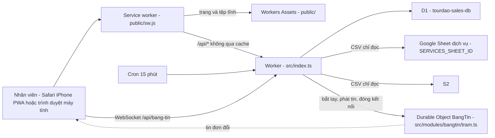
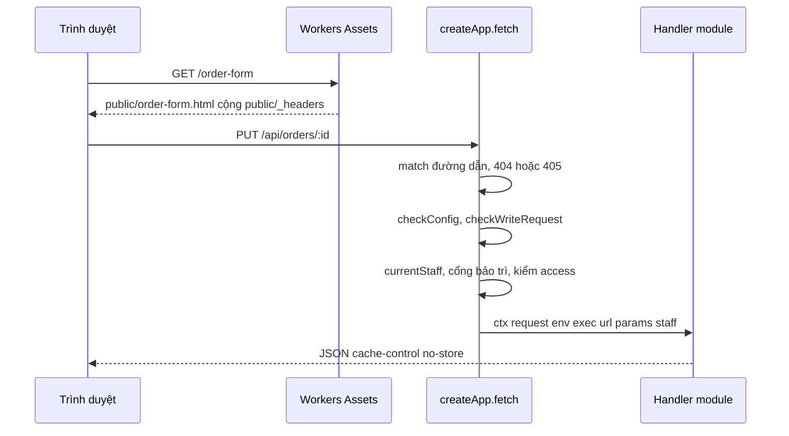
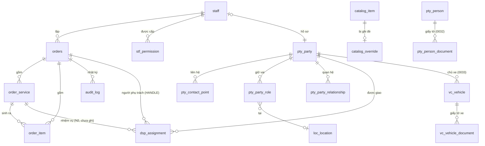
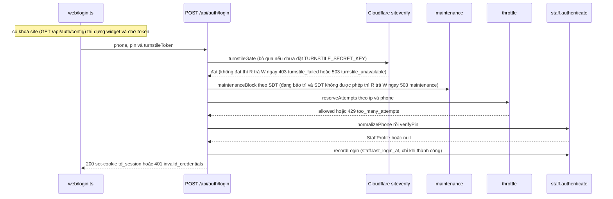

# Thiết kế hệ thống — tourdao-sales

> Mô tả **hiện trạng mã tại HEAD của nhánh này**, cho kỹ sư (hoặc một phiên Claude mới) chưa biết dự án và cần sửa nhanh, đúng.
> Luật kiến trúc: `docs/ARCHITECTURE.md` + `docs/adr/`. Đặc tả nghiệp vụ: `docs/SPEC-tourdao-sales.md`. Bảng/cột/view: `docs/DATA-DICTIONARY.md` (sinh từ `docs/data-dictionary.json`). Triển khai/hoàn tác: `docs/HANDOFF-N1.md`. PWA: `docs/PWA-IPHONE.md`.
> Tài liệu này KHÔNG chép lại các tệp đó; khi mâu thuẫn thì **mã thắng** — xem §16.
> Sơ đồ kiến trúc tổng quan theo chuẩn C4 (bối cảnh, khối triển khai, 15 phần máy chủ theo tầng, dữ liệu, vị trí như một SaaS): `docs/so-do-kien-truc/README.md`.

## Mục lục

1. [Mục đích, người dùng, phạm vi, ràng buộc nền tảng](#1-mục-đích-người-dùng-phạm-vi-ràng-buộc-nền-tảng)
2. [Bối cảnh và topology chạy thật](#2-bối-cảnh-và-topology-chạy-thật)
3. [Vòng đời một request](#3-vòng-đời-một-request)
4. [Xác thực và phiên](#4-xác-thực-và-phiên)
5. [Mô hình dữ liệu](#5-mô-hình-dữ-liệu)
6. [Luồng nghiệp vụ chính](#6-luồng-nghiệp-vụ-chính)
7. [Danh mục API](#7-danh-mục-api)
8. [Phân quyền](#8-phân-quyền)
9. [Giao diện](#9-giao-diện)
10. [Build, kiểm thử, triển khai](#10-build-kiểm-thử-triển-khai)
11. [Bảo mật](#11-bảo-mật)
12. [Giới hạn và hiệu năng](#12-giới-hạn-và-hiệu-năng)
13. [Quan sát và vận hành](#13-quan-sát-và-vận-hành)
14. [Lộ trình và điểm gắn tính năng tiếp theo](#14-lộ-trình-và-điểm-gắn-tính-năng-tiếp-theo)
15. [Thuật ngữ](#15-thuật-ngữ)
16. [Sai lệch tài liệu ↔ mã](#16-sai-lệch-tài-liệu--mã)

---

## 1. Mục đích, người dùng, phạm vi, ràng buộc nền tảng

**Mục đích.** Sổ đơn hàng nội bộ của Công ty TNHH Tour Đảo: nhân viên lập đơn dịch vụ tour, ghi thông tin chuyến (ngày giờ khởi hành, đón, check-in), xác nhận hoặc huỷ đơn; quản trị viên quản lý tài khoản + quyền, danh mục dịch vụ (đồng bộ từ Google Sheet), hồ sơ khách/đại lý và địa điểm.

**Người dùng** = nhân viên có tài khoản trong D1 (không có đăng ký công khai). Sáu quyền app (`src/shared/permissions.ts`): `SALES` (Bán hàng), `ACCOUNTING` (Kế toán), `ADMIN` (Quản trị), `FIELD` (Hướng dẫn viên), `PARTNER` (Đối tác — ADR-0014), `SUPER_ADMIN` (Super Admin, vai trên Quản trị — ADR-0014). Một tài khoản mang **nhiều** quyền (ADR-0005).

**Trong phạm vi hiện tại:** đăng nhập (kèm Cloudflare Turnstile khi được bật, khối thông tin công ty và số phiên bản ở màn đăng nhập), sổ đơn (nháp → xác nhận/huỷ), sửa thông tin chuyến sau xác nhận, **người phụ trách đơn** (đặt/đổi/nhận; người phụ trách sửa được đơn như người lập — §6(j), §9), danh mục dịch vụ + ghi đè giá, tài khoản/quyền, hồ sơ (party) và địa điểm, nhật ký, và **Bảng tin** (báo tức thì cho mọi màn hình đang mở khi một đơn đổi — WebSocket + một Durable Object, ADR-0022; §2, §3, §9, §11; **đã lên production từ bản 1.16**).
**Ảnh xác nhận đơn (PNG) gửi khách:** ĐÃ có (v1.0), dựng ở trình duyệt (§9). **Chưa có trong mã:** xuất PDF/in A4 bản xác nhận, thu tiền/hoá đơn, phân công NHIỆM VỤ (đón khách, lái cano — N2; riêng "người phụ trách" đã có), màn hình cho tài khoản chỉ-`FIELD` (xem §14).

**Ràng buộc nền tảng.**

| Ràng buộc | Chi tiết |
|---|---|
| Runtime và CSDL | Cloudflare Workers, một Worker duy nhất tên `tourdao-sales` (`wrangler.jsonc`), `compatibility_date` `2026-09-01`; Cloudflare D1 `tourdao-sales-db`, binding `DB`, `migrations_dir: migrations`; Durable Object `BangTin` (binding `BANG_TIN`, MỘT thực thể tên `cong-ty`, migration DO tag `v1` `new_sqlite_classes` ở `wrangler.jsonc` — chỉ cho Bảng tin, §2) |
| Tệp tĩnh | Workers Assets: thư mục `./public`, binding `ASSETS`, `run_worker_first: ["/api/*"]` |
| Ngôn ngữ và giao diện | TypeScript `strict` + `noUncheckedIndexedAccess` (`tsconfig.json`), không framework, không thư viện router; HTML tĩnh `public/*.html` + TypeScript thuần `web/*.ts` gom bằng **esbuild** vào `public/js/` (gitignored) |
| Phụ thuộc | Chỉ `devDependencies`: `esbuild`, `typescript`, `wrangler`. Không có dependency runtime. |

---

## 2. Bối cảnh và topology chạy thật



*Một tên miền `booking.tourdao.vn` (`routes` + `custom_domain: true`); vì khai `routes` mà không khai `workers_dev`, địa chỉ `workers.dev` đã bị TẮT có chủ ý. `run_worker_first: ["/api/*"]` khiến mọi `/api/*` vào Worker trước, còn lại do Workers Assets phục vụ.*

**Cron.** `triggers.crons: ["*/15 * * * *"]` → `scheduled()` trong `src/index.ts` gọi `ctx.waitUntil(runScheduledSync(env))` (module `catalog`) để kéo danh mục dịch vụ.

**Bảng tin — Durable Object `BangTin` (ADR-0022; đã lên production từ bản 1.16).** Thông báo tức thì "đơn vừa đổi" tới mọi màn hình đang mở, không cần bấm tải lại. Thành phần:

- **Trạm** `src/modules/bangtin/tram.ts` — lớp `BangTin extends DurableObject`, MỘT thực thể tên `cong-ty` cho cả công ty (`env.BANG_TIN.getByName("cong-ty")`); lưu trữ theo lớp SQLite (`new_sqlite_classes`) nhưng KHÔNG lưu gì ngoài một báo thức: không bảng, không lưu tin — tin đi rồi là thôi. Dùng WebSocket Hibernation API: `ctx.acceptWebSocket(server, nhãn)` (nhãn = tag), `serializeAttachment({ staffId, hetHan })` gắn vào kết nối; `setWebSocketAutoResponse("ping" → "pong")` trả lời mà không đánh thức trạm (BT-3); `webSocketMessage/Close/Error` không làm gì (mọi tin trình duyệt gửi lên bị bỏ). Bốn lối vào: `fetch` (chỉ nhận yêu cầu bắt tay do route dựng MỚI), RPC `phat(sự kiện, nhãn)` và RPC `dongCua(…)` (chỉ gốc lắp ráp gọi), và `alarm`.
- **Route bắt tay** `GET /api/bang-tin` (`src/modules/bangtin/index.ts`, module lá hạng `KHONG_DB` — không bảng, không SQL, không `env.DB`; `architecture.test.ts` ép) và luật thuần `bangtin/rules.ts` (`kiemOrigin`, `docHanGiay`, `keHoachTram` — MỌI quyết định đóng/gửi/báo thức nằm ở đây để `node --test` kiểm được; `tram.ts` chỉ là vỏ gọi API Cloudflare).
- **Gốc lắp ráp** `src/index.ts` — nơi DUY NHẤT nạp lớp `tram.ts` (`export { BangTin } from "./modules/bangtin/tram"`; `architecture.test.ts` cấm nơi khác) và nối hai hàm tiêm `baoThayDoi`/`dongBangTin` (§3). `orders`, `dispatch`, `accounts`, `maintenance` KHÔNG import `bangtin`, chỉ gọi `ctx.baoThayDoi`/`ctx.dongBangTin`.
- **Hàm thuần dùng chung server ↔ trình duyệt** `src/shared/bang-tin.ts` (§9): nhãn kết nối/sự kiện suy từ `can()`, kiểu sự kiện đúng 5 khoá, câu thông báo nổi, thời gian chờ nối lại.
- **Phía trình duyệt** `web/bangtin.ts` + `web/bangtin-logic.ts` + `web/toast.ts` + `web/lam-moi-logic.ts` (§9).

Không có D1 migration; có MỘT migration Durable Object (tag `v1`) do `wrangler deploy` tự áp — cửa một chiều mềm (`docs/HANDOFF-N1.md`, mục runbook Bảng tin). Mỗi lần deploy ngắt mọi kết nối (Cloudflare khởi động lại Durable Object); trình duyệt tự nối lại trong 1–30 giây.

**Google Sheet — chỉ ĐỌC, công khai.** `src/shared/sheets.ts#fetchSheetCsv` gọi `https://docs.google.com/spreadsheets/d/<id>/export?format=csv`, `AbortSignal.timeout(8000)`. App **không bao giờ** ghi ngược vào Sheet.

**Biến và bí mật.**

| Tên | Loại | Đặt ở đâu | Dùng ở đâu |
|---|---|---|---|
| `SERVICES_SHEET_ID` | biến công khai (`vars`) | `wrangler.jsonc` | `catalog`: `syncCatalog` |
| `SESSION_SECRET` | **bí mật** | `wrangler secret put SESSION_SECRET` (production), `.dev.vars` (local — xem `.dev.vars.example`) | ký/kiểm cookie phiên (`src/modules/auth/session.ts`) |
| `TURNSTILE_SITE_KEY` | biến công khai, **tuỳ chọn** | `vars` của `wrangler.jsonc` khi có khoá thật (chưa thêm), `.dev.vars` (local) | `auth`: `GET /api/auth/config` trả cho trang đăng nhập dựng widget Turnstile |
| `TURNSTILE_SECRET_KEY` | **bí mật, tuỳ chọn** | `wrangler secret put TURNSTILE_SECRET_KEY` (production, chỉ khi chủ dự án ra lệnh), `.dev.vars` (local) | `auth`: `verifyTurnstile` (`POST /api/auth/login`). Vắng ⇒ Turnstile TẮT (xem mục 4) |
| `DB` / `ASSETS` | binding D1 / binding Workers Assets | `wrangler.jsonc` | `env.DB` ở mọi module; `ASSETS` do nền tảng dùng |
| `BANG_TIN` | binding Durable Object (lớp `BangTin`) | `wrangler.jsonc` (`durable_objects.bindings` + `migrations` tag `v1`); kiểu khai TAY ở `worker-configuration.d.ts` | `src/modules/bangtin/index.ts` (`getByName("cong-ty")`); lớp ở `src/modules/bangtin/tram.ts`, export từ `src/index.ts` |
| `BANG_TIN_HAN_GIAY` | biến, **tuỳ chọn, KHÔNG đặt ở production** | chỉ `--var` khi chạy e2e (`tests/e2e/run.mjs` đặt `20`) hoặc `.dev.vars`; khai TAY dạng tuỳ chọn ở `worker-configuration.d.ts` | `bangtin/rules.ts#docHanGiay`: hạn sống một kết nối Bảng tin, giây; vắng hoặc không phải số nguyên dương → 900; kẹp trong [5, 3600] |

`SESSION_SECRET` ngắn hơn `MIN_SECRET_LENGTH` = 32 ký tự → **mọi** route trả 500 `server_misconfigured` (`checkAuthConfig`). Hai biến Turnstile KHÔNG đi qua `checkAuthConfig` (vắng là trạng thái hợp lệ "tắt"). Kiểu của `Env` ở `worker-configuration.d.ts` (sinh bởi `npm run types` khi `.dev.vars` có đủ bí mật; hai biến Turnstile đang khai tay dạng tuỳ chọn — xem `docs/CHANGE-GUIDE.md` công thức l; `BANG_TIN` và `BANG_TIN_HAN_GIAY` cũng khai tay — `npm run types` chỉ sinh lại `BANG_TIN_HAN_GIAY` nếu `.dev.vars` có tên đó, xem bẫy ở `docs/CHANGE-GUIDE.md` §4).

---

## 3. Vòng đời một request



*Tệp tĩnh không chạm Worker; `/api/*` đi qua `createApp` rồi mới tới handler của module.*

**`src/shared/router.ts`** — router tối giản, không import module nào (gốc lắp ráp `src/index.ts` tiêm `currentStaff`, `checkConfig` và `injected`):

- `route(method, path, access, handler)`; `Access = "public" | "staff" | "office" | "orders" | "admin"`.
- Khớp đường dẫn bằng `split("/").filter(Boolean)`, tham số `:tên` giải mã bằng `decodeURIComponent`. Không khớp đường dẫn nào → **404** `not_found`; khớp đường dẫn nhưng sai phương thức → **405** `method_not_allowed` kèm header `allow`.
- `injected` (BẮT BUỘC, ADR-0007 điều 4(b)): hai hàm nối chéo module do gốc lắp ráp cung cấp từ module `dispatch` — router đưa vào `ctx` thành `ctx.isAssigned(orderId)` (người đang đăng nhập có phải người phụ trách đang mở của đơn không; một truy vấn D1 mỗi lần gọi, chỉ route nào cần thì gọi) và `ctx.newOrderHandler(staffId)` (ADR-0030 S20-4, thay `defaultHandlerStatement` cũ — đơn mới KHÔNG BAO GIỜ tự gắn người lập: `dispatch` đọc tài khoản NGƯỜI ĐƯỢC CHỌN lúc lập đơn, xét bằng `checkAssignee`, trả `{ ok: true, statements(orderId, at) }` — các câu lệnh chưa chạy mở dòng `HANDLE` + nhật ký, dựng theo id đơn và mốc `at` của từng lần thử của `createOrder` — hoặc `{ ok: false, message }`; một truy vấn D1 mỗi lần gọi; chưa đăng nhập → không đạt, không truy vấn). `orders` dùng chúng mà KHÔNG import `dispatch`. **ADR-0030 S20-13** thêm hai hàm tra cứu nữa từ `dispatch`: `ordersWithHandler(env, orderIds)` → `ctx.ordersWithHandler(ids)` (trong các đơn này, đơn nào ĐANG có người phụ trách — trả `Set`; không phụ thuộc người gọi; mảng rỗng không truy vấn; Trang chủ đếm ô "Chưa phụ trách" bằng hàm này) và `handledOrderIdsOf(env, staffId)` → `ctx.myHandledOrderIds()` (đơn mà người ĐANG ĐĂNG NHẬP phụ trách, id lấy từ phiên; chưa đăng nhập → `[]`). `orders` không đọc view `v_dsp_*` của `dispatch` (bài `src/architecture.test.ts`, kể cả tệp test). Hàm thứ ba `maintenanceBlock(env, staff)` (từ module `maintenance`) là cổng chế độ bảo trì — bullet về `access` ngay dưới. **Bảng tin (ADR-0022)** thêm hai hàm BẮT BUỘC nữa: `baoThayDoi(env, người thao tác, { orderId, thayDoi, handlerTruoc? })` và `dongBangTin(env, { staffId } | "tat-ca")`; router đưa vào `ctx` thành `ctx.baoThayDoi(e)` và `ctx.dongBangTin(muc)` kiểu `void` — route KHÔNG `await` được: router bọc `exec.waitUntil(Promise.resolve().then(…).catch(…))` nên lỗi phát tin/đóng kết nối không làm hỏng hay chậm thao tác ghi, chỉ ghi một dòng log `bang_tin_loi` (`{ viec: "bao" | "dong", name }`, không SĐT/tên/nội dung lỗi — §13). `ctx.baoThayDoi` là no-op ở route công khai (không có người thao tác). Phía `src/index.ts`, `baoThayDoi` thoát ngay khi vắng binding `BANG_TIN` (khung thử `tests/audit`, `router.test.ts` không có trạm), rồi đọc song song `findOrderRef` (orders) + `handlerOf` (dispatch), dựng sự kiện đúng 5 khoá (`tao` mà không ai phụ trách → `tao_cho_nhan`), tính nhãn người nhận bằng `nhanSuKien` và gọi `phatDon`.
- `checkConfig` lỗi → **500** `server_misconfigured` (ghi log, không bao giờ in giá trị bí mật).
- `checkWriteRequest` với `POST/PUT/PATCH/DELETE`: so `Origin` với `url.origin` (thiếu `Origin` thì xét `Sec-Fetch-Site === "same-origin"`) → sai thì **403** `cross_origin`; thân không phải `application/json` → **415** `unsupported_media_type`.
- `access !== "public"` mà không có phiên → **401** `unauthenticated`; rồi **cổng bảo trì** (`injected.maintenanceBlock`): tài khoản bị chặn lúc này → **503** `maintenance` (mục 4), handler không chạy; RỒI mới kiểm quyền: `admin` mà `passesAdminGate(staff)` sai → **403** `forbidden`; `office` mà `isOffice(staff)` sai → **403** `forbidden`; `orders` mà `canAccessOrders(staff)` sai → **403** `forbidden` (ba hàm đọc ba danh sách `ADMIN_GATE`/`OFFICE_GATE`/`ORDERS_GATE`, mục 8). Cổng đứng TRƯỚC kiểm quyền để người bị chặn thấy "đang bảo trì" chứ không phải "không đủ quyền". Cổng KHÔNG chạy cho route `public` (`/api/auth/config`, `/api/auth/login`, `/api/auth/logout`, `/api/company`); `GET /api/auth/me` là route `staff` nên có qua cổng. Chi phí: MỘT truy vấn D1 (`getMaintenanceState`) mỗi request cần đăng nhập, cố ý KHÔNG đệm (hiệu lực ngay khi bật). `maintenanceBlock` là trường BẮT BUỘC của `injected` — thiếu là lỗi `tsc`, không phải chế độ bảo trì lặng lẽ mất tác dụng.
- **Router KHÔNG bọc/dựng lại phản hồi của route** (`fetch` trả thẳng `await dispatch(...)`, `dispatch` trả thẳng kết quả handler; `src/index.ts` `fetch: app.fetch`). Điều này BẮT BUỘC cho `/api/bang-tin`: phản hồi 101 của trạm mang thuộc tính `webSocket` — `new Response(body, res)`/thêm header chung lên nó làm rơi `webSocket` và bắt tay hỏng lặng lẽ. Đừng thêm bước bọc chung ở router mà không miễn `/api/bang-tin` (e2e `bangtin.mjs` ca 1 mở kết nối thật nên sẽ hỏng khi đó — nhưng chưa từng thử cố ý làm hỏng để thấy đỏ).
- **Một request bắt tay Bảng tin** (`GET /api/bang-tin`, `Upgrade: websocket`; không nằm trong `checkWriteRequest` vì là GET): khớp đường dẫn (404/405) → `checkConfig` (500) → **401** chưa đăng nhập → **503** chế độ bảo trì (cổng của router) → handler `bangtin`: thiếu `Upgrade: websocket` → **426** (kèm `upgrade: websocket`) → `kiemOrigin` (CÓ `Origin` VÀ bằng `url.origin`; vắng/lạ → **403** `cross_origin`; KHÔNG có nhánh `Sec-Fetch-Site` dự phòng như `checkWriteRequest`) → vắng binding `BANG_TIN` → **503** `unavailable` → tính nhãn `nhanKetNoi(staff)` bằng `can()` → dựng yêu cầu MỚI `https://bang-tin/ket-noi` chỉ với ba header do máy chủ đặt (`upgrade`, `x-bang-tin-nhan`, `x-bang-tin-nguoi`) — header `x-bang-tin-*` hay cookie của trình duyệt KHÔNG được chép sang (BT-2) → `getByName("cong-ty").fetch(...)` → trạm `acceptWebSocket` + đặt hạn/báo thức → **101**. Route dùng `access: "staff"` (mọi tài khoản đang đăng nhập, kể cả Đối tác và Hướng dẫn viên); Ai nhận được tin nào do nhãn quyết định, không do route.
- Bọc toàn cục: ngoại lệ → **500** `internal` kèm `requestId` (`cf-ray` hoặc `crypto.randomUUID()`), log JSON một dòng `{level, event: "unhandled", requestId, method, path, error}`.

**`src/shared/http.ts`** — `json()` (luôn `content-type: application/json; charset=utf-8` + `cache-control: no-store`), `error(status, code, message)`, `readJson()`, `intParam(v, fallback, min, max)`, `escapeLike()`, `getCookie()`, `UUID_RE`.

**`public/_headers`** (chỉ áp cho tệp tĩnh): CSP `default-src 'self'; script-src 'self' https://challenges.cloudflare.com; style-src 'self' 'unsafe-inline'; img-src 'self' data: blob:; font-src 'self' data:; connect-src 'self' wss://booking.tourdao.vn https://challenges.cloudflare.com; frame-src https://challenges.cloudflare.com; object-src 'none'; base-uri 'none'; form-action 'self'; frame-ancestors 'none'` (Cloudflare mở duy nhất cho widget Turnstile ở màn đăng nhập — đúng ba directive này, không nới `style-src`/`img-src`; `frame-src` chỉ có Cloudflare nên khung cùng nguồn cũng bị chặn — app không dùng iframe nào; đã đo bằng Chrome thật, `docs/evidence/2026-09-21-v1-0/`; `connect-src` còn liệt kê rõ `wss://booking.tourdao.vn` cho WebSocket Bảng tin vì Safari cũ không coi `wss:` cùng máy là `'self'` — local/LAN dựa vào `'self'`, **chưa kiểm** trên Safari iPhone thật qua LAN), `X-Content-Type-Options: nosniff`, `Referrer-Policy: same-origin`, `X-Frame-Options: DENY`, `Permissions-Policy: camera=(), microphone=(), geolocation=()`; riêng `/sw.js` là `Cache-Control: no-store` (KHÔNG `no-cache` — lý do ở `docs/PWA-IPHONE.md`).

---

## 4. Xác thực và phiên

**Đăng nhập = số điện thoại + PIN 6 số.** `normalizePhone` (`src/shared/phone.ts`) chuẩn hoá về `0xxxxxxxxx`; `isValidPin` (`src/modules/staff/phone.ts`: đúng 6 chữ số) và `isWeakPin` (`src/modules/staff/rules.ts`) chặn PIN toàn số giống nhau hoặc chạy liên tiếp (kể cả cuộn vòng).

**Băm PIN** — `src/modules/staff/password.ts`: PBKDF2-SHA256, `PBKDF2_ITERATIONS = 100_000` (trần của Workers), muối 16 byte ngẫu nhiên, khoá 256 bit; chuỗi lưu `pbkdf2$sha256$<iter>$<salt>$<hash>` (base64url). So sánh bằng `timingSafeEqual`. `verifyDummy()` chạy một phép băm giả khi SĐT không tồn tại để thời gian phản hồi không lộ tài khoản nào có thật.

**Cookie phiên** — `src/modules/auth/session.ts`: tên `td_session`; token `"<staffId>.<issuedAt ms>.<HMAC-SHA256 base64url>"` ký bằng `SESSION_SECRET`; `SESSION_TTL_SECONDS = 60*60*24*7` (7 ngày). Thuộc tính: `Path=/; Max-Age=604800; HttpOnly; SameSite=Lax` và `Secure` khi request là `https:`. Chữ ký đúng nhưng `issuedAt > now + 60_000` → từ chối (đồng hồ lạ).

**Thu hồi phiên.** `currentStaff` → `getActiveStaff(db, id, issuedAt)`: tài khoản phải `active = 1`, và nếu `staff.credentials_changed_at` (mili-giây) **lớn hơn** thời điểm phát hành phiên thì phiên bị từ chối. Đổi PIN / đặt lại PIN cập nhật cột này ⇒ mọi thiết bị cũ bị đăng xuất; route đổi PIN cấp ngay cookie mới cho thiết bị hiện tại (`newSessionCookie`).

**Cloudflare Turnstile (chỉ ở đăng nhập)** — `src/modules/auth/turnstile.ts` (thuần, có test). `POST /api/auth/login` nhận thêm `turnstileToken`; sau khi đầu vào hợp lệ (400 nếu thiếu SĐT/PIN) và **TRƯỚC** `verifyPinThrottled`, máy chủ gọi `https://challenges.cloudflare.com/turnstile/v0/siteverify` (POST form `secret`, `response`, `remoteip` — chỉ khi `cf-connecting-ip` đúng là IP), hạn chót `TURNSTILE_TIMEOUT_MS` = 5 giây, token dài tối đa 2048 ký tự (`MAX_TOKEN_LENGTH` — ngưỡng ĐÃ ĐỐI CHIẾU 2026-09-21 với tài liệu Cloudflare (tối đa 2048 ký tự); xem log sau khi bật khoá thật). Kẻ tấn công không có token nhận **403 `turnstile_failed`** ("Chưa xác minh được bạn là người thật. Hãy thử lại.") mà **không tiêu hao lượt thử** của SĐT nạn nhân (cũng không của IP). **Đóng khi lỗi**: siteverify không trả lời/HTTP lỗi/hết giờ/thân lạ/secret sai (`invalid-input-secret`, trả HTTP 400) → **503 `turnstile_unavailable`** ("Chưa kết nối được dịch vụ xác minh. Hãy thử lại sau ít phút."), ghi log `turnstile_unavailable` kèm mã ngắn `detail`. `GET /api/auth/config` (public) → `{ turnstileSiteKey }`: khoá site khi có CẢ secret lẫn khoá site, ngược lại `null`.
**Chưa đặt `TURNSTILE_SECRET_KEY` ⇒ TẮT**: bỏ qua kiểm (không khoá chết local/e2e/lần deploy đầu), `config` trả `null`, và mỗi lần đăng nhập máy chủ `console.warn` `turnstile_disabled` để mất secret không thành tắt lặng lẽ — sau deploy phải kiểm `GET /api/auth/config` khác `null`. Có secret mà thiếu khoá site ⇒ vẫn kiểm, trang không có widget nên không ai đăng nhập được (log `turnstile_misconfigured`). **Widget ở trang đăng nhập** (`web/login.ts`): chỉ khi `GET /api/auth/config` trả khoá site, trang tải `api.js` của Cloudflare (`?render=explicit`, script động — không nhúng trong HTML) rồi `turnstile.render` (`theme: "light"`, `language: "vi-vn"`, cỡ `flexible` hoặc `compact` khi lòng thẻ < 300 px). **`theme: "light"` là lệch có chủ ý so với đặc tả nháp v1.0 (ghi "chủ đề theo hệ thống", tức `auto`)**: app chỉ có giao diện sáng, `auto` cho widget tối trên thẻ trắng khi điện thoại bật chế độ tối; đổi lại khi app có chế độ tối. Trạng thái của trang:
- Trong lúc chờ nạp script (tối đa 15 giây) khung giữ chỗ hiện "Đang tải xác minh…" (`<p role="status">`, không phải `<div>` để không lẫn với widget) và nút Đăng nhập khoá; nút khoá tới khi có token; `turnstile.reset()` sau MỌI lần đăng nhập thất bại (token dùng một lần; cổng Turnstile chạy trước PIN nên token đã bị đốt dù PIN sai).
- Lỗi 403/503 của máy chủ hiện nguyên văn ở `#error`; script không tải/`render` lỗi thì thông báo + nút "Thử lại"; `error-callback` của widget cũng hiện thông báo + "Thử lại" và ghi `console.warn("Turnstile báo lỗi, mã:", <mã>)` (callback trả `true` = "đã xử lý" thì Cloudflare KHÔNG ghi mã lỗi ra console, nên lần deploy khoá thật đầu tiên sai tên miền sẽ chỉ còn thông báo chung nếu trang không tự ghi).
- **Hỏi lại cấu hình (tự phục hồi):** `GET /api/auth/config` lỗi lúc mở trang thì nút Đăng nhập mở NGAY (đăng nhập như không có widget; cấu hình chỉ chậm thì nút mở sau 3 giây) và trang hỏi lại NỀN sau 1,5 giây rồi 4 giây (không giữ nút); khi máy chủ đã bật Turnstile mà trang chưa có khoá site, mỗi lần đăng nhập bị 403 `turnstile_failed` / 503 `turnstile_unavailable` lại hỏi lại (ngay, sau 2 giây, sau 4 giây). Mỗi lúc chỉ MỘT vòng, có hạn số lần (không lặp vô hạn, không bão yêu cầu); lấy được khoá thì dựng widget và khoá nút tới khi có token. Đây cũng là lưới an toàn cho người đã mở trang đăng nhập GIỮA lúc deploy mã và lúc `wrangler secret put` (lúc mở, `config` trả `null` nên trang chưa có widget; secret đặt xong thì lần đăng nhập đầu bị 403 rồi trang tự dựng widget, không cần tải lại). Kịch bản Chrome `v1-dang-nhap.mjs` (bước l, o) kiểm cơ chế này. Bỏ cơ chế này thì `siteKey` kẹt `null` và MỌI lần đăng nhập 403 mãi — mà PWA trên iPhone không có nút tải lại. Cấu hình về muộn hơn 3 giây thì widget vẫn được dựng lúc đó.

Đặt secret ở production PHẢI kèm khoá site (`vars`). Đổi PIN không đòi Turnstile.

**Ghi nhận đăng nhập thành công.** `POST /api/auth/login` (PIN) VÀ `POST /api/auth/passkey/login` (Face ID — xem mục dưới) đều gọi `recordLogin` (module `staff`) → `staff.last_login_at` = giờ hiện tại (ISO UTC; migration `0015`; NULL = chưa từng đăng nhập kể từ khi có cột). KHÔNG ghi trong `verifyPinThrottled` (dùng chung với đổi PIN — ghi ở đó thì mỗi lần đổi PIN thành "một lần đăng nhập"), không ghi khi phiên được cấp lại sau đổi PIN. Lỗi ghi được log `record_login_failed` và KHÔNG làm hỏng đăng nhập (chỉ là thống kê). Chỉ lưu thời điểm — không SĐT/PIN nào vào nhật ký. Hiện ở cột "Đăng nhập gần nhất" của `/staff` (`GET /api/staff` → `lastLoginAt`).

**Đăng nhập bằng Face ID (passkey, ADR-0016 — accepted 2026-09-23).** Song song với SĐT + PIN, không thay thế: PIN luôn còn là đường dự phòng. Chuẩn WebAuthn, kiểm phía máy chủ **tự viết bằng Web Crypto** (`src/modules/auth/webauthn.ts`, không thư viện chạy lúc runtime) — CBOR tự giải mã (`src/modules/auth/cbor.ts`), khoá công khai ES256 (`algorithm -7`) hoặc RS256 (`-257`, đòi ≥ 2048 bit).
- **Bật/tắt tính năng theo cấu hình, không theo cột dữ liệu:** `passkeyRelyingParty(env)` (`src/modules/auth/webauthn.ts`) đọc hai biến `PASSKEY_RP_ID`/`PASSKEY_ORIGIN`; thiếu MỘT trong hai, hoặc `origin` không khớp `rpId`, hoặc giao thức không phải `https:` (trừ `localhost`/`127.0.0.1` được `http:`) ⇒ **TẮT** (`passkeyRp` trả `null`, mọi route passkey — cả 10, kể cả xem danh sách, gỡ và quản trị viên gỡ hộ, đặc tả §2.3 — trả 503 `passkey_unavailable` trước mọi truy vấn D1, test `src/passkey-off.test.ts`; khi tắt, đặt lại PIN (`POST /api/staff/:id/reset-pin`) VẪN gỡ hết Face ID, ngưng tài khoản cũng VẪN gỡ (không phụ thuộc công tắc — xem "8b" dưới); `console.warn` MỘT lần mỗi isolate — `passkey_disabled` khi thiếu cả hai biến, `passkey_misconfigured` khi có một trong hai mà cấu hình sai, giống cơ chế `turnstile_disabled` của mục Turnstile). `GET /api/auth/config` trả thêm `passkey: boolean` cho trang đăng nhập/trang Tôi biết có hiện nút hay không.
- **Bảng `aut_passkey`** (migration `0023`, module `auth`): `staff_id`, `credential_id` (UNIQUE — chặn đăng ký lại cùng một khoá), `public_key` (SPKI DER, base64url), `algorithm`, `user_handle` (16 byte ngẫu nhiên gửi làm `user.id` — KHÔNG chứa SĐT/thông tin cá nhân, ADR-0016 điều 8), `sign_count`, `label` (tên máy đoán từ `User-Agent`, vd "iPhone", "Máy Mac" — `src/modules/auth/device-label.ts`), `last_used_at`, hiệu lực `valid_from_at`/`valid_to_at` (gỡ = đóng cột này, KHÔNG xoá cứng).
- **Thách thức KHÔNG lưu D1** — cookie riêng `td_webauthn` (`src/modules/auth/challenge.ts`), ký HMAC **DẪN XUẤT** từ `SESSION_SECRET` bằng nhãn mục đích riêng (`KEY_LABEL`), TTL 300 giây (`CHALLENGE_TTL_SECONDS`), `Path=/api; HttpOnly; SameSite=Strict`. Token có **7 phần** (`w1.<mục đích>.<staffId|->.<ms phát hành>.<challenge>.<phụ|->.<chữ ký>`) — khác hẳn cấu trúc 3 phần của `td_session`, nên token thách thức không bao giờ qua được `verifySessionToken` và ngược lại (khoá dẫn xuất riêng là lớp thứ hai). Ba mục đích (`ChallengePurpose`): `login` (đăng nhập), `register` (bật Face ID, `extra` mang `user_handle`), `pin` (đặt PIN bằng Face ID, điều 2b).
- **Dùng một lần:** một thách thức chỉ xác nhận được đúng MỘT lần — `checkPasskeyAssertion` (`src/modules/auth/passkey.ts`) gọi `markPasskeyUsed` (ghi `last_used_at`) SAU khi kiểm chữ ký/bộ đếm/cổng bổ sung nhưng TRƯỚC khi trả kết quả; dùng lại token cũ ⇒ 400 `passkey_expired`.
- **Luồng đăng nhập** (`POST /api/auth/passkey/options` rồi `POST /api/auth/passkey/login`, cả hai `public`): xin thách thức (hạn mức riêng theo IP, `CHALLENGE_IP_LIMIT` = 120/15 phút — KHÔNG dùng chung bộ chống dò PIN vì không có PIN để dò) → trình duyệt gọi `navigator.credentials.get` → máy chủ tìm khoá theo `credential_id`, kiểm chữ ký (`verifyAssertion`) và bộ đếm (`counterRegressed`: từ chối nếu bộ đếm mới ≤ bộ đếm cũ VÀ cả hai > 0 — nghi khoá bị nhân bản) → cổng bảo trì theo SĐT chủ khoá (TRƯỚC khi tiêu thụ thách thức, đúng thứ tự đặc tả §2.6: kiểm → cổng bảo trì → dùng một lần) → `recordLogin` → cấp `td_session` + xoá `td_webauthn`. Không Turnstile (không phải chỗ để dò PIN) và không bộ chống dò PIN (chỉ hạn mức thách thức).
- **Bật Face ID cho một máy** (tự phục vụ, `staff`): `POST /api/account/passkeys/options` đòi nhập lại PIN hiện tại (cùng `verifyPinThrottled`/bộ chống dò của đăng nhập — điều 2a) rồi mới cấp thách thức `register`; `POST /api/account/passkeys` kiểm `verifyRegistration` và ghi `aut_passkey` + nhật ký `passkey_added`. **Hai lần chạm riêng trên iPhone** (`web/passkey.ts` `enableFlow`): chạm 1 gửi PIN (có `await fetch`), chạm 2 (nút "Tiếp tục với Face ID") gọi `navigator.credentials.create` NGAY, không `await` nào trước đó — Safari/iOS có thể chặn WebAuthn nếu không còn trong "cử chỉ người dùng" trực tiếp (đặc tả §2.7).
- **Gỡ Face ID:** `DELETE /api/account/passkeys/:id` (một khoá) hoặc `POST /api/account/passkeys/remove-all` (tự phục vụ, tất cả — dùng khi mất máy) đều đóng `valid_to_at`, đẩy `staff.credentials_changed_at` (đăng xuất MỌI máy khác) và cấp `td_session` mới cho máy đang thao tác cùng MỘT mốc `now`; admin gỡ hộ qua `POST /api/staff/:id/passkeys/remove-all` (theo luật "cấp dưới" — mục 8) không cần đặt lại PIN. `POST /api/staff/:id/reset-pin` (đặt lại PIN) cũng gỡ HẾT Face ID của tài khoản đó (điều 6) — đặt lại PIN là tình huống "có thể đã lộ", Face ID cũ không còn đáng tin.
- **Đặt PIN mới bằng Face ID** (điều 2b, không cần PIN cũ): `POST /api/account/pin-by-passkey/options` (thách thức mục đích `pin`, ràng buộc ĐÚNG `staff.id` của phiên) rồi `POST /api/account/pin-by-passkey` — bắt buộc một lần ký Face ID MỚI, phiên đang mở không đủ. Đặt xong thì gỡ khoá "sai PIN quá nhiều" của SĐT (`unlockPhone`, như admin `reset-pin` — chủ quyết 2026-09-23).
- **Mã lỗi riêng** (`PASSKEY_ERRORS`, `src/modules/auth/passkey.ts`): `passkey_unavailable` (503, tắt), `passkey_expired` (400, thách thức hết hạn/đã dùng), `passkey_unknown` (401, khoá đã gỡ/không thuộc tài khoản nào), `passkey_invalid` (401 "Không xác nhận được Face ID…" khi đăng nhập/đặt PIN bằng Face ID: chữ ký/bộ đếm sai; 400 "Không bật được Face ID. Hãy thử lại." khi bật Face ID: dữ liệu đăng ký không hợp lệ), `passkey_exists` (409, máy đã bật), `passkey_none` (409, chưa bật Face ID nào), `passkey_not_yours` (403, đặt PIN bằng Face ID — `POST /api/account/pin-by-passkey` — mà ký bằng khoá của người khác). Gỡ khoá không phải của mình qua `DELETE /api/account/passkeys/:id` KHÔNG dùng mã này: trả 404 `not_found` như khoá không tồn tại.
- **Nhật ký** (`passkey_added`, `passkey_removed`, `pin_set_by_passkey`) KHÔNG chứa id khoá/`credential_id` — chỉ ai, khi nào, đối tượng.
- **Ngưng tài khoản gỡ mọi Face ID trong CÙNG lô ghi ("8b", ADR-0016 điều 6; chủ chọn A-4 phương án 1):** `PATCH /api/staff/:id` với `active: false` nối ba câu vào CUỐI batch của `patchStaffStatements` (sau mọi mắt xích cũ, vì câu gỡ có thể đổi 0 dòng mà chuỗi cũ dựa vào `changes() > 0`): gỡ CÓ ĐIỀU KIỆN `passkey_revoke_all_if_suspended` (chỉ khi tài khoản đang ngưng — đọc qua view `v_stf_staff_label`; câu chốt "còn quản trị viên khác" thua thì không gỡ gì) → `touchCredentialsStatement(…, true)` NGAY SAU (đẩy `credentials_changed_at`, thu hồi phiên cũ) → nhật ký `passkey_removed` "gỡ khi ngưng tài khoản" (`changes() > 0`). Kích hoạt lại tài khoản KHÔNG làm Face ID cũ sống lại. Bất biến `R-AUT-1` (§10, `scripts/audit-checks.mjs`) là lưới dữ liệu cho điều này: sau triển khai phải xanh; đỏ là lỗi thật.

**Chế độ bảo trì — chỉ Toàn quyền dùng được khi bật (ADR-0071 điều 3, thay miễn trừ theo SĐT).** Module `maintenance` (`src/modules/maintenance/`), luật thuần + thông điệp ở `src/shared/maintenance.ts` (dùng chung với giao diện), bảng `mnt_setting` (singleton `default`, migration `0016`, gieo TẮT; cột `allowed_phones` còn nhưng **thôi được đọc** — ADR-0071 điều 3d, expand–contract). **Tự tắt:** tới/qua `ends_at` thì máy chủ coi là TẮT dù dòng còn `enabled = 1` (`stateFromRow`, đọc theo giờ, không ghi lại dòng; chủ dự án 30/9); bật không kèm giờ (chỉ có khi sửa tay bằng SQL) thì giữ bật. BẬT thì máy chủ chặn MỌI tài khoản không giữ `SUPER_ADMIN` (`isBlocked(state, permissions)`; kể cả Quản trị), KỂ CẢ phiên đang mở, bằng **503** với thân `{ error: { code: "maintenance", message, endsAt } }` (`endsAt` = giờ dự kiến hoàn tất, ISO UTC hoặc `null`; giao diện dựng đồng hồ đếm ngược từ đó, không gọi thêm). Ba nơi ép, đều dùng `maintenanceBlock(db, () => quyền)` của module: (1) router — mọi route cần đăng nhập, sau `currentStaff` và trước kiểm quyền (mục 3), theo QUYỀN của phiên; (2) `POST /api/auth/login` — sau Turnstile, TRƯỚC `verifyPinThrottled`: khi bật, tra tài khoản theo SĐT (`findStaffByPhone`), không phải Toàn quyền đang hoạt động — kể cả SĐT không tồn tại, SĐT hỏng, tài khoản đã ngưng — nhận CÙNG một 503, không tiêu hao lượt thử PIN (lúc tắt không tra thêm gì); đăng nhập Face ID xét quyền của chủ khoá; (3) `GET /api/auth/config` trả `maintenance: { on, endsAt }` (công khai) cho banner ở trang đăng nhập; `GET /api/auth/me` trả thêm `maintenance` (chỉ Toàn quyền mới tới được nó khi đang bảo trì) cho dải "Đang ở chế độ bảo trì". Bật/tắt bằng `PUT /api/maintenance` (§7): chỉ ô `settings.ops` (Toàn quyền), không còn điều kiện SĐT; giờ dự kiến phải ở tương lai, tối đa 7 ngày (`MAX_MAINTENANCE_MS`); ghi nhật ký `maintenance_changed` (không ghi SĐT). Thông điệp đúng chữ chủ dự án đã chốt: "Hệ thống đang tạm đóng để bảo trì. Thời gian dự kiến hoàn tất là (đếm ngược), liên hệ quản trị viên khi cần hỗ trợ thêm (0989929373)." (từ 1 ngày trở lên đồng hồ hiện "3 ngày 5 giờ 10 phút"); hết giờ dự kiến hoặc chưa có giờ thì dùng biến thể không có đếm ngược (`maintenanceMessageParts`). `503 maintenance` KHÁC `503 turnstile_unavailable` (dịch vụ xác minh của Cloudflare lỗi). Cron đồng bộ danh mục không đi qua router nên không bị chặn. **Đường thoát khẩn** khi chủ bị khoá (tài khoản chủ mất `SUPER_ADMIN` hoặc bị ngưng): một câu `UPDATE mnt_setting` qua `wrangler d1 execute --remote` — `docs/HANDOFF-N1.md`. Giới hạn đã chấp nhận: Toàn quyền nhập sai PIN nhận 401/429 chứ không phải 503, nên về lý thuyết phân biệt được SĐT của tài khoản Toàn quyền với số khác.

**Phiên và Bảng tin (ADR-0022, KN-2).** Kết nối Bảng tin sống lâu hơn một request nên KHÔNG tự thấy phiên bị thu hồi. Vì vậy mọi route đổi thông tin đăng nhập/quyền của một tài khoản gọi `ctx.dongBangTin({ staffId })` sau khi ghi thành công, và `PUT /api/maintenance` (bật) gọi `dongBangTin("tat-ca")` — trạm đóng các kết nối đó với mã 4003 (danh sách route đầy đủ ở §11). Trình duyệt nối lại và nhận 401/503 như một request thường.
**Chống dò PIN** — `src/modules/auth/throttle.ts`, bảng `login_attempt`, cửa sổ trượt `LOGIN_WINDOW_MS = 15 * 60 * 1000`:

| Khoá | Hằng | Giá trị |
|---|---|---|
| `phone:<SĐT chuẩn hoá>` | `PHONE_LIMIT` | 5 lần / 15 phút |
| `ip:<cf-connecting-ip>` | `IP_LIMIT` | 30 lần / 15 phút |

Cơ chế **đặt chỗ trước khi kiểm**: đếm → nếu đã đủ thì chặn ngay và KHÔNG ghi thêm (kẻ tấn công không kéo dài khoá của nạn nhân) → chèn dòng → đếm lại; nếu vượt thì xoá dòng vừa chèn và chặn. Vượt → **429** `too_many_attempts` kèm `retry-after` giây. Thành công → `clearAttempts` xoá mọi lần thử của SĐT đó. `verifyPinThrottled` dùng chung cho **đăng nhập và đổi PIN** (đổi PIN không thành đường vòng dò PIN hiện tại). Admin mở khoá bằng `POST /api/staff/:id/unlock` (`unlockPhone`); danh sách đang khoá do `lockedPhones` trả về.

**`safeNext`** (`src/shared/safe-next.ts`): `/login?next=…` chỉ nhận đường dẫn nội bộ; chặn `//evil.com`, `/\evil.com`, ký tự điều khiển. Dùng ở `web/login.ts` và `goLogin()` của `web/api.ts`.

---

## 5. Mô hình dữ liệu

Module chủ sở hữu bảng của mình; bảng mới mang tiền tố module (`pty_`, `loc_`, `stf_`), bảng cũ giữ nguyên tên và được đánh dấu `legacy` trong `docs/data-dictionary.json` (**nguồn sự thật**, `src/architecture.test.ts` đối chiếu với schema thật).

| Bảng / view | Module | Mục đích |
|---|---|---|
| `staff` | staff | tài khoản đăng nhập (SĐT, `pin_hash`, `active`, `credentials_changed_at`, `last_login_at`, `party_id`); `role` và `full_name` là **cột chết** |
| `stf_permission_type` | staff | tra cứu 10 quyền app (ADR-0071 thêm `HR` "Nhân sự", 0057 — chỉ ba ô tài khoản): `SALES`, `ACCOUNTING`, `ADMIN`, `FIELD`, `PARTNER`, `SUPER_ADMIN` (hai mã: ADR-0014), `INTERN` (0024, ADR-0018), `DRIVER` "Tài xế" (0031, ADR-0040 D3 — lượt 1a mọi ô nghiệp vụ `none`, chỉ xem giấy tờ của chính mình), `DRIVER_PARTNER` "Tài xế đối tác" (0037, ADR-0048 D2 — mọi ô nghiệp vụ `none` kể cả mọi ô tiền, trừ góp ý và giấy tờ của chính mình; **đứng một mình** — LC-1b) |
| `stf_permission` | staff | quyền của một tài khoản, có hiệu lực `valid_from_at` / `valid_to_at` |
| `v_stf_staff_label` | staff | view công bố: `id, label, active, party_id` (`label` = tên hồ sơ, dự phòng `(chưa có hồ sơ)`) |
| `pty_party` | parties | hồ sơ: `party_kind` `PERSON` hoặc `ORGANIZATION`, `display_name`, `active` |
| `pty_person` / `pty_organization` | parties | phần cá nhân (`family_name`, `middle_name`, `given_name`) / phần tổ chức (`legal_name`, `tax_code`, `address`, `invoice_email`) |
| `pty_contact_kind` / `pty_role_type` / `pty_relationship_type` | parties | tra cứu: loại liên hệ (`PHONE`, `EMAIL`); vai trò hồ sơ (`STAFF`, `GUIDE`, `DRIVER`, `AGENT`, `CUSTOMER`…, nay có thêm 11 vai mô hình người–vai–quyền — ADR-0018); loại quan hệ. `pty_role_type.role_group` (0024, `CHECK IN ('INTERNAL','EXTERNAL','OTHER')`, tập đóng theo ADR-0003 điều 3) phân biệt vai gắn với TÀI KHOẢN (`INTERNAL`/`EXTERNAL`, quản lý ở trang Nhân viên) với vai khác (`OTHER`, vẫn quản lý ở trang Hồ sơ như trước). 0031 (ADR-0040 D3): thêm vai tài khoản `DRIVER_INTERNAL` "Tài xế công ty" (nhóm `INTERNAL`, bộ quyền mặc định `DRIVER`); mã vai hồ sơ cũ `DRIVER` (nhóm `OTHER`) `active = 0` — ngưng gán mới, dòng đang có giữ nguyên. Máy chủ từ chối gán mới MỌI loại vai đã ngưng (409 `role_type_inactive`, Ruling R6; trừ đường đổi công ty chủ). ADR-0048: vai tài khoản bên ngoài `DRIVER_EXTERNAL` "Tài xế đối tác" (0037, sinh `DRIVER_PARTNER`); vai hồ sơ `CARRIER` "Nhà xe đối tác" (0038, nhóm `OTHER`, không sinh quyền, không gắn tài khoản) và loại quan hệ `DRIVES_FOR` "Tài xế của" (0038, người → nhà xe; trigger B1.2) |
| `pty_contact_point` | parties | điểm liên hệ của hồ sơ, có `is_primary` và hiệu lực theo ngày |
| `pty_party_role` | parties | hồ sơ giữ vai trò nào, ở nơi nào, trong khoảng nào |
| `pty_party_relationship` | parties | quan hệ hồ sơ ↔ hồ sơ, có hiệu lực |
| `v_pty_party_label` | parties | view công bố: `id, display_name, party_kind, active, sort_key` |
| `v_pty_open_role_group` (0024) | parties | view nội bộ dùng bởi trigger LC-3: mỗi hồ sơ đang giữ vai nhóm nào (`INTERNAL`/`EXTERNAL`) đang mở, để chặn giữ cả hai cùng lúc |
| `v_pty_owner_company` (0038) | parties | view công bố CHỈ KHOÁ `party_id`: hồ sơ đang mở vai công ty chủ (`OWNER_COMPANY`) — trigger chủ xe của `van-chuyen` (ADR-0048 B1.1) và cờ "xe của công ty chủ hiện tại" |
| `v_pty_carrier` (0038) | parties | view công bố CHỈ KHOÁ `party_id`: hồ sơ đang mở vai Nhà xe đối tác (`CARRIER`, ở bất kỳ nơi nào, `DISTINCT`) — "đang mở" = `valid_to_date IS NULL` |
| `v_pty_carrier_driver` (0038) | parties | view công bố `carrier_party_id, driver_party_id` — LUẬT "tài xế T thuộc nhà xe X" công bố MỘT lần (ADR-0048 D1): T = X (nhà xe CÁ NHÂN tự lái) HOẶC T có quan hệ `DRIVES_FOR` đang mở tới X; X phải đang mở vai Nhà xe. Hiện tại, không theo ngày |
| `pty_person_document_type` / `pty_license_class` (0032) | parties | danh mục SỬA ĐƯỢC TRONG APP (khoá = `code`, `active`, `sort_order`, khoá lạc quan `updated_at`): loại giấy tờ của người (gieo `CCCD`, `GPLX`, `HEALTH_CHECK`, `TRANSPORT_TRAINING`; `has_expiry`; hai mã `CCCD`, `GPLX` CỐ ĐỊNH — không ngưng được) / hạng bằng lái (gieo 8 hạng: `B`, `D1`, `D2`, `D` và 4 hạng cũ). Nghĩa của hạng (chở tối đa bao nhiêu khách) để lượt 1b |
| `pty_person_document` (0032) | parties | giấy tờ của NGƯỜI (ADR-0040 D2, dữ liệu cá nhân): `party_id` → `pty_person`, loại, `document_number` + `number_key` (chuẩn hoá: bỏ khoảng trắng . - /, viết HOA), hạng (chỉ và bắt buộc với GPLX), ngày cấp, nơi cấp, ngày hết hạn (NULL = không hạn), `previous_id` (dòng này GIA HẠN dòng nào), `voided_at` (huỷ dòng nhập nhầm — không xoá). Dòng **hiện hành** = chưa huỷ và không có dòng gia hạn chưa huỷ nối vào. Số **che** trong mọi danh sách / DTO (`••••` + 4 ký tự cuối); xem đủ số là route riêng, ghi nhật ký KHÔNG kèm số |
| `vc_vehicle_document_type` (0033) | van-chuyen | danh mục loại giấy tờ xe sửa được trong app (gieo 6 loại: Đăng ký xe — không hạn; Kiểm định; Bảo hiểm trách nhiệm dân sự; Phù hiệu xe hợp đồng; Giám sát hành trình; Camera người lái), cùng khuôn danh mục trên |
| `vc_vehicle` (0033) | van-chuyen | xe: biển số (`plate_number` + `plate_key` chuẩn hoá), số khung (`chassis_*` — cột cho phép trống, **máy chủ bắt buộc** khi tạo / sửa, Ruling R9), tên, năm sản xuất, số người được chở KHÔNG kể tài xế, chủ xe `owner_party_id` → `pty_party` (lượt 1a: hồ sơ công ty chủ lúc thêm xe; đổi công ty chủ sau này KHÔNG tự đổi chủ xe; **ADR-0048 D1: hoặc hồ sơ đang mở vai Nhà xe đối tác** — trigger 0039 canh lúc thêm và lúc đổi chủ, sửa chủ khi nhập nhầm được theo Q1 = (a)), `status` `active` / `maintenance` / `retired` (tập đóng), `valid_from_date` / `valid_to_date` (ngừng ⇔ có ngày). Không xoá — chuyển sang Ngừng dùng; "Dùng lại xe" = đổi lại `active` |
| `vc_vehicle_document` (0033) | van-chuyen | giấy tờ XE: cùng khuôn gia hạn (`previous_id`) / huỷ dòng (`voided_at`) như giấy tờ của người; số **không che** (ADR-0040 D2 chỉ đòi che số CCCD, bằng lái) |
| `vc_expiry_policy` (0033) | van-chuyen | mốc nhắc giấy tờ sắp hết hạn (số ngày, gieo 30) — **chỉ-thêm**: đổi = chèn dòng mới có `valid_from_at`, dòng mới nhất đã tới hiệu lực là dòng đang dùng (trigger chặn sửa / xoá). Chỉ Toàn quyền đổi (`settings.ops`) |
| `vc_dispatch_policy` (0041) | van-chuyen | chính sách điều phối xe (ADR-0049 lát 1.1, đã lên production bản 1.38): `min_lead_minutes` (mốc tối thiểu — **một con số cho cả lúc đặt và lúc xếp**, gieo 360; `CHECK` 1–2880 — **không tắt được**, chủ trả lời lần 9), `warn_lead_minutes` (cảnh báo sát mốc, gieo 120), `rest_minutes` (khoảng nghỉ giữa hai chuyến, gieo 30), `require_manifest` (bắt đủ danh sách hành khách, gieo 1), `require_contract` **khoá ở 0 bằng `CHECK`** (ĐP7 — mở phải bằng migration + ADR hợp đồng), `proxy_backdate_max_minutes` (**ADR-0050 VK1-A** — kẹp lùi tối đa khi văn phòng bấm thay khai giờ xảy ra, gieo 180, `CHECK` 1–1440, **không `DEFAULT`**: câu chèn quên cột bị `NOT NULL` chặn). **Chỉ-thêm** như `vc_expiry_policy`: `valid_from_at` UNIQUE, dòng mới nhất đã tới hiệu lực là dòng đang dùng. Chỉ Toàn quyền (`settings.ops`) |
| `vc_leg_template` (0058, CHƯA gộp) | van-chuyen | **mẫu đưa đón theo dịch vụ** (ADR-0054 D10.1): `code` (mã dịch vụ — tham chiếu LOGIC, không khoá ngoại), `mode` `NONE`/`ONE_WAY`/`ROUND_TRIP` (CHECK), `return_time_hint` (HH:MM, chỉ hai chiều), `default_dropoff_location_id` (nơi trả mặc định — ADR nháp `docs/superpowers/specs/2026-10-01-de-xuat-adr-noi-tra-mac-dinh.md` đã duyệt 1/10; điểm danh mục, chỉ khi có đưa đón), `valid_from_at` (UNIQUE với `code`), bốn cột WHO. **Chỉ-thêm** (trigger `vc_leg_template_no_update` / `_no_delete`); dòng mới nhất đã tới là hiện hành, không dòng = không đưa đón. Quản trị / Toàn quyền ghi (`admin.manage`); form lập đơn đọc mẫu hiện hành (`order.create`). Chỉ là GỢI Ý (`changMacDinh`) — máy chủ không tự tạo chặng, không tự điền nơi trả; đồng bộ Sheet không chạm |
| `vc_departure_rule` (0041) | van-chuyen | điều kiện xuất bến theo cỡ xe: "xe từ `min_capacity` người → bắt buộc giấy tờ X của XE (`vehicle_document_type_code` → `vc_vehicle_document_type`) hoặc của TÀI XẾ (`person_document_type_code` → `pty_person_document_type`) còn hạn tới hết chuyến"; `CHECK` đúng một mã theo `subject`. Thêm và **đóng hiệu lực MỘT lần** (`valid_to_at`, `closed_by`), không sửa nội dung, không xoá. **Gieo hai dòng** (ADR-0050 VK1-C, chủ Q-L1-3): mọi xe (từ 1 người) phải có `INSPECTION` (Kiểm định) và `TPL_INSURANCE` (Bảo hiểm trách nhiệm dân sự) còn hạn tới hết chuyến; sàn cứng GPLX vẫn nằm trong mã. Chỉ Toàn quyền |
| `vc_license_capacity` (0041) | van-chuyen | hạng bằng lái (`license_class_code` → `pty_license_class`) → số khách tối đa KHÔNG kể lái (`NULL` = không giới hạn); chỉ-thêm, `UNIQUE (hạng, valid_from_at)`. Gieo theo bảng tra 27/9 (chưa có người chuyên môn kiểm): B 8, D1 16, D2 29, D không giới hạn, B2 cũ 8, C cũ 8, D cũ 29, E cũ không giới hạn. Hạng không có dòng → máy CHẶN (không đoán). Chỉ Toàn quyền |
| `vc_reason` (0041) | van-chuyen | danh mục lý do điều phối (bảng tra cứu, khoá `code`): nhóm `reason_group` là danh sách MỞ kiểm ở mã (`NHOM_LY_DO` — `src/shared/dieu-phoi-kieu.ts`; máy chỉ rẽ nhánh theo nhóm), nhãn, `active`, thứ tự. Gieo 13 lý do (Phá lệ, Huỷ chuyến, Kết thúc gián đoạn, Đổi giờ xe tới, Bỏ qua điểm — mỗi nhóm có "Khác"; `BO_QUA_KHONG_CON_KHACH` là mã máy tự ghi). Không xoá (ngưng = `active` 0), không đổi mã / nhóm. Quản trị (`admin.manage`) |
| `vc_trip` (0042) | van-chuyen | **chuyến xe** (ADR-0049 D1 lát 1.2, đã lên production bản 1.38): kế hoạch + thực thi MỘT thực thể — xe, chủ xe chụp lúc xếp (`carrier_party_id` = chủ hiện tại của xe lúc ghi), `service_date` (= ngày VN của `planned_start_ms` — `CHECK`), `planned_start_ms`/`planned_end_ms` (≤ 24 giờ), **`earliest_start_ms`** (khoá dính mốc lúc xếp — R-P6/R-P7, `≤ planned_start_ms`), `rest_minutes_snapshot`, trạng thái `PLANNED → RUNNING → ENDED | ENDED_INTERRUPTED`, `PLANNED → CANCELLED` (`CHECK` + trigger đi tiến), `departed_*`/`ended_*` = giờ XẢY RA (ADR-0050 VK1-A; `ended_ms ≥ departed_ms`), `version` (khoá lạc quan) + `last_cmd_id` (DẤU LỆNH = id sự kiện = id nhật ký) |
| `vc_trip_driver` (0042) | van-chuyen | ai lái — dòng có hiệu lực, một dòng MỞ mỗi chuyến; chỉ ĐÓNG một lần (`REASSIGNED`, `TRIP_CANCELLED`, `REFUSED`) |
| `vc_trip_stop` (0042) | van-chuyen | điểm dừng: `seq`, `PICKUP`/`DROPOFF`, đúng MỘT nơi (điểm danh mục `location_id` HOẶC chữ tự do đã che `place_text`), **`place_key`** = khoá so sánh nơi (`L:<id>` / `T:` + 64 hex SHA-256 chữ chưa che — ADR-0050 VK1-B; KHÔNG bao giờ hiển thị; `CHECK` khuôn), giờ xe tới ghi đè (`planned_date` + `planned_time`, cả hai NULL = theo giờ hẹn), trạng thái `PENDING → ARRIVED → DONE`, `→ SKIPPED` (lý do), `MOVED` (lượt 2); danh tính (chuyến, loại, nơi, khoá) cấm đổi |
| `vc_trip_allocation` (0042) | van-chuyen | **suất** — một người trên một chuyến, có hiệu lực: `PASSENGER` (chặng `leg_id`, người `passenger_key` = `person_key`, NULL = chưa có tên, đặt MỘT lần) hoặc `CREW`; điểm lên / xuống CỐ ĐỊNH (đổi = đóng `STOP_CHANGED` + mở suất mới); khoá người không còn trong đơn = đóng `PASSENGER_CHANGED` + mở lại (R-P29, chủ lần 16); trạng thái `WAITING → BOARDED → DROPPED`, `WAITING → NO_SHOW → BOARDED`, `WAITING → CANCELLED_AT_STOP`; rời chuyến = đóng dòng (`MOVED`, `REMOVED`, `TRIP_CANCELLED`, `TRIP_INTERRUPTED`, `TRANSFERRED`, `STOP_CHANGED`). LC-01: một suất mở mỗi (chặng, người). **`leg_id`, `passenger_key` KHÔNG khoá ngoại sang `ord_*` (R-P19 — chủ chốt 29/9, Trả lời lần 13)**: tham chiếu logic qua `v_ord_leg_key` / `v_ord_passenger_key` (trigger LC-09 / LC-10) |
| `vc_trip_event` (0042) | van-chuyen | sự kiện có kiểu, CHỈ THÊM, `id` = id dòng `audit_log` = dấu lệnh (không khoá ngoại — khuôn 0021); `kind` kiểm ở mã (`LOAI_SU_KIEN_CHUYEN`); `request_id` UNIQUE (lệnh lặp = một sự kiện); giờ ghi nhận `created_at` + giờ xảy ra `occurred_at/_ms/_source` (`MAY_CHU` ⇒ bằng nhau; `VAN_PHONG_KHAI` ⇒ có `policy_id`); phá lệ `override_rule_code` + `override_reason_code`; `related_trip_id` cho lệnh chạm hai chuyến (dời) |
| `vc_trip_departure_check` / `_item` (0042) | van-chuyen | bản chụp điều kiện xuất bến (một dòng mỗi lần kiểm + dòng con GPLX / giấy tờ xe / giấy tờ người / điều kiện), CHỈ THÊM; `cmd_id` = dấu lệnh của lô xuất bến (LC-05); chép biển số, số chỗ, hạng, hạn — KHÔNG số giấy tờ, không nơi cấp |
| `vc_trip_manifest` (0042) | van-chuyen | bản chốt danh sách lúc xuất bến, CHỈ THÊM: trỏ ID DÒNG hành khách đã dùng (`passenger_row_id`, không chép họ tên) hoặc người đi kèm; **không khoá ngoại sang `ord_passenger` (R-P19)** — trigger `vc_trip_manifest_scope` đọc view `v_ord_passenger_row` (dòng hiện hành của đúng người của suất, đúng đơn, đúng chuyến) |
| `v_ord_passenger_row` (0042) | orders (view) | view công bố CHỈ KHOÁ: `id`, `person_key`, `order_id`, `is_current` của mỗi dòng hành khách — cho trigger bản chốt của van-chuyen (R-P19); không tên, không năm sinh |
| `vc_leg_appt_ack` (0043) | van-chuyen | **mốc "giờ hẹn đã biết" của chặng** (ADR-0051 GB1 — đã lên production bản 1.38, cùng lần phát hành với 0042): chuỗi dòng CHỈ THÊM theo `seq` — `XEP` (máy chụp trong lô xếp khi chặng LẦN ĐẦU lên xe; không chụp lại khi dời / cập nhật điểm / rút rồi xếp lại), `DA_GOI` (người bấm "Đã gọi báo"; `id` = id nhật ký), `BO_DANH_DAU` (dòng đảo); `appt_*` = giờ "đã biết" sau dòng, `prev_appt_*` = trước dòng; `leg_id` tham chiếu LOGIC (không khoá ngoại — R-P19); `UNIQUE (leg_id, seq)`, `request_id` UNIQUE; `bo_gio_hen_doi` (CHỈ và BẮT BUỘC ở `BO_DANH_DAU` — GA-59, chủ lần 16) = kết quả lần đầu của lệnh "Bỏ đánh dấu": JSON `{"moi":{"ngay","gio"},"maChuyen":[…]}` hoặc JSON `null` (không còn mục), hình đóng bằng `CHECK`, mã chuyến phải có thật (trigger `vc_leg_appt_ack_snapshot`) — không tên / SĐT / chữ tự do. Trigger: chỉ-thêm, chuỗi liền mạch (so `IS` — giờ NULL = chưa chốt giờ), dòng người bấm chỉ khi chặng còn khách CHỜ ĐÓN trên xe chưa kết thúc, và `vc_trip_allocation_needs_appt` (suất khách chỉ mở được khi chặng đã có mốc) |
| `stf_permission_adjustment` (0024) | staff | dòng CHỈNH TAY cộng/bớt một mã quyền ngoài bộ mặc định của vai (`direction` `CHECK IN ('ADD','REMOVE')`, tập đóng); mỗi (tài khoản, mã quyền) tối đa MỘT dòng đang mở; nơi DUY NHẤT tính là `roleChangeStatements` (module `staff`) |
| `loc_location_type` | locations | tra cứu loại địa điểm (`OFFICE`, `TICKET_COUNTER`, `PIER`, `PORT`; 0034 thêm `HOTEL` Khách sạn, `AIRPORT` Sân bay, `CABLE_CAR` Ga cáp treo — ADR-0047) |
| `loc_location` | locations | địa điểm (`code`, `name`, `sort_order`, `active`); 0010 nạp sẵn 8 dòng |
| `v_loc_location_label` | locations | view công bố: `id, code, name, location_type_code, active` |
| `dsp_task_kind` | dispatch | tra cứu loại việc: `HANDLE` (phụ trách), `PICKUP`, `DROPOFF`, `BOAT`; **bản v1.0 chỉ dùng `HANDLE`** (migration 0014; module `dispatch` ghi/đọc — `src/modules/dispatch/`) |
| `dsp_assignment_status` | dispatch | tra cứu trạng thái việc: chỉ `PENDING`, `DONE` (huỷ = đóng dòng, không có `CANCELLED`) |
| `dsp_assignment` | dispatch | một dòng = một người được giao một việc, thuộc ĐÚNG MỘT hạt: cả đơn (`order_id`) hoặc một dịch vụ (`order_service_id`); hiệu lực `valid_from_at`/`valid_to_at` (UTC, NULL = đang mở). Người phụ trách = dòng `HANDLE` hạt đơn đang mở (ADR-0006/0009). Mã ghi hạt dịch vụ chưa có (chờ N2) |
| `v_dsp_order_handler` | dispatch | view công bố: `order_id, party_id, staff_id, label, since` — người phụ trách ĐANG MỞ của đơn (`staff_id` NULL nếu hồ sơ không có tài khoản) |
| `orders` | orders | đơn: `order_code`, `staff_id`, `status`, thông tin khách (bản chụp `customer_*`), `booker_party_id` (0018, N2 lát 1 — NULL được, FK `pty_party` NO ACTION, chỉ mục `orders_booker_party_idx`; tên đọc qua `v_pty_party_label`, không đọc trực tiếp `pty_party`), các số tiền, `updated_at`, `confirmed_at` |
| `order_service` | orders | một dịch vụ trong đơn: số khách 4 loại + thông tin chuyến (ngày giờ, đón, check-in, ghi chú). **Từ ADR-0047 (phát hành 1): `pickup_time`/`pickup_place` chỉ là BẢN SAO GHI KÉP của chặng chiều đi đầu** (mã không đọc nữa — dẫn xuất từ `ord_transfer_leg`; phát hành 2 thành cột chết) |
| `ord_transfer_leg` (0034, ADR-0047 A1) | orders | **chặng đưa đón** — một lần hẹn đưa HOẶC đón khách của MỘT dòng dịch vụ: `direction` `OUT`/`RETURN` (tập đóng), `pickup_date` (giờ VN; trống chỉ khi đơn nháp chưa có ngày đi), `pickup_time` (trống = có hẹn chưa chốt giờ), nơi đón ĐÚNG MỘT (`pickup_location_id` điểm danh mục / `pickup_place` chữ), nơi trả TỐI ĐA MỘT, `closed_at` + `close_reason_code` (bỏ chặng sau xác nhận = đóng dòng; lý do ở mã `LY_DO_DONG_CHANG`), dấu vết, `updated_at` (khoá lạc quan của route sửa/đóng). Không mang tiền. Nguồn DUY NHẤT của "hẹn đưa, đón khách" (có dòng mở = "có hẹn đón", thực hiện ADR-0006 điều 6). **0040 (ADR-0049 D2, đã lên production bản 1.38):** năm cột "đặt gấp" `short_notice_reason` (mã thuộc `LY_DO_DAT_GAP` — kiểm ở mã; CSDL giữ khuôn chữ HOA + gạch dưới 1–40), `short_notice_note` (≤ 120, đã che dãy số, không vào nhật ký), `short_notice_by` (WHO, không khoá ngoại), `short_notice_at`, `short_notice_lead_minutes` (số phút mốc đã dùng, 1–2880); `CHECK` "có lý do thì có người + lúc + số phút" (vế `IS NOT NULL` tường minh). Chỉ route đặt gấp và nhánh `datGap` của lệnh sửa chặng ghi (I16). **0057 (kế hoạch 2026-10-01 ô mới của chặng, CHƯA gộp):** `flight_code` (số hiệu chuyến bay — ADR-0055 VK2-C; chữ HOA 3–8, máy chủ chuẩn hoá + khuôn ở mã) và `pax_override` (số người RIÊNG của chặng VỀ — ADR-0054 D10.3; `CHECK` đúng chữ ADR: ≥ 1 và chỉ `RETURN`; NULL = theo số khách dịch vụ; ≤ số khách hiệu lực ở mã + R-ORD-14). Số người hiệu lực của chặng chỉ tính ở `soNguoiChang` (src/shared/so-nguoi-chang.ts). Khoá vắng ở thân = giữ giá trị đang lưu; `PUT /trip` không bao giờ ghi hai cột này |
| `ord_passenger` (0035, ADR-0047 A2) | orders | **danh sách hành khách** — dòng nhẹ của đơn, KHÔNG phải hồ sơ Bên (dữ liệu cá nhân): `full_name` 1–100, `birth_year` (bắt buộc), `pax_code` (tuỳ chọn), chuỗi phiên bản `previous_id` + `person_key` (= id dòng đầu chuỗi), `voided_at`, `source` `OFFICE`/`DRIVER` (DRIVER chưa ADR nào mở). Đơn nháp: xoá–chèn lại khi lưu nháp; sau xác nhận CHỈ-THÊM (sửa tên = dòng mới cùng `person_key`, nhập nhầm = huỷ dòng) |
| `order_item` | orders | dòng tiền: `description`, `quantity`, `unit_price`, `line_total`, `catalog_code`, `catalog_price`, `pax_code`, `service_id` |
| `v_ord_order_label` | orders | view công bố: `id, order_code` |
| `catalog_item` | catalog | dịch vụ lấy từ Sheet: `code`, `name`, `unit`, 4 mức giá, ghi chú, `in_sheet` |
| `catalog_override` / `catalog_sync` | catalog | ghi đè của admin (`hidden`, `prices_json`, `base_json` = giá Sheet lúc ghi đè) / trạng thái lần kéo gần nhất (đúng một dòng `default`) |
| `ctl_group` (0055) | catalog | **nhóm dịch vụ** (ADR-0058): `code` (mã ba chữ của Sheet, không hiện cho người dùng), `name` (1–40 ký tự), `sort_order`, `active`; gieo 14 nhóm MỘT lần từ ảnh chụp Sheet 30/9, sau đó Quản trị quản lý trong app (đồng bộ Sheet không đụng tới). Không xoá (trigger `ctl_group_no_delete` — tắt bằng `active = 0`); tên chỉ cấm trùng giữa nhóm ĐANG DÙNG (chỉ mục duy nhất một phần `ctl_group_name_active`) |
| `ctl_service_group` (0055) | catalog | **lịch sử gán nhóm** cho từng dịch vụ (ADR-0058): `service_code` → `catalog_item(code)`, `group_code` (NULL = Chưa phân loại), `seq` tăng theo từng dịch vụ (`UNIQUE (service_code, seq)`), dòng `seq` lớn nhất = nhóm hiện hành. CHỈ THÊM (trigger cấm sửa / xoá); gán vào nhóm đang tắt bị trigger `ctl_service_group_active_group` chặn. Gieo 110 cặp bằng `JOIN catalog_item` (mã chưa có trên D1 thì bỏ qua; mã mới trên Sheet ở lại Chưa phân loại) + một dòng nhật ký `catalog_groups_seeded` |
| `audit_log` | audit | nhật ký chỉ-thêm: `action`, `staff_id` (NULL = hệ thống), `order_id`, `target_type`, `target_id`, `detail` |
| `login_attempt` | auth | lần thử PIN theo `key` (`phone:`/`ip:`) và `at` (mili-giây) |
| `company_profile` | company | hồ sơ công ty cũ (singleton `default`). Từ T2b (ADR-0024 điều 6, 6.3) các cột pháp lý `company_name`, `tax_code`, `address`, `hotline`, `zalo_number`, `email` **thôi được đọc** (sổ dữ liệu đánh dấu cột chết) — nguồn định danh Tour Đảo là **hồ sơ công ty chủ** (tổ chức ở `pty_*` đang giữ vai `OWNER_COMPANY`, hàm công bố `ownerCompany` của `parties`); còn `logo_url` (thương hiệu) thuộc module `company`. Thu hồi bảng theo expand–contract ở lần phát hành sau |
| `mnt_setting` | maintenance | chế độ bảo trì (singleton `default`): `enabled` 0/1, `ends_at` (giờ dự kiến hoàn tất, ISO UTC), `allowed_phones` (cột cũ — SĐT được dùng app khi bật; **thôi được đọc từ ADR-0071**, miễn trừ nay theo quyền Toàn quyền; giữ cột, bỏ ở lần phát hành sau nếu chủ muốn) + cột kiểm toán ADR-0003 (`updated_by` = người bật/tắt lần cuối). Không CHECK chéo cột: tắt khẩn là MỘT câu `UPDATE … SET enabled = 0` |
| `tl_luot_hoi` (0050) | tro-ly | trợ lý Hỗ trợ (ADR-0066): MỘT dòng cho mỗi câu hỏi đã tới bước hỏi — người hỏi (`staff_id`, không khoá ngoại), `ngay_vn`, token vào / đã đệm / ra, `chi_phi_micro_usd` (micro-USD — ngoại lệ có tên với luật tiền VNĐ), `ket_qua` ok / het_tran / loi; từ 0060 (ADR-0073) thêm `mau` (mã mẫu của lượt; NULL = lượt cũ, hiểu là `gpt-5-nano`; dòng `het_tran` cũng NULL vì chưa gọi mẫu — mọi dòng khác có `mau`) và `la_thu` (1 = Thử key / ô thử: tính trần tiền tháng, không tính trần ngày). **Không cột nội dung hỏi / đáp** (bài `src/migrations-tro-ly.test.ts` ghim tập cột) — nội dung ĐÃ CHE nằm ở `tl_hoi_dap` (0054). Chỉ thêm (trigger `tl_luot_hoi_no_update` / `_no_delete`) |
| `tl_cai_dat` (0050) | tro-ly | cài đặt trợ lý, bản có hiệu lực CHỈ THÊM (bản hiện hành = `valid_from_at` lớn nhất): `bat`, `tran_thang_micro_usd`, `tran_ngay`; gieo bật / 5.000.000 / 30. Chỉ Toàn quyền thêm bản (ô `settings.ops`) |
| `tl_vai` (0054) | tro-ly | công tắc trợ lý theo MÃ QUYỀN (ADR-0069 điều 3), bản có hiệu lực CHỈ THÊM theo từng mã; mã không có dòng = tắt; gieo bật cả 9. Người hỏi được dùng khi ít nhất một quyền đang bật (`duocDungTroLy`) |
| `tl_loi_dan` (0054) | tro-ly | lời dặn của Toàn quyền (câu chào, giọng, lời dặn thêm, câu hỏi mẫu — mảng JSON), bản có hiệu lực CHỈ THÊM; mọi bản là "lịch sử bản", quay lại = bản mới cùng nội dung. Gieo câu chào của bản 1.44 |
| `tl_ngu_canh` (0054) | tro-ly | đoạn ngữ cảnh bổ sung (tiêu đề, nội dung, bật), bản có hiệu lực CHỈ THÊM theo `doan_id`; đoạn đang bật vào kho tìm đoạn của trợ lý (tên nguồn "Ngữ cảnh bổ sung › …") |
| `tl_bo_nao` (0060) | tro-ly | bộ não trợ lý Hỗ trợ (ADR-0073 Đ1, Đ2): `mau`, `muc_suy_nghi`, `do_dai`, `token_ra_toi_da` (800–4000), `loi_nhac` (TOÀN BỘ, 1–12.000 ký tự); bản có hiệu lực CHỈ THÊM (hiện hành = `valid_from_at` lớn nhất); không gieo — chưa có bản thì dùng bản mặc định trong mã. Chỉ Toàn quyền thêm bản (`settings.ops`) |
| `tl_hoi_dap` (0054) | tro-ly | lịch sử hỏi đáp (ADR-0069 điều 5, sửa ADR-0066 điều 7): câu hỏi ĐÃ CHE (CHECK chặn dãy 8 chữ số), câu trả lời, nguồn, `vai` (mảng JSON mã quyền), chi phí; `luot_id` UNIQUE → `tl_luot_hoi`, ghi CÙNG LÔ. Chỉ Toàn quyền đọc. Chỉ thêm, không xoá; từ 0060 thêm `cuoc_tro_chuyen` (mã cuộc trò chuyện, NULL = lượt cũ — khoá tra phần nhớ 3 lượt, luôn kèm `staff_id`) |
| `fbk_kind` / `fbk_status` | feedback | tra cứu: loại yêu cầu (`BUG`, `IDEA`, `QUESTION`) / trạng thái xử lý (`NEW`, `ACK`, `IN_PROGRESS`, `DONE`, `DECLINED`) |
| `fbk_ticket` | feedback | một yêu cầu Góp ý/Báo lỗi: `seq` (mã người đọc `YC-000n`), `kind_code`, `status_code`, `title`, `context` (JSON trình duyệt gửi, không đáng tin, đã lọc khoá ở `rules.ts`), `submitter_id`/`assignee_id` (WHO, không khoá ngoại), `client_request_id` (UUID chống gửi trùng), các mốc đã xem/hoạt động/phản hồi công khai/đã báo email |
| `fbk_message` | feedback | một tin trong cuộc trao đổi của một `fbk_ticket`: `author_id` (WHO, không khoá ngoại), `body`, `internal` (1 = ghi chú nội bộ, chỉ admin thấy) |
| `ntf_notice` | thongbao | tin thủ công do Toàn quyền gửi (ADR-0034): `tieu_de`/`noi_dung` (1–120/1–2000 ký tự), `quan_trong`, `client_request_id` (chống gửi trùng, khoá duy nhất cùng `created_by`), `valid_to` (thu hồi = đặt mốc, không xoá cứng) |
| `ntf_notice_target` | thongbao | tin gửi cho ai: `tag` = `noi-bo` (Toàn công ty) hoặc `quyen:<mã quyền>` (một hoặc nhiều dòng mỗi tin) |
| `ntf_ack` | thongbao | ai đã bấm "Đã hiểu" tin nào, lúc nào — **chỉ-thêm** (trigger chặn `UPDATE`/`DELETE`, cùng khuôn `audit_log`) |
| `ntf_read_mark` | thongbao | mốc "đã đọc hộp" của từng tài khoản (`doc_den_luc`) — mở hộp = đọc hết tới mốc này |
| `ntf_push_sub` (0026, ADR-0036) | thongbao | địa chỉ nhận thông báo màn hình khoá (Web Push) của từng máy: `staff_id` (WHO, không khoá ngoại), `endpoint` (do trình duyệt cấp, kiểm bằng `kiemDiaChi` — chỉ dịch vụ đẩy thật, `docs/SO-HANG-RAO.md`), `thiet_bi` (nhãn máy ngắn), `revoked_at`/`revoke_reason` (NULL = đang bật; không xoá cứng); không lưu khoá mã hoá của máy, không lưu nội dung |
| `v_aud_order_event` | audit (view cho thongbao) | hình chiếu `audit_log` cho tin về đơn: 6 hành động (`created`, `order_claimed`, `order_handler_changed`, `confirmed`, `cancelled`, `order_cancelled_by_field`), chỉ dòng có `order_id` |
| `v_ord_order_owner` / `v_dsp_first_handler` | orders / dispatch (view cho thongbao) | người lập đơn; mốc đơn có người phụ trách LẦN ĐẦU (phân biệt tin "lập"/"chờ nhận" khỏi "giao" — X2) |
| `v_ord_order_flag` / `v_ord_leg_key` / `v_ord_passenger_key` (0035, ADR-0047 A3) | orders | view công bố CHỈ khoá + cờ cho trigger của module khác về sau (chưa ai đọc): `id, is_confirmed, is_cancelled`; `id, order_id, order_service_id, is_open`; `person_key, order_id, has_current_row`. Không tên, năm sinh, tiền |

Tin về đơn KHÔNG có bảng riêng — là hình chiếu của `audit_log` qua ba view trên, lọc/gắn nhãn ở MỘT hàm thuần `locHopThongBao` (`src/shared/thong-bao.ts`), dùng chung cho số đỏ trên chuông lẫn danh sách hai ngăn. Xem đặc tả `docs/superpowers/specs/2026-09-27-thong-bao-he-thong-design.md`, ADR-0034.

### Quan hệ cốt lõi



*Ba nhánh chính: đơn → dịch vụ → dòng tiền; tài khoản → hồ sơ → vai trò/liên hệ/quan hệ; vai trò → địa điểm. `order_item.catalog_code` cố ý KHÔNG có khoá ngoại tới `catalog_item` (nhập tay luôn phải chạy được).*

### Bất biến do SQL giữ (lưới cuối, luật chính vẫn ở code)

| Cơ chế | Nơi | Giữ điều gì |
|---|---|---|
| `orders_money_insert` / `_update`, `order_item_money_insert` / `_update` | 0007 | `total = subtotal − discount`, `remaining = total − deposit`, không âm, có cọc phải có `deposit_method`; `line_total = quantity * unit_price`. **Từ sổ tiền lượt 1 (ADR-0026 đ9):** ba cột cọc NGỪNG được đọc (hàng rào `src/coc-cu-khong-doc.test.ts`); đơn mới ghi `0` / `NULL` / `total` chỉ để thoả trigger này |
| `orders_milestone_insert`, `orders_delivered_from_confirmed`, `orders_completed_after_delivered`, `orders_delivered_lock`, `*_delivered_lock_{ins,upd,del}` trên `order_service` / `order_item` / `ord_transfer_leg` / `ord_passenger`, `order_money_adjustment` (chèn), `dsp_assignment_delivered_lock_{ins,upd}` | 0044 | Mốc "Đã giao – đã thu đủ" chỉ đặt một lần từ đơn `confirmed`; "Hoàn thành" chỉ sau Đã giao; sau Đã giao không sửa gì của đơn (trừ đặt mốc Hoàn thành) — chữ lỗi bắt đầu `order_delivered:` / `order_completed:` (ADR-0025 đ4) |
| `bil_*_no_update` / `_no_delete`, `bil_*_reversal_match`, `bil_debt_line_trip_not_yet`, `bil_posting_reason_required`, `bil_posting_order_required`, `bil_posting_delivered_paid`, `bil_posting_completed_settled`, `bil_payment_receipt_refund_within_paid` (hoàn khách không vượt số đã thu — canh trong lô); `CHECK` một nguồn (đơn XOR chuyến — ADR-0057 T3), chỉ mục duy nhất một phiếu Đã giao / Hoàn thành mỗi đơn | 0045 | Sổ chỉ-thêm, sai thì ghi dòng đảo khớp gốc; phiếu Đã giao chỉ chèn khi tổng lần thu còn hiệu lực = số phải thu chụp (`due_snapshot`) và không còn lần thu chưa rõ người thu; phiếu Hoàn thành chỉ chèn khi không còn ai nợ công ty vì đơn (ADR-0025 đ3–7, ADR-0026 đ2–8) |
| `bil_accounting_entry_no_update` / `_no_delete`; `CHECK` bỏ dấu ⇒ có lý do, không số; số hoá đơn 1–50 ký tự | 0051 | Dấu "đã nhập phần mềm kế toán" chỉ-thêm (ADR-0060): trạng thái hiện tại = dòng rowid lớn nhất của đơn; đánh dấu chỉ khi đơn đã xác nhận (lính gác trong câu INSERT của route — không ở trigger) |
| `order_item_service_scope_insert` / `_update` | 0008 | `service_id` phải thuộc đúng đơn đó |
| `order_service_frozen_insert` / `_delete` / `_update` | 0008 | đơn không còn `draft` thì không thêm/xoá dịch vụ, không đổi dịch vụ hay số khách (trường vận hành vẫn sửa được) |
| `order_service_confirmed_keeps_date` | 0008 | đơn đã xác nhận không được xoá `depart_date` |
| `orders_confirm_requires_trip` | 0008 | lúc chuyển sang `confirmed`: có ≥ 1 dịch vụ, mọi dịch vụ có ngày khởi hành và ≥ 1 khách |
| `pty_party_role_no_overlap_ins` / `_upd`, `pty_relationship_no_overlap_ins` / `_upd`; `pty_contact_primary_uq` | 0011 | vai trò và quan hệ không chồng lấn khoảng hiệu lực; chỉ mục duy nhất **một phần**: mỗi hồ sơ tối đa một liên hệ chính cho mỗi loại (dòng còn mở) |
| `pty_party_role_open_uq`, `pty_relationship_open_uq`, `stf_permission_open_uq` | 0011/0012 | mỗi bộ khoá tối đa **một dòng đang mở** (`valid_to… IS NULL`) |
| `staff_party_uq` | 0012 | một hồ sơ tối đa một tài khoản (`WHERE party_id IS NOT NULL`) |
| `dsp_assignment_handler_open_uq`, `dsp_assignment_grain_ck`, `dsp_assignment_handle_grain_ck` | 0014 | mỗi đơn tối đa **một `HANDLE` đang mở** (chỉ mục duy nhất một phần); đúng MỘT trong `order_id`/`order_service_id`; `HANDLE` chỉ ở hạt đơn (không thì `order_id` NULL lọt chỉ mục). Cố ý KHÔNG có trigger chống chồng lấn khoảng đã đóng — **LỆCH ADR-0003 điều 7 có chủ ý**: đổi người đóng dòng cũ và mở dòng mới cùng một thời điểm, mà vị từ chồng lấn mẫu của ADR coi hai đầu mút trùng là chồng lấn nên sẽ chặn chính đường đổi người. **Lưới thay thế: kiểm `R-DSP-3` của `audit-invariants`** (khoảng NỬA MỞ `[từ, đến)` của các dòng `HANDLE` cùng đơn không chồng nhau; mức đỏ; có test chạy đúng câu SQL ở `src/audit-invariants.test.ts`). Muốn chặn ngay ở CSDL thì cần trigger dùng vị từ nửa mở — việc của một migration mới + ADR |
| `CHECK` | 0003/0011… | tập ĐÓNG: `orders.status`, `deposit_method`, `party_kind`, khuôn dạng ngày `YYYY-MM-DD` / giờ `HH:MM` |
| `lc1_stf_permission_external_partner_only` (LC-1) | 0024, **tạo lại cùng tên ở 0037** | tài khoản đang giữ vai nhóm EXTERNAL chỉ được thêm **quyền bên ngoài** — từ 0037 (ADR-0048 B2.1) là `PARTNER` hoặc `DRIVER_PARTNER` (= hằng `EXTERNAL_PERMISSIONS`); chặn `INSERT` vào `stf_permission`, kể cả câu `INSERT OR IGNORE` |
| `lc1b_stf_permission_driver_partner_alone` (LC-1b) | 0037 | tài khoản giữ `DRIVER_PARTNER` không giữ quyền nào khác (hai chiều, chỉ đếm dòng đang mở — lô đổi quyền đóng cũ trước, mở mới sau); chỉ canh `INSERT`, lưới thứ hai `R-LC-1b` |
| `pty_relationship_drives_for_person` / `_carrier` | 0038 | quan hệ `DRIVES_FOR` đi từ hồ sơ cá nhân, tới hồ sơ đang mở vai `CARRIER` lúc mở quan hệ (ADR-0048 B1.2); chỉ canh `INSERT`, lưới thứ hai `R-PTY-5` (vế "từ người") |
| `vc_vehicle_owner_ins` / `_upd` | 0039 | chủ xe ∈ {công ty chủ đang hiệu lực, hồ sơ đang mở vai Nhà xe} lúc thêm xe và lúc ĐỔI `owner_party_id` (vế `IS NOT` bắt buộc: `UPDATE OF` chạy cả khi giá trị không đổi); đọc `v_pty_owner_company`, `v_pty_carrier`; xe cũ không bị chạm |
| `pty_party_role_group_conflict_ins` / `_upd` (LC-3) | 0024 | một hồ sơ không được giữ cùng lúc vai nhóm INTERNAL và EXTERNAL đang mở — chặn cả mở mới (`INSERT`) lẫn mở lại vai đã đóng (`UPDATE`) |
| `ntf_ack_frozen_update` / `_delete` | 0025 | "Đã hiểu" một tin thủ công là chỉ-thêm — không sửa/xoá được (cùng khuôn `audit_log_no_update`/`_delete`) |
| `pty_person_document_no_delete` / `_superseded` / `_voided` / `_identity` / `_renew_ins`; chỉ mục `pty_person_document_next_uq`; `pty_person_document_cccd_one_person_ins` / `_upd`; `CHECK` hạng ⇔ GPLX, CCCD/GPLX phải có số | 0032 | giấy tờ của người (ADR-0040 D2): không xoá; không sửa đè dòng đã có dòng gia hạn chưa huỷ; dòng đã huỷ không sửa / bỏ huỷ được; không đổi người, loại, dòng trước, mốc tạo; dòng gia hạn nối đúng người + loại, dòng trước chưa huỷ; mỗi dòng tối đa MỘT dòng gia hạn chưa huỷ (không tách nhánh); **một số CCCD thuộc đúng một người** (dòng chưa huỷ). Lưới thứ hai: `R-PTY-2`, `R-PTY-3` (nhật ký không số: `R-PTY-4`, mức `warn-unless-strict`) |
| `vc_vehicle_plate_open_uq` (một phần: xe chưa ngừng), `vc_vehicle_chassis_uq`; `CHECK` ngừng ⇔ có ngày; `vc_vehicle_no_delete`; `vc_vehicle_document_*` (5 trigger + `_next_uq`, cùng khuôn 0032); `vc_expiry_policy_no_update` / `_no_delete` | 0033 | biển số không trùng giữa các xe chưa ngừng ("dùng lại xe" khi biển đã thuộc xe khác cũng vấp — máy chủ kiểm trước, mã `vehicle_plate_taken`; lớp CSDL `vehicle_plate_conflict`); số khung không trùng; không xoá xe / giấy tờ xe; chính sách mốc nhắc chỉ-thêm. Lưới thứ hai: `R-VC-1`, `R-VC-2` |
| `vc_dispatch_policy_no_update` / `_no_delete`, `vc_license_capacity_no_update` / `_no_delete` (câu báo `vc_policy_append_only`); `CHECK (require_contract = 0)`; `vc_departure_rule_close_once` / `_no_delete`; `vc_reason_no_delete`, `vc_reason_identity` | 0041 (ADR-0049, bản 1.38) | chính sách điều phối và bảng hạng bằng chỉ-thêm; hợp đồng vận chuyển không bật được; điều kiện xuất bến chỉ đóng một lần, không sửa nội dung; lý do không xoá, không đổi mã / nhóm / mốc tạo. Bằng chứng chặn thật: `docs/SO-HANG-RAO.md` (2026-09-29) |
| `pty_party_role_owner_company_switch` / `_keep_last` / `_no_reopen` / `_start_today` | 0030 | **đúng một hồ sơ công ty chủ, không lúc nào trống** (ADR-0043, thay 6.5(ii) của ADR-0024 — chủ 2026-09-28 "cho Super Admin đổi"): chèn một dòng `OWNER_COMPANY` đang mở ⇒ trigger đóng mọi dòng `OWNER_COMPANY` đang mở khác trong cùng câu (ngày đóng = ngày trước ngày bắt đầu của dòng mới, không trước ngày bắt đầu của chính nó); không đóng được dòng mở cuối cùng; không mở lại dòng đã đóng; dòng mở mới phải có `valid_from_date` = `date(created_at, '+7 hours')` (ngày tạo theo giờ VN — không đọc giờ hiện tại trong SQL). KHÔNG chặn các cách sửa tay khác (đổi mã vai, đổi hồ sơ, xoá, chèn dòng đã đóng — câu Q1 của kế hoạch T2b, chủ giữ (a)); lưới thứ hai: kiểm `R-PTY-1` của `audit-invariants` |
| `ord_transfer_leg_scope_ins` / `_upd`, `_no_delete`, `_identity`, `_closed`, `_date_ins` / `_upd`, `orders_confirm_requires_leg_date`, **`orders_no_delete`**; `CHECK` nơi đón đúng một / nơi trả tối đa một / đóng ⇔ lý do / chiều | 0034 | chặng đưa đón (ADR-0047 A1): cùng đơn với dịch vụ; không xoá khi đơn không còn nháp (đơn NHÁP xoá–chèn lại khi lưu — ngoại lệ có tên `XOA_CUNG_NHAP`, lệch hẹp Hiến chương 5.5 chủ xác nhận Q0 2026-09-29, CHỜ duyệt tệp đề xuất luật); không đổi đơn/dịch vụ/chiều/mốc tạo sau xác nhận; chặng đã đóng không sửa, không mở lại; chặng mở của đơn không nháp phải có ngày đón; xác nhận đơn còn chặng mở thiếu ngày → `incomplete_trip` (máy chủ tự điền ngày đi trước — không bao giờ gặp); **không xoá cứng ĐƠN không còn nháp (`orders_no_delete` → `order_frozen`; chủ "Trả lời lần 15", sửa tại chỗ `0034` trước khi áp remote — ADR-0049; đã lên production bản 1.38): đóng lỗ xoá đơn trước khi khoá ngoại TẮT / HOÃN làm trigger chặng / khách / dịch vụ không chạy**. Lưới thứ hai: `R-ORD-7` (ghi kép), `R-ORD-8`, `R-ORD-12`, `R-VC-19` |
| `ord_passenger_no_delete`, `_frozen_update`, `_voided`, `_superseded`, `_chain_ins`; chỉ mục `ord_passenger_next_uq` | 0035 | hành khách (ADR-0047 A2): không xoá, không sửa đè nội dung khi đơn không còn nháp; dòng đã huỷ không sửa / bỏ huỷ; dòng đã có dòng thay thế chưa huỷ không sửa ("huỷ người" huỷ mới trước cũ sau); chuỗi đúng người, đúng đơn, nối dòng chưa huỷ; mỗi dòng tối đa MỘT dòng thay thế chưa huỷ. Lưới thứ hai: `R-ORD-10`, `R-ORD-11`; cờ `R-ORD-9` |
| **0042 — luật lõi LC-01…LC-16 lớp CSDL** (`vc_trip*`, ba trigger trên `vc_vehicle`) | 0042 | LC-01 chỉ mục `vc_trip_allocation_person_open_uq`; LC-02 `vc_trip_allocation_capacity_ins`/`_upd`, `vc_trip_vehicle_capacity`, `vc_vehicle_trip_capacity`, `vc_vehicle_trip_retire` (mỗi suất MỘT câu `INSERT`); LC-03 `vc_trip_overlap_ins`/`_upd` (xe + tài xế đang mở khi đổi giờ — K-03 (a)), `vc_trip_driver_overlap_ins`, `vc_trip_driver_one_running`, chỉ mục `vc_trip_one_running_vehicle`; LC-04 `…_no_delete` tám bảng, `…_no_update` sự kiện / bản chụp / bản chốt, `vc_trip_identity`, `vc_trip_driver_close_once`, `vc_trip_stop_identity` (có `place_key`), `vc_trip_allocation_identity` (có điểm lên / xuống — K-03 (b)), `_close_once`, `_name_once`, `_stop_scope`; LC-05 `vc_trip_running_requires_check`; LC-06 `vc_trip_final_frozen` + `…_trip_final_*`, `vc_trip_event_trip_final`; LC-07 `…_status_forward` (ba bảng; `ARRIVED → SKIPPED` chỉ trong lô gián đoạn); LC-09 `vc_trip_allocation_leg_open`; LC-10 `vc_trip_allocation_person_order_ins`/`_upd`, `vc_trip_manifest_scope` (R-P19); LC-11 `UNIQUE (request_id)`; LC-13 `vc_trip_carrier_ins`, `vc_trip_driver_carrier_ins`, `vc_trip_vehicle_carrier_upd`, `vc_vehicle_trip_owner_upd`; LC-15 `vc_trip_running_locked_*` (ngoại lệ duy nhất: đóng `TRIP_INTERRUPTED` khi sự kiện mang dấu lệnh HIỆN HÀNH là `ENDED_INTERRUPTED`); LC-16 `vc_trip_end_requires_settled`; VK1-A `vc_trip_departed_after_plan` (xuất bến ≥ giờ ghi nhận mọi sự kiện trước, kể cả dời vào chuyến; trừ dấu lệnh hiện hành), `vc_trip_event_after_departure`, hai `CHECK` giờ xảy ra. Câu báo mang tiền tố `lc01_`…`lc16_`, `vk1a_`, `vc_trip_append_only`. Thân trigger chỉ đọc `vc_` + bảy view công bố (bài `src/architecture.test.ts`) |

### Migration

| # | Tệp | Nội dung |
|---|---|---|
| 0001 | `0001_staff.sql` | bảng `staff` |
| 0002 | `0002_company_profile.sql` | bảng `company_profile` (singleton `default`) |
| 0003 | `0003_orders.sql` | bảng `orders`, `order_item` và chỉ mục |
| 0004 | `0004_audit_log.sql` | bảng `audit_log` (ban đầu bắt buộc gắn đơn) |
| 0005 | `0005_admin_and_login_throttle.sql` | dựng lại `audit_log` cho hành động không thuộc đơn; `staff.credentials_changed_at`; bảng `login_attempt` |
| 0006 | `0006_catalog.sql` | `audit_log.staff_id` cho phép NULL (hệ thống); `catalog_item`, `catalog_override`, `catalog_sync` |
| 0007 | `0007_audit_open_actions_catalog_code_money_guards.sql` | bỏ `CHECK` liệt kê của `audit_log` (danh sách chuyển về code); `order_item.catalog_code`; 4 trigger bất biến tiền |
| 0008 | `0008_order_service.sql` | bảng `order_service`; `order_item.service_id/catalog_price/pax_code`; di trú đơn cũ; 6 trigger đóng băng và điều kiện xác nhận |
| 0009 | `0009_orders_label_view.sql` | view công bố `v_ord_order_label` |
| 0010 | `0010_locations.sql` | `loc_location_type`, `loc_location` (8 dòng nạp sẵn), `v_loc_location_label` |
| 0011 | `0011_parties.sql` | toàn bộ `pty_*` + trigger không chồng lấn + `v_pty_party_label` |
| 0012 | `0012_staff_permissions_party.sql` | `stf_permission_type`, `stf_permission`, `staff.party_id`, `v_stf_staff_label`, backfill hồ sơ/vai trò `STAFF`/quyền cho tài khoản có sẵn |
| 0013 | `0013_company_email.sql` | bản v1.0, ĐÃ lên production 2026-09-21: chỉ dữ liệu — điền `company_profile.email` (không đổi cấu trúc) |
| 0014 | `0014_dispatch.sql` | bản v1.0, ĐÃ lên production 2026-09-21: chỉ THÊM — `dsp_task_kind`, `dsp_assignment_status`, `dsp_assignment` (đủ cột cả hạt dịch vụ), `v_dsp_order_handler`; **backfill** mỗi đơn hiện có một dòng `HANDLE` đang mở = người lập đơn (qua `staff.party_id`; tài khoản chưa có hồ sơ thì đơn đó tạm chưa có người phụ trách) |
| 0015 | `0015_staff_last_login.sql` | ĐÃ lên production 2026-09-21: chỉ THÊM cột `staff.last_login_at` (TEXT NULL) |
| 0016 | `0016_maintenance.sql` | ĐÃ lên production 2026-09-21: chỉ THÊM bảng singleton `mnt_setting` (gieo TẮT, `allowed_phones` = `0989929373`) |
| 0016 | `0016_feedback.sql` | Góp ý / Báo lỗi: chỉ THÊM `fbk_kind`, `fbk_status` (bảng tra cứu), `fbk_ticket`, `fbk_message` |
| 0017 | `0017_order_status_audit_guards.sql` | ĐÃ lên production 2026-09-21: chỉ THÊM trigger `orders_status_transition` (CSDL chặn đơn chuyển trạng thái sai chiều) và `audit_log_no_update`/`audit_log_no_delete` (nhật ký chỉ-thêm), đối chiếu Oracle TCA |
| 0018 | `0018_orders_booker_party.sql` | đã lên production 2026-09-22: chỉ THÊM cột `orders.booker_party_id` (TEXT, NULL được, FK `pty_party(id)` NO ACTION) + chỉ mục `orders_booker_party_idx` — người đặt trên đơn (N2 lát 1, ADR-0011) |
| 0024 | `0024_vai_quyen_mac_dinh.sql` | đã lên production bản 1.8: chỉ THÊM — cột `pty_role_type.role_group` (`CHECK`), 11 dòng vai mô hình người–vai–quyền (ADR-0018) vào `pty_role_type`, bảng `stf_permission_adjustment` (`CHECK direction`), view `v_pty_open_role_group`, trigger `lc1_stf_permission_external_partner_only` (LC-1), `pty_party_role_group_conflict_ins`/`_upd` (LC-3). Số `0019` chưa dùng (giữa 0018 và 0020, xem `docs/CHANGE-GUIDE.md` bẫy số migration) |
| 0025 | `0025_thong_bao.sql` | Thông báo hệ thống lượt 1 (ADR-0034), đã lên production bản 1.22: chỉ THÊM — 4 bảng `ntf_notice`, `ntf_notice_target`, `ntf_ack` (chỉ-thêm), `ntf_read_mark`; 3 view công bố `v_aud_order_event`, `v_ord_order_owner`, `v_dsp_first_handler` |
| 0026 | `0026_thong_bao_may.sql` | Thông báo màn hình khoá / Web Push lượt 2 (ADR-0036), đã lên production bản 1.24: chỉ THÊM — bảng `ntf_push_sub` (địa chỉ nhận của từng máy) + chỉ mục duy nhất một phần (một endpoint đang bật thuộc đúng một tài khoản) |
| 0027 | `0027_v_stf_toan_quyen.sql` | ADR-0038, đã lên production bản 1.26: chỉ THÊM view `v_stf_toan_quyen` (tài khoản đang giữ `SUPER_ADMIN`) cho bộ lọc thao tác im lặng của `GET /api/audit`; không đổi bảng/dữ liệu. Số 0026 dùng cho Thông báo màn hình khoá |
| 0028 | `0028_vai_it.sql` | ADR-0044, đã lên production bản 1.30: chỉ THÊM một dòng `pty_role_type` — vai `IT` (nội bộ; bộ quyền mặc định ở `src/shared/roles.ts`) |
| 0030 | `0030_ho_so_cong_ty_chu.sql` | T2b — ADR-0024 điều 6 (+ câu trả lời của chủ 2026-09-28 cho 6.5), đã lên production bản 1.34: chỉ THÊM — mã vai `OWNER_COMPANY` "Công ty chủ" (nhóm OTHER, `active = 0` = ngưng gán thường), MỘT hồ sơ tổ chức Tour Đảo + `pty_organization` + liên hệ Hotline/Zalo/email **chép** từ `company_profile` bằng `INSERT … SELECT` (không số viết tay; id cố định), dòng vai công ty chủ (gieo TRƯỚC khi tạo trigger), bốn trigger đổi/giữ (bảng trên). Số 0028 dùng cho vai IT (ADR-0044); 0029 còn giữ chỗ cho ADR-0041 (đính kèm tệp thông báo, chưa làm) |
| 0031 | `0031_vai_quyen_tai_xe.sql` | Vận chuyển lượt 1a — ADR-0040 D3, đã lên production bản 1.35: chỉ THÊM quyền app `DRIVER` "Tài xế" và vai tài khoản `DRIVER_INTERNAL` "Tài xế công ty"; ngưng gán mới mã vai hồ sơ cũ `DRIVER` (`active = 0`, dòng đang có giữ nguyên — số dòng trên production: chủ đếm bằng lệnh chỉ đọc) |
| 0032 | `0032_giay_to_cua_nguoi.sql` | Vận chuyển lượt 1a — ADR-0040 D2, đã lên production bản 1.35: chỉ THÊM `pty_person_document_type`, `pty_license_class` (có gieo), `pty_person_document` + 7 trigger + chỉ mục `_next_uq` (bảng bất biến trên) |
| 0033 | `0033_van_chuyen_xe.sql` | Vận chuyển lượt 1a — ADR-0040 D1, đã lên production bản 1.35: chỉ THÊM `vc_vehicle_document_type` (gieo 6 loại), `vc_vehicle`, `vc_vehicle_document`, `vc_expiry_policy` (gieo một dòng 30 ngày, id cố định) + trigger / chỉ mục (bảng bất biến trên) |
| 0034 | `0034_chang_dua_don.sql` | ADR-0047 A1 (phát hành 1 — expand, đã lên production bản 1.38): bảng `ord_transfer_leg` + chỉ mục; ba loại điểm `HOTEL`/`AIRPORT`/`CABLE_CAR`; **CHÉP** mọi dịch vụ có giờ HOẶC nơi đón cũ (mọi trạng thái đơn) thành một chặng chiều đi (ngày đón = ngày đi; nơi trả = nơi check-in nếu có; giờ mà không nơi → "(chưa ghi nơi đón)" — Q1 (a), giả định chờ truy vấn đếm; id khuôn 8-4-4-4-12); trigger (bảng bất biến trên). Hai cột cũ KHÔNG bị đụng |
| 0035 | `0035_hanh_khach.sql` | ADR-0047 A2/A3 (phát hành 1, đã lên production bản 1.38): bảng `ord_passenger` + chỉ mục + trigger; ba view `v_ord_order_flag`, `v_ord_leg_key`, `v_ord_passenger_key`. `0036` bỏ trống (trả lại — Ruling R11 không làm); `0037`–`0039` dùng cho ADR-0048 |
| 0037 | `0037_tai_xe_doi_tac.sql` | ADR-0048 D2, đã lên production bản 1.37: quyền app `DRIVER_PARTNER` "Tài xế đối tác" (thứ tự 9), vai tài khoản `DRIVER_EXTERNAL` (nhóm EXTERNAL, thứ tự 25); `DROP` + tạo lại trigger LC-1 cùng tên với tập quyền bên ngoài mới (NỚI — chờ chủ xác nhận ở tệp đề xuất luật ADR-0048 mục 1); thêm trigger LC-1b. Không đổi quyền, vai của ai |
| 0038 | `0038_nha_xe_doi_tac.sql` | ADR-0048 D1, đã lên production bản 1.37: chỉ THÊM — vai hồ sơ `CARRIER` (OTHER, thứ tự 31), loại quan hệ `DRIVES_FOR` (thứ tự 2), ba view công bố `v_pty_owner_company`, `v_pty_carrier`, `v_pty_carrier_driver`, hai trigger `pty_relationship_drives_for_*` |
| 0039 | `0039_chu_xe_nha_xe.sql` | ADR-0048 B1.1, đã lên production bản 1.37: chỉ THÊM hai trigger `vc_vehicle_owner_ins` / `_upd`. Số `0034`, `0035` dùng cho ADR-0047 (`0036` bỏ trống). Số kế tiếp trong `migrations/`: `0044` — nhưng `0044`, `0045` đã được kế hoạch sổ tiền lượt 1 giữ (migration A, B — `docs/superpowers/plans/2026-09-29-so-tien-luot-1-ke-hoach.md`); `0019` giữ chỗ B5, `0029` giữ chỗ ADR-0041 |
| 0040 | `0040_dat_gap_chang.sql` | Điều phối xe lượt 1 — ADR-0049 D2 lát 1.4 (bổ sung ADR-0047 A1), đã lên production bản 1.38: chỉ `ALTER TABLE ord_transfer_leg ADD COLUMN` năm cột đặt gấp + `CHECK` trên cột thêm sau cùng (cách 1 — đã thử thật trên node:sqlite và D1 local, nhật ký ADR-0049 mục 2.1). Không trigger mới |
| 0041 | `0041_chinh_sach_dieu_phoi.sql` | Điều phối xe lượt 1 — ADR-0049 D2, đã lên production bản 1.38: chỉ THÊM `vc_dispatch_policy` (gieo 360/120/30/1/0 + kẹp lùi 180 — ADR-0050 VK1-A), `vc_departure_rule` (gieo Kiểm định + Bảo hiểm cho mọi xe — ADR-0050 VK1-C; tệp đã sửa tại chỗ TRƯỚC khi lên `main`/remote; nay đã áp remote nên không sửa tệp nữa), `vc_license_capacity` (gieo 8 hạng), `vc_reason` (gieo 13 lý do) + 7 trigger (bảng bất biến trên). Số `0037`–`0039` (ADR-0048) lên production 1.37; `0034`, `0035` (ADR-0047) và `0040` (đặt gấp, ADR-0049 A9) lên cùng bản 1.38; `0036` bỏ trống (đã trả) |
| 0042 | `0042_chuyen_xe.sql` | Điều phối xe lượt 1 — ADR-0049 D1, D2 lát 1.2 + ADR-0050 VK1-A, VK1-B, đã lên production bản 1.38: chỉ THÊM tám bảng `vc_trip*`, view công bố `v_ord_passenger_row` (R-P19), luật lõi LC-01…LC-16 + VK1-A ở lớp CSDL (xem bảng trigger ở trên), ba trigger mới trên `vc_vehicle`. Không khoá ngoại sang `ord_*` (R-P19). Cần 0034/0035 (view `v_ord_*`), 0038 (view `v_pty_*`), 0041 (`vc_reason`, `vc_dispatch_policy`) |
| 0044 | `0044_orders_da_giao.sql` | Sổ tiền lượt 1 — ADR-0025 (chưa lên production): bốn cột `delivered_at/by`, `completed_at/by` trên `orders`, view `v_ord_order_state`, 19 trigger khoá đơn sau Đã giao (bảng trên). |
| 0045 | `0045_billing_so_cong_no.sql` | Sổ tiền lượt 1 — ADR-0024 đ1–5, ADR-0026, ADR-0057 T3 (chưa lên production): 6 bảng tra (hình thức thu, vai người thu, loại lần thu, giai đoạn, loại phiếu, loại dòng nợ), `bil_payment_receipt`, `bil_posting` (`due_snapshot`), `bil_debt_line` (`trip_id` dự trữ), view `v_bil_order_paid`, `v_bil_party_balance`; **chuyển cọc cũ một lần** thành lần thu người thu CHƯA RÕ (Q3: ngày tạo đơn giờ VN, hình thức `NULL` → `OTHER`); trigger sổ. |
| 0043 | `0043_nhac_goi_bao.sql` | ADR-0051 GB1 (đã lên production bản 1.38, cùng lần với 0042): bảng `vc_leg_appt_ack` + sáu trigger (`vc_leg_appt_ack_no_update`, `_no_delete`, `_chain`, `_snapshot` (GA-59), `_active`, `vc_trip_allocation_needs_appt` trên bảng suất của 0042). **Đã lên cùng lần phát hành với 0042** (tách ra sẽ cần bước bù mốc). Câu báo `gb_…` → 409 (`gio_hen_vua_doi` / `trip_rule`) |
| 0050 | `0050_tro_ly.sql` | Trợ lý Hỗ trợ — ADR-0066 (CHƯA lên production): chỉ THÊM `tl_luot_hoi`, `tl_cai_dat` + bốn trigger chỉ-thêm, gieo một bản cài đặt. `0046`–`0049` giữ chỗ cho nhánh khác |
| 0051 | `0051_billing_nhap_ke_toan.sql` | ADR-0060 (CHƯA lên production): bảng chỉ-thêm `bil_accounting_entry` (dấu "đã nhập phần mềm kế toán" + "Số hoá đơn đã nhập" của một đơn — module `billing`) + hai trigger chỉ-thêm + chỉ mục theo đơn. Số do điều phối cấp lại 30/9 (0050 đã dùng cho trợ lý) |
| 0054 | `0054_tl_bang_dieu_khien.sql` | Bảng điều khiển trợ lý — ADR-0069 (CHƯA lên production): chỉ THÊM `tl_vai`, `tl_loi_dan`, `tl_ngu_canh`, `tl_hoi_dap` + tám trigger chỉ-thêm; gieo 9 công tắc bật + lời dặn mặc định (chín câu `INSERT` riêng — D1 từ chối `UNION ALL` chín vế). `0051`–`0053` đã dùng ở nhánh khác chưa gộp |
| 0055 | `0055_nhom_dich_vu.sql` | ADR-0058 (nhóm dịch vụ, lượt 1a; chưa lên production; số tạm giữ chỗ `0046` đã đổi thành `0055` vì `0050`–`0054` lên main trước): hai bảng `ctl_group`, `ctl_service_group` (tiền tố `ctl_` → module `catalog`, nới `TABLE_PREFIX` đã duyệt), bốn trigger (`ctl_group_no_delete`, `ctl_service_group_no_update`, `_no_delete`, `_active_group`), chỉ mục `ctl_group_name_active`; gieo 14 nhóm / 110 cặp và một dòng `audit_log` `catalog_groups_seeded` (`detail` "gieo 14 nhóm, N dịch vụ", N đếm lúc áp — D1 chưa đồng bộ Sheet thì N = 0). Số 0055 chỉ được lên production SAU `0044` / `0045`. Bài: `src/migrations-0055.test.ts` |
| 0057 | `0057_hanh_chinh_nhan_su.sql` | ADR-0071 (CHƯA lên production; số = lớn nhất trên các nhánh cục bộ + 1 lúc thi công 2026-10-01): chỉ THÊM quyền app `HR` "Nhân sự" (thứ tự 10), vai tài khoản `HR_STAFF` "Hành chính nhân sự" (nhóm INTERNAL, thứ tự 18), công tắc trợ lý `tl_vai` bật cho `HR` (như 0054 gieo cho mọi mã). Không trigger mới: LC-1 (0037, `NOT IN ('PARTNER', 'DRIVER_PARTNER')`) tự chặn `HR` trên tài khoản vai bên ngoài — bài `src/migrations-hanh-chinh-nhan-su.test.ts` |
| 0058 | `0058_chang_so_nguoi_chuyen_bay.sql` | Kế hoạch 2026-10-01 ô mới của chặng (CHƯA gộp; số chốt lúc gộp — bài tìm theo đuôi tên): chỉ `ALTER TABLE ord_transfer_leg ADD COLUMN` `flight_code` (CHECK nguyên chữ ADR-0055 C1) và `pax_override` (CHECK nguyên chữ ADR-0054 D10.3 — CHECK cột tham chiếu `direction`, tiền lệ 0040; không trigger). Bài: `src/migrations-chang-o-moi.test.ts` |
| 0059 | `0059_mau_chang.sql` | ADR-0054 D10.1 + nơi trả mặc định (CHƯA gộp): bảng `vc_leg_template` + 2 trigger chỉ-thêm; cột nơi trả mặc định trong CÙNG `CREATE TABLE` (CHECK bảng NT-D1). Bài: `src/migrations-mau-chang.test.ts` |
| 0060 | `0060_tl_bo_nao.sql` | ADR-0073 (CHƯA lên production; số = lớn nhất trên main `0059` + 1 lúc gộp 1.53 ngày 2026-10-01): chỉ THÊM `tl_bo_nao` (+ trigger chỉ-thêm) và ba cột `tl_luot_hoi.mau`, `tl_luot_hoi.la_thu`, `tl_hoi_dap.cuoc_tro_chuyen`; không gieo |

**Hai tệp cùng tiền tố `0016`** (`0016_maintenance.sql` và `0016_feedback.sql`) — chấp nhận được: wrangler theo dõi migration theo **tên đầy đủ**, không theo số, và thứ tự áp là thứ tự tên (`0016_feedback` trước `0016_maintenance`). Hai tệp hoàn toàn độc lập (bảng `fbk_*` ↔ `mnt_setting`) nên thứ tự nào cũng dựng được schema. KHÔNG đổi tên `0016_feedback.sql` (đã áp production đúng tên đó).

Migration siết B5 (`staff_party_required`: bắt buộc `staff.party_id`) **chưa có trong `migrations/`** — cố ý, theo expand–contract (`docs/HANDOFF-N1.md`); số thứ tự của nó là số kế tiếp sau `0018` (dự kiến `0019`; `0018` đã dùng cho người đặt trên đơn — N2 lát 1; không còn là `0013` hay `0015`).

---

## 6. Luồng nghiệp vụ chính

### (a) Đăng nhập



*Turnstile rồi cổng bảo trì đứng TRƯỚC bộ chống dò: không có token, hoặc SĐT bị chặn vì bảo trì, thì không chạm bộ đếm. `web/login.ts` gửi `turnstileToken` của widget (khi máy chủ báo có khoá), reset widget sau mỗi lần thất bại và hỏi lại cấu hình sau 403/503 khi chưa có khoá site (mục 4). SĐT không tồn tại vẫn chạy `verifyDummy` để không lộ tài khoản; thành công thì `clearAttempts` xoá bộ đếm của SĐT.*

**Đăng nhập bằng Face ID (passkey, song song với luồng trên — mục 4):**

```mermaid
sequenceDiagram
  participant W as web/passkey.ts
  participant O as POST /api/auth/passkey/options
  participant L as POST /api/auth/passkey/login
  participant A as Authenticator (Face ID/Touch ID)
  participant M as maintenance
  participant S as staff.getActiveStaff
  W->>O: (không thân)
  O-->>W: 503 passkey_unavailable nếu TẮT; hạn mức theo IP (429) nếu quá
  O-->>W: 200 challenge + cookie td_webauthn (mục đích "login")
  W->>A: navigator.credentials.get NGAY trong lần chạm
  A-->>W: assertion đã ký
  W->>L: credential + cookie td_webauthn
  L->>L: tìm khoá theo credential_id, kiểm chữ ký + bộ đếm (không tăng lùi)
  L->>S: getActiveStaff(chủ khoá)
  S-->>L: StaffProfile hoặc null (401 passkey_unknown)
  L->>M: maintenanceBlock theo SĐT (TRƯỚC khi dùng thách thức)
  M-->>L: đạt (không đạt thì 503 maintenance)
  L->>L: đánh dấu thách thức đã dùng (400 passkey_expired nếu dùng lại)
  L->>S: recordLogin (staff.last_login_at)
  L-->>W: 200 set-cookie td_session, xoá td_webauthn
```

*Không Turnstile, không bộ chống dò PIN (không có PIN để dò) — chỉ hạn mức xin thách thức theo IP. Thứ tự "kiểm chữ ký/bộ đếm → cổng bảo trì → dùng một lần" đúng đặc tả §2.6: cổng bảo trì chạy TRƯỚC khi tiêu thụ thách thức để một SĐT bị chặn không "đốt" thách thức của chính khoá đó. `getActiveStaff` lọc `active = 0` nên tài khoản đã ngưng luôn bị từ chối ở đây, kể cả khi Face ID còn hiệu lực vì lọt lưới (vd. ngưng bằng SQL) — đường API ngưng tài khoản đã gỡ Face ID trong cùng lô (8b, xem mục 4).*

### (b) Lập đơn nháp

`web/order-form.ts` (thẻ dịch vụ + bộ đếm + đơn giá) → `POST /api/orders` → `validationContext(db, null)` nạp danh mục hiệu lực → `validateOrder` (`orders/rules.ts`) → với mỗi dịch vụ `validateService` (`orders/service-rules.ts`) → `buildLines` (`shared/order-lines.ts`) sinh dòng tiền → `createOrder` (`orders/repository.ts`) ghi **một `db.batch`**: `INSERT orders` (mã đơn `TD-YYYYMMDD-NNNN` sinh ngay trong câu `INSERT` bằng `MAX(...)+1`, thử lại tối đa 3 lần nếu đụng `UNIQUE`) + `INSERT order_service`… + `INSERT order_item`… + `auditStatement(action: "created", detail: summarizeDeviations(...))`. Mọi số tiền do **server** tính, không nhận từ client.
**Ba kiểm riêng sau `validateOrder`, theo thứ tự R1 → R2 → R3 (DK-T3-01, chủ dự án trả lời 2026-09-26; luật thuần `orders/price-guards.ts`, route gọi qua `priceGuard` ở `POST`/`PUT /api/orders`):**
- **R1 — dịch vụ nhập tay đã ngừng (mọi tài khoản):** máy chủ **không nhận dịch vụ nhập tay MỚI** → **400 `invalid_input`** "Dịch vụ N: dịch vụ nhập tay đã ngừng — …". Dịch vụ nhập tay CŨ đã lưu của chính đơn (đơn nháp lập trước bản vá) bị **đóng băng**: chỉ nhận lại khi có `id` trỏ đúng dịch vụ nhập tay đã lưu (không mượn được id của dịch vụ danh mục) VÀ tên + các dòng tiền (mô tả, chi tiết, số lượng, đơn giá — so sau khi bỏ khoảng trắng; chi tiết `null` ≡ `""`) giống hệt bản đã lưu (`manualFreezeViolation`); thông tin chuyến, ngày cả đơn (ADR-0021) và số khách vẫn sửa được; bỏ dịch vụ nhập tay khỏi đơn nháp thì được. Dữ liệu cũ không bị xoá. `validateService` (phân tích dữ liệu) không đổi. Giao diện: nút "+ Dịch vụ nhập tay" vẫn ẩn; thẻ nhập tay đã lưu ở form sửa đơn **chỉ xem** tên và dòng tiền (`isFrozenManual`, `web/service-card.ts`), còn bộ đếm số khách, khối chuyến và nút "Xoá".
- **R2 — giá bán lẻ cho tài khoản CÓ quyền Đối tác** (có `PARTNER`, kể cả khi kèm quyền khác — `holdsPartner`; chủ dự án chốt 2026-09-26 "Có quyền Đối tác là áp", vì đường quản trị cũ gán được `PARTNER` kèm quyền nội bộ mà LC-1 không chạy): mọi dòng tiền phải có giá danh mục và **đơn giá = giá danh mục** (`retailPricesOnly`) → sai **403 `forbidden`** "Tài khoản đối tác dùng đúng giá bán lẻ theo danh mục; muốn giá khác, nhờ văn phòng." Áp ở lập, sửa **và xác nhận** (mục d). Nhân viên nội bộ (SALES/ADMIN/…) lập/sửa/xác nhận với đơn giá thoả thuận như cũ. Lưu ý: tài khoản Đối tác nhận 403 ở `GET /api/catalog` nên hôm nay KHÔNG lập được đơn trên giao diện (chỉ qua API trực tiếp) — mở danh mục cho Đối tác là quyết định quyền, chưa làm.
- **R3 — tài khoản có quyền Đối tác chưa được giảm giá** (chủ dự án chốt 2026-09-26: giá luôn là giá bán lẻ; đối tác được giảm cho khách nhưng luôn trả công ty một mức giá cố định, **mức giảm tối đa = mức chiết khấu Tour Đảo dành cho đối tác**; app CHƯA có bảng mức chiết khấu nên chủ chọn **"Tạm không cho giảm"**): giảm giá cấp đơn phải ≤ trần `PARTNER_DISCOUNT_CAP` = **0** (`discountWithinCap(discount, trần)`) → sai **403 `forbidden`** "Tài khoản đối tác chưa được giảm giá: mức giảm tối đa bằng mức chiết khấu Tour Đảo dành cho đối tác, mà mức này chưa được thiết lập. Muốn giảm cho khách, nhờ văn phòng." Áp ở lập, sửa **và xác nhận** (xác nhận đọc giảm giá ĐÃ LƯU — mục d); đơn nháp cũ của Đối tác có giảm giá phải sửa giảm giá về 0 rồi mới xác nhận được. Nhân viên nội bộ giảm giá như cũ. Khi có bảng chiết khấu (việc sau, chưa làm): route tính trần từ bảng đó thay hằng 0 và đổi câu lỗi.

### (c) Sửa đơn nháp

`PUT /api/orders/:id` kiểm `can(staff, "order.modify", {ownerId})`, `status === "draft"`, `validateOrder` rồi ba kiểm R1/R2/R3 của mục (b), và **khoá lạc quan** `expectedUpdatedAt`. `updateDraftOrder` chạy một `db.batch`: `UPDATE orders … WHERE status = 'draft' AND updated_at = ?` → dòng nhật ký `updated` có `id` riêng chỉ chèn khi `changes() > 0` → `DELETE order_item` → `DELETE order_service` → chèn lại, mọi câu sau mang `wonGuard` = `EXISTS (SELECT 1 FROM audit_log WHERE id = ?)`. Thua → route đọc lại và trả **409 `stale`** (hoặc `not_editable` nếu đơn đã đổi trạng thái).
Xung đột giá: nếu `catalogPriceSeen` của form khác giá danh mục hiện tại, `validateService` trả **409 `catalog_changed`** kèm `changes[]` (`serviceIndex`, `catalogCode`, `pax`, `seen`, `current`); `classifyOrderError` (`shared/order-errors.ts`) biến nó thành banner "Giá danh mục vừa đổi". Nháp cũ giữ **bản chụp** (`snapshotService`): dịch vụ đã lưu, cùng mã và cùng số khách thì không tra lại danh mục nên dịch vụ đã ẩn/đổi giá vẫn sửa được.

### (d) Xác nhận và huỷ đơn

`POST /api/orders/:id/status` với `status: "confirmed" | "cancelled"`; `canTransition` cho `draft → confirmed|cancelled` và `confirmed → cancelled`, không có đường quay lại.
`confirmOrder` đặt điều kiện **trong chính câu `UPDATE`**: còn `draft`, có ≥ 1 dịch vụ, không dịch vụ nào thiếu ngày khởi hành, ngoài khoảng `[hôm nay, hôm nay + MAX_DAYS_AHEAD]` hoặc có tổng khách < 1. Thua → route đọc lại: đã đổi trạng thái thì **409 `invalid_transition`**, thiếu chuyến thì **409 `incomplete_trip`** kèm `missing[]` do `confirmGaps` dựng (`no_date`, `past_date`, `too_far`, `no_guests`). Trigger `orders_confirm_requires_trip` là lưới thứ hai.
`cancelOrder` dùng điều kiện `status = <from>`; thua → **409 `invalid_transition`**. Cả hai ghi nhật ký với `changes() > 0`.
**Xác nhận bởi tài khoản có quyền Đối tác (DK-T3-01 R2 + R3, mục b):** trước `confirmOrder`, route đọc đơn (`findOrder`) và từ chối **403 `forbidden`** nếu có dòng không đúng giá danh mục (R2 — kể cả đơn nháp CŨ lập trước bản vá, và dòng nhập tay — không có giá danh mục), hoặc giảm giá ĐÃ LƯU vượt trần (R3 — hôm nay trần 0). Giới hạn đã biết: `confirmOrder` không khoá theo `updated_at`, nên nếu NHÂN VIÊN NỘI BỘ sửa giá/giảm giá đúng lúc Đối tác bấm xác nhận thì có một khe đua rất hẹp (Đối tác tự mình không ghi được giá lệch hay giảm giá — R2/R3 chặn ở PUT).

### (e) Sửa thông tin chuyến sau xác nhận

`PUT /api/orders/:id/trip` (quyền `order.trip.edit`) chấp nhận cả đơn `draft` và `confirmed`, từ chối đơn `cancelled`. `validateTripUpdate` nhận gửi **một phần** dịch vụ (mỗi dịch vụ gửi lên thì thay toàn bộ trường chuyến của nó; dịch vụ vắng giữ nguyên — giao diện `web/trip-sheet.ts` luôn gửi đủ); với đơn đã xác nhận, `departDate` không được xoá và nếu **đổi** thì ngày mới phải nằm trong cửa sổ cho phép. **Một ngày cho cả đơn** (ADR-0021, đặc tả `docs/superpowers/specs/2026-09-25-mot-ngay-ca-don.md`): `validateOrder` (lập/sửa nháp) từ chối các dịch vụ khác `departDate` ("chưa có ngày" cũng là một giá trị); `validateTripUpdate` chỉ khi yêu cầu **đổi** ngày của ít nhất một dịch vụ thì trạng thái sau khi sửa phải cùng một ngày — không đổi ngày thì đơn cũ đang lệch vẫn sửa được. Hàm thuần dùng chung: `sameDepartDate`, `tripUpdateKeepsOneDate` (`src/shared/trip-rules.ts`). Dữ liệu vẫn lưu theo từng `order_service.depart_date`; chưa có bất biến dữ liệu cho luật này (đơn cũ có thể lệch). `describeTripUpdates` dựng dòng nhật ký `trip_updated` — ngày/giờ ghi "trước → sau", còn điểm đón / nơi check-in / ghi chú **chỉ ghi "đổi"** (không đưa dữ liệu cá nhân vào nhật ký). `updateTrip` dùng cùng cặp khoá lạc quan + `wonGuard`. Giao diện: `web/trip-sheet.ts`.

### (f) Đồng bộ danh mục dịch vụ

Hai lối vào cùng một hàm `syncCatalog(env, actorId, {force})` (`catalog/service.ts`): Cron 15 phút (`actorId = null` → nhật ký ghi là hệ thống) và `POST /api/catalog/sync` của admin. Ngoài ra `GET /api/catalog` và `GET /api/catalog/for-order` (cùng hàm nội bộ `catalogForOrderForm`, gọi SAU khi route đã kiểm quyền — ADR-0033) gọi `bootstrapIfNeverSynced` — chỉ request giành được quyền (`claimFirstSync`) mới kéo Sheet lần đầu.
Các bước: `markAttempt` → `fetchSheetCsv` → `parseCatalogSheet` (cột bắt buộc `Mã tour`, `Tên tour`, `Đơn vị`, `Giá người lớn`; **cố ý không đọc** `Khoá giá`, `Đường dẫn`, `Ghi chú nội bộ`) → `planSync` (`added` / `changed` / `missing` / `unchanged`) → **chốt chặn `syncGuard`**: Sheet không còn dịch vụ hợp lệ nào, hoặc sẽ ẩn quá nửa số dịch vụ khi đang có ≥ 4 → **409 `sync_guard`**, chưa áp thay đổi nào (admin có thể gửi `force: true`). Lỗi mạng → 502 `sheet_unreachable`; mất quyền chia sẻ / sai định dạng → 424. Dịch vụ biến mất khỏi Sheet chỉ bị **đặt `in_sheet = 0`**, không xoá.
**Ghi đè của admin không bị lần đồng bộ sau đè mất**: nằm ở bảng riêng `catalog_override`; `applyOverride` phủ lên giá Sheet và so `base_json` để báo `conflicts` khi Sheet đổi giá; `acknowledge` ("Giữ ghi đè") chụp lại mốc mới; `DELETE /api/catalog/:code/override` quay về theo Sheet.

### (g) Nạp nhân viên từ Sheet

**Đồng bộ nhân viên từ Google Sheet ĐÃ GỠ (ADR-0071 điều 2, bản 1.52):** không còn `GET /api/staff/sheet`, `POST /api/staff/sheet/apply`, `src/modules/staff/sheet.ts`, `scripts/import-staff.mjs`, biến `STAFF_SHEET_ID`. Tài khoản chỉ tạo trong app bằng `POST /api/staff` (ô `account.create` — Hành chính nhân sự, Toàn quyền). Dữ liệu tài khoản đã nạp trước đây giữ nguyên; dòng nhật ký `staff_synced` cũ vẫn đọc được (nhãn còn ở `audit-actions.ts`).

### (h) Cấp/đổi quyền và đổi PIN

- `PUT /api/staff/:id/permissions`: `cleanPermissions` (mảng không rỗng, mã hợp lệ, theo thứ tự chuẩn) → `checkAccountChange` chặn tự đổi quyền của chính mình và chặn mất quản trị viên cuối → `setPermissionStatements` đóng dòng cũ (`valid_to_at`) và mở dòng mới; khi bỏ `ADMIN`, câu chốt đứng đầu batch và mọi câu sau mang `changes() > 0` → thua trả **409 `account_rule`**.
- `PATCH /api/staff/:id` (tên, SĐT, ngưng/kích hoạt): `patchStaffStatements` giữ thứ tự chốt → nhật ký → đổi tên ở hồ sơ (`renameAccountStatements`), khi ngưng thì thêm ở CUỐI: gỡ Face ID có điều kiện → đẩy `credentials_changed_at` → nhật ký `passkey_removed` (mục 4, 8b); SĐT trùng → **409 `phone_taken`**; chưa có hồ sơ → **409 `no_party`**; đổi SĐT của tài khoản đang nằm trong danh sách được phép của chế độ bảo trì → **409 `account_rule`** (`phoneChangeProblem`; chế độ nhận diện chủ theo SĐT nên đổi là tự khoá — cạnh `accounts → maintenance`). `POST /api/staff/:id/reset-pin` sinh PIN mới, ghi `pin_reset` **không chứa PIN**, mở khoá đăng nhập, trả PIN một lần; **không áp cho chính người gọi** → **403 `forbidden`** trước mọi ghi (DK-T3-02: route này không hỏi PIN cũ; tự đổi PIN của mình chỉ ở trang Tôi — `POST /api/account/change-pin` có PIN hiện tại, hoặc `pin-by-passkey` với một lần ký Face ID mới).
- `POST /api/account/change-pin`: kiểm PIN hiện tại qua `verifyPinThrottled` (PIN sai → 403 `invalid_credentials`), `validateNewPin` chặn PIN yếu và trùng PIN cũ, ghi `pin_changed`, rồi cấp cookie phiên mới.
- **Tạm khoá** = ngưng tài khoản (`active = false`) ở màn Nhân viên (`PATCH /api/staff/:id`, trên) — hồ sơ `pty_party` giữ nguyên đang hoạt động, chỉ đăng nhập bị chặn (và Face ID bị gỡ, mục 8b). **Nghỉ việc** = ngưng tài khoản (`PATCH /api/staff/:id` với `active: false`, màn Nhân viên) **và** kết thúc vai trò Nhân sự (`STAFF`) ở màn Hồ sơ, bằng `POST /api/parties/:id/roles/:rid/end` (chỉ **admin** — ADR-0013 điều 5). `PUT /api/parties/:id` với `active` khác giá trị hiện tại **không** phải đường làm việc này: với hồ sơ gắn tài khoản, route đó luôn 409 `account_rule` (đổi "đang dùng" của hồ sơ có tài khoản chỉ làm được ở màn Nhân viên, mục (i) dưới) — kể cả admin. Máy chủ giữ bất biến một chiều: tài khoản đang hoạt động thì hồ sơ của nó phải đang hoạt động (`R-ADR13-1`, §10) — chiều ngược lại (tài khoản ngưng, hồ sơ còn hoạt động = "tạm khoá") là hợp lệ.

### (i) Hồ sơ và địa điểm

`web/parties.ts` → `/api/parties*`: `GET /api/parties/meta` (loại vai trò + loại quan hệ), `GET /api/parties/lookup?phone=` cảnh báo trùng SĐT trước khi tạo, `GET/POST /api/parties`, `GET/PUT /api/parties/:id` (khoá lạc quan → 409 `stale`). Liên hệ: thêm và **đóng** (`/contacts`, `/contacts/:cid/end`) — nhân sự văn phòng làm được với hồ sơ **không** gắn tài khoản; hồ sơ gắn tài khoản chỉ quản trị viên cấp trên (ADR-0013: ô `party.staff.write` + kết luận cấp bậc qua `ctx.partyAccount`), và ba route ghi này không đổi "đang dùng" ở đây — gửi `active` khác giá trị hiện tại cho hồ sơ gắn tài khoản luôn là 409 `account_rule` (đổi "đang dùng" của tài khoản làm ở màn Nhân viên). Vai trò và quan hệ (`/roles`, `/relationships` và hai đường `…/end`) chỉ **admin**; đụng ràng buộc chồng lấn → 409 `role_overlap` / `relationship_overlap`.
**Hồ sơ công ty chủ (T2b — ADR-0024 điều 6, 6.4, 6.5; ADR-0038 điều 7; câu trả lời của chủ 2026-09-28):** Tour Đảo là MỘT hồ sơ tổ chức giữ vai `OWNER_COMPANY` "Công ty chủ" (gieo ở migration 0030). Sửa tên/MST/địa chỉ, thêm/đóng liên hệ và mọi công việc của hồ sơ này chỉ người giữ ô `company.legal.write` (hôm nay: chỉ Toàn quyền) — Bán hàng, Kế toán, Quản trị nhận 403 "Chỉ người phụ trách hệ thống…" (chữ không nói "Toàn quyền": vai ẩn); `editable` tính cùng điều kiện nên Danh bạ tự ẩn nút sửa. **Đổi công ty chủ** = người giữ ô gán "Công ty chủ" cho một hồ sơ TỔ CHỨC khác (không gắn nơi, không ngày kết thúc, từ hôm nay; phải đang dùng và đủ tên pháp lý, MST, địa chỉ, liên hệ "Hotline" đang dùng — không thì 409 `owner_company_inactive` / `owner_company_incomplete`; câu xác nhận ở Danh bạ). Hồ sơ đang là công ty chủ không ngưng dùng được (409 `owner_company_keep_active` — Ruling D17) → trigger đóng dòng cũ, `GET /api/company` và chân trang đăng nhập đọc hồ sơ mới ngay; nhật ký ghi ở cả hai hồ sơ (chỉ tên). **Kết thúc** dòng "Công ty chủ" luôn 409 `owner_company_locked` (kể cả Toàn quyền) — muốn đổi thì gán cho hồ sơ khác. Cơ chế và quy ước ngày: ADR-0043 (thay 6.5(ii) của ADR-0024). Quan hệ "Người liên hệ của" với hồ sơ này giữ `admin.manage` (chủ chọn 2A). Gộp hồ sơ (ADR-0068, dưới) từ chối hồ sơ công ty chủ (409 `merge_owner_company`).

**Gộp hồ sơ cá nhân (ADR-0068).** Quản trị / Toàn quyền gộp hồ sơ phụ A vào hồ sơ chính B (`POST /api/parties/:id/merge/preview` → `…/merge`, ô `admin.manage` + luật cấp bậc). Một `db.batch()`: liên hệ, công việc nhóm OTHER, quan hệ, giấy tờ còn hiệu lực của A đóng / huỷ ở A và mở ở B (không nhân đôi, tránh chồng lấn ngày); đơn nháp / đã xác nhận chưa giao đổi người đặt sang B (câu của `orders` qua `ctx.gopHoSo`); A `active = 0`, `merged_into_id = B`; hai dòng nhật ký `party_merged`. Sổ sách (đơn đã giao / huỷ, chuyến, phiếu thu, công nợ, nhật ký) giữ A — gom "theo người" thì đi `merged_into_id` một bước. Hồ sơ đã gộp ẩn khỏi danh sách, tra SĐT, ô chọn khách; mở theo id thấy "Đã gộp vào …", mọi route ghi trả 409 `party_merged`. Không tách lại. `GET /api/parties/duplicates` liệt kê cặp nghi trùng (SĐT, tên chuẩn hoá giữ dấu, SĐT đăng nhập). `POST /api/staff` không kèm `partyId` mà có hồ sơ khớp → 409 `party_match_exists` trừ khi `taoHoSoMoi: true` (đồng bộ Sheet không đổi). Bất biến: trigger `pty_party_merge_*` + `R-PTY-MERGE-1..5`.
`web/locations.ts` → `/api/locations`: mọi tài khoản đăng nhập **đọc** được (nhãn không nhạy cảm, người làm hiện trường cũng cần), chỉ admin thêm/sửa; mã trùng → 409 `code_taken`. Không có đường xoá cứng — ngưng dùng bằng `active = 0`.

### (j) Người phụ trách đơn (module `dispatch`, ADR-0006/0009)

**Người phụ trách** = dòng `HANDLE` hạt đơn đang mở của `dsp_assignment`: người nhận trách nhiệm chăm sóc khách (gọi xác nhận, đón), một người mỗi đơn (chỉ mục duy nhất `dsp_assignment_handler_open_uq`), và **sửa được đơn như người lập** (`order.modify`, `order.history.view`, `order.trip.edit`, `dispatch.assign` là `ownOrAssigned`; `order.money.edit` KHÔNG mở qua cơ chế này). Riêng `FIELD` đang phụ trách có một cơ chế RIÊNG, hẹp hơn (`order.money.edit` phạm vi `assigned`, ADR-0014 điều 6): sửa số khách qua route `POST /api/orders/:id/handler-money-edit`, không qua `ownOrAssigned`; huỷ đơn đã xác nhận qua `POST /api/orders/:id/handler-cancel` (`order.cancel` phạm vi `assigned`, ADR-0014 điều 11, lý do đóng ba lựa chọn — hai mã cố định cộng "Khác" gõ tự do có chặn số điện thoại/dãy số dài, ADR-0037) — **trừ khi tour đã qua ngày đi** (DK-T4-02, chủ dự án chốt 2026-09-26): ngày đi = ngày khởi hành LỚN NHẤT trong các dịch vụ, đã qua ⇔ < hôm nay giờ VN (luật thuần `tripDeparted`, `src/shared/trip-rules.ts`; `dispatch` đọc ngày qua `findOrderDepartDates` của `orders`) → **409 `departed`**; ngay trong ngày đi vẫn huỷ được; từ hôm sau chỉ văn phòng huỷ (`POST /api/orders/:id/status`). Sửa số khách (`handler-money-edit`) cũng bị mốc này chặn từ 2026-09-30 (chủ dự án duyệt "Cho sửa đến hết ngày đi"): qua ngày đi → **409 `departed`** "Đơn đã qua ngày đi — không sửa số khách được nữa. Cần sửa, nhờ tài khoản Toàn quyền."; đúng ngày đi vẫn sửa được; tài khoản `SUPER_ADMIN` không bị chặn. Lý do sửa số khách (chữ tự do, vào `audit_log.detail`) cũng bị chặn dãy số dài giống SĐT bằng cùng `hasLongDigitRun` và cùng câu (`PHONE_IN_TEXT_MESSAGE`, `src/shared/text-guards.ts`) như lý do "Khác" khi huỷ → 400 `invalid_input`. Trang Tôi ("Việc của tôi") ẩn nút "Huỷ đơn này" và "Sửa số khách" theo cùng luật (`myJobActions`). **"Việc của tôi"** (`GET /api/dispatch/mine`, ADR-0030 S23-8 — từ lượt 1) trả mọi đơn CHƯA HUỶ mà người gọi đang phụ trách, **kể cả đơn chờ xác nhận** (nháp), mỗi mục kèm `status`; giao diện ẩn "Huỷ đơn này" và "Lưu số khách mới" với đơn chưa xác nhận (hàm thuần `myJobActions`, `src/shared/handler-view.ts` — route huỷ/sửa số khách của HDV vẫn chỉ nhận đơn đã xác nhận ở lượt 1), và hiện một dòng "HDV: <tên mình>" đọc từ phiên đăng nhập (không gọi `GET /api/dispatch/handlers`).
- **Đơn mới (ADR-0030 S20-4, ADR-0020 điều 1, Q-C — từ lượt 1 của ADR-0030):** đơn mới **không bao giờ tự gắn người lập**. Thân `POST /api/orders` có trường tuỳ chọn `handlerStaffId` (mã tài khoản; vắng/`null` = không chọn — form cũ trong bộ nhớ đệm không gửi trường này, đơn "chờ nhận", nhận sau bằng `dispatch.claim`/`dispatch.assign`; form lập đơn hiện nay gửi trường này khi người lập đã chọn ở khối "Người phụ trách" — §9, Task 1.8 phần b). Có chọn: (1) route hỏi `can(staff, "dispatch.assign", { ownerId: staff.id })` NGAY sau khi đọc thân, trước mọi 400 và mọi đọc CSDL — Thực tập, Đối tác → **403** (G4); (2) dạng mã sai → 400 `invalid_input` (`parseHandlerPick`, `orders/rules.ts`); (3) sau `validateOrder`/`priceGuard`/người đặt, route gọi `ctx.newOrderHandler(staffId)` — `dispatch` đọc tài khoản và xét bằng `checkAssignee` (kể cả chặn tài khoản lai, S20-5); không đạt → **400 `invalid_assignee`, KHÔNG tạo đơn**; (4) đạt → `createOrder` gộp vào CÙNG `db.batch()` tạo đơn, sau câu INSERT đơn và dòng nhật ký `created`: [INSERT dòng `HANDLE` của người được chọn; nhật ký `order_handler_changed` "từ chưa có người phụ trách sang <tên>" `WHERE changes() > 0`] (`newOrderHandlerStatements`, `dispatch/service.ts`) — dựng theo id đơn và mốc `at` của TỪNG lần thử (id đơn đổi khi thử lại vì trùng mã). **Một mốc `at` cho cả lô:** `orders.created_at`, `created_at` của dòng `created`, `dsp_assignment.valid_from_at` và `created_at` của dòng `order_handler_changed` bằng nhau tuyệt đối (bài `src/modules/orders/don-moi-chon-hdv.test.ts`). Bảng tin phát `tao` (không kèm `handlerTruoc`; gốc lắp ráp đổi thành `tao_cho_nhan` khi đơn không có người), không bao giờ phát `giao` cho đơn vừa lập. Hàm thuần `defaultHandlerPartyId` cũ đã gỡ.
- **Ai được đặt/đổi** (`mayChangeHandler`, và `handlerChangeVerdict` cho route): `dispatch.assign` (người lập — kể cả đã giao lại —, người phụ trách hiện tại, quản trị) hoặc `dispatch.claim` (SALES/ADMIN và — từ ADR-0030 S20-6/S20-12, lượt 1 — hướng dẫn viên `FIELD` nhận CHO CHÍNH MÌNH khi đơn chưa có người). Kế toán, Đối tác, Thực tập không (403 ngay đầu thân). `FIELD` không có `dispatch.assign`: chỉ tự Nhận, giao hộ người khác (kể cả khi đang phụ trách) → 403. Người có quyền nhận mà đơn ĐÃ có người phụ trách → 409 `stale`, không phải 403 (ghi chú dưới bảng API, §7).
- **Chốt Nhận (ADR-0030 S20-5, lượt 1):** chỉ áp cho "Nhận" thật (đơn CHƯA có người và người gọi tự đặt CHÍNH MÌNH), với **mọi người** kể cả Toàn quyền: tài khoản có quyền Đối tác (kể cả tài khoản lai Đối tác + quyền khác — `holdsPartner`) → **403 `forbidden`**; đơn đã huỷ → **409 `cancelled`**; đơn đã qua ngày đi (`tripDeparted`, ngày khởi hành lớn nhất < hôm nay giờ VN) → **409 `departed`**. **Giao** cho người khác (kể cả trên đơn đã huỷ) không bị chốt này. Chốt chỉ ở mã máy chủ (đọc rồi mới ghi — đơn bị huỷ đúng lúc vẫn có thể được Nhận): lệch có chủ ý 5.1, §16.
- **Người được giao** (`checkAssignee`): đang hoạt động, có hồ sơ, **không mang quyền Đối tác** (`holdsPartner` — tài khoản lai Đối tác + quyền khác bị loại, ADR-0030 S20-5; câu kiểm dữ liệu `R-DSP-2a` cũng loại tài khoản lai), và `can(người đó, "order.modify", { assigned: true })` (cấp đầy đủ — SALES/ADMIN/SUPER_ADMIN) HOẶC ô `order.money.edit` của một quyền người đó giữ đúng bằng `assigned` (cấp hẹp — FIELD, ADR-0014 điều 6). `PARTNER` chưa đủ điều kiện (cấp thứ ba, điều 10, chưa làm). Không hợp lệ → 400 `invalid_assignee` kèm lý do (cả ở `PUT …/handler` lẫn lúc lập đơn kèm `handlerStaffId`).
- **Đổi người = một `db.batch()`** (`handlerChangeStatements`): [đóng dòng cũ — câu chốt, chỉ áp dụng nếu người phụ trách đang mở VẪN là người route đã đọc; mở dòng mới `WHERE changes() > 0`; nhật ký `order_handler_changed` "từ A sang B" `WHERE changes() > 0`]; hoặc khi chưa có người: [mở dòng mới `WHERE NOT EXISTS (dòng đang mở)`; nhật ký]. `changes` của câu đầu = 0 → **409 `stale`** và KHÔNG dòng nào thay đổi, không nhật ký. Đổi sang chính người đang phụ trách → 409 `no_change`. Chỉ mục duy nhất là lưới cuối (lỗi của nó cũng ra 409 `stale`, không 500).
- **Đọc:** `GET /api/dispatch/handlers?orderIds=…` (một lời gọi mỗi trang danh sách; hỏi `order.view` KHÔNG ngữ cảnh — hướng dẫn viên vẫn 403, ruling điều phối của kế hoạch ADR-0030: người phụ trách chỉ cần thấy tên CHÍNH MÌNH, giao diện đọc từ phiên đăng nhập), `GET /api/dispatch/assignees`; `orders` hỏi "đang được giao" bằng `ctx.isAssigned(orderId)`, "trong các đơn này đơn nào có người" bằng `ctx.ordersWithHandler(ids)` (ADR-0030 S20-13; Trang chủ và hàng chờ nhận), "các đơn tôi đang phụ trách" bằng `ctx.myHandledOrderIds()` (danh sách đơn của hướng dẫn viên) — `orders` không SQL nào đọc view `v_dsp_*` (bài `src/architecture.test.ts`).
- **Hướng dẫn viên xem đơn (ADR-0030 S23-1…5, lượt 1) — ba đường tách nhau:** (1) `GET /api/orders` → CHỈ đơn mình đang phụ trách, đủ tiền và SĐT khách (`order.view`/`money.view`/`contact.view` = `assigned`); (2) `GET /api/orders/pool` → hàng chờ nhận: đơn không có dòng `HANDLE` đang mở, chưa huỷ, chưa qua ngày đi, ở **phần hẹp** (mã đơn, ngày đi, tên dịch vụ, số khách, nơi đón, giờ đón — không tên/SĐT/email khách, không tiền, ghi chú, lịch sử, người lập; mọi dãy từ 8 chữ số ở nơi đón/tên dịch vụ bị che bằng "•" — `src/modules/orders/pool.ts`); (3) `GET /api/orders/:id` → 200 đủ với đơn mình phụ trách, **404** với mọi đơn khác kể cả đơn chờ nhận (như đơn không tồn tại — `seesOnlyAssignedOrders`). Tài khoản chỉ-HDV mở "/" được chuyển sang `/orders` (`homeRedirect`, `src/shared/start-page.ts`).
- **Giao diện** (dòng "HDV: <tên>" / chip "Chờ nhận" ở thẻ đơn, khối "Người phụ trách" và bảng chọn ở trang đơn): mục "Người phụ trách ở giao diện" của §9. Màn hàng chờ nhận của hướng dẫn viên và ô chọn HDV trong form lập đơn **chưa có** (chờ bản thiết kế của chủ — kế hoạch ADR-0030 Task 1.8); máy chủ đã sẵn sàng.

### (k) Chặng đưa đón và hành khách (ADR-0047)

- **Đọc (Ruling R2a):** chi tiết đơn trả `services[].legs` (chặng CÒN HIỆU LỰC, xếp ngày → giờ → chiều); hai khoá cũ `pickupTime`/`pickupPlace` ở MỌI DTO (chi tiết, danh sách, Trang chủ, hàng chờ HDV, "việc của tôi", biên nhận) là DẪN XUẤT của chặng chiều đi đầu qua MỘT hàm `chieuDiDau` (`src/shared/chang-dua-don.ts`) — nơi = tên điểm danh mục hoặc chữ. "Chuyến đón hôm nay" ở Trang chủ GIỮ chọn theo ngày đi (Q3), giờ/nơi lấy từ chặng. Hàng chờ HDV giữ ĐÚNG bốn khoá (không `legs`), vẫn che dãy số.
- **Lập / sửa nháp (Ruling R1, R2b, R4):** thân `POST/PUT /api/orders` có `services[].legs` (mọi dịch vụ hoặc không dịch vụ nào) và/hoặc `passengers`. Khoá VẮNG = GIỮ (máy chưa tải bản mới): không `legs` → chặng đang lưu dời theo ngày đi mới (`doiNgayChang`) rồi trộn `pickupTime`/`pickupPlace` cũ vào chặng chiều đi đầu (`tronChangCu`; hai khoá rỗng → bỏ chiều đi); không `passengers` → giữ danh sách. Ngày đón trống → ngày đi (R4b); khoảng −1/+7 ngày quanh ngày đi (Q2); điểm danh mục phải đang dùng (R7, `resolveLegPlaces`); có khoá `passengers` thì hỏi thêm ô `order.passenger.write`. Lô lưu nháp: … xoá dòng tiền → **xoá chặng** → xoá dịch vụ → chèn dịch vụ → chèn dòng tiền → **chèn chặng** → (nếu có khoá) **xoá rồi chèn hành khách**; mọi câu sau nhật ký mang lính gác. **Ghi kép (R3):** hai cột cũ của `order_service` ghi giá trị dẫn xuất. Nhật ký `created`/`updated` thêm mẩu "danh sách khách: N người" khi có khoá.
- **Xác nhận (R4c):** câu đầu lô điền ngày đi vào chặng mở còn trống ngày, rồi mới đổi trạng thái (trigger `orders_confirm_requires_leg_date` là lưới; `confirmGaps` không đổi).
- **`PUT /trip` cũ (R2c, R4e):** khoá `pickupTime`/`pickupPlace` CÓ MẶT (kể cả rỗng) → trộn vào chặng chiều đi đầu (tạo nếu chưa có; rỗng cả hai → ĐÓNG chiều đi, lý do `NOT_NEEDED`, cả đơn nháp); VẮNG → không đụng chặng; đổi ngày đi → mọi chặng mở dời cùng số ngày (`keHoachChangTrip`, `src/modules/orders/service.ts`); ghi kép qua chính câu UPDATE dịch vụ.
- **Sau xác nhận:** chặng qua ba route riêng (thêm / sửa trường vận hành / đóng có lý do — ô `order.trip.edit`, khoá lạc quan: thêm theo mốc ĐƠN, sửa/đóng theo mốc CHẶNG; mỗi lần ghi đẩy mốc đơn, ghi kép, nhật ký trước → sau che dãy số, Bảng tin `chuyen`); hành khách qua `POST /api/orders/:id/passengers` (ô `order.passenger.write`, mốc ĐƠN; thêm dòng, sửa = dòng mới cùng `person_key`, huỷ = mọi dòng của người đó MỚI trước CŨ sau — R8; nhật ký ĐÚNG khuôn "thêm N, sửa N, huỷ N khách"; Bảng tin `sua`). Đơn nháp gọi các route này → 409 `use_order_form`.
- **Hàm công bố cho module khác (ADR-0047 A3; hôm nay 0 nơi gọi):** `soKhachHieuLuc(db, serviceIds)` (số đã lưu phủ dòng điều chỉnh gần nhất qua đúng `parseAdjustmentAfter` — một nguồn với danh sách/Trang chủ) và `hanhKhachChoChuyen(db, legIds)` (phần hẹp: mã đơn, tên dịch vụ, chiều, ngày giờ, nơi đón/trả che dãy số, số khách hiệu lực, người có tên — không tiền/ghi chú/SĐT/email/người lập). **ADR-0049 A11 (bản 1.38):** `lichChungChang(db, tuNgay, denNgay)` → `{ chang, nhap }` (chặng MỞ của đơn ĐÃ XÁC NHẬN theo NGÀY ĐÓN: mã đơn, tên dịch vụ, chiều, ngày giờ, nơi đón / trả ĐÃ CHE + id điểm danh mục, số khách hiệu lực qua CÙNG `effectivePax`, khoá người của đơn (không tên), cờ đặt gấp, và hai KHOÁ SO SÁNH NƠI `khoaNoiDon` / `khoaNoiTra` tính trên chữ CHƯA che — chỉ để so, không bao giờ hiển thị; `nhap` chỉ khoá, mã đơn, ngày giờ, cờ đặt gấp — I11) và `lienHeChoTaiXe(db, orderIds)` (ĐÚNG bốn khoá: mã đơn + tên, SĐT người liên hệ của đơn ĐÃ XÁC NHẬN — route van-chuyen chỉ gọi trong ngày chạy). KHÔNG tự kiểm quyền — bài `src/orders-cong-bo.test.ts` buộc nơi gọi (cả bốn hàm) đứng sau `can()`.
- **SQL:** mọi câu mới ở tệp "nửa nghiêm" `src/modules/orders/chang-hanh-khach-repo.ts` (`defineSql`, bài EXPLAIN); ba ngoại lệ có tên ở `src/architecture.test.ts` (xoá cứng nháp, đọc `audit_log` làm lính gác — có hạn, `full_name`) ĐÃ DUYỆT 2026-09-29 (lần 5) (`docs/superpowers/plans/2026-09-29-adr-0047-de-xuat-luat.md`).

### (l) Điều phối xe (ADR-0049, ADR-0050, ADR-0051 — đã lên production bản 1.38, 2026-09-30; chủ quyết CHƯA dùng cho chuyến thật tới khi có màn nhập tên khách)

> Hướng dẫn lời thường theo vai và checklist trước khi thử: `docs/VAN-CHUYEN.md`; lộ trình: `docs/superpowers/specs/2026-09-29-van-chuyen-lo-trinh.md`.

- **Mô hình (module `van-chuyen`, migration `0041`–`0043`):** chuyến `vc_trip` (xe + khung giờ dự kiến + `version` + dấu lệnh `last_cmd_id`), ai lái `vc_trip_driver`, điểm dừng `vc_trip_stop` (thứ tự, nơi danh mục hoặc chữ tự do, khoá so sánh `place_key`), suất `vc_trip_allocation` (khách của một chặng `leg_id` + `passenger_key`, hoặc người đi kèm), sự kiện `vc_trip_event` (id = id dòng nhật ký, hai giờ — xem bảng dưới), bản chụp xuất bến + bản chốt danh sách (trỏ DÒNG hành khách, không chép tên), mốc giờ hẹn `vc_leg_appt_ack` (ADR-0051). Mọi bảng chỉ thêm / đóng dòng, không sửa đè nội dung (LC-04).
- **Đọc:** lịch chung ngày D (`GET /api/van-chuyen/lich`) và chi tiết chuyến lấy chặng qua hàm hẹp `lichChungChang` của `orders` (gọi trong thân route SAU `can()`); "giữ" tính LÚC ĐỌC bằng `src/shared/ly-do-giu.ts` + `kiemXuatBen` (một hàm cho máy chủ và màn hình — K9), không lưu cột "giữ".
- **Lệnh kế hoạch (văn phòng — ô `trip.dispatch`):** tạo / sửa / xếp / rút / dời / huỷ / cập nhật điểm. Một `db.batch` mỗi lệnh, thứ tự cố định: câu cổng `version` đặt dấu lệnh → nhật ký `changes() > 0` → sự kiện → các câu còn lại gác `EXISTS (… last_cmd_id = ?)` (bài `thu-tu-lo.test.ts`). Mốc 6 giờ lúc xếp theo giờ xuất bến SỚM NHẤT từng có (khoá dính, R-P6); vượt mốc cần Quản trị phá lệ (`trip.override`).
- **Tiến độ:** tài xế bấm ở `…/cuoc-cua-toi/:id/*` (chỉ chuyến mình ĐANG lái — khác → 404, luôn giờ máy chủ); văn phòng bấm thay ở `…/chuyen/:id/*` (ô `trip.progress`, được khai giờ xảy ra `xayRaLuc` trong kẹp lùi của chính sách, qua `kiemGioXayRa`). Hai bộ route gọi CHUNG một hàm mỗi lệnh (`dieu-phoi-tien-do.ts`; bài `tien-do-mot-luat.test.ts`). Một mốc giờ `bayGioMs = Date.now()` mỗi request.
- **Họ tên + năm sinh hành khách:** CHỈ `GET /api/van-chuyen/chuyen/:id` (văn phòng) và `GET /api/van-chuyen/cuoc-cua-toi/:id` (tài xế, trong ngày chạy); phản hồi mọi lệnh ghi / tiến độ không kèm tên (TC-39, Task A18). Nhật ký, sự kiện, mọi cột chữ `vc_*` không tên, không năm sinh, không số giấy tờ, không khoá nơi.
- **Nơi dùng giờ nào** (tóm ADR-0050 VK1-A; giờ ghi nhận = lúc máy ghi, giờ xảy ra = lúc việc thật xảy ra — bằng nhau khi tài xế bấm):

| Nơi dùng | Giờ dùng |
|---|---|
| Chồng giờ LC-03 `[planned_start, COALESCE(ended_ms, planned_end))` | `ended_ms` = giờ XẢY RA kết thúc |
| "Một chuyến đang chạy mỗi xe, mỗi tài xế" | trạng thái, không theo giờ |
| Khoảng nghỉ lúc xuất bến | giờ xảy ra xuất bến − giờ xảy ra kết thúc chuyến trước |
| Mốc 6 giờ (khoá dính) | giờ DỰ KIẾN + "bây giờ" |
| Hạn giấy tờ "tới hết chuyến" | giờ kết thúc DỰ KIẾN (ngày VN) |
| "Trong ngày chạy" (DTO tài xế) | ngày chạy + trạng thái + ngày VN của giờ xuất bến (ADR-0053 D7.2, Q-L3-B) |
| Lịch chung, màn chuyến, màn tài xế | hiện giờ xảy ra; khác giờ ghi nhận thì "07:31 · ghi lúc 07:45 — Lan" |
| Suất, dòng lái `valid_from_at` / `valid_to_at` | giờ GHI NHẬN (sổ kế hoạch) |
| "Ai thật sự trên xe lúc t" | từ sự kiện Đã đón tới Đã trả, giờ xảy ra |
| Nhật ký `audit_log.at` | giờ ghi nhận; `detail` thêm "xảy ra lúc HH:MM" khi văn phòng khai |
| Bản chụp xuất bến `checked_at` | giờ ghi nhận |

  Khai lùi để lách khoảng nghỉ: lớp bù là nhật ký hai giờ + câu kiểm định kỳ R-VC-13 (`warn`) + màn chuyến hiện "giờ do văn phòng khai".
- **Vì sao có lý do giữ `NOI_HEN_DOI`** (ADR-0050 VK1-B): nơi đón / trả của chặng đổi SAU khi xếp thì xe vẫn chạy tới điểm cũ. Máy so KHOÁ NƠI (`L:<id điểm>` hoặc `T:` + SHA-256 của chữ CHƯA che, chuẩn hoá NFC / khoảng trắng / chữ thường — `src/shared/khoa-noi.ts`, một nguồn), KHÔNG so chữ hiển thị: chữ hiển thị đã che dãy ≥ 8 chữ số nên hai nơi chỉ khác ở dãy số dài che ra cùng một chữ. Khoá chỉ sống ở `vc_trip_stop.place_key` và trong bộ nhớ lúc so — không DTO, không nhật ký, không bản chụp (TC-50). Chuyến đang chạy mà lệch: chỉ cảnh báo `NOI_HEN_KHAC_DIEM`.
- **Khách đổi sau khi gắn tên (R-P29, chủ lần 16):** suất mang khoá người không còn là hành khách hiện hành của đơn (khách bị bỏ / thay SAU khi máy gắn tên lúc xếp — I19a) → giữ `KHACH_DA_DOI` ("Khách trong xe không còn trong đơn — bấm Cập nhật khách theo đơn"; chữ nút `NUT_CAP_NHAT_KHACH` ở `src/shared/ly-do-giu.ts`) trong CHÍNH `kiemXuatBen` — màn, lịch chung và lệnh xuất bến cùng kết luận (trước đây màn "đạt", lệnh 409 — kiểm độc lập K2d CAO). Lệnh xuất bến giữ một lưới thứ hai (đơn đổi giữa hai lần đọc của chính request): tính lại CHÍNH `kiemXuatBen` với danh sách người vừa đọc và trả ĐÚNG lý do màn sẽ hiện khi tải lại (KHACH_DA_DOI cho suất đã có tên, THIEU_TEN cho suất vừa gán tạm; vẫn đạt → 409 `stale` "tải lại" — K2e THẤP-3, GA-69). Văn phòng gỡ bằng `POST …/cap-nhat-khach` (§7).
- **Route 40 "Cập nhật điểm theo đơn"** (`POST /api/van-chuyen/chuyen/:id/cap-nhat-diem`, ô `trip.dispatch`, chuyến `PLANNED`): máy tự tìm suất lệch nơi (`noiLechCuaSuat`), ĐÓNG suất cũ `STOP_CHANGED` rồi MỞ suất mới cùng chặng, cùng người ở điểm có nơi mới (thêm điểm nếu chưa có); điểm cũ hết khách → `SKIPPED` `BO_QUA_KHONG_CON_KHACH`; không khoá theo mốc 6 giờ (không đổi "ai đi xe nào"); không suất nào lệch → 200 `{ daCapNhat: 0 }`; nhật ký ghi tên điểm danh mục hoặc "nơi tự do", không chép chữ.
- **Điều kiện gieo** (ADR-0050 VK1-C): `0041` gieo hai điều kiện xuất bến cho MỌI xe — Kiểm định (`INSPECTION`), Bảo hiểm trách nhiệm dân sự (`TPL_INSURANCE`) còn hạn tới hết chuyến; thiếu → giữ `DIEU_KIEN_GIAY_TO_XE` (ai xử lý: Quản trị). Khung thử / e2e có xuất bến phải gieo hai giấy này (`tests/audit/dieu-phoi-khung.mjs` `xe()`); đừng đóng hai điều kiện để "cho qua".
- **Gọi báo khách khi giờ hẹn đổi (ADR-0051, `0043`):** lần ĐẦU chặng lên xe, lô xếp chụp mốc `XEP` (giờ hẹn lúc xếp); dời / cập nhật điểm / rút rồi xếp lại KHÔNG chụp lại. Giờ hẹn hiện hành khác mốc hiện hành mà chặng còn khách chờ trên chuyến chưa kết thúc → mục "Giờ hẹn đổi — gọi báo khách" ở `GET /api/van-chuyen/nhac-goi-khach` và `goiBao[]` của chi tiết chuyến. "Đã gọi báo" / "Bỏ đánh dấu" (ô `trip.call_ack`) chỉ THÊM dòng (`seq` nối tiếp, trigger chặn sửa / xoá), không chạm `version` chuyến. Mở suất khách mới mà chặng chưa có mốc → trigger `vc_trip_allocation_needs_appt` chặn (khung thử gieo qua `gieoMocXep`).

---

### (m) Tiền của đơn: lần thu, "Đã giao – đã thu đủ", "Hoàn thành" (sổ tiền lượt 1 — ADR-0024 đ1–5, ADR-0025, ADR-0026; chưa lên production)

- **Một nguồn số tiền:** "phải thu hiện hành" do `orders` tính (dòng dịch vụ + điều chỉnh gần nhất — `orders/hoan-tat.ts`); "đã thu / còn lại / dư / chưa rõ" chỉ do `billing/rules.ts:conLai` tính từ các lần thu còn hiệu lực. Mọi bề mặt (chi tiết đơn, danh sách, Trang chủ, "Việc của tôi", biên nhận) đọc qua billing (`GET /api/orders/:id/payments`, `POST /api/ledger/balances`, `GET /api/ledger/unpaid-summary`); ba cột cọc cũ của `orders` không còn được đọc.
- **Lần thu** (`bil_payment_receipt`, chỉ-thêm): người thu = Công ty / chính người ghi / (Kế toán chọn) người khác; người thu không phải Công ty ⇒ dòng *giữ hộ* (người đó nợ công ty); "Công ty thu – CK" do người không phải Kế toán khai ⇒ giữ hộ trên người khai tới khi Kế toán bấm "Công ty đã nhận". Form lập đơn: tiền trả trước ghi ở BƯỚC HAI sau khi lưu đơn (lỗi bước hai → chi tiết đơn hiện dải "chưa ghi được tiền trả trước").
- **"Đã giao – đã thu đủ"** (`POST /api/orders/:id/delivered`, ô `order.handover`: HDV đang phụ trách, Quản trị, Toàn quyền): điều kiện đơn đã xác nhận, hôm nay ≥ ngày đi muộn nhất, không dịch vụ thiếu ngày, không có người hưởng (M1), đã thu = phải thu, không còn lần thu chưa rõ. MỘT lô: [câu bảo vệ người phụ trách] → câu đặt mốc (kèm `updated_at` + seq điều chỉnh đã đọc) → [lần thu nhập ở bước này] → phiếu `DELIVERED` (chụp `due_snapshot`) → nhật ký. Sau mốc: mọi route ghi của `orders` / `dispatch` trả 409 `order_delivered` (bài `billing/sau-da-giao.test.ts`) và trigger 0044 chặn ở CSDL.
- **"Hoàn thành"** (`POST /api/orders/:id/completed`, ô `order.complete`: Kế toán, Toàn quyền): chỉ khi không còn ai giữ tiền của công ty vì đơn (Kế toán ghi "Công ty đã nhận" / nộp tiền trước).
- **Thao tác Kế toán TẠM trên trang đơn** (điều phối 30/9, gỡ khi có màn sổ riêng): khung Thanh toán hiện cho người có `keToan` các nút "Xác nhận đã nhận", "Đảo" (bắt buộc lý do), "Đã nộp về công ty", "Ghi hoàn cho khách" — chỉ gọi route `/api/ledger/*` có sẵn.
- **Dấu "đã nhập phần mềm kế toán"** (ADR-0060, bảng `bil_accounting_entry` chỉ-thêm): Kế toán / Toàn quyền (ô `accounting.entry.mark`) bấm "Đánh dấu đã nhập" kèm "Số hoá đơn đã nhập" (tuỳ chọn, số tham chiếu trong phần mềm kế toán ngoài — KHÔNG phải luồng yêu cầu xuất hoá đơn ADR-0004) khi đơn đã xác nhận, kể cả sau Đã giao / Hoàn thành; sửa số = dòng mới; bỏ dấu bắt buộc lý do. Khoá lạc quan `truocDo` (id dòng hiện tại đang thấy) → 409 `stale`. Ô xem `accounting.entry.view` (bằng `order.view` trừ Đối tác none) quyết cả ba chỗ: khối "Phần mềm kế toán" ở trang đơn, nhãn trên thẻ danh sách (vắng khoá khi không qua ô), dòng `order_accounting_entry_*` trong lịch sử đơn. Bảng tin: loại `tien` (không gõ cửa điện thoại).
- **Sổ công nợ** (`/api/ledger*`): Kế toán xem số dư từng bên, khoản chờ xác nhận, lần thu chưa rõ người thu; ghi nộp / trả, hoàn khách, điều chỉnh (có lý do, không dãy ≥ 8 chữ số). Người thường xem "Sổ của tôi" (`GET /api/ledger/mine`). Hai màn sổ mới CHƯA dựng — ảnh phác ở `docs/evidence/2026-09-29-so-tien-luot-1/anh-phac/` chờ chủ xem.
- **Biên nhận** (module `receipt`, không bảng): `GET /api/orders/:id/receipt` trả `ReceiptDto` theo DANH SÁCH TRẮNG (không id, người lập, ghi chú nội bộ, giá danh mục, người thu, hình thức thu); ảnh xác nhận PNG dựng từ đó.

## 7. Danh mục API

Tất cả 205 route khai bằng `route(...)` trong `src/modules/*/index.ts` (đếm lại: `grep -ho 'route("' src/modules/*/index.ts | wc -l`; con số này ĐỔI theo thời gian, đừng tin số ghi ở đây hơn lệnh grep).

| Phương thức | Đường dẫn | Mức truy cập | Module | Mục đích |
|---|---|---|---|---|
| GET | `/api/auth/config` | public | auth | `{ turnstileSiteKey, maintenance: { on, endsAt }, passkey, version, companyName, companyTaxCode }` — khoá site để trang đăng nhập dựng widget (`null` = Turnstile tắt), trạng thái chế độ bảo trì cho banner + đếm ngược (không lộ ai được phép), `passkey: boolean` (đăng nhập Face ID có bật hay không — ADR-0016), và `version` (số phiên bản đang chạy, từ nhật ký thay đổi — `src/shared/changelog.ts`); `companyName`/`companyTaxCode` = tên gọi + MST của hồ sơ công ty chủ cho chân trang đăng nhập (T2b, ADR-0024 6.2; đọc hồ sơ lỗi → hai trường `null`, cấu hình vẫn 200) |
| POST | `/api/auth/login` | public | auth | đăng nhập SĐT + PIN (+ `turnstileToken` khi Turnstile bật), đặt cookie phiên và ghi `staff.last_login_at`; 403 `turnstile_failed` / 503 `turnstile_unavailable`; 503 `maintenance` (đang bảo trì và SĐT không được phép — sau Turnstile, TRƯỚC PIN) |
| GET | `/api/auth/me` | staff | auth | `{ staff, maintenance: { on, endsAt } }` — hồ sơ nhân viên của phiên hiện tại; khi đang bảo trì chỉ người được phép tới được đây (người khác nhận 503 `maintenance` từ router) |
| POST | `/api/auth/logout` | public | auth | xoá cookie phiên |
| POST | `/api/auth/passkey/options` | public | auth | xin thách thức đăng nhập Face ID (ADR-0016; hạn mức riêng theo IP, không Turnstile/chống dò PIN); 503 `passkey_unavailable` nếu tắt |
| POST | `/api/auth/passkey/login` | public | auth | đăng nhập bằng Face ID (assertion đã ký); cùng cổng bảo trì + ghi `last_login_at` như PIN; 401 `passkey_unknown`/`passkey_invalid`, 400 `passkey_expired` |
| POST | `/api/account/change-pin` | staff | accounts | tự đổi PIN (thu hồi phiên cũ, cấp phiên mới) |
| POST | `/api/account/passkeys/options` | staff | accounts | bật Face ID bước 1: nhập lại PIN (bộ chống dò của đăng nhập) → thách thức đăng ký |
| POST | `/api/account/passkeys` | staff | accounts | bật Face ID bước 2: gửi khoá vừa tạo (một lần chạm riêng ở giao diện); 409 `passkey_exists` |
| GET | `/api/account/passkeys` | staff | accounts | danh sách Face ID còn hiệu lực của chính mình (nhãn máy, ngày bật, lần dùng gần nhất — không lộ id khoá) |
| POST | `/api/account/passkeys/remove-all` | staff | accounts | tự gỡ hết Face ID của mình (mất máy); đăng xuất mọi thiết bị khác, cấp phiên mới cho thiết bị hiện tại |
| DELETE | `/api/account/passkeys/:id` | staff | accounts | tự gỡ một Face ID; 404 `not_found` nếu không có HOẶC không phải khoá của mình (không phân biệt hai trường hợp) |
| POST | `/api/account/pin-by-passkey/options` | staff | accounts | xin thách thức đặt PIN mới bằng Face ID (không cần PIN cũ, điều 2b); 409 `passkey_none` nếu chưa bật |
| POST | `/api/account/pin-by-passkey` | staff | accounts | đặt PIN mới sau khi ký lại bằng Face ID (bắt buộc một lần ký MỚI, phiên đang mở không đủ) |
| GET | `/api/staff` | accounts | accounts | (ô `account.view`, ADR-0071) (ADR-0042: người không giữ Toàn quyền nhận quyền qua `quyenHienThi` — `SUPER_ADMIN` hiện thành `ADMIN`) danh sách tài khoản kèm cờ `locked` (đang bị khoá đăng nhập) và `lastLoginAt` (lần đăng nhập thành công gần nhất, ISO UTC; `null` = chưa từng) |
| POST | `/api/staff` | accounts | accounts | tạo tài khoản (kèm hồ sơ, trả PIN một lần) — ô `account.create`: Hành chính nhân sự + Toàn quyền, **Quản trị KHÔNG** (ADR-0071 điều 1b); `GET /api/staff/ho-so-khop` cùng ô. Hồ sơ trùng (route đọc VÀ 409 `party_match_exists`, cùng hàm `hoSoKhopKhiTaoTaiKhoan`) thu hẹp theo ô `party.view` của người gọi (ADR-0071 điều 3b): không xem Danh bạ (Hành chính nhân sự) → chỉ hồ sơ đang mở vai tài khoản hoặc đã có tài khoản, và trường `vai` của hồ sơ đó chỉ gồm tên vai tài khoản (bỏ "Khách hàng", "Lái cano"… — chủ dự án 2026-10-01; người có `party.view` thấy đủ vai như cũ); khách / hồ sơ khác chỉ thành cờ `coHoSoKhacTrongDanhBa` (không id, tên, vai); `partyId` trỏ hồ sơ không được thấy → cùng câu "Không tìm thấy hồ sơ đã chọn.". Mỗi mục khớp kèm `vaiTaiKhoan` (mã vai tài khoản đang mở) để form chọn sẵn vai (Ruling R26) mà không đọc Danh bạ |
| PATCH | `/api/staff/:id` | accounts | accounts | sửa tên, SĐT đăng nhập, ngưng/kích hoạt (ô `account.edit` + cấp bậc `canManageAccount`) |
| PUT | `/api/staff/:id/permissions` | accounts | accounts | đặt tập quyền app của tài khoản CHƯA gán vai mô hình người–vai–quyền (ADR-0018); tài khoản ĐÃ gán vai (role-managed) → **409 `role_managed`**, sửa qua `PUT /api/staff/:id/roles` |
| GET | `/api/staff/:id/roles` | accounts | accounts | trạng thái vai + chỉnh tay của một tài khoản: vai đang giữ (nhóm INTERNAL/EXTERNAL), quyền hiệu lực (mặc định của vai ± chỉnh tay), dòng chỉnh tay đang mở kèm `reason` — dữ liệu để trang Nhân viên xem trước trước khi lưu |
| PUT | `/api/staff/:id/roles` | accounts | accounts | đổi vai và/hoặc chỉnh tay quyền của tài khoản trong MỘT lần lưu; LC-4 (`roleAssignmentProblem`/`highPermissionProblem`) chặn người không phải Toàn quyền cấp/gỡ quyền Quản trị/Toàn quyền/Nhân sự, hay gán vai chỉ Toàn quyền gán (Giám đốc, Điều hành chung, IT, Hành chính nhân sự) qua đường này — kể cả qua dòng chỉnh tay chưa có hiệu lực hôm nay ("ngủ"); vi phạm LC-1/LC-3 (trigger CSDL) → 409 `rule_violation`; tự sửa vai của chính mình → 403 |
| POST | `/api/staff/:id/reset-pin` | admin | accounts | đặt lại PIN và mở khoá đăng nhập; cũng gỡ HẾT Face ID của tài khoản đó (ADR-0016 điều 6); tài khoản của chính người gọi → 403 (DK-T3-02) |
| POST | `/api/staff/:id/passkeys/remove-all` | admin | accounts | quản trị viên gỡ hết Face ID của một tài khoản (mất máy, nghi lộ khoá) mà không cần đặt lại PIN; luật "cấp dưới" như các route quản lý tài khoản khác (mục 8) |
| POST | `/api/staff/:id/unlock` | admin | accounts | mở khoá đăng nhập (xoá bộ đếm theo SĐT) |
| GET | `/api/orders` | orders | orders | danh sách đơn, lọc `q` / `status`, phân trang `limit`/`offset`. Ba nhánh lọc (ADR-0030 S23-4), mỗi nhánh hỏi `order.view`/`money.view`/`contact.view` với đúng ngữ cảnh: xem mọi đơn (`any`) → không lọc; "mình lập" (`own` — Đối tác, Thực tập) → người lập = chính mình; "mình phụ trách" (`assigned` — hướng dẫn viên) → tập đơn qua `ctx.myHandledOrderIds` (chưa phụ trách đơn nào = danh sách rỗng, không phải "không lọc"); tài khoản ghép thấy hợp các tập. Không nhánh nào → 403 ADR-0060: mỗi thẻ có `nhapKeToan: true` khi đơn đang "đã nhập phần mềm kế toán" VÀ người xem qua ô `accounting.entry.view` với đơn đó (vắng khoá trong mọi trường hợp khác); tham số `nhapKeToan=da\|chua` chỉ cho ô xem `any` (người khác 403 — đứng trước mọi 400), bắt buộc `tu` + `den` ≤ 92 ngày (400), tập ứng viên tối đa 5000 đơn (400 "thu hẹp khoảng ngày"); `orders` lấy tập ứng viên (cùng bộ dựng điều kiện với trang) rồi hỏi hàm tiêm `ctx.nhapKeToanCuaDon` của `billing`, lọc + phân trang trên tập đã lọc |
| GET | `/api/orders/dashboard` | orders | orders | ba ô số liệu Trang chủ (toàn công ty, chuyến đón hôm nay — kèm `tomorrow`/`dayAfter` cùng luật cho nút Ngày mai / Ngày kia, góp ý YC-0007 30/9, doanh thu của người xem); hỏi `order.view` + `money.view` + `contact.view` (thiếu một ô → 403); chuyển từ `office` sang `orders` ở ADR-0019 phần B. Sổ tiền lượt 1: bỏ khối `unpaid` (Trang chủ đọc `GET /api/ledger/unpaid-summary`) |
| GET | `/api/orders/pool` | orders | orders | hàng chờ nhận (ADR-0030 S23-1, S23-2): `{ orders: [{ orderId, orderCode, departDate, services: [{ name, pax, pickupPlace, pickupTime }] }] }` — PHẦN HẸP của đơn không có người phụ trách đang mở, chưa huỷ, chưa qua ngày đi (ngày đi gần nhất trước, chưa có ngày xuống cuối); dãy ≥ 8 chữ số ở nơi đón và tên dịch vụ bị che. Hỏi `order.pool.view` (Hướng dẫn viên, Toàn quyền) VÀ không mang quyền Đối tác (tài khoản lai → 403) TRƯỚC mọi đọc; người khác 403. Khai TRƯỚC `GET /api/orders/:id` (router khớp theo vị trí). Không chia trang |
| POST | `/api/orders` | orders | orders | lập đơn nháp; nhận thêm `bookerPartyId` (gắn hồ sơ có sẵn) **hoặc** `newBooker: { fullName, phone }` (tạo hồ sơ cá nhân mới + vai `CUSTOMER` cùng `db.batch()`, ADR-0011 điều 1) — không gửi cả hai, vắng cả hai = không gắn. Trường tuỳ chọn `handlerStaffId` (ADR-0030 S20-4): người phụ trách được chọn ngay lúc lập, cùng lô tạo đơn; vắng/`null` = đơn chờ nhận (đơn mới KHÔNG tự gắn người lập). Có chọn mà không có `dispatch.assign` trên đơn của mình (Thực tập, Đối tác) → 403 `forbidden` trước mọi 400; mã sai dạng → 400 `invalid_input`; người được chọn không đủ điều kiện (`checkAssignee`) → 400 `invalid_assignee` và KHÔNG tạo đơn (§6 j). Dịch vụ nhập tay mới → 400 `invalid_input`; tài khoản chỉ Đối tác với đơn giá ≠ giá danh mục hoặc giảm giá > 0 → 403 `forbidden` (DK-T3-01 R2/R3, §6 b) **ADR-0049 D2 (A10):** nháp CÓ chặng gọi `ctx.mocToiThieu` đúng một lần (chưa có mốc → **503 `moc_toi_thieu_chua_co`**, không tạo đơn); phản hồi thêm `canhBaoMoc: { legKey, phutConLai }[]` (chặng có giờ, chưa đặt gấp, dưới mốc — KHÔNG chặn lưu) và `mocToiThieuPhut` (null khi nháp không chặng). Thân không ghi được năm cột đặt gấp (danh sách trắng — TC-25). |
| GET | `/api/orders/:id` | orders | orders | chi tiết đơn + lịch sử + cờ `canModify`; `OrderDto` có `bookerPartyId`, `bookerName` (tên đọc qua `v_pty_party_label`, `null` = chưa gắn). Tài khoản CHỈ xem đơn mình phụ trách (chỉ-HDV, `seesOnlyAssignedOrders`) mở đơn không phụ trách — kể cả đơn chờ nhận — → **404 `not_found`** như đơn không tồn tại (ADR-0030 S23-4); Đối tác/Thực tập mở đơn người khác vẫn 403 **ADR-0049 I31:** thêm `mocToiThieuPhut` (mốc tối thiểu đang hiệu lực, null = chưa có chính sách — đọc không bị chặn). **Chủ H4 / N-14 (29/9, bản 1.38):** mỗi chặng có `datGap` — `null` (không đặt gấp); văn phòng (ô `order.leg.short_notice.view`: Bán hàng, Kế toán, Quản trị, Toàn quyền) nhận ĐỦ `{ daDuyet, lyDo, lyDoNhan, nguoiDuyet (tên hiển thị qua `v_stf_staff_label`, không SĐT), luc, ghiChu (đã che số) }`; Đối tác, HDV, Thực tập CHỈ nhận `{ daDuyet: true }`. Áp cho MỌI phản hồi chi tiết đơn (qua `loadOrderView(…, xemDuDatGap)` — tham số bắt buộc). **R-P21:** khối `history` cũng theo vai — Đối tác, HDV, Thực tập thấy dòng đặt gấp (`order_leg_short_notice` và dòng sửa / thêm chặng kèm `datGap`) dạng "Đặt gấp — Quản trị đã duyệt", người làm "Quản trị" (không tên, không id); nhật ký trong CSDL vẫn ghi đủ. |
| PUT | `/api/orders/:id` | orders | orders | sửa đơn nháp (khoá lạc quan `expectedUpdatedAt`); nhận `bookerPartyId`/`newBooker` như `POST` (đổi hoặc bỏ gắn hồ sơ khách của đơn nháp) — RIÊNG đường này: thân yêu cầu KHÔNG có cả hai khoá `bookerPartyId`/`newBooker` (client PWA cũ chưa biết trường người đặt) thì **giữ nguyên** người đặt đang lưu, không gọi lại `resolveBooker`; `bookerPartyId: null` tường minh vẫn bỏ gắn. `POST /api/orders` và `PUT /api/orders/:id/booker` không có ngoại lệ này — vắng cả hai khoá ở hai đường đó vẫn là "không gắn"/"không đổi" như đọc trực tiếp từ `parseBooker`. Dịch vụ nhập tay: chỉ nhận lại NGUYÊN dịch vụ nhập tay đã lưu (tên + dòng tiền), khác → 400 `invalid_input`; tài khoản chỉ Đối tác với đơn giá ≠ giá danh mục hoặc giảm giá > 0 → 403 `forbidden` (DK-T3-01 R2/R3, §6 b) **ADR-0049 D2 (A10):** như lập nháp (mốc một lần, 503, `canhBaoMoc`, `mocToiThieuPhut`); **Q1 = (a):** chặng mới khớp ĐÚNG MỘT chặng cũ đã đặt gấp (mã danh mục + vị trí dịch vụ, chiều, ngày, giờ, nơi đón, nơi trả) mang lại năm cột dấu đọc từ CSDL; đổi giờ / ngày / nơi hoặc khớp không một-một → mất dấu. |
| PUT | `/api/orders/:id/trip` | orders | orders | sửa thông tin chuyến (kể cả đơn đã xác nhận); ADR-0047: khoá `pickupTime`/`pickupPlace` có mặt → trộn vào chặng chiều đi đầu (rỗng cả hai → đóng chiều đi), vắng → không đụng chặng; đổi ngày đi dời mọi chặng mở **ADR-0049 I14 (A10):** đơn ĐÃ XÁC NHẬN mà lệnh đổi / thêm chặng có min(giờ cũ, giờ mới) dưới mốc → cần khoá `datGap: { lyDo, ghiChu? }` + ô `order.leg.short_notice` (403 nếu không có ô; vắng → **409 `short_notice_required`**); chặng đổi mà không dấu mới → dấu cũ BỎ (I16). Đơn nháp: không xét mốc ở đây. |
| POST | `/api/orders/:id/legs` | orders | orders | ADR-0047 A1: thêm chặng cho đơn ĐÃ XÁC NHẬN (`order.trip.edit` { ownerId, assigned }); thân `{ expectedUpdatedAt (của đơn), serviceId, leg }` → 201 `{ order }`; 400 `invalid_input`, 403, 404, 409 `use_order_form` (nháp) / `not_editable` (huỷ) / `stale` **ADR-0049 I14 (A10):** chặng mới dưới mốc → `datGap` + ô `order.leg.short_notice` (vắng → 409 `short_notice_required`; có khoá mà thiếu ô → 403); dấu ghi cùng dòng; nhật ký thêm "· đặt gấp: <nhãn>". |
| PUT | `/api/orders/:id/legs/:legId` | orders | orders | sửa trường vận hành của chặng mở (không đổi chiều); thân `{ expectedUpdatedAt (của CHẶNG), leg }` → 200 `{ order }`; 404 `leg_not_found`, 409 `leg_closed` / `stale` / `use_order_form` / `not_editable` **ADR-0049 I14 (A10, Q3 chủ):** min(giờ cũ, giờ mới) dưới mốc → `datGap` + ô `order.leg.short_notice` — dấu CŨ không miễn; không dấu mới → dấu cũ bỏ (I16). **Ô mới của chặng (CHƯA gộp):** `leg.flightCode` / `leg.paxOverride` (vắng = giữ; L-R1 cho giá trị mới/đổi → 400); CHỈ đổi hai ô này → không xét mốc và GIỮ dấu đặt gấp (chủ Q-B 1/10) trừ khi thân có `datGap`. **Nhánh NHÁP:** đơn nháp + thân chỉ `{ expectedUpdatedAt (của chặng), paxOverride }` → ghi số người chiều về (ADR-0054 D10.3 "đường mới"); khoá khác → 409 `use_order_form`. |
| POST | `/api/orders/:id/legs/:legId/close` | orders | orders | bỏ chặng = đóng dòng có lý do (`NOT_NEEDED`/`WRONG_ENTRY`/`REPLACED`); thân `{ expectedUpdatedAt (của CHẶNG), reasonCode }` → 200; mã lỗi như trên |
| POST | `/api/orders/:id/legs/:legId/short-notice` | orders | orders | **ĐẶT GẤP** (ADR-0049 D2, D3 — đã lên production bản 1.38): thân `{ lyDo, ghiChu? }` — `lyDo` ∈ `LY_DO_DAT_GAP` (`KHACH_DOAN_GOI_GAP` "Khách đoàn gọi gấp", `CHUYEN_BAY_DOI_GIO` "Chuyến bay đổi giờ", `DON_BU_LO_CHUYEN` "Đơn bù cho khách bị lỡ chuyến", `KHAC` "Lý do khác" — theo bản vẽ của chủ, ruling R-P18), ghi chú ≤ 120 ký tự SAU khi che dãy số (lưu trên chặng, KHÔNG vào nhật ký); đóng năm cột `short_notice_*` lên chặng còn mở của đơn nháp hoặc đã xác nhận, số phút = mốc tối thiểu HIỆN HÀNH (`ctx.mocToiThieu` — chưa có → **503 `moc_toi_thieu_chua_co`**); đóng dấu lại được (dấu mới thay dấu cũ). Đơn lạ 404, chặng lạ 404 `leg_not_found`, chặng đã bỏ 409 `leg_closed`, đơn huỷ 409. Nhật ký `order_leg_short_notice` (mã đơn · chiều · nhãn lý do). Bảng tin "chuyen". Ô `order.leg.short_notice` (chỉ Quản trị, Toàn quyền) hỏi ĐẦU thân |
| GET | `/api/orders/nguoi-lap` | orders | orders | **Người đã lập đơn** cho ô "Người lập" của bộ lọc danh sách đơn (ADR-0067, chủ duyệt 30/9): `{ nguoiLap: [{ id, ten, ganNhat }] }` — mọi người đã lập ít nhất một đơn (mọi trạng thái), kể cả người đã nghỉ và tài khoản Đối tác, không nhãn vai / trạng thái nghỉ / SĐT; `ten` qua view `v_stf_staff_label`, `ganNhat` = ngày giờ Việt Nam của đơn gần nhất (để phân biệt tên trùng); xếp đơn gần nhất trước rồi theo tên. Hỏi ĐÚNG ba ô của nhánh "xem mọi đơn" của `GET /api/orders` (`order.view` + `money.view` + `contact.view`, không ngữ cảnh) TRƯỚC mọi đọc — HDV, Đối tác, Thực tập → 403; ghép bằng bài ghim hành vi trên 512 tập con quyền (`src/modules/orders/nguoi-lap-route.test.ts`). Câu SQL ở tệp nửa nghiêm `chang-hanh-khach-repo.ts`. Chỉ đọc, không nhật ký. Khai TRƯỚC `GET /api/orders/:id`. |
| GET | `/api/orders/moc-toi-thieu` | orders | orders | **MỐC TỐI THIỂU cho biểu mẫu đơn chưa lưu** (ruling R-P15 của điều phối, 29/9 — ADR-0049 kế hoạch I31 cách (a); đã lên production bản 1.38): ô `order.create` hỏi đầu thân (Kế toán, HDV → 403); trả `{ mocToiThieuPhut, canhBaoPhut }` của chính sách điều phối HIỆN HÀNH qua hàm tiêm `ctx.mocToiThieu` (không đọc bảng `vc_`); thiếu hàm tiêm / chính sách rỗng → **503 `moc_toi_thieu_chua_co`**. CHỈ để hiển thị — máy chủ vẫn quyết lúc lưu (`canhBaoMoc`) và xác nhận (409 `short_notice_required`). Khai TRƯỚC `GET /api/orders/:id` (":id" cũng khớp chữ này). |
| GET | `/api/orders/:id/passengers` | orders | orders | ADR-0047 A2: danh sách hành khách (dòng hiện hành) + cờ `vuotSoKhach` (R9); khuôn chi tiết đơn: `order.view` rồi `contact.view` theo phạm vi đơn (chỉ-HDV không phụ trách → 404) |
| POST | `/api/orders/:id/passengers` | orders | orders | thêm / sửa (dòng mới) / huỷ hành khách của đơn ĐÃ XÁC NHẬN (`order.passenger.write`); thân `{ expectedUpdatedAt (của đơn), them, sua, huy }` → 200 danh sách; 409 `use_order_form` (nháp — gửi `passengers` trong `PUT /api/orders`) |
| PUT | `/api/orders/:id/booker` | orders | orders | đổi khách (hồ sơ người đặt + tên/SĐT chụp trên đơn) của đơn **nháp hoặc đã xác nhận** — cùng quyền `order.trip.edit` với sửa chuyến (ADR-0011 điều 2); nhận `bookerPartyId`/`newBooker` (không gửi cả hai); 400 `invalid_input`, 403 `forbidden`, 404 `not_found`, 409 `stale` (khoá lạc quan) / `not_editable` (đơn đã huỷ); nhật ký `booker_changed` "từ A sang B" bằng tên, không SĐT |
| POST | `/api/orders/:id/status` | orders | orders | xác nhận hoặc huỷ đơn; tài khoản có quyền Đối tác xác nhận đơn có dòng ≠ giá danh mục hoặc giảm giá đã lưu > 0 → 403 `forbidden` (DK-T3-01 R2/R3, §6 d) **ADR-0049 D2 (A10, I15):** xác nhận gọi `ctx.mocToiThieu` (chưa có → 503); câu xác nhận nay là `defineSql("orders", "order_confirm")` ở tệp nửa nghiêm, thêm vế "không chặng mở có giờ, chưa đặt gấp, `ngày giờ` < `nguongMocVn(bây giờ, mốc)`"; thua vì mốc → **409 `short_notice_required`** `{ legs: [{ legId, phutConLai }] }` (sau khi đã loại lý do `incomplete_trip`). Chặng chưa chốt giờ không chặn (I13). |
| GET | `/api/dispatch/handlers` | orders | dispatch | `?orderIds=a,b,c` (tối đa 100; thiếu/rỗng = rỗng; giá trị lạ 400) → `{ handlers: { [orderId]: { partyId, staffId, name } \| null } }` — người phụ trách đang mở của từng đơn (chỉ tên, không SĐT). Hỏi `order.view` KHÔNG ngữ cảnh: Đối tác, Thực tập và **hướng dẫn viên** → 403 (HDV thấy tên chính mình từ phiên đăng nhập, không qua route này — ruling kế hoạch ADR-0030 Task 1.6) |
| GET | `/api/dispatch/assignees` | office | dispatch | `{ assignees: [{ staffId, partyId, name, roleLabel }] }` — nhân sự có thể được giao phụ trách (`checkAssignee`: đang hoạt động, có hồ sơ, không mang quyền Đối tác, có quyền Bán hàng/Quản trị/Toàn quyền hoặc Hướng dẫn viên); `roleLabel` = nhãn nhóm HIỂN THỊ cho bảng chọn ("Hướng dẫn viên" / "Bán hàng" / "Quản trị", một nhãn mỗi người, ưu tiên Hướng dẫn viên > Quản trị > Bán hàng — `assigneeRoleLabel`, `src/shared/assignee-pick.ts`; Task 1.8 phần b ADR-0030; KHÔNG phải luật quyền); hỏi `dispatch.assign` (ngữ cảnh chính mình) |
| PUT | `/api/orders/:id/handler` | orders | dispatch | `{ staffId }` đặt/đổi người phụ trách (hoặc tự nhận khi đơn chưa có người — Bán hàng, Quản trị, Toàn quyền, Hướng dẫn viên); trả `{ handler }`. 403 `forbidden` (không có ô nhận/giao; giao hộ khi không được; tự Nhận bằng tài khoản có quyền Đối tác — ADR-0030 S20-5), 400 `invalid_assignee` (người được giao không đủ điều kiện — `checkAssignee`, §6 j) / `invalid_input`, 404, 409 `cancelled` / `departed` (chốt Nhận: tự Nhận đơn đã huỷ / đã qua ngày đi — không áp cho Giao), 409 `no_change` / `stale` (mọi kết quả "thua đua" là MỘT mã — xem ghi chú dưới bảng) |
| POST | `/api/orders/:id/handler-cancel` | staff | dispatch | `{ reason, note? }` (`not_reachable` \| `customer_requested` \| `other`) — hướng dẫn viên (`FIELD`) đang phụ trách huỷ đơn ĐÃ XÁC NHẬN (ADR-0014 điều 11). `reason: "other"` bắt buộc `note` (chữ tự do, đã `.trim()`, không rỗng, không chứa dãy ≥ 8 chữ số liền — `hasLongDigitRun`, ADR-0037): nhật ký ghi ĐÚNG NGUYÊN VĂN `note`; hai mã cũ ghi nhãn cố định. Trả `{ ok: true }`, nhật ký `order_cancelled_by_field`, không đổi cột tiền. Thứ tự: 404 → 403 `forbidden` (không phải người phụ trách cấp hẹp) → 409 `not_editable` (không phải đơn đã xác nhận) → **409 `departed`** (tour đã qua ngày đi — ngày khởi hành lớn nhất < hôm nay giờ VN; DK-T4-02) → 400 `invalid_input` (lý do sai dạng, hoặc `note` rỗng/chứa dãy số dài khi chọn "Khác") → ghi (thua khoá lạc quan → 409 `stale`/`not_editable`) |
| GET | `/api/orders/:id/payments` | orders | billing | tiền của đơn (sổ tiền lượt 1): `OrderPaymentsResponse` — phải thu, đã thu, còn lại, dư, số lần thu chưa rõ, danh sách lần thu, hai mốc, lý do chưa Đã giao / chưa Hoàn thành (kèm "ai xử lý"), số người xem đang giữ, `coTheGhiThu`, `quyenGiao`, `quyenHoanThanh`, `laKeToan` và `keToan` — `{ dangGiu: [{ partyId, ten, soTien }], choXacNhan: [receiptId] }` CHỈ khi người xem có ô `ledger.write` (Kế toán, Toàn quyền), còn lại `null`: ai đang giữ tiền của công ty VÌ ĐƠN NÀY + lần thu "Công ty thu – CK" chờ xác nhận, phục vụ thao tác Kế toán đặt TẠM trên trang đơn (quyết định tạm của điều phối 30/9; GỠ khi dựng hai màn sổ theo bản vẽ Claude Design của chủ); hỏi `order.view` + `money.view` với phạm vi của đơn |
| POST | `/api/orders/:id/payments` | orders | billing | ghi một lần thu `{ soTien, hinhThuc: CASH\|BANK_TRANSFER\|OTHER, nguoiThu: "toi"\|"cong_ty"\|{partyId}, ngayPhatSinh?, ghiChu? }` (ô `payment.receive`; `{partyId}` và ngày khác hôm nay chỉ Kế toán / Toàn quyền); 409 `order_delivered` sau Đã giao; 201 |
| POST | `/api/orders/:id/delivered` | orders | billing | "Đã giao – đã thu đủ", thân tuỳ chọn `{ lanThu }` (ô `order.handover`, lô xem §6 m); 409 `not_deliverable` kèm câu lý do / `order_delivered` / `stale` |
| POST | `/api/orders/:id/completed` | office | billing | "Hoàn thành" (ô `order.complete`); 409 khi còn người giữ tiền của công ty |
| GET | `/api/orders/:id/nhap-ke-toan` | orders | billing | ADR-0060: `NhapKeToanResponse` `{ hienTai, truocDo, coTheGhi, donDaXacNhan }` — `order.view` phạm vi đơn (chỉ-HDV không phụ trách → 404) rồi `accounting.entry.view` (sai → 403); `truocDo` (các lần trước) CHỈ cho người có `accounting.entry.mark`, còn lại `null` |
| POST | `/api/orders/:id/nhap-ke-toan` | office | billing | ADR-0060: `{ daNhap, soHoaDon?, lyDo?, truocDo }` (ô `accounting.entry.mark` — Kế toán, Toàn quyền); 400 bỏ dấu thiếu lý do / kèm số / lý do có dãy ≥ 8 chữ số; 409 `order_not_confirmed` (đánh dấu đơn nháp / đã huỷ), `stale`; trùng trạng thái → 200 `{ doi: false }` không thêm dòng; chạy được sau Đã giao / Hoàn thành |
| GET | `/api/orders/:id/receipt` | orders | receipt | biên nhận theo danh sách trắng (`ReceiptDto`); cùng khuôn quyền chi tiết đơn |
| POST | `/api/ledger/balances` | orders | billing | `{ orderIds: [...≤100] }` → `{ balances: { [id]: { phaiThu, daThu, conLai, du, chuaRo, daGiao, hoanThanh } } }`; đơn không được xem tiền bị BỎ khỏi kết quả (không 403 cả lô) |
| GET | `/api/ledger/unpaid-summary` | orders | billing | số đơn / tổng còn phải thu trong phạm vi người xem + `earliestDate` (Trang chủ, thay khối `unpaid` cũ của dashboard) |
| GET | `/api/ledger/mine` | staff | billing | "Sổ của tôi": `{ dangGiu, dong: [{ maDon, ngay, loai, soTien, soDu }] }` — tiền của công ty người xem đang giữ; mã đơn chỉ để đối chiếu |
| GET | `/api/ledger` | office | billing | "Sổ công nợ" (ô `ledger.view` any — Kế toán, Toàn quyền): số dư từng bên, khoản "Công ty thu" chờ xác nhận, lần thu chưa rõ người thu |
| POST | `/api/ledger/company-receipts/:receiptId/confirm` | office | billing | "Công ty đã nhận" (ô `ledger.write`) — đảo dòng giữ hộ của người khai |
| POST | `/api/ledger/settlements` | office | billing | nộp / trả `{ chieu: "nop"\|"tra", partyId, phanBo: [{ orderId, soTien }], ngayPhatSinh?, ghiChu? }` (ô `ledger.write`) |
| POST | `/api/ledger/refunds` | office | billing | hoàn tiền cho khách (ô `ledger.write`; không quá số đã thu) |
| POST | `/api/ledger/adjustments` | office | billing | điều chỉnh có lý do (ô `ledger.write`; Kế toán chọn hai bên + loại dòng) |
| GET | `/api/cai-dat/nhap-tay` | orders | orders | ADR-0061: công tắc "Dịch vụ nhập tay" — `{ batNhapTay, duocDung, doiDuoc }`; `duocDung` = `duocNhapTay` của CHÍNH người gọi (form lập đơn hiện nút theo trường này). **Hai điểm thi công thêm ngoài văn bản ADR-0061 / trang ghép (ghi ở nhật ký thi công, chờ chủ biết):** (a) thân hỏi `order.create` — trang ghép ghi "đọc: không cần ô", nhưng hàng rào 2 luật (1b) (`src/route-write-guard.test.ts`) buộc mọi route sau cổng `orders` phải hỏi bảng; hệ quả: chỉ-HDV, Kế toán → 403 (không lập đơn nên không cần công tắc); (b) trường thêm `doiDuoc` = `can(settings.ops)` để trang Tôi biết hiện khối bật/tắt (ADR chỉ nêu `{ batNhapTay, duocDung }`) |
| POST | `/api/cai-dat/nhap-tay` | admin | orders | ADR-0061: `{ batNhapTay }` — chỉ Toàn quyền (`settings.ops`; Quản trị 403); chèn dòng mới `ord_manual_service_policy` (không lùi, đi sau dòng mới nhất) + nhật ký `manual_service_policy_changed` (không gắn đơn) trong MỘT `db.batch`; gửi cùng trạng thái = 200, không ghi; hai lệnh đổi cùng lúc cùng mốc ⇒ lệnh thua va UNIQUE `valid_from_at` ⇒ 409 `stale` "Công tắc vừa được đổi — tải lại rồi thử lại." (lô không áp). Miễn trừ có tên ở bài NT-F7 (không ghi đơn nào) |
| POST | `/api/tro-ly/hoi` | staff | tro-ly | trợ lý Hỗ trợ (ADR-0066): `{ cauHoi }` → `{ traLoi, nguon: [tên mục] }` (ô `assistant.ask` — mọi quyền). Máy chủ che SĐT / email / số giấy tờ rồi cắt 500 ký tự, chọn đoạn hướng dẫn liên quan (≤ ~6.000 token), gọi OpenAI Responses API (mẫu / lời nhắc = bộ não hiện hành, mặc định `gpt-5-nano`; đoạn ngữ cảnh đang bật vào cùng kho), ghi CÙNG LÔ một dòng `tl_luot_hoi` không nội dung + một dòng `tl_hoi_dap` (câu hỏi đã che). 403 `tro_ly_vai_tat` (mọi quyền của người hỏi đang tắt — ADR-0069 điều 3, kiểm TRƯỚC trần, không gọi OpenAI), 503 `tro_ly_chua_bat` (tắt / thiếu `OPENAI_API_KEY`), 429 `tro_ly_het_tran_thang` / `tro_ly_het_tran_ngay` (không gọi OpenAI), 502 `tro_ly_loi`. ADR-0073: thân thêm `cuocTroChuyen` (mã ngẫu nhiên, tuỳ chọn) — máy chủ tự lấy ≤ 3 lượt trước của chính người hỏi; dùng bộ não hiện hành; không khớp đoạn nào vẫn gọi mẫu; câu trả lời ẩn số tiền; nguồn chỉ khi mẫu ghi; trần tháng kiểm cả chi phí tối đa trước khi gọi. |
| GET | `/api/tro-ly/cai-dat` | office | tro-ly | chỉ Toàn quyền (ô `settings.ops`): bật / tắt, trần tháng (USD), trần ngày, có khoá chưa + TỐI ĐA 4 ký tự cuối (`khoaCuoi`, null khi khoá < 16 ký tự — không bao giờ trả đủ khoá), chi phí + số câu tháng này (giờ VN), số câu hôm nay, công tắc 9 vai, số câu + chi phí theo vai (từ `tl_hoi_dap`). ADR-0073 T6: số câu hôm nay / tháng KHÔNG gồm lượt thử (`la_thu = 1`); chi phí tháng GỒM lượt thử; `soLuotThuThang` đếm riêng |
| GET | `/api/tro-ly/khung` | staff | tro-ly | ADR-0069: `{ duocDung, cauChao, cauHoiMau }` — cờ ẩn / hiện nút Hỗ trợ (cùng hàm `duocDungTroLy` với route hỏi) + chữ của khung |
| POST | `/api/tro-ly/cai-dat` | office | tro-ly | chỉ Toàn quyền: thêm bản cài đặt mới `{ bat, tranThangUsd, tranNgay }` — hiệu lực ngay, không cần deploy; ghi nhật ký `tro_ly_settings_changed` (không nội dung) |
| POST | `/api/tro-ly/vai` | office | tro-ly | chỉ Toàn quyền (ADR-0069 điều 3): `{ vai: {9 mã: boolean} }` — thêm bản cho mã ĐỔI; nhật ký "công tắc theo vai" |
| POST | `/api/tro-ly/thu-khoa` | office | tro-ly | chỉ Toàn quyền (ADR-0069 điều 2): gửi OpenAI một câu cố định (không dữ liệu công ty) bằng MẪU của bộ não hiện hành (ADR-0073 B10), ghi `tl_luot_hoi` chi phí thật với `mau` + `la_thu = 1` (tính tiền tháng, không tính trần ngày); `{ ma, cau }` được / sai key (401) / hết tiền (429 `insufficient_quota`) / giới hạn / mẫu không nhận cấu hình thử (400 `mau_tu_choi`) / lỗi mạng / lỗi khác / chưa đặt — chỉ đọc mã trạng thái + mã lỗi danh sách trắng, không chuyển tiếp chữ lỗi của OpenAI |
| GET, POST | `/api/tro-ly/loi-dan` | office | tro-ly | chỉ Toàn quyền (ADR-0069 điều 4): lời dặn hiện hành + 30 bản gần nhất; POST lưu bản mới (qua `viPhamChu` — SĐT / email / số tiền ⇒ 400) |
| GET, POST | `/api/tro-ly/ngu-canh` | office | tro-ly | chỉ Toàn quyền: đoạn ngữ cảnh hiện hành; POST thêm đoạn (tối đa 30) |
| PUT | `/api/tro-ly/ngu-canh/:id` | office | tro-ly | chỉ Toàn quyền: sửa / bật / tắt đoạn = bản mới cùng `doan_id` |
| GET, PUT | `/api/tro-ly/bo-nao` | office | tro-ly | chỉ Toàn quyền (ô `settings.ops` trong thân; ADR-0073 Đ1, Đ2): bộ não hiện hành `{ mau, mucSuyNghi, doDai, tokenRaToiDa, loiNhac }` + cờ `macDinh` + lời nhắc mặc định + danh sách mẫu đóng (giá micro-USD / 1M token, mức suy nghĩ có nhãn, ngày tra giá, ước tính một câu) + nhãn độ dài. PUT = thêm bản mới `tl_bo_nao` (chỉ-thêm) qua `kiemBoNao` (sai ⇒ 400 lời thường, không ghi) + nhật ký `tro_ly_settings_changed` chỉ nêu PHẦN đổi (không nội dung lời nhắc) trong MỘT lô. "Quay lại bản cũ" / "Khôi phục mặc định" = PUT lại nội dung. Bản lưu trỏ mẫu đã bỏ ⇒ câu hỏi dùng thông số mặc định, giữ lời nhắc |
| GET | `/api/tro-ly/bo-nao/lich-su` | office | tro-ly | chỉ Toàn quyền (ADR-0073 B6): 30 bản mới nhất — thời điểm, tên người lưu (`v_stf_staff_label`), nội dung bản, `phanDoi` so với bản trước |
| POST | `/api/tro-ly/thu` | office | tro-ly | chỉ Toàn quyền (ô `settings.ops` trong thân; ADR-0073 Đ5 — ô thử): thân `{ boNao (CHƯA lưu, qua `kiemBoNao` — sai ⇒ 400), cauHoi, vai (một mã quyền giả định; chỉ tên nhóm vai vào lời nhắc) }` → `{ traLoi, nguon, tokenVao, tokenRa, chiPhiMicroUsd, chiPhiUsd, mau }`. Đường ống thật (che, tìm đoạn theo vai, gọi, tách nguồn, ẩn tiền); chạy được khi trợ lý TẮT; thiếu khoá ⇒ 503 `tro_ly_chua_bat`; trần tiền tháng (kể cả ước chi phí tối đa trước khi gọi) ⇒ 429 `tro_ly_het_tran_thang`; mẫu từ chối (OpenAI 400) ⇒ 502 `mau_tu_choi` câu lời thường. Ghi MỘT dòng `tl_luot_hoi` (`la_thu = 1`, có `mau`) — tính tiền tháng, không tính trần câu mỗi ngày; KHÔNG ghi `tl_hoi_dap`, không nhớ, không đổi bộ não đã lưu, không nhật ký |
| GET | `/api/tro-ly/lich-su` | office | tro-ly | chỉ Toàn quyền (ADR-0069 điều 5): `?tu&den&nguoi&vai&q&trang` — 30 dòng / trang, câu hỏi đã che, tên người qua `v_stf_staff_label`, vai bằng nhãn tiếng Việt. Không route xoá |
| GET | `/api/dispatch/mine` | staff | dispatch | "Việc của tôi": `{ assignments: [{ orderId, orderCode, customerName, customerPhone, status, total, services }] }` (sổ tiền lượt 1: đã thu / còn thu lấy qua `POST /api/ledger/balances`) — mọi đơn CHƯA HUỶ mà chính người gọi đang phụ trách, **kể cả đơn chờ xác nhận** (từ ADR-0030 S23-8, lượt 1; trước đó chỉ đơn đã xác nhận); từ Task 1.8 (chủ dự án quyết 2026-09-27) có ĐÚNG ba trường tiền cấp đơn — số hiện hành sau điều chỉnh, trùng chi tiết đơn (ADR-0017 điều 5) — dịch vụ vẫn không có trường tiền nào. Hỏi `contact.view` VÀ `money.view` ngữ cảnh `assigned` (Thực tập, Đối tác thuần → 403) |
| GET | `/api/catalog` | office | catalog | danh mục dịch vụ đang bán (giá hiệu lực) + trạng thái đồng bộ (kể cả chữ lỗi đồng bộ) — CHỈ ĐỌC, cho văn phòng; Đối tác, Thực tập, Hướng dẫn viên 403 ở cổng (ADR-0033 đưa về `office` — bản 1.15–1.18 là `orders`) |
| GET | `/api/catalog/for-order` | orders | catalog | danh mục cho form lập đơn — người có `order.create` (Bán hàng, Quản trị, Toàn quyền, Đối tác, Thực tập; Kế toán và tài khoản chỉ-Hướng dẫn viên không có; ADR-0033): cùng `CatalogPublicResponse` như `GET /api/catalog`; chữ lỗi đồng bộ (`sync.error`) chỉ cho văn phòng, người khác nhận `null`. 403 `forbidden` ở thân khi không có `order.create` (Kế toán; Hướng dẫn viên kể cả sau Phần C). ADR-0058 Đ5 (cả hai route, cùng `catalogForOrderForm`): mỗi dịch vụ thêm `groupCode` (`null` = chưa phân loại HOẶC nhóm đang tắt) và cấp trên thêm `groups: { code, name }[]` — chỉ nhóm đang dùng có ≥ 1 dịch vụ đang hiện, xếp `sort_order`; nhóm do Quản trị quản lý trong app, KHÔNG đọc từ Sheet |
| GET | `/api/catalog/admin` | admin | catalog | danh mục đầy đủ: giá Sheet, ghi đè, ẩn, xung đột; từ ADR-0058 thêm `groupCode` mỗi dịch vụ (nhóm hiện hành thật, kể cả nhóm tắt) và `groups` (mọi nhóm kèm `sortOrder`, `active`, `soDichVu`, `updatedAt`) |
| POST | `/api/catalog/sync` | admin | catalog | "Đồng bộ ngay" (nhận `force` để vượt chốt chặn) |
| PATCH | `/api/catalog/:code` | admin | catalog | ghi đè giá và/hoặc ẩn/hiện một dịch vụ |
| POST | `/api/catalog/:code/ack` | admin | catalog | "Giữ ghi đè" sau khi Sheet đổi giá |
| DELETE | `/api/catalog/:code/override` | admin | catalog | bỏ toàn bộ ghi đè, quay về theo Sheet |
| GET | `/api/catalog/groups` | admin | catalog | nhóm dịch vụ (ADR-0058 Đ4): mọi nhóm kể cả đã tắt, kèm `soDichVu` hiện hành, `updatedAt`, và `chuaPhanLoai` = số dịch vụ của danh mục (kể cả ẩn / đã rời Sheet) không có nhóm hiện hành |
| POST | `/api/catalog/groups` | admin | catalog | thêm nhóm `{ name, sortOrder? }` → 201 `{ group }` (mã máy sinh; thứ tự vắng = lớn nhất + 1); tên 1–40 ký tự; trùng tên nhóm đang dùng → 409; nhật ký `catalog_group_created` |
| PATCH | `/api/catalog/groups/:code` | admin | catalog | đổi `name` / `sortOrder` / `active`, khoá lạc quan `expectedUpdatedAt` (sai → 409); 404 mã lạ; 409 trùng tên, bật lại nhóm tắt mà tên trùng nhóm đang dùng, tắt nhóm còn dịch vụ ("Nhóm còn N dịch vụ, chuyển chúng sang nhóm khác trước."); nhật ký `catalog_group_updated` (trước → sau) |
| PUT | `/api/catalog/group-assignments` | admin | catalog | chuyển nhóm một lô `{ codes (1–50), groupCode \| null }` → `{ doi, boQua }`; máy chủ kiểm TRƯỚC khi ghi: nhóm lạ 404, nhóm tắt 409, mã dịch vụ không có trong danh mục 404 (cả lô không ghi); mã đã đúng nhóm bỏ qua; mỗi dịch vụ đổi một dòng `ctl_service_group` + một dòng `catalog_group_assigned` trong CÙNG một `db.batch`; đua `seq` → 409 |
| GET | `/api/catalog/:code/group-history` | admin | catalog | lịch sử nhóm của một dịch vụ, mới nhất trước: `{ luc, createdBy (id tài khoản, null = Hệ thống gieo), nhom (tên, null = Chưa phân loại) }` — tên người do màn Quản trị ghép từ `GET /api/staff` (`catalog` không phụ thuộc `staff`) |
| GET | `/api/audit` | admin | audit | chỉ Toàn quyền (`audit.view`, ADR-0038 điều 6); nhật ký toàn hệ thống, lọc `action` / `q`, phân trang; người không có `admin.manage.superadmin` không nhận thao tác im lặng (`SILENT_AUDIT_ACTIONS`) do người đang giữ Toàn quyền làm — lọc trong SQL qua view `v_stf_toan_quyen` (ADR-0038) |
| GET | `/api/locations` | staff | locations | danh sách địa điểm + loại địa điểm |
| POST | `/api/locations` | admin | locations | thêm địa điểm |
| PUT | `/api/locations/:id` | admin | locations | sửa địa điểm (khoá lạc quan) |
| GET | `/api/company` | public | company | thông tin công ty công khai cho biên nhận `{ company }`: tên pháp lý, MST, địa chỉ, hotline, email (không Zalo/logo/người sửa). Từ T2b đọc **hồ sơ công ty chủ** qua `ownerCompany` của `parties` (ADR-0024 6.2; hotline = liên hệ PHONE đang mở ghi chú "Hotline"); thiếu tên pháp lý/MST/địa chỉ/Hotline → 404 |
| GET | `/api/maintenance` | admin | maintenance | `{ on, endsAt, canToggle }` — `canToggle` = chính người gọi có được bật/tắt không (nằm trong danh sách được phép); KHÔNG trả danh sách |
| PUT | `/api/maintenance` | admin | maintenance | `{ on, endsAt? }` bật/tắt chế độ bảo trì; trả `{ on, endsAt, canToggle: true }`. 403 `forbidden` (không nằm trong danh sách được phép), 400 `invalid_input` (thiếu/sai `on`; bật mà thiếu/sai giờ dự kiến, giờ không ở tương lai, hoặc quá 7 ngày). Ghi nhật ký `maintenance_changed` (không SĐT) cùng một `db.batch()` với câu cập nhật |
| GET | `/api/parties/meta` | office | parties | loại vai trò (TẤT CẢ, kể cả 12 vai mô hình người–vai–quyền — ADR-0018, ADR-0044 thêm `IT` — kèm `group` INTERNAL/EXTERNAL/OTHER và `active`) và loại quan hệ |
| GET | `/api/parties/lookup` | office | parties | tra hồ sơ theo SĐT (cảnh báo trùng) |
| GET | `/api/parties` | office | parties | danh sách hồ sơ, tìm/lọc, phân trang |
| POST | `/api/parties` | office | parties | tạo hồ sơ cá nhân hoặc tổ chức |
| GET | `/api/parties/:id` | office | parties | chi tiết hồ sơ (liên hệ, vai trò, quan hệ) |
| PUT | `/api/parties/:id` | office | parties | sửa hồ sơ (khoá lạc quan). 403 nếu hồ sơ có tài khoản và người gọi không phải quản trị cấp trên (chính mình hoặc cấp dưới); hồ sơ công ty chủ: 403 nếu thiếu ô `company.legal.write` (T2b), và 409 `owner_company_keep_active` nếu đặt `active = false` (Ruling D17 — muốn thôi dùng thì đổi công ty chủ trước); 409 `account_rule` khi đổi `active` của hồ sơ có tài khoản (kể cả admin) |
| POST | `/api/parties/:id/contacts` | office | parties | thêm điểm liên hệ. 403 nếu hồ sơ có tài khoản và người gọi không phải quản trị cấp trên; hồ sơ công ty chủ: 403 nếu thiếu `company.legal.write` |
| POST | `/api/parties/:id/contacts/:cid/end` | office | parties | đóng một điểm liên hệ. 403 nếu hồ sơ có tài khoản và người gọi không phải quản trị cấp trên; hồ sơ công ty chủ: 403 nếu thiếu `company.legal.write` |
| POST | `/api/parties/:id/roles` | admin | parties | gán vai trò hồ sơ (kèm nơi, khoảng hiệu lực); vai nhóm INTERNAL/EXTERNAL (mô hình người–vai–quyền, ADR-0018) → **409 `role_via_account`** — vai này chỉ gán được ở trang Nhân viên (`GET/PUT /api/staff/:id/roles`), không qua route Hồ sơ. T2b: mọi vai trên hồ sơ công ty chủ, và mã `OWNER_COMPANY` trên bất kỳ hồ sơ nào (= ĐỔI công ty chủ), cần `company.legal.write` (403); gán `OWNER_COMPANY` cho hồ sơ cá nhân / có nơi / có ngày kết thúc / ngày bắt đầu khác hôm nay → 400; gán lại cho chính hồ sơ đang là công ty chủ → 409 `owner_company_already`; hồ sơ đang ngưng dùng → 409 `owner_company_inactive` (Ruling D17); hồ sơ thiếu tên pháp lý / MST / địa chỉ / liên hệ "Hotline" đang dùng → 409 `owner_company_incomplete` nêu mục thiếu (Ruling T8 — cùng danh sách mà `GET /api/company` cần, `thieuChoCongTyChu`); đổi LẠI trong ngày về hồ sơ vừa thôi vai → 409 `owner_company_same_day` ("làm vào ngày mai" — ADR-0043 điều 2). Loại vai ĐÃ NGƯNG (`pty_role_type.active = 0` — `DRIVER` cũ, `STAFF`, `SALES`, `GUIDE`, `AGENT`…) → **409 `role_type_inactive`** (Ruling R6 của Vận chuyển 1a; trừ đường đổi công ty chủ — `OWNER_COMPANY` vốn `active = 0`) |
| POST | `/api/parties/:id/roles/:rid/end` | admin | parties | kết thúc một vai trò; vai nhóm INTERNAL/EXTERNAL → **409 `role_via_account`** cùng lý do trên. T2b: vai trên hồ sơ công ty chủ cần `company.legal.write` (403); dòng `OWNER_COMPANY` → **409 `owner_company_locked`** kể cả Toàn quyền (đổi bằng cách gán cho hồ sơ khác; lớp CSDL: trigger `_keep_last`, ánh xạ 409 `owner_company_last_open`) |
| POST | `/api/parties/:id/relationships` | admin | parties | thêm quan hệ giữa hai hồ sơ. Loại `DRIVES_FOR` "Tài xế của" (ADR-0048 B1.2, lớp route): đầu từ phải là hồ sơ cá nhân (409 `drives_for_not_person`), đầu tới đang mở vai Nhà xe đối tác (409 `drives_for_not_carrier`), không đặt trước ngày kết thúc (400 — G2); lớp CSDL (trigger 0038) trả 409 `drives_for_rule` |
| POST | `/api/parties/:id/relationships/:rid/end` | admin | parties | kết thúc một quan hệ |
| GET | `/api/parties/documents/mine` | staff | parties | giấy tờ của CHÍNH MÌNH (ADR-0040 D2; Ruling R4, R5 — mọi nhân viên nội bộ kể cả Tài xế): `{ documents: PersonDocumentDto[] }`, CHỈ dòng hiện hành, ngày hết hạn tăng dần (không hạn cuối — R15 điểm 6), số che (`maskedNumber` `••••` + 4 ký tự cuối). Hỏi `party.document.view` ngữ cảnh chính mình (Đối tác → 403) rồi chặn MỌI tài khoản mang quyền Đối tác, kể cả lai với quyền nội bộ (`holdsPartner` → 403 cùng câu — Ruling R18, tiền lệ ADR-0030); tài khoản chưa có hồ sơ → danh sách rỗng |
| GET | `/api/parties/documents/meta` | office | parties | danh mục loại giấy tờ của người + hạng GPLX (cả mục đã ngưng, kèm `updatedAt` cho khoá lạc quan); hỏi `party.document.write` hoặc `admin.manage` |
| POST | `/api/parties/document-types` | admin | parties | thêm loại giấy tờ của người (`code` chữ HOA, `name`, `hasExpiry`, `sortOrder`); 409 `code_taken`. Nhật ký `party_document_catalog_changed` (mã + tên, không gắn đối tượng) |
| PUT | `/api/parties/document-types/:code` | admin | parties | sửa tên / có hạn / thứ tự / ngưng (khoá lạc quan `expectedUpdatedAt` → 409 `stale`); ngưng `CCCD` hay `GPLX` → **409 `fixed_type`** |
| POST | `/api/parties/license-classes` | admin | parties | thêm hạng giấy phép lái xe; 409 `code_taken` |
| PUT | `/api/parties/license-classes/:code` | admin | parties | sửa / ngưng hạng (khoá lạc quan → 409 `stale`) |
| GET | `/api/parties/:id/documents` | office | parties | giấy tờ của một người, ĐỦ lịch sử (dòng đã gia hạn, đã huỷ — cờ `current`, `voided`), số che; hỏi `party.document.write` (`party.view` KHÔNG mở giấy tờ); hồ sơ tổ chức → danh sách rỗng |
| POST | `/api/parties/:id/documents` | office | parties | thêm giấy tờ (loại, số, hạng — chỉ và bắt buộc với GPLX, ngày cấp, nơi cấp, ngày hết hạn). Thứ tự: 403 ô `party.document.write` → 404 hồ sơ → **403 cấp bậc** (hồ sơ gắn tài khoản cấp trên — Ruling R8) → 400 (hồ sơ tổ chức, thân sai, loại / hạng đã ngưng) → ghi + nhật ký `party_document_added` cùng lô (tên loại, hạng, hạn — KHÔNG số, không nơi cấp). CCCD đã có ở hồ sơ khác → **409 `cccd_taken`** (câu không kèm số) |
| POST | `/api/parties/:id/documents/:did/renew` | office | parties | gia hạn = chèn dòng MỚI nối `previous_id`; không gửi số thì CHÉP số (và hạng) dòng trước — số đầy đủ không phải ra trình duyệt. Dòng không hiện hành → **409 `document_not_current`** (lớp route); thua đua ở CSDL → 409 `document_changed`. Nhật ký `party_document_renewed` (hạn trước → sau) |
| POST | `/api/parties/:id/documents/:did/correct` | office | parties | "Sửa sai" dòng hiện hành với **lý do bắt buộc** trong danh sách đóng (`LY_DO_SUA_SAI`: sai số, sai ngày cấp, sai ngày hết hạn, sai hạng, sai nơi cấp, nhập nhầm — huỷ dòng) và `expectedUpdatedAt`; mỗi lần sửa ĐÚNG một trường theo lý do; "nhập nhầm" = đặt `voided_at` (dòng trước thành hiện hành lại). 409 `document_not_current` / `document_changed` / `stale`. Nhật ký `party_document_corrected` (lý do; trước → sau chỉ cho ngày và hạng) |
| POST | `/api/parties/:id/documents/:did/reveal` | office | parties | "Xem đủ số" — route DUY NHẤT trả số đầy đủ: `{ number }`. Hỏi `party.document.reveal` (Quản trị, Toàn quyền) → 404 hồ sơ → 403 cấp bậc (R8) → 404 dòng → 409 `no_number` (giấy không số) → **ghi nhật ký `party_document_number_viewed` TRƯỚC** (chi tiết = tên loại, KHÔNG số) rồi mới trả số; ghi lỗi → 500, không số (R15 điểm 5). Tự che lại sau 10 giây là việc của giao diện |
| GET | `/api/van-chuyen/xe` | office | van-chuyen | danh sách xe (`VehicleDto`: biển, số khung, tên, năm, số người được chở, trạng thái, ngày, và ba trường cảnh báo suy ra `alert` / `alertTypeName` / `alertDaysLeft` / `alertCount` theo mốc nhắc đang hiệu lực — xe đã ngừng không cảnh báo; ADR-0048 D1: `ownerPartyId`, `ownerName` (tên, qua `v_pty_party_label`), `ownerIsCompany` (chủ là công ty chủ HIỆN TẠI)). `?chu=<partyId>` lọc theo chủ xe (vắng / rỗng = mọi xe; sai khuôn → 400). Mọi route xe, giấy tờ xe, danh sách sắp hết hạn, nhà xe (`/api/van-chuyen/xe*`, `…/sap-het-han`, `…/nha-xe`) cổng `office` hỏi `vehicle.manage` (Quản trị, Toàn quyền) ở ĐẦU thân, trước khi đọc thân yêu cầu; route chính sách điều phối (ADR-0049, dưới) hỏi `settings.ops` |
| POST | `/api/van-chuyen/xe` | office | van-chuyen | thêm xe (số khung **bắt buộc** — Ruling R9); chủ xe = `ownerPartyId` (ADR-0048 D1) hoặc, khi vắng, hồ sơ công ty chủ lúc thêm (chưa có → 409 `no_owner_company`); chủ không phải công ty chủ / nhà xe đang hợp tác (`nhaXeDangHopTac`) → **409 `vehicle_owner_not_carrier`** (lớp CSDL — trigger 0039 — trả `vehicle_owner_conflict`); nhật ký thêm "chủ: <tên nhà xe>"; biển số đã thuộc xe khác chưa ngừng → **409 `vehicle_plate_taken`** "Biển số này đang dùng cho xe khác."; số khung trùng → **409 `vehicle_chassis_taken`** "Số khung này đã có ở xe khác." (lớp route, R15 điểm 3; thua đua ở CSDL → `vehicle_plate_conflict` / `vehicle_chassis_conflict`). Nhật ký `vehicle_created` |
| GET | `/api/van-chuyen/xe/:id` | office | van-chuyen | một xe + giấy tờ xe đủ lịch sử (`VehicleDocumentDto`, số KHÔNG che) |
| PUT | `/api/van-chuyen/xe/:id` | office | van-chuyen | sửa xe / đổi trạng thái (Đang dùng / Bảo dưỡng / Ngừng dùng — ngừng thì có ngày); **"Dùng lại xe"** (Ngừng → Đang dùng / Bảo dưỡng) khi biển đã thuộc xe khác chưa ngừng → 409 `vehicle_plate_taken` (R15 điểm 1); khoá lạc quan → 409 `stale`. **Sửa chủ xe khi nhập nhầm** (ADR-0048, chủ chọn Q1 = (a) ngày 29/9): `ownerPartyId` vắng hoặc bằng chủ hiện tại → giữ chủ (kể cả xe của công ty chủ cũ); khác → phải là công ty chủ / nhà xe đang hợp tác (409 `vehicle_owner_not_carrier`); chuyển chủ có lịch sử vẫn là việc riêng. Nhật ký `vehicle_updated` (biển số mở đầu; số khung chỉ ghi "số khung" đã đổi; "chủ xe <tên cũ> → <tên mới>") |
| POST | `/api/van-chuyen/xe/:id/giay-to` | office | van-chuyen | thêm giấy tờ xe (loại trong danh mục, số, ngày cấp, hạn); xe đã ngừng → **409 `vehicle_retired`**. Nhật ký `vehicle_document_added` (biển số + tên loại + hạn, KHÔNG số) |
| POST | `/api/van-chuyen/xe/:id/giay-to/:did/gia-han` | office | van-chuyen | gia hạn giấy tờ xe (dòng mới, chép số khi không gửi); xe đã ngừng → 409 `vehicle_retired`; 409 `document_not_current` / `document_changed` |
| POST | `/api/van-chuyen/xe/:id/giay-to/:did/sua-sai` | office | van-chuyen | sửa sai giấy tờ xe, lý do bắt buộc (sai số, sai ngày cấp, sai ngày hết hạn, nhập nhầm — huỷ dòng); cả với xe đã ngừng (sửa lịch sử được phép); 409 `document_not_current` / `stale` |
| GET | `/api/van-chuyen/nha-xe` | office | van-chuyen | ADR-0048 D1: `{ ownerCompany, carriers }` — công ty chủ + nhà xe đang hợp tác (hàm công bố `nhaXeDangHopTac` của `parties`, xếp theo tên), mỗi nhà xe có `vehicleCount` (xe CHƯA NGỪNG — G5) và `driverCount` (tài xế "thuộc" theo `v_pty_carrier_driver`); không liên hệ, không MST. Hỏi `vehicle.manage` |
| GET | `/api/van-chuyen/meta` | office | van-chuyen | `{ documentTypes, warnDays }` — danh mục loại giấy tờ xe (cả loại đã ngưng) + mốc nhắc đang hiệu lực; hỏi `vehicle.manage` hoặc `admin.manage` |
| POST | `/api/van-chuyen/loai-giay-to-xe` | admin | van-chuyen | thêm loại giấy tờ xe (luật kiểm chung với loại giấy tờ của người, `src/shared/giay-to.ts`); 409 `code_taken`. Nhật ký `vehicle_document_type_changed` |
| PUT | `/api/van-chuyen/loai-giay-to-xe/:code` | admin | van-chuyen | sửa / ngưng loại giấy tờ xe (khoá lạc quan → 409 `stale`) |
| POST | `/api/van-chuyen/nguong-het-han` | admin | van-chuyen | đổi mốc nhắc (số ngày) = chèn dòng chính sách MỚI, hiệu lực ngay; **chỉ Toàn quyền** (`settings.ops` — Quản trị 403). Nhật ký `expiry_policy_changed` (cũ → mới). Hai lần gọi cùng một mili-giây vấp khoá duy nhất `valid_from_at` → **409 `stale`** "Vừa có người đổi mốc nhắc, tải lại rồi thử lại." (Ruling R19; cả lô huỷ) |
| GET | `/api/van-chuyen/sap-het-han` | office | van-chuyen | `{ warnDays, count, items[] }` — giấy tờ hiện hành có hạn ≤ hôm nay + mốc nhắc (kể cả đã quá hạn) của xe CHƯA NGỪNG và của tài xế ĐANG giữ vai `DRIVER_INTERNAL` (qua hàm công bố `expiringDriverDocuments` của `parties` — KHÔNG số, không nơi cấp, không id giấy tờ), gộp, gần hạn trước; `count` cho huy hiệu trên menu (R15 điểm 2) |
| GET | `/api/van-chuyen/mau-chang` | orders | van-chuyen | ADR-0054 D10.1 (CHƯA gộp): `MauChangFormResponse` `{ mauChang: { <mã>: { mode, returnTimeHint, noiTraMacDinh: { id, ten } \| null } } }` — CHỈ mẫu hiện hành, ba khoá mỗi mã (điểm đã ngưng → null). Thân hỏi `order.create` đầu tiên (HDV, Kế toán, tài xế → 403) |
| GET | `/api/van-chuyen/mau-chang/:code` | admin | van-chuyen | `MauChangLichSuResponse` `{ code, hienHanh, lichSu }` (mới trước; nơi trả kèm `dangDung`; CHƯA có người ghi — màn Danh mục bản vẽ M7 bỏ cột "Người đổi"). `admin.manage`. Màn dùng: khung "Đưa đón" ở `/catalog` (`web/catalog.ts`; câu "Cũ → mới" do `src/shared/lich-su-mau-chang.ts`), cùng `GET /api/van-chuyen/mau-chang` (chip chế độ mỗi dòng) và `GET /api/locations` (ô "Nơi trả gợi ý" — điểm đang dùng) |
| POST | `/api/van-chuyen/mau-chang/:code` | admin | van-chuyen | thêm bản MỚI hiệu lực ngay: `mode` + khoá `returnTimeHint` bắt buộc (null = không gợi ý; chỉ hai chiều), `noiTraMacDinhId` tuỳ chọn (vắng = chép bản hiện hành trừ khi `NONE`; null = bỏ; điểm phải đang dùng — kể cả khi chép); ngày hiệu lực trong thân → 400; cùng mili-giây → 409 `stale`. 201. Nhật ký `transfer_template_set` (tên điểm, không id). `admin.manage` |
| GET | `/api/van-chuyen/chinh-sach-dieu-phoi` | office | van-chuyen | ADR-0049 D2 lát 1.1 (bản 1.38): `DispatchPolicyResponse` `{ current, history }` — chính sách điều phối đang hiệu lực (mốc tối thiểu, cảnh báo sát mốc, khoảng nghỉ, bắt đủ danh sách, hợp đồng luôn `false`, `proxyBackdateMaxMinutes` kẹp lùi giờ khai, `nguoiLuu` — "ai lưu" = TÊN hiển thị qua hàm tiêm `ctx.nhanNhanVien`, ruling R-P23; bản gieo / khung thử không tiêm → `null`; không SĐT, không id) + mọi bản, mới trước. Thân hỏi `settings.ops` (**chỉ Toàn quyền, kể cả route đọc**) → 403 "Chỉ người phụ trách hệ thống xem và đổi được chính sách điều phối xe." |
| POST | `/api/van-chuyen/chinh-sach-dieu-phoi` | office | van-chuyen | thêm bản MỚI, hiệu lực ngay (`valid_from_at` = lúc ghi): đủ NĂM giá trị (`minLeadMinutes` 1–2880 — 0 bị từ chối vì mốc không tắt được, `warnLeadMinutes` 0–1440, `restMinutes` 0–480, `requireManifest`, `proxyBackdateMaxMinutes` 1–1440 — **bắt buộc**, thiếu → 400, không chép ngầm từ bản cũ); thân có khoá kiểu ngày hiệu lực (`validFrom`…) hoặc `requireContract: true` → 400; cùng một mili-giây → **409 `stale`**. 201. Nhật ký `dispatch_policy_changed` (cũ → mới, chỉ con số). `settings.ops` |
| GET | `/api/van-chuyen/dieu-kien` | office | van-chuyen | `DepartureRuleListResponse` — điều kiện xuất bến theo cỡ xe, đang áp trước; loại giấy tờ XE có tên, loại giấy tờ của NGƯỜI chỉ có mã (danh mục của `parties`). `settings.ops` |
| POST | `/api/van-chuyen/dieu-kien` | office | van-chuyen | thêm điều kiện `{ minCapacity, subject: "VEHICLE" \| "DRIVER", documentTypeCode }`; loại giấy tờ xe lạ → 400 (kiểm trước); loại giấy tờ người lạ → 400 (khoá ngoại của CSDL chặn — `van-chuyen` không đọc thẳng bảng `parties`). 201. Nhật ký `departure_rule_added`. `settings.ops` |
| POST | `/api/van-chuyen/dieu-kien/:id/dong` | office | van-chuyen | đóng hiệu lực MỘT lần; đã đóng → 409 `rule_closed`; id lạ → 404. Nhật ký `departure_rule_closed`. `settings.ops` |
| GET | `/api/van-chuyen/hang-bang` | office | van-chuyen | `LicenseCapacityResponse` `{ current, history }` — hạng bằng → số khách tối đa (`null` = không giới hạn), một dòng đang hiệu lực mỗi hạng. `settings.ops` |
| POST | `/api/van-chuyen/hang-bang` | office | van-chuyen | thêm dòng MỚI cho một hạng (dòng cũ giữ nguyên); hạng lạ → 400 (khoá ngoại); cùng mili-giây → 409 `stale`. 201. Nhật ký `license_capacity_changed` ("hạng bằng D2: 29 khách → 30 khách"). `settings.ops` |
| GET | `/api/van-chuyen/ly-do` | admin | van-chuyen | `TripReasonListResponse` — danh mục lý do điều phối (mã, nhóm + nhãn nhóm, nhãn, đang dùng, thứ tự). `admin.manage` viết thẳng (luật 4) |
| POST | `/api/van-chuyen/ly-do` | admin | van-chuyen | thêm lý do (mã chữ HOA 2–40 ký tự; nhóm thuộc `NHOM_LY_DO` — kiểm ở mã; nhãn 1–80 ký tự); trùng mã → 409 `code_taken`. 201. Nhật ký `trip_reason_added` |
| PUT | `/api/van-chuyen/ly-do/:code` | admin | van-chuyen | sửa nhãn / thứ tự / ngưng; khoá lạc quan `expectedUpdatedAt` → 409 `stale`; gửi `code` / `group` → 400 (không đổi mã, nhóm — CSDL cũng chặn); mã lạ → 404. Nhật ký `trip_reason_updated` |
| GET | `/api/van-chuyen/lich?ngay=` | office | van-chuyen | **LỊCH CHUNG ngày D** (ADR-0049 D1 — hình chiếu lúc đọc, không bảng; Task A13, đã lên production bản 1.38): ô `trip.view` (Bán hàng, Kế toán, Quản trị, Toàn quyền). Chặng (hàm hẹp `lichChungChang` của orders, đọc SAU `can()`) + trạng thái (`trangThaiChang`), chuyến + tải + lý do GIỮ (`kiemXuatBen` dự phóng xuất bến đúng giờ) + khoá mốc (R-P13, khoá dính) + mốc tiến độ, cảnh báo (`dungLichChung`: sát / quá mốc, xếp thiếu / thừa, giữ, nơi hẹn khác điểm, giờ xe tới muộn — K-02), số đơn nháp; `nhapChoDatGap` CHỈ khi người xem có `order.leg.short_notice`; `mocToiThieuPhut`, `canhBaoPhut` (R-P12); lý do đang dùng, xe / tài xế để chọn. Không tên khách, không SĐT, không khoá so sánh nơi |
| GET | `/api/van-chuyen/chuyen/:id` | office | van-chuyen | **CHI TIẾT CHUYẾN** (văn phòng — R-P1): ô `trip.view`. A-GB (ADR-0051): `goiBao[]` — mỗi chặng trên chuyến còn mục "Giờ hẹn đổi — gọi báo khách" (`gioHenDoi`) hoặc mang dấu "đã gọi báo" (`daGoiBao: { cu, moi, luc, nguoiBam (tên), phienBan, boDuoc }`). A15: `gioSomNhatKhai` (R-P14 — giờ sớm nhất văn phòng khai được cho xuất bến, kết thúc, từng điểm chưa tới, từng suất; tính bằng CHÍNH `kiemGioXayRa` / `somNhatKhai`). Tóm tắt + điểm (tên nơi đã che, giờ hẹn, giờ xe tới, số người, cờ `lechDon` — R-P16, không khoá) + suất mở (họ tên + năm sinh qua `hanhKhachChoChuyen` SAU `can()`; `trip.view = any` ⇒ `contact.view = any`) + cảnh báo + nhật ký chuyến (nhãn người bấm qua hàm tiêm `ctx.nhanNhanVien` — R-P20) + bản chụp xuất bến (không số giấy tờ). Lý do giữ CỤ THỂ cho chặng rơi khỏi lịch (đơn huỷ / chặng bỏ / ngày đón ngoài chuyến — I38). Không SĐT, không khoá so sánh nơi. **Họ tên + năm sinh CHỈ ở route này và `GET /cuoc-cua-toi/:id`** (TC-39, Task A18): phản hồi mọi lệnh ghi / bấm thay của van-chuyen dựng cùng DTO nhưng KHÔNG kèm tên (`chiTietChuyen(…, kemTen = false, …)`) — bài `src/hanh-khach-khong-lo-ten.test.ts` khối van-chuyen |
| POST | `/api/van-chuyen/chuyen` | office | van-chuyen | **TẠO CHUYẾN**: ô `trip.dispatch` (+ `trip.override` khi gửi `nghiPhaLe`); thân `{ requestId, xeId, taiXePartyId, batDau{ngay,gio}, ketThuc, nghiPhaLe? }`. `kiemTaoSuaChuyen` (giờ, xe, LC-03 trùng giờ, CH-02 khoảng nghỉ → 409 `chua_du_nghi`, LC-12 → 409 `khong_du_dieu_kien_lai`, LC-13 → 409 `cheo_xe_tai_xe` — kể cả hồ sơ KHÔNG có trong `taiXeChoDieuPhoi`); tạo trong mốc KHÔNG cần phá lệ (Q2 = (a)). Mã `CX-DDMM-NN`. Lô: INSERT chuyến (câu cổng) → nhật ký `trip_created` → sự kiện `CREATED` → dòng tài xế. Lệnh lặp cùng `requestId` → 200 cùng chuyến. 201 + chi tiết |
| PUT | `/api/van-chuyen/chuyen/:id` | office | van-chuyen | **SỬA KẾ HOẠCH** (khoá `version`): xe, tài xế, giờ, thứ tự + giờ xe tới của điểm chưa tới; ô `trip.dispatch` (+ `trip.override` cho `phaLe` / `nghiPhaLe`). Trong mốc: đổi xe / đổi tài xế → 409 `can_pha_le` (khoá DÍNH theo `earliest_start_ms` — R-P6/R-P7; cột mới tính bằng `batDauSomNhatSauDoiGio`); dời giờ, đổi thứ tự không khoá. Không đổi gì → 200 không ghi. Nhật ký `trip_edited` (không phải `trip_updated` — tên đó của orders, GA-37) |
| POST | `/api/van-chuyen/chuyen/:id/phan-bo` | office | van-chuyen | **XẾP** chặng (tách đoàn: `soSuat` < số người; `personKeys` gắn tên ngay; KHÔNG gửi / gửi thiếu thì MÁY gắn khoá người RẢNH theo thứ tự — I19(a), `khoaNguoiRanh` + `tenLucXep`, MỘT luật với gắn tên lúc xuất bến I19(b); hết khoá rảnh → suất chưa tên) và / hoặc người đi kèm (`nguoiDiKem` — CREW); ô `trip.dispatch` (+ `trip.override` cho `phaLe`). `kiemXep` (LC-09, I13, L-D1, LC-02, LC-10, LC-01 theo tên, mốc — chặng đặt gấp qua); điểm dựng từ khoá nơi của chặng (I40 — gộp theo `place_key`, dùng lại điểm chưa tới cùng khoá); mỗi suất MỘT câu INSERT. Chặng không có trong lịch → 409 `chang_khong_hop_le` + lý do cụ thể. **Cảnh báo sớm** (lời chủ 1/10, chỉ nhắc): `kiemXep` trả thêm `canhBao` (CHUA_CO_NOI_TRA, THIEU_TEN — cùng hàm `lyDoNoiTra` / `lyDoThieuTen` với cổng xuất bến, THIEU_TEN theo cờ `requireManifest`) → phản hồi 200 mang `canhBaoXep: LyDoGiuDto[]` (vắng khi không có; lần gửi lại cùng `requestId` không tính lại); bảng điều phối hiện dải vàng "Đã xếp …" |
| POST | `/api/van-chuyen/chuyen/:id/rut` | office | van-chuyen | **RÚT** suất (đóng `REMOVED`); điểm chưa tới hết khách → `SKIPPED` `BO_QUA_KHONG_CON_KHACH` (I20); trong mốc → 409 `can_pha_le` |
| POST | `/api/van-chuyen/chuyen/:id/doi` | office | van-chuyen | **DỜI** suất sang chuyến khác — CỔNG ĐÔI (`version` + `denVersion`): cổng đích chỉ thắng khi cổng nguồn đã thắng, mọi câu sau gác theo chuyến ĐÍCH (không nửa lô). Đóng `MOVED` ngay trước khi mở ở đích (cùng chặng, cùng người). Mốc: `DOI_DI` ở nguồn, `DOI_DEN` ở đích (chặng đặt gấp qua) |
| POST | `/api/van-chuyen/chuyen/:id/huy` | office | van-chuyen | **HUỶ CHUYẾN** (lý do nhóm HUY_CHUYEN): còn khách + trong mốc → 409 `can_pha_le`. Lô: cổng → nhật ký → sự kiện `CANCELLED` → đóng suất `TRIP_CANCELLED` → đóng tài xế → bỏ điểm → trạng thái CUỐI (đứng cuối lô) |
| POST | `/api/van-chuyen/chuyen/:id/cap-nhat-diem` | office | van-chuyen | **CẬP NHẬT ĐIỂM THEO ĐƠN** (ADR-0050 VK1-B, route 40, I42): máy tự tìm mọi suất khách mở LỆCH nơi (`noiLechCuaSuat` — cùng hàm với lý do giữ `NOI_HEN_DOI`), đóng `STOP_CHANGED` ngay trước khi mở suất mới ở điểm theo khoá nơi hiện hành; điểm cũ hết khách → SKIPPED. Chỉ chuyến PLANNED (chạy → 409 `xe_dang_chay`); KHÔNG khoá theo mốc (hỏi chính `kiemMocXep` với `DOI_DIEM_THEO_CHANG`). Không suất nào lệch → 200 `daCapNhat: 0`, không ghi (xét TRƯỚC cổng version). Nhật ký `trip_stops_synced`: tên nơi danh mục / "nơi tự do" |
| POST | `/api/van-chuyen/chuyen/:id/cap-nhat-khach` | office | van-chuyen | **CẬP NHẬT KHÁCH THEO ĐƠN** (R-P29, chủ lần 16 "Giữ xe + nút cập nhật"; khuôn route 40 — bản 1.38): thân `{ version, requestId }`; ô `trip.dispatch` (Kế toán 403); KHÔNG khoá theo mốc (lệnh `DOI_KHACH_THEO_DON` ngoài `LENH_KHOA_THEO_MOC`); chỉ chuyến `PLANNED` (`RUNNING` → 409 `xe_dang_chay`). Máy tự tìm mọi suất khách mở mang khoá người KHÔNG còn trong đơn (`suatKhachDaDoi` — CÙNG định nghĩa với lý do giữ `KHACH_DA_DOI` của `kiemXuatBen`, cùng điều kiện chặng `changXetTheoDon`): đóng `PASSENGER_CHANGED`, mở lại tới SỐ NGƯỜI của chặng (`moLaiSauDoiKhach` — đếm suất mở của chặng trên mọi chuyến như `kiemXep`) mang khoá rảnh theo thứ tự (`khoaNguoiRanh`, MỘT luật với I19) hoặc chưa tên; đơn đã giảm người → chỉ đóng; điểm hết khách → `SKIPPED` `BO_QUA_KHONG_CON_KHACH`. Không lệch → 200 `{ daCapNhat: 0 }`, không ghi (kể cả `version` cũ); còn lệch + `version` cũ → 409 `stale`; lệnh lặp → kết quả cũ. Phản hồi `CapNhatKhachResponse` = chi tiết chuyến (KHÔNG tên — GA-55) + `daCapNhat`. Nhật ký `trip_passengers_synced` (mã chuyến, mã đơn, SỐ khách) + sự kiện `ALLOCATION_PASSENGER_CHANGED` (`count`) |
| GET | `/api/van-chuyen/cuoc-cua-toi?tu=&den=` | staff | van-chuyen | **CUỐC CỦA TÔI** (ADR-0049 D3, route 19, R-P17; Task A15, đã lên production bản 1.38): `can(trip.view, { assigned: true })` (tài xế công ty; Bán hàng / văn phòng qua được bước này nhưng chỉ thấy chuyến MÌNH đang lái → rỗng; tài xế đối tác → 403). Chuyến có dòng lái MỞ của người gọi, ngày chạy trong [tu, den] (mặc định hôm nay + 6 ngày, tối đa 31) hoặc đang chạy: mã, giờ xuất bến dự kiến, trạng thái, biển số, số khách, số điểm đón / trả, điều kiện còn thiếu (mã, câu, ai xử lý — `kiemXuatBen` dự phóng). Không tên, không SĐT |
| GET | `/api/van-chuyen/cuoc-cua-toi/:id` | staff | van-chuyen | **CHI TIẾT CUỐC** (route 20): khuôn hai bước (mục 1.2) — `can(trip.view, { assigned: true })` → 403; không phải chuyến mình đang lái (kể cả người có ô `any`) → 404. DTO tài xế (`tai-xe-dto.ts`, danh sách trắng): chuyến, điểm (tên nơi đã che, giờ hẹn, giờ xe tới, số người, mốc đã tới), suất (mã đơn, điểm lên / xuống, trạng thái, mốc đã đón / đã trả), điều kiện còn thiếu, lý do kết thúc gián đoạn. CHỈ trong ngày chạy (`trongNgayChay`: hôm nay là ngày chạy HOẶC đang chạy đã xuất bến từ ngày chạy trở đi — ADR-0053 D7.2, Q-L3-B: bấm Xuất bến tối hôm trước không mở tên / SĐT sớm; chuyến qua nửa đêm vẫn thấy): `suat[].hoTen/namSinh` (suất đã gắn tên) + `lienHe[]` (mã đơn, tên + SĐT người liên hệ — `lienHeChoTaiXe`, CHỈ route này); ngoài ngày chạy các khoá đó VẮNG MẶT. Mốc văn phòng khai giờ có `nguoiBam` (tên, R-P11) |
| POST | `/api/van-chuyen/cuoc-cua-toi/:id/{xuat-ben, diem/:sid/da-toi, phan-bo/:aid/don, …/vang, …/khach-huy, …/tra, ket-thuc, ket-thuc-gian-doan, thu-tu}` | staff | van-chuyen | **LỆNH TIẾN ĐỘ CỦA TÀI XẾ** (route 21–29): 403 → 404 (`can(trip.progress, { assigned })` + dòng lái mở) → 400 (thân). `requestId` bắt buộc (lệnh lặp → 200 kết quả hiện tại); `xayRaLuc` → **400 `xay_ra_khong_nhan`** (tài xế bấm = giờ máy chủ, `MAY_CHU`). Gọi ĐÚNG hàm xử lý của route văn phòng cùng lệnh (`dieu-phoi-tien-do.ts` — R-P1, bài TC-41). Phản hồi: DTO tài xế KHÔNG kèm `lienHe`, **không `hoTen` / `namSinh`** (A18, TC-39 — màn tải lại `GET /cuoc-cua-toi/:id`) |
| POST | `/api/van-chuyen/chuyen/:id/{xuat-ben, diem/:sid/da-toi, phan-bo/:aid/don, …/vang, …/khach-huy, …/tra, ket-thuc, ket-thuc-gian-doan, thu-tu}` | office | van-chuyen | **VĂN PHÒNG BẤM THAY** (route 31–39, R-P1): `can(trip.progress)` đầu thân (Bán hàng, Quản trị, Toàn quyền; Kế toán → 403). Route 31–38 nhận `xayRaLuc` (ISO có múi giờ — văn phòng khai giờ xảy ra; `kiemGioXayRa` với kẹp lùi của chính sách hiện hành; ngoài khoảng → **409 `gio_xay_ra_ngoai_khoang`** kèm `maGio`, `somNhat`, `mocChan` — R-P14); route 39 (đổi thứ tự) không nhận. Nhật ký ghi "văn phòng bấm thay" (+ "xảy ra lúc HH:MM" khi khai). Xuất bến: `kiemXuatBen` với giờ XẢY RA (khoảng nghỉ đo từ đó — I37) → lô: cổng version (máy chủ đọc — I23) → nhật ký → sự kiện DEPARTED → gắn tên còn thiếu (I19b) → bản chụp ĐẠT + dòng con (không số) → bản chốt (trỏ DÒNG hành khách hiện hành) → RUNNING (`departed_at/_ms` = đúng cặp giờ xảy ra). Suất / điểm: câu CHUYỂN trạng thái đứng đầu lô (tự gác "đang chạy" + trạng thái nguồn + điểm đã tới), cổng `changes() > 0`, điểm tự DONE khi hết người phải xử lý (I20). Kết thúc: LC-16 → 409 `con_khach_chua_xong` + `goiY: "KET_THUC_GIAN_DOAN"`. Kết thúc gián đoạn: sự kiện ENDED_INTERRUPTED TRƯỚC khi đóng suất `TRIP_INTERRUPTED` / bỏ điểm (ngoại lệ LC-15, LC-07) |
| GET | `/api/van-chuyen/nhac-goi-khach` | office | van-chuyen | **DANH SÁCH NHẮC "GỌI BÁO KHÁCH"** (ADR-0051 GB1, Q-GB-3 = (a) "Hiện ngay hôm nay"; bản 1.38): `can(trip.view)` (Kế toán đọc được, không nút). Chặng có khách CHỜ ĐÓN trên chuyến `PLANNED`/`RUNNING` có ngày CHUYẾN trong [hôm nay − 1, hôm nay + 14] (`NHAC_GOI_SO_NGAY`) mà giờ hẹn HIỆN HÀNH (đọc theo id — `hanhKhachChoChuyen`, sau `can()`) khác mốc "đã biết" → `{ tu, den, muc: [{ legId, orderCode, chieu, noiDon, ngayChuyen, gioHenDoi: { cu, moi, phienBan, maChuyen[], baoDuoc } }] }`, sắp theo giờ mới. `baoDuoc` = ĐÚNG lời gọi `can(trip.call_ack, { ownerId, assigned })` của route ghi. Không tên khách / năm sinh / SĐT / người lập. `GET /lich` KHÔNG lặp mục này |
| POST | `/api/van-chuyen/chang/:legId/da-goi-bao`, `…/bo-danh-dau-goi-bao` | office | van-chuyen | **"ĐÃ GỌI BÁO" / "BỎ ĐÁNH DẤU"** (ADR-0051 GB1, GB2): thứ tự mã CỐ ĐỊNH 403 (thô: `trip.view` + `trip.call_ack` ≠ none ở một cột) → 404 (chặng lạ — `v_ord_leg_key`) → 403 (`can(trip.call_ack, { ownerId: người lập, assigned: ctx.isAssigned })`) → 400 (thân `{ requestId, phienBan, gioMoi }` / `{ requestId, phienBan }`) → lệnh lặp 200 (trả KẾT QUẢ LẦN ĐẦU, dựng từ dòng mốc mang `requestId` — `phanHoiLenhLap`, K2a T2; phản hồi LẦN ĐẦU của CẢ HAI lệnh cũng dựng từ dòng vừa ghi bằng cùng hàm (R-P30 — lệnh khác chen giữa lô và lần đọc không đổi kết quả); "Đã gọi báo": mọi trường suy từ dòng; "Bỏ đánh dấu": `moi` + `maChuyen` lấy từ bản chụp `bo_gio_hen_doi` tính trước lô bằng `mucGioHenDoi` ⇒ y hệt kể cả khi giữa hai lần gửi giờ hẹn đổi thêm / khách dời chuyến — GA-59, GA-67 ĐÓNG; `baoDuoc` / `boDuoc` = quyền của người gọi lúc gọi, GA-68) → 409 `khong_con_can_goi` / `gio_hen_vua_doi`. Lô ĐÚNG HAI câu: câu cổng `CONG_MOC` (`INSERT … WHERE max(seq) = phienBan`) + nhật ký `trip_appt_called` / `trip_appt_call_undone` (`orderId` NULL; detail "TD-… · chiều đi · giờ hẹn đón A → B · CX-…"). Không chạm `vc_trip` (không version) — được cả khi chuyến đang chạy, chừng nào khách còn chờ đón. Phản hồi = khối `GoiBaoChangDto` |
| GET | `/api/van-chuyen/xe-cua-don/:orderId` | office | van-chuyen | **XE TRÊN CHI TIẾT ĐƠN** (ADR-0059, bổ sung ADR-0049 D3; bản 1.46): thân hỏi `trip.view` VÀ `order.view` KHÔNG ngữ cảnh TRƯỚC mọi truy vấn (Bán hàng, Kế toán, Quản trị, Toàn quyền; Tài xế công ty — `assigned` — 403; HDV, Đối tác, Thực tập, Tài xế đối tác 403; bài ghim `trip.view = any ⇒ order.view = any` ở `src/shared/permissions.test.ts`); đơn lạ 404. DANH SÁCH TRẮNG `XeCuaDonResponse`: mỗi chặng ĐANG MỞ của đơn `{ legId, xe: [{ bienSo, tenTaiXe \| null, soKhach, trangThai }] }` — một dòng mỗi chuyến chưa huỷ có suất khách đang mở của chặng (chặng chia nhiều xe → nhiều dòng; chưa xếp → `xe` rỗng); đọc qua view công bố `v_ord_order_label`, `v_ord_leg_key`, `v_pty_party_label`. Không SĐT, tên / năm sinh khách, khoá so sánh nơi, id / mã chuyến. Không ghi nhật ký; `trip_*` vẫn `order_id` NULL |
| POST | `/api/feedback` | staff | feedback | gửi yêu cầu Góp ý / Báo lỗi (`clientRequestId` chống gửi trùng; trần 5 yêu cầu/giờ giữ bằng MỘT câu `INSERT … SELECT … WHERE (đếm) < trần`); báo email admin chạy trong `waitUntil`, lỗi không làm hỏng yêu cầu |
| GET | `/api/feedback/mine` | staff | feedback | danh sách yêu cầu của chính mình |
| GET | `/api/feedback/badge` | staff | feedback | số mục chưa đọc cho chấm đỏ (người thường: phản hồi mới; admin: thêm yêu cầu chờ) |
| GET | `/api/feedback` | admin | feedback | hàng đợi tiếp nhận: lọc theo trạng thái/loại, thống kê, cờ `mailPending` |
| GET | `/api/feedback/:id` | staff | feedback | một yêu cầu + cuộc trao đổi (`feedback.view`: người gửi thấy của mình, admin thấy mọi yêu cầu; tin nội bộ ẩn với người gửi) |
| POST | `/api/feedback/:id/messages` | staff | feedback | thêm tin vào cuộc trao đổi (trần 30 tin/giờ); người gửi trả lời khi yêu cầu đã đóng thì mở lại về `ACK` |
| PATCH | `/api/feedback/:id` | admin | feedback | đổi trạng thái / người xử lý (`feedback.triage`); khoá lạc quan theo trạng thái hiện tại → sai bước trả 409 `bad_transition` |
| GET | `/api/bang-tin` | staff | bangtin | mở kết nối WebSocket Bảng tin (BT-1) — chỉ nhận yêu cầu `Upgrade: websocket`; **426** thiếu `Upgrade`, **403** `cross_origin` (Origin vắng/lạ), **503** `unavailable` (vắng binding trạm), **101** kèm khung tin `{ loai: "don", orderId, maDon, thayDoi, luc }` (đúng 5 khoá — §11). 401 (chưa đăng nhập) và 503 `maintenance` do router. Phản hồi 101 của trạm đi nguyên tới trình duyệt, router không bọc lại (§3) |
| GET | `/api/thong-bao/tom-tat` | staff | thongbao | `{ soChuaDoc, quanTrongChuaHieu[] }` cho chuông + dải tin quan trọng — `quanTrongChuaHieu` tính TRƯỚC khi cắt trần 100 tin (X4 đứng trên trần) |
| GET | `/api/thong-bao?ngan=cua-toi\|tat-ca` | staff | thongbao | hộp thông báo hai ngăn: `{ tin[], soChuaDoc, quanTrongChuaHieu[] }`, một hàm lọc duy nhất `locHopThongBao` (tin về đơn là hình chiếu `audit_log`, tin thủ công đọc `ntf_notice*`) |
| POST | `/api/account/thong-bao/da-doc` | staff | thongbao | tự đặt mốc "đã đọc hộp" của chính mình (mở hộp = đọc hết) — đường `/api/account/*` (không phải `/api/thong-bao/…` như đặc tả ban đầu ghi — `src/route-write-guard.test.ts` chỉ nhận ngoại lệ dưới tiền tố đó, xem đặc tả §6.4) |
| POST | `/api/account/thong-bao/:id/da-hieu` | staff | thongbao | tự bấm "Đã hiểu" một tin quan trọng (chỉ-thêm ở `ntf_ack`); tin không tồn tại/đã thu hồi/không thuộc nhóm nhận/của chính mình gửi → 404; bấm lần hai (đã hiểu) vẫn 200 |
| GET | `/api/account/thong-bao/may[?endpoint=…]` | staff | thongbao | `{ khoa, soMay, mayNay }` — `khoa` = `VAPID_PUBLIC_KEY` chỉ khi CẢ HAI khoá VAPID có mặt VÀ khớp cặp (`khoaVapid`; thiếu/lệch → `null`, trang Tài khoản ẩn cả mục); `soMay` = số địa chỉ đang bật của chính tài khoản; `mayNay` = địa chỉ `endpoint` gửi kèm có đang bật cho CHÍNH tài khoản này không (chỉ xét dòng của người gọi; thiếu `endpoint` → `false`) — nhãn "Đang bật trên máy này" dùng cờ này (ADR-0036) |
| POST | `/api/account/thong-bao/may` | staff | thongbao | tự đăng ký địa chỉ nhận của máy đang dùng: `{ endpoint, thietBi }`; 400 nếu `endpoint` không qua `kiemDiaChi` (không phải địa chỉ dịch vụ đẩy thật) hoặc `thietBi` sai độ dài; cùng máy đăng ký lại = không đổi gì; endpoint đã thuộc tài khoản KHÁC → huỷ dòng cũ đó (lý do `doi-tai-khoan`, máy dùng chung) |
| POST | `/api/account/thong-bao/may/huy` | staff | thongbao | tự tắt: `{ endpoint }` (một máy, người dùng bấm "Tắt", lý do `tu-tat`); `{ endpoint, dangXuat: true }` (ĐÚNG máy đang đăng xuất, lý do `dang-xuat` — `logout()` gọi, ADR-0046); `{ tatCa: true }` (chủ động tắt mọi máy của chính mình, lý do `dang-xuat`; đăng xuất KHÔNG còn dùng) — chỉ đổi dòng của tài khoản trong phiên, không ghi thay tài khoản khác |
| GET | `/api/thong-bao/moi-nhat` | staff | thongbao | `{ tin: { cau, lienKet } \| null, imLang }` — tin CHƯA ĐỌC đầu tiên của ngăn "Của tôi" (cùng `locHopThongBao` như hộp thông báo); service worker tự gọi route này khi nhận cú gõ cửa Web Push để biết hiện câu gì (ADR-0036); `imLang` = đang giờ yên lặng 22:00–06:00 VN VÀ tin không quan trọng (ADR-0039) → service worker hiện `silent: true` (không rung/kêu), tin quan trọng luôn rung; hỏng/401/quá giờ → service worker hiện câu chung, KHÔNG im lặng, không gọi lại route khác |
| POST | `/api/thong-bao` | admin | thongbao | Toàn quyền gửi tin thủ công (`can(staff,"notice.send")` trước mọi truy vấn); `clientRequestId` chống gửi trùng (bấm lại/mạng chậm → cùng id, 200 thay vì tạo dòng mới) |
| GET | `/api/thong-bao/da-gui` | admin | thongbao | danh sách tin Toàn quyền đã gửi kèm `soNguoiNhan`/`soDaHieu` (loại người GỬI khỏi cả hai số) |
| GET | `/api/thong-bao/:id/nguoi-da-hieu` | admin | thongbao | ai đã/chưa bấm "Đã hiểu" một tin quan trọng (tên · quyền · giờ), loại người gửi khỏi danh sách |
| POST | `/api/thong-bao/:id/thu-hoi` | admin | thongbao | thu hồi tin (đặt `ntf_notice.valid_to`, không xoá cứng); thu hồi lần hai → 409 `conflict` |

**Ô quyền máy chủ hỏi trong thân route (ADR-0019 phần B — cổng chỉ là lớp thô, `can()` mới là lớp quyết định):** mọi route sau cổng `office`/`orders`/`admin` (đọc lẫn ghi) phải gọi `can(staff, "<ô>")` và dùng kết quả để từ chối (`src/route-write-guard.test.ts`, hàng rào 2). **Luật (1c) — ADR-0049 D3, Task A16 (bản 1.38):** route cổng `staff` cũng vậy, trừ tự phục vụ `/api/account/*` và bảy route tự phục vụ có tên ở `TU_PHUC_VU_STAFF` (phiên của mình, Bảng tin, góp ý của mình, tên địa điểm, ba route hộp thông báo) — thêm mục = nới hàng rào. Đối chiếu nhanh: `/api/orders*` hỏi `order.view`/`order.create`/`order.modify`/`order.trip.edit`/`money.view`/`contact.view`/`order.history.view` tuỳ route; `GET /api/orders/dashboard` và `GET /api/orders/nguoi-lap` (ADR-0067) hỏi `order.view` + `money.view` + `contact.view`; `GET /api/orders/pool` hỏi `order.pool.view` (+ `holdsPartner`); `GET /api/dispatch/handlers` hỏi `order.view`; `GET /api/dispatch/assignees` hỏi `dispatch.assign` (ngữ cảnh chính mình); `PUT /api/orders/:id/handler` hỏi `dispatch.assign`/`dispatch.claim` (`mayChangeHandler`/`handlerChangeVerdict` ở `src/modules/dispatch/rules.ts`); `POST /api/orders` có `handlerStaffId` hỏi thêm `dispatch.assign` (ngữ cảnh chính mình); `GET /api/catalog` (cổng `office`, ADR-0033) hỏi `money.view` (ngữ cảnh chính mình); `GET /api/catalog/for-order` (cổng `orders`, ADR-0033) hỏi `order.create` TRƯỚC mọi truy vấn rồi `money.view` (ngữ cảnh chính mình); các route Hồ sơ `office` hỏi `party.view`/`party.write` (hồ sơ gắn tài khoản: `party.staff.write` + luật cấp bậc); vai/quan hệ của hồ sơ (`/api/parties/:id/roles*`, `…/relationships*`) hỏi `admin.manage` + luật cấp bậc khi hồ sơ gắn tài khoản; route `admin` khác hỏi `admin.manage` (`/api/staff*`, danh mục, địa điểm, nhật ký, `GET /api/maintenance`), `admin.manage.superadmin` (chỉ để biết người gọi có phải Toàn quyền cho luật LC-4 ở `POST /api/staff`, `PUT /api/staff/:id/permissions`, `PUT /api/staff/:id/roles` — không phải cổng chặn), `feedback.triage` (hàng đợi Góp ý), `settings.ops` (`PUT /api/maintenance`; `GET` chỉ trả cờ `canToggle` = `settings.ops` && SĐT trong danh sách được phép; `POST /api/cai-dat/nhap-tay` — ADR-0061), `notice.send` (bốn route `admin` của `thongbao` — gửi/xem đã gửi/xem ai đã hiểu/thu hồi; ô này = **chỉ SUPER_ADMIN**, `ADMIN` không đủ dù cổng `admin` của router cho cả hai qua). Vận chuyển 1a (ADR-0040): route giấy tờ của người hỏi `party.document.view` (của mình — cổng `staff`), `party.document.write` (xem danh sách người khác, thêm, gia hạn, sửa sai) + luật cấp bậc khi hồ sơ gắn tài khoản, `party.document.reveal` (xem đủ số); danh mục loại giấy tờ / hạng hỏi `admin.manage`; route xe / giấy tờ xe / sắp hết hạn của `/api/van-chuyen/*` cổng `office` hỏi `vehicle.manage`, danh mục loại giấy tờ xe hỏi `admin.manage`, mốc nhắc hỏi `settings.ops`. Điều phối xe lượt 1 (ADR-0049 D2/D3, bản 1.38): chính sách điều phối, điều kiện xuất bến, hạng bằng (`/api/van-chuyen/chinh-sach-dieu-phoi`, `…/dieu-kien*`, `…/hang-bang` — cổng `office`) hỏi `settings.ops` ở ĐẦU thân kể cả route đọc; danh mục lý do (`/api/van-chuyen/ly-do*` — cổng `admin`) hỏi `admin.manage` viết thẳng. Không thêm ô mới ở lát này. Route `admin` phải có dòng `if (!can(…, "admin.manage" | "admin.manage.superadmin" | "feedback.triage" | "settings.ops")) return …` viết thẳng trong thân (hàng rào cùng tệp — không đưa ô qua biến/hàm bọc).

**Ghi chú về 503 `maintenance` (mã lỗi mới):** chỉ trả khi chế độ bảo trì BẬT và SĐT của tài khoản (hoặc SĐT gõ ở đăng nhập) không nằm trong danh sách được phép; thân `{ error: { code: "maintenance", message, endsAt } }` (`endsAt` là trường thêm so với các lỗi khác — `web/api.ts` đã chuyển thân `error` vào `ApiError.details`). Router trả nó cho MỌI route không công khai, kể cả `GET /api/auth/me` và các route `admin`/`office`/`orders` (cổng chạy trước kiểm quyền); route công khai không bao giờ trả nó, trừ `POST /api/auth/login` (chủ ý, sau Turnstile).

**Ghi chú về Bảng tin (ADR-0022) — route nào phát tin / đóng kết nối:**
- **Phát tin đơn** (`ctx.baoThayDoi`, ngay trước `return` thành công, sau `db.batch`; KHÔNG ở các nhánh lỗi 400/403/404/409 và nhánh "không đổi gì" của `trip`/`booker`): `POST /api/orders` (`tao`, hoặc `tao_cho_nhan` khi không ai phụ trách), `PUT /api/orders/:id` (`sua`), `PUT …/trip` (`chuyen`), `PUT …/booker` (`sua`), `POST …/status` (`xac_nhan`/`huy`), `PUT …/handler` (`nhan` khi tự nhận đơn chưa có người, còn lại `giao`), `POST …/handler-cancel` (`huy`), `POST …/handler-money-edit` (`tien`). `src/bang-tin-guard.test.ts` canh QUÊN gọi ở đúng tám route này (`docs/SO-HANG-RAO.md`). **Lệch nhỏ đã biết (R16):** `handler-money-edit` phát `tien` cả khi số khách y nguyên (`editMoneyAsHandler` trả `{ ok: true }` không ghi gì mà route vẫn gọi) — thêm một lần làm mới thừa, không thông báo nổi vì `tien` không hiện toast; sửa thật đụng hợp đồng tiền orders↔dispatch nên chờ chủ.
- **Đóng kết nối** (`ctx.dongBangTin`): mười vị trí — `POST /api/account/change-pin`, `POST /api/account/passkeys/remove-all`, `DELETE /api/account/passkeys/:id`, `POST /api/account/pin-by-passkey`, `PATCH /api/staff/:id` (chỉ khi `active: false` hoặc đổi SĐT), `PUT /api/staff/:id/permissions`, `PUT /api/staff/:id/roles`, `POST /api/staff/:id/reset-pin`, `POST /api/staff/:id/passkeys/remove-all` (chín route `accounts`, đóng theo `{ staffId }`), và `PUT /api/maintenance` khi bật (`"tat-ca"`). Mới hai vị trí có e2e (`bangtin.mjs` ca 9, 10).
- **Tự tắt địa chỉ Web Push** (ADR-0036, cùng gốc lắp ráp `dongBangTin`, chạy `Promise.allSettled` cả khi không có binding `BANG_TIN`): trong CHÍN vị trí `staffId` ở trên (không có ở `PUT /api/maintenance`/"tat-ca" — bật bảo trì KHÔNG tắt địa chỉ, có ghi ở đặc tả §9 "Lệch có ghi"), BẢY vị trí là thao tác bảo mật (`tatThongBao: true` — đổi/đặt lại PIN, đổi PIN bằng Face ID, gỡ Face ID một/tất cả, quản trị gỡ Face ID, ngưng tài khoản / đổi SĐT) huỷ mọi địa chỉ đang bật của tài khoản đó (lý do `tai-khoan-doi`); HAI vị trí đổi quyền / đổi vai (`PUT /api/staff/:id/permissions`, `…/roles`) truyền `tatThongBao: false` — chỉ đóng Bảng tin, KHÔNG tắt thông báo (ADR-0046, thay ADR-0036 điều 6: người nhận tính lúc gửi và nội dung đọc bằng phiên của máy theo quyền hiện tại). Đăng xuất (`POST /api/auth/logout`, route công khai, không đọc phiên) huỷ bằng trình duyệt TRƯỚC khi gọi route (`web/shell.ts#logout`) — CHỈ địa chỉ của máy đang đăng xuất (`{ endpoint, dangXuat: true }`, ADR-0046), máy khác của cùng tài khoản vẫn nhận — **dựa vào kỷ luật phía trình duyệt**, lỡ thì service worker vẫn rung nhưng chỉ hiện câu chung (401 ở `GET /api/thong-bao/moi-nhat`).
**Ghi chú về `PUT /api/orders/:id/handler` (đã chủ ý — đừng "sửa" mà không đọc):**
- **Nhận phụ trách thua đua = luôn 409 `stale`.** Người có quyền nhận (SALES/ADMIN và, từ ADR-0030 lượt 1, hướng dẫn viên) tự đặt CHÍNH MÌNH khi đơn ĐÃ có người phụ trách nhận 409 `stale` (giao diện tải lại), không phải 403: nếu thua đúng lúc ghi thì câu chốt của batch không áp dụng (409), nếu đến sau thì route thấy đơn đã có người — cả hai là cùng một chuyện nên cùng một mã. 403 chỉ còn cho vượt quyền thật (giao hộ người khác khi không phải người lập/người phụ trách/quản trị; hướng dẫn viên giao hộ; kế toán, Đối tác, Thực tập; tự Nhận bằng tài khoản có quyền Đối tác). Luật ở `handlerChangeVerdict` (`src/modules/dispatch/rules.ts`, `allow`/`stale`/`forbidden`).
- **GIAO được cả đơn đã xác nhận và đơn ĐÃ HUỶ; tự NHẬN thì không** (chốt Nhận, ADR-0030 S20-5 — lệch có chủ ý 5.1, §16): giao không xét trạng thái đơn — khách của đơn huỷ vẫn cần người theo dõi. Với đơn huỷ, việc này chỉ mở thêm cho người phụ trách quyền xem nhật ký (`order.history.view`); sửa nội dung đơn vẫn bị các luật trạng thái của `orders` chặn như với mọi người (PUT đơn chỉ nháp, `PUT /trip` từ chối đơn huỷ, đơn huỷ là trạng thái cuối).
- **Khoá lạc quan của đổi người theo GIÁ TRỊ `party_id`** (câu đóng `… AND party_id = <người route đã đọc>`), không theo phiên bản dòng ⇒ KHÔNG chặn ABA: nếu giữa lúc đọc và lúc ghi người phụ trách đi A → B → A thì câu chốt vẫn thắng. Đây là "lost update" lành tính có chủ ý — trạng thái thật lúc ghi vẫn là "A phụ trách" như người thao tác đã thấy, lịch sử và nhật ký giữ mọi lần đổi, bất biến "một `HANDLE` đang mở" còn nguyên. Ghi tại `src/modules/dispatch/repository.ts`.

---

## 8. Phân quyền

Hai tầng, cả hai **mặc định từ chối**:

1. **Router** (`access` của từng route) — lớp thô: `public` / `staff` (mọi tài khoản đăng nhập) / `office` (`isOffice(staff)` = giữ một mã trong `OFFICE_GATE` = Bán hàng, Kế toán, Quản trị, Toàn quyền) / `orders` (`canAccessOrders(staff)` = giữ một mã trong `ORDERS_GATE` = văn phòng, Hướng dẫn viên (`FIELD` — từ ADR-0030 S23-4, lượt 1; `OFFICE_GATE` KHÔNG có), Đối tác, Thực tập, dùng cho `/api/orders*`) / `admin` (`passesAdminGate(staff)` = giữ một mã trong `ADMIN_GATE` = Quản trị, Toàn quyền — ADR-0014 điều 2). Ba danh sách khai tường minh ở `src/shared/permissions.ts` và được khoá bằng `src/shared/cong-quyen.test.ts` (ADR-0019, không suy từ ô `order.view`); Tài xế (`DRIVER`, ADR-0040 D3) KHÔNG nằm trong cổng nào — tài khoản chỉ-`DRIVER` chỉ qua cổng `staff` (bài `src/tai-xe-cong.test.ts` gọi MỌI route thật bằng tài khoản đó); "xem được mọi đơn" (hiện Trang chủ/Đơn hàng ở giao diện) là câu hỏi riêng `seesAllOrders(staff)`.
2. **`can(who, op, ctx)`** (`src/shared/permissions.ts`) — bản đồ ADR-0007 + ADR-0014, MỘT nguồn dùng chung server ↔ `web/`. Thao tác lạ hoặc ô không khai → `false`.

**Phạm vi (`Scope`)**: `none` không được · `own` chỉ đơn của mình (`orders.staff_id`) · `assigned` chỉ việc đang được giao (nguồn hiện có: người phụ trách đang mở của `dispatch`, qua `ctx.isAssigned`; nhiệm vụ đón/lái cano là N2) · `ownOrAssigned` một trong hai · `any` tất cả. Quyền của một người là **hợp** các ô của mọi quyền họ có. `SUPER_ADMIN` = `any` ở **mọi** thao tác dưới đây, không ngoại lệ (ADR-0014 điều 2) — không lặp lại ở cột riêng.

| Thao tác | SALES | ACCOUNTING | ADMIN | FIELD | PARTNER | Thi hành ở đâu |
|---|---|---|---|---|---|---|
| `order.view` | any | any | any | assigned | own | router `orders`; `GET /api/orders` ba nhánh lọc (`any` mọi đơn / `own` người lập = mình / `assigned` tập đơn mình phụ trách qua `ctx.myHandledOrderIds` — ADR-0030 S23-4) và `GET /api/orders/:id` (D-01, ADR-0014 điều 3; chỉ-`assigned` mở đơn khác → 404, `seesOnlyAssignedOrders`); `GET /api/orders/dashboard`, `GET /api/dispatch/handlers` hỏi không ngữ cảnh (`own`/`assigned` → 403); giao diện hỏi qua `seesAllOrders(who)` = `can(who, "order.view")` (Trang chủ, mục Đơn hàng) |
| `money.view` | any | any | any | assigned | own | `GET /api/catalog` và `GET /api/catalog/for-order` (bảng giá, ngữ cảnh chính mình — chỉ bắt ô `none`; hướng dẫn viên vẫn 403 ở hai route này: cổng `office` / thân `order.create`), `GET /api/orders/dashboard`, `GET /api/orders/:id` và danh sách đơn (403 khi thiếu; FIELD `assigned` = tiền đơn mình phụ trách, ADR-0030 S23-5), `GET /api/dispatch/mine` (ngữ cảnh `assigned`, từ Task 1.8 — PARTNER `own` → 403); `web/` (hiển thị tiền) |
| `order.history.view` | ownOrAssigned | any | any | assigned | own | `GET /api/orders/:id` (rỗng nếu không được; FIELD: đơn mình phụ trách, ADR-0030 S23-3) |
| `contact.view` | any | any | any | assigned | ownOrAssigned | nay gồm HỌ TÊN + NĂM SINH hành khách (ADR-0047 A2 — `GET /api/orders/:id/passengers`, cùng `order.view` theo phạm vi đơn); `GET /api/orders/dashboard`, `GET /api/orders/:id`, danh sách đơn, `GET /api/dispatch/mine` (ngữ cảnh `assigned`) — 403 khi thiếu (PARTNER: own + assigned sau khi được duyệt "xin nhận" — Phase C, chưa thi công) |
| `order.create` | any | none | any | none | any | `POST /api/orders`; `GET /api/catalog/for-order` (chốt chặn trước mọi truy vấn — ADR-0033; bài khoá "`order.create` ≠ none ⇒ `money.view` ≠ none" ở `src/shared/permissions.test.ts`); `web/shell.ts`, `web/orders.ts`, `web/order-form.ts` |
| `order.modify` | ownOrAssigned | none | any | none | own | `PUT /api/orders/:id`, `POST /api/orders/:id/status`, cờ `canModify` |
| `order.trip.edit` | ownOrAssigned | none | any | none | none | `PUT /api/orders/:id/trip`; ba route chặng sau xác nhận (ADR-0047 A1) |
| `order.leg.short_notice` (ADR-0049 D3) | none | none | any | none | none | `POST /api/orders/:id/legs/:legId/short-notice` (đặt gấp); nhánh `datGap` của lệnh sửa chặng dưới mốc (A10 — Q3 chủ: chỉ Quản trị, Toàn quyền). Toàn quyền any. Tài xế, tài xế đối tác, Thực tập none |
| `order.leg.short_notice.view` (chủ H4 / N-14, 29/9 — bản 1.38) | any | any | any | none | none | XEM ĐỦ dấu đặt gấp trên chi tiết đơn (lý do, người duyệt, lúc, ghi chú đã che) — `loadOrderView(…, xemDuDatGap(staff))` ở mọi phản hồi chi tiết đơn; mã `none` chỉ nhận cờ `{ daDuyet: true }`. Toàn quyền any; Thực tập, hai mã tài xế none. Bài ghim: `src/shared/permissions.test.ts` ("H4/N-14 …"), hành vi: `src/modules/orders/dat-gap-hien-thi.test.ts` |
| `order.passenger.write` | ownOrAssigned | none | any | none | own | ADR-0047 A2 (ô MỚI, bằng `order.modify` — bài suy từ MATRIX; INTERN own, DRIVER none): `POST /api/orders/:id/passengers`; `POST`/`PUT /api/orders` khi thân có khoá `passengers` (bài khoá văn bản) |
| `task.progress` | none | none | any | assigned | assigned | **chưa có route** (N2; PARTNER chỉ có tác dụng sau khi được duyệt "xin nhận" — Phase C) |
| `order.money.edit` | own | any | any | assigned | none | `POST /api/orders/:id/handler-money-edit` (module `dispatch` — ADR-0014 điều 6, FIELD đang phụ trách sửa số khách; ghi qua bảng `order_money_adjustment`, không sửa đè `order_service`/`order_item`/cột tiền) |
| `order.cancel` | none | none | none | assigned | none | `POST /api/orders/:id/handler-cancel` (module `dispatch` — ADR-0014 điều 11, huỷ đơn đang phụ trách, lý do đóng ba lựa chọn — kể cả "Khác" gõ tự do có chặn số điện thoại/dãy số dài, ADR-0037; tour đã qua ngày đi → 409 `departed`, DK-T4-02) |
| `dispatch.assign` | ownOrAssigned | none | any | none | none | `PUT /api/orders/:id/handler` (module `dispatch`, `mayChangeHandler`), `GET /api/dispatch/assignees` (ngữ cảnh chính mình); hiện nút đổi: `handlerControls` (`src/shared/handler-view.ts`) |
| `dispatch.claim` | any | none | any | any | none | `PUT /api/orders/:id/handler` với `staffId` = chính mình khi đơn CHƯA có người phụ trách (FIELD `any` từ ADR-0030 S20-6/S20-12; route còn sàng sớm: người không có cả `dispatch.claim` lẫn `dispatch.assign` nhận 403 ngay đầu thân, trước mọi đọc CSDL/thân yêu cầu; chốt Nhận đơn đã huỷ/đã qua ngày đi + chặn tài khoản có quyền Đối tác ở thân route — §6 j) — điều kiện "chưa có người" do dịch vụ của `dispatch` kiểm (câu chốt trong batch), không phải ô này; hiện nút nhận: `handlerControls` (`handler === null && can(…)`) |
| `order.pool.view` | none | none | none | any | none | `GET /api/orders/pool` (hàng chờ nhận, phần hẹp — ADR-0030 S23-1/S23-2; kèm chặn tài khoản có quyền Đối tác). Quản trị KHÔNG có ô này (đã thấy mọi đơn qua `order.view`); SUPER_ADMIN `any`. Ngoại lệ có tên của `contact.view`: nơi đón/giờ đón ở phần hẹp không đòi ô đó (bù bằng che dãy số) |
| `dispatch.guides.view` | none | none | none | none | any | **chưa có route** (Phase C, ADR-0014 điều 9 — danh sách hẹp hướng dẫn viên nội bộ) |
| `payment.receive` | own | any | any | assigned | own | `POST /api/orders/:id/payments`, lần thu kèm `POST …/delivered` (sổ tiền lượt 1; Thực tập `own`, Toàn quyền `any`, tài xế `none`) |
| `payment.refund` | none | any | none | none | none | `POST /api/ledger/refunds` (Quản trị `any` → `none` ở sổ tiền lượt 1 — ADR-0026) |
| `order.handover` | none | none | any | assigned | none | `POST /api/orders/:id/delivered` (ADR-0025 đ2; Toàn quyền `any`) |
| `order.complete` | none | any | none | none | none | `POST /api/orders/:id/completed` (ADR-0025 đ6; Toàn quyền `any`; Quản trị KHÔNG) |
| `ledger.view` | own | any | own | own | none | `GET /api/ledger` (chỉ `any`), `GET /api/ledger/mine` (Thực tập `own`, Toàn quyền `any`) |
| `ledger.write` | none | any | none | none | none | `/api/ledger/company-receipts/*/confirm`, `settlements`, `refunds`, `adjustments`; cũng là ô "là Kế toán" khi ghi lần thu (chọn người thu khác, ngày khác) |
| `invoice.request` | own | any | any | none | none | **chưa có route** (N3) |
| `invoice.issue` | none | any | any | none | none | **chưa có route** (N3) |
| `accounting.entry.mark` (ADR-0060) | none | any | none | none | none | `POST /api/orders/:id/nhap-ke-toan` (Toàn quyền `any`; Quản trị KHÔNG — lời chủ; không dùng lại `invoice.issue`) |
| `accounting.entry.view` (ADR-0060) | any | any | any | assigned | none | `GET /api/orders/:id/nhap-ke-toan`; nhãn `nhapKeToan` + tham số lọc (chỉ `any`) của `GET /api/orders`; dòng `order_accounting_entry_*` trong lịch sử của `GET /api/orders/:id`. Thực tập `own`, Toàn quyền `any`, tài xế `none`; bài ghim ⊆ `order.view` từng cột; lai SALES+PARTNER thấy (hợp ô) |
| `party.view` | any | any | any | none | none | `can()` trong 4 route GET (`meta`, `lookup`, `GET /api/parties`, `GET /api/parties/:id`, module `parties`) |
| `party.write` | any | any | any | none | none | `can()` trong 4 route GHI (`POST /api/parties` tạo mới, `PUT /api/parties/:id`, `POST …/contacts`, `POST …/contacts/:cid/end`, module `parties`) — chỉ áp dụng khi hồ sơ **không** gắn tài khoản; hồ sơ gắn tài khoản dùng `party.staff.write` thay thế |
| `party.staff.write` | none | none | any | none | none | `can()` trong 3 route ghi trên (`PUT /api/parties/:id`, `POST …/contacts`, `POST …/contacts/:cid/end`), CHỈ khi `ctx.partyAccount(id)` báo hồ sơ gắn tài khoản (`acc.linked`); còn cần `acc.manageable` — ADMIN chỉ quản được chính mình hoặc cấp dưới (ADR-0014 điều 8), SUPER_ADMIN quản mọi tài khoản (ADR-0013) |
| `admin.manage` | none | none | any | none | none | router `access: "admin"` VÀ `can(staff, "admin.manage")` viết thẳng trong thân mọi route `admin` (danh mục, địa điểm, nhật ký, vai/quan hệ hồ sơ, hỗ trợ đăng nhập `reset-pin`/`unlock`/`passkeys/remove-all`; danh mục lý do điều phối `/api/van-chuyen/ly-do*` — ADR-0049, bản 1.38) — hàng rào `src/route-write-guard.test.ts`; route Quản lý tài khoản KHÔNG còn hỏi ô này (ADR-0071: cổng `accounts` + `account.*`). Giới hạn "cấp dưới" ở tầng `canManageAccount` (ADR-0014 điều 8 + ADR-0071 điều 1c, NGOÀI bản đồ quyền — `src/shared/roles.ts`): Quản trị / HCNS không quản tài khoản giữ `ADMIN`/`SUPER_ADMIN`/`HR`; `reset-pin`, `unlock`, `passkeys/remove-all` dùng luật này (`mayManage`) VÀ hỏi thêm ô `account.access.manage` (ADR-0042: Quản trị + Toàn quyền; HCNS không); `GET /api/audit` hỏi thêm `audit.view` |
| `admin.manage.superadmin` | none | none | none | none | none | `PUT /api/staff/:id/permissions` (đổi thành/khỏi `SUPER_ADMIN`), `PUT /api/staff/:id/roles` (gán/gỡ vai cấp cao, LC-4), `POST /api/staff` (tạo mới với `SUPER_ADMIN`) — chỉ `SUPER_ADMIN` gọi được, ADR-0014 điều 2/8 |
| `settings.ops` | none | none | none | none | none | cài đặt vận hành (ADR-0019): **chỉ `SUPER_ADMIN` = any** (cột SUPER_ADMIN không có trong bảng này). `GET` và `PUT /api/maintenance` chỉ hỏi ô này (ADR-0071 điều 3c — bỏ điều kiện SĐT; `canToggle` luôn true khi qua chốt); ADR-0049 (bản 1.38): bảy route chính sách điều phối / điều kiện xuất bến / hạng bằng (`/api/van-chuyen/chinh-sach-dieu-phoi`, `…/dieu-kien*`, `…/hang-bang` — cổng `office`, cả GET) |
| `account.access.manage` (ADR-0038 điều 6, ADR-0042) | none | none | any | none | none | `POST /api/staff/:id/reset-pin`, `POST /api/staff/:id/passkeys/remove-all`, `POST /api/staff/:id/unlock` — ADMIN (chỉ cấp dưới, `mayManage`) + `SUPER_ADMIN`; hỏi SAU `admin.manage` |
| `account.create` / `account.view` / `account.edit` (ADR-0071 điều 1b) | none | none | none / any / any | none | none | cột HR (Nhân sự) = any ở cả ba, SUPER_ADMIN any; Quản trị KHÔNG `account.create`. Cổng router `accounts` (`ACCOUNTS_GATE` = ADMIN, SUPER_ADMIN, HR): `POST /api/staff` + `GET /api/staff/ho-so-khop` (create), `GET /api/staff` + `GET /api/staff/:id/roles` (view), `PATCH /api/staff/:id`, `PUT …/permissions`, `PUT …/roles` (edit) — thân hỏi ô viết thẳng (hàng rào luật 4b ở `src/route-write-guard.test.ts`), rồi cấp bậc + LC-4. Ô `staff.sheet.sync` đã XOÁ (gỡ đồng bộ Sheet nhân viên). Quyền HR chỉ có ba ô này + các ô của mọi tài khoản nội bộ (góp ý của mình, trợ lý, giấy tờ của mình) — bài ghim nguyên dòng ở `permissions.test.ts` |
| `audit.view` (ADR-0038 điều 6) | none | none | none | none | none | `GET /api/audit` (trang Nhật ký) — **chỉ `SUPER_ADMIN` = any**; hỏi SAU `admin.manage`, trước bộ lọc thao tác im lặng |
| `feedback.submit` | any | any | any | any | any | `POST /api/feedback`, `POST /api/feedback/:id/messages` (mọi tài khoản đăng nhập đều gửi được) |
| `assistant.ask` (ADR-0066) | any | any | any | any | any | `POST /api/tro-ly/hoi` — mọi tài khoản đăng nhập (cả 9 mã; ngoại lệ có tên ở hai bài ghim hàng tài xế). Trợ lý không đọc dữ liệu nghiệp vụ. ADR-0069: thêm công tắc theo vai ở `tl_vai` (điều kiện DỮ LIỆU sau ô này — chỉ siết: vai tắt ⇒ 403 `tro_ly_vai_tat`) |
| `feedback.view` | own | own | own (ADR-0038) | own | own | `GET /api/feedback/mine`, `GET /api/feedback/:id` — "của mình" ở đây là NGƯỜI GỬI yêu cầu (không phải người lập đơn) |
| `feedback.triage` | none | none | none (ADR-0038) | none | none | `POST /api/feedback/:id/messages` (nơi DUY NHẤT ô này **từ chối**: 403 khi người không triage ghi chú nội bộ), `GET /api/feedback/:id` và `GET /api/feedback/badge` (chỉ dùng cờ để đổi nội dung trả về); còn `GET /api/feedback` (hàng đợi) và `PATCH /api/feedback/:id` đều gọi `can(staff, "feedback.triage")` viết thẳng trong thân và từ chối 403 (ADR-0019 phần B; trước đó chỉ có router) |
| `notice.send` (ADR-0034) | none | none | none | none | none | gửi/xem đã gửi/xem ai đã hiểu/thu hồi tin thủ công (module `thongbao`): **chỉ `SUPER_ADMIN` = any** (cột SUPER_ADMIN không có trong bảng này, cùng khuôn `settings.ops`); `ADMIN` qua được cổng router `admin` nhưng bị `can(staff,"notice.send")` chặn 403 ngay đầu thân, TRƯỚC mọi truy vấn (`src/modules/thongbao/index.ts`) |
| `company.legal.write` (ADR-0038 điều 7, ADR-0024 6.4 — T2b) | none | none | none | none | none | **chỉ `SUPER_ADMIN` = any**. Sửa hồ sơ công ty chủ (tên, MST, địa chỉ), liên hệ và công việc của nó; gán vai "Công ty chủ" (= đổi công ty chủ). Hỏi thẳng trong thân năm route ghi của `parties` (`PUT /api/parties/:id`, `…/contacts`, `…/contacts/:cid/end`, `…/roles`, `…/roles/:rid/end`) khi đụng hồ sơ hoặc mã vai công ty chủ; `party.write`/`party.staff.write`/`admin.manage` từ chối hồ sơ này. Câu 403 nói "người phụ trách hệ thống" (vai ẩn, ADR-0038 điều 8) |
| `party.document.view` (ADR-0040 D2) | own | own | own | own | none | `GET /api/parties/documents/mine` (ngữ cảnh chính mình — Ruling R5: MỌI nhân viên nội bộ, kể cả `INTERN` và `DRIVER` = `own`; Đối tác `none` → 403, Ruling R4; tài khoản LAI mang `PARTNER` cũng 403 — `holdsPartner` trong thân, Ruling R18). Xem giấy tờ NGƯỜI KHÁC không qua ô này mà qua `party.document.write` |
| `party.document.write` (ADR-0040 D2) | none | none | any | none | none | `GET /api/parties/:id/documents` (danh sách đủ lịch sử, số che), `POST …/documents`, `…/:did/renew`, `…/:did/correct`, `GET /api/parties/documents/meta` (hoặc `admin.manage`); cộng luật cấp bậc khi hồ sơ gắn tài khoản (`ctx.partyAccount(id).manageable` — Ruling R8: Quản trị không ghi giấy tờ của tài khoản cấp trên). `party.view` KHÔNG mở giấy tờ |
| `party.document.reveal` (ADR-0040 D2) | none | none | any | none | none | `POST /api/parties/:id/documents/:did/reveal` — route DUY NHẤT trả số đầy đủ; cộng luật cấp bậc (R8); ghi nhật ký (không số) TRƯỚC khi trả |
| `vehicle.manage` (ADR-0040 D1) | none | none | any | none | none | route xe, giấy tờ xe, danh sách sắp hết hạn của `/api/van-chuyen/*` cổng `office` (KHÔNG gồm route chính sách điều phối của ADR-0049 — những route đó hỏi `settings.ops`; `GET /api/van-chuyen/meta` nhận thêm `admin.manage`). Danh mục loại giấy tờ xe hỏi `admin.manage`; mốc nhắc hỏi `settings.ops` (chỉ Toàn quyền) |
| `trip.view` (ADR-0049 D3) | any | any | any | none | none | lịch chung, chi tiết chuyến (cổng office); Toàn quyền any; **Tài xế công ty `assigned`** (chuyến mình đang lái — route tài xế, A15; NỚI bài ghim DRIVER — ĐÃ DUYỆT 2026-09-30 (lần 17)); Thực tập, Tài xế đối tác none. Bài ghim: mọi mã `trip.view = any` có `contact.view = any` |
| `trip.dispatch` (ADR-0049 D3) | any | none | any | none | none | tạo / sửa / xếp / rút / dời / huỷ chuyến, cập nhật điểm theo đơn (route 2, 4–8, 40); Toàn quyền any |
| `trip.progress` (ADR-0049 D3, A15) | any | none | any | none | none | lệnh tiến độ: văn phòng bấm thay qua route 31–39 (cổng office); **Tài xế công ty `assigned`** qua route 21–29 (chuyến mình đang lái; NỚI bài ghim DRIVER — ĐÃ DUYỆT 2026-09-30 (lần 17)); Toàn quyền any; Kế toán, HDV, Đối tác, Thực tập, Tài xế đối tác none |
| `trip.call_ack` (ADR-0051 GB2) | ownOrAssigned | none | any | none | none | ghi / bỏ dấu "đã gọi báo khách" giờ hẹn mới của chặng đang trên xe — Bán hàng CHỈ đơn mình lập hoặc mình đang phụ trách (route truyền `ownerId` + `assigned` của người phụ trách ĐƠN); Toàn quyền any. Bài ghim: không rộng hơn `order.trip.edit` ở mọi cột; ≠ none ⇒ `trip.view = any`, `contact.view ≠ none` |
| `trip.override` (ADR-0049 D3) | none | none | any | none | none | phá lệ luật CẤU HÌNH (mốc tối thiểu `phaLe`, khoảng nghỉ `nghiPhaLe`) đi kèm lệnh; Bán hàng gửi → 403; Toàn quyền any. Luật lõi LC-01…18 không ai phá lệ |

Ba ô `feedback.*` là mở rộng của module Góp ý (spec 2026-09-21), KHÔNG thuộc bảng ADR-0007 gốc. **Cột `DRIVER`** (Tài xế, ADR-0040 D3, Ruling R2 — không in trong bảng như `INTERN` / `SUPER_ADMIN`): lượt 1a mọi ô `none`, trừ `party.document.view` = `own`, `feedback.submit` = `any`, `feedback.view` = `own`; **Cột `DRIVER_PARTNER`** (Tài xế đối tác, ADR-0048 D2 — cũng không in trong bảng): mọi ô `none` kể cả MỌI ô tiền, trừ `party.document.view` = `own`, `feedback.submit` = `any`, `feedback.view` = `own`; không vào cổng `office` / `orders` / `admin` (chỉ `staff`); `row()` có CHÍN cột (bài ghim nguyên dòng cho cả `DRIVER` lẫn `DRIVER_PARTNER` ở `src/shared/permissions.test.ts`; các bài "mọi tập con quyền" nay chạy 512 tập). Tài khoản chỉ-`DRIVER_PARTNER` cũng về `/tai-xe` (`coPhanTaiXe`, giả định I2/G1). Tài khoản chỉ-`DRIVER` về trang đầu `TRANG_DAU_TAI_XE` = `/tai-xe` (`src/shared/start-page.ts`; Ruling R10 để tạm `/account`, Phần B đã đổi sang `/tai-xe`). Ba thao tác `order.cancel`, `dispatch.guides.view`, `admin.manage.superadmin` là ADR-0014 (điều 2/8/9/11); `order.pool.view` là ADR-0030 (S23-1, lượt 1); ô `dispatch.request` (ADR-0014 điều 10) đã bỏ khỏi bản đồ ở ADR-0019 vì không còn route dự kiến.
Các ô "chưa có route" có mặt để **khoá bản đồ bằng test** (`src/shared/permissions.test.ts`) trước khi N2/N3/Phase B/C tới.
**Luật giá và giảm giá cho tài khoản có quyền Đối tác (DK-T3-01 R2 + R3, 2026-09-26) nằm NGOÀI `MATRIX`:** ô `order.create`/`order.modify` của `PARTNER` không đổi; route `POST`/`PUT /api/orders` và xác nhận (`POST /api/orders/:id/status`) thêm kiểm `isPartnerOnly(staff) && !retailPricesOnly(dòng tiền)` (R2) và `isPartnerOnly(staff) && !discountWithinCap(giảm giá, PARTNER_DISCOUNT_CAP)` (R3, trần hôm nay 0 — "tạm không cho giảm") → 403 `forbidden` (`src/modules/orders/price-guards.ts`, §6 b/d). Chỉ xét mã quyền (mọi quyền là `PARTNER`), không xét vai hồ sơ; tài khoản `PARTNER` kèm quyền khác và tài khoản Thực tập (`INTERN`) KHÔNG thuộc luật này.
Nơi `can()` thực sự được gọi trong mã (từ ADR-0019 phần B mọi module có route sau cổng `office`/`orders`/`admin` đều gọi — `orders`, `dispatch`, `catalog`, `parties`, `accounts`, `locations`, `audit`, `maintenance`, `feedback`; danh sách dưới chỉ kể chi tiết `orders`/`dispatch`): `src/modules/orders/index.ts` (các lời gọi: `order.create`, `order.history.view`, `order.modify` ở `canModify`/`PUT`/`status`, `order.trip.edit`; các route đó truyền `assigned` từ `ctx.isAssigned(id)`, `GET /api/orders/:id` tính MỘT lần cho cả nhật ký và `canModify` để cờ và máy chủ luôn khớp nhau), `src/modules/dispatch/rules.ts` (`dispatch.assign`, `dispatch.claim`, và `order.modify` với `assigned: true` để xét ai được giao phụ trách), `web/shell.ts`, `web/orders.ts`, `web/order-form.ts`, và `src/shared/handler-view.ts` (`handlerControls`: nút đổi/nhận người phụ trách của `web/order.ts`; Sửa/Xác nhận/Huỷ ở trang đơn KHÔNG gọi `can()` mà theo cờ `canModify` của máy chủ), `src/modules/feedback/index.ts` (`feedback.submit`, `feedback.view` với `ownerId` = người gửi, `feedback.triage`) và `web/feedback.ts` + `web/shell.ts`/`web/account.ts` (chấm đỏ, tab hàng đợi). Giao diện chỉ **ẩn/hiện**; máy chủ luôn kiểm lại.
Vai trò hồ sơ (HDV, tài xế…) **không bao giờ** là điều kiện cho phép — `src/architecture.test.ts` bắt mọi tệp ngoài `src/modules/parties/` nhắc tới `pty_party_role`. Điểm cần người kiểm xét (kế hoạch Vận chuyển 1a mục 14): hàm công bố `expiringDriverDocuments` (trong `parties`) LỌC danh sách giấy tờ sắp hết hạn theo vai `DRIVER_INTERNAL` đang mở — lọc NỘI DUNG báo cáo, không quyết ai được xem (ô `vehicle.manage` quyết). Tương tự, hàm công bố `taiXeChoDieuPhoi` (ADR-0049 D2, bản 1.38) lọc danh sách tài xế cho điều phối theo vai `DRIVER_INTERNAL` đang mở hoặc view `v_pty_carrier_driver` — lọc DỮ LIỆU (ai là tài xế), không quyết ai được gọi route; trả giấy tờ hiện hành KHÔNG số, không nơi cấp.
Phạm vi (`Scope`) hiện chỉ theo sở hữu/phân công; **thêm phạm vi theo nơi (chi nhánh, đại lý tự xem đơn) chỉ khi đạt ngưỡng của `docs/adr/ADR-0010-nguong-mo-rong-sau-doi-chieu-oracle.md` điều 1** (accepted 2026-09-21); tác nhân tự động ghi dữ liệu thay người dùng theo điều 3 của ADR đó. Hai ngoại lệ đã quyết cho N2 lát 1 (migration `0018` đã lên production 2026-09-22): lập/sửa đơn được tạo hồ sơ khách + vai `CUSTOMER` (`POST`/`PUT /api/orders`), và đổi người đặt của đơn đã xác nhận theo `order.trip.edit` (`PUT /api/orders/:id/booker`) — `docs/adr/ADR-0011-khach-tren-don-ngoai-le-quyen.md`.

### Vai → quyền (ADR-0018, mô hình người–vai–quyền, GĐ1 — migration `0024`, đã lên production bản 1.8)

Sáu cột quyền cũ ở trên (`SALES`/`ACCOUNTING`/`ADMIN`/`FIELD`/`PARTNER`/`SUPER_ADMIN`) **không đổi một ô nào** ở giai đoạn này. Bên cạnh đó, tài khoản có thể được gán MỘT hoặc nhiều trong **11 vai** (nay 13: ADR-0044 thêm `IT`, ADR-0040 D3 thêm "Tài xế công ty" `DRIVER_INTERNAL` — nhóm INTERNAL, bộ mặc định `DRIVER`, migration 0031) khai ở `src/shared/roles.ts` (đối chiếu `pty_role_type` bằng `src/roles-schema.test.ts`): Giám đốc, Điều hành chung, Hướng dẫn viên nội bộ, Nhân viên kinh doanh, Kế toán (dùng lại mã `ACCOUNTANT` cũ), Thực tập sinh (`INTERN`, mã vai TRÙNG mã quyền, tạm hẹp giai đoạn 1 — xem cột `INTERN` của `MATRIX` ở `src/shared/permissions.ts`: lập đơn được (`order.create` = `any`), chỉ xem/sửa đơn, tiền, lịch sử, liên hệ của CHÍNH MÌNH (`own`), gửi Góp ý được nhưng chỉ xem yêu cầu của mình; mọi thao tác quản trị/thu chi/người phụ trách khác = `none`) — nhóm INTERNAL; Công ty lữ hành, Hướng dẫn viên độc lập, Lễ tân khách sạn, Tài xế taxi, Cộng tác viên — nhóm EXTERNAL. Vai nhóm INTERNAL/EXTERNAL chỉ gán/đổi/kết thúc được ở **trang Nhân viên** (`GET`/`PUT /api/staff/:id/roles`); route vai của Hồ sơ (`POST /api/parties/:id/roles`, `.../end`) từ chối các vai này bằng 409 `role_via_account` (§7). Vai nhóm OTHER (khách, HDV/tài xế/đại lý kiểu cũ…) vẫn quản lý ở trang Hồ sơ như trước, không đổi — trừ loại vai ĐÃ NGƯNG (`active = 0`, trong đó mã cũ `DRIVER` từ 0031): gán mới bị từ chối 409 `role_type_inactive` (Ruling R6), dòng đang có giữ nguyên. **Bộ quyền mặc định của vai quản lý** (`ROLES[…].defaults`): Giám đốc = Quản trị (`ADMIN`) — ADR-0072 điều 1 (2026-10-01) bỏ Toàn quyền khỏi vai này (việc kỹ thuật); Giám đốc cần thêm thì Toàn quyền cộng tay có lý do (`ACCOUNTING` hoặc `SUPER_ADMIN`). Quyền được tính lúc gán vai rồi lưu, nên tài khoản đang giữ vai không tự đổi; Điều hành chung = Quản trị; IT = Quản trị + Toàn quyền (ADR-0044, ADR-0072 điều 2); Hành chính nhân sự = Nhân sự (`HR`, ADR-0071). Bốn vai này chỉ Toàn quyền gán/gỡ (`superAdminOnly`). Luật "còn ít nhất một quản trị viên" đếm `ADMIN`, nên Giám đốc vẫn được đếm.

**LC-1 mới và LC-1b (ADR-0048 B2.1, B2.2):** tài khoản mang vai bên ngoài chỉ giữ **quyền bên ngoài** = hằng `EXTERNAL_PERMISSIONS` (`PARTNER`, `DRIVER_PARTNER`) — lọc ở `effectivePermissions`, chặn cộng tay ở `roleAssignmentProblem`, trigger LC-1 tạo lại ở 0037 (nới — chờ chủ xác nhận ở tệp đề xuất luật mục 1). Tài khoản giữ `DRIVER_PARTNER` **không giữ quyền nào khác** (LC-1b, Q4 = (a)): hàm thuần `taiKhoanLaiProblem` gọi ở CẢ NĂM đường ghi quyền (POST có vai / đường cũ, `sheet/apply` — vai cố định, PUT `…/permissions`, PUT `…/roles`) → 400 `invalid_input`; gán cùng lúc "Tài xế đối tác" với vai bên ngoài khác → 400 "một người chọn một"; lớp CSDL trigger LC-1b → 409 `account_rule` (không 500). Nghĩa "Toàn công ty" (`laNoiBo`): có ít nhất một quyền KHÔNG thuộc `EXTERNAL_PERMISSIONS` — tài xế đối tác không nhận, tài xế công ty vẫn nhận.

**Quyền hiệu lực của một tài khoản đã gán vai** = quyền MẶC ĐỊNH của (các) vai đang giữ, **cộng** mã trong dòng chỉnh tay `direction = 'ADD'` đang mở, **trừ** mã trong dòng chỉnh tay `direction = 'REMOVE'` đang mở (bảng `stf_permission_adjustment`), rồi **lọc bởi LC-1** (tài khoản giữ vai EXTERNAL chỉ còn lại mã `PARTNER`, nếu có). `stf_permission` (bảng cũ) là bản **hiện thực hoá** của phép tính này tại thời điểm lưu — nơi DUY NHẤT tính lại là `roleChangeStatements` (module `staff`); không nơi nào khác được tự suy ra quyền từ vai.

**LC-4 (không ai tự cấp/gỡ Quản trị+Toàn quyền+Nhân sự trừ Toàn quyền — ADR-0071 thêm `HR` vào `SUPER_ADMIN_GRANTED`)** áp dụng ở MỌI đường cấp quyền, kể cả đường vai và đường chỉnh tay "ngủ" (chưa đổi quyền ròng hôm nay nhưng sẽ tự kích hoạt khi vai đổi sau): `roleAssignmentProblem`/`highPermissionProblem` (`src/shared/roles.ts`) so `currentAdjustments` (dòng chỉnh tay THẬT đang có của tài khoản) với dòng mới, cả hai chiều cấp/gỡ. Ba đường gọi: `PUT /api/staff/:id/roles` (route mới), `PUT /api/staff/:id/permissions` (route cũ), `POST /api/staff` (tạo mới; đường nạp từ Sheet đã gỡ — ADR-0071).

**Route quyền cũ khoá với tài khoản đã gán vai (role-managed):** `PUT /api/staff/:id/permissions` trả 409 `role_managed` cho tài khoản đã có vai mô hình mới — sửa quyền của tài khoản đó phải qua `PUT /api/staff/:id/roles`. Tài khoản CHƯA gán vai không đổi gì (không có câu nào tự tính lại quyền của họ khi phát hành 0024).

**Tạo tài khoản theo vai trên hồ sơ có sẵn** (`POST /api/staff` kèm `roles` + `partyId`, `createAccountWithRolesStatements`): hồ sơ phải là cá nhân, đang hoạt động, chưa có tài khoản, không lẫn nhóm (LC-3), và **vai được chọn phải gồm mọi vai tài khoản hồ sơ đang giữ** (không gắn nơi, `valid_to_date IS NULL`) — thiếu thì 409 `account_rule` "Hồ sơ này đang giữ vai …: chọn cả vai này (hoặc đổi vai sau khi tạo)." (Ruling R26, để quyền không lệch vai). Vai đã có không chèn lại. Trang Nhân viên chọn sẵn các vai đó khi bấm "Dùng hồ sơ có sẵn" (đọc `GET /api/parties/:id`).

**Giao diện** (`web/staff.ts`, `web/role-picker.ts`): chọn vai theo nhóm, xem trước quyền hiệu lực TRƯỚC khi lưu, chặn LC-3 ngay ở giao diện (chọn vai nội bộ tắt lựa chọn nhóm bên ngoài và ngược lại); ADR-0048 Task B1: ô vai / ô cộng tay CHƯA chọn bị tắt nếu chọn nó tạo xung đột LC-1b ("Tài xế đối tác" cùng vai bên ngoài khác, hoặc tài khoản lai) — dùng chung hàm thuần `vaiTaiXeDoiTacXungDot` / `taiKhoanLaiProblem` với máy chủ — máy chủ luôn kiểm lại. Trang Hồ sơ hiện dòng "Đổi ở trang Nhân viên" thay nút "Kết thúc" cho vai do trang Nhân viên quản lý (ADR-0018, R18), và ô thêm vai trò của Hồ sơ không còn liệt kê 11 vai Nội bộ/Bên ngoài này.

---

## 9. Giao diện

| Trang | HTML | Bundle | API gọi | Ai vào được |
|---|---|---|---|---|
| Trang chủ | `public/index.html` | `web/home.ts` | `/api/auth/me`, `GET /api/orders/dashboard` (ba ô số liệu toàn công ty, "Chuyến đón" Hôm nay / Ngày mai / Ngày kia, "Doanh thu của tôi" — riêng người xem); ADMIN thêm `/api/catalog/admin` + `/api/feedback` cho khối "Cần xem lại" (Đợt D Task 3, chỉ gọi khi `canSeeReviewAlerts()` xác nhận) | `orders` (cổng) + ba ô `order.view`/`money.view`/`contact.view` không ngữ cảnh trong thân (ADR-0019); tài khoản dùng được Đơn hàng nhưng không xem được mọi đơn (`!seesAllOrders && canAccessOrders`, thực tế: Đối tác, Thực tập) được `location.replace("/orders")` ngay sau `/api/auth/me`, KHÔNG gọi dashboard (`homeRedirect()` ở `src/shared/start-page.ts`, sửa sau phát hành 2026-09-24); tài khoản chỉ-`DRIVER` (Tài xế, ADR-0040 D3) được đưa sang `TRANG_DAU_TAI_XE` = `/tai-xe` (trang đầu tài xế — Phần B; Ruling R10 từng để tạm `/account`), cũng KHÔNG gọi dashboard (kịch bản Chrome `docs/evidence/2026-09-28-van-chuyen-1a/kich-ban/tai-xe-trang-dau-smoke.mjs`); chỉ-FIELD vẫn thấy banner lỗi 403 |
| Đơn hàng (danh sách) | `public/orders.html` | `web/orders.ts` | `/api/auth/me`, `/api/orders`, `/api/dispatch/handlers` (MỘT lời gọi mỗi lần tải một trang; lỗi thì ẩn dòng "Phụ trách", danh sách vẫn hiện) | cổng `orders` (`ORDERS_GATE`: văn phòng, Đối tác, Thực tập; cả `/api/orders` lẫn `/api/dispatch/handlers` là `access: "orders"`); `/api/dispatch/handlers` hỏi `order.view` KHÔNG ngữ cảnh nên Đối tác/Thực tập (`own`) không được hỏi: từ lỗi báo 30/9 trang KHÔNG gọi route này cho họ (`hoiDuocNguoiPhuTrach`, `src/shared/handler-view.ts`) và không có dòng "Phụ trách"; hướng dẫn viên (chỉ thấy đơn mình phụ trách, `seesOnlyAssignedOrders`) KHÔNG gọi route này — mọi thẻ là đơn của chính họ, dòng "HDV: <tên>" lấy tên từ phiên (`nguoiPhuTrachTuPhien`, `src/shared/handler-view.ts`; vòng sửa 1 sau kiểm độc lập lượt 1 ADR-0030) |
| Đăng nhập | `public/login.html` | `web/login.ts` | `/api/auth/login`, `/api/auth/me`, `/api/auth/config` (widget Turnstile; lỗi thì hỏi lại — mục 4; và banner + đếm ngược khi đang bảo trì) (chân trang: tên + MST thay từ `/api/auth/config` — hồ sơ công ty chủ, T2b; địa chỉ và số hỗ trợ là chữ tĩnh theo bản thiết kế 2026-09-24 — KHÔNG gọi `/api/company`) | công khai |
| Lập/sửa đơn | `public/order-form.html` | `web/order-form.ts` | `/api/catalog/for-order` (ADR-0033), `/api/orders`; khối "Người phụ trách" (chỉ LẬP đơn mới, chỉ khi `mayPickHandlerOnCreate` = `dispatch.assign` trên đơn của mình — Bán hàng/Quản trị/Toàn quyền): bảng chọn `web/assignee-picker.ts` gọi `/api/dispatch/assignees` KHI MỞ bảng; lựa chọn đi kèm thân `POST /api/orders` (`handlerStaffId`); ADR-0049 V12 (Phần B7): `GET /api/orders/moc-toi-thieu` (R-P15 — mốc để cảnh báo "dưới mốc" ngay trên đơn CHƯA lưu, chỉ hiển thị), "Duyệt đặt gấp" của Quản trị / Toàn quyền = lưu nháp rồi `POST /api/orders/:id/legs/:legId/short-notice` (lỗi → sang trang đơn kèm `datgap=loi`) | có `order.create` |
| Chi tiết đơn | `public/order.html` | `web/order.ts` | `/api/orders/:id`, `/api/orders/:id/status`, `/api/orders/:id/trip`; khối "Xe đón" dưới thông tin chuyến (ADR-0059): `GET /api/van-chuyen/xe-cua-don/:orderId` song song với đơn, CHỈ khi `duocXemXeTrenDon` (`src/shared/xe-tren-don.ts` — `trip.view` + `order.view` không ngữ cảnh); lỗi / 403 → không hiện khối; khối "Người phụ trách": `/api/dispatch/handlers?orderIds=<id>` (song song với đơn; lỗi riêng; gọi SỚM chỉ khi bản nhớ khung ADR-0035 ghi `seesAll`; Đối tác/Thực tập KHÔNG gọi và KHÔNG có khối — `hoiDuocNguoiPhuTrach`, lỗi báo 30/9; hướng dẫn viên KHÔNG gọi — người phụ trách = chính họ, tên từ phiên, `nguoiPhuTrachTuPhien`; câu "không sửa được" riêng cho HDV, `khongQuyenSuaText`), bảng chọn (`web/handler-sheet.ts`): `/api/dispatch/assignees`, `PUT /api/orders/:id/handler` (đổi) và cùng route đó với `staffId` của chính mình (nhận); hộp thoại ảnh xác nhận: `/api/company`, `/api/dispatch/handlers` (tên người phụ trách — hướng dẫn viên: tên chính họ từ phiên, không gọi route; BỐN trạng thái — có tên, CHẮC CHẮN chưa có → câu chờ nhận, 403 (Đối tác/Thực tập) → ẩn hẳn dòng, KHÔNG BIẾT → không tạo ảnh, xem §9); ADR-0049 V12 (Phần B7): nhãn đặt gấp theo `legs[].datGap` (đủ / chỉ cờ — đúng khoá DTO), đơn nháp dưới mốc (`mocToiThieuPhut` + `changDuoiMoc`) khoá "Xác nhận đơn" và (Quản trị / Toàn quyền) nút "Đặt gấp" → `POST /api/orders/:id/legs/:legId/short-notice`; bảng "Sửa thông tin chuyến" gửi lại `PUT /api/orders/:id/trip` kèm `datGap` sau 409 `short_notice_required` (chỉ người có `order.leg.short_notice`) | cổng `orders` (`/api/orders/:id*`, `/api/dispatch/handlers`); `/api/dispatch/assignees` là `office` (hỏi `dispatch.assign`) |
| Tôi | `public/account.html` | `web/account.ts` (+ `web/viec-cua-toi.ts`) | `/api/auth/me`, `/api/account/change-pin`, `/api/maintenance` (mục "Chế độ bảo trì", chỉ ADMIN), `GET/POST /api/account/thong-bao/may`, `POST …/may/huy` (mục "Thông báo trên điện thoại" — ADR-0036, mọi tài khoản kể cả Đối tác; ẩn cả mục khi `khoa === null`); khối "Việc của tôi" (chỉ tài khoản có quyền Hướng dẫn viên — Task 1.8 ADR-0030, theo bản thiết kế `docs/design/tour-o-booking-hdv/project/Viec cua toi - HDV v2.dc.html`): `GET /api/orders/pool` (hàng chờ, phần hẹp; tài khoản lai 403 → khối hàng chờ ẩn), `PUT /api/orders/:id/handler` `{ staffId: chính mình }` (Nhận), `GET /api/dispatch/mine` (đơn mình phụ trách, có Tổng tiền/Đã cọc/Còn thu), `POST /api/orders/:id/handler-money-edit` (bảng "Sửa số khách": gửi ĐỦ mọi dịch vụ danh mục của đơn, một lý do chung, nút chọn nhanh chỉ điền ô; máy chủ chặn lý do có SĐT; nút ẩn khi đơn đã qua ngày đi), `POST /api/orders/:id/handler-cancel` (bảng "Huỷ đơn": chọn lý do rồi mới bấm được, "Khác" cho gõ tự do — ADR-0037). Tên "HDV: <tên>" lấy từ phiên (không gọi `/api/dispatch/handlers`). Vận chuyển 1a (ADR-0040): khối "Giấy tờ của tôi" (`GET /api/parties/documents/mine`, số che, không nút; chỉ khi `coMucGiayToCuaToi` — ô `party.document.view` của chính mình và KHÔNG giữ `PARTNER`, Ruling R18 — và có giấy tờ hoặc là tài xế); tài khoản có `vehicle.manage` thấy nhóm VẬN CHUYỂN (Xe, Giấy tờ sắp hết hạn + huy hiệu số — `GET /api/van-chuyen/sap-het-han`; dòng "Loại giấy tờ xe" cần thêm `admin.manage`); Quản trị (`admin.manage`) có dòng "Loại giấy tờ người" ngay sau "Địa điểm" (hai dòng này tách từ dòng "Danh mục giấy tờ" cũ theo chủ dữ liệu, 2026-09-28) | mọi tài khoản |
| Hồ sơ | `public/parties.html` | `web/parties.ts` | `/api/parties*`, `/api/locations`; mở thẳng một hồ sơ bằng `/parties?id=<id>` (dòng người ở "Giấy tờ sắp hết hạn"); mục "Giấy tờ" dưới "Người liên hệ, tài xế" (hồ sơ cá nhân — ADR-0040 D2): `GET /api/parties/:id/documents` (số che, đủ lịch sử), `POST …/documents`, `…/renew`, `…/correct`, "Xem đủ số" `POST …/:did/reveal` (hộp xác nhận "Mỗi lần xem đều được ghi nhật ký", số hiện 10 giây theo token `--t-reveal` rồi tự che, không lưu vào kho trình duyệt); mục quan hệ tên "Người liên hệ, tài xế" — ô "Loại" có thêm "Hồ sơ này LÀ tài xế của nhà xe…" / "Hồ sơ này là nhà xe CÓ tài xế…" (gửi `DRIVES_FOR` đúng chiều, ADR-0048 Task B2); vai "Nhà xe đối tác" tự có ở ô "Công việc" và ô lọc | office (vai trò/quan hệ: `admin.manage` — Quản trị hoặc Toàn quyền; hồ sơ công ty chủ và lựa chọn "Công ty chủ" = đổi công ty chủ: chỉ `company.legal.write`, kèm câu xác nhận — T2b; mục "Giấy tờ": `party.document.write`, nút "Xem đủ số" `party.document.reveal` + cấp bậc — hồ sơ tài khoản cấp trên chỉ xem, Ruling R8) |
| Trang đầu tài xế | `public/tai-xe.html` | `web/tai-xe.ts` | `/api/auth/me`, `GET /api/parties/documents/mine` (HAI giấy gần hạn nhất, số che); khối "Cuốc xe": tài xế công ty → liên kết sang `/cuoc` (Q5 ADR-0049), tài xế đối tác → câu giữ chỗ; tab "Trang chủ" của tài xế | tài khoản "chỉ tài xế" (`chiTaiXe`: `homeRedirect` → `/cuoc` hoặc `/tai-xe`); người khác mở → về "/" |
| Cuốc của tôi | `public/cuoc.html` | `web/cuoc.ts` | `GET /api/van-chuyen/cuoc-cua-toi?tu=&den=` (hôm nay + ngày mai; không tên, không SĐT khách — R-P17); điều kiện còn thiếu "(văn phòng lo)" — ADR-0049 V5, bản vẽ 04; TRANG MỞ ĐẦU của tài xế công ty (Q5); tài khoản vừa tài xế công ty vừa văn phòng mở từ mục thanh bên / dòng ở trang Tôi, trang đầu không đổi (K2b T2) | `coCuocCuaToi` (quyền `DRIVER`) |
| Chuyến của tài xế (xuất bến / đang chạy) | `public/cuoc-chuyen.html` | `web/cuoc-chuyen.ts` (khối chung `web/tien-do-ui.ts`) | `GET /api/van-chuyen/cuoc-cua-toi/:id` (tên + liên hệ CHỈ trong ngày chạy — đọc lại sau MỖI lệnh vì phản hồi lệnh không kèm tên, GA-55), `POST …/cuoc-cua-toi/:id/{xuat-ben, diem/:sid/da-toi, phan-bo/:aid/don|vang|khach-huy|tra, ket-thuc, ket-thuc-gian-doan, thu-tu}` (KHÔNG `xayRaLuc`); mất mạng → dòng "Chưa gửi được" + "Bấm lại" cùng requestId, không tự gửi lại — ADR-0049 V6, V7, bản vẽ 05, 06 | `coCuocCuaToi`; máy chủ chỉ cho chuyến mình lái |
| Xe | `public/xe.html` | `web/xe.ts` | `GET /api/van-chuyen/xe` (lọc trạng thái ở trình duyệt; điện thoại: thẻ, máy tính: bảng); ADR-0048 Task B3: `GET /api/van-chuyen/nha-xe` cho ô lọc "Chủ xe" (`?chu=`, chỉ hiện khi đã có nhà xe), dòng phụ "Nhà xe: <tên>" khi chủ không phải công ty chủ | `vehicle.manage` (Quản trị, Toàn quyền) |
| Thêm / sửa xe | `public/xe-sua.html` | `web/xe-sua.ts` | `POST /api/van-chuyen/xe`, `GET/PUT /api/van-chuyen/xe/:id` ("Ngừng dùng xe" có hộp xác nhận, gửi ngay; "Dùng lại xe"); ô "Chủ xe" dưới "Tên / đời xe" (`GET /api/van-chuyen/nha-xe`; chỉ hiện khi đã có nhà xe; sửa được khi nhập nhầm — ADR-0048 Q1 = (a)) | `vehicle.manage` |
| Chi tiết xe | `public/xe-chi-tiet.html` | `web/xe-chi-tiet.ts` | `GET /api/van-chuyen/xe/:id`, `GET /api/van-chuyen/meta`, `POST …/giay-to`, `…/giay-to/:did/gia-han`, `…/giay-to/:did/sua-sai` (số giấy tờ XE hiện đủ); dòng "Chủ xe: <tên>" ở đầu thẻ (ADR-0048) | `vehicle.manage` |
| Giấy tờ sắp hết hạn | `public/giay-to-sap-het-han.html` | `web/giay-to-sap-het-han.ts` | `GET /api/van-chuyen/sap-het-han` (xe + tài xế một danh sách, không số); KHÔNG có ô đổi mốc (Ruling R23 — route `POST /api/van-chuyen/nguong-het-han` chỉ gọi bằng API); dòng có `ownerLabel` thêm nhãn phụ "Nhà xe: <tên>" (ADR-0048 Task B4) | `vehicle.manage` |
| Loại giấy tờ xe | `public/loai-giay-to-xe.html` | `web/loai-giay-to-xe.ts` (khối dùng chung `web/danh-muc-giay-to-khoi.ts`) | `GET /api/van-chuyen/meta`, `POST/PUT /api/van-chuyen/loai-giay-to-xe*` (một khối, khuôn trang Địa điểm; breadcrumb "Vận chuyển › Loại giấy tờ xe"). Lối vào: mục con thứ ba dưới "Vận chuyển" ở thanh bên, dòng cuối nhóm VẬN CHUYỂN ở trang Tôi | `admin.manage` (lối vào nằm trong nhóm `vehicle.manage`) |
| Loại giấy tờ người | `public/loai-giay-to-nguoi.html` | `web/loai-giay-to-nguoi.ts` (cùng khối dùng chung) | `GET /api/parties/documents/meta`, `POST/PUT /api/parties/document-types*`, `POST/PUT /api/parties/license-classes*` (hai khối: loại giấy tờ của người, hạng giấy phép lái xe — danh mục chung của Danh bạ). Lối vào: mục nhóm QUẢN TRỊ ngay sau "Địa điểm", dòng sau "Địa điểm" ở trang Tôi. Đường dẫn cũ `/danh-muc-giay-to` (trang gộp ba khối của bản 1.35, Task A19) nay là trang chuyển hướng không JS về đây (`public/danh-muc-giay-to.html`, khuôn `public/home.html`) | `admin.manage` |
| Chính sách điều phối | `public/chinh-sach-dieu-phoi.html` | `web/chinh-sach-dieu-phoi.ts` | `GET/POST /api/van-chuyen/chinh-sach-dieu-phoi` (bản mới hiệu lực ngay khi lưu; hai ô theo giờ đổi ra phút), `GET /api/van-chuyen/dieu-kien` (chip điều kiện đang áp), `GET /api/parties/documents/meta` (chỉ khi có điều kiện giấy tờ tài xế); lịch sử bản ở cột phải / bảng trượt (điện thoại) — ADR-0049 B8, bản vẽ `docs/design/van-chuyen-dieu-phoi/project/08` | chỉ `can(staff, "settings.ops")` (Toàn quyền); cổng `office` |
| Điều kiện xuất bến | `public/dieu-kien-xuat-ben.html` | `web/dieu-kien-xuat-ben.ts` | `GET/POST /api/van-chuyen/dieu-kien`, `POST …/dieu-kien/:id/dong`, `GET/POST /api/van-chuyen/hang-bang`, `GET /api/van-chuyen/meta`, `GET /api/parties/documents/meta` (khuôn danh mục, không bản vẽ; mở từ trang Chính sách điều phối) | chỉ `settings.ops`; cổng `office` |
| Lý do điều phối | `public/ly-do-dieu-phoi.html` | `web/ly-do-dieu-phoi.ts` | `GET/POST /api/van-chuyen/ly-do`, `PUT /api/van-chuyen/ly-do/:code` (mã lý do mới SINH từ nhãn, trùng → hậu tố) — bản vẽ 08 khung 8c / 8d | `admin.manage` (Quản trị, Toàn quyền); cổng `admin` |
| Điều phối xe | `public/dieu-phoi.html` | `web/dieu-phoi.ts` (khối chung `web/dieu-phoi-ui.ts`) | `GET /api/van-chuyen/lich?ngay=` (một lần mỗi ngày xem), `POST …/chuyen/:id/phan-bo` (hộp "Xếp vào chuyến": chọn chuyến lên kế hoạch + số khách — ít hơn = tách đoàn; kéo thả thẻ chặng vào khối chuyến mở cùng hộp), `POST …/chuyen/:id/cap-nhat-diem`, `POST …/chuyen/:id/cap-nhat-khach` (vòng 5e — lý do giữ `KHACH_DA_DOI`, nút ở thẻ đang chọn + Cần xử lý, không phá lệ); 409 `can_pha_le` + `canQuyen` → hộp "Phá lệ" (không nút "Phá lệ" đứng riêng). Cột "Cần xử lý" thêm danh sách nhắc `GET /api/van-chuyen/nhac-goi-khach` (ADR-0051 — theo hôm nay, hiện ở mọi ngày đang xem; nút "Đã gọi báo" khi `baoDuoc` → `POST /api/van-chuyen/chang/:legId/da-goi-bao`, dải kết quả có "Bỏ đánh dấu"). Ba cột Chưa xếp / Dòng thời gian theo xe (+ thẻ chuyến đang chọn) / Cần xử lý ở máy tính (≥ 900px), ba thẻ ở điện thoại. Khoá theo `khoaMoc` từng chuyến; vạch mốc chỉ để nhìn — ADR-0049 B1, bản vẽ `docs/design/van-chuyen-dieu-phoi/project/01` | `thayDieuPhoiXe` = `can(staff, "trip.view")` (Bán hàng, Kế toán, Quản trị, Toàn quyền; tài xế không); nút xếp theo `trip.dispatch` (Kế toán chỉ xem); cổng `office` |
| Chi tiết chuyến | `public/chuyen.html` | `web/chuyen.ts` | `GET /api/van-chuyen/chuyen/:id`, `POST …/cap-nhat-diem`, `POST …/cap-nhat-khach` (vòng 5e: dải "Khách trong đơn đã đổi" + nút `NUT_CAP_NHAT_KHACH`, không hộp xác nhận, không phá lệ; đọc lại GET — GA-55), `POST …/huy` (hộp Huỷ chuyến; trong vùng khoá còn khách → hộp Phá lệ); điểm "Lệch đơn" theo cờ `lechDon`, điều kiện xuất bến từ lý do giữ, nhật ký chuyến. BẤM THAY tài xế (A15, route 31–39; bản vẽ 5c, 6d): "Xuất bến thay tài xế" (khoá khi bị giữ), chuyến đang chạy hiện từng điểm + khách với "Đã tới" / "Đã đón" / "Vắng" / "Khách đã huỷ" / "Đã trả", "Kết thúc chuyến", "Kết thúc gián đoạn" — mỗi lệnh qua hộp có ô "Xảy ra lúc" (CHỈ gửi `xayRaLuc` khi đã đổi giờ — I34; "Sớm nhất" từ `gioSomNhatKhai`); đọc lại GET sau mỗi lệnh (GA-55). Thẻ "Khách trong chuyến" (chuyến lên kế hoạch, vòng 5b): "Rút khỏi xe" (`POST …/rut`) / "Chuyển sang xe khác" (`POST …/doi`, chuyến đích cùng ngày từ `GET /lich`) theo `trip.dispatch`; vùng khoá theo `khoaMoc` — Bán hàng chỉ câu "cần Quản trị phá lệ", Quản trị qua hộp Phá lệ. Dòng "Giờ hẹn đổi — gọi báo khách" ở điểm đón (`goiBao[]`, ADR-0051) + "Đã gọi báo" / "Bỏ đánh dấu" theo `baoDuoc` / `boDuoc` — ADR-0049 B2, bản vẽ 02 | `trip.view`; nút Sửa / Huỷ / Cập nhật điểm theo `trip.dispatch`; bấm thay theo `trip.progress` (Kế toán không); cổng `office` |
| Tạo / sửa chuyến | `public/chuyen-sua.html` | `web/chuyen-sua.ts` | `GET /api/van-chuyen/chuyen/:id` hoặc `GET /api/van-chuyen/lich?ngay=` (danh sách xe, tài xế, lý do + cột "<biển số> trong ngày"), `POST /api/van-chuyen/chuyen`, `PUT /api/van-chuyen/chuyen/:id` (chỉ ô đã đổi + `version`); 409 → câu dưới đúng ô (`truongLoiChuyen`); phá lệ mốc / khoảng nghỉ qua hộp Phá lệ khi `canQuyen` — ADR-0049 B3, bản vẽ 03 | `trip.dispatch` (Bán hàng, Quản trị, Toàn quyền); cổng `office` |
| Địa điểm | `public/locations.html` | `web/locations.ts` | `/api/locations` | admin |
| Dịch vụ | `public/catalog.html` | `web/catalog.ts` | `/api/catalog/admin`, `/api/catalog/sync`, `/api/catalog/:code*`; nhóm dịch vụ (ADR-0058 Đ4, Đ8 — Task A7, khuôn sẵn của trang): `GET/POST /api/catalog/groups`, `PATCH /api/catalog/groups/:code` (kèm `expectedUpdatedAt`), `PUT /api/catalog/group-assignments`, `GET /api/catalog/:code/group-history`, `GET /api/staff` (tải MỘT lần khi mở màn, chỉ để ghép tên người vào lịch sử nhóm). Khối **"Nhóm dịch vụ"** đầu trang: tên + số dịch vụ mỗi nhóm (cả nhóm đã tắt, nhãn "Đã tắt"), "Thêm nhóm", mỗi dòng "Đổi tên" / "Lên" / "Xuống" (đổi `sortOrder` với nhóm kề — hai PATCH) / "Tắt"–"Bật"; lỗi 400/409 hiện đúng câu tiếng Việt của máy chủ (vd "Nhóm còn N dịch vụ, chuyển chúng sang nhóm khác trước."); dòng "Chưa phân loại (kể cả dịch vụ ẩn): N dịch vụ" lấy `chuaPhanLoai` (đếm cả dịch vụ ẩn / đã rời Sheet — nên khác chip "Chưa phân loại" ở form đơn). Bảng / thẻ thêm cột / dòng "Nhóm" và ô chọn; ô lọc thêm "Nhóm: …" (nhóm đang dùng) + "Chưa phân loại". Thanh chọn nhiều (trong dòng chảy trang, không cố định): "Chọn tất cả đang hiện", "Đã chọn N dịch vụ", "Chuyển sang nhóm", nút "Chuyển N dịch vụ" — quá 50 thì nút đổi thành "Tối đa 50 dịch vụ một lần", khoá, không gửi. Hộp "Sửa giá" thêm ô "Nhóm của dịch vụ này" + "Đổi nhóm" và "Lịch sử nhóm" (mới nhất trước, "30/09 14:05 — Lan: Tour đảo → Thể thao biển"; người `null` → "Hệ thống", id không có trong danh sách → "Người dùng cũ" — luật thuần `src/shared/lich-su-nhom.ts`). Kịch bản Chrome `docs/evidence/2026-09-30-nhom-dich-vu/kich-ban/danh-muc-nhom-smoke.mjs` | admin |
| Nhân viên | `public/staff.html` | `web/staff.ts` | `/api/staff*` (cột "Đăng nhập gần nhất": `lastLoginAt`, "Chưa đăng nhập" khi `null`) | admin |
| Nhật ký | `public/audit.html` | `web/audit.ts` | `/api/audit` | admin |
| Góp ý / Báo lỗi | `public/feedback.html` | `web/feedback.ts` | `/api/feedback*` (gửi yêu cầu, "yêu cầu của tôi", cuộc trao đổi; tab hàng đợi + thống kê chỉ admin) | mọi tài khoản |
| Trợ giúp | `public/help.html` | `web/help.ts` | phiên bản, nhật ký thay đổi (`src/shared/changelog.ts`), lối tắt Góp ý; chấm đỏ theo `localStorage` `td_help_seen` | mọi tài khoản |
| Gửi thông báo | `public/gui-thong-bao.html` | `web/gui-thong-bao.ts` | `GET /api/thong-bao/da-gui`, `POST /api/thong-bao` (gửi), `GET /api/thong-bao/:id/nguoi-da-hieu`, `POST /api/thong-bao/:id/thu-hoi` | chỉ `can(staff,"notice.send")` = SUPER_ADMIN (ADR-0034); mục điều hướng hiện cho tài khoản chỉ-SUPER_ADMIN dù không có ADMIN |
| Trợ lý Hỗ trợ (ADR-0069, chỉ Toàn quyền — mục nhóm QUẢN TRỊ + dòng ở trang Tôi) | `public/tro-ly-cai-dat.html` | `web/tro-ly-cai-dat.ts` | `GET`/`POST /api/tro-ly/cai-dat`, `POST /api/tro-ly/vai`, `POST /api/tro-ly/thu-khoa`, `GET`/`POST /api/tro-ly/loi-dan`, `GET`/`POST /api/tro-ly/ngu-canh`, `PUT /api/tro-ly/ngu-canh/:id`, `GET /api/tro-ly/lich-su`, `GET`/`PUT /api/tro-ly/bo-nao`, `GET /api/tro-ly/bo-nao/lich-su` (ADR-0073 — giao diện ở task sau). Nút nổi Hỗ trợ ở mọi trang (`web/tro-ly.ts`) hỏi `GET /api/tro-ly/khung` rồi mới dựng nút |

**Lớp logic thuần dùng chung server ↔ `web/`** (`src/shared/`, không import `src/modules/` — `src/architecture.test.ts` kiểm):

| Tệp | Vai trò |
|---|---|
| `contracts.ts` | hợp đồng API: **chỉ kiểu**, `web/api.ts` re-export |
| `permissions.ts` | bản đồ quyền → thao tác, `can`, ba danh sách cổng (`ADMIN_GATE`/`OFFICE_GATE`/`ORDERS_GATE`), `isOffice`, `canAccessOrders`, `seesAllOrders`, `hasPermission` |
| `order-lines.ts` | `buildLines`, `parseUnit`, `PAX_*`, `priceDeviation`, `MAX_AMOUNT_VND`, `MAX_GUESTS_PER_SERVICE`, `CATALOG_CODE_RE` |
| `trip-rules.ts` | `MAX_SERVICES`, `MAX_LINES_PER_ORDER`, `MAX_DAYS_AHEAD`, `confirmWindow`, `MISSING_LABEL` |
| `trip-form.ts` | giá trị ô thông tin chuyến, cảnh báo ngày/giờ, thân `PUT /trip` |
| `service-form.ts` | bản nháp một thẻ dịch vụ, dòng tiền xem trước, lỗi chặn Lưu |
| `order-errors.ts` | `classifyOrderError`: phản hồi lỗi → một banner (giọng, tiêu đề, dòng, hành động) |
| `order-view.ts` | DTO → mô hình hiển thị trang đơn, bộ nút theo trạng thái và quyền |
| `handler-view.ts` | người phụ trách ở giao diện: `handlerControls` ("ai thấy nút nào" — nút đổi = `can(…, "dispatch.assign", { ownerId, assigned })` với `assigned` = người phụ trách là chính mình; nút nhận = đơn CHƯA có người và `can(…, "dispatch.claim")`; chưa biết người phụ trách → không nút nào), `handlerFailure` (409 `stale`/`no_change` và 403 → tải lại + banner cảnh báo tiếng Việt; 400 giữ chữ máy chủ; mất mạng câu riêng; không lộ mã lỗi), `handlerSaved`, `NO_HANDLER_TEXT` ("Chờ nhận" — từ ADR-0030 điều 3, lượt 1; ảnh gửi khách giữ hằng riêng "Chưa có người phụ trách" ở `order-confirmation.ts`), `handlerText` ("HDV: <tên>" — áp cho MỌI người phụ trách, kể cả nhân viên Bán hàng), `myJobActions` (nút "Huỷ đơn này"/"Lưu số khách mới" của "Việc của tôi" chỉ cho đơn đã xác nhận); thuần, có test. Nhãn trạng thái đơn `STATUS_LABEL` ở `src/shared/order-status-label.ts` (đơn nháp hiện "Chờ xác nhận"; `web/format.ts` xuất lại) |
| `viec-cua-toi.ts` | "Việc của tôi" của hướng dẫn viên (Task 1.8 ADR-0030): `relLabel` ("Hôm nay"/"Ngày mai"/"Còn N ngày"/"Đã đi N ngày trước", tính trên chuỗi ngày, không theo giờ máy), `departLabel` ("Thứ Hai, 28/09"), `orderDepartDate` (ngày khởi hành lớn nhất — cùng định nghĩa `tripDeparted`), `paxSummary`, `myJobChip` (chờ xác nhận / đã xác nhận / đã đi tour), `sortMyJobs`, `telHref`, `EDIT_REASON_QUICK` (ba chữ chọn nhanh), `moneyEditServices` (thân sửa số khách: đủ mọi dịch vụ danh mục) |
| `order-confirmation.ts` | đơn + hồ sơ công ty + tên người phụ trách → mô hình nội dung ảnh xác nhận (khối/dòng đã định dạng chữ, đã làm sạch ký tự điều khiển/bidi); KHÔNG biết canvas |
| `bang-tin.ts` | Bảng tin (ADR-0022): `THAY_DOI` (9 loại thay đổi), `SuKienDon` (đúng 5 khoá `loai/orderId/maDon/thayDoi/luc`), `nhanKetNoi` (nhãn kết nối suy từ `can()`), `nhanSuKien` (nhãn người nhận một sự kiện), `thayDoiCuaHandler`, `choNoiLai` (chờ nối lại), `thongBaoNoi` (có hiện thông báo nổi không, câu gì), `laSuKienHopLe`; import `./permissions.ts`, không I/O |
| `text-wrap.ts` | ngắt dòng theo bề rộng đo được (hàm đo tiêm vào): dấu cách thường, NBSP không ngắt, ngắt cứng theo cụm ký tự |
| `audit-actions.ts` | nguồn duy nhất của `audit_log.action` và `target_type` + nhãn tiếng Việt (nhóm `system` "Hệ thống" cho `maintenance_changed`; nhóm `trip` **"Điều phối xe"** — ADR-0049, bản 1.38: sáu hành động chính sách / lý do `dispatch_policy_changed`, `departure_rule_added`, `departure_rule_closed`, `license_capacity_changed`, `trip_reason_added`, `trip_reason_updated`, không `order_id`, không `target`; ADR-0050 VK1-B thêm `trip_stops_synced` "Cập nhật điểm theo đơn" (route ở A13, chưa có); bộ lọc trang Nhật ký `web/audit.ts` tự thêm mục nhóm) |
| `maintenance.ts` | luật chế độ bảo trì: `isBlocked`, `isAllowedPhone`, `parseAllowedPhones`, `checkMaintenanceInput`, `formatCountdown`, `maintenanceMessageParts` / `maintenanceMessage` (thông điệp đúng chữ chủ dự án chốt), `MAINTENANCE_CODE`, `MAINTENANCE_CONTACT_PHONE`, `MAX_MAINTENANCE_MS`; thuần, có test — MÁY CHỦ ép, giao diện chỉ hiển thị thông điệp/đếm ngược từ cùng nguồn |
| `feedback-catalog.ts` | danh mục Góp ý dùng chung: loại (`FeedbackKind`), trạng thái (`FeedbackStatus`) + nhãn tiếng Việt, bảng chuyển trạng thái hợp lệ; thuần, có test — migration `0016_feedback` gieo đúng các mã này (`src/shared/feedback-catalog.test.ts` đối chiếu) |
| `giay-to.ts` | giấy tờ (người, xe) dùng chung server ↔ `web/` (ADR-0040): `LOAI_CO_DINH` (CCCD, GPLX), `LY_DO_SUA_SAI` (lý do sửa sai — danh sách đóng, nhãn tiếng Việt, trường được sửa, có dùng cho xe không), `TRANG_THAI_XE` + nhãn, `soNgayConLai` / `mucHan` (mức cảnh báo theo mốc nhắc), luật ngày cấp / ngày hết hạn, luật kiểm danh mục loại giấy tờ (chung cho người và xe). Che số (`cheSo`) và luật riêng giấy tờ người ở `src/modules/parties/giay-to.ts`; luật xe ở `src/modules/van-chuyen/rules.ts` |
| `start-page.ts` | `homeRedirect(who)` — trang đầu theo tổ hợp quyền (xem mọi đơn → Trang chủ; dùng được Đơn hàng mà không xem mọi đơn → `/orders`; chỉ Tài xế công ty → `TRANG_CUOC` = `/cuoc` (Q5 ADR-0049); chỉ Tài xế đối tác → `TRANG_DAU_TAI_XE` = `/tai-xe`); `chiTaiXe`, `coCuocCuaToi` cho thanh tab / menu tài xế; `coMucDonHang` — tab / mục "Đơn hàng" cho người xem mọi đơn HOẶC lập được đơn (Đối tác, Thực tập — lỗi báo 30/9); bài 256 tập con quyền ở `start-page.test.ts` |
| `giay-to-hien-thi.ts` | luật hiển thị giấy tờ / xe cho `web/` (Vận chuyển 1a): chip hạn theo số ngày còn (`chipHan`, "Hết hạn hôm nay" tông cát), tên giấy kèm hạng, xếp theo hạn, HAI giấy gần hạn nhất, chuỗi lịch sử theo dòng trước, nhãn / tông trạng thái xe, bộ lọc xe, thân gửi thêm / sửa / ngừng / dùng lại xe, dòng cảnh báo xe, tóm tắt giấy tờ xe, lý do sửa sai lọc theo xe / loại giấy, đường dẫn dòng "sắp hết hạn", `coMucGiayToCuaToi` (Ruling R18); bài ở `giay-to-hien-thi.test.ts` |
| `dieu-phoi-kieu.ts` | điều phối xe (ADR-0049, bản 1.38): tập ĐÓNG bốn máy trạng thái (chuyến, suất, điểm dừng — khớp `CHECK` của migration lõi chuyến sau này), danh sách MỞ kiểm ở mã (`NHOM_LY_DO` bảy nhóm, `LOAI_SU_KIEN_CHUYEN` 16 loại — thêm `ALLOCATION_STOP_CHANGED` của ADR-0050 VK1-B, `LOAI_SU_KIEN_KHAI_GIO` tám loại tiến độ văn phòng được khai giờ xảy ra (VK1-A), `NGUON_GIO_XAY_RA`, `MA_LUAT_PHA_LE` = mốc tối thiểu + khoảng nghỉ), bảng `LENH_DONG_SUAT` (lệnh → mã đóng suất; "cập nhật điểm theo đơn" = `STOP_CHANGED`, không dùng lại `MOVED`), kiểu VÀO của luật thuần (đúng hình dữ liệu nguồn: tài xế = `taiXeChoDieuPhoi` không số; chặng = `lichChungChang` chỉ khoá — kèm hai KHOÁ SO SÁNH NƠI `khoaNoiDon` / `khoaNoiTra`, điểm kèm `placeKey`, suất kèm `moTuMs` (ADR-0050); khoá nơi chỉ để so, không bao giờ vào DTO / nhật ký) và kiểu RA (`KetQuaKiem`, `KetQuaXuatBen`, `BanChup` khớp cột bản chụp) |
| `ly-do-giu.ts` | **chỗ sống duy nhất của "giữ"** (Hiến chương 5.7; K9): kiểu `LyDoGiu { ma, loiNhan, aiXuLy }`, bộ mã ĐÓNG `MA_GIU` (32 mã — thêm `NOI_HEN_DOI` "nơi đón / trả đã đổi sau khi xếp", văn phòng — ADR-0050 VK1-B; câu tiếng Việt, "ai xử lý": văn phòng / Quản trị / Toàn quyền), `lyDoGiu(ma, chiTiet?)` — chi tiết chỉ mã đơn, mã chuyến, biển số, con số |
| `moc-toi-thieu.ts` | mốc tối thiểu (ADR-0049 D2): `nguongMocVn` (ngưỡng CHUỖI "YYYY-MM-DD HH:MM" giờ VN, làm tròn LÊN phút — cho câu SQL xác nhận; luôn trả chuỗi, không có nhánh "tắt"), `kiemMocDat` (lúc đặt; chặng chưa có giờ không kiểm; đặt gấp qua), `kiemMocXep` + `LENH_XEP` / `LENH_KHOA_THEO_MOC` + `gioXetMocXep` + `batDauSomNhatSauDoiGio` (lúc xếp, **khoá dính** R-P6/R-P7 — xét theo min(giờ xuất bến sớm nhất khi đã vào vùng, giờ hiện tại); sửa giờ khi đang trong vùng khoá thì giữ giờ sớm nhất, ngoài vùng thì đặt lại: khoá xếp / rút / dời / đổi xe / đổi tài xế / huỷ chuyến còn khách; tạo chuyến trong mốc không khoá — Q2 = (a)), `mucMoc` (sát / quá mốc), kiểu `MocToiThieu`. Bài tương đương chuỗi ↔ hàm ở `moc-toi-thieu.test.ts` |
| `dieu-phoi-kiem.ts` | luật thuần điều phối — MỘT hàm cho máy chủ và màn hình, không biết quyền (ADR-0050: `noiLechCuaSuat` — MỘT hàm so nơi hẹn cho cả lý do giữ `NOI_HEN_DOI` của `kiemXuatBen` lẫn cảnh báo K-02 của lịch chung; `kiemXuatBen` nhận `diem` + `xuatBenMs` — khoảng nghỉ đo từ giờ XẢY RA xuất bến): `kiemTaoSuaChuyen` (LC-03 trùng giờ nửa mở, CH-02 khoảng nghỉ → cần phá lệ, LC-12 hạng / hạn GPLX tới hết chuyến theo ngày VN, LC-13 chéo xe – tài xế, mốc khi đổi xe / tài xế), `kiemXep` (LC-09, I13, L-D1, LC-02, LC-10, LC-01 theo tên, mốc), `kiemXuatBen` (cổng xuất bến — trả lý do giữ, bản chụp không số, danh sách gắn tên còn thiếu), `kiemKetThuc` (LC-16), `trongNgayChay`. Chính sách rỗng / hạng lạ → chặn |
| `chinh-sach-hien-thi.ts` | hiển thị V13 (ADR-0049 B8): giờ ↔ phút của form chính sách (`docFormChinhSach`, câu lỗi theo đơn vị của ô), tóm tắt / lịch sử bản, nhãn điều kiện xuất bến, năm nhóm lý do lượt 1, mã lý do sinh từ nhãn (`maLyDoMoi`) |
| `dat-gap-hien-thi.ts` | hiển thị V12 (ADR-0049 B7): câu mốc "Giờ đón cách bây giờ … — dưới mốc …", nhãn đặt gấp theo khoá DTO (`nhanDatGap`), chặng nháp còn phải đặt gấp (`changDuoiMoc` — dùng `kiemMocDat`), cảnh báo trên biểu mẫu chưa lưu, thân lệnh đặt gấp (`LY_DO_DAT_GAP`, ghi chú ≤ 120) |
| `dieu-phoi-hien-thi.ts` | hai giờ của mốc tiến độ "07:31 · ghi lúc 07:45 — Hoa" (`nhanMocTienDo` — nhận giờ TRẦN "HH:MM"), dòng điều kiện màn tài xế "(văn phòng lo)" (`dongDieuKienTaiXe`). Câu "Sớm nhất" và câu từ chối giờ khai CHỈ ở `tien-do-man.ts` |
| `tien-do-man.ts` | hiển thị TIẾN ĐỘ chuyến (ADR-0049 D3, ADR-0050 VK1-A — A15): ô "Xảy ra lúc" (`xayRaLucTu` — giờ sau lúc bấm là hôm qua; `goiYKhaiGio` — "Sớm nhất" từ máy chủ), câu từ chối 409 `gio_xay_ra_ngoai_khoang` theo mã + mốc gây chặn (`cauTuChoiKhaiGio`), `con_khach_chua_xong` (`cauConKhach`), bước từng điểm + khách của chuyến đang chạy (`buocDiem`), `ketThucDuoc`, thẻ Cuốc của tôi (`nhomCuoc`), giữ tên khách theo id suất khi đọc lại hỏng (`giuTenKhach`, GA-55) |
| `dieu-phoi-man.ts` | luật hiển thị ba màn văn phòng B1–B3 (ADR-0049) + nhắc gọi báo khách (ADR-0051: `viecGoiBao`, `dongGoiBao`): thẻ chặng + cột Chưa xếp (`chipChang`, `changChuaXep`), dải số liệu, màu / nhãn chuyến (`kieuChuyen`), cột "Cần xử lý" (`viecCanXuLy` — chỉ nhãn DTO, nút theo cờ quyền, không "Gọi tài xế" / "Đã gọi báo"), hình dòng thời gian (`hinhDongThoiGian` — khoảng giờ theo dữ liệu, cờ khoá từ `khoaMoc`), câu khoá (`cauKhoaMoc`), điều kiện xuất bến, điểm dừng, nhật ký chuyến, 409 → ô (`truongLoiChuyen`), `requestId` lặp lại sau mất mạng (`idChoLenh`), cổng mục menu `thayDieuPhoiXe` |
| `gio-xay-ra.ts` | **giờ xảy ra thật khi văn phòng bấm thay** (ADR-0050 VK1-A, bản 1.38): `kiemGioXayRa` — kẹp lùi theo chính sách, không tương lai, thứ tự trong chuyến (xuất bến ≤ tiến độ; đã tới ≤ sự kiện suất ở điểm; đã đón ≤ đã trả), xuất bến ≥ kết thúc thật chuyến trước cùng xe / tài xế, không sớm hơn lần sửa kế hoạch / đổi thứ tự / mở suất (so GIỜ GHI NHẬN); chỉ tám loại tiến độ được khai (`LOAI_SU_KIEN_KHAI_GIO`); mã `MA_GIO_XAY_RA` + nhãn. Route bấm thay (A15) chưa có |
| `khoa-noi.ts` | **khoá so sánh nơi — một nguồn** (ADR-0050 VK1-B): `chuanHoaNoi` (NFC → cắt → gộp khoảng trắng → `toLowerCase`), `khoaNoi` → `L:<id điểm>` \| `T:<SHA-256 hex của chữ CHƯA che>` \| null (Web Crypto `crypto.subtle`, thử thật Node 22 = Worker ở A0 bước 15). Chỉ để so; KHÔNG vào DTO, nhật ký, bản chụp. Cửa MỘT CHIỀU: đổi khuôn = mọi `place_key` cũ lệch |
| `dieu-phoi-trang-thai.ts` / `dieu-phoi-lich-chung.ts` | `trangThaiChang` (hình chiếu trạng thái một chặng: nháp, chưa xếp, đã xếp, chờ đón, đã đón n/N, đã trả, xong, giữ, đã bỏ + nhãn sát / quá mốc, đặt gấp, xếp một phần, vắng…); `dungLichChung` (lịch chung ngày D dựng lúc đọc: trạng thái chặng, tải + lý do giữ của chuyến chưa chạy — chính `kiemXuatBen` dự phóng xuất bến đúng giờ — cảnh báo MQ-04 lượt 1 + hai cảnh báo K-02 `NOI_HEN_KHAC_DIEM`, `GIO_XE_TOI_MUON_HON_HEN` (ADR-0050), nhãn ở `NHAN_CANH_BAO_LICH`, đơn nháp dưới mốc chờ Quản trị duyệt đặt gấp). Bộ ca mẫu xe A / xe B: `golden/dieu-phoi/`, bài `src/dieu-phoi-ca-mau.test.ts` (đáp án CHỜ CHỦ XÁC NHẬN) |
| `vn-date.ts` | `vnToday`, `addDays`, `isISODate`, `isHHMM`, `vnLocalToMs` (ADR-0047 A1) / `msToVnLocal` (ADR-0049 — hàm ngược, bỏ giây), `vnDateTimeText` ("HH:MM DD/MM/YYYY" giờ VN, dùng cho câu chữ ghi vào nhật ký) theo giờ Việt Nam (UTC+7) |
| `app-info.ts` | `APP_NAME`, `APP_VERSION`, `APP_RELEASE_DATE`, `formatReleaseLine()` ("Phiên bản 1.0 · ngày 21 tháng 9 năm 2026") — số phiên bản hiện ở màn đăng nhập (`web/login.ts`), hằng trong mã, không ở D1; thông tin pháp lý công ty ở bảng `company_profile` |
| `phone.ts` / `safe-next.ts` | chuẩn hoá SĐT Việt Nam / chặn open redirect cho `?next=` |
| `sw-policy.ts` | `PAGES`, `PRECACHE`, `routeFor`, `isCacheable`, `CACHE_NAME` |
| `router.ts`, `http.ts`, `csv.ts`, `encoding.ts`, `sheets.ts`, `sql-registry.ts` | hạ tầng chỉ dùng ở server |

**Thành phần DOM** (`web/`): `dom.ts` (`h()` — chỉ `textContent`/`createTextNode`, **không bao giờ `innerHTML`**), `icons.ts` (SVG bằng `createElementNS`), `shell.ts` (thanh đầu trang + thanh tab + điều hướng theo quyền + gọi `ganThongBao()`), `thong-bao-logic.ts`/`thong-bao-ui.ts` (chuông, huy hiệu số đỏ, ngăn "Của tôi"/"Tất cả", hộp đọc tin thủ công, dải tin quan trọng — ADR-0034, không phải trang riêng), `banner.ts`, `counter.ts` (− / ô số / +), `money-input.ts`, `service-card.ts`, `catalog-picker.ts`, `order-services.ts`, `trip-fields.ts`, `trip-sheet.ts`, `handler-sheet.ts` (bảng chọn người phụ trách của đơn đã có), `assignee-picker.ts` (bảng chọn người phụ trách ngay lúc lập đơn — Task 1.8 phần b), `confirmation-image.ts` (bộ vẽ PNG), `confirmation-dialog.ts` (hộp thoại xác nhận gửi khách), `maintenance-screen.ts` (lớp phủ + thông điệp bảo trì có đếm ngược), `format.ts`, `pwa.ts`; Vận chuyển 1a: `bang-truot.ts` (bảng trượt dùng chung: nền trơ, Esc / chạm nền đóng, trả tiêu điểm), `giay-to-ui.ts` (form thêm / gia hạn / sửa sai giấy tờ, bộ che số `taoBoCheSo` + hộp xác nhận "Xem đủ số", chip, breadcrumb), `vc-dem.ts` (một lần đọc danh sách sắp hết hạn cho huy hiệu thanh bên / trang Tôi), `danh-muc-giay-to-khoi.ts` (khối danh mục thêm / sửa / ngưng, khoá lạc quan — dùng chung hai trang Loại giấy tờ xe / người); `shell.ts` có mục cha "Vận chuyển" + ba mục con ("Xe", "Sắp hết hạn" — ô `vehicle.manage`; "Loại giấy tờ xe" — thêm ô `admin.manage`), mục "Loại giấy tờ người" sau "Địa điểm" (ô `admin.manage`) và thanh tab / mục "Trang chủ" → `/tai-xe` của tài xế.

**Người phụ trách ở giao diện — v1.0** (module `dispatch`, §6(j); luật thuần ở `src/shared/handler-view.ts`; bằng chứng `docs/evidence/2026-09-21-v1-0/`, kịch bản `v1-nguoi-phu-trach.mjs`). Người phụ trách có BA trạng thái, không hai: **có tên** · **`null` = đơn chưa có người phụ trách** (trạng thái hợp lệ và — từ ADR-0030 S20-4, lượt 1 — THƯỜNG GẶP NHẤT: mọi đơn lập mà không chọn người phụ trách; ngoài ra đơn của tài khoản chưa có hồ sơ lúc áp `0014`, đơn do mã cũ tạo giữa lúc áp migration và lúc deploy, hoặc dòng `HANDLE` đã bị đóng) · **chưa biết** (lời gọi lỗi, thiếu khoá hoặc phản hồi sai dạng). Gộp "chưa biết" vào `null` là lỗi: một lần mạng chập chờn sẽ làm mọi đơn hiện chip "Chờ nhận" và mời nhận đơn đã có người.
- **Danh sách** (`web/orders.ts`): trang danh sách vốn là MỘT thẻ (`.order-row`) cho mỗi đơn ở MỌI khổ màn hình — không có "bảng máy tính" riêng (đặc tả nháp ghi khác; mã thắng, §16) — nên dòng "HDV: <tên>" (hoặc chip "Chờ nhận"; trước ADR-0030 điều 3 là "Phụ trách: <tên>" / "Chưa có người phụ trách") nằm trong thẻ ở cả điện thoại lẫn máy tính. MỘT lời gọi `GET /api/dispatch/handlers?orderIds=…` cho mỗi lần tải một trang (≤ 30 mã; "Tải thêm" gọi thêm cho các thẻ mới) và KHÔNG chờ nó: danh sách hiện ngay, mỗi thẻ có sẵn chỗ một dòng (không nhảy bố cục). Chưa biết → dòng bị ẩn, KHÔNG chip, không banner lỗi. Thẻ đã bị thay (gõ tìm kiếm mới trong lúc chờ) thì bỏ qua kết quả.
- **Trang đơn** (`web/order.ts`): khối "Người phụ trách" (tên hoặc chip) nằm trong `#order`, tải SONG SONG với đơn nhưng lỗi riêng (`loadHandler` không bao giờ ném: đơn luôn hiện). Nút theo `handlerControls`: "Đổi người phụ trách" (nhãn "Chọn người phụ trách" khi đơn chưa có người) và "Nhận phụ trách" (nhận cho chính mình khi đơn chưa có người; người lập và quản trị ở đơn chưa có người thấy cả hai). Chưa biết → "Chưa tải được người phụ trách." + "Thử lại" (tải lại đơn) và KHÔNG nút đổi/nhận (mời nhận khi không biết đơn đã có người chưa là khẳng định điều chưa biết). Hai nút này nằm NGOÀI `#actions`; Sửa/Xác nhận/Huỷ vẫn theo `canModify` của máy chủ (đã tính người phụ trách, ADR-0009) — client KHÔNG tự tính lại quyền sửa đơn. "Sửa thông tin chuyến" / "Đổi khách" của đơn đã xác nhận thêm ô `order.trip.edit` (`suaChuyenDuoc`, `src/shared/order-view.ts` — phạm vi suy từ `canModify`; Đối tác/Thực tập không có hai nút, lỗi báo 30/9). Người không được hỏi người phụ trách (Đối tác, Thực tập) không có khối này. Sau đổi/nhận thành công: tải lại đơn, banner thông tin ("Đã đổi người phụ trách sang <tên>." / "Bạn đã nhận phụ trách đơn này."), trả focus. Câu giải thích cho người không được sửa: "Chỉ <người lập> (người lập đơn), người phụ trách đơn hoặc quản trị viên mới được sửa, xác nhận hoặc huỷ đơn này." (`web/order.ts`; `web/order-form.ts` có câu tương ứng).
- **Bảng chọn** (`web/handler-sheet.ts`, cùng khuôn `trip-sheet.ts`, dùng chung CSS `.sheet*`): `role=dialog`, `aria-modal`, nền `inert`, Esc/✕/chạm nền, trả focus; danh sách là các ô radio GỐC (bàn phím và trình đọc màn hình miễn phí) lấy từ `GET /api/dispatch/assignees` lúc mở; người đang phụ trách bị khoá + chip "Đang phụ trách"; "Lưu người phụ trách" chỉ mở khi đã chọn. KHOÁ khi đang lưu: nút ("Đang lưu…"), danh sách và ✕ khoá, Esc/chạm nền KHÔNG đóng, bấm đúp chỉ gửi một PUT. Lỗi máy chủ đi qua `handlerFailure`: 409 `stale`/`no_change` và 403 = màn hình đã cũ → bảng đóng, đơn tải lại, banner tiếng Việt (bảng này không có dữ liệu gõ tay để mất nên không giữ mở như `trip-sheet`); 400 `invalid_assignee` (người vừa nghỉ) → bảng GIỮ MỞ, hiện chữ của máy chủ, làm mới danh sách và bỏ lựa chọn cũ; lỗi tải danh sách → thông báo + "Thử lại". Focus luôn ở trong bảng (nút đang giữ focus mà bị khoá/gỡ làm focus rơi ra `body` — bẫy ở `docs/CHANGE-GUIDE.md` §4). `stale` thật không đến được từ bảng: `PUT` đọc lại người phụ trách hiện tại NGAY trong yêu cầu nên đổi sau lưng giao diện ra 200 (người khác), 409 `no_change` hoặc 403; chỉ "nhận đơn vừa có người" ra 409 `stale` xác định được từ giao diện. Không có test tự động cho `handler-sheet.ts` — bằng chứng là `v1-nguoi-phu-trach.mjs`.
- **Chọn người phụ trách NGAY LÚC LẬP ĐƠN** (Task 1.8 phần b ADR-0030; bản thiết kế "Nguoi phu trach - Form lap don.dc.html" của chủ dự án, phương án 1b; bằng chứng `docs/evidence/2026-09-27-tu-choi-huy-hdv/`, kịch bản `chon-hdv-lap-don-smoke.mjs`): khối "Người phụ trách" (`#owner-card`, thẻ viền nhấn) nằm CUỐI form lập đơn, ngay trước vùng nút Lưu — trong `.form-side`, sau thẻ "Tóm tắt" (≥ 960px: cột phải dính, cạnh nút Lưu; khổ một cột: sau Thanh toán và Tóm tắt). Chỉ dựng khi LẬP đơn mới (không có `?id=`) VÀ `mayPickHandlerOnCreate(staff)` (`src/shared/assignee-pick.ts` = `can(staff, "dispatch.assign", { ownerId: staff.id })`, đúng câu máy chủ hỏi) — Thực tập, Đối tác thuần: khối không hiện; sửa đơn thì đổi người ở trang đơn. Hai trạng thái: chưa chọn → chip "Chờ nhận" + "Chưa chọn ai — hướng dẫn viên nào cũng bấm Nhận được." + nút "Chọn người phụ trách"; đã chọn → nút "HDV: <tên>" + nhãn nhóm + "Đổi", và nút riêng "Bỏ chọn — để Chờ nhận". Bảng chọn `web/assignee-picker.ts` (khuôn `.sheet*`, `role=dialog`, `aria-modal`, nền `inert`, Esc/✕/chạm nền, trả focus): gọi `GET /api/dispatch/assignees` khi mở; ô "Tìm theo tên" lọc CỤC BỘ theo tên đã bỏ dấu (`normName`), gom nhóm theo `roleLabel` đúng thứ tự thiết kế Hướng dẫn viên → Bán hàng → Quản trị (`groupAssignees`); dòng đầu luôn là "Chưa chọn ai" (= xoá lựa chọn). Khác `handler-sheet.ts`: KHÔNG có nút Lưu riêng, KHÔNG gọi API ghi — bấm một hàng là bảng đóng, lựa chọn nằm trong state của form, khối dựng lại và focus về nút mới; máy chủ chỉ nhận lựa chọn khi bấm Lưu của cả đơn (`handlerStaffId` trong thân POST; chưa chọn → không gửi trường). Lưu mà người được chọn vừa nghỉ/mất quyền → 400 `invalid_assignee`: không có đơn, form giữ nguyên (cả lựa chọn), banner = đúng lời máy chủ + "Đơn chưa được lưu. Bỏ chọn hoặc chọn người phụ trách khác rồi bấm Lưu lại." (`classifyOrderError`); đổi/bỏ lựa chọn thì banner đó tự gỡ.
- **Ảnh xác nhận** in người phụ trách hiện tại ở dòng "Nhân viên phụ trách"; CHẮC CHẮN chưa có người thì bỏ dòng đó, thay bằng câu chờ nhận (quyết định chủ dự án 2026-09-28, KHÔNG còn dùng tên người lập làm dự phòng — xem §16); 403 (Đối tác/Thực tập không được biết) → ẨN HẲN dòng, không câu chờ, vẫn tạo ảnh (`HANDLER_HIDDEN`); sau khi đổi người, mở lại ảnh ra đúng tên mới (`loadHandlerName` không nhớ đệm).

**Ô "Chọn từ danh mục" ở form lập đơn — lọc** (`web/catalog-picker.ts`, luật thuần `src/shared/loc-danh-muc.ts` + test; bản 1.42 góp ý YC-0003 và ADR-0058 Đ8 — Task A6, chủ chọn cách 1 ngày 30/9, ảnh phác `docs/design/nhom-dich-vu-2026-09-30/`):
- Hàng **"Lọc sẵn có"** (1.42): "★ Hay dùng" (ghim ☆/★ trên máy) / "Theo người" / "**Giá theo nhóm**" (chữ cũ "Theo nhóm" — nghĩa giá tính theo nhóm khách; chỉ đổi chữ, khoá lọc `theo-nhom` và khoá nhớ `td.dmLoc.v1` giữ nguyên). Nhớ chung một máy.
- Hàng **"Nhóm dịch vụ"** riêng ngay dưới (`data-cho="nhom"`): "Tất cả" + nhóm của `groups` (`GET /api/catalog/for-order`, chỉ nhóm đang dùng có dịch vụ đang hiện, thứ tự máy chủ) + "Chưa phân loại" (chỉ khi có dịch vụ `groupCode` null); một chip một lúc, trượt ngang (không làm trang tràn ở 390px), chip `.loc-nut` ≥ 44px, `aria-pressed`. Lọc **VÀ** với hàng trên và ô tìm (`locTheoNhom` sau `locDanhMuc`). Khi chọn một nhóm: dòng `role="status"` "Đang lọc: <nhóm> — N dịch vụ · Bỏ lọc" (N = số dịch vụ đang hiện sau cả ba bộ lọc, trước trần 40 kết quả; "Bỏ lọc" chỉ bỏ chip nhóm). Hàng ẩn khi `groups` rỗng (Kế toán không tải danh mục).
- Chip nhóm **nhớ theo tài khoản trên máy**: khoá `loc-nhom-dv:<staffId>` (`khoaNhoNhom`); bộ chọn dựng trước khi biết tài khoản nên `order-form.ts` gọi `picker.setTaiKhoan(staff.id)` ngay sau `initShell()` — trước đó không đọc / ghi bộ nhớ. Nhóm đã nhớ không còn trong `groups` / "Chưa phân loại" hết dịch vụ / bộ nhớ bị chặn → "Tất cả". Không gọi thêm request. Bấm chip chỉ đổi `aria-pressed` (không dựng lại nút, tránh bộ nghe "bấm ra ngoài" đóng danh sách). Kịch bản Chrome: `docs/evidence/2026-09-30-nhom-dich-vu/kich-ban/chip-nhom-smoke.mjs`.

**Bảng tin ở giao diện (ADR-0022; đã lên production từ bản 1.16).** Sau khi đăng nhập, mỗi trang gọi `initShell()` (`web/shell.ts`) mở ĐÚNG MỘT kết nối WebSocket `/api/bang-tin` (`batDauBangTin(staff)` ở `web/bangtin.ts`, gọi cuối `initShell()`; trang Đăng nhập không gọi `initShell()` nên không mở). Phân tầng: `web/bangtin.ts` (glue mỏng nối `WebSocket`/`window`/`document` thật) → `web/bangtin-logic.ts` (logic THUẦN: `taoBoDieuKhien`, `taoBoGop`, `taoSoTuLam`, `taoBoThongBao`, `ganThongBao` — không đụng DOM nên `node --test` chạy được, test ở `src/bang-tin-web.test.ts`) → `web/toast.ts` (vẽ thông báo nổi) và `web/lam-moi-logic.ts` (bộ gộp lần tải `taoBoLamMoi` + `suKienVeDon`/`soDongCanTai`/`coODaSua`/`nenHoanLamMoi`, test ở `src/lam-moi-web.test.ts`). Hai tệp `*-logic.ts` import `src/shared` KÈM đuôi `.ts` (vì Node chạy thẳng tệp) — lệch chữ của `web/CLAUDE.md` (không đuôi), chờ chủ duyệt (§16).

- **Hai sự kiện trên `window`:** `don-thay-doi` (`detail: SuKienDon[]` — tin đến liên tiếp được gộp trong 1 giây thành MỘT đợt) và `can-tai-lai` (mỗi lần mở kết nối thành công sau một lần hỏng/đóng chủ động — kể cả lần mở đầu tiên đến sau một lần thử đầu đã hỏng; KHÔNG phát ở lần mở đầu tiên khi chưa hỏng lần nào). `visibilitychange` → hiện lại, `online`, `pageshow` (khôi phục từ bộ nhớ đệm chuyển trang) đều đóng socket cũ và nối lại NGAY, nên `can-tai-lai` bắn ở MỌI lần đổi tab hiện lại — mọi trang phải làm mới rẻ và gộp. `pagehide` đóng sạch, không nối lại.
- **Nối lại và sống còn:** đóng/lỗi → chờ tăng gấp đôi từ 1 giây tới trần 30 giây, cộng ngẫu nhiên (`choNoiLai`, tối đa ~36 giây ở trần); gửi `ping` mỗi 50 giây, không thấy `pong` trong 10 giây thì coi kết nối chết và nối lại. Máy chủ đóng mỗi kết nối sau 900 giây (mã 4001) nên trình duyệt định kỳ nối lại và tải lại (§11).
- **Thông báo nổi** (`web/toast.ts`, `thongBaoNoi` quyết): chỉ 5 loại hiện — `tao_cho_nhan` (chỉ người có `dispatch.claim`, không mang quyền Đối tác), `nhan`, `giao`, `xac_nhan`, `huy`; `tao`, `sua`, `chuyen`, `tien` chỉ làm mới màn hình. `nhan` (một người tự Nhận đơn ở hàng chờ) KHÔNG hiện cho kết nối có nhãn `cho-nhan` mà không có `tat-ca` (theo `nhanKetNoi` — hôm nay: hướng dẫn viên không kèm quyền văn phòng) — quyết định chủ dự án 2026-09-27: HDV khác chỉ thấy danh sách hàng chờ tự cập nhật; khung tin vẫn tới (nhãn không đổi). `giao` (văn phòng giao đơn đang chờ cho một người) vẫn hiện cho mọi HDV nhận khung — khung 5 khoá không phân biệt được người vừa được giao với HDV không liên quan (chủ đã quyết giữ nguyên cho lượt 1, 2026-09-27; phương án tách loại tin riêng cho người được giao để xét ở lượt 2). KHÔNG bao giờ hiện cho tài khoản không phải văn phòng và không phải Hướng dẫn viên (Đối tác, Thực tập — Đối tác chỉ được làm mới màn hình; "chấm đếm" cho Đối tác theo ADR-0014 điều 12 CHƯA có). Vùng `div.toast-vung[aria-live="polite"]` được tạo sẵn lúc khởi động; mỗi thông báo là một liên kết `a.toast` (dựng bằng `h()`), tự ẩn sau ~6 giây, tối đa 3 cái, bấm vào mở `/order?id=<đơn>` (văn phòng) hoặc `/account` (Hướng dẫn viên — hôm nay không mở được `/order`). **Không hiện cho việc CHÍNH tab này vừa làm** (`vuaLamBoiTabNay`, sổ trong bộ nhớ trang, 5 giây): dấu được ghi từ lúc GỬI yêu cầu với id lấy từ đường dẫn `/api/orders/<id>…`, và ghi lại khi thành công (id của `POST /api/orders` lấy từ phản hồi); quyết định hiện được hoãn 500 ms rồi mới kiểm dấu, vì máy chủ phát tin song song với việc dựng phản hồi HTTP (có thể tới trước hoặc sau phản hồi) nên khung tin có thể tới trước dấu. Đánh đổi đã chấp nhận: dấu theo đơn (không theo người làm) nên có thể chặn nhầm thông báo về đơn ĐÓ do NGƯỜI KHÁC làm trong cùng 5 giây.
- **Từng trang làm mới thế nào** (đều đi qua `taoBoLamMoi`: tối đa hai lần tải TUẦN TỰ mỗi cụm tin, không bao giờ song song): `/orders` tải lại danh sách giữ bộ lọc/ô tìm và đủ số dòng đang xem (trần 100), không chen vào lượt "Tải thêm" đang chạy; `/order?id=X` chỉ phản ứng với tin về đơn X và không phản ứng với tin về việc tab này vừa ghi ≤ 5 giây (khỏi xoá dải "Đã lưu…"), tải lại đơn + khối người phụ trách — nhưng khi đang mở bảng sửa hoặc hộp xác nhận (`.sheet[role="dialog"]`) thì chỉ hiện dải "Đơn vừa được cập nhật — Tải lại" (không dựng lại dưới tay người dùng), và bỏ phản hồi tải cũ hơn lần đã áp (`loadSeq`); `/` (Trang chủ) tải lại số liệu + danh sách hôm nay; `/account` tải lại CẢ hai khối của "Việc của tôi" (hàng chờ nhận + đơn của tôi — Task 1.8: đây là cách hàng chờ tự cập nhật lặng lẽ khi HDV khác Nhận; thẻ rời hàng chờ co lại rồi mới dựng danh sách mới), nhưng hoãn khi bảng "Sửa số khách"/"Huỷ đơn" đang mở hoặc đang Nhận, và tự tải lại khi bảng đóng / Nhận xong; `/order-form` KHÔNG BAO GIỜ tự tải lại (sẽ xoá thứ đang nhập) — chỉ khi đang SỬA đơn có tin về đúng đơn đó mới hiện dải cảnh báo, khoá lạc quan `stale` ở máy chủ vẫn là lưới thật khi bấm Lưu.
- **Điều đã biết / chưa kiểm:** (1) khi có bảng/hộp mở, dải "Tải lại" và cả thông báo nổi nằm DƯỚI lớp phủ (`.toast-vung` z-index 40 < `.sheet-root` 50) nên có thể không thấy tới khi đóng bảng; dải nằm trong nền `inert` nên trình đọc màn hình có thể không đọc (**chưa kiểm**) — chờ chủ quyết cách sửa (`docs/superpowers/plans/2026-09-25-bang-tin-de-xuat-luat.md`). (2) **Chưa kiểm** trên iPhone Safari thật (khoá màn hình ≥ 1 phút, mất mạng thật, CSP `wss:` qua LAN) — việc của chủ (Task 13). Bằng chứng Chrome hai tài khoản: `docs/evidence/2026-09-25-bang-tin/` (kịch bản `bang-tin-smoke.mjs`, §10).
**Ảnh xác nhận đơn (PNG) — v1.0.** Dựng HOÀN TOÀN ở trình duyệt (Worker không có canvas/font; PDF/in A4 để sau; ảnh không lưu lên máy chủ, dựng lại mỗi lần mở). Luồng: `web/order-form.ts` lưu đơn MỚI xong `location.replace("/order?id=…&moi=1")` → `web/order.ts` bỏ `moi` khỏi URL bằng `history.replaceState` NGAY (trước mọi `await`) rồi sau lần tải đơn đầu mở hộp thoại một lần (đơn SỬA không kèm `moi`; tải lại trang không bật lại). Nút "Xem biên nhận" (trước 1.11: "Xác nhận gửi khách"; `#send`, ngoài `#actions`) luôn có ở trang đơn cho mọi trạng thái và mọi người xem được đơn (ảnh chỉ in lại dữ liệu họ đã thấy). Hộp thoại `web/confirmation-dialog.ts` cùng khuôn `trip-sheet.ts` (role=dialog, aria-modal, nền `inert`, Esc/✕/chạm nền, trả focus): lấy `GET /api/company` (nhớ sau lần thành công) và tên người phụ trách qua `loadHandlerName` (`GET /api/dispatch/handlers?orderIds=<id>`, tối đa 3 giây; BỐN trạng thái, quyết định chủ dự án 2026-09-28: có tên → dùng tên; máy chủ trả lời RÕ chưa có người → mô hình tự in câu chờ nhận, KHÔNG BAO GIỜ dùng tên người lập; 403 (Đối tác/Thực tập không được biết) → `HANDLER_HIDDEN`, ẩn hẳn dòng, không câu chờ, vẫn tạo ảnh; KHÔNG BIẾT — 404/5xx/mất mạng/hết giờ/dữ liệu hỏng — → hộp thoại dừng lại, KHÔNG tạo ảnh, báo "Chưa tải được người phụ trách, vui lòng thử lại." + Thử lại) → `buildConfirmation` (`src/shared/order-confirmation.ts`) → `renderConfirmationPng` (`web/confirmation-image.ts`): đọc màu/phông từ token qua `getComputedStyle` (không hex cứng; thiếu token = lỗi), chờ `document.fonts.load` cho mọi họ × độ đậm KÈM chữ của mô hình (mỗi họ phông tách hai tập con theo `unicode-range`; thiếu chữ mẫu thì tập tiếng Việt chưa nạp và ₫/dấu bị vẽ bằng phông dự phòng) rồi mới ĐO, bố cục 720 px CSS × `max(2, min(3, devicePixelRatio))` (ảnh ≥ 1440 px; đơn cao hơn ~5.800 px CSS thì hạ độ phân giải theo bước 0,25, tối thiểu 1, để diện tích canvas ≤ 2²⁴ điểm ảnh — giới hạn của iOS Safari, vượt thì trả canvas trống), `toBlob("image/png")`. Tiền chỉ ở ô nguyên khối căn phải (cột bảng đo theo chuỗi dài nhất của mọi dịch vụ; hết chỗ cho mô tả thì bảng chuyển hai hàng), không qua bộ ngắt dòng. Nút "Tải ảnh PNG" = `<a download="xac-nhan-<mã đơn>.png">` trỏ `blob:` URL (thu hồi khi đóng/thử lại/đóng giữa lúc đang dựng); "Chia sẻ" chỉ khi `navigator.canShare({ files })`. Lỗi (công ty, phông, canvas, `toBlob` null, quá 30 giây) → thông báo tiếng Việt + "Thử lại", không kẹt. Không ghi nhật ký `exported_png` (không có route; xem §14). Thay đổi mẫu: `docs/CHANGE-GUIDE.md` công thức p; bằng chứng: `docs/evidence/2026-09-21-v1-0/`.

**Màn Đăng nhập — bản thiết kế "Đăng nhập.dc.html" (Claude Design, dự án `11c6f555…`, 2026-09-24; chủ dự án yêu cầu tuân thủ 100%).** Một cột giữa (`.login-col`, tối đa `--w-login` 400px) trên nền trắng: logo 72px, tiêu đề thương hiệu "Tour Đảo Booking" (navy, 26px / 32px từ 900px; tên APP ở tiêu đề tab vẫn là "Island Booking System"), banner bảo trì và khung lỗi (`#error`, nằm NGOÀI form, trên các ô), ô "Số điện thoại" và ô "Mã PIN 6 số" (nhãn ở trên; bộ đếm `#pin-count` "n/6"; nút Hiện/Ẩn nằm trong ô; ô cao `--h-field` 56px / 52px từ 900px, chữ 17px, viền navy + vành 3px khi gõ), khung widget Turnstile (KHÔNG có trong bản thiết kế — lớp bảo mật đang chạy thật, giữ, đặt giữa ô PIN và hàng nút), hàng nút: "Đăng nhập" (navy; vòng quay + "Đang đăng nhập…" khi gửi) và nút vuông sinh trắc học CHỈ biểu tượng (`#passkey-login`, `aria-label` "Đăng nhập bằng Face ID / vân tay"), rồi "Hỗ trợ kỹ thuật" + nút số `tel:0989929373`, dòng "Phiên bản V<x> · ngày d/m/yyyy" (từ nhật ký thay đổi), và chân trang có vạch trên: "<tên> · MST <mã số thuế>" / địa chỉ — HÌNH THỨC đúng bản thiết kế; từ T2b (ADR-0024 6.2) tên + MST do `web/login.ts` (`apDungChanTrang`, luật thuần `chanTrangCongTy` ở `src/shared/cong-ty-chu.ts`) thay từ `GET /api/auth/config` (hồ sơ công ty chủ; không thêm yêu cầu, trang vẫn không gọi `GET /api/company`), chữ tĩnh trong `public/login.html` là DỰ PHÒNG và phải khớp dữ liệu gieo (`src/chan-trang-dang-nhap.test.ts`); địa chỉ vẫn là chữ tĩnh. Ảnh xác nhận đơn đọc `GET /api/company` (cũng từ hồ sơ công ty chủ). Hành vi theo bản thiết kế: ô SĐT chỉ nhận chữ số/dấu cách (tối đa 13), ô PIN chỉ chữ số (tối đa 6); nút "Đăng nhập" KHOÁ tới khi SĐT ≥ 10 chữ số và PIN đủ 6 số (cộng các điều kiện cũ: đã biết cấu hình, có token Turnstile khi bật, không đang gửi); sửa ô thì ẩn lỗi cũ; sai SĐT/PIN (401) thì xoá PIN. Máy chủ vẫn kiểm lại mọi thứ. **Không kéo được:** `body.login-page` cao đúng `100dvh`, `overflow: hidden`, `overscroll-behavior: none`; chỉ `main.login` tự cuộn khi màn thấp hơn nội dung (vd Safari có thanh công cụ + widget Turnstile). Lời mời bật Face ID ẩn form. Kịch bản: `dang-nhap-v2.mjs` (số đo đúng bản thiết kế ở 390×844 và 1280×800, vừa một màn hình kể cả có Turnstile, nút khoá tới khi đủ, lọc ký tự, bộ đếm), `v1-dang-nhap.mjs` (điền sẵn bộ SĐT/PIN hợp lệ để đo cơ chế Turnstile), `dot-c-smoke.mjs`, `passkey-smoke.mjs`, `v1-bao-tri.mjs`.

**Chế độ bảo trì ở giao diện** (máy chủ ép — mục 4; giao diện chỉ hiển thị, chữ và cách đếm lấy từ `src/shared/maintenance.ts`). (1) **Lớp phủ toàn trang:** `web/api.ts` bắt `error.code === "maintenance"` TRƯỚC khi ném `ApiError` và gọi `showMaintenanceScreen(endsAt)` (`web/maintenance-screen.ts`): một lớp `role="alertdialog"` phủ lên trang, thông điệp đúng chữ đã chốt với đồng hồ đếm ngược SỐNG (một phần tử riêng, `aria-live="off"` để trình đọc màn hình không đọc từng giây; hết giờ tự đổi sang câu "…sắp hoàn tất…"), nút "Thử lại" (tải lại), nút "Đăng xuất" (`POST /api/auth/logout` — route công khai nên không bị chặn), tự hỏi lại `GET /api/auth/config` mỗi 20 giây VÀ 2 giây sau khi đồng hồ về 0 (máy chủ tự tắt đúng giờ) để đổi câu chữ + nút "Tải lại trang" khi hệ thống đã mở lại; banner ở trang đăng nhập tự ẩn khi đồng hồ về 0 (lời gọi API đang treo không tự chạy tiếp nên vẫn phải tải lại, phần chưa lưu mất), và trả Promise không bao giờ xong như `goLogin()` để mã gọi API dừng. KHÔNG xoá DOM bên dưới (chỉ `inert`) nên chữ người dùng đang gõ vẫn còn trong trang; nhiều lời gọi cùng gặp 503 chỉ tạo MỘT lớp. Không áp dụng ở `/login`. (2) **Banner ở `/login`** (`web/login.ts`, khối `#maintenance-banner` trong `public/login.html`): hiện khi `GET /api/auth/config` báo `maintenance.on` hoặc khi `POST /api/auth/login` trả 503 `maintenance`; KHÔNG che form (chủ vẫn phải đăng nhập được) và không đi vào nhánh hỏi lại cấu hình của Turnstile. (3) **Dải "Đang ở chế độ bảo trì — chỉ tài khoản Toàn quyền dùng được"** (chữ đổi 2026-10-01, chủ duyệt) (`setMaintenanceStrip` ở `web/shell.ts`, từ `me.maintenance.on` của `GET /api/auth/me`): chỉ tài khoản Toàn quyền tới được app lúc bảo trì (ADR-0071) nên chỉ họ thấy; liên kết tới `/account`. (4) **Nút bật/tắt** ở `/account` (`web/account.ts`, mục `#maintenance` trong `public/account.html`): chỉ hiện khi `GET /api/maintenance` trả `canToggle`; nút nhanh 30/60/120 phút hoặc chọn giờ (`<input type="datetime-local">` hiểu là GIỜ VIỆT NAM — `vnLocalToIso` ở `src/shared/vn-date.ts`), gọi `PUT /api/maintenance`, rồi cập nhật dải ngay.

**PWA.** `public/manifest.webmanifest` (`name` "Island Booking System", `short_name` "Island Booking" — đổi từ "Tour Đảo Booking"/"Tour Đảo" 2026-09-24, `display: standalone`, `theme_color` `#0c4a6e`), `public/icons/*` (RGB, không alpha), service worker `web/sw/sw.ts` → `public/sw.js` với `__BUILD_ID__` 14 chữ số. Chính sách ở `src/shared/sw-policy.ts`: **danh sách cho phép đóng theo mặc định** (`PAGES` 13 đường dẫn + `STATIC_FILE` đúng mẫu) và **lớp chắn theo content-type** (`isCacheable`) ⇒ `/api/*` không bao giờ vào cache, kể cả `//api/…`.

**Thông báo màn hình khoá / Web Push (ADR-0036, giờ yên lặng theo ADR-0039).** Trang Tôi có mục "Thông báo trên điện thoại" (`web/account.ts`, luật thuần suy máy `thietBiTu` và giải khoá công khai `b64uSangBytes` ở `web/push-ui.ts`): ẩn hoàn toàn khi `GET /api/account/thong-bao/may` trả `khoa: null` (thiếu một trong hai khoá VAPID — chưa triển khai xong, không lỗi; hoặc CÓ cả hai nhưng LỆCH CẶP, `khoaVapid` tự phát hiện, xem §11); còn lại tuỳ trạng thái trình duyệt (chưa cài ra màn hình chính / không hỗ trợ / đã chặn quyền / chưa bật / đã bật) hiện đúng một câu hướng dẫn hoặc nút. Nút "Bật" gọi `Notification.requestPermission()` **là await đầu tiên trong cú chạm** (giữ cử chỉ người dùng cho Safari/iOS) rồi `pushManager.subscribe()` rồi `POST /api/account/thong-bao/may`. Service worker (`web/sw/sw.ts`) nhận sự kiện `push` (không nội dung) → tự hỏi `GET /api/thong-bao/moi-nhat` (`credentials: "same-origin"`, hạn 8 giây) → `showNotification` (LUÔN gọi, kể cả hỏi hỏng — bắt buộc để iOS không thu hồi quyền). Từ 22:00 đến 06:00 giờ Việt Nam (ADR-0039, thay điều 4 của ADR-0036 "không gửi"): máy chủ VẪN gõ cửa như ban ngày, chỉ báo qua cờ `imLang` của `moi-nhat` để service worker hiện `showNotification({ …, silent: true })` (không rung/không kêu, không đặt `renotify` — ADR-0039 không cần "rung lại"; **không đặt `vibrate`** vì cùng `silent: true` thì `showNotification` ném `TypeError`); tin quan trọng (ADR-0034) không bao giờ im lặng; ngoài giờ yên lặng hoặc hỏi `moi-nhat` hỏng (401/mất mạng/quá giờ) thì hiện như cũ (`renotify: true` để hai tin liên tiếp cùng rung). `notificationclick` mở đúng trang, chỉ cùng nguồn. Đăng xuất (`web/shell.ts#logout`) tự huỷ đăng ký của máy trước khi xoá phiên. Chi tiết dữ liệu/bí mật: §5, §7, §11; hướng dẫn triển khai (tạo khoá, thứ tự, tắt khẩn): `docs/HUONG-DAN-BAT-THONG-BAO-DIEN-THOAI.md`.

**CSS.** `public/app.css` khai toàn bộ token ở `:root` (màu `--c-*`, bo góc, bóng, font — MỌI chữ Be Vietnam Pro, một tệp mỗi độ đậm, từ 2026-09-30 —, `--tap-min: 44px`, `--bar-h`, `--tabbar-h`, các cỡ chữ `--fs-*` trỏ về thang `--fs-step-1…14`…; công thức "Phông chữ" ở `docs/CHANGE-GUIDE.md` i). **Từ dấu mốc `/* ---------- app iPhone (PWA)` đến cuối tệp chỉ được dùng token**: `tests/e2e/pwa.mjs` cắt phần đó, bỏ chú thích và điều kiện `@media`, rồi bắt lỗi nếu còn màu hex, `rgb()/hsl()`, số `px` (trừ đúng `1px`) hay `rem/em`. Bộ quét này **không** bắt tên màu (`red`), `%`, `vw/vh/ch`, `color-mix()` — vẫn phải tự kiểm. `theme_color` của manifest phải bằng token `--c-primary`, cũng do `pwa.mjs` đối chiếu. Font tự lưu trữ: 6 tệp `public/fonts/*.woff2` (Nunito, Be Vietnam Pro), mỗi tệp phải có thật, đúng `content-type: font/woff2` và nằm trong `PRECACHE`.

---

## 10. Build, kiểm thử, triển khai

**Script (`package.json`).**

| Lệnh | Làm gì |
|---|---|
| `npm run dev` | `wrangler dev` (tự chạy `build:web` nhờ `build.command` + `watch_dir: web`) |
| `npm run build:web` | chạy bộ sinh kho trợ lý `scripts/sinh-so-do-trang.mjs` TRƯỚC (ADR-0070 điều 3: sơ đồ + bố cục trang, cấu trúc app → `src/shared/so-do-trang.ts`, `src/shared/tro-ly-cau-truc.ts`; lỗi ⇒ dừng build), rồi sinh MỘT `BUILD_ID` (dấu thời gian 14 chữ số) rồi esbuild 13 trang `web/*.ts` → `public/js/` (`--bundle --format=esm --target=es2022 --minify --define:__BUILD_ID__`), rồi `web/sw/sw.ts` → `public/sw.js` (`--format=iife`, cùng `__BUILD_ID__` đó — bundle trang và service worker luôn cùng một mã bản dựng) |
| `npm run typecheck` | `tsc --noEmit` cho server, `-p web`, `-p web/sw` |
| `npm test` | `node scripts/chay-test.mjs` (chủ "Trả lời lần 15", 30/9): bước 0 (ADR-0070) = sinh lại kho trợ lý — bộ sinh lỗi hoặc tệp sinh vừa đổi ⇒ thoát ≠ 0 sau khi chạy bài; bước 1 = `node --test` mọi tệp của glob `"src/**/*.test.ts"` TRỪ `src/claude-guard-thoi-gian.test.ts`, song song; bước 2 = riêng tệp đo giờ của hook, `--test-concurrency=1`; một bước đỏ ⇒ thoát ≠ 0 |
| `npm run test:e2e` | `node tests/e2e/run.mjs` |
| `npm run types` / `npm run dict` | sinh `worker-configuration.d.ts` / sinh lại `docs/DATA-DICTIONARY.md` từ `docs/data-dictionary.json` |
| `npm run db:migrate:local` / `:remote` | `wrangler d1 migrations apply tourdao-sales-db --local` / `--remote` |

**Thêm một trang mới phải khai ở 4 nơi** (không có nơi nào tự suy ra):
`public/<tên>.html` → mục `esbuild` của `build:web` trong `package.json` → `PAGES` và `PRECACHE` (trang + `/js/<tên>.js`, bắt buộc từ 2026-09-27) trong `src/shared/sw-policy.ts` → điều hướng trong `web/shell.ts`. Hai bài kiểm bắt lỗi nếu quên: `src/shared/sw-policy.test.ts` đối chiếu `PAGES` với các tệp HTML trong `public/`, và `tests/e2e/pwa.mjs` yêu cầu mọi đường dẫn trong `PAGES ∪ PRECACHE` trả 200 với content-type qua được `isCacheable`, đồng thời kiểm thẻ meta iOS và tên/màu trên MỌI trang của `PAGES` (14 trang, thêm `/orders` từ Đợt D Task 5 và `/help` từ trang Trợ giúp: e2e in "nhất quán trên 14 trang").

**Các lớp kiểm.**

- **Unit** `src/**/*.test.ts` (`node --test`, chạy thẳng TypeScript nên tệp thuần import nhau bằng đuôi `.ts`). Nổi bật: `src/architecture.test.ts` — dựng schema thật từ `migrations/*.sql` bằng `node:sqlite`, kiểm ranh giới import theo `ALLOWED_EDGES`, đồ thị không vòng, `shared/` và `web/` không import module, sổ dữ liệu ↔ schema, tiền tố bảng, khoá ngoại xuyên module, view công bố đúng cột và không `INSTEAD OF`, cột kiểm toán của bảng mới, và **ranh giới SQL bằng `EXPLAIN`** cho module "nghiêm" (`company`, `dispatch`, `feedback`, `locations`, `maintenance`, `parties`, `staff` — SQL phải đi qua `defineSql` của `src/shared/sql-registry.ts`, và `.prepare(` không được nhận chuỗi/template thô).
- **E2E** `tests/e2e/*.mjs` qua `tests/e2e/run.mjs`: dựng D1 local **tạm** trong `mktemp` (không đụng `.wrangler/state`), áp migration, seed tài khoản, chạy `wrangler dev` trên cổng tự do với `SESSION_SECRET` ngẫu nhiên và Turnstile BẬT bằng khoá thử của Cloudflare (`--var TURNSTILE_SITE_KEY/TURNSTILE_SECRET_KEY`; mọi đăng nhập trong kịch bản gửi token thử), rồi chạy 15 kịch bản `platform, pwa, orders, trip, admin, turnstile, catalog, dispatch, admin-race, locations, parties, permissions, feedback, company, maintenance` (`feedback` xếp TRƯỚC `maintenance`: cổng bảo trì chặn mọi route cần đăng nhập) (`maintenance` tự đặt `allowed_phones` bằng SQL rồi khôi phục và luôn tắt chế độ ở cuối, vì chế độ bật chặn mọi tài khoản test còn lại). **Cần mạng**: `admin.mjs` và `catalog.mjs` đọc Google Sheet thật; mọi đăng nhập gọi siteverify của Cloudflare, và `turnstile.mjs` kiểm thêm hợp đồng với siteverify thật. Chạy đủ bộ thì bước cuối là `scripts/audit-invariants.mjs --strict`. Danh sách kịch bản đủ nằm ở `ALL` của `tests/e2e/run.mjs` (số 15 ở trên đã cũ). **Bảng tin:** kịch bản `bangtin` (đứng SAU `company`, TRƯỚC `maintenance` vì tự bật/tắt bảo trì; `passkey` phải chạy sau `permissions`) — `run.mjs` thêm `--var BANG_TIN_HAN_GIAY:20` để ca hạn sống 4001 chỉ mất ~20 giây; `tests/e2e/lib.mjs` mở WebSocket bằng `node:http` + bộ đọc/viết khung viết tay (`moBangTin`/`batTay`) vì `fetch` của Node CẤM header `Upgrade` và vì sự kiện `close` của `WebSocket` gốc nổi lên trễ ~10 giây trên `wrangler dev` cục bộ (harness coi "đã đóng" = ĐỌC ĐƯỢC khung close). `tests/audit/harness.mjs` cần plugin esbuild `cloudflare-workers-gia` để gói `src/index.ts` (kéo `tram.ts` import `cloudflare:workers`).
- **Bất biến dữ liệu**: `scripts/audit-invariants.mjs --db local|remote [--strict]` — **chỉ đọc** (`SELECT`/`PRAGMA`), mỗi kiểm `R-N1-*` / `R-DSP-*` (người phụ trách đơn) / `R-AUT-1` (tài khoản đã ngưng không còn Face ID hiệu lực, `fail`; đỏ trên D1 thật là lỗi thật — ngưng tài khoản qua API luôn gỡ Face ID trong cùng lô, 8b) / `R-ADR13-1` (tài khoản đang hoạt động ⇒ hồ sơ của nó đang hoạt động, `fail`; chiều ngược lại — tài khoản ngưng, hồ sơ còn hoạt động, tức "tạm khoá" — là hợp lệ; ADR-0013 điều 5, mục 6h ở trên) là một câu SQL đếm dòng vi phạm (danh sách ở `scripts/audit-checks.mjs`, tệp thuần; `src/audit-invariants.test.ts` chạy đúng các câu đó trên schema đầy đủ bằng `node:sqlite`), thoát mã 1 nếu có vi phạm. Ba mức: `fail` (đỏ), `warn-unless-strict` (cảnh báo, đỏ khi `--strict` — mức của e2e), `warn` (cảnh báo vĩnh viễn). `R-DSP-1` (một `HANDLE` đang mở mỗi đơn) và `R-DSP-3` (các dòng `HANDLE` cùng đơn không chồng nhau theo khoảng nửa mở; lưới thay thế cho trigger ADR-0003 điều 7 mà `0014` cố ý không có — xem §5) là `fail`; `R-DSP-2a` (người phụ trách không còn tài khoản hoặc quyền Bán hàng/Quản trị) là `warn-unless-strict`; `R-DSP-2b` (người phụ trách có tài khoản đã ngưng) là `warn`. `R-VC-11` (xe chưa ngừng có ≥ 2 dòng giấy tờ HIỆN HÀNH cùng loại — "hiện hành" là nguyên văn `HIEN_HANH` của `van-chuyen/repository.ts`, test đỏ khi lệch) và `R-PTY-6` (vai / quan hệ hồ sơ có `valid_to_date` sau hôm nay giờ VN, `date('now', '+7 hours')`) là `warn`: chỉ phát hiện lỗ LH-04 / LH-06 của đặc tả 2026-09-29, route vẫn nhận. `R-CTL-1` (ADR-0058: dịch vụ đang hiện — `in_sheet = 1`, không bị `catalog_override.hidden = 1` — mà không có nhóm hiện hành, hoặc nhóm hiện hành là "Chưa phân loại" / đang tắt) là `warn`: in số, không chặn phát hành; Quản trị gán nhóm ở màn Danh mục. **Thoát mã 2 = không chạy được** (D1 chưa áp đủ migration — vd chưa có `dsp_*` của `0014` —, mất mạng, sai `--db`), không có nghĩa dữ liệu sạch.
- **Kịch bản Chrome thật** (đều KHÔNG nằm trong CI; số dòng ✓ ở lần chạy cuối, ghi trong README bằng chứng): `docs/evidence/2026-09-20-a2/kich-ban/` (`a2-smoke-form.mjs` 21 ✓, `a2-smoke-order.mjs` 10 ✓, `a2-smoke-sheet.mjs` 13 ✓, `a2-cdp.mjs`, `a2-evidence.mjs`, `chrome-wrap.sh`) — bắt buộc chạy lại khi sửa `web/order-form.ts`, `web/order.ts`, `web/trip-sheet.ts` (ba tệp này không có kiểm tự động trong repo). Màn đăng nhập v1.0: `docs/evidence/2026-09-21-v1-0/kich-ban/v1-dang-nhap.mjs` (15 dòng ✓, bước a–o: khối công ty, widget Turnstile trên hai máy chủ bật/tắt, CSP, service worker, axe, ảnh, tự phục hồi khi cấu hình lỗi, chữ chờ nạp script, `theme: "light"`, ghi mã lỗi widget; CẦN MẠNG, ≈ 9 phút vì có bước chờ thật) — chạy lại khi sửa `web/login.ts`, `public/login.html` hoặc CSP ở `public/_headers`. Người phụ trách: `v1-nguoi-phu-trach.mjs` (12 dòng ✓: A lập đơn bằng giao diện → dòng "Phụ trách" ở danh sách (390 và 1040) → đổi người → ảnh PNG in đúng tên → ai thấy nút nào cho từng vai → đơn chưa có người và nhận → bảng chọn (a11y, `inert`, khoá khi đang lưu, focus) → đổi song song (409 `no_change`/`stale`, 403, 400) → lời gọi `handlers` lỗi (chưa biết ≠ chưa có) → axe 18 trạng thái → ảnh; không cần mạng ngoài; tự tạo thêm tài khoản dùng một lần) — chạy lại khi sửa `web/orders.ts`, `web/order.ts` (khối người phụ trách), `web/handler-sheet.ts`, `src/shared/handler-view.ts` hoặc khối "người phụ trách" ở cuối `public/app.css`. Ảnh xác nhận đơn: `docs/evidence/2026-09-21-v1-0/kich-ban/v1-xac-nhan-png.mjs` (11 dòng ✓: tạo đơn bằng giao diện → hộp thoại tự mở, PNG đo điểm ảnh, tải/thu hồi `blob:`, chia sẻ, tải lại không bật lại, trạng thái/quyền, tên người phụ trách, đơn cỡ tối đa, vẽ lỗi, axe, ảnh mẫu; không cần mạng ngoài) — chạy lại khi sửa `web/confirmation-image.ts`, `web/confirmation-dialog.ts`, `src/shared/order-confirmation.ts`, `src/shared/text-wrap.ts`, hoặc phần `moi=1`/nút "Xác nhận gửi khách" ở `web/order.ts`/`web/order-form.ts`. Bảng tin: `docs/evidence/2026-09-25-bang-tin/kich-ban/bang-tin-smoke.mjs` (36 dòng ✓ = 18 mỗi khổ 390/1040; HAI tài khoản mở CÙNG LÚC bằng hai ngữ cảnh trình duyệt tách kho cookie; cần Chrome + axe ngoài repo, lệnh trong README cùng thư mục) — chạy lại khi sửa `web/bangtin*.ts`, `web/toast.ts`, `web/lam-moi-logic.ts`, phần Bảng tin của `web/api.ts`/`web/shell.ts`/`web/orders.ts`/`web/order.ts`/`web/home.ts`/`web/account.ts`/`web/order-form.ts`, hoặc khối `.toast*` ở `public/app.css`. "Việc của tôi" của hướng dẫn viên (Task 1.8 ADR-0030): `docs/evidence/2026-09-27-tu-choi-huy-hdv/kich-ban/hdv-viec-cua-toi-smoke.mjs` (8 bước ✓: hàng chờ phần hẹp + thứ tự + nhãn ngày, HDV khác Nhận → thẻ rời hàng chờ lặng lẽ qua Bảng tin, thua đua 409 → banner, Nhận → sang "Đơn của tôi", tiền trùng API, bảng sửa số khách/huỷ đơn ở 390 và 1040, axe; không cần mạng ngoài) — chạy lại khi sửa `web/viec-cua-toi.ts`, `src/shared/viec-cua-toi.ts` hoặc khối `.hdv-*` của `public/app.css`; phần giao diện DK-T4-02 của `va3-smoke.mjs` (bước 3–6 cũ) đã chuyển sang kịch bản này. Chọn người phụ trách ngay lúc lập đơn (Task 1.8 phần b ADR-0030): `docs/evidence/2026-09-27-tu-choi-huy-hdv/kich-ban/chon-hdv-lap-don-smoke.mjs` (12 bước ✓: khối đúng chỗ ở 390 và 1040 — nút Lưu vẫn trong khung nhìn ở 1040×900 và 1040×768, kể cả khi đã chọn người VÀ banner lỗi 3 dòng ở cột phải dính —, không chọn → thân POST không có `handlerStaffId`, bảng chọn a11y + nhóm đúng thứ tự + tìm bỏ dấu lọc cục bộ, Esc/nền/✕, chọn → đóng ngay không gọi API ghi, Bỏ chọn, lưu kèm HDV → đơn hiện ở `GET /api/dispatch/mine` của HDV, người được chọn vừa nghỉ → 400 `invalid_assignee` không mất dữ liệu, Đối tác/Thực tập không thấy khối, axe; không cần mạng ngoài) — chạy lại khi sửa `web/assignee-picker.ts`, `src/shared/assignee-pick.ts`, khối "Người phụ trách" của `web/order-form.ts`/`public/order-form.html` hoặc khối `.owner-*`/`.assignee-*` của `public/app.css` (kèm ba `a2-smoke-*.mjs` vì chạm `web/order-form.ts`).

**Môi trường.** Local: `cp .dev.vars.example .dev.vars` (điền `SESSION_SECRET` ≥ 32 ký tự) → `npm run db:migrate:local` → `scripts/create-staff.mjs` in SQL tạo tài khoản → `npm run dev`. Thử trên iPhone thật với D1 tạm: `node scripts/dev-iphone.mjs` (thêm `--tunnel` để có HTTPS tạm, mới có service worker). Production: Cloudflare **không nối GitHub** — `git push` không deploy; quy trình áp migration rồi `wrangler deploy` ngay trong cùng lượt, cổng chỉ-đọc trước khi áp, điểm khôi phục Time Travel, cửa sổ đóng băng thao tác tài khoản và cách hoàn tác: **xem `docs/HANDOFF-N1.md`** (không chép lại ở đây).

---

## 11. Bảo mật

| Mối đe doạ | Biện pháp | Nơi trong mã |
|---|---|---|
| CSRF / ghi từ trang khác | Cookie `SameSite=Lax` + kiểm `Origin` (dự phòng `Sec-Fetch-Site`) cho mọi phương thức ghi → 403 `cross_origin`; thân bắt buộc `application/json` → chặn form `enctype="text/plain"` giả JSON | `src/shared/router.ts#checkWriteRequest`, `session.ts#sessionCookie` |
| Dò PIN (1 triệu tổ hợp) | Giới hạn 5 lần/SĐT và 30 lần/IP trong 15 phút, đặt chỗ trước khi kiểm; PBKDF2 100k vòng; dùng chung bộ đếm cho đổi PIN | `src/modules/auth/throttle.ts`, `verifyPinThrottled`, `staff/password.ts` |
| Bot dò PIN / khoá SĐT của người khác | Cloudflare Turnstile kiểm ở `POST /api/auth/login` TRƯỚC bộ chống dò: không có token thì 403 mà không tiêu hao lượt thử của SĐT; đóng khi Cloudflare lỗi (503). Chỉ có tác dụng khi `TURNSTILE_SECRET_KEY` được đặt (mục 4) | `src/modules/auth/turnstile.ts`, `auth/index.ts` |
| Chiếm phiên / phiên cũ sống dai | Token ký HMAC-SHA256, so bằng `timingSafeEqual`, TTL 7 ngày, cookie `HttpOnly` + `Secure` trên https; đổi/đặt lại PIN đẩy `credentials_changed_at` ⇒ mọi phiên cũ bị từ chối; phiên đang mở KHÔNG tự đặt lại được PIN của chính mình (reset-pin trên chính mình → 403, DK-T3-02) — tự đổi PIN cần PIN hiện tại (`change-pin`) hoặc một lần ký Face ID mới (`pin-by-passkey`, ADR-0016 điều 2b); chỉ có phiên thì không đủ | `auth/session.ts`, `staff/index.ts#getActiveStaff` |
| Nhân viên vẫn dùng app khi chủ dự án đang thử/sửa trên production | Chế độ bảo trì ép Ở MÁY CHỦ: cổng trong router (mọi route cần đăng nhập, kể cả phiên đang mở, chạy trước kiểm quyền) và ở `POST /api/auth/login` (sau Turnstile, trước PIN, cùng 503 cho mọi người không phải Toàn quyền đang hoạt động); miễn trừ theo QUYỀN Toàn quyền (ADR-0071), không theo SĐT; giao diện chỉ hiển thị thông điệp. Chỉ Toàn quyền (ô `settings.ops`) bật/tắt được; nhật ký `maintenance_changed` không ghi SĐT | `src/modules/maintenance/`, `src/shared/router.ts`, `src/modules/auth/index.ts` |
| Vượt quyền | Mặc định từ chối hai tầng: `access` của route (401/403) và `can()` theo phạm vi `own`/`any`; ô không khai = không được; giao diện chỉ ẩn/hiện, máy chủ luôn kiểm lại | `src/shared/router.ts`, `src/shared/permissions.ts` |
| XSS | `web/dom.ts` chỉ dựng DOM qua `textContent`/`createTextNode`, repo không dùng `innerHTML`; CSP `script-src 'self'` (không inline, không CDN; ngoại lệ duy nhất `https://challenges.cloudflare.com` cho widget Turnstile), `object-src 'none'`, `base-uri 'none'`, `frame-ancestors 'none'` | `web/dom.ts`, `web/icons.ts`, `public/_headers` |
| Script bên thứ ba trên trang nhập PIN | **Rủi ro chấp nhận có chủ ý:** `api.js` của Cloudflare chạy với đặc quyền của trang `/login` (đọc được ô SĐT/PIN); Cloudflare không hỗ trợ SRI cho script này (ghi nhận ở rà soát Task 3 v1.0, chưa đối chiếu lại bằng mạng) nên không ghim băm được. Giảm thiểu: script CHỈ tải khi Turnstile bật (lúc tắt trang không chạm Cloudflare) và chỉ ở `/login`; CSP mở đúng một nguồn ở ba directive (`script-src`, `frame-src`, `connect-src`); `Referrer-Policy: same-origin`; service worker không cache script này. Tin nhà cung cấp là điều kiện của việc dùng Turnstile | `web/login.ts`, `public/_headers`, `src/shared/sw-policy.ts` |
| Lộ PII trong nhật ký | Nhật ký chuyến **chỉ ghi "đổi"** cho điểm đón / nơi check-in / ghi chú; `pin_reset` và `staff_created` không chứa PIN; log lỗi chỉ có `requestId`, method, path; `checkAuthConfig` không in giá trị bí mật | `orders/service-rules.ts#describeTripChange`, `accounts/index.ts`, `router.ts` |
| Tin tiền từ trình duyệt | Mọi `line_total`, `subtotal`, `total` (và "đã thu / còn lại" — billing `conLai`, sổ tiền lượt 1) do server tính từ danh mục + số khách; `catalogPriceSeen` của form chỉ dùng để phát hiện lệch giá → 409 `catalog_changed`; trigger tiền ở 0007 là lưới cuối | `orders/rules.ts`, `orders/service-rules.ts`, `migrations/0007…` |
| Sheet độc hại hoặc hỏng | Chỉ đọc, timeout 8 giây, kiểm `content-type` và phát hiện trang HTML trả về với mã 200 (mất quyền chia sẻ); `syncGuard` chặn lần đồng bộ sẽ ẩn hàng loạt; dịch vụ biến mất chỉ bị ẩn; dữ liệu Sheet được tải lại và **không** tin thân request khi áp dụng | `src/shared/sheets.ts`, `catalog/rules.ts#syncGuard`, `accounts/index.ts` |
| Open redirect; SQL injection | `safeNext` chỉ nhận đường dẫn nội bộ; mọi câu SQL tham số hoá, tên bảng trong `insertRow` là union literal, module nghiêm phải `defineSql` và bị `EXPLAIN` soi | `src/shared/safe-next.ts`, `orders/repository.ts`, `src/shared/sql-registry.ts` |
| Chiếm tài khoản qua Face ID trên máy dùng chung | **Rủi ro chấp nhận, dựa vào kỷ luật người dùng:** bật Face ID đăng ký khoá của CHÍNH thiết bị đang cầm — không có gì ở máy chủ phân biệt "máy riêng" với "máy dùng chung"; giao diện cảnh báo tường minh ("Chỉ bật trên điện thoại riêng của bạn.") ngay trước bước ký. Giảm nhẹ: mỗi khoá đứng tên một máy (`label`), tự xem/tự gỡ được ở trang Tôi, admin gỡ hộ không cần PIN khi nghi ngờ (ADR-0016 điều 6) | `web/passkey.ts#enableFlow` (cảnh báo), `GET/DELETE /api/account/passkeys`, `POST /api/staff/:id/passkeys/remove-all` |
| Gửi lại lần xác nhận (replay) | Thách thức WebAuthn dùng ĐÚNG MỘT lần: `markPasskeyUsed` ghi `last_used_at` ngay sau khi kiểm chữ ký/bộ đếm/cổng bổ sung nhưng TRƯỚC khi trả kết quả; gửi lại cùng một `credential`/thách thức cũ → 400 `passkey_expired`. Bộ đếm chữ ký (`sign_count`) cũng bị kiểm không được lùi (`counterRegressed`) — lưới thứ hai cho khoá bị nhân bản | `src/modules/auth/passkey.ts#checkPasskeyAssertion`, `repository.ts#markPasskeyUsed` |
| Cookie thách thức giả làm phiên | `td_webauthn` (thách thức) và `td_session` (phiên) dùng HAI khoá ký HMAC **dẫn xuất riêng** từ `SESSION_SECRET` (nhãn mục đích khác nhau) và hai cấu trúc token khác số phần (thách thức 7 phần, phiên 3 phần) — token thách thức không bao giờ qua được `verifySessionToken` và ngược lại, kể cả nếu một phía bị lộ | `src/modules/auth/challenge.ts`, `src/modules/auth/session.ts` |
| Trang khác mở WebSocket tới Bảng tin (CSWSH) | Bắt tay `GET /api/bang-tin` là GET nên KHÔNG qua `checkWriteRequest`; route tự kiểm `Origin` bằng `kiemOrigin` — chỉ nhận khi CÓ header `Origin` VÀ bằng đúng `url.origin`; vắng hoặc lạ → 403 `cross_origin`, không mở kết nối, không có nhánh `Sec-Fetch-Site` dự phòng. Kiểm này chạy SAU cổng đăng nhập/bảo trì của router và sau kiểm `Upgrade`, TRƯỚC khi chạm trạm | `src/modules/bangtin/rules.ts#kiemOrigin`, `bangtin/index.ts`; `bat-tay.test.ts`, e2e `bangtin.mjs` ca 1 |
| Người nhận tin không đúng quyền / tin lộ dữ liệu | Nhãn kết nối tính Ở MÁY CHỦ bằng `can()` (`nhanKetNoi`: `nguoi:<id>` luôn có; `tat-ca` khi `order.view` là `any`; `cho-nhan` khi `dispatch.claim`), yêu cầu gửi trạm dựng MỚI với ba header — nhãn/cookie do trình duyệt gửi bị bỏ (BT-2); trạm KHÔNG có đường vào ngoài binding. Nhãn người nhận một sự kiện: `tat-ca` + người lập + người phụ trách trước/sau (nếu có tài khoản) + `cho-nhan` khi đơn không còn ai phụ trách. Sự kiện chỉ ĐÚNG 5 khoá (`loai`, `orderId`, `maDon`, `thayDoi`, `luc`): KHÔNG tiền, SĐT, tên khách/người, id người làm; trình duyệt bỏ mọi tin sai hình dạng (`laSuKienHopLe`). Đối tác chỉ nhận tin đơn do mình lập (hoặc mình phụ trách); Hướng dẫn viên theo ô `order.view` hiện hành (hôm nay `none` → chỉ đơn mình phụ trách). Bài NT-3 đỏ có chủ đích khi quyết định (5)/GĐ2 đổi `MATRIX` | `src/shared/bang-tin.ts`, `bangtin/tram.ts`, `src/index.ts`; e2e `bangtin.mjs` ca 3–6 |
| Kết nối Bảng tin sống dai sau khi quyền bị thu hồi | (1) **Hạn sống** 900 giây (KN-1; `BANG_TIN_HAN_GIAY` chỉ để e2e rút ngắn, production không đặt): báo thức của trạm + kiểm ở mỗi lần phát đóng kết nối quá hạn với mã **4001** (`het-han`); trình duyệt nối lại (qua cổng đăng nhập/bảo trì) và tải lại trang. (2) **Đóng theo biến cố** (KN-2): mã **4003** (`cap-nhat-tai-khoan`) cho mọi kết nối của tài khoản khi ngưng/đổi SĐT/đổi quyền/đổi vai/đổi hay đặt lại PIN/gỡ Face ID (chín route `accounts`, §7), và cho MỌI kết nối khi bật chế độ bảo trì; tắt bảo trì không đóng gì. Người bị chặn nối lại nhận 401/503 như thường; trình duyệt thử lại theo lùi tới 30 giây. Chỉ 2/10 vị trí gọi có e2e (`docs/SO-HANG-RAO.md`) | `bangtin/tram.ts`, `bangtin/rules.ts#keHoachTram`, `accounts/index.ts`, `maintenance/index.ts` |
| Lỗi phát tin làm hỏng thao tác ghi | `baoThayDoi`/`dongBangTin` bắn-và-quên (`exec.waitUntil` + `.catch`); lỗi chỉ ghi log `bang_tin_loi` không kèm dữ liệu cá nhân; module `bangtin` hạng `KHONG_DB` nên không thể ghi/đọc D1 | `src/shared/router.ts`, `architecture.test.ts` |
| Bảng địa chỉ máy (`ntf_push_sub`) bị dùng làm bàn đạp gọi máy chủ khác (SSRF) | Máy chủ chỉ POST tới địa chỉ đã qua `kiemDiaChi`: `https:`, cổng mặc định, không userinfo, host đúng MỘT trong bốn dịch vụ đẩy thật (Apple/FCM/Windows/Mozilla); ngoài danh sách → 400 ngay ở route đăng ký, không lưu | `src/shared/web-push.ts#kiemDiaChi`; `docs/SO-HANG-RAO.md` (đã quan sát chặn thật 2026-09-28) |
| Khoá ký VAPID lộ hoặc bị thay đổi ngoài ý muốn | `VAPID_PRIVATE_KEY` chỉ qua `wrangler secret put` (chủ tự đặt), không nằm trong `.dev.vars.example` mặc định, không commit; JWT ES256 ký bằng Web Crypto, `exp` ≤ 12 giờ; đổi cặp khoá làm MỌI máy đã bật phải bật lại (không xoay tuỳ tiện) | `src/shared/web-push.ts#taoJwtVapid`, `wrangler.jsonc` (`vars.VAPID_PUBLIC_KEY`), `docs/HUONG-DAN-BAT-THONG-BAO-DIEN-THOAI.md` |
| Khoá công khai (`vars`) và khoá bí mật (`wrangler secret`) LỆCH cặp (đặt ở hai lệnh/hai lượt deploy khác nhau) → mọi lần gửi bị dịch vụ đẩy từ chối (403) ÂM THẦM | `khoaVapid` tính lại khoá công khai từ trường `x`/`y` của JWK bí mật rồi so đúng chuỗi trước khi coi là "đã cấu hình" — lệch cặp trả `null` (tắt tính năng, ẩn nút, một dòng log `vapid_khoa_lech` không kèm giá trị khoá) thay vì để lộ ra bằng gửi thật | `src/shared/web-push.ts#khoaVapid`; `docs/SO-HANG-RAO.md` (đã quan sát chặn thật 2026-09-28) |
| Nội dung tin lộ qua máy chủ Apple/Google | Cú gõ cửa Web Push KHÔNG mang nội dung (thân rỗng); service worker tự hỏi `GET /api/thong-bao/moi-nhat` bằng phiên của chính máy đó SAU khi nhận cú gõ cửa — không nội dung nào đi qua máy chủ đẩy | `web/sw/sw.ts`, `src/modules/thongbao/index.ts` |
| Máy vẫn nhận thông báo sau khi mất quyền (đổi PIN, gỡ Face ID, ngưng tài khoản, đổi SĐT, đăng xuất) | Bảy vị trí thao tác bảo mật đang gọi `dongBangTin({ …, tatThongBao: true })` (§7) tắt luôn địa chỉ Web Push của tài khoản đó (`tatMayStatement`, lý do `tai-khoan-doi`); đổi quyền/vai KHÔNG tắt (ADR-0046 — người nhận tính lúc gửi, nội dung đọc bằng phiên của máy theo quyền hiện tại nên không lộ gì); đăng xuất tắt ĐÚNG máy đó phía trình duyệt TRƯỚC khi xoá phiên — **dựa vào kỷ luật** (route đăng xuất công khai, không đọc phiên); lỡ thì máy vẫn rung nhưng chỉ hiện câu chung (401 ở route hỏi tin mới nhất) | `src/index.ts` (`dongBangTin`), `web/shell.ts#logout` |

---

## 12. Giới hạn và hiệu năng

**Hằng nghiệp vụ (giá trị thật trong mã).**

| Hằng | Giá trị | Nơi |
|---|---|---|
| `MAX_SERVICES` | 20 dịch vụ / đơn | `src/shared/trip-rules.ts` |
| `MAX_LINES_PER_ORDER` | 50 dòng tiền / đơn (cũng là trần dòng nhập tay của một dịch vụ) | `src/shared/trip-rules.ts` |
| `MAX_DAYS_AHEAD` | 365 ngày (cửa sổ xác nhận) | `src/shared/trip-rules.ts` |
| `MAX_GUESTS_PER_SERVICE` | 50 khách / dịch vụ | `src/shared/order-lines.ts` |
| `MAX_AMOUNT_VND` / `MAX_QUANTITY` | 100 000 000 000 ₫ / 100 000 (số lượng một dòng nhập tay) | `shared/order-lines.ts`, `orders/service-rules.ts` |
| `PBKDF2_ITERATIONS` | 100 000 | `src/modules/staff/password.ts` |
| `SESSION_TTL_SECONDS` / `MIN_SECRET_LENGTH` | 604 800 s (7 ngày) / 32 ký tự | `auth/session.ts`, `auth/index.ts` |
| `LOGIN_WINDOW_MS` / `PHONE_LIMIT` / `IP_LIMIT` | 900 000 ms / 5 / 30 | `src/modules/auth/throttle.ts` |
| `REQUEST_TIMEOUT_MS` / timeout đọc Sheet | 45 000 ms / 8 000 ms | `web/api.ts`, `src/shared/sheets.ts` |
| Hạn sống một kết nối Bảng tin (`docHanGiay`) | 900 s mặc định; kẹp [5, 3600] | `src/modules/bangtin/rules.ts` |
| Gộp tin / hoãn thông báo nổi / dấu "tab này vừa làm" | 1000 ms / 500 ms / 5000 ms | `web/bangtin-logic.ts` (`GOP_MS`, `TRE_THONG_BAO_MS`, `HAN_TU_LAM_MS`) |
| Ping / chờ pong / nối lại | mỗi 50 s / 10 s / 1 s tăng gấp đôi tới trần 30 s (+ tối đa 20% ở trần) | `web/bangtin-logic.ts` (`PING_MS`, `PONG_HAN_MS`), `src/shared/bang-tin.ts#choNoiLai` |
| Thông báo nổi | tự ẩn ~6 s; tối đa 3 cùng lúc | `web/toast.ts`, `web/bangtin-logic.ts` (`TOI_DA_THONG_BAO`) |

**Số câu D1 — đếm từ mã, hai đơn vị khác nhau, đừng lẫn.**

*Một `db.batch()` lớn nhất:* `createOrder` = 1 `INSERT orders` + tối đa 20 `INSERT order_service` + tối đa 50 `INSERT order_item` + 1 nhật ký = **72**. `updateDraftOrder` = 1 `UPDATE` + 1 nhật ký + 2 `DELETE` + (20 + 50) `INSERT` = **74**. `updateTrip` = 1 + 1 + tối đa 20 = **22**. `POST /api/staff/sheet/apply` = **6N + 1** câu cho N tài khoản (`docs/HANDOFF-N1.md`).

*Một lần gọi Worker (tổng mọi câu, kể cả ngoài batch)* — đây mới là đơn vị của giới hạn D1 theo gói: `POST /api/orders` = 1 (`getActiveStaff`) + 1 (`loadAll` danh mục) + 72 + 3 (`findOrder`) + 1 (`loadAll` lần hai trong `loadOrderView`) = **≈ 78**; `PUT /api/orders/:id` = 1 + 1 (`getMeta`) + 1 + 2 (`getStoredServices`) + 74 + 3 + 1 = **≈ 83**.

**Gói Workers: TRẢ PHÍ (chủ dự án xác nhận 2026-09-21).** Mối lo ở A1/N1 (`docs/HANDOFF-M4.md`, `docs/HANDOFF-N1.md`) là giới hạn số truy vấn D1 mỗi lần gọi Worker của gói Free; ở gói trả phí đơn cỡ tối đa (≈ 78 khi tạo, ≈ 83 khi sửa) nằm xa giới hạn, nên KHÔNG cần hạ `MAX_SERVICES`/`MAX_LINES_PER_ORDER`. Vẫn phải đối chiếu trang giới hạn D1 hiện hành của Cloudflare trước khi TĂNG các hằng đó, và (riêng) kích thước/số tham số của một câu và một batch trước lần nạp nhân viên đầu tiên qua Sheet (`docs/HANDOFF-N1.md` "Cổng bổ sung" §2). Tài liệu này **không chép lại con số nào của Cloudflare** để tránh tin nhầm khi gói hoặc chính sách đổi.

**Phân trang và hiệu năng khác.** `GET /api/orders`: `limit` mặc định 30, kẹp `[1, 100]`; `offset` kẹp `[0, 100000]`; `q` cắt còn 100 ký tự; bộ lọc chọn đồng thời (góp ý T4, `src/shared/loc-don.ts`): `tu`/`den` ngày đi (so `order_service.depart_date`, cùng một dòng dịch vụ với `dichVu`), `dichVu` tối đa 20 mã danh mục, `status` lặp, `nguoiLap` — AND với phạm vi xem của vai, không bao giờ nới. `GET /api/audit`: `limit` mặc định 50, kẹp `[1, 100]`. `GET /api/parties` cũng dùng `intParam`. Tìm kiếm dùng `LIKE` với `escapeLike` (`ESCAPE '\'`). `getActiveStaff` xác thực lại mỗi request bằng **một** truy vấn (kèm tên và quyền); chi tiết đơn đọc bằng `db.batch` ba câu. `GET /api/orders` (danh sách): 2 câu tuần tự — trang chính + một câu gộp dữ liệu dịch vụ (`json_each(?1)`) cho các đơn trong trang đó. Khung app mở từ cache service worker (stale-while-revalidate) nên lần mở thứ hai gần như tức thì; dữ liệu vẫn luôn đi mạng.

---

## 13. Quan sát và vận hành

- **Observability**: `wrangler.jsonc` bật `"observability": { "enabled": true }` ⇒ log của Worker xem trong Cloudflare dashboard (Workers → `tourdao-sales` → Logs) hoặc `npx wrangler tail`. Lỗi chưa bắt được ghi một dòng JSON `{level:"error", event:"unhandled", requestId, method, path, error}`; `requestId` cũng nằm trong thân 500 trả về người dùng, nên nhân viên đọc mã đó là tra được. Turnstile ghi thêm các dòng JSON (không bao giờ có secret/token/IP; dựng bởi `turnstileLog` ở `turnstile.ts`, có test): `turnstile_disabled` (cảnh báo, MỖI lần đăng nhập khi chưa đặt `TURNSTILE_SECRET_KEY`), `turnstile_misconfigured` (có secret thiếu khoá site), `turnstile_unavailable` (503, kèm `detail`: `network`, `timeout`, `http_<mã>`, `bad_response`, `invalid-input-secret`…) và `turnstile_failed` (403, MỘT dòng warn mỗi lần bị từ chối, kèm `detail` là mã lý do đã lọc: `missing_token`, `timeout-or-duplicate`, `invalid-input-response`, `rejected`…) — 403 hàng loạt là bot đang dò, máy khách còn `login.js` cũ, hoặc widget/khoá site/ngưỡng `MAX_TOKEN_LENGTH` sai. Sau deploy hãy kiểm `GET /api/auth/config` và tìm các sự kiện này.
- **Bảng tin:** lỗi phát tin/đóng kết nối ghi MỘT dòng JSON `{ level: "error", event: "bang_tin_loi", viec: "bao" | "dong", name }` (`src/shared/router.ts#ghiLoiBangTin`) — chỉ mã lỗi, không SĐT/tên/nội dung; KHÔNG ghi `audit_log` cho mỗi lần kết nối hay mỗi tin. Cloudflare khởi động lại Durable Object mỗi lần deploy nên mọi kết nối bị ngắt và tự nối lại trong 1–30 giây — không phải sự cố. Runbook + hoàn tác (không `wrangler rollback` qua migration DO): `docs/HANDOFF-N1.md` mục Bảng tin.
- **`audit_log`** — nhật ký chỉ-thêm. **Ghi**: `action` (danh sách ở `src/shared/audit-actions.ts`, không còn `CHECK` trong SQL từ 0007), ai (`staff_id`, NULL = hệ thống/Cron), khi nào, đối tượng (`target_type` + `target_id`), đơn liên quan, và `detail` ngắn gọn — lệch giá danh mục (mã + loại khách + số tiền), thay đổi tên/SĐT, đổi quyền, tóm tắt lần đồng bộ. **KHÔNG ghi**: PIN, giá trị chuỗi tự do của khách (điểm đón, nơi check-in, ghi chú — chỉ ghi "đổi"), nội dung phiên, giá trị bí mật. Dòng nhật ký được gộp vào cùng `db.batch` với thay đổi dữ liệu và thường mang `changes() > 0` ⇒ không có dấu vết cho thao tác đã bị chặn.
- **Xem nhật ký**: `GET /api/audit` (admin) hoặc trang `/audit`; lịch sử một đơn nằm trong `GET /api/orders/:id` (chỉ khi `can(staff, "order.history.view")`). Trạng thái đồng bộ danh mục nằm ở bảng `catalog_sync` (`last_attempt_at`, `last_success_at`, `last_error_code`, `last_error`, `item_count`, `problems_json`), hiện ở `/catalog`. Bất biến dữ liệu: `node scripts/audit-invariants.mjs --db remote` (chỉ đọc, an toàn trên production).
- **D1 Time Travel**: `npx wrangler d1 time-travel info tourdao-sales-db` để ghi điểm khôi phục **trước** mỗi lần áp migration; khôi phục bằng `npx wrangler d1 time-travel restore tourdao-sales-db --bookmark=<điểm>`. Migration không có `down`; hoàn tác chỉ Worker **chỉ** an toàn khi chưa có thao tác tài khoản/quyền/hồ sơ nào dưới mã mới — đánh đổi và cửa sổ đóng băng mô tả đầy đủ ở `docs/HANDOFF-N1.md`.
- **Chế độ bảo trì — tắt khẩn cấp khi chủ bị khoá:** `CI=1 npx wrangler d1 execute tourdao-sales-db --remote --command "UPDATE mnt_setting SET enabled = 0 WHERE id = 'default'"` (tác dụng tức thì, không cần deploy; xem trạng thái chỉ-đọc: `SELECT enabled, ends_at FROM mnt_setting`). Chỉ dùng khi chủ không vào được app; ghi lại vào `docs/HANDOFF-N1.md` sau khi dùng. Mỗi lần bật/tắt qua giao diện có một dòng `maintenance_changed` ở `/audit` (nhóm "Hệ thống"). Lỗi ghi `last_login_at` chỉ hiện ở log Worker dưới dạng `record_login_failed`.
- **Tắt khẩn cấp service worker** (khung hỏng bị cache trên máy nhân viên): thay `web/sw/sw.ts` bằng đoạn `unregister()` + xoá cache rồi deploy; được phép vì `/sw.js` luôn `no-store`. Quy trình ở `docs/PWA-IPHONE.md`.

---

## 14. Lộ trình và điểm gắn tính năng tiếp theo

> Các mục N2 (phần nhiệm vụ đón/lái cano), N3 và N4 dưới đây là **KẾ HOẠCH — chưa có trong mã**: các ô `MATRIX` của `contact.view`, `task.progress`, `invoice.*` và hai tên hành động nhật ký `exported_png`/`exported_pdf` đã có sẵn để khoá bản đồ, nhưng **không route/mã nào dùng**. (`order.money.edit` từng nằm trong nhóm này nhưng ĐÃ có route — xem "Đã lên production" dưới; phần "sửa sau xác nhận" của N3 nay chỉ còn phạm vi cho `SALES`/`ACCOUNTING`/`ADMIN`, chưa làm.)
> **Đăng nhập nhanh (Face ID/passkey — ADR-0016, accepted 2026-09-23):** lát 0 (thử `navigator.credentials` thật trên iPhone, ngoài mã app) kết luận **ĐI** 2026-09-23 (`docs/evidence/2026-09-23-passkey/ket-luan-lat-0.md`) — thiết kế "hai lần chạm riêng" ở đặc tả §2.7 được giữ nguyên vì cả hai kiểu gọi (lấy sẵn/chạm rồi xin) đều chạy được trong cửa sổ app cài lẫn tab trình duyệt. Lát 1 (PIN chính, Face ID phụ) **đã lên production 2026-09-23** (Task 0–12, mục 4/6(a)/7/8/11 ở trên là hiện trạng mã); đây là toàn bộ phạm vi đã thi công của mục này. **Lát 2 (đăng nhập bằng Google) CHƯA làm — mô phỏng chuyển hướng qua tên miền khác ở lát 0 CHƯA có kết quả** (trang `bounce/back` chưa từng được gọi trong lần thử; chưa rõ cửa sổ app cài có giữ cookie và quay về đúng cửa sổ sau khi rời tên miền hay không): phải thử lại bước đó trước khi lập kế hoạch lát 2. Zalo (lát 3, nếu có) để sau. Runbook phát hành lát 1 (gồm "8b": ngưng tài khoản gỡ Face ID trong cùng lô ghi — chủ chọn A-4 phương án 1, đã lên production cùng lát 1): `docs/HANDOFF-N1.md`.
> **Bản v1.0 (ba việc: màn đăng nhập, người phụ trách, ảnh xác nhận PNG) ĐÃ LÊN PRODUCTION 2026-09-21 (merge vào `main` @ `9594696` + deploy, Worker `21cbaca5-8229-43b8-bab8-928036c9e871`)** — trạng thái Turnstile đổi theo thời gian (bật/tắt bằng `wrangler secret`), xem hiện trạng thật ở `docs/HANDOFF-N1.md` mục "TRẠNG THÁI TRIỂN KHAI — bản v1.0" (đừng tin số này ở đây, tài liệu mô tả không cập nhật theo). Runbook: `docs/HANDOFF-N1.md` mục "Lần phát hành v1.0". `docs/adr/ADR-0009-nguoi-phu-trach-duoc-sua-don.md` (accepted 2026-09-21) đã quyết đổi ba ô của `SALES` — `order.modify`, `order.history.view`, `dispatch.assign` — từ `own` sang `ownOrAssigned` và thêm thao tác `dispatch.claim`; **`MATRIX` ĐÃ đổi** (task 4; §8 là hiện trạng), module `dispatch` (task 6) ĐÃ tiêm `ctx.isAssigned` cho các route của `orders` nên người phụ trách sửa được đơn, và giao diện người phụ trách ĐÃ có (task 8; §9). Đặc tả (NHÁP, chưa duyệt): `docs/superpowers/specs/2026-09-21-v1-0-dang-nhap-xac-nhan-phu-trach-design.md`; nhật ký thi công: `docs/superpowers/plans/2026-09-21-v1-0-thi-cong-nhat-ky.md`.

- **N2 — phân công / người phụ trách** (ADR-0006): module mới `dispatch`, bảng `dsp_assignment` (+ `dsp_task_kind`, `dsp_assignment_status`, `dsp_call_log`, `dsp_service_progress`). Tiền tố `dsp_` đã được khai sẵn trong `TABLE_PREFIX`/`VIEW_PREFIX` của `src/architecture.test.ts`. **Đã có (migration 0014, bản v1.0):** `dsp_task_kind`, `dsp_assignment_status`, `dsp_assignment`, `v_dsp_order_handler` và backfill người phụ trách cho đơn hiện có; **mã module `dispatch` ĐÃ có (task 6: người phụ trách + `dispatch.claim`) và giao diện người phụ trách ĐÃ có (task 8, §9); chưa có:** `dsp_call_log`, `dsp_service_progress`, nhiệm vụ đón/lái cano (hạt dịch vụ). Tiền đề bắt buộc: `updateDraftOrder` phải đổi từ "xoá hết rồi chèn lại" sang so khớp theo `id` để `order_service.id` bền. `OperationContext.assigned` đã có nguồn dữ liệu thật cho người phụ trách (`ctx.isAssigned`); ô `assigned` của `FIELD` (việc đón, N2) vẫn chưa có nguồn.
- **N3 — sổ thu tiền, hoá đơn, sửa sau xác nhận (`SALES`/`ACCOUNTING`/`ADMIN`)** (ADR-0004): **sổ thu tiền lượt 1 đã thi công (CHƯA lên production)** — module `billing` (`bil_*`, migration 0045), `payment.receive`/`payment.refund` + bốn ô mới có route (§6 m, §7, §8); lượt 2 (giá vốn, hoa hồng, khoá kỳ) chưa làm. `invoice.request`, `invoice.issue` đã có trong `MATRIX`, chưa có route. Riêng `order.money.edit` cho `FIELD` (cấp hẹp — ADR-0014 điều 6, Phase B) đã có route (`POST /api/orders/:id/handler-money-edit`, bảng `order_money_adjustment`); `SALES`/`ACCOUNTING`/`ADMIN` (`order.money.edit` phạm vi `own`/`any`) vẫn chưa có route, vẫn thuộc N3.
- **N4 — giá net HDV/Guide**: cột `Ghi chú nội bộ` của Sheet dịch vụ hiện **cố ý không đọc** (`src/modules/catalog/sheet.ts`).
- **Sau T2b (hồ sơ công ty chủ, ADR-0024 điều 6):** (1) **gộp hồ sơ** (N2, chưa có mã) khi xây phải TỪ CHỐI hồ sơ công ty chủ (6.4); (2) **thu hồi `company_profile`** theo expand–contract ở một lần phát hành sau (6.3): gỡ các cột pháp lý đã chết và câu giữ chỗ `find_logo` (nợ R1/D4 của nhật ký thi công T2b), chuyển `logo_url` về nơi thương hiệu; (3) lượt "Hoàn tất đơn" dùng lại bất biến `R-PTY-1`, không thêm `R-BIL-7`; (4) địa chỉ ở chân trang đăng nhập vẫn là chữ tĩnh (6.2 duyệt hai trường).
- **Vận chuyển (ADR-0040, accepted 2026-09-28).** Lượt 1a Phần A (máy chủ: migration 0031–0033, 23 route, quyền `DRIVER`, vai "Tài xế công ty") và Phần B (giao diện theo bản vẽ Claude Design của chủ — thư mục `docs/design/van-chuyen-1a/`: trang `/tai-xe`, màn Xe, Giấy tờ, trang Danh mục giấy tờ) đã lên production bản 1.35 — nhật ký `docs/superpowers/plans/2026-09-28-van-chuyen-1a-thi-cong-nhat-ky.md`. **Lượt 1b** (ADR-0040 D3, thiết kế §4–§5): ô "xem cuốc xe của mình" cho `DRIVER`; trang `/tai-xe` hiện cuốc xe; nghĩa của hạng GPLX (chở tối đa bao nhiêu khách); bộ điều kiện xuất bến; khoảng nghỉ; chuyến / điểm dừng / phân bổ khách. **Lượt 2:** tài xế đối tác (nhóm bên ngoài) + sửa LC-1 (đã làm theo ADR-0048, bản 1.37); quyết số phận mã vai hồ sơ cũ `DRIVER`. **Để sau (ADR-0040 D1):** nhắc hạn trên chuông; chuyển chủ xe; ảnh giấy tờ.
- **Điều phối xe (ADR-0049 lượt 1, accepted 2026-09-29; thay lượt 2 cũ của 1b).** Đã lên production bản 1.38 (30/9): migration `0041` (chính sách, điều kiện xuất bến, hạng bằng, lý do), 10 route chính sách / lý do, hàm công bố `mocToiThieuHienHanh` (chỉ gốc lắp ráp sẽ gọi), luật thuần `src/shared/{dieu-phoi-*,ly-do-giu,moc-toi-thieu}.ts`, bộ ca mẫu. Cùng bản: đặt gấp + mốc lúc đặt (`0040`, ô `order.leg.short_notice`), lõi chuyến (`0042`), nhắc gọi báo (`0043`, ADR-0051 — cùng lần phát hành với `0042`), 32 route văn phòng / tài xế / gọi báo, năm ô `trip.*`, câu kiểm R-VC-3…19 — máy chủ + giao diện điều phối, kiểm độc lập cuối ĐẠT CÓ ĐIỀU KIỆN; chủ quyết chưa dùng Bảng điều phối cho chuyến thật tới khi có màn nhập tên khách (ADR-0047 Phần B) — kế hoạch `docs/superpowers/plans/2026-09-29-adr-0049-thi-cong.md`, nhật ký `…-adr-0049-thi-cong-nhat-ky.md`.

**Ba việc của bản v1.0 — ĐÃ LÊN PRODUCTION 2026-09-21 (trạng thái Turnstile: xem `docs/HANDOFF-N1.md`); đã chạm những chỗ nào và còn gì:**

| Việc | Đã chạm / còn lại |
|---|---|
| Cloudflare Turnstile ở màn hình đăng nhập | **ĐÃ XONG (task 2 + 3; phần sửa phía web ở task 8):** máy chủ `src/modules/auth/turnstile.ts` + `POST /api/auth/login` (kiểm token trước `verifyPinThrottled`) + `GET /api/auth/config`; giao diện `web/login.ts` (widget `theme: "light"`, `reset()` sau lần thất bại, nút Thử lại, hỏi lại cấu hình khi lỗi, chữ chờ nạp script, ghi mã lỗi widget — mục 4) và CSP ở `public/_headers`; test `sw-policy` (script/khung Cloudflare không vào cache). **Còn lại lúc deploy (thứ tự ĐÚNG — deploy mã TRƯỚC khi đặt secret):** tạo widget Turnstile cho `booking.tourdao.vn` (chủ dự án), ghi khoá site vào `vars` của `wrangler.jsonc`; áp `0013`+`0014` rồi `wrangler deploy` (Turnstile còn TẮT vì chưa có secret); để nhân viên mở app một lần — service worker phục vụ `login.js` từ cache nên iPhone đã cài PWA có thể còn chạy bản CŨ (không gửi token) và sẽ bị 403 nếu bật kiểm quá sớm; rồi `wrangler secret put TURNSTILE_SECRET_KEY` (không cần deploy lại) và kiểm `GET /api/auth/config` khác `null`, header CSP của `/login`, đăng nhập thử bằng trình duyệt thật. Chi tiết từng bước: `docs/HANDOFF-N1.md` mục "Lần phát hành v1.0". Đối chiếu ngưỡng `MAX_TOKEN_LENGTH` trước khi đặt khoá thật. Bằng chứng Chrome (khoá thử, không phải khoá thật): `docs/evidence/2026-09-21-v1-0/`. |
| Bản xác nhận đơn dạng PNG tải xuống | **ĐÃ XONG (task 9 + 10):** mô hình `src/shared/order-confirmation.ts`, bố cục/vẽ `web/confirmation-image.ts`, hộp thoại `web/confirmation-dialog.ts`, nối vào `web/order-form.ts` (`&moi=1`) và `web/order.ts` (nút "Xác nhận gửi khách"); CSP `img-src blob:` đủ dùng (KHÔNG có `connect-src blob:`, nên không `fetch("blob:…")`). Còn thiếu: PDF/in A4, và ghi nhật ký `exported_png` (tên hành động đã có trong `AUDIT_ACTIONS`, **không nơi nào dùng** vì ảnh dựng ở trình duyệt, không có route; nếu cần ghi thì thêm route ghi nhật ký gọi từ hộp thoại khi tải/chia sẻ — khả năng một module `exports` mới theo `docs/ARCHITECTURE.md` mục "Thêm một module mới"). |
| Người phụ trách ở danh sách đơn, trang đơn, bảng chọn | **ĐÃ XONG (task 6 + 8):** module `dispatch` và API (`GET /api/dispatch/handlers`, `GET /api/dispatch/assignees`, `PUT /api/orders/:id/handler`), giao diện `web/orders.ts`, `web/order.ts`, `web/handler-sheet.ts`, luật thuần `src/shared/handler-view.ts` (§9). **Khác dự kiến ban đầu:** danh sách KHÔNG có cột mới RIÊNG CHO NGƯỜI PHỤ TRÁCH trong `listOrders`/`OrderSummaryDto` (khác với các trường hiển thị thẻ đơn thêm ở Bước 1 thiết kế lại giao diện — xem `docs/superpowers/specs/2026-09-22-thiet-ke-lai-giao-dien-design.md` §7) — `web/orders.ts` gọi RIÊNG `GET /api/dispatch/handlers` cho các mã đang hiện (một lời gọi mỗi trang), vì `orders` không được đọc `dsp_*` và một lời gọi lỗi không được làm hỏng danh sách. Nếu sau này cần sắp xếp/lọc danh sách theo người phụ trách thì phải hỏi `dispatch` qua hàm gốc lắp ráp tiêm vào `ctx` (như `ctx.ordersWithHandler`, ADR-0030 S20-13) — `orders` KHÔNG đọc view `v_dsp_*` của dispatch (từ 2026-09-27 `src/architecture.test.ts` đỏ) và không JOIN thẳng bảng của module khác. Bằng chứng Chrome: `docs/evidence/2026-09-21-v1-0/` (`v1-nguoi-phu-trach.mjs`). Chưa kiểm: iPhone thật, danh sách 30 đơn với "Tải thêm", đơn có người phụ trách đã nghỉ (README bằng chứng, mục "Chưa kiểm"). |

---

## 15. Thuật ngữ

| Tiếng Việt | Định danh mã | Ghi chú |
|---|---|---|
| đơn (booking) | bảng `orders`, DTO `OrderDto` | `ORDER` là từ khoá SQL nên bảng số nhiều; mã đơn `orders.order_code` dạng `TD-YYYYMMDD-NNNN` theo giờ VN |
| trạng thái đơn | `orders.status` | `draft` nháp · `confirmed` đã xác nhận · `cancelled` đã huỷ |
| dịch vụ trong đơn | bảng `order_service` | số khách 4 loại + thông tin chuyến |
| dòng tiền | bảng `order_item` | `quantity × unit_price = line_total` |
| thông tin chuyến | `TripInfoDto`, `validateTrip` | ngày/giờ khởi hành, đón, check-in, ghi chú |
| loại khách | `PaxCode` | `adult`, `child`, `senior`, `infant` |
| bản chụp | `snapshotService` | dựng lại dịch vụ danh mục từ dữ liệu đã lưu của đơn |
| danh mục dịch vụ, ghi đè | `catalog_item`, `catalog_override`, `applyOverride` | "giá hiệu lực" = giá Sheet đã áp ghi đè; ghi đè không bị đồng bộ sau đè mất |
| hồ sơ (màn **Danh bạ**, `/parties`) | bảng `pty_party` ("party") | cá nhân `PERSON` hoặc tổ chức `ORGANIZATION`; mỗi mục trong Danh bạ vẫn gọi là "hồ sơ" (từ bản 1.10, trước đó màn tên "Hồ sơ") |
| vai trò hồ sơ (trên màn: mục **"Công việc tại đâu"**; quan hệ `pty_party_relationship` hiện ở mục **"Người liên hệ, tài xế"** — tên cũ "Người liên hệ" tới ADR-0048) | `pty_party_role`, `pty_role_type` | HDV, tài xế, `STAFF`… — **không** dùng để cho/chặn thao tác |
| tài khoản (màn **Quản lý tài khoản**, `/staff`; tab điện thoại "Tài khoản") | bảng `staff`, module `staff`/`accounts` | đăng nhập (SĐT, PIN, Face ID), vai và quyền, khoá/nghỉ việc; mỗi tài khoản trỏ đúng một hồ sơ. Trang cá nhân `/account` là "Tôi" (mục thanh bên: "Của tôi"). Từ bản 1.10; trước đó màn tên "Nhân viên" |
| quyền app | `stf_permission`, `PermissionCode` | `SALES`, `ACCOUNTING`, `ADMIN`, `FIELD`, `PARTNER`, `SUPER_ADMIN` (hai mã: ADR-0014), `INTERN` (ADR-0018), `DRIVER` "Tài xế" (ADR-0040), `DRIVER_PARTNER` "Tài xế đối tác" (ADR-0048), `HR` "Nhân sự" (ADR-0071) |
| quyền bên ngoài | `EXTERNAL_PERMISSIONS` (`src/shared/permissions.ts`) | `PARTNER`, `DRIVER_PARTNER` — một hằng cho LC-1 và nghĩa "Toàn công ty" (ADR-0048) |
| Tài xế đối tác | vai tài khoản `DRIVER_EXTERNAL` (nhóm EXTERNAL) → quyền app `DRIVER_PARTNER` | người lái của nhà xe đối tác, có tài khoản; không phải bên đặt; đứng một mình (LC-1b); khác quyền `DRIVER` (tài xế công ty) |
| Nhà xe đối tác | vai hồ sơ `CARRIER` (nhóm OTHER) | hồ sơ tổ chức hoặc người; không sinh quyền, không có tài khoản (Q5 = (a)); xe của nhà xe là `vc_vehicle` có `owner_party_id` = hồ sơ nhà xe; danh sách qua `nhaXeDangHopTac` / `GET /api/van-chuyen/nha-xe` |
| Tài xế của | loại quan hệ `DRIVES_FOR` (người → nhà xe), view `v_pty_carrier_driver` | "tài xế T thuộc nhà xe X": T = X (nhà xe cá nhân tự lái) hoặc quan hệ đang mở tới X, X đang mở vai Nhà xe |
| thao tác | `OperationCode`, `MATRIX`, `can()` | ô của bản đồ ADR-0007 + ADR-0014 |
| nhân sự văn phòng; đơn (văn phòng hoặc Đối tác); nhật ký | `isOffice` / `access: "office"`; `canAccessOrders` / `access: "orders"` (ADR-0014, ADR-0019); `audit_log`, `AUDIT_ACTIONS` | `OFFICE_GATE`; `ORDERS_GATE`; nhật ký chỉ-thêm |
| chế độ bảo trì | module `maintenance`, bảng `mnt_setting`, mã lỗi 503 `maintenance` | bật thì chặn mọi tài khoản không giữ Toàn quyền (ADR-0071 — kể cả Quản trị), kể cả phiên đang mở; khác "Development Mode" của Cloudflare (chỉ tắt cache) |
| khoá lạc quan; view công bố | `expectedUpdatedAt` / `updated_at`; `v_<tiền tố>_<tên>` | lệch → 409 `stale`; view là cách duy nhất đọc nhãn của module khác |
| Tài xế công ty | vai tài khoản `DRIVER_INTERNAL` (nhóm INTERNAL) → quyền app `DRIVER` | nhân viên có tài khoản (ADR-0040 D3); khác mã vai hồ sơ CŨ `DRIVER` "Tài xế" (nhóm OTHER, đã ngưng gán mới) — cùng chữ `DRIVER` ở hai bảng khác nghĩa |
| giấy tờ (của người / của xe) | `pty_person_document` / `vc_vehicle_document` | CCCD, bằng lái (GPLX, có hạng), khám sức khoẻ…; đăng ký, kiểm định, bảo hiểm… Số của NGƯỜI luôn che (`••••` + 4 ký tự cuối); số của xe không che |
| giấy tờ hiện hành | `is_current` (SQL `HIEN_HANH`), DTO `current` | dòng chưa huỷ và chưa có dòng gia hạn chưa huỷ nối vào; chỉ dòng này gia hạn / sửa sai được (khác → 409 `document_not_current`) |
| gia hạn | `previous_id`, route `…/renew`, `…/gia-han` | chèn dòng MỚI nối dòng cũ (không sửa đè — trigger chặn); không gửi số thì chép số cũ |
| sửa sai; huỷ dòng nhập nhầm | `LY_DO_SUA_SAI`, route `…/correct`, `…/sua-sai`; `voided_at` | sửa đúng một trường của dòng hiện hành, lý do bắt buộc trong danh sách đóng; "nhập nhầm cả dòng" = đặt `voided_at` (không xoá), dòng trước thành hiện hành lại |
| xem đủ số | route `…/reveal`, ô `party.document.reveal` | cách DUY NHẤT thấy số giấy tờ của người; ghi nhật ký (không số) trước khi trả |
| mốc nhắc (ngưỡng sắp hết hạn) | `vc_expiry_policy`, `warnDays` | số ngày trước hạn bắt đầu nhắc (gieo 30); đổi = chèn dòng mới, chỉ Toàn quyền |
| trạng thái xe; dùng lại xe | `vc_vehicle.status` (`TRANG_THAI_XE`) | Đang dùng · Bảo dưỡng · Ngừng dùng (có ngày ngừng); "dùng lại xe" = Ngừng → Đang dùng, vấp khi biển đã thuộc xe khác chưa ngừng (409 `vehicle_plate_taken`) |
| mốc tối thiểu (mốc 6 giờ) | `vc_dispatch_policy.min_lead_minutes`, `src/shared/moc-toi-thieu.ts` | số phút tối thiểu trước giờ đón (lúc đặt) / trước giờ xuất bến (lúc xếp); gieo 360; dưới mốc thì xác nhận đơn và xếp khách cần "đặt gấp" / "phá lệ" của Quản trị, Toàn quyền (ADR-0049 D2) |
| giữ (chuyến bị giữ) | `LyDoGiu`, `MA_GIU` (`src/shared/ly-do-giu.ts`), `kiemXuatBen` | chuyến chưa đủ điều kiện xuất bến ở lại "lên kế hoạch", hiện lý do + ai xử lý; không lưu cột, tính lại mỗi lần đọc |
| chính sách điều phối; điều kiện xuất bến; hạng bằng → số khách; lý do điều phối | `vc_dispatch_policy`, `vc_departure_rule`, `vc_license_capacity`, `vc_reason` | xem §5 (0041, ADR-0049 — bản 1.38) |

---

## 16. Sai lệch tài liệu ↔ mã

| Tệp tài liệu | Câu sai | Sự thật trong mã |
|---|---|---|
| `docs/SPEC-tourdao-sales.md` §1/§2 (tên app, chốt 2026-09-19) | Tên ứng dụng là "Tour Đảo Booking" | Chủ dự án đổi tên APP 2026-09-24 thành **"Island Booking System"** (tên ngắn "Island Booking"; manifest, tiêu đề tab 14 trang, thanh bên, hộp thoại Face ID); riêng tiêu đề trang Đăng nhập là tên thương hiệu "Tour Đảo Booking" theo bản thiết kế cùng ngày. Chờ chủ dự án ghi dòng quyết định mới vào đặc tả (AI không sửa đặc tả đã duyệt). |
| `docs/SPEC-tourdao-sales.md` §1 ("Là gì", bước 3–4) | "Xem trước bản xác nhận theo mẫu chuẩn công ty" và "Xuất PNG … và/hoặc PDF" như năng lực của ứng dụng | PNG ĐÃ có từ v1.0 (dựng ở trình duyệt: `web/confirmation-image.ts`, hộp thoại `web/confirmation-dialog.ts`, mô hình `src/shared/order-confirmation.ts`; §9) — chỉ thiếu PDF/in A4. Hai **tên** hành động nhật ký `exported_png` / `exported_pdf` trong `src/shared/audit-actions.ts` vẫn không nơi nào ghi (ảnh không đi qua máy chủ). Thông tin công ty: module `company` (`GET /api/company`, chỉ đọc), dùng ở chân trang màn đăng nhập và đầu ảnh xác nhận. |
| `docs/SPEC-tourdao-sales.md` §2.1 (bảng `staff`) | mô tả `full_name` là "tên hiển thị trên đơn" trong dòng trường | Cùng bảng đã chú thích đúng ở dòng `role` rằng `full_name` là **cột chết**; mã đọc tên từ `v_stf_staff_label` (hồ sơ `pty_party`) và `src/architecture.test.ts` (R-N1-14) bắt mọi chỗ đọc `staff.full_name`. Mâu thuẫn nội bộ trong chính bảng đó. |
| `docs/adr/ADR-0003` điều 7 (khoảng hiệu lực) | chống chồng lấn khoảng đã đóng "bắt buộc bằng trigger" với vị từ đóng | LỆCH CÓ CHỦ Ý ở `dsp_assignment` (migration 0014): KHÔNG có trigger vì đổi người đóng dòng cũ và mở dòng mới cùng một thời điểm — vị từ đóng của ADR coi hai đầu mút trùng là chồng lấn nên chặn chính đường đổi người. Lưới thay thế: kiểm `R-DSP-3` (khoảng nửa mở) của `audit-invariants`; xem §5. ADR không sửa (quy tắc `CLAUDE.md` §8); muốn trigger nửa mở thì cần migration mới + ADR mới. |
| `docs/superpowers/specs/2026-09-21-v1-0-dang-nhap-xac-nhan-phu-trach-design.md` (đặc tả NHÁP, chưa được chủ dự án duyệt; ba chỗ lệch dưới đây được ghi ở đây chứ không sửa vào đặc tả) | (1) Việc 1: widget "chủ đề theo hệ thống"; (2) Việc 3: dòng "Phụ trách" "cả ở bảng máy tính và thẻ điện thoại"; (3) dòng 46: "**nhân viên phụ trách** (= người phụ trách của việc 3; chưa có thì người lập)" | (1) `theme: "light"` — LỆCH CÓ CHỦ Ý: app chỉ có giao diện sáng, `auto` cho widget tối trên thẻ trắng khi điện thoại bật chế độ tối (§4). (2) Danh sách đơn chỉ có MỘT dạng thẻ (`.order-row`) ở mọi khổ màn hình, không có bảng máy tính riêng; dòng "Phụ trách" nằm trong thẻ đó và có ở cả hai loại thiết bị (§9). Hai chỗ này đã đo bằng Chrome (`docs/evidence/2026-09-21-v1-0/`). (3) LỆCH CÓ CHỦ Ý — **quyết định chủ dự án 2026-09-28** ("một sự thật duy nhất", sau khi đơn do Đối tác lập từng in nhầm "Nhân viên phụ trách: Cộng tác viên"): đơn CHẮC CHẮN chưa có người phụ trách KHÔNG còn dùng tên người lập làm dự phòng — dòng "Nhân viên phụ trách" biến mất, thay bằng câu chờ nhận `PENDING_HANDLER_TEXT` ("Đơn khởi tạo thành công và đang chờ hướng dẫn viên nhận khách", `src/shared/order-confirmation.ts`); KHÔNG BIẾT (404/5xx/mất mạng/hết giờ/dữ liệu hỏng) thì `web/confirmation-dialog.ts` dừng lại, không tạo ảnh. Đặc tả không sửa (vẫn NHÁP, chưa duyệt); trình chủ dự án ra dòng lịch sử/ADR mới nếu muốn chốt chính thức. |
| `docs/adr/ADR-0009` điều 3 (và phần "ai được làm gì" của đặc tả nháp v1.0 — đặc tả nháp đã được sửa tên, ADR thì không) | `dispatch` xuất hàm `isHandler(db, staffId, orderId)`; gốc lắp ráp tiêm kết quả vào `ctx.assigned` | TÊN thật: hàm công khai của `dispatch` là `isOrderHandler` (`src/modules/dispatch/index.ts`; `isHandler` là tên NỘI BỘ của `repository.ts`); gốc lắp ráp tiêm nó thành `ctx.isAssigned(orderId)` (`AppOptions.injected`, `src/shared/router.ts`) — một HÀM (mỗi lần gọi một truy vấn D1; route nào cần thì gọi); `assigned` chỉ là KHOÁ của `OperationContext` (`src/shared/permissions.ts`) mà route điền từ kết quả `ctx.isAssigned(id)`. Ý nghĩa của quyết định không đổi. ADR không sửa (quy tắc `CLAUDE.md` §8). |
| `docs/SPEC-tourdao-sales.md` §2.3 mục 5 (chốt 2026-09-19) | "chỉ **người lập đơn** hoặc `admin` được sửa, xác nhận, huỷ một đơn" | Từ ADR-0009 (accepted 2026-09-21) thêm **người phụ trách đang mở của đơn** (`dispatch`): người đó sửa nháp đủ, xác nhận, huỷ, sửa thông tin chuyến, xem nhật ký; người lập giữ quyền sau khi giao lại. Số khách/dịch vụ/tiền sau xác nhận vẫn khoá (N3). SPEC là bản ghi quyết định lịch sử — không sửa; ADR-0009 thay thế phần này. |
| `docs/adr/ADR-0015-khung-dieu-huong-doc.md` điều 1 ("Máy tính (≥900px): thanh bên dọc thay thanh ngang") | Thanh điều hướng dọc chỉ hiện từ **≥900px** | LỆCH CÓ CHỦ Ý: mã hiện thanh bên dọc từ **641px** — luật thật là khối `@media (min-width: 641px)` chứa `body.has-sidebar { display: grid; … }` trong `public/app.css` (tìm bằng `grep -n "body.has-sidebar { display: grid" public/app.css`; **đừng trích theo số dòng** — bản đầu của mục này trích `:334`/`:348` và đã trỏ nhầm sang hai luật không liên quan). Đã đo lại độc lập nhiều vòng và xác nhận đúng. Nguồn quyết định: **quyết định 9 của chủ dự án**, `docs/superpowers/specs/2026-09-23-trang-chu-moi-quyet-dinh.md` dòng 76 (2026-09-23, sau khi ADR-0015 đã accepted). **Lý do:** vòng thi công phát hiện khoảng hở 641–899px không nằm trong ADR-0015 — dải đó không có thanh bên (chỉ ≥900px) lẫn thanh tab (chỉ ≤640px), nên mất hẳn đường vào các trang Nhân viên/Địa điểm/Nhật ký/Hồ sơ và mất luôn nút Đăng xuất; iPad dựng đứng (768px) rơi đúng vào dải hở này. Bản thanh ngang cũ vẫn hoạt động ở dải đó nên giữ nguyên ≥900px là HỒI QUY chức năng do Đợt D gây ra. ADR-0015 không sửa (`CLAUDE.md` §8, N9 cấm sửa ADR đã duyệt để khớp mã); mục trình chủ ra ADR mới/dòng lịch sử mới cho ngưỡng 641px: `docs/superpowers/specs/2026-09-23-dot-d-can-chu-duyet.md`. |
| `docs/adr/ADR-0007` điều 3 ("Máy chủ kiểm quyền theo bảng này … bảng nằm ở một nơi duy nhất trong mã và có test phủ từng ô") | Ngụ ý mọi ô của `MATRIX` đều được máy chủ hỏi và có test hành vi | **Hiện trạng sau ADR-0019 phần B:** cổng `office`/`orders`/`admin` khai bằng ba danh sách (`ADMIN_GATE`/`OFFICE_GATE`/`ORDERS_GATE`, không còn suy từ `order.view`); mọi route sau các cổng đó (đọc lẫn ghi) đều gọi `can()` trong thân (hàng rào `src/route-write-guard.test.ts`; route `admin` phải viết thẳng ô quản trị); ô `dispatch.request` đã bỏ, ô `settings.ops` mới. Phần còn hoãn (có người chịu trách nhiệm + hạn) nằm ở `docs/quyen-hoan.json`: sáu ô chưa có route (`task.progress`, `dispatch.guides.view`, `payment.receive`, `payment.refund`, `invoice.request`, `invoice.issue`) và bảy cửa ghi tự phục vụ của chính mình (`/api/account/*`). **Lịch sử** — kiểm lại 2026-09-24: **13/25 ô không được máy chủ hỏi ở đâu** (`party.view`, `party.write`, `admin.manage`, `admin.manage.superadmin`, `money.view`, `contact.view`, `task.progress`, `dispatch.guides.view`, `dispatch.request`, `payment.*`, `invoice.*`); 12 route Hồ sơ, 4 route danh mục, 2 route địa điểm không có lời kiểm quyền nào ngoài cổng thô `access` của router (§8 mục 1); các route `/api/staff/:id*` (`mayManage`, cấp bậc ADR-0014 điều 8) và `PUT /api/maintenance` (`isAllowedPhone`) có kiểm thật nhưng **không qua ô `admin.manage`** của `MATRIX`; và cổng `office` là `can(order.view)` chứ không phải danh sách quyền tường minh. `src/shared/permissions.test.ts` chỉ khoá GIÁ TRỊ ô. Hệ quả đã chứng minh: F-01 (`tests/audit/redteam.test.mjs` R3/R3b/R3c) và lỗ tiềm ẩn khi thi công ADR-0017 (`docs/evidence/2026-09-24-lo-hong-ho-so/`). Từ 2026-09-24 có hai hàng rào máy `src/permission-enforcement.test.ts` + `src/route-write-guard.test.ts` với danh sách hoãn có hạn `docs/quyen-hoan.json`; kế hoạch kéo mã về ADR: `docs/superpowers/plans/2026-09-24-hang-rao-quyen-va-va-lo-hong-ho-so.md` (ADR-0013 sửa lời, ADR-0018 mới). ADR-0007 không sửa (N9). |
| `docs/ARCHITECTURE.md` Phần II (nơi đặt mã, quy tắc 1: "Module khác chỉ import `index.ts` của module đó") | Ngụ ý không tệp nào ngoài `index.ts` của một module được import từ bên ngoài module | LỆCH CÓ TÊN, CHƯA ĐƯỢC DUYỆT: `src/index.ts` (gốc lắp ráp) import `./modules/bangtin/tram` — lớp Durable Object `BangTin`, wrangler cần nó được export từ tệp chính. `architecture.test.ts` bài "tệp lớp DO" đã thi hành ngoại lệ này (chỉ `src/index.ts` được import tram.ts; không nơi khác) nhưng ĐIỀU LUẬT chưa ghi ngoại lệ — đề xuất diff ở `docs/superpowers/plans/2026-09-25-bang-tin-de-xuat-luat.md`; luật (`ARCHITECTURE.md`) không tự sửa. |
| `web/CLAUDE.md` ("`web/` import `src/shared` không đuôi") | Mọi tệp `web/` import `src/shared` không kèm đuôi `.ts` | LỆCH CÓ TÊN, CHƯA ĐƯỢC DUYỆT: `web/bangtin-logic.ts` và `web/lam-moi-logic.ts` import kèm đuôi `.ts` (Node chạy thẳng hai tệp này dưới `node --test`; esbuild/`tsc -p web` chấp nhận nhờ `allowImportingTsExtensions`). `web/bangtin.ts` và các tệp còn lại vẫn không đuôi. Đề xuất ngoại lệ (hoặc dời logic thuần sang `src/shared/`) ở `docs/superpowers/plans/2026-09-25-bang-tin-de-xuat-luat.md`; `web/CLAUDE.md` không tự sửa. |
| `docs/ARCHITECTURE.md` Phần I, 5.1 ("bất biến … ở cơ sở dữ liệu **và** ở mã") và 5.8 ("quyền làm một bước xét theo vai của người đó trên chính đối tượng") | Luật "phải luôn đúng" có hai lớp; quyền theo vai trên đơn | LỆCH CÓ CHỦ Ý, TẠM THỜI — **ADR-0029** (chủ duyệt 2026-09-26): ba luật của ADR-0027 (ngừng dịch vụ nhập tay; giá danh mục + trần giảm giá cho tài khoản có quyền Đối tác; hướng dẫn viên không huỷ tour đã qua ngày đi) chỉ ở mã máy chủ, không trigger/`CHECK`, không kiểm ở `audit-invariants`; luật giá Đối tác xét theo quyền người đang thao tác (`holdsPartner(staff)`), không theo bên đặt của đơn — nhân viên nội bộ sửa/xác nhận đơn do Đối tác lập vẫn đặt giá khác được. Mốc huỷ của hướng dẫn viên xét theo người phụ trách (`isAssigned`), khớp 5.8. Điều kiện gỡ lệch ghi ở ADR-0029. **ADR-0061 (accepted 2026-09-30) thu hẹp lệch này, KHÔNG tự hết:** luật nhập tay nay mở có điều kiện (công tắc `ord_manual_service_policy` của Toàn quyền, ô `order.service.manual`, tài khoản có quyền Đối tác luôn bị chặn — `duocNhapTay` ở `src/modules/orders/price-guards.ts`); phần "khi tắt / không có ô / có quyền Đối tác" VẪN chỉ ở mã (lưu nháp xoá–chèn lại `order_service`, dòng dịch vụ không có dấu người/lúc tạo riêng — trigger không phân biệt được). Lớp bù: kiểm định kỳ `R-ORD-NT1` (mức warn, `scripts/audit-checks.mjs`). Gỡ khi dòng dịch vụ có dấu vết riêng (ADR mới thêm trigger). |
| `docs/ARCHITECTURE.md` Phần I, 5.1 ("bất biến … ở cơ sở dữ liệu **và** ở mã") | Luật "phải luôn đúng" có hai lớp | LỆCH CÓ CHỦ Ý — **ADR-0030 S20-5** (chủ duyệt lượt 1, 2026-09-27; mẫu dòng ADR-0029): chốt **Nhận** (không tự nhận đơn đã huỷ → 409 `cancelled`, đơn đã qua ngày đi → 409 `departed`) chỉ ở mã máy chủ (`PUT /api/orders/:id/handler`, `src/modules/dispatch/index.ts`), không trigger/`CHECK`, không kiểm ở `audit-invariants` — vì Nhận và Giao-cho-chính-mình là CÙNG một câu chèn dòng `HANDLE` ở tầng dữ liệu, trigger không phân biệt được, mà Giao trên đơn huỷ vẫn phải được. Lưới dữ liệu còn: chỉ mục duy nhất một dòng mở mỗi đơn (`migrations/0014_dispatch.sql`). Giới hạn đã biết: đọc rồi mới ghi, nên đơn bị huỷ đúng lúc vẫn có thể được Nhận. Điều kiện gỡ lệch (ADR mới do chủ duyệt): khi có khoá "Đã giao" của ADR-0025, hoặc khi chủ chấp nhận "không ai nhận/giao trên đơn đã huỷ" — lúc đó thêm trigger chặn dòng `HANDLE` mới của đơn `cancelled` (ADR-0030 S20-5; ADR-0030 điều 4 áp cùng lý do cho các luật của lượt 2). Hàng rào: `src/modules/dispatch/nhan-don.test.ts` (`docs/SO-HANG-RAO.md`) |
| `docs/ARCHITECTURE.md` Phần I, 5.14 ("Hai trục thời gian; khoá kỳ") | Sổ tiền có khoá kỳ (không ghi / sửa vào kỳ đã khoá) | LỆCH CÓ CHỦ Ý tới lượt 2 sổ tiền (ADR-0024; kế hoạch sổ tiền lượt 1 rủi ro R12): lượt 1 (nhánh thi công, chưa lên production) có `occurred_date` bắt buộc ở lần thu / phiếu nhưng CHƯA có khoá kỳ. Chờ chủ duyệt dòng 5.14 mới ở `docs/superpowers/plans/2026-09-29-so-tien-luot-1-de-xuat-luat.md` mục 1b; hạn = cùng bản với lượt 2 |
| `docs/superpowers/specs/2026-09-19-a2-giao-dien-design.md` §2 Q2 [GIẢ ĐỊNH] và §5.1 (đã duyệt 2026-09-20) | "> 640px mở sẵn" khối Thông tin chuyến; dòng tóm tắt hiện "Chưa có ngày khởi hành" tới khi có ngày; mục danh mục không chọn được "gợi ý nhập tay" | LỆCH CÓ CHỦ Ý — chủ dự án yêu cầu 30/9 (bản 1.39, `web/order-form.ts` `openTrip: open ?? false`): khối chuyến **thu gọn ở mọi khổ**, `?focus=` của cảnh báo thiếu thông tin chuyến vẫn mở đúng thẻ; dòng tóm tắt không ghi ngày (cả đơn một ngày, ADR-0021): "Đón 07:30 · <nơi đón> · Check-in 08:15", thiếu giờ lẫn nơi đón → "Chưa có giờ / nơi đón" kiểu cảnh báo (`tripSummaryLine` ở `src/shared/trip-form.ts`); mục chưa hỗ trợ ghi "chưa hỗ trợ" (dịch vụ nhập tay đã bỏ). Không sửa mã; chờ chủ thêm dòng lịch sử vào đặc tả. |
| `docs/adr/ADR-0030` S23-9 (accepted 2026-09-27; kế hoạch `docs/superpowers/plans/2026-09-27-tu-choi-huy-hdv-thi-cong.md` Task 2.7 chưa làm) | Lý do HDV sửa số khách (`POST /api/orders/:id/handler-money-edit`) là **danh sách đóng** ("Khách thêm người", "Khách bớt người", "Đổi dịch vụ", "Khác" không ô chữ); chữ tự do → 400 | LỆCH TẠM, CÓ CHỦ Ý — bước siết 2026-09-30 (chủ dự án duyệt "Những lỗi của app đã báo sửa luôn"; khớp "Quyết định C" giữ ô chữ tự do, `web/viec-cua-toi.ts:148`, và ADR-0037 điều 5): lý do VẪN là chữ tự do, ghi vào `audit_log.detail` (`order_money_adjusted_by_field`), nhưng máy chủ chặn dãy số dài giống SĐT bằng `hasLongDigitRun` + câu `PHONE_IN_TEXT_MESSAGE` (`src/shared/text-guards.ts`; `orders/money-adjustment.ts` `parseMoneyEditInput`) → 400. Giữ tới lượt 2 / D6 (thi công S23-9 thật). Chưa chặn email, MST, hay số chêm chữ giữa các chữ số (cùng giới hạn ADR-0037 điều 4). Ghi nhận kèm của người kiểm độc lập 30/9 (chưa sửa): (M-2) chưa có bài cố định giờ ở ranh giới 23:59 / 00:01 giờ VN cho mốc "sửa tới hết ngày đi" (`tripDeparted` + `vnToday`) — các bài hiện dùng ngày lệch ±1, ±2; (M-1) regex `/09\d{8}/` trong `tests/e2e/dispatch.mjs` có thể chập chờn khi trùng với chuỗi số trong UUID ngẫu nhiên — có sẵn từ trước, chưa sửa. |

## 17. Bản đồ lõi (mô tả hiện trạng theo Hiến chương kiến trúc, `docs/ARCHITECTURE.md` Phần I)

> Tài liệu **mô tả**: thua mã, sửa cùng commit khi mã đổi. Cập nhật 2026-09-25 (main `eec8d18`, bản 1.13). ADR-0022 (đã duyệt) và ADR-0024…0026 (nháp) nhắc dưới đây đã có trên `main` (gộp 2026-09-26). Luật (chuẩn tắc) ở `docs/ARCHITECTURE.md`; đây chỉ ghi **đang nằm ở đâu** và **đạt/lệch/chưa có**.

| Lõi | Đang nằm ở | Tình trạng |
|---|---|---|
| K1 Định danh | module `auth` (phiên HMAC, PIN, Turnstile, Face ID `aut_passkey`), `staff` (tài khoản) | **đạt**; tác nhân tự động ghi thay người: chưa tồn tại |
| K2 Bên | module `parties` (`pty_party`, `pty_person`, `pty_organization`, `pty_party_role`, `pty_party_relationship`, `pty_contact_point`; giấy tờ của người `pty_person_document` — ADR-0040 D2, bản 1.35) | **đạt**; Tour Đảo là MỘT hồ sơ tổ chức giữ vai `OWNER_COMPANY` "Công ty chủ" (T2b, migration 0030, hàm công bố `ownerCompany`; bốn trigger giữ đúng một, đổi được bởi người giữ `company.legal.write`); `company_profile` còn đó chờ thu hồi (cột pháp lý đã chết). ADR-0048 D1 (bản 1.37): nhà xe đối tác là hồ sơ mang vai `CARRIER` (không bảng riêng — Hiến chương 2.1); tài xế đối tác là hồ sơ người mang vai `DRIVER_EXTERNAL`; luật "tài xế thuộc nhà xe" công bố một lần ở `v_pty_carrier_driver` + hàm `nhaXeDangHopTac`. ADR-0049 D2 (bản 1.38): hàm công bố `taiXeChoDieuPhoi` — tài xế công ty / nhà xe, các nhà xe đang thuộc, giấy tờ hiện hành (không số, không nơi cấp) cho điều phối xe |
| K3 Tổ chức & địa điểm | `company` (danh sách trắng năm trường công khai cho biên nhận, đọc hồ sơ công ty chủ qua `parties`), `locations` (`loc_location`) | một pháp nhân; trục đơn vị/phòng ban chưa dựng (đúng Hiến chương 2.4) |
| K4 Quyền | `src/shared/permissions.ts` (`MATRIX`, `can()`), router (cổng `public/staff/office/orders/admin`) | **lệch có tên, thu hẹp**: ADR-0019 phần B đã đưa route hỏi bảng quyền; còn hoãn trong `docs/quyen-hoan.json` (ô chưa có route, cửa ghi tự phục vụ). ADR-0048 D2 (bản 1.37): cột thứ chín `DRIVER_PARTNER` (mọi ô nghiệp vụ `none`, không cổng nào ngoài `staff`), hằng `EXTERNAL_PERMISSIONS`, LC-1 hai lớp theo nghĩa mới, LC-1b hai lớp |
| K5 Đối tượng có vòng đời | `orders` (nháp → xác nhận → huỷ), `dispatch` (phân công), `feedback` (ticket); `van-chuyen` (xe: Đang dùng / Bảo dưỡng / Ngừng dùng; giấy tờ: hiện hành → gia hạn / huỷ dòng — bản 1.35); chuyến xe (ADR-0049: `PLANNED → RUNNING → ENDED / ENDED_INTERRUPTED / CANCELLED`, suất, điểm dừng — bản 1.38) | đạt cho ba trạng thái hiện có; "Đã giao / Hoàn thành" chưa có (ADR-0025 nháp) |
| K6 Chứng từ | biên nhận: `src/shared/order-confirmation.ts` + `web/confirmation-*.ts` | **lệch**: dựng ở trình duyệt từ cả `OrderDetailDto`, chưa danh sách trắng ở máy chủ (ADR-0026 nháp) |
| K7 Lệnh + kiểm luật | route của từng module + `rules.ts` | đạt |
| K8 Ranh giới giao dịch | `db.batch()` + điều kiện "câu chính đã thắng" (`audit_log.id`) | đạt |
| K9 Luồng, giữ, duyệt | luật chuyển trạng thái đơn (`orders/rules.ts`, trigger 0017); chuyến xe: bốn máy trạng thái (`src/shared/dieu-phoi-trang-thai.ts` + trigger LC-07) và "giữ" tính lúc đọc (`src/shared/ly-do-giu.ts`, `kiemXuatBen` — ADR-0049, bản 1.38) | "giữ" mới có ở chuyến xe (ADR-0049); đơn chưa có |
| K10 Chính sách & chụp | giá chụp lúc lập (`order_item.catalog_price/unit_price`); ghi đè giá danh mục (`catalog_override`); mốc nhắc giấy tờ sắp hết hạn `vc_expiry_policy` (chính sách có ngày hiệu lực, chỉ-thêm — Vận chuyển 1a); chính sách điều phối `vc_dispatch_policy`, điều kiện xuất bến `vc_departure_rule`, hạng bằng `vc_license_capacity` (chỉ-thêm / đóng một lần — ADR-0049, bản 1.38); chính sách điều phối `vc_dispatch_policy` (chỉ-thêm) chụp vào chuyến lúc tạo (`rest_minutes_snapshot`…), bản chụp xuất bến, mốc giờ hẹn `vc_leg_appt_ack` (ADR-0049/0051, bản 1.38) | chiết khấu/giá vốn/người bán: chưa có (module `pricing` dự kiến, ADR-0024 nháp) |
| K11 Danh mục tham chiếu | `catalog` (đồng bộ Google Sheet), các bảng tra cứu `*_type`, `*_kind`, `*_status`; danh mục SỬA ĐƯỢC TRONG APP: loại giấy tờ của người, hạng GPLX, loại giấy tờ xe (Vận chuyển 1a) | đạt; `catalog` còn `LEGACY` |
| K12 Nhật ký | `audit` (`audit_log` chỉ-thêm, trigger 0017), `src/shared/audit-actions.ts`; sự kiện chuyến `vc_trip_event` nối 1-1 với `audit_log` (cùng id, câu kiểm R-VC-6) — ADR-0049, bản 1.38 | đạt; nhật ký cũ trên production còn SĐT (`staff_updated` trước 21/9) |
| K13 Hình chiếu tiền | sổ tiền lượt 1 (CHƯA lên production): `billing` — lần thu, phiếu, dòng nợ hai chân chỉ-thêm (0045); "đã thu / còn lại" một hàm `conLai`; ba cột cọc của `orders` ngừng đọc | lượt 2 (giá vốn, hoa hồng, khoá kỳ — `R-BIL-2/5`) chưa làm; hai màn sổ mới chưa dựng; `order_money_adjustment` có `CASCADE` (lệch Hiến chương 5.5; thiếu cột dấu vết là cố ý theo ADR-0007 điều 2) |
| K14 Tích hợp | `catalog/sheet.ts` + Cron 15 phút; email `send_email`; Turnstile | đạt (đồng bộ chạy lại không sinh trùng) |
| K15 Báo cáo | view công bố `v_*`; Trang chủ (`/api/orders/dashboard`); danh sách giấy tờ sắp hết hạn (`GET /api/van-chuyen/sap-het-han`, gộp xe + tài xế qua hàm công bố của `parties`) | đạt ở mức hiện có |
| K16 Thông báo | **Bảng tin (ADR-0022): module `bangtin` + Durable Object `BangTin` + phía trình duyệt — đã lên production bản 1.16, chưa thử iPhone thật**; email Góp ý; chuông thông báo (ADR-0034, bản 1.22) và Web Push màn hình khoá (ADR-0036, bản 1.24). Chấm đếm cho Đối tác (ADR-0014 điều 12): chưa có | thông báo không lưu (tin đi rồi là thôi; mất mạng thì `can-tai-lai` tải lại thay vì phát bù) |
