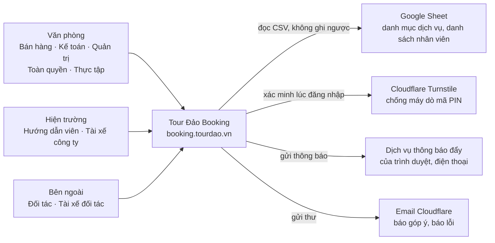
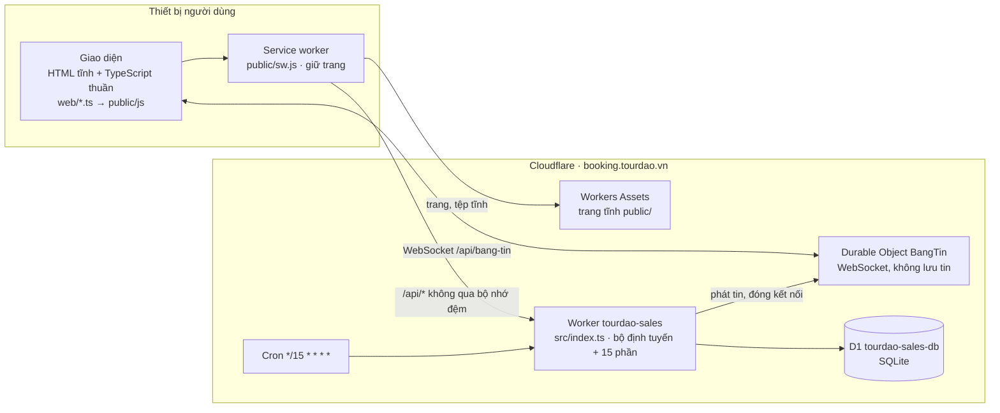
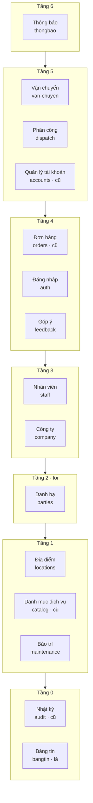
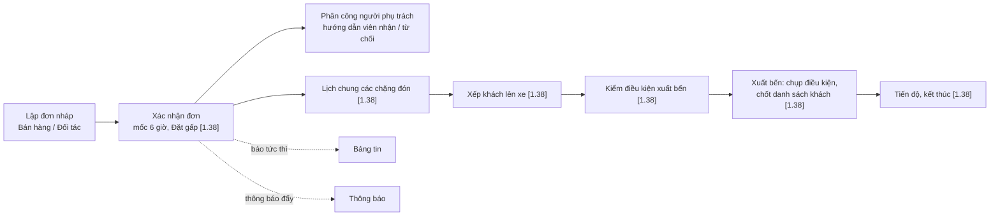
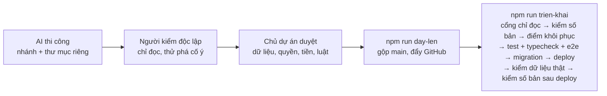

# Sơ đồ kiến trúc — Tour Đảo Booking

> **Loại tài liệu:** mô tả (không phải luật). Khi mâu thuẫn: Hiến pháp → Hiến chương và luật ở [`docs/ARCHITECTURE.md`](../ARCHITECTURE.md) → ADR ([`docs/adr/`](../adr/README.md)) → mã → tài liệu này. Thấy lệch với mã thì sửa tài liệu này trong cùng commit.
> **Chuẩn trình bày:** mô hình C4 (mức 1 Bối cảnh → mức 2 Khối triển khai → mức 3 Thành phần) và khung arc42 rút gọn (bối cảnh, khối xây dựng, luồng chạy, triển khai, khía cạnh xuyên suốt, quyết định).
> **Hiện trạng:** production chạy bản **1.37** (ngày 30/9/2026). Mục đánh dấu **[1.38]** là phần đang phát hành: Vận chuyển lượt 1 (ADR-0047 phần máy chủ, ADR-0049, ADR-0050, ADR-0051).
> **Bản trực quan** (mở bằng trình duyệt): [`tong-the.html`](tong-the.html) — toàn hệ thống; [`van-chuyen.html`](van-chuyen.html) — phân hệ Vận chuyển.

## Mục lục

1. [Cách đọc](#1-cách-đọc)
2. [Sản phẩm và vị trí như một SaaS](#2-sản-phẩm-và-vị-trí-như-một-saas)
3. [Mức 1 — Bối cảnh hệ thống](#3-mức-1--bối-cảnh-hệ-thống)
4. [Mức 2 — Khối triển khai](#4-mức-2--khối-triển-khai)
5. [Mức 3 — Các phần máy chủ](#5-mức-3--các-phần-máy-chủ)
6. [Luồng chạy chính](#6-luồng-chạy-chính)
7. [Dữ liệu và chủ sở hữu](#7-dữ-liệu-và-chủ-sở-hữu)
8. [Người dùng, vai và cổng](#8-người-dùng-vai-và-cổng)
9. [Khía cạnh xuyên suốt](#9-khía-cạnh-xuyên-suốt)
10. [Triển khai và vận hành](#10-triển-khai-và-vận-hành)
11. [Phân hệ Vận chuyển](#11-phân-hệ-vận-chuyển)
12. [Quyết định kiến trúc và tài liệu liên quan](#12-quyết-định-kiến-trúc-và-tài-liệu-liên-quan)
13. [Giữ tài liệu này đúng](#13-giữ-tài-liệu-này-đúng)

---

## 1. Cách đọc

| Mức | Trả lời câu hỏi | Mục |
|---|---|---|
| C4 mức 1 — Bối cảnh | Ai dùng hệ thống, hệ thống nói chuyện với những gì bên ngoài? | §3 |
| C4 mức 2 — Khối triển khai | Hệ thống gồm những khối chạy riêng nào, đặt ở đâu? | §4 |
| C4 mức 3 — Thành phần | Bên trong máy chủ chia thành những phần nào, phần nào được gọi phần nào? | §5, §11 |
| Luồng chạy | Một yêu cầu, một đơn hàng, một chuyến xe đi qua hệ thống thế nào? | §6 |
| Xuyên suốt | Những luật áp cho mọi phần (quyền, dữ liệu cá nhân, tiền, giờ…) | §8, §9 |
| Triển khai | Bản mới đi từ máy lập trình tới hệ thống thật thế nào? | §10 |

Chi tiết từng đường API, từng bảng, từng màn hình nằm ở [`docs/SYSTEM-DESIGN.md`](../SYSTEM-DESIGN.md) và [`docs/DATA-DICTIONARY.md`](../DATA-DICTIONARY.md). Tài liệu này không chép lại, chỉ vẽ khung.

---

## 2. Sản phẩm và vị trí như một SaaS

**Tour Đảo Booking** là phần mềm dạng dịch vụ web (SaaS) dùng nội bộ cho Công ty TNHH Tour Đảo (Nha Trang). Phần mềm phục vụ ba việc:
- lập và xác nhận đơn dịch vụ tour;
- phân công người phụ trách và hướng dẫn viên;
- điều xe đưa đón khách.

Ngoài ra có quản trị danh bạ, danh mục dịch vụ, tài khoản và quyền.

| Lớp của sản phẩm | Trong Tour Đảo Booking |
|---|---|
| Trải nghiệm | Ứng dụng web cài lên iPhone như app ("Tour Đảo Booking"), giao diện tiếng Việt, 23 trang (31 trang từ [1.38]) |
| Ứng dụng | Một máy chủ Cloudflare Worker, chia 15 phần (module) có ranh giới được máy kiểm |
| Dữ liệu | Một cơ sở dữ liệu D1 (SQLite): 46 bảng (61 bảng từ [1.38]) |
| Tích hợp | Google Sheet (chỉ đọc), Cloudflare Turnstile, thông báo đẩy Web Push, email |
| Vận hành | Lịch chạy 15 phút, Bảng tin thời gian thực, chế độ bảo trì, nhật ký thao tác, quy trình phát hành có cổng kiểm |

**Mô hình khách thuê: một doanh nghiệp, một bản cài riêng** (single-tenant, kiểu "silo").
- Mỗi doanh nghiệp có một Worker, một D1 và một tên miền riêng. Bản đang chạy: `tourdao-sales`, `tourdao-sales-db`, `booking.tourdao.vn`.
- Không có dữ liệu của doanh nghiệp khác chung cơ sở dữ liệu.

**Tái dùng cho doanh nghiệp khác.**
- Định danh doanh nghiệp (tên pháp lý, mã số thuế, địa chỉ, hotline) không cài cứng trong mã. Nó là hồ sơ **"công ty chủ"** trong Danh bạ, vai `OWNER_COMPANY`. Toàn quyền đổi được sang hồ sơ khác mà không sửa mã (ADR-0024 điều 6, ADR-0043).
- Chủ dự án chọn hướng này để "dùng cái khung, mã nguồn cho một doanh nghiệp khác".
- Phục vụ thêm một doanh nghiệp nghĩa là cài thêm một bản: Worker, D1, tên miền, Google Sheet riêng.

**Chưa có** (không phải hiện trạng):
- nhiều doanh nghiệp dùng chung một bản cài: không có cột phân tách khách thuê;
- tự đăng ký;
- tính phí theo gói;
- trang quản trị nhiều khách thuê.

Muốn có những thứ đó phải qua ADR mới do chủ dự án duyệt.

---

## 3. Mức 1 — Bối cảnh hệ thống

| Bên ngoài | Dùng để | Chiều | Ghi chú |
|---|---|---|---|
| Google Sheet dịch vụ | Kéo danh mục, bảng giá dịch vụ | chỉ đọc | Lịch 15 phút + nút đồng bộ có xem trước; phần `catalog` |
| Google Sheet nhân viên | Đề xuất tài khoản mới | chỉ đọc | Sheet chỉ là nguồn đề xuất; D1 là nguồn sự thật; phần `accounts` |
| Cloudflare Turnstile | Chặn máy dò mã PIN ở đăng nhập | máy chủ gọi | Bật khi có khoá bí mật; phần `auth` |
| Web Push | Thông báo tới điện thoại, máy tính | máy chủ gọi | Khoá VAPID; phần `thongbao` |
| Email (binding `send_email`) | Báo góp ý, báo lỗi cho chủ dự án | máy chủ gọi | Phần `feedback` |

---

## 4. Mức 2 — Khối triển khai

| Khối | Công nghệ | Trách nhiệm | Mã |
|---|---|---|---|
| Giao diện | HTML tĩnh + TypeScript thuần (không React), esbuild | Màn hình, ẩn/hiện nút theo quyền, gọi `/api` | `public/*.html`, `web/*.ts` |
| Service worker | PWA | Giữ trang cho iPhone, không đệm `/api` | `web/sw/sw.ts` → `public/sw.js` |
| Trang tĩnh | Cloudflare Workers Assets | Phục vụ trang, không chạm máy chủ | `public/` |
| Máy chủ | Cloudflare Worker (TypeScript) | Định tuyến, kiểm quyền, luật nghiệp vụ, ghi dữ liệu | `src/index.ts`, `src/modules/*`, `src/shared/*` |
| Bảng tin | Durable Object `BangTin`, một thực thể `cong-ty` | Báo tức thì "đơn vừa đổi" tới màn hình đang mở | `src/modules/bangtin/tram.ts` |
| Lịch | Cloudflare Cron | Kéo danh mục dịch vụ 15 phút một lần | `scheduled()` trong `src/index.ts` |
| Cơ sở dữ liệu | Cloudflare D1 (SQLite) | Nguồn sự thật; trigger giữ luật lõi | `migrations/*.sql` |

- Một tên miền duy nhất. `run_worker_first: ["/api/*"]` đưa mọi `/api` vào máy chủ trước.
- Địa chỉ `workers.dev` tắt có chủ ý.
- Bí mật (khoá phiên, khoá Turnstile, khoá thông báo) chỉ đặt bằng `wrangler secret put`, không nằm trong mã.

Chi tiết: [`docs/SYSTEM-DESIGN.md`](../SYSTEM-DESIGN.md) §2.

---

## 5. Mức 3 — Các phần máy chủ

Máy chủ chia 15 phần. Mỗi phần sở hữu đường API, bảng và luật của mình. Phần khác chỉ gọi qua `index.ts` của nó và chỉ đọc dữ liệu qua cửa đọc công bố (view `v_<tiền tố>_*`).

Danh sách mối nối được phép nằm ở hằng `ALLOWED_EDGES` trong [`src/architecture.test.ts`](../../src/architecture.test.ts). Bài kiểm đỏ khi có mối nối lạ, và không có vòng.

Mũi tên giữa các tầng nghĩa là "chỉ được gọi xuống". Mối nối cụ thể của từng phần:

| Phần | Tên mã | Hạng | Làm gì | Được đọc / gọi |
|---|---|---|---|---|
| Thông báo | `thongbao` | nghiêm | Tin nội bộ, thông báo đẩy | `audit`, `orders`, `dispatch`, `staff` |
| Vận chuyển | `van-chuyen` | nghiêm | Xe, giấy tờ xe, chuyến, điều phối, tài xế | `parties`, `audit`; từ [1.38] thêm `orders`, `locations` |
| Phân công | `dispatch` | nghiêm | Người phụ trách đơn, hướng dẫn viên nhận việc | `orders`, `parties`, `locations`, `staff`, `audit` |
| Quản lý tài khoản | `accounts` | cũ | Tạo tài khoản, cấp quyền, đổi PIN, nạp từ Sheet | `staff`, `auth`, `audit`, `maintenance` |
| Đơn hàng | `orders` | cũ (có tệp nửa nghiêm) | Đơn, dịch vụ, thông tin chuyến, xác nhận; từ [1.38] chặng đưa đón, hành khách | `audit`, `catalog`, `staff`, `parties`, `locations` |
| Đăng nhập | `auth` | nghiêm | PIN, Face ID (passkey), phiên, Turnstile | `staff`, `maintenance`, `parties` |
| Góp ý | `feedback` | nghiêm | Phiếu góp ý / báo lỗi, email | `staff`, `audit` |
| Nhân viên | `staff` | nghiêm | Tài khoản và quyền của từng người | `parties`, `audit` |
| Công ty | `company` | nghiêm | Logo; định danh lấy từ hồ sơ công ty chủ | `parties` |
| Danh bạ | `parties` | nghiêm | Mọi "Bên": khách, đại lý, đối tác, nhân viên, nhà xe, công ty chủ; vai, quan hệ, liên hệ, giấy tờ người | `locations`, `audit` |
| Địa điểm | `locations` | nghiêm | Khách sạn, bến tàu, điểm tham quan | `audit` |
| Danh mục dịch vụ | `catalog` | cũ | Dịch vụ, bảng giá, đồng bộ Sheet | `audit` |
| Bảo trì | `maintenance` | nghiêm | Bật / tắt chế độ bảo trì (chỉ chủ dự án) | `audit` |
| Nhật ký | `audit` | cũ | Ai làm gì, lúc nào; chỉ thêm | — |
| Bảng tin | `bangtin` | lá, không bảng | Bắt tay WebSocket; không đọc dữ liệu | — |

**Hạng.**
- **Nghiêm:** mọi câu SQL đăng ký qua `defineSql`, bài `EXPLAIN` kiểm không đọc lén bảng phần khác.
- **Cũ:** ngoại lệ có hạn, gỡ khi được chạm.

**Hai lớp không thuộc phần nào.**
- **Gốc lắp ráp** `src/index.ts`: nơi duy nhất nối chéo.
  - Nó tiêm vào `ctx` các hàm `isAssigned`, `newOrderHandler`, `ordersWithHandler`, `myHandledOrderIds`, `baoThayDoi`, `dongBangTin`, và từ [1.38] thêm `mocToiThieu`. Nhờ vậy `orders` không phải import `dispatch`, `van-chuyen` hay `bangtin`.
  - Nó cũng đưa cổng bảo trì `maintenanceBlock` cho bộ định tuyến.
- **Luật thuần dùng chung** `src/shared/`: bảng quyền (`permissions.ts`), định tuyến (`router.ts`), hợp đồng dữ liệu (`contracts.ts`), luật tính tiền, luật kiểm chuyến… dùng chung cho máy chủ và màn hình. Không import `src/modules/`.

---

## 6. Luồng chạy chính

### 6.1 Một yêu cầu `/api`

| Trạm | Kiểm | Không qua thì |
|---|---|---|
| 1 | Khớp đường dẫn, phương thức | 404 / 405 |
| 2 | Cấu hình máy chủ (khoá phiên đủ dài) | 500 |
| 3 | Lệnh ghi phải cùng nguồn (`Origin`), thân JSON | 403 / 415 |
| 4 | Phiên đăng nhập (cookie có chữ ký) | 401 |
| 5 | Cổng bảo trì | 503 |
| 6 | Cổng theo nhóm: `public`, `staff`, `office`, `orders`, `admin` | 403 |
| 7 | Phần xử lý hỏi bảng quyền `can(staff, việc, ngữ cảnh)` cho đúng việc, đúng đơn | 403 / 409 |
| 8 | Ghi D1 và nhật ký cùng một lô; trả JSON `no-store` | 200 |

Sơ đồ tuần tự: [`docs/SYSTEM-DESIGN.md`](../SYSTEM-DESIGN.md) §3.

### 6.2 Từ đơn hàng tới chuyến xe

Luồng nghiệp vụ từng bước: [`docs/SYSTEM-DESIGN.md`](../SYSTEM-DESIGN.md) §6. Vòng đời chuyến xe: §11 và [`van-chuyen.html`](van-chuyen.html).

---

## 7. Dữ liệu và chủ sở hữu

Chỉ phần chủ được ghi vào bảng của mình. Tiền tố tên bảng cho biết chủ.

| Chủ | Tiền tố / bảng | Số bảng | Nội dung |
|---|---|---|---|
| Vận chuyển | `vc_` | 4 → **17** [1.38] | Xe, giấy tờ xe, ngưỡng nhắc hạn; [1.38] chuyến, ai lái, điểm dừng, suất, sự kiện, bản chụp xuất bến, bản chốt danh sách, chính sách, gọi báo |
| Danh bạ | `pty_` | 12 | Bên, người, tổ chức, vai, quan hệ, liên hệ, giấy tờ người, hạng bằng |
| Đơn hàng | `orders`, `order_*`, `ord_` | 4 → **6** [1.38] | Đơn, dịch vụ, dòng giá, điều chỉnh tiền; [1.38] chặng đưa đón, hành khách |
| Thông báo | `ntf_` | 5 | Tin, người nhận, đã đọc, đã xác nhận, đăng ký thông báo đẩy |
| Nhân viên | `staff`, `stf_` | 4 | Tài khoản, quyền, loại quyền, điều chỉnh quyền |
| Góp ý | `fbk_` | 4 | Phiếu, tin trao đổi, loại, trạng thái |
| Phân công | `dsp_` | 3 | Giao việc, trạng thái, loại việc |
| Danh mục dịch vụ | `catalog_*` | 3 | Mục dịch vụ, sửa tay, lần đồng bộ |
| Đăng nhập | `aut_`, `login_attempt` | 2 | Khoá Face ID, lần thử PIN |
| Địa điểm | `loc_` | 2 | Địa điểm, loại |
| Nhật ký | `audit_log` | 1 | Mọi thao tác quan trọng |
| Bảo trì, Công ty | `mnt_setting`, `company_profile` | 2 | Cài đặt bảo trì; logo |
| **Tổng** | | **46 → 61** [1.38] | |

Luật dữ liệu:
- **Tiền** là `INTEGER` đồng, chỉ máy chủ tính (`buildLines`).
- **Ngày dân sự** theo giờ Việt Nam; dấu thời gian ISO UTC.
- **Không xoá cứng:** đổi bằng dòng có hiệu lực (`valid_from/to`). Ngoại lệ có tên duy nhất: dòng `ord_*` của đơn nháp, `XOA_CUNG_NHAP`.
- **Migration chỉ thêm tệp mới.**

Từng cột: [`docs/DATA-DICTIONARY.md`](../DATA-DICTIONARY.md).

---

## 8. Người dùng, vai và cổng

Chín mã quyền; một tài khoản giữ được nhiều quyền (trừ Tài xế đối tác đứng một mình).

| Nhóm | Vai (mã) |
|---|---|
| Văn phòng | Bán hàng (`SALES`), Kế toán (`ACCOUNTING`), Quản trị (`ADMIN`), Toàn quyền (`SUPER_ADMIN`), Thực tập (`INTERN`) |
| Hiện trường | Hướng dẫn viên (`FIELD`), Tài xế công ty (`DRIVER`) |
| Bên ngoài | Đối tác (`PARTNER`), Tài xế đối tác (`DRIVER_PARTNER`) |

- **Hai lớp kiểm quyền.** Cổng theo nhóm ở đường API (§6.1, trạm 6), rồi ô quyền cho từng việc trong bảng `MATRIX` của [`src/shared/permissions.ts`](../../src/shared/permissions.ts).
- **Mặc định từ chối.** Giao diện chỉ ẩn hay hiện nút; máy chủ luôn kiểm lại.
- **Tài khoản bên ngoài** không giữ thêm quyền nội bộ; cơ sở dữ liệu cũng chặn (trigger LC-1).
- Ma trận đầy đủ: [`docs/SYSTEM-DESIGN.md`](../SYSTEM-DESIGN.md) §8.

---

## 9. Khía cạnh xuyên suốt

| Khía cạnh | Cách làm | Nơi thi hành |
|---|---|---|
| Xác thực | Mã PIN 6 số hoặc Face ID (passkey); cookie phiên có chữ ký; Turnstile trước bộ chống dò PIN | `auth` |
| Chống giả mạo | Lệnh ghi phải có `Origin` cùng nguồn; CSP chặt ở `public/_headers` | `src/shared/router.ts` |
| Dữ liệu cá nhân | Nhật ký không ghi SĐT, email, mã số thuế, số giấy tờ; xem đủ số giấy tờ phải ghi nhật ký trước; [1.38] tên khách chỉ hiện cho tài xế trong ngày chạy | từng phần + bài kiểm |
| Nhật ký | Mọi thao tác quan trọng một dòng, chỉ thêm, nhãn tiếng Việt | `audit`, `src/shared/audit-actions.ts` |
| Đồng thời | Khoá lạc quan `updated_at` + lính gác; [1.38] phần nghiêm dùng `version` + dấu lệnh, một lệnh là một lô ghi | từng phần |
| Bảo trì | Bật thì máy chủ chặn mọi SĐT ngoài danh sách cho phép, kể cả phiên đang mở | `maintenance`, trạm 5 |
| Ngôn ngữ | Giao diện, thông báo lỗi, tài liệu đều tiếng Việt có dấu; không lộ mã trạng thái thô | toàn bộ |
| Quan sát | Log JSON một dòng, `requestId`; lỗi không bắt được → 500 kèm mã yêu cầu | `src/shared/router.ts` |
| Bất biến dữ liệu | Bộ kiểm định kỳ, chỉ đọc (`R-*`), chạy sau mỗi lần triển khai | `scripts/audit-invariants.mjs` |

---

## 10. Triển khai và vận hành

| Môi trường | Dùng để | Dữ liệu |
|---|---|---|
| Máy lập trình | `npm run dev` (wrangler dev) | D1 local |
| D1 tạm | Kiểm đầu-cuối, thử iPhone qua mạng nội bộ | tạo mới mỗi lần, xoá sau |
| Production | `booking.tourdao.vn` | D1 `tourdao-sales-db` |

- **Chỉ chủ dự án** chạy `day-len` và `trien-khai`, và chỉ trong Terminal. Hàng rào máy (hook `.claude/hooks/guard-remote.mjs`, `permissions.deny`) chặn AI tự đẩy mã, tự triển khai, tự ghi dữ liệu thật.
- **Cloudflare không nối GitHub.** Đẩy mã lên GitHub không tự triển khai.
- **Số phiên bản** lấy từ mục đầu của nhật ký thay đổi (`src/shared/changelog.ts`).
- **Kiểm thử:** `npm test` (luật thuần + bài kiến trúc, hai bước), `npm run typecheck`, `npm run test:e2e` (API thật trên D1 tạm), kịch bản Chrome, `audit-invariants`.
- **Runbook:** [`docs/HANDOFF-N1.md`](../HANDOFF-N1.md), [`docs/QUY-TRINH-PHAT-HANH.md`](../QUY-TRINH-PHAT-HANH.md).

---

## 11. Phân hệ Vận chuyển

Phân hệ lớn nhất và mới nhất. Bản đầy đủ có sơ đồ nối, tuyến bảy trạm của một chuyến, bảng quyền, dữ liệu, hàng rào và việc còn lại: [`van-chuyen.html`](van-chuyen.html).

**Phạm vi theo bản.**
- **1.35 (đã chạy):** xe, giấy tờ xe, tài xế, giấy tờ người (ADR-0040).
- **1.37 (đã chạy):** nhà xe đối tác, tài xế đối tác trong danh bạ (ADR-0048).
- **[1.38]:**
  - chặng đưa đón và hành khách (ADR-0047 phần máy chủ);
  - Bảng điều phối, mốc 6 giờ, đặt gấp (ADR-0049);
  - giờ thật khi bấm thay, giữ chuyến khi nơi đổi, Kiểm định + Bảo hiểm (ADR-0050);
  - nhắc gọi báo khách (ADR-0051).

**Vòng đời một chuyến [1.38].** Đơn có chặng đón → lịch chung (dựng lúc đọc) → xếp khách lên xe (mỗi khách một suất) → kiểm điều kiện xuất bến → xuất bến (chụp điều kiện, chốt danh sách hành khách) → tiến độ → kết thúc.
- Màn hình và nút xuất bến dùng chung một hàm kiểm: `kiemXuatBen`.
- Xe bị giữ khi nơi đón đổi, khách đổi, hoặc giờ hẹn đổi.

**Đã duyệt, chưa thi công:**
- ADR-0052: chuyển điểm, xe đang chạy;
- ADR-0053: tài xế đối tác dùng app;
- ADR-0054: chiều về theo dịch vụ;
- ADR-0055, ADR-0056: Kernel lượt 2–3;
- ADR-0057: tiền xe thuê;
- sổ tiền lượt 1: ADR-0024…0026.

**Chưa có:** màn nhập chặng và danh sách khách (ADR-0047 phần giao diện).

---

## 12. Quyết định kiến trúc và tài liệu liên quan

| Cần | Đọc |
|---|---|
| Luật kiến trúc (chuẩn tắc): Hiến chương Phần I, luật Phần II | [`docs/ARCHITECTURE.md`](../ARCHITECTURE.md) |
| Quyết định đã duyệt | [`docs/adr/README.md`](../adr/README.md) |
| Hiện trạng chi tiết: API, quyền, giao diện, bảo mật | [`docs/SYSTEM-DESIGN.md`](../SYSTEM-DESIGN.md) |
| Từng bảng, từng cột | [`docs/DATA-DICTIONARY.md`](../DATA-DICTIONARY.md) |
| Sửa nhanh, bẫy hay dính | [`docs/CHANGE-GUIDE.md`](../CHANGE-GUIDE.md) |
| Hàng rào và ngày thấy chặn thật | [`docs/SO-HANG-RAO.md`](../SO-HANG-RAO.md) |
| Việc để sau | [`docs/BACKLOG.md`](../BACKLOG.md) |

Những quyết định định hình khung:
- ADR-0002: ranh giới module;
- ADR-0018: người – vai – quyền;
- ADR-0024 điều 6 và ADR-0043: công ty chủ là hồ sơ;
- ADR-0022: Bảng tin;
- ADR-0036 và ADR-0045: thông báo đẩy;
- ADR-0047…0051: Vận chuyển.

---

## 13. Giữ tài liệu này đúng

Tài liệu này mô tả, nên thua mã. Khi đổi các thứ dưới đây, sửa mục tương ứng trong cùng commit:

| Đổi | Sửa mục | Nguồn số liệu |
|---|---|---|
| Thêm / bỏ một phần máy chủ, đổi mối nối | §5 | `ALLOWED_EDGES`, `STRICT`, `LEGACY` trong `src/architecture.test.ts` |
| Thêm bảng | §7 | `migrations/*.sql` (đếm lệnh tạo bảng) |
| Thêm trang | §2 | `PAGES` trong `src/shared/sw-policy.ts` |
| Thêm dịch vụ ngoài, binding, lịch | §3, §4 | `wrangler.jsonc` |
| Thêm mã quyền, đổi cổng | §8 | `src/shared/permissions.ts`, `src/shared/router.ts` |
| Phát hành bản mới | dòng "Hiện trạng" ở đầu, bỏ nhãn [1.38] khi bản lên production | `src/shared/changelog.ts` |

Hai bản trực quan `tong-the.html`, `van-chuyen.html` là ảnh chụp ngày 30/9/2026 theo mã nhánh phát hành 1.38. Khi lệch, tệp Markdown này là bản đúng.
