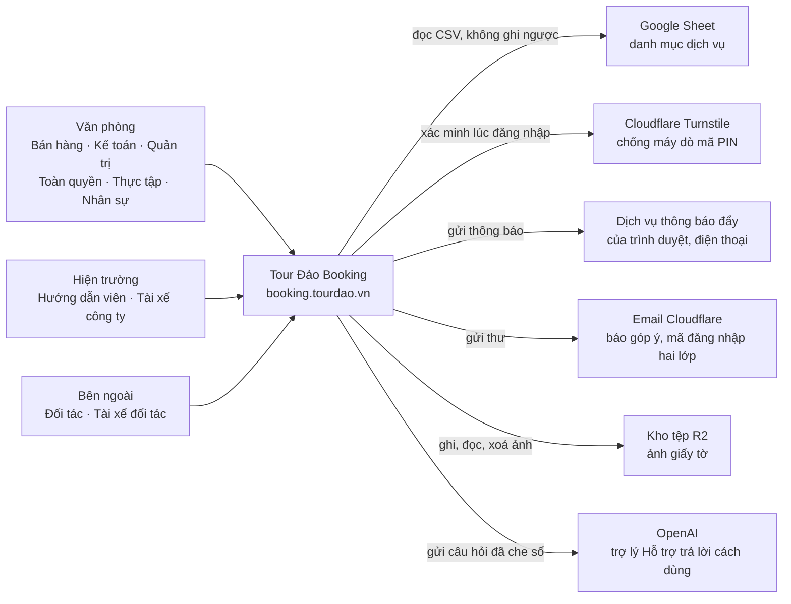
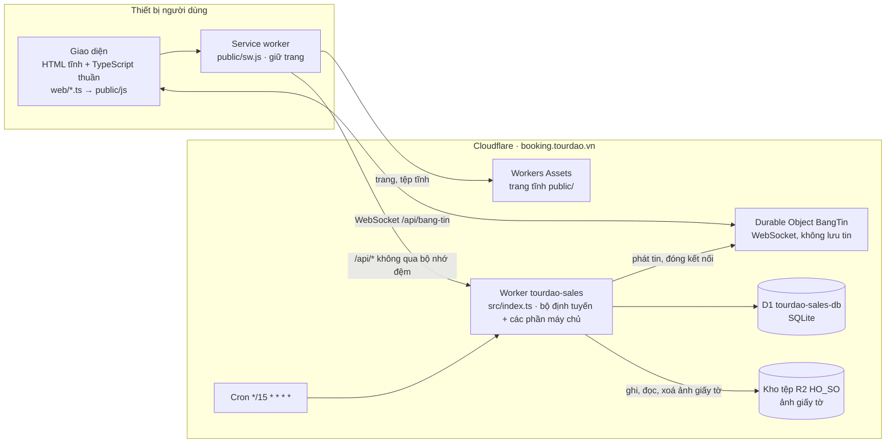
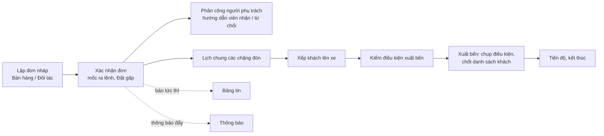
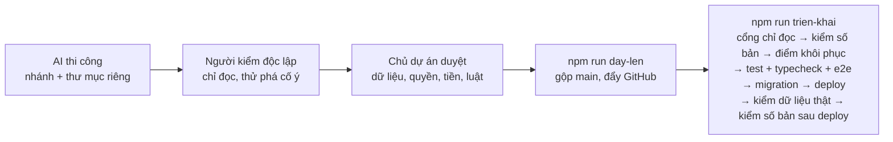

# Sơ đồ kiến trúc — Tour Đảo Booking

> **Loại tài liệu:** mô tả (không phải luật). Khi mâu thuẫn: Hiến pháp → Hiến chương và luật ở [`docs/ARCHITECTURE.md`](../ARCHITECTURE.md) → ADR ([`docs/adr/`](../adr/README.md)) → mã → tài liệu này. Thấy lệch với mã thì sửa tài liệu này trong cùng commit.
> **Chuẩn trình bày:** mô hình C4 (mức 1 Bối cảnh → mức 2 Khối triển khai → mức 3 Thành phần) và khung arc42 rút gọn (bối cảnh, khối xây dựng, luồng chạy, triển khai, khía cạnh xuyên suốt, quyết định).
> **Hiện trạng:** tài liệu này không ghi số bản và không tự kiểm production. Số bản của mã lấy từ mục đầu của `src/shared/changelog.ts`; bản đang chạy trên production lấy ở mục «TRẠNG THÁI TRIỂN KHAI» đầu `docs/HANDOFF-N1.md` và kiểm bằng `GET /api/auth/config`.
> **Bản máy đọc:** [`kien-truc.json`](kien-truc.json) — mục đích, đối tượng dùng và giới hạn của từng phần máy chủ, kèm các khối ngoài. Bài `src/so-do-kien-truc.test.ts` ép tệp này khớp mã (đủ phần, đúng tiền tố bảng, đúng mã quyền, tệp trỏ tới có thật). Mối nối và tầng không chép vào đó: lấy ở `ALLOWED_EDGES`.
> **Bản trực quan** (mở bằng trình duyệt): [`tong-the.html`](tong-the.html) — toàn hệ thống; [`van-chuyen.html`](van-chuyen.html) — phân hệ Vận chuyển. Cả hai là ảnh chụp theo bản 1.38 (30/9/2026), chưa vẽ lại; con số và trạng thái hiện hành lấy ở tệp này.

## Mục lục

1. [Cách đọc](#1-cách-đọc)
2. [Sản phẩm và vị trí như một SaaS](#2-sản-phẩm-và-vị-trí-như-một-saas)
3. [Mức 1 — Bối cảnh hệ thống](#3-mức-1--bối-cảnh-hệ-thống)
4. [Mức 2 — Khối triển khai](#4-mức-2--khối-triển-khai)
5. [Mức 3 — Các phần máy chủ](#5-mức-3--các-phần-máy-chủ)
6. [Luồng chạy chính](#6-luồng-chạy-chính)
7. [Dữ liệu và chủ sở hữu](#7-dữ-liệu-và-chủ-sở-hữu)
8. [Người dùng, vai và cổng](#8-người-dùng-vai-và-cổng)
9. [Khía cạnh xuyên suốt](#9-khía-cạnh-xuyên-suốt)
10. [Triển khai và vận hành](#10-triển-khai-và-vận-hành)
11. [Phân hệ Vận chuyển](#11-phân-hệ-vận-chuyển)
12. [Quyết định kiến trúc và tài liệu liên quan](#12-quyết-định-kiến-trúc-và-tài-liệu-liên-quan)
13. [Giữ tài liệu này đúng](#13-giữ-tài-liệu-này-đúng)

---

## 1. Cách đọc

| Mức | Trả lời câu hỏi | Mục |
|---|---|---|
| C4 mức 1 — Bối cảnh | Ai dùng hệ thống, hệ thống nói chuyện với những gì bên ngoài? | §3 |
| C4 mức 2 — Khối triển khai | Hệ thống gồm những khối chạy riêng nào, đặt ở đâu? | §4 |
| C4 mức 3 — Thành phần | Bên trong máy chủ chia thành những phần nào, phần nào được gọi phần nào? | §5, §11 |
| Luồng chạy | Một yêu cầu, một đơn hàng, một chuyến xe đi qua hệ thống thế nào? | §6 |
| Xuyên suốt | Những luật áp cho mọi phần (quyền, dữ liệu cá nhân, tiền, giờ…) | §8, §9 |
| Triển khai | Bản mới đi từ máy lập trình tới hệ thống thật thế nào? | §10 |

Chi tiết từng đường API, từng bảng, từng màn hình nằm ở [`docs/SYSTEM-DESIGN.md`](../SYSTEM-DESIGN.md) và [`docs/DATA-DICTIONARY.md`](../DATA-DICTIONARY.md). Tài liệu này không chép lại, chỉ vẽ khung.

---

## 2. Sản phẩm và vị trí như một SaaS

**Tour Đảo Booking** là phần mềm dạng dịch vụ web (SaaS) dùng nội bộ cho Công ty TNHH Tour Đảo (Nha Trang). Phần mềm phục vụ ba việc:
- lập và xác nhận đơn dịch vụ tour;
- phân công người phụ trách và hướng dẫn viên;
- điều xe đưa đón khách.

Ngoài ra có quản trị danh bạ, danh mục dịch vụ, tài khoản và quyền.

| Lớp của sản phẩm | Trong Tour Đảo Booking |
|---|---|
| Trải nghiệm | Ứng dụng web cài lên iPhone như một ứng dụng ("Tour Đảo Booking"), giao diện tiếng Việt |
| Ứng dụng | Một máy chủ Cloudflare Worker, chia thành nhiều phần (module) có ranh giới được máy kiểm; phần lớn có đường API, vài phần là thư viện |
| Dữ liệu | Một cơ sở dữ liệu D1 (SQLite) gồm bảng và view công bố; kèm một kho tệp R2 cho ảnh giấy tờ |
| Tích hợp | Google Sheet danh mục dịch vụ (chỉ đọc), Cloudflare Turnstile, thông báo đẩy Web Push, email, OpenAI (trợ lý Hỗ trợ) |
| Vận hành | Lịch chạy 15 phút, Bảng tin thời gian thực, chế độ bảo trì, lớp chống ghi trùng, nhật ký thao tác, quy trình phát hành có cổng kiểm |

Cách đếm (không ghi số ở đây vì đổi liên tục): trang = `PAGES` trong `src/shared/sw-policy.ts`; phần = thư mục con của `src/modules/`, trong đó phần có đường API là các phần ở mảng `modules` của `src/index.ts`; bảng và view = `tables`, `views` trong `docs/data-dictionary.json`. Mục đích của từng phần: [`kien-truc.json`](kien-truc.json).

**Mô hình khách thuê: một doanh nghiệp, một bản cài riêng** (single-tenant, kiểu "silo").
- Mỗi doanh nghiệp có một Worker, một D1 và một tên miền riêng. Bản đang chạy: `tourdao-sales`, `tourdao-sales-db`, `booking.tourdao.vn`.
- Không có dữ liệu của doanh nghiệp khác chung cơ sở dữ liệu.

**Tái dùng cho doanh nghiệp khác.**
- Định danh doanh nghiệp (tên pháp lý, mã số thuế, địa chỉ, hotline) không cài cứng trong mã. Nó là hồ sơ **"công ty chủ"** trong Danh bạ, vai `OWNER_COMPANY`. Toàn quyền đổi được sang hồ sơ khác mà không sửa mã (ADR-0024 điều 6, ADR-0043).
- Chủ dự án chọn hướng này để "dùng cái khung, mã nguồn cho một doanh nghiệp khác".
- Phục vụ thêm một doanh nghiệp nghĩa là cài thêm một bản: Worker, D1, tên miền, Google Sheet riêng.

**Chưa có** (không phải hiện trạng):
- nhiều doanh nghiệp dùng chung một bản cài: không có cột phân tách khách thuê;
- tự đăng ký;
- tính phí theo gói;
- trang quản trị nhiều khách thuê.

Muốn có những thứ đó phải qua ADR mới do chủ dự án duyệt.

---

## 3. Mức 1 — Bối cảnh hệ thống

| Bên ngoài | Dùng để | Chiều | Ghi chú |
|---|---|---|---|
| Google Sheet dịch vụ | Kéo danh mục, bảng giá dịch vụ | chỉ đọc | Lịch 15 phút + nút đồng bộ có xem trước; phần `catalog`. Sheet nhân viên đã bỏ (ADR-0071 điều 2): tài khoản chỉ tạo trong Nền tảng |
| Cloudflare Turnstile | Chặn máy dò mã PIN ở đăng nhập | máy chủ gọi | Bật khi có khoá bí mật; phần `auth` |
| Web Push | Thông báo tới điện thoại, máy tính | máy chủ gọi | Khoá VAPID; phần `thongbao` |
| Email (binding `send_email`) | Báo góp ý, báo lỗi cho người xử lý; gửi mã đăng nhập hai lớp bằng email | máy chủ gọi | Phần `feedback` (`notify.ts`) và phần `auth` (`mfa-email.ts`); thiếu địa chỉ cấu hình thì phần báo góp ý tự tắt |
| Kho tệp R2 (binding `HO_SO`) | Ảnh giấy tờ của người; dấu vết phiếu xoá | máy chủ ghi, đọc, xoá | Chỉ phần `parties` (`kho-tep.ts`); xem §4 |
| OpenAI | Trợ lý Hỗ trợ trả lời cách dùng Nền tảng | máy chủ gọi | Khoá `OPENAI_API_KEY` (bí mật); câu hỏi bị che dãy số trước khi gửi; không đọc đơn, khách, tiền; phần `tro-ly` (ADR-0066, ADR-0069) |

Mã QR thanh toán (VietQR) không gọi dịch vụ ngoài: máy chủ dựng chuỗi từ tài khoản nhận tiền của công ty (`src/shared/vietqr.ts`), trình duyệt chỉ vẽ ảnh.

---

## 4. Mức 2 — Khối triển khai

| Khối | Công nghệ | Trách nhiệm | Mã |
|---|---|---|---|
| Giao diện | HTML tĩnh + TypeScript thuần (không React), esbuild | Màn hình, ẩn/hiện nút theo quyền, gọi `/api` | `public/*.html`, `web/*.ts` |
| Service worker | PWA | Giữ trang cho iPhone, không đệm `/api` | `web/sw/sw.ts` → `public/sw.js` |
| Trang tĩnh | Cloudflare Workers Assets | Phục vụ trang, không chạm máy chủ | `public/` |
| Máy chủ | Cloudflare Worker (TypeScript) | Định tuyến, kiểm quyền, luật nghiệp vụ, ghi dữ liệu | `src/index.ts`, `src/modules/*`, `src/shared/*` |
| Bảng tin | Durable Object `BangTin`, một thực thể `cong-ty` | Báo tức thì "đơn vừa đổi" tới màn hình đang mở | `src/modules/bangtin/tram.ts` |
| Lịch | Cloudflare Cron | Kéo danh mục dịch vụ 15 phút một lần | `scheduled()` trong `src/index.ts` |
| Cơ sở dữ liệu | Cloudflare D1 (SQLite) | Nguồn sự thật; trigger giữ luật lõi | `migrations/*.sql` |
| Kho tệp | Cloudflare R2, binding `HO_SO` (bucket `tourdao-sales-ho-so`) | Giữ ảnh giấy tờ của người (căn cước, bằng lái…) và dấu vết ngoài D1 của phiếu xoá (chỉ mã và thời điểm, không tên, không số); chỉ phần `parties` chạm kho (bài `src/kho-tep-ho-so.test.ts`); không công khai, đọc qua đường API của `parties` | `src/modules/parties/kho-tep.ts` |

- Một tên miền duy nhất. `run_worker_first: ["/api/*", "/giao-dien.css"]` đưa mọi `/api` và tệp màu giao diện công ty (máy chủ dựng từ D1) vào máy chủ trước.
- Địa chỉ `workers.dev` tắt có chủ ý.
- Bí mật (khoá phiên `SESSION_SECRET`, khoá lớp chống ghi trùng `LAN_GUI_SECRET`, khoá Turnstile, nửa bí mật khoá thông báo, khoá OpenAI, địa chỉ email báo góp ý) chỉ đặt bằng `wrangler secret put`, không nằm trong mã. `SESSION_SECRET` và `LAN_GUI_SECRET` **bắt buộc**, mỗi khoá từ 32 ký tự: thiếu hoặc ngắn thì mọi API trả 500 (`checkConfig` ở `src/index.ts`). Mẫu cho máy lập trình: `.dev.vars.example`.

Chi tiết: [`docs/SYSTEM-DESIGN.md`](../SYSTEM-DESIGN.md) §2.

---

## 5. Mức 3 — Các phần máy chủ

Máy chủ chia thành các phần (thư mục con của `src/modules/`; mục đích từng phần ở [`kien-truc.json`](kien-truc.json)). Mỗi phần sở hữu đường API, bảng và luật của mình, trừ ba phần là thư viện không có đường API: `staff` (đường API của nó nằm ở `accounts`), `ky-so` (đường API nằm ở `billing`) và `lan-gui` (router dùng qua gốc lắp ráp). Phần khác chỉ gọi qua `index.ts` của nó và chỉ đọc dữ liệu qua cửa đọc công bố (view `v_<tiền tố>_*`).

Danh sách mối nối được phép nằm ở hằng `ALLOWED_EDGES` trong [`src/architecture.test.ts`](../../src/architecture.test.ts). Bài kiểm đỏ khi có mối nối lạ, và không có vòng. Tầng dưới đây tính từ `ALLOWED_EDGES` (tầng của một phần = 1 + tầng cao nhất trong các phần nó được gọi).

```mermaid
flowchart TB
  subgraph T7["Tầng 7"]
    receipt["Biên nhận, QR<br/>receipt · không bảng"]
  end
  subgraph T6["Tầng 6"]
    thongbao["Thông báo<br/>thongbao"]
    billing["Sổ tiền<br/>billing"]
  end
  subgraph T5["Tầng 5"]
    vanchuyen["Vận chuyển<br/>van-chuyen"]
    dispatch["Phân công<br/>dispatch"]
    feedback["Góp ý, vé hỗ trợ<br/>feedback"]
    accounts["Quản lý tài khoản<br/>accounts · cũ"]
  end
  subgraph T4["Tầng 4"]
    orders["Đơn hàng<br/>orders · cũ"]
    auth["Đăng nhập, hai lớp<br/>auth"]
    troly["Trợ lý Hỗ trợ<br/>tro-ly"]
  end
  subgraph T3["Tầng 3"]
    staff["Nhân viên<br/>staff"]
    company["Công ty<br/>company"]
    pricing["Hoa hồng, điều khoản bán<br/>pricing"]
  end
  subgraph T2["Tầng 2 · lõi"]
    parties["Danh bạ<br/>parties"]
  end
  subgraph T1["Tầng 1"]
    locations["Địa điểm<br/>locations"]
    catalog["Danh mục dịch vụ<br/>catalog · cũ"]
    maintenance["Bảo trì<br/>maintenance"]
    kyso["Khoá sổ tháng<br/>ky-so"]
    giaodien["Giao diện công ty<br/>giao-dien"]
  end
  subgraph T0["Tầng 0"]
    audit["Nhật ký<br/>audit · cũ"]
    bangtin["Bảng tin<br/>bangtin · lá"]
    langui["Chống ghi trùng<br/>lan-gui · lá"]
  end
  T7 --> T6 --> T5 --> T4 --> T3 --> T2 --> T1 --> T0
```

Mũi tên giữa các tầng nghĩa là "chỉ được gọi xuống".

Mối nối cụ thể của từng phần:

| Phần | Tên mã | Hạng | Làm gì | Được đọc / gọi |
|---|---|---|---|---|
| Biên nhận, QR | `receipt` | không bảng | Biên nhận gửi khách theo danh sách trắng; QR thanh toán (không bảng, không câu SQL) | `orders`, `billing`, `parties`, `company` |
| Thông báo | `thongbao` | nghiêm | Tin nội bộ, thông báo đẩy, tin chuyến | `audit`, `orders`, `dispatch`, `staff` |
| Sổ tiền | `billing` | nghiêm | Lần thu, cọc, "Đã giao" / "Hoàn thành", nhập phần mềm kế toán, khoá sổ tháng (đường API) | `orders`, `parties`, `staff`, `dispatch`, `audit`, `ky-so` |
| Vận chuyển | `van-chuyen` | nghiêm | Xe, giấy tờ xe, chuyến, điều phối, tài xế, tiền xe thuê | `parties`, `audit`, `orders`, `locations`, `ky-so` |
| Phân công | `dispatch` | nghiêm | Người phụ trách đơn, hướng dẫn viên nhận việc | `orders`, `parties`, `locations`, `staff`, `audit` |
| Quản lý tài khoản | `accounts` | cũ | Tạo tài khoản, cấp quyền, đổi PIN, sổ phiên đăng nhập | `staff`, `auth`, `audit` |
| Đơn hàng | `orders` | cũ, có tệp nửa nghiêm | Đơn, dịch vụ, thông tin chuyến, xác nhận, chặng đưa đón, hành khách, bản chụp mức hoa hồng lúc xác nhận | `audit`, `catalog`, `staff`, `parties`, `locations`, `pricing` |
| Đăng nhập | `auth` | nghiêm | PIN, Face ID (passkey), bảo mật hai lớp (ứng dụng mã, email, mã dự phòng, máy tin cậy), phiên, Turnstile | `staff`, `maintenance`, `parties` |
| Góp ý, vé hỗ trợ | `feedback` | nghiêm | Phiếu góp ý / báo lỗi và vé hỗ trợ: nhóm xử lý, nhận việc, chuyển nhóm, trao đổi, gắn đơn của chính người gửi; email báo | `staff`, `audit`, `orders` (chỉ ba view công bố) |
| Trợ lý Hỗ trợ | `tro-ly` | nghiêm | Trợ lý AI trả lời cách dùng Nền tảng; bảng điều khiển của Toàn quyền | `audit`, `staff` |
| Nhân viên | `staff` | nghiêm | Tài khoản và quyền của từng người (thư viện, không có đường API) | `parties`, `audit` |
| Công ty | `company` | nghiêm | Logo; định danh lấy từ hồ sơ công ty chủ (danh sách trắng năm trường) | `parties` |
| Hoa hồng, điều khoản bán | `pricing` | nghiêm | Mức hoa hồng đối tác theo dịch vụ hoặc nhóm dịch vụ; ai bán dịch vụ nào | `parties`, `catalog`, `audit` |
| Danh bạ | `parties` | nghiêm | Mọi "Bên": khách, đại lý, đối tác, nhân viên, nhà xe, công ty chủ; vai, quan hệ, liên hệ, giấy tờ người và ảnh giấy tờ (kho tệp), tài khoản nhận tiền; hồ sơ riêng tư: chính sách và đồng ý, tự khai, hàng chờ xác minh, xoá và ẩn danh hoá | `locations`, `audit` |
| Địa điểm | `locations` | nghiêm | Khách sạn, bến tàu, điểm tham quan | `audit` |
| Danh mục dịch vụ | `catalog` | cũ, có một tệp nửa nghiêm | Dịch vụ, bảng giá, nhóm dịch vụ, đồng bộ Sheet | `audit` |
| Bảo trì | `maintenance` | nghiêm | Bật / tắt chế độ bảo trì (chỉ Toàn quyền) | `audit` |
| Khoá sổ tháng | `ky-so` | nghiêm | Tháng đã khoá sổ (thư viện, không có đường API; đường API ở `billing`) | `audit` |
| Giao diện công ty | `giao-dien` | nghiêm | Màu, phông giao diện công ty; Toàn quyền chỉnh | `audit` |
| Nhật ký | `audit` | cũ | Ai làm gì, lúc nào; chỉ thêm | — (xem ghi nhận dưới) |
| Bảng tin | `bangtin` | lá, không DB | Bắt tay WebSocket; không đọc dữ liệu | — |
| Chống ghi trùng | `lan-gui` | nghiêm, lá | Vé mỗi lần gửi lệnh ghi (ADR-0094); bộ định tuyến dùng qua gốc lắp ráp | — |

**Hạng.**
- **Nghiêm:** mọi câu SQL đăng ký qua `defineSql`, bài `EXPLAIN` kiểm không đọc lén bảng phần khác. Danh sách nằm ở `STRICT` trong `src/architecture.test.ts`.
- **Cũ:** ngoại lệ có hạn (`LEGACY`), gỡ khi được chạm. Tệp "nửa nghiêm" (`NUA_NGHIEM`) của phần cũ đã theo luật nghiêm.
- **Không bảng** (`KHONG_BANG`): không bảng, không câu SQL; chỉ chuyển tay cầm cơ sở dữ liệu cho hàm công bố của phần mình được gọi. **Lá, không DB** (`KHONG_DB`): không đụng cơ sở dữ liệu.

**Ghi nhận hiện trạng, chưa có máy canh.** (Các tệp SQL tiền của `billing` đã vào `STRICT`, không còn ngoại lệ.)
- `audit` khai là lá (không mối nối nào ở `ALLOWED_EDGES`) nhưng câu SQL của nó đọc view của `staff`, `orders`, `parties`, `locations` để lấy nhãn; vì `audit` còn ở hạng cũ nên không bài nào bắt chỗ này.

**Hai lớp không thuộc phần nào.**
- **Gốc lắp ráp** `src/index.ts`: nơi duy nhất nối chéo.
  - Nó tiêm các hàm sau (khối `injected`); phần lớn đi vào `ctx` của route: `isAssigned`, `newOrderHandler`, `ordersWithHandler`, `handledOrderIdsOf` (route thấy là `ctx.myHandledOrderIds`), `baoThayDoi`, `baoThayDoiChuyen`, `dongBangTin`, `giaoLoDay`, `mocToiThieu`, `chuyenChoTin`, `nguongHetHan`, `nhanNhanVien`, `huongDanVien`, `partyAccount`, `gopHoSo`, `benDatCuaToi` (bên đặt do máy chủ ép cho tài khoản Đối tác), `nhapKeToanCuaDon`. Nhờ vậy `orders` không phải import `dispatch`, `van-chuyen`, `billing` hay `bangtin`; `auth` không import `pricing`.
  - Bộ định tuyến tự dùng hai hàm khác, không qua `ctx`: cổng bảo trì `maintenanceBlock` và lớp chống ghi trùng `lanGui`.
  - Nó ghép cấu hình bắt buộc `checkConfig` (khoá phiên của `auth` và khoá của `lan-gui`) và là nơi duy nhất nạp lớp Durable Object `BangTin`.
- **Luật thuần dùng chung** `src/shared/`: bảng quyền (`permissions.ts`), định tuyến (`router.ts`), hợp đồng dữ liệu (`contracts.ts`), luật tính tiền, sổ đại lý, mã QR, khoá tháng, luật giấy tờ, luật kiểm chuyến, kho tri thức của trợ lý… dùng chung cho máy chủ và màn hình. Không import `src/modules/`. Gần như toàn thuần; chỗ cần môi trường Worker (D1, `fetch`) là `router.ts`, `lan-gui-boc.ts`, `sheets.ts`.

### Nhóm sổ tiền (`billing`, `pricing`, `receipt`, `ky-so`)

- **Sổ tiền lượt 1 (`billing`):** lần thu theo đơn, cọc (duyệt, chi, chuyển, hoàn ngoài hệ thống), "Đã giao" / "Hoàn thành", dấu "đã nhập phần mềm kế toán". Các bảng sổ `bil_*` chỉ thêm dòng (trigger cấm sửa, xoá).
- **QR thanh toán (bản 1.86, migration 0087–0088):** `receipt` trả `GET /api/orders/:id/qr-thanh-toan`; chuỗi VietQR dựng ở máy chủ từ tài khoản nhận tiền của công ty chủ (`pty_bank_account` ở `parties`, danh sách ngân hàng `pty_bank`). Kế toán xác nhận tiền chuyển khoản về công ty phải nhập mã giao dịch ngân hàng, một mã không ghi hai lần (`bil_receipt_bank_txn`).
- **Sổ đại lý đợt 1 (bản 1.87, migration 0090):** `pricing` giữ mức hoa hồng đối tác theo dịch vụ hoặc nhóm dịch vụ và điều khoản người bán (`prc_*`, đường API `/api/pricing/*`, trang `/hoa-hong`, `/nguoi-ban`). Lúc Xác nhận, `orders` chụp mức vào `ord_service_terms` (qua `docBangChoChup` của `pricing`). Với tài khoản Đối tác, bên đặt do máy chủ ép (`benDatCuaToi`). Khoá tháng: `GET|POST /api/ledger/ky…` ở `billing`, bảng `ky_period_close` của `ky-so`, trang `/khoa-thang`; từ khi khoá, trigger `*_period_closed` chặn ghi thêm tiền vào tháng đó (cả `vc_trip_cost_line`), tháng khoá không mở lại.
- Ai thấy mức hoa hồng, giá đại lý, tỷ lệ mua lại, ai khoá được tháng: các ô `partner.commission.*`, `supply.terms.*`, `order.terms.*`, `ledger.period.close` trong `MATRIX`; chi tiết ở `docs/SYSTEM-DESIGN.md`.

### Năng lực đã lên production, theo phần chủ

- **Hồ sơ riêng tư (`parties`, kho tệp R2 `HO_SO`).** Mục đích: giữ giấy tờ và thông tin cá nhân của người một cách có kiểm soát. Có: chính sách riêng tư và việc đồng ý (`/api/parties/chinh-sach-rieng-tu`, `…/cua-toi/dong-y`); phiếu tự khai của chính người dùng (`…/cua-toi/phieu`); hàng chờ xác minh cho Quản trị / Nhân sự, người tạo tài khoản không tự xác minh phiếu của người đó (`…/xac-minh*`); phiếu xoá dữ liệu cá nhân và việc thực hiện ẩn danh hoá (`…/cua-toi/phieu-xoa`, `…/phieu-xoa*`); ảnh giấy tờ đã hết lý do giữ (`…/anh-can-xoa`) và tệp đang chờ xoá khỏi kho (`…/tep-cho-xoa`). Ảnh giấy tờ nằm ở R2; D1 chỉ giữ dòng tệp và khoá kho.
- **Bảo mật hai lớp (`auth`).** Sau PIN có thể đòi yếu tố thứ hai: ứng dụng mã, email hoặc mã dự phòng, kèm máy tin cậy (`/api/auth/mfa/*`, bảng `aut_mfa_*`, `aut_trusted_device`).
- **Vé hỗ trợ (`feedback`).** Phiếu góp ý nâng thành vé có nhóm xử lý, nhận việc, chuyển nhóm, trao đổi hai chiều và gắn đơn của chính người gửi (`/api/feedback/*`, bảng `fbk_team*`, `fbk_ticket*`); đọc đơn chỉ qua ba view công bố của `orders`.
- **Sổ vàng vận chuyển (`van-chuyen`).** Luật nghiệp vụ hiện hành về mốc ra lệnh do Quản trị đặt, xe riêng không ghép khách, thêm khách khi thiếu chỗ, tài xế công ty lái xe thuê, giới hạn số chỗ: [`docs/VAN-CHUYEN.md`](../VAN-CHUYEN.md) mục 0.

---

## 6. Luồng chạy chính

### 6.1 Một yêu cầu `/api`

| Trạm | Kiểm | Không qua thì |
|---|---|---|
| 1 | Khớp đường dẫn, phương thức | 404 / 405 |
| 2 | Cấu hình máy chủ (khoá phiên `SESSION_SECRET` và khoá lớp chống ghi trùng `LAN_GUI_SECRET` đủ dài) | 500 |
| 3 | Lệnh ghi phải cùng nguồn (`Origin`), thân JSON | 403 / 415 |
| 4 | Phiên đăng nhập (cookie có chữ ký) | 401 |
| 5 | Cổng bảo trì: bật thì chặn mọi tài khoản không giữ Toàn quyền | 503 |
| 6 | Cổng theo nhóm: `public`, `staff`, `office`, `orders`, `admin`, `accounts` | 403 |
| 7 | Lệnh ghi qua lớp chống ghi trùng (header `Idempotency-Key`, ADR-0094); hiện (giai đoạn 1) thiếu vé vẫn cho qua, chỉ ghi dòng log đếm | 400 / 409 / 422 |
| 8 | Phần xử lý hỏi bảng quyền `can(staff, việc, ngữ cảnh)` cho đúng việc, đúng đơn | 403 / 409 |
| 9 | Ghi D1 và nhật ký cùng một lô; trả JSON `no-store` | 200 |

Sơ đồ tuần tự: [`docs/SYSTEM-DESIGN.md`](../SYSTEM-DESIGN.md) §3.

### 6.2 Từ đơn hàng tới chuyến xe

Luồng nghiệp vụ từng bước: [`docs/SYSTEM-DESIGN.md`](../SYSTEM-DESIGN.md) §6. Vòng đời chuyến xe: §11 và [`van-chuyen.html`](van-chuyen.html).

---

## 7. Dữ liệu và chủ sở hữu

Chỉ phần chủ được ghi vào bảng của mình. Tiền tố tên bảng cho biết chủ.

| Chủ | Tiền tố / bảng | Nội dung |
|---|---|---|
| Vận chuyển | `vc_` | Xe, giấy tờ xe, chính sách điều phối, tuyến, cỡ xe, bảng giá thuê, chi phí chuyến, lịch xe bận, chuyến, ai lái, điểm dừng, suất, sự kiện, bản chụp xuất bến, bản chốt danh sách, yêu cầu chuyển khách |
| Danh bạ | `pty_` | Bên, người, tổ chức, vai, quan hệ, liên hệ, giấy tờ người và tổ chức, ảnh giấy tờ và liên kết, chính sách riêng tư, đồng ý, phiếu tự khai, xác minh, phiếu xoá, ngân hàng, tài khoản nhận tiền |
| Sổ tiền | `bil_` | Lần thu, duyệt cọc, hoàn ngoài hệ thống, phiếu sổ, dòng nợ, điều chỉnh cần duyệt, nhập phần mềm kế toán, mã giao dịch ngân hàng, mốc áp luật kiểm; các bảng tra |
| Đơn hàng | `orders`, `order_*`, `ord_` | Đơn, dịch vụ, dòng giá, điều chỉnh tiền, chặng đưa đón, hành khách, lý do huỷ, chính sách dịch vụ nhập tay, điều khoản thương mại chụp lúc xác nhận, mốc áp luật kiểm |
| Trợ lý Hỗ trợ | `tl_` | Lượt hỏi (chỉ đếm), cài đặt, vai, lời dặn, ngữ cảnh, lịch sử hỏi đáp, bộ não tuỳ biến, chỉ mục tìm theo nghĩa |
| Danh mục dịch vụ | `catalog_*`, `ctl_` | Mục dịch vụ, sửa tay, lần đồng bộ, nhóm dịch vụ |
| Thông báo | `ntf_` | Tin, người nhận, đã đọc, đã xác nhận, đăng ký thông báo đẩy |
| Nhân viên | `staff`, `stf_` | Tài khoản, quyền, loại quyền, điều chỉnh quyền |
| Đăng nhập | `aut_`, `login_attempt` | Khoá Face ID, phiên đăng nhập, chính sách phiên, yếu tố hai lớp, mã email, mã dự phòng, máy tin cậy, lần thử PIN |
| Góp ý | `fbk_` | Phiếu / vé, tin trao đổi, sự kiện vé, nhóm xử lý và thành viên, mốc đã đọc, loại, trạng thái |
| Phân công | `dsp_` | Giao việc, trạng thái, loại việc |
| Hoa hồng, điều khoản bán | `prc_` | Vai được hưởng, bậc, mức hoa hồng, điều khoản người bán |
| Địa điểm | `loc_` | Địa điểm, loại |
| Chống ghi trùng | `lg_` | Vé mỗi lần gửi, thời hạn giữ vé |
| Nhật ký | `audit_log` | Mọi thao tác quan trọng |
| Bảo trì | `mnt_setting` | Cài đặt bảo trì |
| Công ty | `company_profile` | Logo (các cột pháp lý cũ đã thôi được đọc) |
| Giao diện công ty | `gd_` | Màu, phông giao diện công ty |
| Khoá sổ tháng | `ky_` | Tháng đã khoá sổ |

Các phần `accounts`, `receipt`, `bangtin` không sở hữu bảng.

Cách đếm (không ghi số ở đây vì đổi liên tục): các phần tử `tables` và `views` của `docs/data-dictionary.json`, nhóm theo `module`; ví dụ `node -e 'const d=require("./docs/data-dictionary.json");const c={};for(const t of d.tables)c[t.module]=(c[t.module]||0)+1;console.log(c)'`. Bài `src/architecture.test.ts` ép sổ này khớp đúng lược đồ dựng từ các tệp migration, và bài `src/so-do-kien-truc.test.ts` ép tiền tố ở [`kien-truc.json`](kien-truc.json) khớp sổ này. Bảng tên cũ không tiền tố bị khoá danh sách ở `LEGACY_TABLES`.

Luật dữ liệu:
- **Tiền** là `INTEGER` đồng, chỉ máy chủ tính (`buildLines`).
- **Ngày dân sự** theo giờ Việt Nam; dấu thời gian ISO UTC.
- **Không xoá cứng:** đổi bằng dòng có hiệu lực (`valid_from/to`). Có một ngoại lệ có tên duy nhất: dòng `ord_*` của đơn nháp, `XOA_CUNG_NHAP`. Nợ cũ còn lại: phần `catalog` (hạng cũ) vẫn xoá cứng dòng ghi đè giá `catalog_override`, hạn gỡ 31/3/2027.
- **Migration chỉ thêm tệp mới.**

Danh sách bảng, view công bố và cột của view: [`docs/DATA-DICTIONARY.md`](../DATA-DICTIONARY.md) (sinh từ `docs/data-dictionary.json`). Cột của từng bảng: đọc ở các tệp `migrations/*.sql` (sổ này không liệt kê cột bảng).

---

## 8. Người dùng, vai và cổng

Các mã quyền (`PERMISSION_CODES` trong `src/shared/permissions.ts`); một tài khoản giữ được nhiều quyền (trừ Tài xế đối tác đứng một mình).

| Nhóm | Vai (mã) |
|---|---|
| Văn phòng | Bán hàng (`SALES`), Kế toán (`ACCOUNTING`), Quản trị (`ADMIN`), Toàn quyền (`SUPER_ADMIN`), Thực tập (`INTERN`), Nhân sự (`HR`, chỉ tạo / xem / sửa tài khoản) |
| Hiện trường | Hướng dẫn viên (`FIELD`), Tài xế công ty (`DRIVER`) |
| Bên ngoài | Đối tác (`PARTNER`), Tài xế đối tác (`DRIVER_PARTNER`) |

- **Hai lớp kiểm quyền.** Cổng theo nhóm ở đường API (§6.1, trạm 6), rồi ô quyền cho từng việc trong bảng `MATRIX` của [`src/shared/permissions.ts`](../../src/shared/permissions.ts).
- **Sáu cổng** (kiểu `Access` ở `src/shared/router.ts`, danh sách mã quyền ở `ADMIN_GATE`, `ACCOUNTS_GATE`, `OFFICE_GATE`, `ORDERS_GATE`): `public` (không cần đăng nhập), `staff` (mọi tài khoản đã đăng nhập), `office` (Bán hàng, Kế toán, Quản trị, Toàn quyền), `orders` (mọi quyền có xem đơn: office cộng Hướng dẫn viên, Đối tác, Thực tập), `admin` (Quản trị, Toàn quyền), `accounts` (Quản lý tài khoản: Quản trị, Toàn quyền, Nhân sự). Cổng chỉ lọc thô; mỗi route sau cổng vẫn tự hỏi `can()`.
- **Mặc định từ chối.** Giao diện chỉ ẩn hay hiện nút; máy chủ luôn kiểm lại.
- **Tài khoản bên ngoài** không giữ thêm quyền nội bộ; cơ sở dữ liệu cũng chặn (trigger LC-1).
- Ma trận đầy đủ: [`docs/SYSTEM-DESIGN.md`](../SYSTEM-DESIGN.md) §8.

---

## 9. Khía cạnh xuyên suốt

| Khía cạnh | Cách làm | Nơi thi hành |
|---|---|---|
| Xác thực | Mã PIN 6 số hoặc Face ID (passkey); cookie phiên có chữ ký, mỗi phiên có một dòng trong sổ phiên (chính sách một máy / nhiều máy); Turnstile trước bộ chống dò PIN | `auth`, `accounts` |
| Chống giả mạo | Lệnh ghi phải có `Origin` cùng nguồn; CSP chặt ở `public/_headers` | `src/shared/router.ts` |
| Dữ liệu cá nhân | Nhật ký không ghi SĐT, email, mã số thuế, số giấy tờ; xem đủ số giấy tờ phải ghi nhật ký trước; tên khách chỉ hiện cho tài xế trong ngày chạy | từng phần + bài kiểm |
| Nhật ký | Mọi thao tác quan trọng một dòng, chỉ thêm, nhãn tiếng Việt | `audit`, `src/shared/audit-actions.ts` |
| Đồng thời | Khoá lạc quan `updated_at` + lính gác; phần nghiêm dùng `version` + dấu lệnh, một lệnh là một lô ghi | từng phần |
| Chống ghi trùng | Mỗi lệnh ghi mang một vé (`Idempotency-Key`); gửi lại cùng vé thì trả đúng kết quả lần đầu, cùng vé khác nội dung thì từ chối. Hiện thiếu vé vẫn cho qua | `lan-gui`, trạm 7 |
| Bảo trì | Bật thì máy chủ chặn mọi tài khoản không giữ Toàn quyền, kể cả Quản trị và phiên đang mở; hết giờ dự kiến thì tự tắt (`src/shared/maintenance.ts`) | `maintenance`, trạm 5 |
| Ngôn ngữ | Giao diện, thông báo lỗi, tài liệu đều tiếng Việt có dấu; không lộ mã trạng thái thô | toàn bộ |
| Quan sát | Log JSON một dòng, `requestId`; lỗi không bắt được → 500 kèm mã yêu cầu | `src/shared/router.ts` |
| Bất biến dữ liệu | Bộ kiểm định kỳ, chỉ đọc (`R-*`), chạy sau mỗi lần triển khai | `scripts/audit-invariants.mjs` |

---

## 10. Triển khai và vận hành

| Môi trường | Dùng để | Dữ liệu |
|---|---|---|
| Máy lập trình | `npm run dev` (wrangler dev) | D1 local |
| D1 tạm | Kiểm đầu-cuối, thử iPhone qua mạng nội bộ | tạo mới mỗi lần, xoá sau |
| Production | `booking.tourdao.vn` | D1 `tourdao-sales-db` |

- **Chỉ chủ dự án** chạy `day-len` và `trien-khai`, và chỉ trong Terminal. Hàng rào máy (hook `.claude/hooks/guard-remote.mjs`, `permissions.deny`) chặn AI tự đẩy mã, tự triển khai, tự ghi dữ liệu thật.
- **Cloudflare không nối GitHub.** Đẩy mã lên GitHub không tự triển khai.
- **Số phiên bản** lấy từ mục đầu của nhật ký thay đổi (`src/shared/changelog.ts`).
- **Kiểm thử:** `npm test` (luật thuần + bài kiến trúc; chạy hai bước, bài đo tốc độ hàng rào chạy riêng), `npm run typecheck`, `npm run test:e2e` (API thật trên D1 tạm), kịch bản Chrome, `audit-invariants`.
- **Runbook:** [`docs/HANDOFF-N1.md`](../HANDOFF-N1.md), [`docs/QUY-TRINH-PHAT-HANH.md`](../QUY-TRINH-PHAT-HANH.md).

---

## 11. Phân hệ Vận chuyển

Phân hệ lớn nhất. Bản đầy đủ có sơ đồ nối, tuyến bảy trạm của một chuyến, bảng quyền, dữ liệu, hàng rào: [`van-chuyen.html`](van-chuyen.html). Trang đó là ảnh chụp theo bản 1.38; phần "việc còn lại" của nó đã cũ, trạng thái hiện hành ở mục này.

Hướng dẫn lời thường (làm gì, ai dùng thế nào, checklist trước khi thử): [`docs/VAN-CHUYEN.md`](../VAN-CHUYEN.md). Lộ trình ban đầu: [`docs/superpowers/specs/2026-09-29-van-chuyen-lo-trinh.md`](../superpowers/specs/2026-09-29-van-chuyen-lo-trinh.md); lộ trình còn lại, đã khoá ngày 5/10/2026: [`docs/superpowers/plans/2026-10-01-van-chuyen-con-lai-00-lo-trinh.md`](../superpowers/plans/2026-10-01-van-chuyen-con-lai-00-lo-trinh.md).

**Phạm vi theo bản.**
- **1.35 (đã chạy):** xe, giấy tờ xe, tài xế, giấy tờ người (ADR-0040).
- **1.37 (đã chạy):** nhà xe đối tác, tài xế đối tác trong danh bạ (ADR-0048).
- **1.38 (đã chạy):**
  - chặng đưa đón và hành khách (ADR-0047 phần máy chủ);
  - Bảng điều phối, mốc 6 giờ, đặt gấp (ADR-0049);
  - giờ thật khi bấm thay, giữ chuyến khi nơi đổi, Kiểm định + Bảo hiểm (ADR-0050);
  - nhắc gọi báo khách (ADR-0051).
- **1.62 (đã chạy):** màn nhập chặng đưa đón và hành khách trên form đơn (ADR-0047 phần giao diện); chiều về theo dịch vụ, mẫu chặng (ADR-0054).
- **1.65 đến 1.80 (Đợt 1–5, đã chạy):**
  - việc nhỏ: mỗi loại giấy tờ xe một dòng hiện hành, đổi thứ tự điểm khi xe chạy, người đi kèm;
  - tin báo chuyến cho tài xế và văn phòng (ADR-0052 D6);
  - lịch xe bận, cảnh báo giờ lái (ADR-0055);
  - tiền xe thuê: bảng giá thuê, chi phí chuyến (ADR-0057 T1–T2);
  - xe đang chạy: thêm khách, báo huỷ, tài xế bổ sung tên khách (ADR-0052 D5, D5b, D5c).
- **1.81 (Đợt 7, đã chạy):** cam kết xe riêng, số chỗ tối thiểu trên chặng (ADR-0056, migration 0077).
- **Sổ vàng vận chuyển (bản 2.11, đã chạy; ADR-0128, ADR-0129):** mốc ra lệnh do Quản trị / Toàn quyền đặt (không còn cố định 6 giờ; không tắt được), xe riêng không ghép khách lẻ, thêm khách khi xe thiếu chỗ thì không thêm ghế nào, tài xế công ty lái được xe nhà xe thuê (kèm cảnh báo), số khách không vượt số chỗ. Luật hiện hành đầy đủ: [`docs/VAN-CHUYEN.md`](../VAN-CHUYEN.md) mục 0; nó thắng mọi chữ «6 giờ» ở các bản cũ trong mục này.

**Vòng đời một chuyến.** Đơn có chặng đón → lịch chung (dựng lúc đọc) → xếp khách lên xe (mỗi khách một suất) → kiểm điều kiện xuất bến → xuất bến (chụp điều kiện, chốt danh sách hành khách) → tiến độ → kết thúc.
- Màn hình và nút xuất bến dùng chung một hàm kiểm: `kiemXuatBen`.
- Xe bị giữ khi nơi đón đổi, khách đổi, hoặc giờ hẹn đổi.

**Chưa làm** (lộ trình đã khoá ngày 5/10/2026, không mở đợt mới; chi tiết và mã `BL-VC-…` ở [`docs/BACKLOG.md`](../BACKLOG.md) mục 22):
- tài xế đối tác dùng Nền tảng và chia doanh thu taxi (ADR-0053; còn thiếu ADR riêng cho sổ chia doanh thu);
- chuyển điểm giữa hai xe, bảng kiểm luật (ADR-0052 D4 hoãn);
- bỏ đường ghi chặng kiểu cũ `pickupTime` / `pickupPlace` (chờ số liệu: thân cũ về 0 đủ 7 ngày);
- toạ độ điểm đón, điểm trả;
- đưa nợ nhà xe vào sổ công nợ (ADR-0057 T4).

---

## 12. Quyết định kiến trúc và tài liệu liên quan

| Cần | Đọc |
|---|---|
| Luật kiến trúc (chuẩn tắc): Hiến chương Phần I, luật Phần II | [`docs/ARCHITECTURE.md`](../ARCHITECTURE.md) |
| Quyết định đã duyệt | [`docs/adr/README.md`](../adr/README.md) |
| Hiện trạng chi tiết: API, quyền, giao diện, bảo mật | [`docs/SYSTEM-DESIGN.md`](../SYSTEM-DESIGN.md) |
| Danh sách bảng, view công bố, cột của view (cột của bảng: các tệp `migrations/*.sql`) | [`docs/DATA-DICTIONARY.md`](../DATA-DICTIONARY.md) |
| Sửa nhanh, bẫy hay dính | [`docs/CHANGE-GUIDE.md`](../CHANGE-GUIDE.md) |
| Hàng rào và ngày thấy chặn thật | [`docs/SO-HANG-RAO.md`](../SO-HANG-RAO.md) |
| Việc để sau | [`docs/BACKLOG.md`](../BACKLOG.md) |

Những quyết định định hình khung:
- ADR-0002: ranh giới module;
- ADR-0018: người – vai – quyền;
- ADR-0024 điều 6 và ADR-0043: công ty chủ là hồ sơ;
- ADR-0022: Bảng tin;
- ADR-0036 và ADR-0045: thông báo đẩy;
- ADR-0047…0051: Vận chuyển;
- ADR-0024…0026: sổ tiền lượt 1 (tách `billing`, `pricing`, `receipt`);
- ADR-0071: vai Nhân sự, bỏ nạp nhân viên từ Sheet, bảo trì theo quyền Toàn quyền;
- ADR-0077, ADR-0078, ADR-0080: sổ đại lý đợt 1 (hoa hồng, người bán, khoá tháng `ky-so`);
- ADR-0094: lớp chống ghi trùng (`lan-gui`);
- ADR-0108: QR thanh toán.

---

## 13. Giữ tài liệu này đúng

Tài liệu này mô tả, nên thua mã. Khi đổi các thứ dưới đây, sửa mục tương ứng trong cùng commit:

| Đổi | Sửa mục | Nguồn số liệu |
|---|---|---|
| Thêm / bỏ một phần máy chủ, đổi mối nối | §5 | `ALLOWED_EDGES`, `STRICT`, `LEGACY`, `NUA_NGHIEM`, `KHONG_DB`, `KHONG_BANG` trong `src/architecture.test.ts`; khối `injected` và mảng `modules` trong `src/index.ts` |
| Thêm bảng, thêm tiền tố | §7 và `tien_to_bang` trong `kien-truc.json` | `docs/data-dictionary.json` (`tables`, `views`); bài `src/architecture.test.ts` ép khớp migration |
| Thêm / bỏ một phần máy chủ, đổi mục đích hoặc giới hạn của nó | `kien-truc.json` (bài `src/so-do-kien-truc.test.ts` đỏ nếu thiếu / thừa phần, sai tiền tố bảng, sai mã quyền, tệp trỏ tới không có) | `src/modules/`, `docs/data-dictionary.json`, `PERMISSION_CODES` |
| Thêm kho tệp, binding mới | §3, §4 và khối `khoi_ngoai` của `kien-truc.json` | `wrangler.jsonc` |
| Thêm trang | §2 (cách đếm, không ghi số) | `PAGES` trong `src/shared/sw-policy.ts` |
| Thêm dịch vụ ngoài, binding, lịch, khoá bí mật | §3, §4 | `wrangler.jsonc`, `.dev.vars.example` |
| Thêm mã quyền, đổi cổng | §8 | `src/shared/permissions.ts`, `src/shared/router.ts` |
| Đổi bước kiểm của một yêu cầu `/api` | §6.1 | `src/shared/router.ts` (hàm `dispatch`) |
| Phát hành bản mới | không phải sửa dòng "Hiện trạng" (không ghi số bản); §11 nếu là bản của Vận chuyển | `src/shared/changelog.ts`, đầu `docs/HANDOFF-N1.md` |

Hai bản trực quan `tong-the.html`, `van-chuyen.html` là ảnh chụp ngày 30/9/2026 theo mã nhánh phát hành 1.38 và chưa được vẽ lại; phần mối nối, số phần, số bảng, quyền, lộ trình của chúng đã cũ. Khi lệch, tệp Markdown này là bản đúng.
