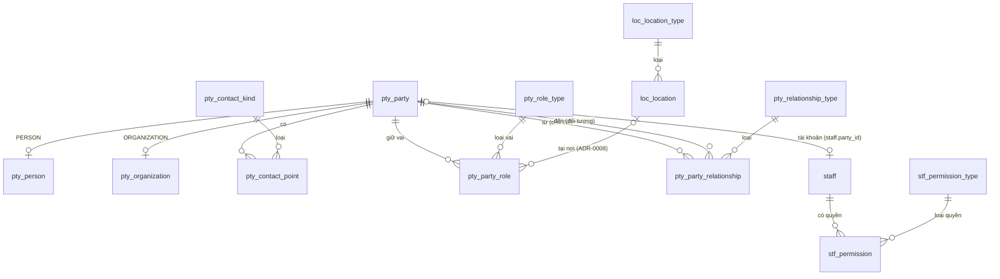

# Đặc tả mô hình dữ liệu N1 — Nền danh tính (hồ sơ, địa điểm, quyền app)

- **Ngày:** 2026-09-20   **Trạng thái:** bản nháp chờ chủ dự án duyệt (Điều 7.1: đặc tả và mô hình dữ liệu do tác nhân điều phối soạn, chủ dự án duyệt)
- **Nguồn ràng buộc (theo Điều 3.1, ADR thắng đặc tả):** `docs/adr/ADR-0001…0007` (accepted 2026-09-20), `ADR-0008` (**proposed**, chờ duyệt — bổ sung cạnh `parties → locations`), `docs/ARCHITECTURE.md`, Hiến pháp `playbook/CONSTITUTION.md`.
- **Bằng chứng kèm theo (Điều 8.2):** DDL tham chiếu `docs/superpowers/specs/2026-09-20-n1-schema-reference.sql` và bộ kiểm `docs/superpowers/specs/2026-09-20-n1-schema-verify.py` — đã chạy trên schema thật (migrations `0001…0008`) với dữ liệu mẫu, **tất cả đạt** (`python3 docs/superpowers/specs/2026-09-20-n1-schema-verify.py`). Lộ trình hai pha ở §9 có bộ kiểm riêng `2026-09-20-n1-schema-verify-phased.py` (**21/21 đạt**): mã cũ còn chạy sau `0011`; backfill `0012` idempotent; schema hai pha **y hệt** schema tệp tham chiếu gộp. DDL tham chiếu là **nguồn chi tiết duy nhất** về kiểu, `CHECK`, chỉ mục, trigger (P6); đặc tả này chỉ nêu ngữ nghĩa, bất biến, nguồn dữ liệu và cách kiểm — không chép lại kiểu cột.

## 1. Phạm vi N1

**Làm:** (a) địa điểm (`locations`); (b) hồ sơ, liên hệ, vai trò theo nơi, quan hệ (`parties`); (c) quyền app đa trị và liên kết tài khoản–hồ sơ (`staff`); (d) view công bố, sổ dữ liệu máy đọc được, bài kiểm kiến trúc (ADR-0002); (e) API quản trị và trang quản trị tối thiểu; (f) thay đọc `staff.role`/`staff.full_name` bằng quyền và hồ sơ, giữ nguyên hành vi hiện có (`canModify`, tên người lập trên đơn/nhật ký).

**Không làm (đợt sau, đã có ADR):** người đặt/khách đi tour trên đơn và gộp hồ sơ (N2, ADR-0001 mục 7–8); phân công, gọi xác nhận, tiến độ (N2, ADR-0006); sổ thu tiền, hoá đơn, sửa sau xác nhận (N3, ADR-0004, ADR-0007); giá net HDV (N4); **gỡ** cột `staff.role` (ADR-0005: cột chết); giao diện thiết kế lại theo mockup (A2).

**Nhắc lại các quyết định của chủ dự án đã khoá N1** (2026-09-20): chỉ nhân sự công ty có tài khoản; khách và đại lý là hồ sơ; vai trò chỉ là nhãn khi gán nhưng lưu bằng khoá ngoại và không bao giờ chặn việc chọn người; một danh bạ chung; 8 địa điểm (2 văn phòng, Quầy vé 01–04, Bến tàu du lịch Nha Trang, Bến cảng Vinpearl); bốn quyền app (Bán hàng, Kế toán, Quản trị, Thực hiện), một tài khoản có thể có nhiều.

## 2. Đối chiếu với ADR (không mâu thuẫn; các điểm làm rõ)

| ADR | Yêu cầu | Chỗ đáp ứng |
|---|---|---|
| 0001 mục 1–3 | hồ sơ, vai trò thực thể, quan hệ | §3–§4; DDL `pty_*` |
| 0001 mục 4 | vai trò lưu bằng khoá ngoại, không chặn chọn người | `pty_party_role` + `pty_role_type`; **không** có luật nào dùng vai trò làm điều kiện cho phép (R-N1-12) |
| 0001 mục 5 | `staff.party_id`; số đăng nhập ≠ số liên hệ; migration không sao chép | DDL §3; R-N1-1, R-N1-13 |
| 0001 mục 8 | tra SĐT chuẩn hoá, chỉ mục không duy nhất, UI bắt buộc hiện trùng, gộp ở N2 | `pty_contact_lookup_ix`; `GET /api/parties/lookup`; gộp = N2 |
| 0002 | 5 quy tắc + 8 điều; sổ; view công bố; bài kiểm | §7, §9, §10 |
| 0003 | 3NF, bảng tra cứu khoá mã, cột WHO không FK, hiệu lực, không CASCADE, `updated_at` khoá lạc quan | toàn bộ DDL; R-N1-6…R-N1-9 |
| 0005 | quyền đa trị; **không dựng lại `staff`**; `party_id` + trigger; `role` chết | DDL §3; §9 |
| 0007 | bản đồ quyền → thao tác; nơi thi hành | §7.1 (`permissions.ts` một nguồn), §7.2 |
| 0008 (proposed) | cạnh `parties → locations` | `pty_party_role.location_id → loc_location.id`; đọc nhãn nơi qua `v_loc_location_label` |

**Chi tiết làm rõ, không đổi quyết định:** (1) `stf_permission` có thêm `id`, `valid_from_at`/`valid_to_at`, `updated_*` so với danh sách cột tối thiểu ở ADR-0005 mục 2 — vì ADR-0003 (điều 7, 8) cấm xoá cứng và đòi hiệu lực/kiểm toán trên mọi bảng nghiệp vụ; thu hồi quyền = đóng dòng. (2) `pty_person` được giữ (ADR-0002 liệt kê) với **họ / tên đệm / tên** (`given_name` là khoá sắp xếp kiểu Việt Nam), tên hiển thị `pty_party.display_name` do module `parties` duy trì (ghép từ ba phần) — TCA làm y hệt (`PARTY_NAME` dẫn xuất từ hồ sơ cá nhân). (3) Danh sách địa điểm có **8** dòng (không phải 9).

## 3. Danh mục thực thể (mẫu `01-CONTENT_MODEL` §1)

| Thực thể (bảng) | Module chủ | Mô tả một dòng | Số dòng dự kiến | Nguồn sự thật |
|---|---|---|---|---|
| `loc_location_type` | locations | loại địa điểm: Văn phòng, Quầy vé, Bến tàu, Bến cảng | 4 | migration (gieo) |
| `loc_location` | locations | một địa điểm phát sinh nghiệp vụ | 8 (thêm bởi Quản trị) | migration gieo + Quản trị |
| `pty_party` | parties | một bên có tên (cá nhân hoặc tổ chức) | hàng trăm→nghìn | nhân viên nhập; nhân sự backfill từ `staff` |
| `pty_person` | parties | phần riêng của cá nhân: họ, tên đệm, tên | = số PERSON | như trên |
| `pty_organization` | parties | phần riêng của tổ chức: tên pháp lý, MST, địa chỉ, email hoá đơn | ít (đại lý, công ty khách) | nhân viên nhập |
| `pty_contact_kind` | parties | loại liên hệ: PHONE, EMAIL | 2 | migration |
| `pty_contact_point` | parties | một liên hệ của hồ sơ, có hiệu lực từ–đến | 1–3 / hồ sơ | nhân viên nhập |
| `pty_role_type` | parties | loại vai trò: STAFF, SALES, ACCOUNTANT, GUIDE, BOAT_CAPTAIN, DRIVER, AGENT, CUSTOMER | 8 | migration + Quản trị |
| `pty_party_role` | parties | hồ sơ X giữ vai Y (tại nơi Z) trong khoảng ngày | ~1–3 / nhân sự | Quản trị |
| `pty_relationship_type` | parties | loại quan hệ: CONTACT_OF | 1 | migration |
| `pty_party_relationship` | parties | quan hệ giữa hai hồ sơ (vd người liên hệ của đại lý) | ít | Quản trị |
| `stf_permission_type` | staff | quyền app: SALES, ACCOUNTING, ADMIN, FIELD | 4 | migration |
| `stf_permission` | staff | tài khoản X có quyền Y trong khoảng thời gian | ~1–2 / tài khoản | Quản trị |
| `staff` (cũ, +`party_id`) | staff | tài khoản đăng nhập | hàng chục | Quản trị / import Sheet |
| `v_loc_location_label`, `v_pty_party_label`, `v_stf_staff_label` | locations / parties / staff | view công bố chỉ-đọc: khoá + nhãn + cờ (ADR-0002 điều 3) | — | dẫn xuất |

Vai trò gieo là **danh mục ban đầu**; thêm loại vai trò/quyền/địa điểm = thêm dòng (ADR-0003 điều 3). `CUSTOMER` được gieo theo danh sách của chủ dự án (khách hàng) nhưng **không bắt buộc**: mọi khách xuất hiện qua đơn (N2), không cần gắn vai.

## 4. Quan hệ (mẫu `01` §3, `05` §3)


Chiều phụ thuộc module (ADR-0002 + 0008): `parties → locations`; `staff → parties`; `locations`, `audit`, `shared` ở đáy. Mọi khoá ngoại xuyên module trỏ khoá chính, `NO ACTION`, không `CASCADE`. Các khoá ngoại có sẵn của `audit_log`/`catalog_override`/`company_profile` tới `staff` là ngoại lệ đã tuyên bố (ADR-0002 điều 6).

## 5. Ngữ nghĩa và nguồn cung cấp dữ liệu (mẫu `01` §2 — chỉ điều DDL không nói)

- **`pty_party.display_name`:** PERSON → **ghép** `family_name + middle_name + given_name` bỏ phần rỗng (hàm thuần `composePersonName`, dùng ở mọi đường ghi); ORGANIZATION → tên gọi ngắn do người nhập. Không sửa `display_name` của PERSON trực tiếp — sửa ba phần rồi ghép. Bất biến R-N1-3.
- **Tách tên khi nhập một chuỗi** (import Sheet, ô "Họ và tên"): hàm thuần `splitPersonName` — *tên* = từ cuối, *họ* = từ đầu (nếu ≥ 2 từ), *tên đệm* = phần giữa; người dùng sửa lại được. Backfill trong migration dùng đúng quy tắc này (đã kiểm với "Nguyễn Tuyên Phong", "Trần Văn Bình", "Hương").
- **`pty_contact_point`:** `value` là chuỗi người nhập, `value_normalized` do hàm chuẩn hoá (SĐT: chỉ chữ số, đầu số VN chuẩn hoá — dùng lại logic của `src/modules/staff/phone.ts`, **chuyển sang `src/shared/phone.ts`** vì `parties` là đáy và không được import `staff`). Một hồ sơ có tối đa **một** liên hệ chính đang mở mỗi loại (chỉ mục duy nhất có điều kiện); số dùng chung giữa hồ sơ là hợp lệ (chỉ mục tra cứu không duy nhất — ADR-0001 mục 8).
- **Số đăng nhập ≠ số liên hệ (ADR-0001 mục 5):** `staff.phone` không bao giờ được sao chép sang `pty_contact_point` bởi migration hay mã; không hiển thị `staff.phone` như liên hệ của hồ sơ. Nhân sự có số liên hệ riêng khi người dùng tạo dòng liên hệ độc lập.
- **`pty_party_role`:** ngày dân sự giờ Việt Nam; "hôm nay" = `vnToday(new Date())` (không `date('now')` UTC); `valid_to_date` NULL = còn hiệu lực. Vai trò **STAFF** được backfill cho mọi nhân sự (không gắn nơi); các vai khác (HDV @ Vinpearl…) do Quản trị thêm.
- **`pty_organization.tax_code`:** MST 10–14 ký tự; **bản chụp** thông tin hoá đơn tại thời điểm xuất thuộc `billing` (N3); đây chỉ là hồ sơ để dùng lại.
- **`stf_permission`:** trạng thái hiện tại = các dòng `valid_to_at IS NULL`. Thu hồi = đặt `valid_to_at`; cấp lại = dòng mới. Quản trị cuối cùng không thu hồi/vô hiệu hoá được (R-N1-5).
- **Cột chết (ADR-0005), nợ có chủ đích, ghi vào sổ dữ liệu:** *đích cuối* của N1 là **không đường mã nào đọc** hai cột `staff.role` và `staff.full_name`; hiện trạng thì **đang đọc** (kê ở §7.4) nên việc chuyển là phạm vi thi công của N1, không phải điều đã đúng sẵn.
  - `staff.role` — như ADR-0005 điều 3.4: tài khoản mới ghi hằng `'sales'` (cột `NOT NULL` không mặc định, `CHECK` hai giá trị).
  - `staff.full_name` — cột `NOT NULL` không `CHECK` (`migrations/0001_staff.sql`). Tài khoản mới ghi **hằng `''`**, **không** sao chép tên hồ sơ: một bản sao sẽ lệch ngay khi ai đó đổi tên qua `PUT /api/parties/:id` (module `parties` không biết `staff`), và bản sao lệch còn tệ hơn không có. Các dòng cũ giữ giá trị lịch sử đóng băng lúc di trú, không cập nhật. Tên duy nhất = `pty_party.display_name`, đọc qua `v_stf_staff_label`.
  - **Điều chỉnh so với ADR-0005:** ADR chỉ nêu riêng `role`; `full_name` là nợ cùng loại (cột không gỡ được nếu không dựng lại `staff`). Ghi vào sổ dữ liệu (`deprecated`) và danh sách nợ; **chủ dự án xác nhận khi duyệt đặc tả này** (Điều 3.1: đặc tả không được lặng lẽ mở rộng ADR).
  - Bài kiểm kiến trúc cấm mọi SQL đọc hai cột; câu **ghi** được phép chỉ là đúng một `INSERT INTO staff` ở `staff/index.ts` (hằng `'sales'`, `''`), migration và test. Điều kiện gỡ: lần đầu phải dựng lại `staff` (ADR-0003 điều 10).
- **Nhật ký không ghi giá trị dữ liệu cá nhân** (SĐT, email, MST): hành động mới ghi "đổi số liên hệ", "thêm liên hệ" (như quy tắc `trip_updated` của A1). Hành động mới trong `src/shared/audit-actions.ts` (nguồn duy nhất): `party_created`, `party_updated`, `party_contact_changed`, `party_role_added`, `party_role_ended`, `party_relationship_changed`, `location_created`, `location_updated`, `permission_changed`.

## 6. Bất biến và cách kiểm bằng máy (mẫu `04-CONSTRAINTS` §1)

Mỗi bất biến có (a) lớp chặn ở CSDL nếu làm được, (b) kiểm bằng máy. "Kiểm" trỏ tới bài kiểm sẽ có trong N1 (test hoặc `scripts/audit-invariants.mjs`, kiểm toán định kỳ — Điều 8.3); các dòng đã chạy trong `n1-schema-verify.py` ghi ✔.

| Mã | Bất biến | Chặn ở CSDL | Kiểm bằng máy |
|---|---|---|---|
| R-N1-1 | mọi `staff` có `party_id`; một hồ sơ tối đa một tài khoản | trigger `staff_party_required_ins/upd`; chỉ mục `staff_party_uq`; FK | ✔ verify; migration test |
| R-N1-2 | mỗi `pty_party` PERSON có đúng một `pty_person` và không có `pty_organization`; ORGANIZATION ngược lại | đường ghi duy nhất của module (một `db.batch()`); (SQLite không có ràng buộc phân loại) | `audit-invariants`: hai truy vấn đếm lệch = 0 |
| R-N1-3 | `display_name` PERSON = ghép họ + đệm + tên | — (mã) | ✔ verify (mọi PERSON); `audit-invariants` |
| R-N1-4 | vai trò/quan hệ: ≤ 1 dòng mở cho mỗi khoá nghiệp vụ; không chồng lấn khoảng đóng | chỉ mục duy nhất có điều kiện + trigger `*_no_overlap_ins/upd` (có `COALESCE`) | ✔ verify (8 ca gồm biên NULL nơi, khoảng mở) |
| R-N1-5 | luôn còn ≥ 1 tài khoản hoạt động có quyền ADMIN | trigger `stf_permission_keep_admin_upd`, `staff_keep_admin_upd` + câu UPDATE có điều kiện ở mã | ✔ verify; e2e `admin`, `admin-race` |
| R-N1-6 | tập giá trị mở là bảng tra cứu khoá mã; **không** `CHECK` liệt kê (chỉ `party_kind`, cờ 0/1) | FK tới `*_type`/`*_kind` | ✔ verify (quét DDL); `architecture.test` |
| R-N1-7 | bảng nghiệp vụ mới có đủ `created_at/by`, `updated_at/by`; cột WHO `TEXT NULL` **không** FK; không `ON DELETE CASCADE` | — | ✔ verify (`PRAGMA table_info`, `foreign_key_list`); `architecture.test` |
| R-N1-8 | ngày dân sự đúng lịch, `valid_to ≥ valid_from` | `CHECK (date(x) = x …)` | ✔ verify (30/02, đảo ngày) |
| R-N1-9 | không xoá cứng bản ghi nghiệp vụ mới: kết thúc hiệu lực hoặc `active = 0` | — (mã không có `DELETE` trên bảng mới) | `architecture.test` quét SQL của module mới: cấm `DELETE FROM pty_/loc_/stf_` |
| R-N1-10 | `PRAGMA foreign_key_check` = 0 dòng | FK | ✔ verify; chạy sau mỗi migration |
| R-N1-11 | mọi bảng/view có trong `docs/data-dictionary.json`, đúng module chủ; cột của view = danh sách trong sổ; không `INSTEAD OF` | — | `architecture.test` (ADR-0002 điều 8 a,c,d + quét migration) |
| R-N1-12 | vai trò hồ sơ **không** là điều kiện cho phép: không câu SQL/luật quyền nào dùng `pty_party_role` để cho/chặn thao tác | — | `architecture.test`: `permissions.ts` và route không import/truy vấn `pty_party_role` để quyết định quyền |
| R-N1-13 | `staff.phone` không xuất hiện trong `pty_contact_point` do migration/mã tạo | — | ✔ verify (0 dòng sau backfill); `audit-invariants`: không có liên hệ `created_by IS NULL` khớp `staff.phone` |
| R-N1-14 | không SQL nào **đọc** `staff.role`/`staff.full_name`; câu ghi duy nhất được phép là `INSERT INTO staff` ở `staff/index.ts` (hằng `'sales'`, `''`), migration, test | — | `architecture.test`: quét mã nguồn, cấm hai tên cột ngoài danh sách cho phép ghi rõ file:dòng |
| R-N1-15 | tài khoản chỉ có quyền `FIELD` **không** gọi được route `parties`/`orders` (chỉ "việc của tôi" ở N2) | — | test quyền từng ô của `permissions.ts` + e2e |

## 7. Module, mã và API

### 7.1 Cấu trúc mã (ADR-0002)
- **`src/modules/locations/`** (mới): `rules.ts` (validate mã/tên/loại), `repository.ts`, `index.ts` (routes + API công khai + view). Đáy đồ thị.
- **`src/modules/parties/`** (mới): `rules.ts` (thuần: `composePersonName`, `splitPersonName`, `validateContact`, `validateRolePeriod`, `validateRelationship`), `repository.ts`, `index.ts`. API công khai cho module khác **chỉ qua `index.ts`**: `newPersonStatements(db, input, actor)` và `newOrganizationStatements(...)` trả **câu lệnh D1 chưa chạy** + `partyId` (quy tắc 3: `staff` gộp vào batch tạo tài khoản); `findPartiesByPhone(db, phone)`.
- **`src/modules/staff/`** (sửa, **năng lực nền, không có route** — ADR-0002): sở hữu `staff` + `stf_*`. API công khai qua `index.ts`, đều trả **câu lệnh D1 chưa chạy** (quy tắc 3): `createAccountStatements` (gọi nội bộ `parties.newPersonStatements` — cạnh `staff → parties` đã có — rồi thêm `INSERT staff` với `party_id`, hằng `role`/`full_name`, và `stf_permission`), `renameStatements` (đổi tên = câu của `parties`; **không** ghi `staff.full_name`), `setPermissionStatements`, `hasPermission`; `authenticate`/`getActiveStaff`/`toProfile` trả `permissions` đọc từ `stf_permission` (`valid_to_at IS NULL`). `listStaffAccounts` đọc tên và quyền qua `v_pty_party_label` + `stf_permission`.
- **`src/modules/accounts/`** (sửa, **nơi có route** `/api/staff*`, `/api/account/*`; phụ thuộc **chỉ** `staff`, `auth`, `audit` — ADR-0002 dòng 33, không thêm cạnh sang `parties`): `POST /api/staff` nhận `{ fullName, phone, permissions[] }` (thay `role`); `PUT /api/staff/:id` bỏ `role`; thêm `PUT /api/staff/:id/permissions`; import Sheet (`sheet.ts`, `POST /api/staff/sheet/apply`) tạo hồ sơ + tài khoản qua `createAccountStatements`. Ghi nhật ký `permission_changed` (§5); `staff_role_changed` **giữ trong `AUDIT_ACTIONS` chỉ để hiện các dòng lịch sử cũ**, mã mới không ghi nữa.
- **`src/shared/phone.ts`** (chuyển từ `staff/phone.ts`; `staff` import lại); **`src/shared/permissions.ts`** (mới, thuần, **một nguồn**): ma trận ADR-0007 dạng dữ liệu (thao tác × quyền × phạm vi `own|any`) + `can(profile, action, ctx)`; test phủ **từng ô** (ADR-0007 điều 3). N1 hiện thực đầy đủ ma trận và dùng cho các thao tác **đang tồn tại** (`canModify` của `orders`, route quản trị); thao tác của N2/N3 có mặt trong ma trận, chưa có route.
- **Hợp đồng (`src/shared/contracts.ts`):** `StaffProfile.role` (contracts.ts:11) → `permissions: PermissionCode[]` + `partyId`; `StaffAccount extends StaffProfile` (contracts.ts:19) theo; thêm `PartyDto`, `PartyListItemDto`, `ContactPointDto`, `PartyRoleDto`, `PartyRelationshipDto`, `LocationDto`, `PermissionCode`. **Không** giữ `role` "dẫn xuất" cho tương thích — đó là đường đọc thứ hai (N7); client và server triển khai cùng lúc.
- **`src/shared/router.ts:107`** tự đọc `staff.role !== "admin"` để chặn route `admin`: đổi thành `hasPermission(staff, "ADMIN")` (hàm thuần trong `shared/permissions.ts`, `shared/` không import module — quy tắc 5). Khai báo route `auth: "public" | "staff" | "admin"` giữ nguyên.
- **Hành vi giữ nguyên (không đổi kết quả với dữ liệu hiện có):** `canModify` (người lập đơn hoặc ADMIN — ADMIN ≙ trước đây `admin`); bất biến admin cuối cùng; tên người lập trên đơn/nhật ký. Nơi đọc tên chuyển sang view: `orders/repository.ts` `ORDER_SELECT` và `audit/repository.ts` (ba `JOIN staff`, tìm theo tên) dùng `v_stf_staff_label`; `audit` LEFT JOIN `orders` chuyển sang `v_ord_order_label(id, order_code)` do `orders` công bố. `wonGuard` → `audit.wonGuardSql()` có thể **ở lại danh sách ngoại lệ có hạn** của ADR-0002 điều 8(b) (hạn: trước khi bắt đầu N2).

### 7.2 Route (đều `application/json`, lỗi tiếng Việt đầy đủ dấu, mã lỗi tiếng Anh; ghi tối đa một dòng nhật ký/hành động, không ghi dữ liệu cá nhân)
| Route | Quyền (ADR-0007) | Việc |
|---|---|---|
| `GET /api/parties?q=&kind=&role=&location=&limit=` | SALES · ACCOUNTING · ADMIN | tìm hồ sơ theo tên (`LIKE … ESCAPE`) hoặc SĐT chuẩn hoá; trả `PartyListItemDto` |
| `GET /api/parties/lookup?phone=` | như trên | hồ sơ trùng số để người dùng chọn "dùng có sẵn" hay "tạo mới" (ADR-0001 mục 8) |
| `GET /api/parties/:id` | như trên (`accountId` chỉ ADMIN) | hồ sơ + liên hệ + vai trò + quan hệ |
| `POST /api/parties` · `PUT /api/parties/:id` | như trên | tạo/sửa cá nhân hoặc tổ chức; `PUT` **bắt buộc `expectedUpdatedAt`** (409 `stale`, như A1) |
| `POST /api/parties/:id/contacts` · `POST …/contacts/:cid/end` | như trên | thêm liên hệ; kết thúc hiệu lực (không xoá) |
| `POST /api/parties/:id/roles` · `POST …/roles/:rid/end` | ADMIN | thêm/kết thúc vai trò theo nơi |
| `POST /api/parties/:id/relationships` · `POST …/relationships/:rid/end` | ADMIN | thêm/kết thúc quan hệ (**[GIẢ ĐỊNH]**: ADR-0007 không nêu riêng; xếp cùng vai trò hồ sơ) |
| `GET /api/locations` | mọi tài khoản đăng nhập (nhãn không nhạy cảm) | danh sách địa điểm |
| `POST /api/locations` · `PUT /api/locations/:id` | ADMIN | thêm/sửa/ngừng dùng (`active = 0`) |
| `GET /api/staff` (mở rộng) · `PUT /api/staff/:id/permissions` (route thuộc `accounts`) | ADMIN | quyền hiện có; đặt tập quyền (đóng/mở dòng trong một `db.batch()` kèm nhật ký), chặn thu hồi ADMIN cuối |

Máy chủ **từ chối theo mặc định**: tài khoản chỉ có `FIELD` nhận 403 ở mọi route `parties`/`orders` (R-N1-15).

### 7.3 Ánh xạ màn hình ↔ dữ liệu (P2/N1 — chốt trước mọi thiết kế giao diện)
| Màn hình (N1, tối thiểu) | Dữ liệu nuôi nó |
|---|---|
| **Hồ sơ** — danh sách + ô tìm | `v_pty_party_label` + liên hệ chính (`pty_contact_point` mở, `is_primary`) + mã vai trò mở |
| **Hồ sơ** — chi tiết/sửa | `pty_party` + `pty_person`/`pty_organization` + `pty_contact_point` + `pty_party_role` (⋈ `v_loc_location_label`) + `pty_party_relationship` |
| **Địa điểm** — danh sách/sửa (Quản trị) | `loc_location` + `loc_location_type` |
| **Nhân sự** (trang `/staff` hiện có) — cột "Quyền" thay "Vai trò" | `staff` + `v_stf_staff_label` + `stf_permission` mở |
Giao diện N1 dùng phong cách hiện có (công cụ quản trị, không mockup mới); thiết kế lại theo token khi A2 nền thị giác xong. Không màn hình nào tự sinh dữ liệu ngoài bảng trên (N1).

### 7.4 Điểm chạm hiện có phải chuyển (kiểm kê 2026-09-20 bằng `grep`; kế hoạch phải phủ hết, `architecture.test` giữ cho không quay lại)
| Đọc | Vị trí | Chuyển thành |
|---|---|---|
| `staff.role` | `src/shared/router.ts:107` | `hasPermission(staff, "ADMIN")` |
| `staff.role` | `src/modules/orders/rules.ts:121` (`canModify`) + `rules.test.ts:145-147` | `can(...)` từ `shared/permissions.ts`; kết quả với dữ liệu cũ không đổi |
| `staff.role` | `src/modules/staff/rules.ts:37-40`, `rules.test.ts` (`checkAccountChange`) | luật "admin cuối / không tự ngưng" tính trên tập quyền |
| `staff.role` | `src/modules/staff/index.ts:15-31,60-61,77-79,100-101` (`authenticate`, `getActiveStaff`, `newStaffStatement`, `updateStaffStatement`, `toProfile`) | §7.1 |
| `staff.role` | `src/modules/accounts/index.ts:78,129,164-185` (`isRole`, tạo, import Sheet, đổi vai) | §7.1 |
| `staff.role` | `web/shell.ts:15`, `web/audit.ts:69`, `web/catalog.ts:177`, `web/staff.ts:11,64,97-105,114,134-139,196` | `permissions.includes("ADMIN")` qua một hàm dùng chung; trang Nhân sự: ô chọn vai → bốn ô tick quyền |
| `staff.full_name` | `src/modules/staff/repository.ts:23` (`SELECT * … ORDER BY full_name`) | đọc qua `v_stf_staff_label`, sắp xếp theo `pty_person.given_name` |
| `staff.full_name` | `src/modules/orders/repository.ts:62` (`ORDER_SELECT`), `:189` (tìm theo tên) | `v_stf_staff_label.label` |
| `staff.full_name` | `src/modules/audit/repository.ts:46,69,76,77` (ba `JOIN staff`, hai `LIKE`) | `v_stf_staff_label` (nối đa hình theo `target_id` giữ ở danh sách ngoại lệ có hạn) |
| ghi `role`/`full_name` | `scripts/staff-lib.mjs` (`insertStaffSql`; `staff/password.test.ts:15`), `scripts/create-staff.mjs`, `scripts/import-staff.mjs`, `tests/e2e/lib.mjs`, `orders/migration.test.ts:22` | tạo kèm hồ sơ + quyền (trigger `staff_party_required_*` chặn nếu quên) |

## 8. Truy vấn của đợt N1 (điều kiện chấp nhận ADR-0001, Điều 6.2)

Đều đã chạy đúng trong `n1-schema-verify.py`; `:today` = `vnToday(new Date())`.
1. **Ai giữ vai HDV ở Bến cảng Vinpearl hôm nay (ai được ghi nhận):**
   `SELECT pl.display_name FROM pty_party_role pr JOIN pty_role_type rt ON rt.code = pr.role_type_code JOIN v_loc_location_label l ON l.id = pr.location_id JOIN v_pty_party_label pl ON pl.id = pr.party_id WHERE rt.code = 'GUIDE' AND l.code = 'CANG_VINPEARL' AND pr.valid_from_date <= :today AND (pr.valid_to_date IS NULL OR pr.valid_to_date >= :today);`
   (Khác câu "ai trực hôm nay" của ADR-0006 — hai nguồn, hai nghĩa.)
2. **Hồ sơ trùng số điện thoại:** `SELECT DISTINCT party_id FROM pty_contact_point WHERE contact_kind_code = 'PHONE' AND value_normalized = :n AND valid_to_date IS NULL;`
3. **Người liên hệ của một đại lý:** `SELECT r.from_party_id FROM pty_party_relationship r WHERE r.to_party_id = :agent AND r.relationship_type_code = 'CONTACT_OF' AND r.valid_to_date IS NULL;`
4. **Quyền hiện có của tài khoản:** `SELECT permission_type_code FROM stf_permission WHERE staff_id = :s AND valid_to_at IS NULL;`
5. **Danh sách nhân sự theo tên (sắp xếp kiểu Việt Nam):** `… JOIN pty_person pe ON pe.party_id = s.party_id ORDER BY pe.given_name COLLATE NOCASE, pe.family_name`.
Không truy vấn nào cần phân tích chữ hay lặp phía ứng dụng.

## 9. Di trú, cổng và triển khai (mẫu `05` §4)

**Bốn migration đánh số (chỉ thêm, sau `0008` của A1), theo expand–contract (ADR-0003 điều 10):**
- **Mở rộng** — `0009_locations.sql` (bảng `loc_*` + gieo 8 địa điểm + view) → `0010_parties.sql` (bảng `pty_*` + gieo tra cứu + trigger chồng lấn + view) → `0011_staff_permissions_party.sql` (bảng `stf_*` + **backfill** hồ sơ/tên/vai STAFF/quyền + `ALTER TABLE staff ADD COLUMN party_id` + chỉ mục `staff_party_uq` + view `v_stf_staff_label`). Ba tệp này **chỉ thêm**: mã cũ (`INSERT INTO staff` không có `party_id`, đọc `role`/`full_name`) vẫn chạy nguyên vẹn trên schema mới.
- **Siết** — `0012_staff_party_required.sql`, **áp sau khi Worker mới đã chạy**: (1) lặp lại backfill **chỉ cho** `staff.party_id IS NULL` (tài khoản do mã cũ tạo trong khoảng giữa hai lần triển khai; cũng cấp quyền `stf_permission` từ `role` cho các dòng chưa có); (2) tạo `staff_party_required_ins/upd`, `stf_permission_keep_admin_upd`, `staff_keep_admin_upd` (ba nhóm trigger dựa vào mã mới). Vì vậy `0011` **không** chứa các trigger đó — khác thứ tự trong tệp tham chiếu (`n1-schema-reference.sql` gộp một tệp để kiểm; bộ kiểm schema của N1 chạy trên `migrations/*.sql` thật).
- Thứ tự trong `0011` như DDL tham chiếu §4 (tạo hồ sơ **trước** khi gán `party_id`). **Không dựng lại `staff`** (ADR-0005). `id` dòng gieo sinh **một lần** và cố định trong tệp migration (uuid) để local và remote giống nhau; id hồ sơ backfill là `'pty-' || staff.id` (xác định, dò ngược được).
- **Thứ tự triển khai remote:** áp `0008` (nếu chưa) → `0009…0011` → deploy Worker → kiểm `SELECT count(*) FROM staff WHERE party_id IS NULL` → áp `0012`. Không có `down`; hoàn tác = D1 Time Travel. Đã kiểm bằng `n1-schema-verify-phased.py` (§ đầu tài liệu).

**Cổng (mỗi cổng = artifact máy đọc được, mặc định từ chối — Điều 8.5):**
1. `npm test` xanh, `npx tsc --noEmit` và `npx tsc --noEmit -p web` sạch (**0 lỗi**, gồm 4 lỗi `web/` mà A1 để lại nếu A2 chưa xong — xác định ở kế hoạch), bộ kiểm schema (bản chuyển thể của `n1-schema-verify.py` thành test Node dựng schema từ `migrations/*.sql`) xanh.
2. `wrangler d1 migrations apply --local` chạy sạch trên D1 local đã có dữ liệu thử; sau `0011` + mã mới, `SELECT count(*) FROM staff WHERE party_id IS NULL` = 0; sau `0012` trigger chặn chèn thiếu `party_id` (đã kiểm ở bộ schema); `PRAGMA foreign_key_check` = 0 dòng; e2e `platform orders trip admin catalog admin-race` xanh.
3. **Cổng remote (ADR-0001, chủ dự án chạy — Claude không có quyền wrangler remote):** dán kết quả `npx wrangler d1 migrations list tourdao-sales-db --remote` và `SELECT count(*) AS orders FROM orders`. Nếu đã có đơn thật: bước backfill thêm phần chuyển dữ liệu khách (thuộc N2, không thuộc N1) — **N1 không đụng `orders`**, nên kết quả không chặn N1; nhưng thứ tự áp migration remote phải theo danh sách thực tế (`0008` chưa áp thì áp trước).
4. Ghi điểm khôi phục D1 Time Travel trước khi áp remote; migration một chiều, không có `down`.
5. Sau khi áp: chạy lại `scripts/audit-invariants.mjs` trên bản remote (chỉ-đọc) — mọi bất biến ở §6 = 0 vi phạm.

**Sửa các đường tạo tài khoản khác:** `scripts/create-staff.mjs`, `scripts/staff-lib.mjs`, `scripts/import-staff.mjs`, fixture e2e (`tests/e2e/lib.mjs`) phải tạo hồ sơ + quyền (trigger sẽ chặn nếu quên — đó là lưới cuối).

## 10. Kiểm thử và nghiệm thu (Điều 6.2 — ngưỡng là con số kiểm được)

| Loại | Nội dung | Ngưỡng |
|---|---|---|
| Đơn vị (`npm test`) | `composePersonName`/`splitPersonName` (họ tên 1, 2, 3, 4+ từ, dấu, khoảng trắng thừa); chuẩn hoá SĐT dùng chung; `validateRolePeriod`; ma trận `permissions.ts` **từng ô** | 100% ô ma trận có test; mọi test cũ vẫn xanh |
| Schema (Node, SQLite thật) | chuyển thể `n1-schema-verify.py` (~60 kiểm tra) + `foreign_key_check` | 0 thất bại |
| Kiến trúc (`architecture.test.ts`) | ADR-0002 điều 8 (a),(c),(d), quét migration (`INSTEAD OF`, `CASCADE`, cột kiểm toán), R-N1-9/12/14 | 0 vi phạm ngoài **danh sách ngoại lệ có hạn** (ghi rõ điểm chạm + hạn) |
| e2e (D1 tạm) | tạo/sửa hồ sơ (cá nhân, tổ chức), tra trùng SĐT, thêm/kết thúc vai trò, khoá lạc quan `stale`, quyền từng loại tài khoản (FIELD bị chặn), quản trị cuối cùng, đua hai request đổi quyền (`admin-race` mở rộng) | tất cả kịch bản xanh; kịch bản mới ≥ 8 |
| Kiểm toán bất biến (`scripts/audit-invariants.mjs`) | các truy vấn R-N1-2/3/13… trên D1 local (và remote chỉ-đọc khi được phép) | 0 vi phạm |

## 11. Nợ, rủi ro, điểm mở

- **ADR-0008 chờ duyệt.** Đặc tả này dùng cạnh `parties → locations`; nếu ADR-0008 bị bác, `pty_party_role.location_id` phải bỏ (mất "HDV @ Vinpearl").
- **Nợ:** `staff.role` (hằng `'sales'`), `staff.full_name` (hằng `''`) — cột chết có điều kiện gỡ ở ADR-0005; ngoại lệ có hạn của bài kiểm 8(b) cho `orders`/`audit` (`wonGuard`), hạn trước N2.
- **Rủi ro:** (1) tách họ/tên đệm/tên bằng quy tắc "từ đầu/từ cuối" sai với tên nước ngoài hoặc họ kép — người dùng sửa được, không chặn nhập; (2) `LIKE` tìm theo tên trên vài nghìn hồ sơ đủ nhanh nhưng đo lại nếu vượt ~10.000; (3) D1 giới hạn số truy vấn mỗi lần gọi Worker: đọc tra cứu bằng `JOIN`, danh sách hồ sơ trả một truy vấn (không N+1).
- **Điểm mở cần chủ dự án:** (a) quan hệ hồ sơ chỉ Quản trị quản lý (đề xuất, ADR-0007 không nêu); (b) duyệt ADR-0008; (c) bản đồ kế hoạch nhánh: N1 làm trên nhánh nào (nhánh A1 hay nhánh tích hợp với PWA/A2 — quyết ở kế hoạch).

## 12. Sổ dữ liệu (mẫu, `docs/data-dictionary.json` — ADR-0002 điều 1)

```json
{ "version": 1,
  "tables": [
    { "name": "pty_party", "module": "parties", "kind": "table", "pk": ["id"],
      "fk": [], "invariants": ["R-N1-2", "R-N1-3"], "deprecated": [] },
    { "name": "staff", "module": "staff", "kind": "table", "pk": ["id"],
      "fk": [{"col": "party_id", "ref": "pty_party.id"}], "deprecated": ["role", "full_name"],
      "invariants": ["R-N1-1", "R-N1-14"] },
    { "name": "audit_log", "module": "audit", "kind": "table", "pk": ["id"],
      "fk": [{"col": "staff_id", "ref": "staff.id", "exception": "integrity-edge"}], "invariants": [] } ],
  "views": [
    { "name": "v_stf_staff_label", "module": "staff", "columns": ["id", "label", "active", "party_id"] } ] }
```
Nguồn sự thật: tệp JSON; `docs/DATA-DICTIONARY.md` được **sinh** từ đó. Việc đầu tiên của N1 là dựng sổ cho **10 bảng hiện có** rồi bài kiểm xanh (điều kiện chấp nhận ADR-0002).

## 13. Trình tự thi công đề nghị (cho kế hoạch)
T0 nhánh + nền xanh → T1 sổ dữ liệu 10 bảng + `architecture.test.ts` (a,c,d + quét migration; danh sách ngoại lệ) → T2 mã dùng chung (`shared/phone.ts`, `shared/permissions.ts` + test từng ô, hợp đồng, hành động nhật ký) → T3 migration `0009` + test → T4 migration `0010` + test → T5 migration `0011` (mở rộng) + test → T6 module `locations` (+ e2e) → T7 module `parties` (+ e2e) → T8 `staff` + `accounts` (`createAccountStatements`, quyền, import Sheet, `authenticate`/`toProfile`, `router.ts:107`, script/fixture tạo tài khoản — §7.4) → T9 chuyển `canModify` và JOIN tên sang view (`orders`, `audit`) → T10 trang quản trị tối thiểu + `web/` đổi `role` → `permissions` → T11 migration `0012` (siết) + test + `scripts/audit-invariants.mjs` → T12 cập nhật `ARCHITECTURE.md` (đồ thị + ADR-0008 + danh sách module), `SPEC` §2, `HANDOFF` → T13 rà soát toàn nhánh + cổng §9. Mỗi task một artifact và một bằng chứng máy (P12, Điều 8.2). Trong T5–T10 mọi test dựng schema từ `migrations/0001…0011` (chưa có trigger siết) nên xanh liên tục; T11 là bước duy nhất làm đỏ mã chưa cập nhật — đó là lưới cuối.
